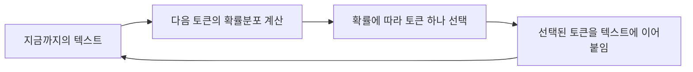
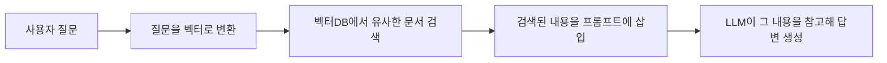
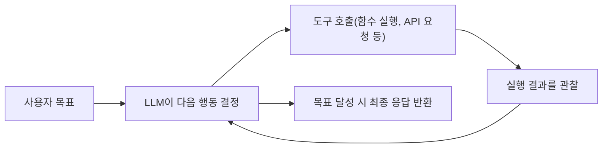

이 블로그의 LLM 시리즈([[LLM 애플리케이션 모의해킹 14개 취약점 진단]], [[OWASP Top 10 for LLM 2025 심화 해설]], [[PortSwigger Web LLM Attacks 랩 실습 — 과도한 권한부터 인다이렉트 인젝션까지]] 등)는 "프롬프트 인젝션이 왜 위험한지", "RAG 오염이 어떻게 터지는지"를 다루지만, 그 전에 LLM·에이전트·RAG가 애초에 어떤 구조로 동작하는지는 전제로 깔고 넘어갑니다. 이 글은 그 전제를 채우는 입문 글입니다. 공격 기법은 거의 다루지 않고, 각 개념이 **왜 그렇게 생겼는지**와 **그 구조가 보안에 어떤 자국을 남기는지**만 짚습니다. 이해가 최우선이라, 다이어그램을 적극적으로 썼습니다.

---

## 1. LLM이란 무엇인가

LLM(Large Language Model)이 학습·생성에서 쓰는 핵심 메커니즘을 한 문장으로 줄이면 "지금까지 나온 텍스트를 보고, 다음에 올 토큰(단어 조각)의 확률분포를 계산해서 하나를 골라 이어붙이는 것"입니다. 이 과정을 반복해서 문장 전체를 만들어냅니다. "이해"가 전혀 없다고 단정할 수는 없지만(내부적으로 상당히 복잡한 패턴·추론 표현을 학습합니다), 겉으로 드러나는 생성 방식만 보면 학습된 패턴에서 다음 조각을 뽑아내는 통계적 과정이라는 점은 변하지 않습니다.

이 과정은 두 단계를 거쳐 지금의 챗봇 형태가 됩니다.

- **사전학습(pretraining)**: 인터넷 수준의 방대한 텍스트로 "다음 토큰 맞히기"만 반복 학습합니다. 이 단계만 거친 모델도 질문에 그럴듯하게 답할 수는 있지만, 지시를 안정적으로 따르거나 대화 형태를 유지하는 성향은 약합니다. 질문을 답하기보다 또 다른 질문으로 이어붙이려는 경향이 자주 나타납니다.
- **지시 튜닝(instruction tuning)과 선호 학습(RLHF, DPO 등)**: "질문 → 답변" 형태의 예시로 모델을 다시 학습시키고, 사람(또는 다른 모델)의 선호 평가를 반영해 한 번 더 조정합니다. RLHF가 대표적으로 알려졌지만 DPO 같은 대안 기법도 널리 쓰이며, 목적은 공통적으로 사용자가 원하는 방식(지시를 따르고, 대화형으로 답하고, 유해한 응답을 피하는)으로 행동을 맞추는 것입니다. 사전학습이 "언어·지식 능력"의 바탕을 만들고, 이 단계가 "챗봇다운 태도"를 입힌다고 보면 됩니다.

여기서 **환각(hallucination)**이 왜 구조적으로 생기기 쉬운지가 설명됩니다. 모델에는 "이 문장이 사실인지 검증하는 모듈"이 따로 없습니다. 다음 토큰을 통계적 그럴듯함으로 생성하는 구조이다 보니, 확신 없는 질문에도 "모른다"고 답하기보다 자연스러운 문장을 추측해서 내놓는 쪽으로 편향되기 쉽고, 그 결과 존재하지 않는 논문 제목이나 틀린 API 함수명이 말투만 자연스럽게 생성될 수 있습니다. 이는 모델이 매번 틀리는 게 아니라, 모를 때도 "그럴듯한 추측"을 내놓게 만드는 학습·평가 방식의 부산물에 가깝습니다.

보안 관점에서 이게 중요한 이유는, 모델이 받는 입력에 역할 구분(시스템/사용자/도구 등)이 형식상 있더라도, 그 구분을 "얼마나 엄격히 지킬지"는 모델이 학습으로 익힌 성향에 달려 있다는 데에서 나옵니다. 즉 지시와 데이터를 물리적으로 분리하는 하드웨어적 채널이 아니라, 모델이 "이건 지시, 이건 데이터"라고 올바르게 판단해주길 기대하는 소프트한 구분입니다. [[OWASP Top 10 for LLM 2025 심화 해설]]의 LLM01 프롬프트 인젝션이 "완전한 차단이 구조적으로 거의 불가능"한 이유가 여기 있습니다.

## 2. 토큰화와 컨텍스트 윈도우

모델은 글자나 단어 단위로 텍스트를 보지 않습니다. **토큰(token)**이라는 조각 단위로 쪼개서 봅니다. 토크나이저마다 쪼개는 방식이 다르지만, 대체로 자주 나오는 단어는 토큰 하나로, 드문 단어는 여러 조각으로 쪼개집니다. 한국어·영어 모두 이런 식으로 글자 수와 토큰 수가 딱 맞아떨어지지 않다 보니, "글자 수 제한"이 아니라 "토큰 수 제한"이라는 표현이 쓰입니다.

**컨텍스트 윈도우(context window)**는 모델이 답을 생성할 때 한 번에 참고할 수 있는 토큰의 범위입니다. 시스템 프롬프트, 대화 기록, RAG로 검색해온 문서, 도구 호출 결과, 사용자의 새 질문까지 모두 이 윈도우 안에 토큰으로 나란히 들어가며, 여기에 모델이 생성할 응답 분량까지 포함해 전체 한도를 나눠 씁니다.

보안 관점에서 결정적인 특성이 하나 있습니다. 입력 형식상으로는 역할 태그(`system`/`user`/`tool` 등)로 구간이 나뉘고, 모델도 이 역할에 우선순위를 두도록 학습됩니다. 하지만 그 우선순위는 **모델이 올바르게 지켜주길 기대하는 학습된 성향**이지, 물리적으로 강제되는 경계가 아닙니다. 그래서 신뢰할 수 없는 외부 텍스트가 `user` 영역이나 도구 결과로 컨텍스트에 들어오면, 모델이 그 안에 적힌 명령을 상위 역할(`system`)의 지시로 잘못 받아들여 따를 가능성이 생깁니다. 이게 프롬프트 인젝션이라는 문제가 애초에 존재하는 근본 원인입니다. [[LLM 애플리케이션 모의해킹 14개 취약점 진단]]의 "클라이언트 내 프롬프트 생성"·"프롬프트 인젝션" 항목이 바로 이 경계를 찌르는 진단입니다.

## 3. 임베딩과 벡터 유사도

**임베딩(embedding)**은 텍스트(단어, 문장, 문서)를 숫자로 이루어진 벡터로 바꾸는 작업입니다. 임베딩 모델이 잘 학습돼 있다면, 이 벡터는 "의미 공간"에서 좌표 역할을 합니다 — 의미가 비슷한 텍스트는 벡터 공간에서 서로 가까운 위치에 놓이는 경향이 있고, 의미가 다른 텍스트는 멀리 떨어지는 경향이 있습니다. "강아지"와 "개"의 벡터는 가깝게, "강아지"와 "주식시장"의 벡터는 멀게 나오는 것이 일반적인 예입니다. 다만 이 "가까움"은 어떤 임베딩 모델을 썼는지, 어떤 과제에 맞춰 학습됐는지에 따라 달라지는 근사치이지, 절대적인 보장은 아닙니다.

두 벡터가 얼마나 가까운지는 코사인 유사도 같은 계산으로 수치화합니다. 즉, 단어가 겹치는지(키워드 매칭)가 아니라 **의미가 비슷한지**를 기준으로 검색할 수 있게 되는 겁니다. 이 아이디어가 바로 다음 섹션 RAG의 "관련 문서 검색"을 가능하게 하는 기반입니다.

## 4. RAG(Retrieval-Augmented Generation)란

LLM은 학습 시점 이후의 정보나, 애초에 학습 데이터에 없던 회사 내부 문서를 모릅니다. 매번 파인튜닝으로 지식을 넣는 건 비용도 크고 느립니다. **RAG**는 이 문제를 "모델에게 지식을 미리 넣어두는 대신, 질문이 올 때마다 관련 문서를 찾아서 프롬프트에 끼워 넣는" 방식으로 우회합니다.

가장 흔한 구현 방식은 다음과 같습니다. 구축 단계에서 문서를 적당한 크기로 잘라 **청킹(chunking)**하고, 각 조각을 임베딩 벡터로 변환해 **벡터DB**에 저장해둡니다. 질의 단계에서는 사용자 질문도 같은 방식으로 벡터로 변환해, 벡터DB에서 가장 가까운(유사도가 높은) 조각들을 찾아옵니다. (실무에서는 벡터 검색만 쓰기도 하고, 키워드 검색과 섞은 하이브리드 검색을 쓰기도 합니다 — 벡터DB·청킹은 RAG를 구현하는 흔한 방법 중 하나일 뿐, RAG라는 개념 자체를 정의하는 요소는 아닙니다.)

보안 연결고리는 바로 D 단계입니다. 검색된 문서는 "개발자가 신뢰 범위를 정한 시스템 프롬프트"가 아니라, 누군가(외부 웹페이지 작성자, 메일 발신자, 같은 벡터DB에 쓰기 권한이 있는 다른 사용자)가 만든 콘텐츠입니다. 그런데 2절에서 봤듯 모델이 역할별 우선순위를 "지켜주길 기대"하는 구조일 뿐이라, 검색된 콘텐츠 안에 명령문이 숨어 있으면 모델이 그걸 지시로 잘못 받아들일 가능성이 남습니다. 그 결과 외부 문서에 숨겨둔 명령이 그대로 "지시"로 읽히는 **인다이렉트 프롬프트 인젝션**의 공격 표면이 열립니다. [[LLM 애플리케이션 모의해킹 14개 취약점 진단]]의 "RAG 데이터 오염" 항목과 [[PortSwigger Web LLM Attacks 랩 실습 — 과도한 권한부터 인다이렉트 인젝션까지]]가 이 경로를 실제로 다룹니다.

## 5. Agent란 무엇인가

LLM 단독으로는 텍스트를 생성하는 것 외에 할 수 있는 게 없습니다. **에이전트(Agent)**는 LLM에게 "도구(tool)를 호출할 권한"을 주고, 다음 루프를 반복시키는 구조입니다.

여기서 정확히 구분할 점이 있습니다. **모델이 하는 일은 "이 도구를 이런 인자로 호출해달라"는 요청을 텍스트로 만들어내는 것까지**이고, 그 요청을 실제로 실행할지, 어떤 권한으로 실행할지는 모델을 감싸고 있는 애플리케이션(에이전트 런타임)이 결정합니다. 승인 없이 바로 실행하게 만들 수도 있고, 사람 승인을 거치게 하거나 읽기 전용 도구만 주는 것도 설계자의 선택입니다. 이 "행동 요청 → (런타임이 실행) → 결과 관찰 → 다음 행동 결정"의 반복을 **ReAct**(Reasoning + Acting) 같은 패턴으로 구조화하는 경우가 많습니다 — 모델이 "생각 → 행동 → 관찰"을 순서대로 끌어내는 방식 중 하나입니다.

에이전트의 핵심 특징은 **자율성(autonomy)**입니다 — 사람이 매 단계를 승인하지 않을수록, 모델이 스스로 "다음에 뭘 할지"를 더 많이 정합니다. 승인 절차·권한 범위·샌드박스 같은 안전장치가 얼마나 느슨한지에 따라 다르지만, 일반적으로 자율성이 높아질수록(런타임이 모델의 요청을 더 적은 검증으로 실행할수록) 보안 리스크도 커집니다. 단순 챗봇이 프롬프트 인젝션에 당하면 "이상한 말을 한다"에서 끝나지만, 메일 발송·DB 쿼리·코드 실행 도구를 승인 없이 실행하는 에이전트가 같은 인젝션에 당하면 그 "이상한 말"이 실제 행동(메일 전송, 데이터 삭제, 명령 실행)으로 이어질 수 있습니다. [[LLM 애플리케이션 모의해킹 14개 취약점 진단]]의 2부(에이전트 구간: API 매개변수 변조, 부적절한 권한, 샌드박스 미적용)가 이 "말이 행동으로 바뀌는 지점"을 다룹니다.

## 6. MCP(Model Context Protocol)란

에이전트가 도구를 호출하려면, 도구마다 "이 함수는 이런 입력을 받고 이런 출력을 낸다"는 정의를 모델에게 알려줘야 합니다. 도구가 늘어날수록 이 연동을 매번 커스텀으로 짜는 건 비효율적입니다. **MCP(Model Context Protocol)**는 AI 애플리케이션(MCP 클라이언트) 쪽과 외부 도구·데이터 소스(MCP 서버) 쪽의 연동 방식을 표준화한 프로토콜입니다. 도구 호출(tool)뿐 아니라 참고 데이터(resource), 미리 정의된 프롬프트 템플릿(prompt)까지 노출할 수 있어서, "에이전트 ↔ 도구"보다는 조금 더 넓은 "AI 애플리케이션 ↔ 외부 컨텍스트/기능" 연동 표준이라고 보는 게 정확합니다. 서버를 만드는 쪽이 MCP 서버로 한 번 노출하면, 그 프로토콜을 지원하는 클라이언트(호스트)가 표준화된 방식으로 붙여 쓸 수 있습니다.

실감 나는 예로, 이 블로그 작업 환경에서는 Claude Code가 Codex CLI·Gemini CLI 연동에 MCP를 활용합니다. Claude가 "Codex에게 설계 검토를 맡겨라"라고 판단하면, MCP를 통해 Codex CLI를 표준화된 방식으로 호출하고 결과를 돌려받습니다. 에이전트 입장에서 Codex는 "호출 가능한 도구 하나"로 보이는 셈입니다.

보안 관점에서 MCP는 에이전트의 도구 공격 표면을 늘리는 지점입니다. 연결 방식이 표준화돼 있다는 것은 "어떤 MCP 서버를 연결했는가"가 곧 "어떤 외부 코드를 신뢰하기로 했는가"와 같다는 뜻이기도 합니다. 악의적이거나 허술하게 구현된 MCP 서버를 연결하면, 그 서버가 노출한 범위 내에서(클라이언트가 어떤 권한·자격증명을 함께 넘겼는지에 따라) 피해 범위가 결정됩니다 — 자동으로 에이전트의 모든 권한에 접근하게 되는 것은 아니지만, 클라이언트 쪽의 권한 분리와 승인 절차가 느슨하면 피해 범위가 그만큼 넓어집니다. "부적절한 권한"·"샌드박스 미적용" 같은 에이전트 취약점이 MCP 생태계에서는 "어떤 MCP 서버를 신뢰하고 연결했는가"라는 공급망 문제로 번지는 셈입니다.

## 7. 파인튜닝 vs 프롬프팅 vs RAG, 뭐가 다른가

모델에게 새 지식이나 행동을 가르치는 세 방법을 짧게 비교하면:

| 방법 | 하는 일 | 비용/속도 | 적합한 상황 |
|---|---|---|---|
| 프롬프팅 | 프롬프트에 지시·예시를 적어 그 자리에서 유도 | 가장 싸고 빠름 | 일반적인 작업 지시, 톤·형식 조정 |
| RAG | 질문 시점에 관련 문서를 검색해 프롬프트에 끼워 넣음 | 중간(검색 인프라 필요) | 자주 바뀌는 지식, 비공개 문서 기반 응답 |
| 파인튜닝 | 모델 가중치 자체를 추가 학습으로 조정 | 대체로 가장 비싸고 느림(규모에 따라 다름) | 특정 말투·형식을 모델 자체에 각인, 반복적인 전문 작업 |

실무에서는 세 방법을 섞어 씁니다. 보안 쪽 함의만 보면, 프롬프팅과 RAG는 "입력(프롬프트/컨텍스트)"을 매번 조작할 여지가 있어 인젝션 공격 표면이 되고, 파인튜닝은 학습 데이터 자체가 오염되면 재학습 전까지 모델이 그 오염을 계속 안고 가게 된다는 차이가 있습니다([[LLM 애플리케이션 모의해킹 14개 취약점 진단]] 3부 "모델 구간"이 이 파인튜닝/학습 데이터 쪽 위험을 다룹니다).

---

이 정도가 LLM 시리즈의 다른 글들을 읽을 때 필요한 최소 배경입니다. 공격 기법 자체가 궁금하다면 [[LLM 애플리케이션 모의해킹 14개 취약점 진단]]부터, 분류 체계가 궁금하다면 [[OWASP Top 10 for LLM 2025 심화 해설]]부터 이어 보시면 됩니다.
