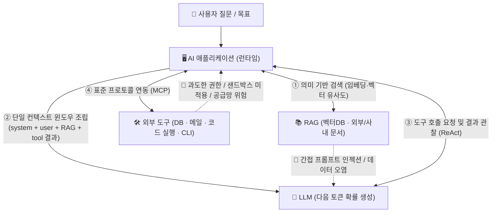
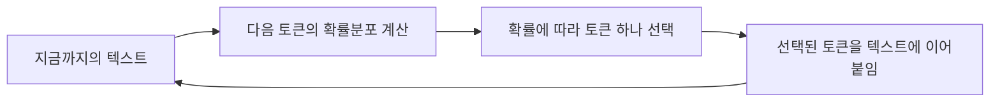
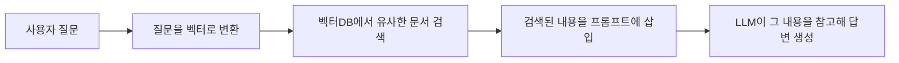
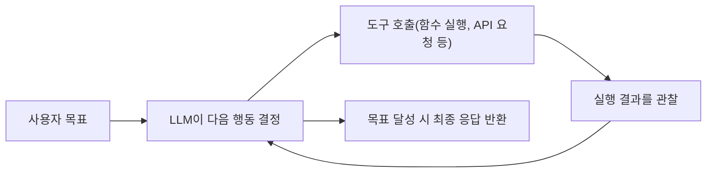

> [!summary] ⏱️ 5초 핵심 요약
> - **한 줄 비유**: **LLM**은 엄청난 책을 읽고 다음 말을 그럴듯하게 이어 붙이는 **달변가**, **RAG**는 답변 전에 참고할 **오픈북 사내 문서철**, **에이전트(Agent)**는 달변가에게 쥐여준 **손발(도구 실행 권한)**, **MCP**는 그 손발을 꽂는 **USB-C 표준 단자**입니다.
> - **핵심 원리**: LLM은 지시(`system`)와 외부 데이터(`user`/`tool`)를 하나의 컨텍스트 윈도우(토큰 스트림) 안에서 통계적으로 처리하므로, 역할 경계가 하드웨어적으로 분리되지 않는 구조적 특성을 가집니다.
> - **핵심 보안 포인트**: 프롬프트 인젝션이 구조적으로 발생하는 이유(컨텍스트 혼재), 외부 문서가 공격 통로가 되는 이유(RAG 오염·간접 인젝션), 그리고 단순 오답이 실제 시스템 피해로 번지는 지점(에이전트 도구 실행과 MCP 공급망)을 한 줄로 연결해 이해해야 합니다.

이 블로그의 LLM 시리즈([[LLM 애플리케이션 모의해킹 14개 취약점 진단]], [[OWASP Top 10 for LLM 2025 심화 해설]], [[PortSwigger Web LLM Attacks 랩 실습 — 과도한 권한부터 인다이렉트 인젝션까지]] 등)는 "프롬프트 인젝션이 왜 위험한지", "RAG 오염이 어떻게 터지는지"를 다루지만, 그 전에 LLM·에이전트·RAG가 애초에 어떤 구조로 동작하는지는 전제로 깔고 넘어갑니다. 이 글은 그 전제를 채우는 입문 글입니다. 공격 기법 자체보다 각 개념이 **왜 그렇게 생겼는지**와 **그 구조가 보안에 어떤 자국을 남기는지**를 다이어그램과 함께 짚습니다.

---

## 한눈에 보는 LLM 생태계 핵심 개념과 보안 연결고리

**💡 한 줄 비유**: AI 서비스라는 자동차를 뜯어볼 때 **엔진(LLM), 연료통(컨텍스트), 내비게이션 지도(임베딩·RAG), 바퀴와 브레이크(에이전트·MCP)가 각각 어디에 붙어 있고 어디서 고장이 나는지** 한 장에 모은 설계도입니다.

| 핵심 개념 | 한 줄 역할 | 왜 도입되었는가? | 구조적 특징이 만드는 보안 리스크 |
|---|---|---|---|
| **LLM (거대언어모델)** | 다음 토큰 확률 예측기 | 자연어 이해·생성 및 추론 | 사실 검증 모듈 부재(**환각**), 지시와 데이터의 소프트한 구분(**프롬프트 인젝션**) |
| **토큰 & 컨텍스트 윈도우** | 모델의 작업 기억 공간 | 시스템 지시·대화·문서를 한 번에 참조 | `system`·`user`·`tool` 역할 태그가 물리적 격리가 아닌 학습된 성향에 의존 |
| **임베딩 & 벡터 유사도** | 텍스트의 의미 좌표화 | 키워드가 달라도 의미가 비슷한 문서 검색 | 모델·학습 과제에 따른 근사치 계산, 임베딩 역전 및 유사도 조작 가능성 |
| **RAG (검색 증강 생성)** | 질문 시점의 오픈북 참조 | 재학습 없이 최신·비공개 사내 지식 반영 | 외부/타인의 비신뢰 문서가 프롬프트에 직접 합류(**간접 프롬프트 인젝션·RAG 오염**) |
| **Agent (에이전트)** | 도구 호출 루프(ReAct) | 텍스트 생성을 넘어 API·DB·코드 실제 실행 | 잘못된 판단이나 인젝션이 실제 시스템 변경·명령 실행으로 직결(**과도한 권한**) |
| **MCP (Model Context Protocol)** | AI ↔ 도구 연동 표준 단자 | 도구마다 커스텀 연동을 짜는 비효율 제거 | 어떤 MCP 서버를 연결하느냐가 곧 외부 코드 신뢰 문제로 번짐(**공급망·권한 분리**) |

---

## 1. LLM이란 무엇인가

**💡 한 줄 비유**: LLM은 머릿속에 백과사전과 사실 확인 장치를 따로 둔 학자가 아니라, **수억 권의 책을 통째로 읽은 뒤 지금 문맥 뒤에 가장 자연스럽게 이어질 '다음 단어 조각'을 확률로 뽑아내는 초고속 작가**입니다.

### 핵심 메커니즘: 다음 토큰 확률 예측
LLM(Large Language Model)이 학습·생성에서 쓰는 핵심 메커니즘을 한 문장으로 줄이면 **"지금까지 나온 텍스트를 보고, 다음에 올 토큰(단어 조각)의 확률분포를 계산해서 하나를 골라 이어붙이는 것"**입니다. 이 과정을 반복해서 문장 전체를 만들어냅니다. 내부적으로 상당히 복잡한 패턴·추론 표현을 학습하지만, 겉으로 드러나는 생성 방식은 학습된 패턴에서 다음 조각을 뽑아내는 통계적 과정입니다.

### 챗봇이 되기까지의 2단계 학습 과정
1. **사전학습(Pretraining) — 언어·지식 능력의 바탕**:
   - 인터넷 수준의 방대한 텍스트로 "다음 토큰 맞히기"만 반복 학습합니다.
   - 이 단계만 거친 모델도 질문에 그럴듯하게 답할 수는 있지만, 지시를 안정적으로 따르거나 대화 형태를 유지하는 성향은 약합니다. 질문에 답하기보다 또 다른 질문으로 이어붙이려는 경향이 자주 나타납니다.
2. **지시 튜닝(Instruction Tuning)과 선호 학습(RLHF, DPO 등) — 챗봇다운 태도 입히기**:
   - `"질문 → 답변"` 형태의 예시로 모델을 다시 학습시키고, 사람(또는 다른 모델)의 선호 평가를 반영해 한 번 더 조정합니다.
   - RLHF가 대표적으로 알려졌지만 DPO 같은 대안 기법도 널리 쓰이며, 공통 목적은 사용자가 원하는 방식(지시를 따르고, 대화형으로 답하고, 유해한 응답을 피하는)으로 행동을 맞추는 것입니다.

### 왜 환각(Hallucination)과 인젝션이 구조적으로 생기는가?
- **환각의 원인**: 모델에는 "이 문장이 사실인지 검증하는 모듈"이 따로 없습니다. 다음 토큰을 통계적 그럴듯함으로 생성하는 구조이다 보니, 확신 없는 질문에도 "모른다"고 답하기보다 자연스러운 문장을 추측해서 내놓는 쪽으로 편향되기 쉽습니다. 그 결과 존재하지 않는 논문 제목이나 틀린 API 함수명이 말투만 자연스럽게 생성됩니다.
- **보안 관점의 핵심**: 모델이 받는 입력에 역할 구분(`시스템`/`사용자`/`도구` 등)이 형식상 있더라도, 그 구분을 **"얼마나 엄격히 지킬지"는 모델이 학습으로 익힌 성향**에 달려 있습니다. 즉 지시와 데이터를 물리적으로 분리하는 하드웨어적 채널이 아니라, 모델이 "이건 지시, 이건 데이터"라고 올바르게 판단해주길 기대하는 소프트한 구분입니다. [[OWASP Top 10 for LLM 2025 심화 해설]]의 `LLM01 프롬프트 인젝션`이 "완전한 차단이 구조적으로 거의 불가능"한 이유가 바로 여기에 있습니다.

---

## 2. 토큰화와 컨텍스트 윈도우

**💡 한 줄 비유**: **토큰(Token)**은 모델이 글을 읽을 때 쪼개는 **레고 블록 조각**이고, **컨텍스트 윈도우(Context Window)**는 모델이 답변을 조립할 때 눈앞에 올려둘 수 있는 **작업 책상의 넓이**입니다. 문제는 그 책상 위에 **사장님의 업무 지시서(`system`)와 외부 민원인의 편지(`user`/`tool`)가 칸막이 없이 나란히 놓인다**는 점입니다.

### 토큰(Token)과 컨텍스트 윈도우(Context Window)의 동작
- **토큰 단위 처리**: 모델은 글자나 단어 단위로 텍스트를 보지 않고 **토큰(token)**이라는 조각 단위로 쪼개서 봅니다. 토크나이저마다 방식이 다르지만 대체로 자주 나오는 단어는 토큰 하나로, 드문 단어는 여러 조각으로 쪼개집니다. 한국어·영어 모두 글자 수와 토큰 수가 딱 맞아떨어지지 않아 "글자 수 제한" 대신 **"토큰 수 제한"**이라는 표현을 씁니다.
- **컨텍스트 윈도우 공유**: 모델이 답을 생성할 때 한 번에 참고할 수 있는 토큰의 범위입니다. **시스템 프롬프트, 대화 기록, RAG로 검색해온 문서, 도구 호출 결과, 사용자의 새 질문**까지 모두 이 윈도우 안에 토큰으로 나란히 들어가며, 모델이 생성할 응답 분량까지 포함해 전체 한도를 나눠 씁니다.

### 보안 관점의 결정적 특성
- 입력 형식상으로는 역할 태그(`system`/`user`/`tool` 등)로 구간이 나뉘고 모델도 이 역할에 우선순위를 두도록 학습되지만, 이는 **학습된 성향이지 물리적으로 강제되는 경계가 아닙니다.**
- 신뢰할 수 없는 외부 텍스트가 `user` 영역이나 도구 결과(`tool`)로 컨텍스트에 들어오면, 모델이 그 안에 적힌 명령을 상위 역할(`system`)의 지시로 잘못 받아들여 따를 가능성이 생깁니다.
- [[LLM 애플리케이션 모의해킹 14개 취약점 진단]]의 **"클라이언트 내 프롬프트 생성"** 및 **"프롬프트 인젝션"** 항목이 바로 이 경계를 찌르는 진단입니다.

---

## 3. 임베딩과 벡터 유사도

**💡 한 줄 비유**: **임베딩(Embedding)**은 단어나 문서를 **'의미 지도' 위의 GPS 좌표(숫자 배열)**로 바꾸는 작업입니다. 철자가 달라도 뜻이 비슷하면 지도에서 가까운 동네에 찍히기 때문에, 단어 일치(Ctrl+F)가 아니라 **의미 거리**로 문서를 찾을 수 있습니다.

### 의미 공간에서의 검색 원리
- **텍스트의 벡터화**: 임베딩은 텍스트(단어, 문장, 문서)를 숫자로 이루어진 벡터로 바꾸는 작업입니다. 임베딩 모델이 잘 학습돼 있다면 의미가 비슷한 텍스트는 벡터 공간에서 서로 가까운 위치에 놓이고, 의미가 다른 텍스트는 멀리 떨어집니다.
- **예시**: `"강아지"`와 `"개"`의 벡터는 가깝게, `"강아지"`와 `"주식시장"`의 벡터는 멀게 배치됩니다. 다만 이 "가까움"은 어떤 임베딩 모델을 썼는지, 어떤 과제에 맞춰 학습됐는지에 따라 달라지는 **근사치**이지 절대적인 보장은 아닙니다.
- **유사도 계산**: 두 벡터가 얼마나 가까운지는 **코사인 유사도(Cosine Similarity)** 같은 계산으로 수치화합니다. 덕분에 단어가 겹치는지(키워드 매칭)가 아니라 **의미가 비슷한지**를 기준으로 검색할 수 있으며, 이 아이디어가 다음 절인 RAG의 기반이 됩니다.

---

## 4. RAG(Retrieval-Augmented Generation)란

**💡 한 줄 비유**: 모델의 뇌(가중치)를 매번 수술해 새 지식을 넣는 대신, **질문이 들어올 때마다 도서관(벡터DB)에서 관련 페이지를 복사해 시험지 여백(프롬프트)에 붙여 주고 오픈북 시험을 치르게 하는 방식**입니다.

### 왜 RAG를 쓰는가?
LLM은 학습 시점 이후의 정보나 학습 데이터에 없던 회사 내부 문서를 모릅니다. 매번 파인튜닝으로 지식을 넣는 것은 비용도 크고 느리기 때문에, **"질문이 올 때마다 관련 문서를 찾아서 프롬프트에 끼워 넣는"** 방식으로 우회합니다.

### 구축 및 질의 단계
1. **구축 단계**: 문서를 적당한 크기로 잘라 **청킹(chunking)**하고, 각 조각을 임베딩 벡터로 변환해 **벡터DB**에 저장해둡니다.
2. **질의 단계**: 사용자 질문도 같은 방식으로 벡터로 변환해 벡터DB에서 가장 가까운(유사도가 높은) 조각들을 찾아옵니다. *(실무에서는 벡터 검색만 쓰기도 하고, 키워드 검색과 섞은 **하이브리드 검색**을 쓰기도 합니다. 벡터DB·청킹은 RAG를 구현하는 흔한 방법 중 하나일 뿐, RAG 개념 자체를 정의하는 유일한 요소는 아닙니다.)*

### 보안 연결고리: 왜 D 단계(프롬프트 삽입)가 위험한가?
- 검색된 문서는 개발자가 신뢰 범위를 정한 시스템 프롬프트가 아니라, **외부 웹페이지 작성자, 메일 발신자, 또는 같은 벡터DB에 쓰기 권한이 있는 다른 사용자가 만든 콘텐츠**입니다.
- 2절에서 봤듯 모델은 역할별 우선순위를 소프트하게 구분하므로, 검색된 문서 안에 명령문이 숨어 있으면 모델이 이를 지시로 착각할 수 있습니다.
- 그 결과 외부 문서에 숨겨둔 명령이 그대로 지시로 읽히는 **간접 프롬프트 인젝션(Indirect Prompt Injection)**의 공격 표면이 열립니다. [[LLM 애플리케이션 모의해킹 14개 취약점 진단]]의 "RAG 데이터 오염" 항목과 [[PortSwigger Web LLM Attacks 랩 실습 — 과도한 권한부터 인다이렉트 인젝션까지]]가 이 경로를 실제로 다룹니다.

---

## 5. Agent란 무엇인가

**💡 한 줄 비유**: 일반 LLM이 유리창 너머에서 조언만 해주는 **상담원**이라면, **에이전트(Agent)**는 상담원 옆에서 **"이 버튼 눌러줘"라는 말을 듣고 실제로 금고 문을 열거나 메일을 보내주는 실행 요원(런타임)이 결합된 구조**입니다.

### 에이전트의 핵심 루프와 역할 분리
LLM 단독으로는 텍스트를 생성하는 것 외에 할 수 있는 게 없습니다. **에이전트(Agent)**는 LLM에게 "도구(tool)를 호출할 권한"을 주고 다음 루프를 반복시키는 구조입니다.

- **모델 vs 런타임의 정확한 구분**:
  - **LLM이 하는 일**: `"이 도구를 이런 인자로 호출해달라"`는 요청을 텍스트로 만들어내는 것까지입니다.
  - **애플리케이션(에이전트 런타임)이 하는 일**: 그 요청을 실제로 실행할지, 어떤 권한으로 실행할지, 사람 승인을 거칠지를 결정합니다.
- **ReAct (Reasoning + Acting) 패턴**: `"생각(Reasoning) → 행동 요청(Acting) → 런타임 실행 및 결과 관찰(Observation) → 다음 행동 결정"`을 순서대로 끌어내는 대표적인 구조화 방식입니다.

### 보안 연결고리: 자율성(Autonomy)과 피해의 현실화
- 사람이 매 단계를 승인하지 않을수록, 즉 **자율성(autonomy)**이 높아질수록(런타임이 모델의 요청을 더 적은 검증으로 실행할수록) 보안 리스크도 함께 커집니다.
- 단순 챗봇이 프롬프트 인젝션에 당하면 **"이상한 말을 한다"**에서 끝나지만, 메일 발송·DB 쿼리·코드 실행 도구를 승인 없이 실행하는 에이전트가 같은 인젝션에 당하면 그 말이 **실제 행동(메일 전송, 데이터 삭제, 명령 실행)**으로 이어집니다.
- [[LLM 애플리케이션 모의해킹 14개 취약점 진단]]의 2부(에이전트 구간: API 매개변수 변조, 부적절한 권한, 사용자 동의 절차 누락, 샌드박스 미적용)가 바로 이 **"말이 행동으로 바뀌는 지점"**을 다룹니다.

---

## 6. MCP(Model Context Protocol)란

**💡 한 줄 비유**: 예전에는 모니터·마우스·외장하드마다 전용 어댑터를 따로 만들어야 했다면, **MCP**는 AI 애플리케이션에 어떤 외부 도구든 표준 규격으로 바로 꽂아 쓸 수 있게 만든 **AI 생태계의 USB-C 포트**입니다.

### 왜 MCP가 등장했는가?
- 에이전트가 도구를 호출하려면 도구마다 `"이 함수는 이런 입력을 받고 이런 출력을 낸다"`는 정의를 모델에게 알려줘야 합니다. 도구가 늘어날수록 이 연동을 매번 커스텀으로 짜는 것은 비효율적입니다.
- **MCP(Model Context Protocol)**는 AI 애플리케이션(**MCP 클라이언트/호스트**)과 외부 도구·데이터 소스(**MCP 서버**) 사이의 연동 방식을 표준화한 프로토콜입니다.
- 단순 도구 호출(`tool`)뿐 아니라 참고 데이터(`resource`), 미리 정의된 프롬프트 템플릿(`prompt`)까지 노출할 수 있어 **"AI 애플리케이션 ↔ 외부 컨텍스트/기능" 연동 표준** 역할을 합니다.
- **실전 예시**: 이 블로그 작업 환경에서도 Claude Code가 Codex CLI·Gemini CLI 연동에 MCP를 활용합니다([[Claude 작업을 Codex로 교차검증하기 — MCP로 두 AI 붙이기]], [[취약점 진단 툴에 MCP 붙이기 Ghidra Burp jadx]] 참고). Claude 입장에서 Codex나 Ghidra는 표준 규격으로 호출 가능한 도구 하나로 보입니다.

### 보안 연결고리: 도구 공격 표면과 공급망 위험
- 연결 방식이 표준화됐다는 것은 곧 **"어떤 MCP 서버를 연결했는가 = 어떤 외부 코드를 신뢰하기로 했는가"**와 같습니다.
- 악의적이거나 허술하게 구현된 MCP 서버를 연결하면, 클라이언트가 넘긴 권한·자격증명 범위와 승인 절차에 따라 피해 범위가 결정됩니다.
- 에이전트의 "부적절한 권한"·"샌드박스 미적용" 취약점이 MCP 생태계에서는 **"어떤 MCP 서버를 신뢰하고 연결했는가"라는 공급망(Supply Chain) 문제**로 확장됩니다.

---

## 7. 파인튜닝 vs 프롬프팅 vs RAG 비교

**💡 한 줄 비유**: **프롬프팅**은 업무 시작 전에 구두로 **당부사항을 일러주는 것**, **RAG**는 옆에 **참고할 업무 매뉴얼 바인더를 놔주는 것**, **파인튜닝**은 아예 직원을 연수원에 보내 **말투와 업무 습관을 체화시키는 재교육**입니다.

모델에게 새 지식이나 행동을 가르치는 세 가지 방법을 비교하면 다음과 같습니다.

| 방법 | 하는 일 | 비용 / 속도 | 적합한 상황 | 주요 보안 함의 (공격 표면) |
|---|---|---|---|---|
| **프롬프팅 (Prompting)** | 프롬프트에 지시·예시를 적어 그 자리에서 행동 유도 | 가장 싸고 빠름 | 일반적인 작업 지시, 톤·형식 조정 | 매 요청의 사용자 입력 조작(**직접 프롬프트 인젝션**, 시스템 프롬프트 유출) |
| **RAG** | 질문 시점에 관련 문서를 검색해 프롬프트에 끼워 넣음 | 중간 (검색·벡터DB 인프라 필요) | 자주 바뀌는 지식, 비공개 사내 문서 기반 응답 | 외부 검색 문서 오염(**간접 프롬프트 인젝션**, 벡터DB 테넌트 경계 우회) |
| **파인튜닝 (Fine-tuning)** | 모델 가중치 자체를 추가 학습으로 조정 | 대체로 가장 비싸고 느림 (규모에 따라 상이) | 특정 말투·형식을 모델 자체에 각인, 반복적인 전문 작업 | 학습 데이터 자체가 오염되면 **재학습 전까지 모델이 백도어·민감정보를 영구 내장** |

- 실무에서는 세 방법을 섞어 씁니다.
- 프롬프팅과 RAG는 매번 들어오는 **입력(프롬프트/컨텍스트)**이 공격 표면이 되고, 파인튜닝은 **학습 데이터와 모델 파일 자체**가 공격 표면이 됩니다([[LLM 애플리케이션 모의해킹 14개 취약점 진단]] 3부 "모델 구간" 참고).
- 이제 기본 구조가 잡혔다면, 분류 체계는 [[OWASP Top 10 for LLM 2025 심화 해설]]에서, 실전 점검 기법은 [[LLM 애플리케이션 모의해킹 14개 취약점 진단]]에서 이어서 확인해 보세요.
