> [!summary] ⏱️ 5초 핵심 요약
> - **한 줄 비유**: AI 서비스의 실제 CVE는 초거대 모델의 뇌(가중치)에서 터지기보다, **모델 주변을 감싼 배관과 밸브(Langflow·LangChain·Open WebUI·Gradio·MLflow·Ollama의 인증·URL 요청·파일 경로·역직렬화·샌드박스)**가 헐거워서 터집니다.
> - **핵심 원리**: LLM 생태계 프레임워크와 UI 도구는 외부 URL 수집, 모델/벡터 파일 로드, 코드 실행 기능을 기본 탑재하고 있어 **전통적인 RCE·SSRF·LFI·역직렬화 취약점이 AI 워크플로와 결합해 클라우드/호스트 권한 탈취로 직결**됩니다.
> - **핵심 검증 원칙**: 공개 PoC 저장소의 익스플로잇 코드를 그대로 복제·실행하지 말고, **격리된 일회용 컨테이너에서 `CANARY-*` 문자열과 버전/설정 대조만으로** 안전하게 취약 여부를 판정해야 합니다.

LLM 서비스는 모델뿐 아니라 LangChain 같은 프레임워크, Langflow·Flowise 같은 빌더, Open WebUI·Gradio 같은 웹 UI, MLflow 같은 MLOps, Ollama 같은 모델 서버로 구성됩니다. 실제 CVE는 주로 이 연결 계층의 **인증, URL 처리, 파일 처리, 역직렬화, 샌드박스**에서 발생합니다.

이 문서는 **2026-10-09 기준 비공개 학습용 목록**입니다. 공개 익스플로잇 코드를 복제하지 않고 공식 권고와 공개 PoC 원문만 연결합니다. 버전 정보는 배포판 백포트 때문에 달라질 수 있으므로 실제 판정은 제품 보안 권고와 설치 패키지의 변경 이력을 함께 확인해야 합니다.

```mermaid
flowchart LR
    subgraph Surface["AI 서비스 스택 (공격 진입점)"]
        UI["웹 UI · 빌더<br/>(Open WebUI · Gradio · Langflow · Flowise)"]
        FW["오케스트레이션 프레임워크<br/>(LangChain Core / Community / JS)"]
        Infra["모델 서버 · MLOps<br/>(Ollama · MLflow)"]
    end
    subgraph VulnClass["7대 주요 CVE 발생 패턴"]
        V1["① 무인증 관리·코드 실행 API"]
        V2["② URL 가져오기 → SSRF"]
        V3["③ 파일·아티팩트 경로 조작 (LFI)"]
        V4["④ Pickle·직렬화 인젝션"]
        V5["⑤ 도구·샌드박스 호스트 탈출"]
        V6["⑥ 악성 모델 서버 SSE 코드 인젝션"]
        V7["⑦ CSRF · 로컬 서비스 · 업로드 경계"]
    end
    Surface --> VulnClass --> Impact["🚨 호스트 RCE · 내부망/IMDS 접근 · 비밀 탈취"]
```



---

## 한눈에 보는 우선 확인 대상 LLM·AI CVE 카탈로그 (18선)

**💡 한 줄 비유**: 현장에서 AI 스택 버전 목록(`pip list`, 컨테이너 이미지 태그)을 뽑았을 때 **가장 먼저 대조해 봐야 할 '지명수배자 명단'**입니다.

| CVE | 제품 | 유형 | 영향 버전 | 수정 버전 | 공개 PoC/권고 |
|---|---|---|---|---|---|
| **CVE-2025-3248** | Langflow | 인증 없는 코드 실행 | `< 1.3.0` | `1.3.0` | [GHSA-rvqx-wpfh-mfx7](https://github.com/advisories/GHSA-rvqx-wpfh-mfx7) · CISA KEV |
| **CVE-2025-2828** | LangChain Community | RequestsToolkit SSRF | `< 0.0.28` | `0.0.28` | [GHSA-h5gc-rm8j-5gpr](https://github.com/advisories/GHSA-h5gc-rm8j-5gpr) |
| **CVE-2025-68665** | LangChain JS | 직렬화 인젝션·비밀 추출 | `@langchain/core < 0.3.80`, `1.0.0–1.1.7` 등 | `0.3.80`, `1.1.8` 등 | [GHSA-r399-636x-v7f6](https://github.com/advisories/GHSA-r399-636x-v7f6) |
| **CVE-2025-65106** | LangChain Core | 프롬프트 템플릿 인젝션 | 권고 참조 | 권고 참조 | [GHSA-6qv9-48xg-fc7f](https://github.com/advisories/GHSA-6qv9-48xg-fc7f) |
| **CVE-2024-5998** | LangChain Community | FAISS pickle 역직렬화 | `< 0.2.4` | `0.2.4` | [GHSA-f2jm-rw3h-6phg](https://github.com/advisories/GHSA-f2jm-rw3h-6phg) |
| **CVE-2025-64496** | Open WebUI | 악성 모델 서버의 SSE 코드 인젝션 | `<= 0.6.34` | `0.6.35` | [GHSA-cm35-v4vp-5xvx](https://github.com/advisories/GHSA-cm35-v4vp-5xvx) |
| **CVE-2026-45400** | Open WebUI | URL 파싱 차이로 SSRF 우회 | `<= 0.9.4` | `0.9.5` | [GHSA-8w7q-q5jp-jvgx](https://github.com/advisories/GHSA-8w7q-q5jp-jvgx) |
| **CVE-2026-45317** | Open WebUI | 이미지 URL 기반 CSRF | `<= 0.9.2` | `0.9.3` | [GHSA-j6w6-986j-2m2m](https://github.com/advisories/GHSA-j6w6-986j-2m2m) |
| **CVE-2024-37032** | Ollama | 모델 Blob 경로 검증 오류 | `< 0.1.34` | `0.1.34` | [GHSA-8hqg-whrw-pv92](https://github.com/advisories/GHSA-8hqg-whrw-pv92) |
| **CVE-2024-3848** | MLflow | 아티팩트 URL 경로 조작·파일 읽기 | `2.9.2–2.12.0` | `2.12.1` | [GHSA-rfqq-wq6w-72jm](https://github.com/advisories/GHSA-rfqq-wq6w-72jm) |
| **CVE-2025-34267** | Flowise | 브라우저 패키지를 통한 샌드박스 우회·명령 실행 | `3.0.1–3.0.7` 및 위험 설정 | `3.0.8` | [GHSA-r4hh-pcgx-j5r2](https://github.com/advisories/GHSA-r4hh-pcgx-j5r2) |
| **CVE-2025-61913** | Flowise | WriteFileTool 임의 파일 쓰기 | `< 3.0.8` | `3.0.8` | [GHSA-jv9m-vf54-chjj](https://github.com/advisories/GHSA-jv9m-vf54-chjj) |
| **CVE-2025-59527** | Flowise | 링크 수집 API SSRF | `3.0.5` | `3.0.6` | [GHSA-hr92-4q35-4j3m](https://github.com/advisories/GHSA-hr92-4q35-4j3m) |
| **CVE-2025-61687** | Flowise | 첨부 파일 검증 미흡 | `3.0.7` | `3.0.8` | [GHSA-35g6-rrw3-v6xc](https://github.com/advisories/GHSA-35g6-rrw3-v6xc) |
| **CVE-2024-51751** | Gradio | File/UploadButton 임의 파일 읽기 | `5.0.0–5.4.x` | `5.5.0` | [GHSA-rhm9-gp5p-5248](https://github.com/advisories/GHSA-rhm9-gp5p-5248) |
| **CVE-2024-1561** | Gradio | Component API 경로 조작·파일 읽기 | `< 4.13.0` | `4.13.0` | [GHSA-g9cj-cfpp-4g2x](https://github.com/advisories/GHSA-g9cj-cfpp-4g2x) |
| **CVE-2024-1727** | Gradio | 외부 웹사이트에서 로컬 Gradio 접근·업로드 | `< 4.19.2` | `4.19.2` | [GHSA-48cq-79qq-6f7x](https://github.com/advisories/GHSA-48cq-79qq-6f7x) |
| **CVE-2024-1183** | Gradio | 파일 처리 경로의 SSRF | `< 4.10.0` | `4.10.0` | [GHSA-qh6x-j82h-vpf9](https://github.com/advisories/GHSA-qh6x-j82h-vpf9) |

*(버전 범위가 여러 패키지·브랜치로 나뉘는 항목은 표를 단순화했습니다. 배포 전에는 반드시 링크된 관리자 권고의 전체 범위를 확인합니다.)*

---

## 1. 공격 경로별 7대 메커니즘과 안전한 검증법

**💡 한 줄 비유**: 개별 CVE 번호를 외우는 것보다 **"어떤 문(무인증 API, URL 파서, 파일 경로, 역직렬화, 샌드박스, 스트리밍, 업로드)이 왜 열렸는지" 7가지 패턴으로 묶어 이해하면** 신종 CVE가 나와도 즉시 같은 방식으로 진단할 수 있습니다.

### 패턴 1. 인증 없는 관리·코드 실행 API
- **대표 사례**: **CVE-2025-3248 (Langflow)**
- **공격 사슬**: `인터넷 노출 → 인증 없는 코드 검증 API → 서버 프로세스 권한으로 코드 실행 → 환경변수·DB·클라우드 역할로 영향 확대`
- **실무 확인 체크포인트**:
  - 자산 검색에서 Langflow 버전과 인터넷 노출 여부를 가장 먼저 확인합니다.
  - 취약 엔드포인트의 존재 여부는 실제 명령 실행 없이 `401/403/404` 응답과 라우팅 설정으로 판정합니다.
  - 불가피하게 동적 검증한다면 폐기 가능한 격리 컨테이너에서 고정 문자열 반환까지만 수행합니다.
  - **CISA KEV 등재 항목**이므로 버전 업그레이드와 외부 접근 차단을 최우선 처리합니다.

### 패턴 2. URL 가져오기 → SSRF → 클라우드 경계 침투
- **대표 사례**: **CVE-2025-2828, CVE-2026-45400, CVE-2025-59527, CVE-2024-1183**
- **공격 사슬**: `URL 입력 → LLM 도구·웹 가져오기·파일 처리기가 서버에서 요청 → 내부 주소 차단 우회 → 관리 API·메타데이터·사내 서비스 접근 가능성`
- **안전한 4단계 PoC**:
  1. 조직 소유 콜백 서버에 `CANARY-CVE-SSRF-{ID}` 경로를 준비합니다.
  2. 정상 외부 URL 요청이 서버에서 도달하는지만 확인합니다.
  3. 사설·루프백·링크 로컬·리디렉션 목적지는 실제 요청하지 않고 프록시 차단 로그와 단위 테스트로 확인합니다.
  4. DNS 재해석(Rebinding)과 리디렉션의 매 단계에서 목적지를 다시 검사하는지 코드·설정으로 확인합니다.

### 패턴 3. 파일 경로·아티팩트 처리 → 서버 임의 파일 노출 (LFI)
- **대표 사례**: **CVE-2024-37032 (Ollama), CVE-2024-3848 (MLflow), CVE-2024-51751 · CVE-2024-1561 (Gradio)**
- **안전한 PoC**: 운영체제 비밀 파일(`/etc/passwd`, SSH 키, 환경변수, 클라우드 자격증명)은 절대 읽지 않고, 격리 컨테이너에 전용 카나리아 파일을 만들어 전용 업로드·아티팩트 디렉터리 밖의 이 파일을 읽을 수 있는지만 확인합니다.

```text
/tmp/ai-cve-lab/CANARY-NOT-A-SECRET.txt
내용: CANARY-FILE-READ-{CVE-ID}
```

### 패턴 4. 역직렬화와 모델·벡터 아티팩트 신뢰
- **대표 사례**: **CVE-2024-5998 (LangChain FAISS pickle), CVE-2025-68665 (LangChain JS 직렬화)**
- **공격 사슬**: `공격자가 통제한 Vector Store·모델·직렬화 객체 → 신뢰된 객체로 복원 → 생성자 부작용·비밀 참조·코드 실행 가능성`
- **실무 확인 체크포인트**:
  - 외부에서 받은 FAISS·pickle·LangChain 직렬화 파일을 로드하는 경로를 전수 조사합니다.
  - 아티팩트 저장소 쓰기 권한과 모델 로딩 권한을 분리하고, 파일 서명·해시·출처가 없는 모델은 로드하지 않습니다.
  - PoC 원문의 위험 객체를 복사하지 말고, 패치 버전에서 거부되는지 회귀 테스트로만 확인합니다.

### 패턴 5. 도구와 샌드박스가 호스트 권한으로 확장
- **대표 사례**: **CVE-2025-34267, CVE-2025-61913 (Flowise)**
- **공격 사슬**: `인증 사용자 또는 프롬프트 → 브라우저·파일 도구의 인자 제어 → 샌드박스 밖 프로세스·파일시스템 → 호스트 또는 클라우드 워크로드 권한`
- **안전한 PoC**:
  - 네트워크와 비밀이 없는 폐기용 컨테이너에서만 검증하고 테스트 후 컨테이너 전체를 폐기합니다.
  - 명령 실행 대신 `/tmp/CANARY-NO-EXEC` 생성 여부처럼 무해한 결과를 사용합니다.
  - `WriteFileTool`은 허용 디렉터리 안과 밖에 각각 카나리아 경로를 지정해 밖의 요청이 거부되는지만 확인합니다.

### 패턴 6. 외부 모델·스트리밍 응답 → 브라우저 코드 실행
- **대표 사례**: **CVE-2025-64496 (Open WebUI)**
- **공격 사슬**: `신뢰하지 않는 모델 서버 → 조작된 SSE 이벤트 → 브라우저가 데이터가 아닌 동작으로 처리 → 사용자 세션 영향`
- **안전한 PoC**:
  - 격리 브라우저와 테스트 계정을 사용하여 쿠키·토큰 접근이나 외부 전송 대신 화면 DOM에 `CANARY-SSE-NO-EXEC`가 단순 텍스트로만 표시되는지 확인합니다.
  - Direct Connections 비활성화 여부와 허용 모델 서버 목록을 함께 점검합니다.

### 패턴 7. CSRF·로컬 서비스·업로드 경계
- **대표 사례**: **CVE-2026-45317 (Open WebUI), CVE-2024-1727 (Gradio), CVE-2025-61687 (Flowise)**
- **실무 확인 체크포인트**:
  - 외부 Origin에서 로컬·내부 AI UI로 요청할 수 있는지, 상태 변경 요청에 CSRF·Origin 검증이 있는지 확인합니다.
  - 업로드 파일의 확장자, MIME, 실제 매직 바이트, 저장 위치가 모두 검증되는지, 업로드 성공과 파일 실행 가능성을 구분하는지 점검합니다.
  - PoC는 웹셸 대신 빈 텍스트 파일과 `CANARY-UPLOAD-{ID}` 이름만 사용합니다.

---

## 2. 단일 CVE 검증 8단계 표준 절차와 증적 양식

**💡 한 줄 비유**: 의사가 환자를 진단할 때 **신원 확인(버전·이미지 태그) → 기저 조건 문진(설정·노출 범위) → 안전한 알레르기 반응 검사(격리 카나리아 PoC) → 완치 판정(회귀 테스트)** 순서로 차트를 작성하는 표준 프로토콜입니다.

### 8단계 표준 검증 워크플로
1. **식별**: 제품·패키지·컨테이너 이미지 태그 식별
2. **버전 대조**: 실제 버전과 벤더 백포트(Backport) 패치 여부 확인
3. **전제조건 비교**: 공식 권고의 영향 조건과 현재 운영 설정 비교
4. **접근성 확인**: 인터넷 노출 여부, 인증 요구 수준, 필요 사용자 역할 확인
5. **안전한 재현**: 격리 환경에서 `CANARY-*` 기반 무해한 PoC 수행
6. **근본 패치 확인**: WAF 임시 차단이 아닌 애플리케이션 자체 패치 여부 확인
7. **탐지 검증**: 감사 로그 기록 여부와 보안 탐지 규칙 동작 확인
8. **회귀 테스트**: 패치 적용 후 동일한 카나리아로 재검증

### 표준 증적 수집 양식
```text
CVE:
제품과 실제 버전:
컨테이너 이미지 digest / 패키지 lock:
영향 조건 충족 여부:
노출 범위:
필요 권한:
사용한 카나리아:
요청 ID와 시각:
관찰 결과:
공식 권고 URL:
공개 PoC URL:
수정 버전 또는 완화 설정:
실제 비밀·운영 데이터 접근 없음 확인:
```

---

## 3. 공개 PoC 취급 수칙 및 공식 모니터링 출처

**💡 한 줄 비유**: 인터넷에 올라온 공개 PoC 코드는 **누가 만들었는지 모르는 불발탄**과 같아서, 내 방 책상(개인 PC·운영망) 위에서 바로 눌러보지 말고 반드시 **방폭 실험실(네트워크 격리 VM·컨테이너) 안에서 설계도(코드·의존성)부터 뜯어봐야** 합니다.

### 공개 PoC 다룰 때 반드시 지킬 6가지 원칙
- **선 코드 검토**: PoC 저장소를 바로 실행하지 말고 코드, `setup.py`/`package.json` 설치 스크립트, 의존성부터 검토합니다.
- **환경 격리**: 개인 PC나 운영망이 아닌 네트워크 격리된 일회용 VM·컨테이너를 사용합니다.
- **교차 검증**: GitHub 저장소의 별(Star) 개수나 검색 순위는 신뢰 근거가 아닙니다. 공식 보안 권고의 원인·패치 커밋과 일치하는지 확인합니다.
- **악용 가능성 구분**: "CVE 번호가 존재한다"와 "현재 배포 환경이 실제로 악용 가능하다"를 구분하여 기능 비활성화, 인증, 네트워크 격리 등 전제조건을 명확히 기록합니다.
- **비파괴 판정**: 공개 PoC가 없어도 버전·설정·패치 코드 차이만으로 충분히 판정할 수 있으며, 무리한 익스플로잇 재현 자체가 목표가 아닙니다.
- **윤리적 기록**: 익스플로잇 코드를 블로그에 그대로 재게시하지 말고 원문 링크, 탐지 지표, 수정 방법 중심으로 기록합니다.

### 지속적으로 모니터링할 공식 출처
- [CISA Known Exploited Vulnerabilities Catalog](https://www.cisa.gov/known-exploited-vulnerabilities-catalog)
- [NVD Vulnerability Search](https://nvd.nist.gov/vuln/search)
- [GitHub Advisory Database](https://github.com/advisories)
- [LangChain Security Advisories](https://github.com/langchain-ai/langchain/security/advisories)
- [MLflow Security Advisories](https://github.com/mlflow/mlflow/security/advisories)
- [Gradio Security Advisories](https://github.com/gradio-app/gradio/security/advisories)
- [Open WebUI Security Advisories](https://github.com/open-webui/open-webui/security/advisories)
