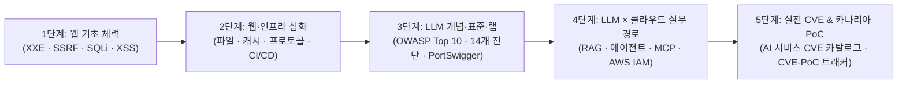

> [!summary] ⏱️ 5초 핵심 요약
> - **한 줄 비유**: 이 페이지는 실제 모의해킹 현장에 투입되기 전에 **기초 체력(웹 취약점 입문·심화)부터 최신 무기 체계(LLM·클라우드 공격 사슬), 실전 기출문제(CVE·공개 PoC 카탈로그)까지 순서대로 훈련하는 보안 진단가의 개인 작전 사령부**입니다.
> - **핵심 원리**: 단일 취약점 암기가 아니라 **`웹 요청/응답 경계 → 파일/캐시/프로토콜 심화 → LLM·RAG·에이전트·클라우드 IAM 권한 전이 → 실제 제품 CVE 구현 실수 분석 → 격리 환경 카나리아(CANARY-*) 검증`**의 5단계로 지식을 연결합니다.
> - **운영 방식**: `.gitignore`로 관리되는 로컬 검토용 허브 페이지이면서, 동시에 블로그 전체 보안 진단 시리즈를 가장 효율적인 순서로 완주할 수 있도록 설계된 **실전 커리큘럼 로드맵**입니다.

블로그에 공개하기 전에 학습하고 검토할 보안 진단 문서와 실무 트랙을 모아 둔 허브 페이지입니다. 일부 비공개 초안은 `.gitignore`에 등록되어 Git 배포에는 포함되지 않지만, 로컬 Quartz에서는 일반 블로그 글처럼 연결해 볼 수 있습니다.

---

## 한눈에 보는 5단계 보안 진단 마스터 학습 로드맵

**💡 한 줄 비유**: 막무가내로 고급 해킹 기술부터 건드리지 않고, **'문을 여는 법(웹 기초) → 건물 배관을 타는 법(웹·클라우드 심화) → AI 비서를 속이고 권한을 추적하는 법(LLM·클라우드) → 실제 사고 사례집 분석(CVE·PoC)'** 순서로 계단을 밟아 올라가는 표입니다.

| 단계 | 학습 트랙 | 핵심 연결 문서 | 중점 습득 역량 (무엇을 할 수 있게 되는가?) | 권장 실습·검증 방법 |
|---|---|---|---|---|
| **Step 1** | **웹 취약점 기초** | [[웹 취약점 진단 기법 입문 — XXE, SSRF부터 SQLi, XSS까지]] | HTTP 요청·응답 구조 이해 및 서버/클라이언트 신뢰 경계 식별 | 로컬 랩에서 입력값이 파서·DB·브라우저로 들어가는 지점 확인 |
| **Step 2** | **웹 취약점 심화** | [[웹 취약점 진단 심화 — 실무에서 보는 기법들]] | 파일 업로드 변환 파이프라인, 웹 캐시, 비동기 프로토콜, 인프라 연계 분석 | 단일 요청이 아닌 다단계(Multi-step) 체인 시나리오 설계 |
| **Step 3** | **LLM 보안 기초·실습** | [[LLM 입문 — 거대언어모델·에이전트·RAG 개념 정리]] [[OWASP Top 10 for LLM 2025 심화 해설]] [[LLM 애플리케이션 모의해킹 14개 취약점 진단]] [[PortSwigger Web LLM Attacks 랩 실습 — 과도한 권한부터 인다이렉트 인젝션까지]] | 컨텍스트 윈도우·RAG·에이전트 구조 이해 및 3대 공격면(통합·에이전트·모델) 14개 항목 실습 | PortSwigger Web LLM 랩 3종 직접 풀이 (`debug_sql`, Blind 명령 주입, 간접 인젝션) |
| **Step 4** | **LLM × 클라우드 실무 경로** | [[LLM 서비스와 클라우드 공격 경로 — 실무 진단 체크리스트]] | 웹(W1~W12)에서 시작해 RAG·에이전트·MCP를 거쳐 클라우드 IAM·로그(A~H)까지 이어지는 전체 공격 그래프 추적 | 전용 테스트 계정에서 `CANARY-*` 문자열과 모의 도구(`audit_test`)로 비파괴 검증 |
| **Step 5** | **실제 CVE & 상시 트래킹** | [[LLM·AI 서비스 CVE와 공개 PoC 카탈로그]] [CVE·PoC 트래커](/CVE-PoC/) | Langflow·LangChain·Open WebUI·Gradio·MLflow·Ollama 실제 취약 원인과 패치 커밋 비교 분석 | 네트워크 격리 컨테이너에서 버전·설정 대조 및 카나리아 파일/콜백 검증 |

---

## 1. 트랙 1 — 웹 취약점 진단 (입문부터 실무 심화까지)

**💡 한 줄 비유**: 모든 최신 클라우드·AI 서비스도 결국 **웹과 API라는 도로 위를 달리기 때문에, 도로의 신호등과 차선 구조(웹 취약점)를 먼저 꿰뚫어야** 그 위를 달리는 AI 전차도 진단할 수 있습니다.

### 주요 학습 문서
- [[웹 취약점 진단 기법 입문 — XXE, SSRF부터 SQLi, XSS까지]]
  - **핵심 포인트**: 외부 엔티티 참조(XXE), 서버 측 요청 위조(SSRF), SQL 인젝션, 크로스 사이트 스크립팅(XSS) 등 가장 빈번하게 발생하는 기본 인젝션과 요청 변조의 원리를 다룹니다.
- [[웹 취약점 진단 심화 — 실무에서 보는 기법들]]
  - **핵심 포인트**: 단발성 페이로드로 끝나지 않는 실무 환경의 파일 처리 파이프라인, 캐시 오염, 인가 우회(IDOR/BOLA), 상태 전환 오류 등을 다룹니다.

---

## 2. 트랙 2 — LLM · 클라우드 · 웹 통합 공격 경로

**💡 한 줄 비유**: 챗봇 창 하나만 두드리는 좁은 시야에서 벗어나, **웹 API → 프롬프트 조립기 → 벡터DB(RAG) → 에이전트/MCP 도구 → 클라우드 IAM 역할과 로그 저장소까지 이어지는 '전체 건물 배선도'를 따라가며 약한 고리를 찾는 과정**입니다.

### 핵심 학습 문서
- [[LLM 서비스와 클라우드 공격 경로 — 실무 진단 체크리스트]]

### 세부 포함 범위 및 실무 점검 체크리스트
1. **프롬프트 및 멀티모달 경계**:
   - 간접(Indirect) 프롬프트 인젝션 및 이미지·PDF·Office·음성(OCR/비전) 기반 멀티모달 인젝션
2. **지식베이스(RAG) 및 메모리 경계**:
   - RAG 문서 지속성 오염과 벡터DB 멀티테넌트 권한 경계 우회
   - 세션 간 요약 메모리·사용자 프로필 오염
3. **에이전트 · MCP · 신원 경계**:
   - 에이전트 목표 탈취(Goal Hijacking), 도구 출력 인젝션(Tool Output Injection), MCP·플러그인 공급망 위험
   - 신원 혼동(Confused Deputy) 및 공용 관리자 서비스 계정 오용
4. **웹 애플리케이션 경계 (W1~W12)**:
   - 대화·파일·에이전트 IDOR/BOLA, 공유 링크 권한 혼동, 세션·OAuth·조직 전환 오류
   - CSRF, CORS 오설정, Markdown·미리보기 XSS, 파일 업로드 변환 파이프라인, URL 브라우징 SSRF
   - SSE·WebSocket 스트림 인가, REST·GraphQL 관리 API 인가, 웹 캐시 오염, 비동기 작업 증폭
5. **클라우드 제어면 연결 (A~H) 및 증적 양식**:
   - `Agent → Function(Lambda) → IAM 역할 → 클라우드 데이터 자원` 권한 전이 추적
   - 비밀 저장소(Secrets Manager) 문맥 노출 및 관측 로그(CloudWatch·S3·APM) 평문 유출
   - `CANARY-*` 기반 안전한 6대 PoC 시나리오와 표준 보고서 증적 양식

---

## 3. 트랙 3 — CVE 분석과 공개 PoC 상시 트래킹

**💡 한 줄 비유**: 이론으로 배운 취약점들이 **실제 유명 오픈소스 제품(LangChain, Open WebUI, Gradio 등)의 어느 코드 줄에서 어떻게 터졌고 어떻게 고쳐졌는지 '실제 사건 판례집'을 뜯어보는 단계**입니다.

### 두 가지 핵심 레퍼런스
- [[LLM·AI 서비스 CVE와 공개 PoC 카탈로그]]
  - **역할**: Langflow, LangChain, Open WebUI, Ollama, MLflow, Flowise, Gradio 관련 18개 주요 CVE의 영향 버전, 수정 버전, 공식 보안 권고(GHSA)·PoC 원문, 그리고 7대 공격 패턴별 안전한 카나리아 검증 절차를 정리한 문서입니다.
- [CVE·PoC 트래커](/CVE-PoC/)
  - **역할**: LLM 한정이 아닌 **일반 CVE 전반**을 다루는 별도 정적 웹 도구입니다. NVD 메타데이터, CVSS 게이지, GitHub(`nomi-sec`) PoC 링크, 격리 랩 기준 재현 절차를 담고 매일 자동 갱신됩니다. *(이 글들과는 별개 폴더인 `CVE-PoC/`의 정적 페이지로 동작합니다.)*

---

## 4. 실전 학습 및 진단 수행 5계명 (Self-Check)

**💡 한 줄 비유**: 사격장에 들어가기 전에 **안전핀 위치와 표적지 규격부터 확인하는 안전 수칙**입니다.

1. **신뢰 경계부터 그린다**: 페이로드를 던지기 전에 `데이터가 어디서 들어와 어느 지점에서 명령이나 권한으로 승격되는지` 아키텍처 흐름도를 먼저 그립니다.
2. **웹·API와 AI·클라우드를 분리해 보지 않는다**: 프롬프트 필터가 완벽해도 웹 IDOR(`W1`)이나 클라우드 함수 실행 역할(`경로 D`)이 뚫리면 전체 서비스가 침해됩니다.
3. **실제 제품 CVE로 구현 실수를 익힌다**: 추상적인 위협 분류에 그치지 않고 실제 프레임워크의 URL 파서 불일치, 역직렬화, 샌드박스 탈출 사례를 패치 코드와 함께 비교합니다.
4. **전용 격리 환경에서 `CANARY-*`만 사용한다**: 운영 데이터 변경, 외부 전송, 실제 메타데이터 자격증명 조회, 타 사용자 데이터 열람은 절대 금물입니다.
5. **공격 문구 대신 재현 가능한 증적을 남긴다**: 요청 ID, 적용된 필터, 실행된 IAM 주체, 로그 시각, 그리고 근본적인 아키텍처 통제 방안(최소 권한·승인·격리)을 한 세트로 기록합니다.
