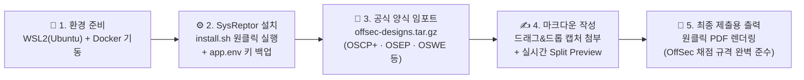

> [!summary] ⏱️ 5초 핵심 요약
> - **한 줄 비유**: 워드(MS Word)에 스크린샷을 붙여 넣다 줄바꿈과 표 서식이 깨져 밤새 씨름하는 대신, **평소 메모하듯 마크다운(Markdown)으로 글과 사진만 던져 넣으면 OffSec 공식 채점 양식 PDF로 자동 조판해 주는 '펜테스트 전용 출판 인쇄기'**입니다.
> - **핵심 원리**: 오픈소스 리포팅 플랫폼인 **SysReptor**에 OffSec 공식 리포트 디자인(`offsec-designs.tar.gz`)을 임포트하면, 마크다운 본문이 HTML/CSS 템플릿을 거쳐 **OSCP+ 공식 양식과 100% 동일한 PDF**로 즉시 렌더링됩니다.
> - **핵심 선택지**: 설치 없이 바로 쓰려면 **OffSec 전용 무료 클라우드([offsec.sysreptor.com](https://offsec.sysreptor.com/oscp/signup/))**를 쓰고, 민감한 데이터를 내 PC 안에만 보관하며 평생 연습 노트로 쓰려면 아래 가이드대로 **WSL2 + Docker 셀프 호스팅**으로 5분 만에 구축하세요.

OSCP는 익스플로잇만 성공한다고 끝이 아닙니다. 시험 종료 후 **24시간 안에 정해진 형식의 리포트를 제출해야 점수가 인정**됩니다. 밤새 셸을 따고 지친 상태에서 워드나 구글 독스로 수십 장의 스크린샷과 코드 블록 서식을 맞추다 보면 시간도 멘탈도 갈려 나갑니다.

[SysReptor](https://docs.sysreptor.com/)는 펜테스트 리포트 작성에 특화된 오픈소스 플랫폼입니다. 마크다운으로 내용을 쓰면 HTML 디자인을 거쳐 PDF로 렌더링되는 구조라, **OffSec이 제공하는 공식 리포트 양식을 그대로 가져와 내용만 채우면 됩니다.** 셀프 호스팅으로 직접 구축한 과정과 OSCP 리포트 작성 실전 워크플로우를 정리합니다.


내용만 채우면 이렇게 OffSec 공식 양식에 맞춘 PDF 표지부터 본문까지 한 번에 떨어집니다. 위 화면이 이 글에서 만들 최종 결과물입니다.



---

## 한눈에 보는 리포트 작성 방식 비교 (Word vs SysReptor 클라우드 vs 셀프 호스팅)

| 비교 항목 | MS Word / LibreOffice | SysReptor 무료 클라우드 (OffSec 전용) | SysReptor 로컬 셀프 호스팅 (이 글의 방법) |
|---|---|---|---|
| **서식·코드 블록 관리** | ❌ 복붙할 때마다 폰트·줄바꿈·페이지 넘김이 깨져 수동 편집에 시간 소모 | ✅ 마크다운 입력 시 **자동으로 공식 디자인 조판** | ✅ 마크다운 입력 시 **자동으로 공식 디자인 조판** |
| **초기 구축 시간** | 템플릿 다운로드 후 즉시 | 회원가입 후 **즉시 사용** ([가입 링크](https://offsec.sysreptor.com/oscp/signup/)) | Docker 기반 **약 5~10분** (스크립트 1줄) |
| **데이터 보관 및 수명** | 내 PC 로컬 파일 | 외부 클라우드 서버 (일정 기간·시험 용도 제한 가능) | **내 PC 로컬 영구 보관** (평소 HTB·PG 연습 기록용으로 최고) |
| **추천 대상** | 마크다운이 전혀 익숙하지 않은 경우 | **당장 시험 한 번만 빠르게 치르고 끝낼 경우** | **데이터를 내 손에 두고 연습 머신부터 시험까지 쭉 관리할 경우** |

---

## 1. 사전 준비 (WSL2 & Docker)

**💡 한 줄 비유**: 인쇄기(SysReptor)를 들여놓기 전에 **작업실 바닥을 평평하게 고르고 전원 콘센트(Ubuntu + Docker 엔진)를 연결하는 기초 공사**입니다.

### 시스템 요구사항
- **OS**: Ubuntu (Windows라면 **WSL2 Ubuntu**, 또는 Kali Linux·macOS에서도 동일하게 동작)
- **RAM**: 최소 8GB 권장
- **필수 엔진**: Docker 및 Docker Compose

### 필수 패키지 및 Docker 설치 명령어
```bash
# 1. 필수 유틸리티 패키지 설치
sudo apt update
sudo apt install -y sed curl openssl uuid-runtime coreutils

# 2. 공식 스크립트로 Docker 원클릭 설치
curl -fsSL https://get.docker.com | sudo bash

# 3. 현재 사용자를 docker 그룹에 추가 (매번 sudo 치지 않고 docker 실행)
sudo groupadd docker 2>/dev/null
sudo usermod -aG docker $USER
newgrp -
```

### WSL2 환경 트러블슈팅 팁
- **`dockerd` 기동 확인**: WSL2에서는 Windows의 Docker Desktop WSL 연동을 켜거나, WSL 내부에서 Docker 엔진이 떠 있어야 합니다. 다음 단계로 가기 전에 반드시 `docker ps`가 에러 없이 동작하는지 확인하세요.
- **`Command 'newgrp' not found` 에러가 뜰 때**: WSL 최소 이미지에는 `newgrp`가 빠져 있을 수 있습니다. 이 명령은 새로 추가한 `docker` 그룹 권한을 현재 터미널에 즉시 반영하려는 편의용이므로, 에러가 나면 **그냥 터미널 창을 닫았다가 다시 열거나**, 확실히 하려면 Windows PowerShell에서 `wsl --shutdown` 후 다시 켜서 `docker ps`가 `sudo` 없이 되는지만 확인하면 됩니다. *(직접 설치하려면 `sudo apt install -y util-linux-extra` 후 `newgrp docker` 실행)*

---

## 2. SysReptor 원클릭 설치 및 `app.env` 백업

**💡 한 줄 비유**: 자동 조립 키트(`install.sh`)를 실행해 인쇄기를 세우고, **금고 문을 여는 단 하나뿐인 마스터 열쇠 파일(`app.env`)을 안전한 곳에 복사해 두는 단계**입니다.

### 원클릭 설치 실행
설치 스크립트 한 줄이면 소스 내려받기, 설정 생성, 볼륨/시크릿 구성, 이미지 다운로드, 컨테이너 기동까지 전부 자동 처리됩니다.

```bash
bash <(curl -s https://docs.sysreptor.com/install.sh)
```

### 설치 중 나오는 대화형 질문 선택 가이드

| 설치 스크립트 질문 | 질문의 의미 | 로컬 개인용 추천 선택 |
|---|---|---|
| `License key` | 비우면 무료 Community Edition으로 설치됨 (나중에 Pro 전환 가능) | **그냥 `Enter`** (OSCP 리포트는 Community로 100% 충분) |
| `Encrypt files and database?` | 업로드 이미지·DB를 저장 시 암호화할지 여부 (키 분실 시 복구 불가) | **`n`** (단순·안전) 또는 **`y`** (보안 강화, 단 아래 `app.env` 백업 필수!) |
| `Did you understand ... lose all data if app.env is gone?` | 암호화 선택 시 `app.env` 파일이 유실되면 모든 리포트가 영구 잠긴다는 재확인 | **`y`** |
| `Setup a webserver (Caddy)?` | 외부 네트워크 노출용 웹서버를 띄울지 여부 (기본은 로컬 `127.0.0.1:8000`만 바인딩) | **`n`** (내 PC에서만 접속할 때는 불필요) |

- **필수 주의사항 (`app.env` 백업)**: 만약 암호화(`y`)를 골랐다면 암호화 키가 `sysreptor/deploy/app.env`에 저장됩니다. **이 파일을 잃어버리면 작성한 리포트를 영영 열 수 없으므로** 설치 직후 반드시 백업해 두세요.
  ```bash
  cp sysreptor/deploy/app.env ~/sysreptor-app.env.backup
  ```
- **접속 확인**: Caddy를 `n`으로 둬도 WSL2가 `localhost` 포워딩을 자동 처리해 주므로, Windows 웹 브라우저에서 바로 아래 주소로 접속할 수 있습니다.
  ```text
  http://127.0.0.1:8000/
  ```

로그인하면 아래와 같은 프로젝트 목록 화면이 보입니다. 좌측에 `Projects` · `Templates` · `Designs` · `Notes`, 그리고 `Administration`(`Users` · `Settings` · `License`) 메뉴가 깔끔하게 정리되어 있습니다.


*(참고: 설치 과정에서 초기 관리자 계정이 생성되며, 추후 계정을 더 만들려면 `cd sysreptor/deploy && docker compose run --rm app python3 manage.py createsuperuser`를 실행하면 됩니다.)*

---

## 3. OffSec 공식 리포트 디자인 가져오기

**💡 한 줄 비유**: 인쇄기에 **OffSec 채점관이 요구하는 '공식 시험지 조판 틀(OSCP+, OSEP, OSWE 등)'을 통째로 장착하는 핵심 단계**입니다.

### 공식 디자인 번들 임포트 명령어
아래 명령어를 실행하면 OffSec의 모든 자격증 시험 양식(**OSCP+, OSEP, OSWP, OSWA, OSWE, OSED, OSMR, OSEE, OSDA, OSIR, OSTH**)이 한 번에 SysReptor 안으로 들어옵니다.

```bash
cd sysreptor/deploy
url="https://docs.sysreptor.com/assets/offsec-designs.tar.gz"
curl -s "$url" | docker compose exec --no-TTY app python3 manage.py importdemodata --type=design
```

임포트가 끝나면 웹 UI의 `Designs` 메뉴에 **`OSCP Exam Report`**를 비롯한 공식 양식들이 나타납니다. 직접 HTML/CSS를 건드릴 필요 없이, OffSec이 채점에서 기대하는 목차와 스타일 그대로를 출발점으로 쓸 수 있습니다.

---

## 4. OSCP 리포트 작성 워크플로우와 감점 방지 철칙

**💡 한 줄 비유**: 왼쪽 목차 빈칸을 따라가며 **터미널 명령어와 스크린샷만 레고 블록처럼 끼워 넣으면, 오른쪽 미리보기 창에 완성된 공식 보고서가 실시간으로 만들어집니다.**

### 4단계 작성 흐름
1. **새 프로젝트 생성**: `Projects` → `Create` 클릭 후 Design으로 **`OSCP Exam Report`** 선택
2. **마크다운 본문 작성**: 좌측 트리의 `High-Level Summary`, 각 타깃 머신(AD Set & Standalones)의 초기 침투·권한 상승 과정, 사용한 명령어를 마크다운으로 기록
3. **스크린샷 드래그 앤 드롭 첨부**: 클립보드에 복사한 캡처 이미지를 에디터에 바로 붙여넣거나(`Ctrl+V`) 드래그 앤 드롭하면 자동 업로드 및 마크다운 링크 삽입 완료
4. **원클릭 PDF 렌더링**: 상단의 `Preview` / `Publish` 버튼 하나로 제출 규격에 맞춘 최종 PDF 생성


위 화면처럼 왼쪽에 OSCP 양식의 섹션(`Student`, `High-Level Summary`, `Methodologies`, `Appendix`)과 타깃별 항목이 잡혀 있고, 가운데 마크다운 에디터에서 포트 스캔·열거·초기 침투를 적어 내려가면 됩니다. `Write` / `Split` / `Preview` 탭으로 작성과 동시에 PDF 조판 결과를 바로 확인할 수 있습니다.

### 시험 합격률을 지키는 OSCP 리포트 4대 철칙
- **재현 가능성(Reproducibility)이 전부다**: 채점관이 내 리포트만 보고 처음부터 끝까지 복사·붙여넣기로 익스플로잇을 100% 똑같이 재현할 수 있어야 합니다.
- **명령어는 이미지 말고 텍스트 코드 블록으로**: 긴 명령어나 수정한 익스플로잇 코드 부분을 스크린샷으로만 퉁치면 채점관이 직접 타이핑해야 하므로 감점·불합격 요인이 됩니다. 반드시 **마크다운 코드 블록(` ``` `)으로 복붙 가능하게 본문에 적고, 핵심 실행 결과 화면만 스크린샷으로 병행**하세요.
- **`local.txt` / `proof.txt` 캡처 규격 엄수**: 플래그 파일 내용(`type proof.txt` 또는 `cat proof.txt`)을 찍을 때는 반드시 **한 터미널 화면 안에 `whoami`, `hostname`, `ipconfig`(또는 `ip a`), 그리고 플래그 값 전체가 잘리지 않고 동시에 보이도록** 캡처해야 합니다.
- **수정한 익스플로잇 코드는 변경점 명시**: 공개 PoC 코드를 수정했다면 원본 URL과 함께 어느 줄(포트, IP, 페이로드 등)을 어떻게 고쳤는지 코드 블록이나 `diff`로 명확히 남겨야 합니다.

---

## 5. 평소 연습 습관과 서버 켜고 끄기 (운영 치트시트)

**💡 한 줄 비유**: 시험 당일에 처음 켜보는 도구는 실수를 부릅니다. **평소 연습 머신(PG Practice, HTB)을 풀 때부터 SysReptor에 기록하는 습관을 들이면, 실제 시험장의 24시간 리포팅이 2~3시간으로 줄어듭니다.**

### 왜 평소 연습 때부터 써야 하는가?
- 머신을 다 뚫고 나서 나중에 몰아서 스크린샷을 찍으려 하면 VPN 세션이 끊기거나 머신이 리셋되어 다시 처음부터 익스플로잇해야 하는 참사가 벌어집니다.
- [[OSCP 사용 도구]]에서 소개한 **Penelope(자동 세션 로깅)**와 **SysReptor**를 함께 띄워두고, **단계가 성공할 때마다 즉시 명령어와 캡처를 SysReptor 해당 섹션에 붙여넣는 습관**이 시험장에서 시간을 가장 크게 아껴줍니다.

### 일상적인 서버 기동·종료 명령어 모음
SysReptor는 Docker 컨테이너로 돌아가므로 PC를 재부팅하거나 WSL이 내려가면 함께 멈춥니다. 다음 날 다시 켤 때는 아래 순서를 쓰세요.

```bash
# 1. Docker 데몬이 떠 있는지 확인 (에러 시 sudo service docker start 또는 Docker Desktop 실행)
docker ps

# 2. SysReptor 컨테이너 백그라운드 기동
cd sysreptor/deploy
docker compose up -d

# 3. 상태 확인 후 브라우저에서 http://127.0.0.1:8000 접속
docker compose ps
```

| 작업 동작 | 실행 명령어 |
|---|---|
| **서버 켜기 (기동)** | `cd sysreptor/deploy && docker compose up -d` |
| **서버 끄기 (중지)** | `cd sysreptor/deploy && docker compose stop` |
| **컨테이너 상태 확인** | `cd sysreptor/deploy && docker compose ps` |
| **실시간 에러 로그 확인** | `cd sysreptor/deploy && docker compose logs -f app` |

*(참고: 컨테이너 재시작 정책이 `unless-stopped`로 되어 있어 Docker 데몬만 켜지면 자동으로 다시 올라오지만, WSL2는 Windows 부팅 시 자동 실행되지 않을 수 있으므로 터미널을 한 번 열어 `docker ps`로 확인하는 습관만 들이면 됩니다.)*

---

## 참고
- [SysReptor 공식 문서](https://docs.sysreptor.com/)
- [OffSec Reporting with SysReptor](https://docs.sysreptor.com/offsec-reporting-with-sysreptor/)
- [Syslifters/OffSec-Reporting (GitHub)](https://github.com/Syslifters/OffSec-Reporting)
- [OSCP Exam Report 데모 PDF](https://docs.sysreptor.com/assets/reports/OSCP-Exam-Report.pdf)
