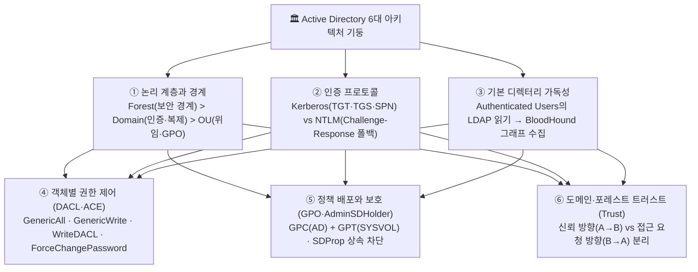
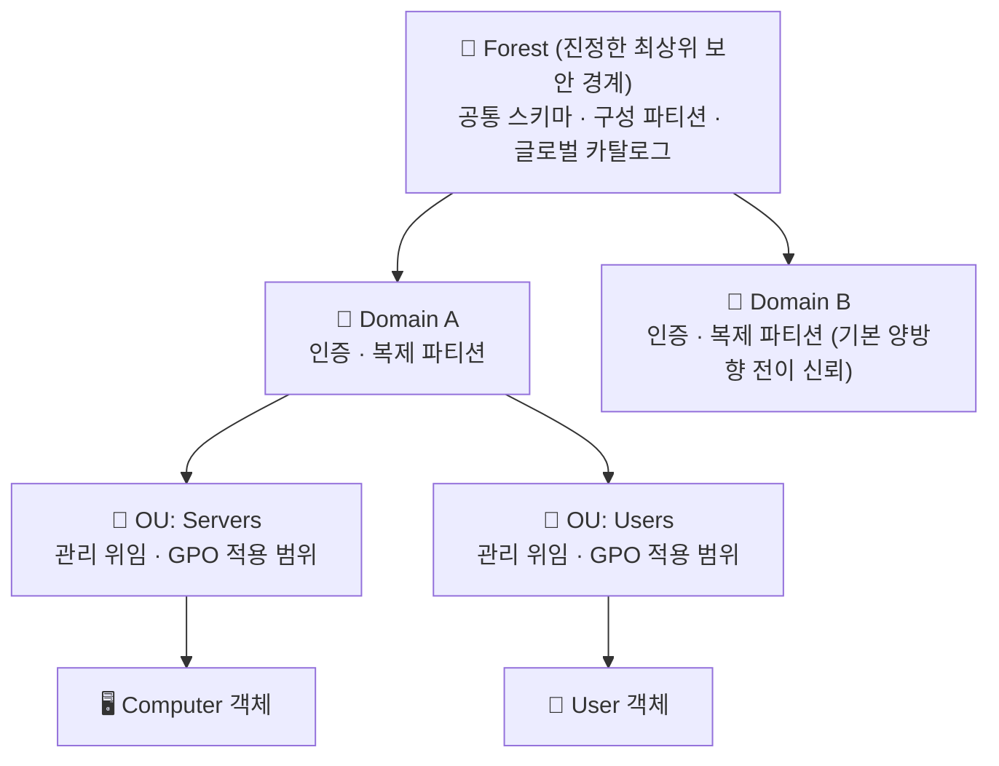
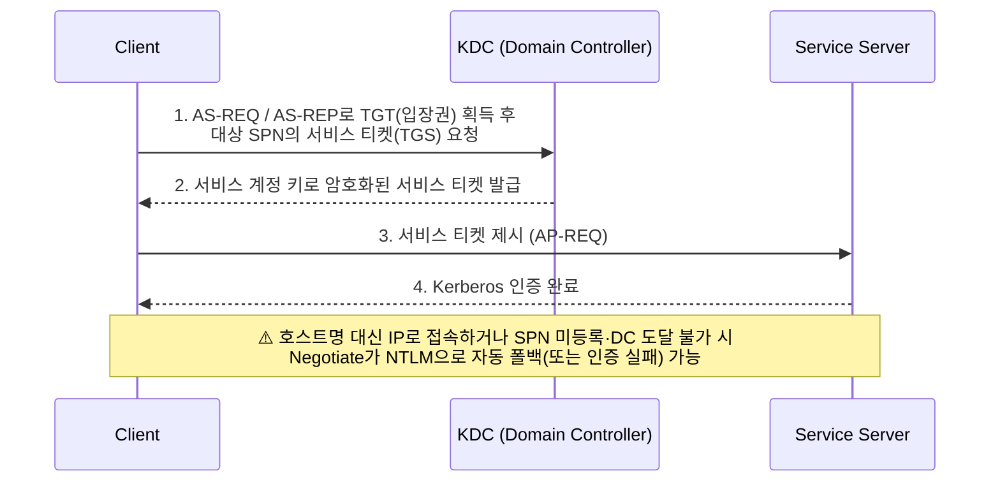
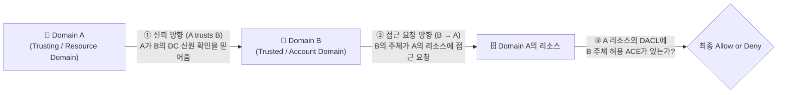

> [!summary] ⏱️ 5초 핵심 요약
> - **한 줄 비유**: Active Directory(AD) 공격 기법을 외우기 전에, **회사 전체의 '조직도 경계(Forest·Domain·OU)', '사원증 발급소(Kerberos·NTLM)', '서랍별 출입 명부(DACL·ACE)', '사내 공문 배포망(GPO·SYSVOL)', '계열사 간 신분증 협약(Trust)'이 원래 어떻게 굴러가도록 설계되었는지 건물 도면부터 읽는 과정**입니다.
> - **핵심 원리**: AD 침투 체인은 버그가 아니라 **정상 기능을 악용(Abuse by Design)**하는 경우가 대부분입니다. ① 일반 사용자의 기본 LDAP 읽기 권한으로 구조를 파악하고, ② Kerberos SPN·티켓 구조나 NTLM 폴백을 노리며, ③ 잘못 위임된 객체별 ACE(`GenericAll`, `WriteDACL`)나 GPO·Trust 경로를 타고 권한을 확장합니다.
> - **핵심 구분**: **보안 경계는 Domain이나 OU가 아니라 `Forest`**이며, **신뢰(Trust) 방향과 실제 접근(Access) 방향은 정반대**이고, **인증 성공(Authentication)과 자원 권한 부여(Authorization/ACL)는 항상 별개로 검증**해야 합니다.

[[AD 환경 Kerberos 체인 공격 - 위임 남용과 토큰 가장|AD 환경 Kerberos 체인 공격: 위임 남용과 토큰 가장으로 DC 장악]]과 [[윈도우 AD 침투 자격증명 피벗 권한상승 3가지 기법|윈도우 AD 침투: 자격증명 피벗·권한상승 3가지 기법]]은 공격 체인이 왜 성립하는지에 필요한 AD 배경지식을 이미 안다고 가정합니다. 이 글은 두 글의 **선행 아키텍처 기초편**으로서 공격 명령어를 단순 나열하는 대신, **정상적으로 의도된 인증·권한·정책 배포 모델이 어떤 조건에서 공격 경로로 해석되는지 그 "왜(Why)"**를 설명합니다.

*(참고: 아래 설명은 Microsoft Learn이 명시하는 Windows Server 2016~2025의 AD DS 개념을 기준으로 합니다. 실제 유효 권한과 인증 선택은 도메인 기능 수준, 스키마, 보안 정책, 객체별 ACL, 애플리케이션 구현에 따라 달라지므로 열거 결과를 문서의 기본값과 동일시해서는 안 됩니다.)*



---

## 한눈에 보는 AD 6대 핵심 구성요소와 보안적 의미

| 구성요소 | 정상 설계상의 목적 | 보안·침투 진단에서의 핵심 의미 (오해 주의점) |
|---|---|---|
| **1. Forest / Domain / OU** | 조직의 디렉터리 파티션 구분 및 관리 위임 | **진정한 보안 경계는 Domain이나 OU가 아니라 `Forest`임.** 같은 Forest 내 한 Domain이 뚫리면 Forest 전체가 위험해짐 |
| **2. Kerberos vs NTLM** | 티켓 기반 SSO 인증(Kerberos) 및 레거시 호환(NTLM) | SPN 누락·IP 직접 접속 시 **Kerberos 대신 NTLM으로 자동 폴백**될 수 있으며, SPN 구조 자체가 Kerberoasting의 기반이 됨 |
| **3. 기본 LDAP 가독성** | 직원 검색·자원 조회 등 일상 협업을 위한 디렉터리 열람 | 일반 도메인 계정 1개만 있어도 **BloodHound/LDAP으로 조직 전체 그룹·권한·위임 관계를 합법적으로 수집** 가능 |
| **4. DACL / ACE** | 사용자·그룹·컴퓨터 객체별 세밀한 관리 권한 위임 | 전역 관리자가 아니어도 특정 객체에 대한 `GenericAll`·`WriteDACL`·`ForceChangePassword` ACE 한 줄이 권한 상승 사다리가 됨 |
| **5. GPO / SYSVOL / AdminSDHolder** | 설정·스크립트 중앙 배포(GPO) 및 고권한 그룹 ACL 보호(SDProp) | GPO 수정 권한이나 SYSVOL 스크립트 변조는 대량 코드 실행 경로가 되며, 보호 계정(`adminCount=1`)은 일반 OU 상속을 무시함 |
| **6. Domain / Forest Trust** | 타 도메인·포레스트 사용자에게 교차 인증 경로 제공 | **"A가 B를 신뢰한다(A→B)"는 것은 "B 사용자가 A 자원에 접근 요청할 수 있다(B→A)"는 뜻**이며, 실제 허용은 A 자원의 ACL이 결정함 |

---

## 1. Forest, Domain, OU: 계층과 경계를 먼저 구분하기

**💡 한 줄 비유**: **Forest**는 법적·물리적으로 완전히 분리된 **기업 그룹 전체**, **Domain**은 그룹 내 같은 인사·출입 규정을 공유하는 **개별 지사**, **OU**는 지사 안에서 부서별로 서류철을 나눠 담은 **캐비닛 칸막이**입니다. 칸막이(OU)나 지사(Domain)만으로는 침입자를 완전히 막는 방화벽(보안 경계)이 되지 못합니다.



### 핵심 원리: 세 계층의 정확한 역할과 경계 차이

| 계층 단위 | 정의 및 공유 범위 | 보안 경계(Security Boundary)인가? | 진단 시 핵심 판단 기준 |
|---|---|---|---|
| **Forest** | 하나 이상의 Domain이 공통 스키마, 구성(Configuration) 파티션, 글로벌 카탈로그를 공유하는 최상위 논리 구조 | ✅ **예 (핵심 보안 경계)** | 같은 Forest의 Domain들은 기본적으로 양방향 전이 신뢰로 묶이며, `Enterprise Admins`나 한 Domain의 DC 침해는 Forest 전체 장악으로 번질 수 있음 |
| **Domain** | Forest 안의 디렉터리 파티션이자 인증(DC)·복제·암호 정책 단위 | ❌ **아니요 (관리·복제 단위)** | 자체 `Domain Admins`를 가지지만, 같은 Forest 내 상위·인접 Domain과 구성 파티션을 공유하므로 완전한 침해 격리 경계가 아님 |
| **OU (Organizational Unit)** | Domain 내부에서 사용자·컴퓨터 객체를 묶는 관리 컨테이너 | ❌ **아니요 (위임·GPO 컨테이너)** | 주 목적은 **관리 권한 위임과 GPO 링크 범위 지정**임. 객체가 어느 OU에 있는지만 보지 말고 그 객체의 실제 유효 ACL을 봐야 함 |

### 체크 포인트
- **Forest를 보안 경계**, **Domain을 인증·복제 파티션**, **OU를 관리 위임·GPO 범위**로 명확히 구분해 평가했는가?
- 객체가 속한 OU 위치와 그 객체에 실제로 적용된 유효 ACL을 분리해서 확인했는가?
- 같은 Forest 내부의 기본 양방향 전이 신뢰와 Forest 수준 서비스 관리자의 영향 범위를 고려했는가?
- 참고: [Active Directory 논리 모델](https://learn.microsoft.com/en-us/windows-server/identity/ad-ds/plan/understanding-the-active-directory-logical-model), [서비스 관리자 권한 범위](https://learn.microsoft.com/en-us/windows-server/identity/ad-ds/plan/service-administrator-scope-of-authority), [Active Directory Security Groups](https://learn.microsoft.com/en-us/windows-server/identity/ad-ds/manage/understand-security-groups)

---

## 2. Kerberos와 NTLM: 선호 프로토콜과 폴백 조건

**💡 한 줄 비유**: **Kerberos**는 놀이공원 정문 매표소(KDC)에서 신분증을 확인받고 **자유이용권 팔찌(TGT)**를 찬 뒤 각 놀이기구(SPN) 전용 **탑승권(TGS)**을 받아 타는 방식이고, **NTLM**은 매표소를 거치지 못할 때 놀이기구 직원이 직접 내는 **암호 수수께끼(Challenge-Response)**를 풀어 통과하는 구형 방식입니다.



### 핵심 원리: Kerberos vs NTLM 비교 및 폴백(Fallback) 조건
- **Kerberos (AD 기본 선호 프로토콜)**:
  - 도메인에 가입된 클라이언트와 서비스가 Kerberos를 지원하고, **DNS 이름 해석 · 시간 동기화(기본 5분 이내) · 올바른 SPN 등록 · KDC(DC) 네트워크 도달성**이 모두 충족될 때 작동합니다.
  - **SPN(Service Principal Name)**은 서비스 인스턴스(예: `MSSQLSvc/db01.corp.local:1433`)를 그 서비스를 실행하는 AD 계정과 연결하는 고유 식별자입니다.
- **NTLM (Challenge-Response 인증)**:
  - 티켓 발급소(KDC) 없이 서버가 난수(Challenge)를 주면 클라이언트가 비밀번호 해시로 계산한 응답(Response)을 돌려주는 방식입니다. 로컬 계정, Workgroup 환경, 레거시 시스템 호환을 위해 존재합니다.
- **언제 Kerberos 대신 NTLM으로 떨어지는가(Fallback)?**: Windows 통합 인증(`Negotiate`)을 쓸 때 아래 조건 중 하나라도 걸리면 Kerberos를 쓰지 못하고 NTLM 협상으로 넘어가거나(NTLM 차단 정책이 있으면 인증 실패) 공격 표면이 달라집니다.
  1. 클라이언트가 호스트 이름(FQDN) 대신 **IP 주소(예: `\\10.10.10.5\share`)로 직접 접근**해 SPN을 구성하지 못하는 경우
  2. 대상 서비스 계정에 **SPN이 등록되어 있지 않거나 중복·오등록**된 경우
  3. 클라이언트가 DC(KDC 88번 포트)와 통신할 수 없거나 방화벽에 막힌 경우

### 체크 포인트
- 대상 서비스에 고유하고 올바른 **SPN**이 등록되어 있는가?
- 사용자가 IP 주소가 아니라 SPN과 일치하는 **호스트 이름(DNS)**으로 접근하고 있는가?
- "로그인이 됐다"는 사실만으로 프로토콜을 추측하지 않고, `klist`, 이벤트 로그(4624 로그의 `Authentication Package`), 패킷 캡처로 **실제 사용된 인증 프로토콜(Kerberos vs NTLM)**을 확인했는가?
- 참고: [Kerberos Authentication Overview](https://learn.microsoft.com/en-us/windows-server/security/kerberos/kerberos-authentication-overview), [NTLM Overview](https://learn.microsoft.com/en-us/windows-server/security/kerberos/ntlm-overview), [Service Principal Names](https://learn.microsoft.com/en-us/windows/win32/ad/service-principal-names)

---

## 3. 기본 가독성: 왜 일반 도메인 사용자도 관계를 수집할 수 있는가

**💡 한 줄 비유**: 일반 신입사원도 사내 인트라넷 주소록에서 **누가 어느 부서 소속이고 누가 결재권자인지 조회할 수 있어야 업무가 돌아가듯**, AD도 도메인 사용자에게 조직도(LDAP) 열람을 기본 허용하기 때문에 공격자가 이 주소록을 모아 침투 지도(BloodHound)를 그릴 수 있습니다.

### 핵심 원리
- **기능으로서의 기본 읽기 권한**: AD는 `Authenticated Users`(또는 `Pre-Windows 2000 Compatible Access` 등)에게 디렉터리의 많은 객체(사용자, 컴퓨터, 그룹, 그룹 멤버십, SPN, DACL 등)를 읽을 수 있도록 기본 설계되어 있습니다. 따라서 **BloodHound(SharpHound/bloodhound-python)**나 `ldapsearch`는 특별한 해킹 익스플로잇을 쓰는 것이 아니라, **일반 도메인 계정 하나에 합법적으로 허용된 LDAP 조회 결과를 모아 그래프 형태로 시각화**하는 것입니다.
- **"AD는 읽을 수 있다" ≠ "모든 것을 무제한으로 읽는다"**:
  - 각 객체에는 보안 설명자와 DACL이 있으며, 비밀번호 해시나 `CONFIDENTIAL` 플래그가 붙은 민감 속성(예: LAPS 비밀번호, BitLocker 복구 키), 명시적 `Deny` ACE, `List Object` 모드 등이 적용된 항목은 일반 계정으로 읽히지 않습니다.
  - **LDAP 수집 vs 호스트 원격 수집의 차이**: BloodHound가 수집하는 데이터 중 그룹 멤버십·ACL·Trust는 **DC에 대한 LDAP 질의**만으로 나오지만, "현재 어느 서버에 누가 로그인해 있는가(Session)"나 "특정 서버의 로컬 Administrators 그룹에 누가 들어 있는가"는 **개별 호스트에 SMB/RPC로 직접 접근**해야 알 수 있습니다.
  - 따라서 **"BloodHound 그래프에 선이 안 보인다"는 것은 실제 권한 관계가 없다는 뜻이 아니라, 현재 계정의 수집 범위나 권한이 부족하다는 신호**일 수 있습니다.

### 체크 포인트
- 현재 계정으로 읽힌 객체·속성과 권한 부족(`CONFIDENTIAL`, `Deny` ACE 등)으로 읽히지 않은 항목을 구분했는가?
- 디렉터리(DC LDAP) 수집 결과와 개별 엔드포인트(호스트 세션·로컬 그룹) 수집 결과를 구분해 해석했는가?
- LDAP에서 읽은 디렉터리 관계와 실제 대상 서버에서의 로컬 정책·자원 접근 권한을 분리해 검증했는가?
- 참고: [Active Directory Account Database](https://learn.microsoft.com/en-us/windows/win32/secauthn/account-database), [DACLs and ACEs](https://learn.microsoft.com/en-us/windows/win32/secauthz/dacls-and-aces), [BloodHound Documentation](https://bloodhound.specterops.io/)

---

## 4. DACL과 ACE: 역할이 아니라 객체별 권한 목록

**💡 한 줄 비유**: AD 안의 모든 사람·그룹·컴퓨터는 각자 고유한 **사물함(객체)**이고, 각 사물함 문 앞에는 **"누가 이 사물함을 열거나 이름표를 고칠 수 있는지" 적힌 출입 명부(`DACL`)와 그 안의 한 줄짜리 규칙(`ACE`)**이 붙어 있습니다.

### 핵심 원리
- **전역 역할이 아닌 '객체 단위' 접근권**: `GenericAll`이나 `WriteDACL` 같은 이름은 계정 전체에 부여된 전역 직함이 아니라, **특정 대상 객체(`Target Object`)의 DACL에 적힌 한 줄의 ACE가 특정 주체(`Principal SID`)에게 허용한 권한**입니다.
- **DACL 평가 구조**:
  ```text
  Object: CN=<target>,OU=<scope>,DC=<domain>
  DACL (순서 및 상속 반영):
    ACE 1: DENY  <principal-A>  <specific-right>               (명시적 거부가 최우선)
    ACE 2: ALLOW <group-B>      <inherited-right>              (상위 OU에서 상속된 허용)
    ACE 3: ALLOW <principal-C>  <object-specific-right-GUID>   (특정 속성·제어 접근권 허용)
  ```

### 공격 체인에 자주 등장하는 4대 핵심 권한(ACE) 비교

| ACE 권한 이름 | 정상 관리 목적 | 실제로 허용되는 기술적 범위 | 공격 체인에서 악용되는 방식 (Abuse) |
|---|---|---|---|
| **`GenericAll`** | 대상 객체에 대한 전면 위임 관리 | 속성 읽기·쓰기, 자식 객체 생성·삭제, **DACL 및 소유자 변경**, 모든 확장 권한(Extended Rights) 행사 | 대상이 사용자면 암호 강제 변경·Shadow Credentials, 그룹이면 자신을 멤버로 추가, 컴퓨터면 RBCD 설정 |
| **`WriteDACL`** | 대상 객체의 보안 권한 목록(DACL) 관리 위임 | 직접 속성을 고치는 권한은 아니지만, **해당 객체의 DACL에 새 `Allow` ACE를 추가**할 수 있음 | 자기 자신에게 `GenericAll` ACE를 새로 적어 넣은 뒤(2단계) 위와 동일하게 대상 객체를 장악 |
| **`GenericWrite`** | 대상 객체의 일반 속성 수정 위임 | DACL 변경을 제외한 **모든 속성 쓰기 및 Validated Write** 허용 | 사용자/컴퓨터의 `msDS-KeyCredentialLink`(Shadow Credentials)나 `servicePrincipalName`(Targeted Kerberoasting) 속성 덮어쓰기 |
| **`ForceChangePassword`** (`User-Force-Change-Password`) | 헬프데스크의 사용자 암호 초기화 지원 | 확장 권한(Extended Right) GUID로, **기존 비밀번호를 몰라도 대상 계정의 비밀번호를 새 값으로 강제 재설정** | 상위 권한 사용자나 서비스 계정의 비밀번호를 임의로 바꿔치기해 즉시 계정 탈취 |

### 체크 포인트
- 권한 이름(`GenericAll` 등)만 적지 않고 **"어느 주체(SID)가 → 어느 대상 객체(DN)에 대해"** 가진 권한인지 쌍으로 기록했는가?
- 직접 부여된 ACE와 상위 OU에서 내려온 상속 ACE, 그리고 `Deny` 우선순위를 확인했는가?
- `GenericAll`, `GenericWrite`, `WriteDACL`, `ForceChangePassword`(확장 권한 GUID)의 기술적 차이와 대상 객체 클래스(User/Group/Computer)별 제약을 구분했는가?
- 참고: [MS-ADTS Access Rights](https://learn.microsoft.com/en-us/openspecs/windows_protocols/ms-adts/990fb975-ab31-4bc1-8b75-5da132cd4584), [DACLs and ACEs](https://learn.microsoft.com/en-us/windows/win32/secauthz/dacls-and-aces), [User-Force-Change-Password](https://learn.microsoft.com/en-us/windows/win32/adschema/r-user-force-change-password)

---

## 5. GPO와 SYSVOL, AdminSDHolder: 정책 배포와 보호 ACL

**💡 한 줄 비유**: **GPO**는 본사 전산실 장부(**`GPC`**)와 전 지점이 공용 게시판(**`SYSVOL`의 `GPT`**)에서 내려받는 실제 지시서 파일 세트로 돌아가며, **AdminSDHolder**는 임원진(`Domain Admins` 등)의 사물함 자물쇠를 누군가 몰래 바꿔치기해도 **1시간마다 본사 표준 자물쇠로 강제 초기화(`SDProp`)해 버리는 자동 경비 시스템**입니다.

### 핵심 원리
- **GPO의 두 반쪽 (`GPC` + `GPT`)**:
  - **GPC (Group Policy Container)**: AD 데이터베이스 내부에 저장되는 객체로, 버전 번호·상태·링크 메타데이터를 담고 **AD 복제**를 통해 전파됩니다.
  - **GPT (Group Policy Template)**: 각 DC의 `\\<domain>\SYSVOL\<domain>\Policies\{GUID}` 공유 폴더에 저장되는 실제 정책 파일·시작 스크립트·그룹 정책 기본 설정(GPP) 파일 묶음으로, 현대 AD에서는 주로 **DFSR**(구형 환경은 FRS)로 복제됩니다.
  - **적용 조건**: SYSVOL에서 GPO 폴더를 찾았다고 그 정책이 모든 서버에 돌아가는 것이 아닙니다. **사이트·Domain·OU 링크 여부, 활성 상태, 보안 필터링(Security Filtering), WMI 필터, 상속 차단 여부**가 맞아야 클라이언트가 실제로 정책을 실행합니다.
- **AdminSDHolder와 SDProp 메커니즘**:
  - `Domain Admins`, `Enterprise Admins`, `Administrators` 등 **보호된 그룹(Protected Groups)**과 그 구성원 객체(`adminCount=1`)는 하위 OU에 들어 있더라도 **일반 OU의 권한 상속이 자동으로 비활성화**됩니다.
  - PDC Emulator 역할을 맡은 DC의 **SDProp** 프로세스가 기본 60분마다 돌면서, 보호 대상 객체들의 DACL을 `CN=AdminSDHolder,CN=System,DC=...` 템플릿 객체의 DACL과 똑같이 덮어씁니다.
  - 따라서 하위 OU에 `GenericAll` 위임을 받아도 그 안의 보호된 관리자 계정은 건드리지 못하는 방어 효과가 생기며, 반대로 공격자가 `AdminSDHolder` 객체 자체의 DACL에 자기 계정을 추가해 두면 1시간 뒤 도메인 내 모든 관리자 계정에 대한 제어권이 자동 전파되는 영속성(Persistence) 경로가 됩니다.

### 체크 포인트
- GPO를 분석할 때 AD의 **GPC**와 SYSVOL의 **GPT**를 하나로 연결하고, **링크된 OU·보안 필터·상속·우선순위**를 계산해 실제 적용 대상 컴퓨터/사용자를 특정했는가?
- 환경의 AD DS 버전과 SYSVOL 복제 방식(DFSR vs 레거시 FRS)을 확인했는가?
- 목표 계정이 보호된 그룹 소속(`adminCount=1`)이라 **AdminSDHolder / SDProp**에 의해 OU 권한 상속이 차단되어 있지 않은지 확인했는가?
- 참고: [Group Policy Overview](https://learn.microsoft.com/en-us/windows-server/identity/ad-ds/manage/group-policy/group-policy-overview), [Group Policy Storage](https://learn.microsoft.com/en-us/previous-versions/windows/desktop/policy/group-policy-storage), [AdminSDHolder: Protected Accounts and Groups](https://learn.microsoft.com/en-us/windows-server/identity/ad-ds/plan/security-best-practices/appendix-c--protected-accounts-and-groups-in-active-directory)

---

## 6. Domain·Forest Trust: 신뢰 방향과 접근 방향을 반대로 읽기

**💡 한 줄 비유**: **A 회사가 B 회사의 사원증 발급소를 신뢰한다(`A trusts B`)**는 것은, 화살표 방향과 반대로 **B 회사 직원이 자기 사원증을 차고 A 회사 건물에 들어오겠다고 요청할 수 있다(`B accesses A`)**는 뜻입니다. 단, 실제로 A 회사 금고 문이 열릴지는 **A 회사 금고 문 앞의 출입 명부(ACL)**가 별도로 결정합니다.



### 핵심 원리: 헷갈리지 않는 Trust 판독 4단계
1. **신뢰 방향과 접근 방향은 정반대다**:
   - **문장 고정**: **"A(신뢰하는 도메인, Trusting)가 B(신뢰받는 도메인, Trusted)를 신뢰하면, B의 사용자가 A의 자원에 접근을 요청할 수 있다."**
   - 관리 도구나 BloodHound에서 `Inbound` / `Outbound` 표시를 볼 때는 항상 기준 도메인을 명확히 두고 **"누가 누구의 신원 보증을 믿어주는가?"**로 번역해야 실수가 없습니다.
2. **Trust(인증 경로) ≠ 자동 권한 부여(Authorization)**:
   - Trust는 단지 "B 도메인 DC가 발급한 티켓/인증을 A 도메인이 받아준다"는 **인증 다리**일 뿐입니다. A 도메인의 서버나 공유 폴더 ACL에 B 도메인 사용자/그룹(또는 `Authenticated Users` / `Everyone`)을 허용하는 ACE가 있어야만 실제 접근이 성립합니다.
3. **단방향/양방향 vs 전이성(Transitivity)**:
   - **방향(Direction)**: 단방향(One-way)인지, 두 단방향이 합쳐진 양방향(Two-way)인지 구분합니다.
   - **전이성(Transitivity)**: A가 B를 신뢰하고 B가 C를 신뢰할 때 A가 자동으로 C도 신뢰하는지 여부입니다. 같은 Forest 내부의 Tree-Root / Parent-Child Trust는 **기본 양방향 전이(Transitive)**이지만, 외부 도메인과 맺은 External Trust는 **비전이(Non-transitive)**입니다.
4. **방어 필터 확인 (SID Filtering & Selective Authentication)**:
   - 외부·Forest Trust에는 기본적으로 **SID Filtering(Quarantine)**이 적용되어, 침해된 B 도메인이 티켓의 `SIDHistory`에 A 도메인의 `Domain Admins` SID를 몰래 끼워 넣어도 경계에서 걸러집니다. (단, 같은 Forest 내부 Domain 간에는 SID Filtering 경계가 기본 적용되지 않아 `ExtraSids` 공격이 통할 수 있습니다.)
   - **Selective Authentication(선택적 인증)**이 켜진 Trust에서는 A 도메인 자원에 대해 `Allowed to Authenticate` 권한이 명시된 주체만 넘어올 수 있습니다.

### 체크 포인트
- 모든 Trust 관계를 **"A가 B를 신뢰한다 → 따라서 B 주체가 A 자원에 접근 요청할 수 있다"**는 문장으로 정확히 방향을 고정했는가?
- Trust의 존재(인증 가능성)와 목적지 자원의 실제 DACL 허용 여부를 분리해 검증했는가?
- **단방향/양방향(Direction)**과 **전이/비전이(Transitivity)**를 별개 속성으로 확인하고, **SID Filtering · Selective Authentication · DNS 조건부 전달자·방화벽** 상태를 함께 점검했는가?
- 참고: [Windows Authentication Concepts](https://learn.microsoft.com/en-us/windows-server/security/windows-authentication/windows-authentication-concepts), [MS-ADTS trustDirection](https://learn.microsoft.com/en-us/openspecs/windows_protocols/ms-adts/5026a939-44ba-47b2-99cf-386a9e674b04), [Active Directory 논리 모델](https://learn.microsoft.com/en-us/windows-server/identity/ad-ds/plan/understanding-the-active-directory-logical-model)

---

## 마무리: 아키텍처 기초에서 실전 공격 체인으로

AD 공격 체인을 읽을 때는 도구 이름보다 먼저 정상 설계를 복원해야 합니다. **주체가 어느 경계(Forest/Domain/OU)에 있고 → 어떤 프로토콜(Kerberos/NTLM)로 인증됐으며 → 어느 객체의 어떤 ACE가 권한을 만들고 → GPO와 Trust가 그 관계를 어디까지 전달하는지** 순서대로 확인하면, 실제 공격 경로와 단순한 디렉터리 관계를 정확히 구분할 수 있습니다. 이어서 실제 공격 체인이 어떻게 돌아가는지 보려면 아래 두 글을 순서대로 읽어보세요.
- [[윈도우 AD 침투 자격증명 피벗 권한상승 3가지 기법|윈도우 AD 침투: 자격증명 피벗·권한상승 3가지 기법]]
- [[AD 환경 Kerberos 체인 공격 - 위임 남용과 토큰 가장|AD 환경 Kerberos 체인 공격: 위임 남용과 토큰 가장으로 DC 장악]]
