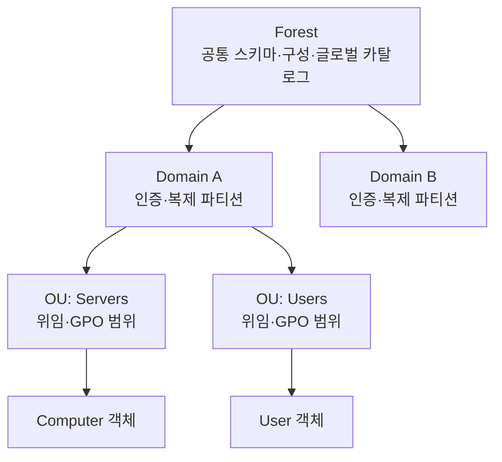
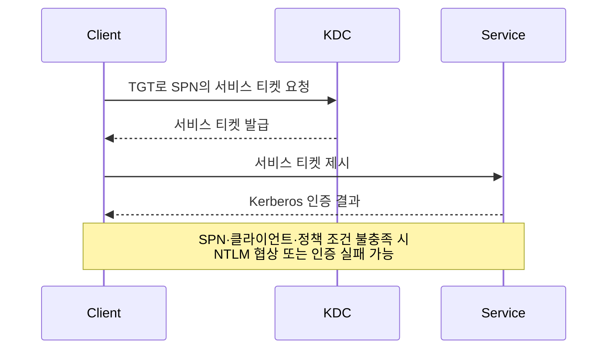
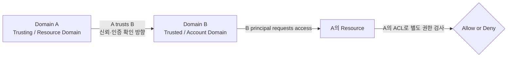

[[AD 환경 Kerberos 체인 공격 - 위임 남용과 토큰 가장|AD 환경 Kerberos 체인 공격: 위임 남용과 토큰 가장으로 DC 장악]]과 [[윈도우 AD 침투 자격증명 피벗 권한상승 3가지 기법|윈도우 AD 침투: 자격증명 피벗·권한상승 3가지 기법]]은 공격 체인이 왜 성립하는지에 필요한 AD 배경지식을 이미 안다고 가정한다. 이 글은 두 글의 선행 아키텍처 글로서 공격 기법을 반복하지 않고, 정상적으로 의도된 인증·권한·정책 배포 모델이 어떤 조건에서 공격 경로로 해석되는지 그 “왜”를 설명한다.

아래 설명은 현재 Microsoft Learn이 명시하는 Windows Server 2016~2025의 AD DS(Active Directory Domain Services: 도메인의 계정·컴퓨터·정책을 관리하는 디렉터리 서비스) 개념을 기준으로 한다. 실제 유효 권한과 인증 선택은 도메인 기능 수준, 스키마, 보안 정책, 객체별 ACL(Access Control List: 객체에 적용되는 접근 권한 목록), 애플리케이션 구현에 따라 달라지므로 열거 결과를 문서의 기본값과 동일시해서는 안 된다.

---

## 1. Forest, Domain, OU: 계층과 경계를 먼저 구분하기

**원리**: Active Directory는 회사 조직도와 사원증 출입 시스템을 합친 것과 같다. 조직도는 사용자·컴퓨터·그룹이 어디에 속하는지 보여 주고, 사원증 체계는 누가 어떤 자원을 사용할 수 있는지 판단한다. Forest, Domain, OU는 모두 이 구조에 등장하지만 같은 강도의 보안 경계는 아니다.

Forest는 하나 이상의 Domain이 공통 스키마, 구성 파티션, 글로벌 카탈로그를 공유하는 최상위 논리 구조다. 같은 Forest의 Domain은 기본적으로 양방향 전이 신뢰로 연결된다. 더 중요한 점은 Forest 수준 서비스 관리자가 Forest 전반에 영향을 미칠 수 있다는 사실이다. 따라서 강한 관리 격리가 필요할 때 OU나 새 Domain만으로 충분하다고 가정해서는 안 되며, Forest를 핵심 보안 경계로 평가한다.

Domain은 Forest 안의 디렉터리 파티션이자 인증·복제 단위다. Domain Controller는 해당 Domain의 계정과 자격 증명을 보관하고 인증하며, 그룹 멤버십 같은 권한 부여 자료를 제공한다. 각 Domain은 자체 `Domain Admins`와 도메인 명명 컨텍스트를 가지지만, 같은 Forest의 공유 구성과 Forest 수준 관리 권한에서 완전히 격리되지는 않는다.

OU(Organizational Unit: Domain 안에서 객체를 묶는 관리 단위)는 Domain 내부에서 객체를 묶는 관리 컨테이너다. 주된 목적은 관리 권한 위임과 GPO(Group Policy Object: 사용자·컴퓨터 설정을 배포하는 정책 객체) 적용 범위 구성이다. OU의 ACL과 하위 객체 ACL을 통해 제한된 작업을 위임할 수 있지만 OU 자체는 독립 인증 영역이나 침해 격리 경계가 아니다. 한 객체의 위치와 그 객체에 대한 실제 권한을 구분해서 읽어야 한다.



체크 포인트:

- Forest를 보안 경계, Domain을 인증·복제 파티션으로 구분했는가?
- OU를 격리 경계가 아니라 위임·GPO 범위로 해석했는가?
- 객체의 컨테이너 위치와 객체별 유효 ACL을 따로 확인했는가?
- 같은 Forest의 양방향 전이 신뢰와 Forest 수준 관리자 영향을 고려했는가?

참고: [Active Directory 논리 모델](https://learn.microsoft.com/en-us/windows-server/identity/ad-ds/plan/understanding-the-active-directory-logical-model), [서비스 관리자 권한 범위](https://learn.microsoft.com/en-us/windows-server/identity/ad-ds/plan/service-administrator-scope-of-authority), [Active Directory Security Groups](https://learn.microsoft.com/en-us/windows-server/identity/ad-ds/manage/understand-security-groups)

## 2. Kerberos와 NTLM: 선호 프로토콜과 폴백 조건

**원리**: Kerberos는 입구에서 신분을 한 번 확인받아 입장권인 TGT(Ticket Granting Ticket: 다른 서비스용 티켓을 요청할 때 쓰는 티켓)를 받고, 이후 각 시설용 서비스 티켓을 받아 신분증을 매번 다시 제시하지 않는 방식과 같다. KDC(Key Distribution Center: Kerberos 티켓을 발급하는 도메인 서비스)는 TGT와 서비스 티켓을 발급하고, 클라이언트는 서비스의 SPN(Service Principal Name: 서비스 인스턴스를 계정과 연결하는 고유 이름)을 기준으로 올바른 서비스 티켓을 요청한다.

AD Domain에 가입된 클라이언트와 서비스가 Kerberos를 지원하고, DNS·시간 동기화·SPN·DC 도달성이 충족되면 Kerberos가 선호된다. SPN은 서비스 인스턴스를 그 서비스가 사용하는 계정에 연결하는 고유 식별자다. 클라이언트가 호스트 이름으로 서비스에 접근하면 보통 서비스 종류와 이름을 조합해 SPN을 만들고 KDC에 티켓을 요청한다.

NTLM(NT LAN Manager: challenge-response 방식의 Windows 인증 프로토콜)은 티켓 시스템이 아니라 challenge-response 계열 인증이다. 로컬 계정, workgroup, 레거시 클라이언트, NTLM만 지원하는 자원처럼 Kerberos를 사용할 수 없는 환경에서도 쓰인다. AD 환경에서 지원된다는 사실은 Kerberos와 동등하게 권장된다는 뜻이 아니며, Microsoft 문서도 Kerberos V5를 선호 방식으로 설명한다.

통합 Windows 인증이 `Negotiate`를 사용할 때 Kerberos 조건이 성립하지 않으면 NTLM이 선택될 수 있다. 대표 원인은 서비스 계정에 SPN이 없거나 잘못 등록된 경우, 레거시 클라이언트나 NTLM 전용 자원, 그리고 호스트 이름 대신 IP 주소로 접근해 기대한 SPN을 구성하지 못하는 경우다. 단, NTLM 제한 정책, 애플리케이션의 provider 순서, DC 도달 실패 같은 조건에 따라 폴백하지 않고 인증 자체가 실패할 수도 있다.



프로토콜을 추측하지 말고 실제 세션을 확인한다. `klist`, 서버 로그, 네트워크 추적, 애플리케이션의 인증 상태를 함께 보면 “로그인 성공”과 “Kerberos 사용”을 구분할 수 있다. IP 접근을 호스트 이름으로 바꿨더니 동작했다는 결과도 SPN과 DNS를 확인하기 전에는 원인 확정이 아니다.

체크 포인트:

- 서비스에 고유하고 올바른 SPN이 등록됐는가?
- 사용자가 IP가 아니라 SPN과 일치하는 호스트 이름으로 접근하는가?
- 클라이언트·서비스가 Kerberos를 지원하고 DC에 도달 가능한가?
- NTLM 폴백 가능성과 NTLM 제한 정책을 함께 확인했는가?
- 성공한 세션의 실제 인증 프로토콜을 증거로 확인했는가?

참고: [Kerberos Authentication Overview](https://learn.microsoft.com/en-us/windows-server/security/kerberos/kerberos-authentication-overview), [NTLM Overview](https://learn.microsoft.com/en-us/windows-server/security/kerberos/ntlm-overview), [Service Principal Names](https://learn.microsoft.com/en-us/windows/win32/ad/service-principal-names)

## 3. 기본 가독성: 왜 일반 도메인 사용자도 관계를 수집할 수 있는가

**원리**: 회사 조직도에서 직원 이름, 부서, 보고 관계를 일반 직원이 찾아볼 수 있어야 협업이 가능하듯, AD도 인증된 사용자가 디렉터리의 많은 객체와 일반 속성을 읽을 수 있도록 설계된 경우가 많다. 이 가독성은 관리 권한이 아니라 디렉터리 검색과 일상 업무를 위한 읽기 권한이다.

사용자, 컴퓨터, 그룹, 그룹 멤버십, SPN 같은 관계 정보는 기본 또는 상속 ACL이 읽기를 허용하면 LDAP(Lightweight Directory Access Protocol: 디렉터리 정보를 조회·수정하는 프로토콜) 검색으로 수집할 수 있다. 그래서 BloodHound 같은 관계 분석 도구는 Domain Admin 자격이 없어도 의미 있는 AD 그래프를 만들 수 있다. 도구가 특별한 우회 권한을 얻는 것이 아니라 현재 주체에게 허용된 LDAP와 호스트 정보를 구조화하는 것이다.

그러나 “AD는 읽기 가능하다”를 “모든 사용자가 모든 속성을 무제한으로 읽는다”로 확대하면 안 된다. 각 디렉터리 객체에는 보안 설명자와 DACL이 있고, 속성 또는 property set 단위 권한도 적용될 수 있다. 암호처럼 검색으로 반환되지 않는 값, confidential 속성, 명시적 Deny, List Object 구성, 별도 위임과 제품별 스키마는 보이는 범위를 바꾼다.

BloodHound의 수집 범위도 수집기 버전과 권한에 따라 다르다. LDAP에서 읽는 디렉터리 관계와 원격 호스트에서 읽는 세션·로컬 그룹 정보는 서로 다른 프로토콜과 권한을 요구한다. “그래프에 없다”는 사실은 관계가 없다는 증명보다 수집 권한이나 범위가 부족하다는 신호일 수 있다.

분석할 때는 확인된 관계와 추론을 분리한다. 예를 들어 그룹 멤버십은 LDAP 결과로 확인할 수 있지만, 그 그룹이 특정 서버에서 실제로 행사하는 권한은 서버의 로컬 정책과 자원 ACL까지 확인해야 한다. 디렉터리 읽기 권한은 곧 자원 접근 권한이 아니다.

체크 포인트:

- 현재 계정으로 읽힌 객체·속성과 읽히지 않은 항목을 구분했는가?
- 디렉터리 LDAP 수집과 엔드포인트 수집의 권한 차이를 기록했는가?
- confidential 속성, Deny ACE, List Object 같은 예외를 고려했는가?
- 도구 그래프의 부재를 실제 관계의 부재로 단정하지 않았는가?
- 읽기 가능한 관계와 실제 자원 권한을 분리해 검증했는가?

참고: [Active Directory Account Database](https://learn.microsoft.com/en-us/windows/win32/secauthn/account-database), [DACLs and ACEs](https://learn.microsoft.com/en-us/windows/win32/secauthz/dacls-and-aces), [BloodHound Documentation](https://bloodhound.specterops.io/)

## 4. DACL과 ACE: 역할이 아니라 객체별 권한 목록

**원리**: AD 객체마다 서랍이 하나씩 있고, 각 서랍 앞에는 “누가 이 서랍을 열거나 고칠 수 있는가”라는 별도 목록이 붙어 있다고 생각하면 된다. 그 목록이 DACL(Discretionary Access Control List: 객체에 허용·거부 권한을 기록한 목록)이고, 특정 사용자·그룹에 Allow 또는 Deny 권한을 적은 한 줄이 ACE(Access Control Entry: 한 주체의 개별 권한 항목)다. 따라서 `GenericAll` 같은 이름은 전역 역할이 아니라 특정 객체에 붙은 ACE가 한 주체에게 부여한 접근권이다.

접근 검사는 요청한 주체의 SID(Security Identifier: 사용자·그룹 등을 고유하게 식별하는 값)와 그룹 SID, 객체 DACL의 ACE, Allow·Deny 순서, 상속 여부, 객체·속성 GUID(Globally Unique Identifier: 객체나 권한을 구별하는 고유 식별자)를 종합한다. 같은 사용자가 한 OU에는 쓰기 권한이 있고 다른 사용자 객체에는 읽기만 가능한 이유가 이것이다. 상위 컨테이너 ACE가 하위 객체로 상속될 수 있지만, 상속 플래그와 적용 대상 클래스에 따라 결과가 달라진다.

`GenericAll`은 해당 객체에 대한 광범위한 제어다. AD DS의 generic mapping에는 속성 읽기·쓰기, 자식 객체 생성·삭제, DACL·소유자 변경, 제어 접근권 등이 포함된다. 다만 실제 작업 가능 여부는 객체 클래스와 서버의 추가 제약도 받으므로 이름만 보고 모든 시스템 자원에 대한 관리자 권한으로 번역해서는 안 된다.

`WriteDACL`은 객체 보안 설명자의 DACL을 수정할 권리다. 직접 모든 속성을 고치는 권리와는 다르지만, 허용 ACE를 추가할 수 있으므로 결과적으로 더 강한 객체 권한을 위임할 수 있다. `GenericWrite`는 해당 객체의 모든 속성 쓰기와 모든 validated write를 포함하지만 DACL 변경 자체를 포함하지 않는다. 어떤 속성 변경이 보안 영향을 갖는지는 사용자·그룹·컴퓨터 등 객체 클래스에 따라 다르다.

`ForceChangePassword`는 흔히 부르는 표시명이며, Microsoft의 `User-Force-Change-Password` 제어 접근권은 대상 계정의 기존 암호를 알지 못해도 관리적 암호 재설정을 허용한다. 이는 대상 사용자의 다른 속성에 대한 전체 쓰기 역할이 아니다. 암호 정책, 보호된 계정, 작업을 수행하는 프로토콜의 요구사항도 별도로 적용된다.

```text
Object: CN=<target>,OU=<scope>,DC=<domain>
DACL:
  ACE 1: DENY  <principal-A>  <specific-right>
  ACE 2: ALLOW <group-B>      <inherited-right>
  ACE 3: ALLOW <principal-C>  <object-specific-right-GUID>
```

체크 포인트:

- 권한 이름 옆에 대상 객체와 주체 SID를 함께 기록했는가?
- 직접 ACE와 상속 ACE, Allow와 Deny 순서를 구분했는가?
- `GenericAll`, `GenericWrite`, `WriteDACL`을 서로 다른 권리로 해석했는가?
- 객체·속성·제어 접근권 GUID가 무엇을 제한하는지 확인했는가?
- 계산된 유효 권한을 해당 객체 클래스의 제약과 함께 검증했는가?

참고: [MS-ADTS Access Rights](https://learn.microsoft.com/en-us/openspecs/windows_protocols/ms-adts/990fb975-ab31-4bc1-8b75-5da132cd4584), [DACLs and ACEs](https://learn.microsoft.com/en-us/windows/win32/secauthz/dacls-and-aces), [User-Force-Change-Password](https://learn.microsoft.com/en-us/windows/win32/adschema/r-user-force-change-password)

## 5. GPO와 SYSVOL, AdminSDHolder: 정책 배포와 보호 ACL

**원리**: GPO는 본사 도서 목록과 각 지점에 배포되는 실제 책 묶음이 한 세트를 이루는 것과 같다. AD의 GPC(Group Policy Container: GPO의 식별·버전 같은 메타데이터를 보관하는 AD 객체)가 정책 정보를 보관하고, 각 DC(Domain Controller: 도메인 인증과 디렉터리 복제를 담당하는 서버)의 SYSVOL에 있는 GPT(Group Policy Template: 스크립트와 파일 기반 정책 자료)가 실제 파일을 제공한다.

GPO는 사이트, Domain, OU에 링크되고 보안 필터링과 WMI 필터, 상속·우선순위에 따라 적용 대상이 결정된다. 컴퓨터 시작과 사용자 로그인, 이후 새로 고침 때 클라이언트가 적용 가능한 GPO를 판단하고 Client-Side Extension이 해당 설정을 처리한다. 단순히 SYSVOL에서 파일을 보았다는 사실만으로 그 GPO가 특정 객체에 적용된다고 결론 내릴 수 없다.

GPC는 AD 복제로, GPT는 현대적인 AD DS 배포에서 주로 DFSR(Distributed File System Replication: SYSVOL 파일을 DC 사이에 복제하는 기능)을 통해 복제된다. 두 구성 요소의 버전과 내용이 일치해야 의도한 정책이 안정적으로 적용된다. 오래된 환경은 FRS(File Replication Service: 과거 SYSVOL 복제에 쓰인 서비스) 이력이 있을 수 있으므로 “모든 버전이 동일한 복제 방식”이라고 가정하지 말고 배포 버전을 확인한다.

AdminSDHolder는 정책 배포 기능이 아니라 보호된 계정·그룹의 보안 설명자를 위한 Domain별 템플릿 객체다. PDC Emulator(Primary Domain Controller Emulator: 시간 동기화와 일부 호환·관리 작업을 담당하는 도메인 역할)의 SDProp 과정은 보호 대상의 권한을 AdminSDHolder와 비교해 일치시키며, 보호 대상에서는 권한 상속이 비활성화된다. 그래서 OU에 위임한 ACE가 일반 계정에는 상속되지만 보호 계정에는 기대대로 적용되지 않을 수 있다.

AdminSDHolder를 모든 고권한 문제를 해결하는 범용 역할로 보아서는 안 된다. 보호 대상은 문서화된 그룹과 전이 멤버십 규칙으로 정해지고, 로컬 관리자나 임의의 애플리케이션 역할이 자동으로 같은 보호를 받는 것은 아니다. 실제 `adminCount`, 상속 상태와 DACL을 함께 확인한다.

체크 포인트:

- GPO의 GPC와 SYSVOL GPT를 하나의 논리 객체로 연결해 확인했는가?
- 링크 위치, 보안 필터, 상속, 우선순위로 실제 적용 범위를 계산했는가?
- 환경의 AD DS 버전과 SYSVOL 복제 방식을 확인했는가?
- 보호 계정에서 AdminSDHolder·SDProp과 상속 비활성화를 고려했는가?
- 일반 OU 위임과 보호 객체의 유효 DACL을 별도로 검증했는가?

참고: [Group Policy Overview](https://learn.microsoft.com/en-us/windows-server/identity/ad-ds/manage/group-policy/group-policy-overview), [Group Policy Storage](https://learn.microsoft.com/en-us/previous-versions/windows/desktop/policy/group-policy-storage), [AdminSDHolder: Protected Accounts and Groups](https://learn.microsoft.com/en-us/windows-server/identity/ad-ds/plan/security-best-practices/appendix-c--protected-accounts-and-groups-in-active-directory)

## 6. Domain·Forest Trust: 신뢰 방향과 접근 방향을 반대로 읽기

**원리**: 두 회사의 출입구를 연결할 때 A 회사가 B 회사의 신분증 발급 기관을 신뢰한다고 가정하자. 그러면 B 직원은 A 회사 자원에 출입을 요청할 수 있지만, 실제 문을 열 권한은 A 회사의 출입 목록이 별도로 결정한다. 즉 Trust는 인증 경로이며 자동 권한 부여가 아니다.

방향을 문장으로 고정하면 혼동이 줄어든다. **A가 B를 신뢰하면 B의 보안 주체가 A의 리소스에 접근을 요청할 수 있다.** Trust의 신뢰 흐름은 A에서 B로 향하지만, 사용자 관점의 접근 요청은 B에서 A로 향하므로 두 방향을 반대로 느끼기 쉽다. A 리소스의 ACL에 B 주체를 허용하지 않았다면 인증 가능성만 생기고 접근은 거부된다.



한쪽 방향 Trust는 이 인증 경로가 한 방향만 있다는 뜻이다. 양방향 Trust는 두 개의 단방향 관계가 함께 있어 양쪽 주체가 상대 자원에 접근을 요청할 수 있지만, 어느 쪽에서도 자원 ACL 검사는 생략되지 않는다. 관리 도구의 `incoming`과 `outgoing` 표시는 관찰하는 Domain 기준이므로 반드시 “누가 누구를 신뢰하는가” 문장으로 다시 써 본다.

전이성도 방향과 별개의 속성이다. 같은 Forest의 Domain은 기본적으로 양방향 전이 Trust를 가지지만, 외부 Trust나 Forest Trust의 도달 범위는 유형과 구성에 따라 다르다. Forest Trust에서도 selective authentication, SID filtering, 이름 해석, 방화벽, 자원 ACL이 실제 접근 범위를 제한할 수 있다.

따라서 Trust 객체를 찾았다는 사실만으로 공격 경로를 확정하지 않는다. Trust 유형, 방향, 전이성, 인증 범위, SID 필터링과 양쪽 DNS를 확인한 뒤, 목적 자원에 B 주체를 허용하는 ACE가 있는지 검증해야 한다.

체크 포인트:

- “A가 B를 신뢰한다”는 문장으로 양쪽 역할을 고정했는가?
- 신뢰 방향과 사용자 접근 요청 방향이 반대임을 표시했는가?
- 인증 가능성과 자원 ACL의 권한 부여를 분리했는가?
- 단방향·양방향과 전이·비전이를 서로 다른 속성으로 확인했는가?
- selective authentication, SID filtering, DNS와 방화벽을 함께 검증했는가?

참고: [Windows Authentication Concepts](https://learn.microsoft.com/en-us/windows-server/security/windows-authentication/windows-authentication-concepts), [MS-ADTS trustDirection](https://learn.microsoft.com/en-us/openspecs/windows_protocols/ms-adts/5026a939-44ba-47b2-99cf-386a9e674b04), [Active Directory 논리 모델](https://learn.microsoft.com/en-us/windows-server/identity/ad-ds/plan/understanding-the-active-directory-logical-model)

AD 공격 체인을 읽을 때는 도구 이름보다 먼저 정상 설계를 복원해야 한다. 주체가 어느 경계에 있고, 어떤 프로토콜로 인증됐으며, 어느 객체의 어떤 ACE가 권한을 만들고, GPO와 Trust가 그 관계를 어디까지 전달하는지 순서대로 확인하면 공격 경로와 단순한 디렉터리 관계를 구분할 수 있다.
