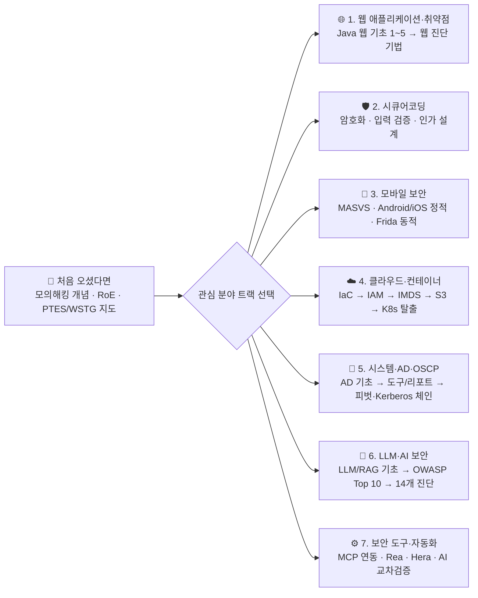

> [!summary] ⏱️ 5초 블로그 소개 (gooyong-sec)
> - **한 줄 비유**: 단편적인 해킹 명령어 암기장이 아니라, **"정상 시스템이 어떻게 설계되었는지(원리·구조) 이해한 뒤 → 어디서 경계가 무너지는지(진단·공격 체인) 확인하고 → 어떻게 사슬을 끊을지(방어·시큐어코딩) 연결하는" 실전 보안 기술 지도**입니다.
> - **학습 철학**: 모든 주제를 **`기초 원리` → `아키텍처·구조 이해` → `취약점 진단 방법론` → `실무 공격·방어 체인`** 4단계 흐름으로 정리합니다.
> - **읽는 법**: 모든 글을 순서대로 읽을 필요 없이, 아래 **7대 분야별 학습 경로 요약표**에서 지금 필요한 트랙을 골라 바로 시작하세요.

안녕하세요. 이곳은 보안 개념을 **기초 원리 → 구조 이해 → 진단 방법 → 실무 사례** 순서로 정리하는 학습 블로그입니다.  
글은 AI를 활용해 작성하고 공식 문서와 공개 자료로 교차 검토합니다. 틀리거나 보완할 내용이 있으면 언제든 알려주세요.

---

## 한눈에 보는 7대 학습 경로 요약표

| 트랙 | 추천 독자 및 목표 | 핵심 키워드 | 시작점(입문 글) |
|---|---|---|---|
| **0. 진단 공통 기초** | 모의해킹을 처음 시작하거나 업무 범위·방법론을 잡아야 할 때 | PTES, OWASP WSTG, RoE, 레드팀 vs 퍼플팀 | [[모의해킹 vs 레드팀 vs 퍼플팀 — 목적·접근방식·산출물로 구분하기]] |
| **1. 웹 애플리케이션 보안** | 웹 요청 처리 구조(WAS·서블릿·DB)부터 주요 웹 취약점까지 연결할 때 | HTTP, Servlet/JSP, Spring MVC, SQLi, XSS, SSRF | [[Java 웹 기초 1 — HTTP·웹 서버·WAS와 요청 처리 흐름]] |
| **2. 시큐어코딩** | 취약점이 코드·암호 설계에서 발생하는 원인과 안전한 구현법을 찾을 때 | AES, 블록 암호 모드(ECB/CBC/GCM), 입력 검증 | [[Java Properties 파일 AES 암호화 — ECB 모드의 함정]] |
| **3. 모바일 보안** | Android/iOS 앱의 정적 리버싱부터 Frida 후킹·네트워크 분석까지 익힐 때 | OWASP MASVS, jadx, iOS Binary, Frida, SSL Pinning | [[모바일 모의해킹 입문 — 환경 구축과 MASVS 체크리스트]] |
| **4. 클라우드·컨테이너 보안** | Terraform/K8s 코드 스캔부터 AWS IAM·IMDS·S3·K8s 탈출 체인을 볼 때 | IaC, IAM `PassRole`, IMDSv2, S3 BPA, K8s RBAC | [[클라우드 인프라 진단 — IaC 보안 스캐닝(Terraform·K8s manifest)]] |
| **5. 시스템·AD·OSCP** | Windows AD 아키텍처 원리와 실전 자격증명 피벗·Kerberos 체인을 익힐 때 | Kerberos, DACL/ACE, LSASS, 위임 남용, OSCP | [[공격 체인 이전의 AD 아키텍처 기초 — Kerberos, NTLM, DACL·ACE, GPO·SYSVOL, 도메인 트러스트]] |
| **6. LLM·AI 보안** | 생성형 AI·RAG·에이전트 서비스의 신규 위협과 모의해킹 기법을 다룰 때 | Prompt Injection, RAG, Excessive Agency, OWASP LLM | [[LLM 입문 — 거대언어모델·에이전트·RAG 개념 정리]] |
| **7. 보안 도구·자동화** | Ghidra·Burp·Frida에 AI(MCP)를 붙여 분석 생산성을 극대화할 때 | MCP, Ghidra, Burp Suite, Frida, Rea, Hera | [[취약점 진단 툴에 MCP 붙이기 Ghidra Burp jadx]] |

---

## 처음 오셨다면 (진단 입문 3단계)

**💡 한 줄 비유**: 산에 오르기 전에 **"이번 등산의 목적(모의해킹/레드팀)은 무엇인지, 출입 금지 구역(RoE)은 어디인지, 전체 등산로 지도(PTES·WSTG)는 어떻게 생겼는지" 먼저 확인하는 베이스캠프**입니다.

1. [[모의해킹 vs 레드팀 vs 퍼플팀 — 목적·접근방식·산출물로 구분하기]] — 우리가 수행하는 진단의 목적과 산출물 정의
2. [[스코프와 교전규칙(RoE) — 모의해킹을 시작하기 전에 정해야 할 것들]] — 합법적이고 안전한 진단을 위한 범위·예외·비상 연락망 합의
3. [[모의해킹 방법론 총정리 — PTES 7단계와 OWASP WSTG로 보는 진단 전체 지도]] — 정찰부터 보고서 작성까지 길을 잃지 않게 해주는 표준 프레임워크
4. 위 3편으로 큰 그림을 잡았다면, 관심 분야의 학습 경로를 골라 아래 순서대로 읽으세요.

---

## 분야별 학습 경로

각 경로는 독립적으로 시작할 수 있습니다. 모든 경로를 순서대로 끝내야 하는 것은 아닙니다.

### 1. 웹 애플리케이션과 웹 취약점

**💡 한 줄 비유**: 건물의 배관과 전기 배선도(Java 웹 서버·서블릿·세션·DB 흐름)를 먼저 이해해야 어디서 누수(SQLi, XSS, SSRF)가 터지는지 정확히 짚어낼 수 있습니다.

- **웹 아키텍처 기초 (Java Web 5부작)**
  - [[Java 웹 기초 1 — HTTP·웹 서버·WAS와 요청 처리 흐름]]
  - [[Java 웹 기초 2 — Servlet 생명주기·멀티스레딩과 Scope]]
  - [[Java 웹 기초 3 — JSP·EL·JSTL과 MVC Model 1·2]]
  - [[Java 웹 기초 4 — Filter·Session과 인증·인가]]
  - [[Java 웹 기초 5 — JDBC·트랜잭션과 Spring MVC 요청 흐름]]
- **웹 취약점 진단 실전**
  - [[웹 취약점 진단 기법 입문 — XXE, SSRF부터 SQLi, XSS까지]]

---

### 2. 시큐어코딩

**💡 한 줄 비유**: 취약점을 찾는 공격자 시선을 넘어, **애초에 부서지지 않는 자물쇠와 문틀을 코드로 어떻게 설계하고 구현할 것인가**를 다룹니다.

- [[Java Properties 파일 AES 암호화 — ECB 모드의 함정]]
- 웹 입력 검증·출력 인코딩·인증/인가 시큐어코딩 글은 순차 보강할 예정입니다.

---

### 3. 모바일 보안

**💡 한 줄 비유**: 내 손안의 스마트폰(클라이언트)은 공격자가 통제하는 영역입니다. **앱 패키지를 뜯어보는 정적 분석과 실행 중인 앱의 메모리를 조작하는 동적 분석**을 순서대로 익힙니다.

- [[모바일 모의해킹 입문 — 환경 구축과 MASVS 체크리스트]]
- [[모바일 취약점 진단 — 안드로이드 정적분석]]
- [[모바일 취약점 진단 — iOS 정적분석]]
- [[모바일 취약점 진단 — Frida 동적분석과 네트워크]]

---

### 4. 클라우드·컨테이너 보안

**💡 한 줄 비유**: 클라우드 침투는 **설계도(IaC) 오구성에서 시작해, 작은 열쇠 하나를 주운 뒤 권한 전달(`PassRole`)·내부 안내 데스크(`IMDS`)·창고 규정(`S3`)·가벽 돌파(`K8s`)를 엮어 나가는 사후 익스플로잇 체인**입니다.

- **배포 전 사전 진단 (Shift-Left)**
  - [[클라우드 인프라 진단 — IaC 보안 스캐닝(Terraform·K8s manifest)]]
- **사후 익스플로잇 및 권한·데이터 유출 체인**
  - [[클라우드 인프라 진단 — AWS IAM 권한상승 체인]]
  - [[클라우드 인프라 진단 — IMDS SSRF로 자격증명 탈취]]
  - [[클라우드 인프라 진단 — S3·스토리지 오남용과 데이터 유출 체인]]
  - [[클라우드 인프라 진단 — 컨테이너·Kubernetes 탈출]]

---

### 5. 시스템·Active Directory·OSCP

**💡 한 줄 비유**: Windows 도메인(AD)의 정상 출입·위임 규정을 먼저 이해한 뒤, **전동 공구(추천 도구·SysReptor)를 챙겨 자격증명 피벗과 Kerberos 티켓 체인으로 도메인 컨트롤러(DC)까지 장악하는 과정**입니다.

- **선행 아키텍처 기초**
  - [[공격 체인 이전의 AD 아키텍처 기초 — Kerberos, NTLM, DACL·ACE, GPO·SYSVOL, 도메인 트러스트]]
- **실전 도구 및 리포팅 환경**
  - [[OSCP 사용 도구]]
  - [[SysReptor로 OSCP 리포트 작성하기]]
- **AD 자격증명 피벗 & Kerberos 공격 체인**
  - [[윈도우 AD 침투 자격증명 피벗 권한상승 3가지 기법]]
  - [[AD 환경 Kerberos 체인 공격 - 위임 남용과 토큰 가장]]

---

### 6. LLM·AI 보안

**💡 한 줄 비유**: 말 한마디로 데이터베이스를 조회하고 외부 API를 호출하는 **AI 대리인(LLM·RAG·Agent)을 속여, 의도치 않은 기밀 유출과 권한 남용을 일으키는 최신 공격 표면**을 진단합니다.

- [[LLM 입문 — 거대언어모델·에이전트·RAG 개념 정리]]
- [[OWASP Top 10 for LLM 2025 심화 해설]]
- [[LLM 애플리케이션 모의해킹 14개 취약점 진단]]
- [[PortSwigger Web LLM Attacks 랩 실습 — 과도한 권한부터 인다이렉트 인젝션까지]]

---

### 7. 보안 도구와 자동화

**💡 한 줄 비유**: 정적 디컴파일러(Ghidra, jadx)와 동적 분석기(Burp, Frida)에 **AI 에이전트 신경망(MCP)을 직접 연결해 반복 분석을 자동화하고 교차 검증하는 엔지니어링 기록**입니다.

- [[취약점 진단 툴에 MCP 붙이기 Ghidra Burp jadx]]
- [[Rea 써봤다 — MCP로 붙는 AI 역공학 에이전트 도구]]
- [[Hera — Frida 기반 동적 보안 분석 워크벤치를 직접 만들다]]
- [[Claude 작업을 Codex로 교차검증하기 — MCP로 두 AI 붙이기]]

---

> [!tip] 탐색 팁
> 왼쪽 탐색기에는 각 분야의 전체 글이 학습 순서대로 정렬되어 있습니다. 긴 글에서는 상단 **`⏱️ 5초 핵심 요약`**과 우측 목차(TOC)를 이용하면 필요한 핵심 원리와 체크리스트로 바로 이동할 수 있습니다.
