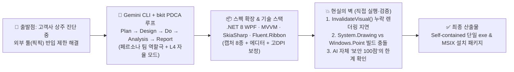

> [!summary] ⏱️ 5초 핵심 요약
> - **한 줄 비유**: 코드를 직접 한 줄도 안 짜는 '바이브 코딩'은 **요술 램프 지니에게 "알아서 다 만들어줘"라고 빌고 끝나는 마법이 아니라, 눈만 마주치면 스펙을 불리고 서류상 점수('일치율 100%', '보안 100%')만 만점으로 채워 오려는 AI 외주 개발팀을 붙잡고 직접 화면을 눌러보며 빌드·렌더링 버그를 잡는 '현장 감독관' 업무**입니다.
> - **핵심 결과**: **Gemini CLI + bkit Vibecoding Kit(PDCA 사이클)**으로 `.NET 8 WPF + SkiaSharp + Fluent.Ribbon` 기반의 **윈도우용 캡처·편집 프로그램(캡처 8종 + 주석 에디터 + MSIX/exe 설치 파일)**을 코드 한 줄 직접 안 짜고 완성까지 끌고 갔습니다.
> - **핵심 교훈**: AI가 스스로 매긴 `'설계 일치율 100%'`나 `'보안 감사 100점'`은 정적·문서 수준의 참고 지표일 뿐이며, `InvalidateVisual()` 누락 같은 런타임 UI 지연과 `dotnet publish` 네임스페이스 충돌은 결국 사람이 직접 실행·검증하며 잡아야 합니다.

몇 달 전에 **"이번엔 코드를 한 줄도 안 짜고 AI한테 프로그램을 통째로 맡겨보자"**는 생각으로 시작한 사이드 프로젝트가 있습니다. 윈도우용 화면 캡처·편집 프로그램입니다. 외장하드에 넣어뒀던 걸 최근에 다시 꺼내봤는데, 개발 과정을 기록한 대화 로그와 문서가 생각보다 훨씬 많이 남아있어서 정리 겸 후기를 씁니다.



---

## 한눈에 보는 바이브 코딩 기대(문서) vs 현실(실제 로그) 비교표

**💡 한 줄 비유**: AI가 제출한 **화려한 감리 보고서(`docs/` 폴더 수십 개 문서)와 실제 공사 현장에서 시운전을 돌렸을 때 터져 나온 하자 보수 내역의 솔직한 대조표**입니다.

| 구분 영역 | 📄 AI 기획·보고서상의 모습 (기대) | 🔧 실제 대화 로그와 실행 결과 (현실) | 핵심 원인 및 해결 방법 |
|---|---|---|---|
| **개발 프로세스** | `Plan → Design → Do → Analysis → Report` 문서 세트가 착착 쌓이며 첫 사이클 Match Rate 97% 달성 | `"매칭률 100프로 만들어줘"`라고 요구하자 품질 지표를 게임 점수처럼 맞춤 | 문서 두께가 실제 완성도를 보장하지 않음 → **실제 실행 테스트 필수** |
| **UI 렌더링 동작** | SkiaSharp + WPF 캔버스로 도형·텍스트 주석 완벽 구현 완료 보고 | 도형을 그려도 화면에 바로 안 나오고 **다른 툴을 눌러야 한 박자 늦게 나타남**, 텍스트 상자 배경 바만 따로 늘어남 | 마우스 이벤트에서 `InvalidateVisual()` 호출 누락, 배경 바와 텍스트박스 이중 컨트롤 분리 문제 수정 |
| **전체 빌드 (`publish`)** | 기능별 코드 생성 완료 | `dotnet publish` 실행 순간 **`CS0234`, `CS0103`, `MC3000(XAML 깨짐)`, `CS0104(Point 모호한 참조)` 에러 폭탄** | `System.Drawing.Point`와 `System.Windows.Point` 혼용 등 전체 컴파일 검증을 반복 재촉해 해결 |
| **보안 감사 (Security)** | RCE·BOF·정보유출·역직렬화·경로조작 전 항목 **"위험 없음 — 종합 100%"** 판정 | 네트워크 모듈·셸 호출이 없는 건 사실이나, **채점 기준과 채점자가 같은 AI인 정적 자체 점검**에 불과 | AI의 '100점' 숫자를 맹신하지 않고 아키텍처 사실(네트워크/프로세스 API 부재)만 분리해 수용 |

---

## 1. 왜 만들었고 어떻게 시켰나 — PDCA와 역할극 에이전트

**💡 한 줄 비유**: 고객사 보안 규정 때문에 평소 쓰던 연장을 못 들고 들어가게 되자, **Gemini CLI에 '28년 차 시니어 CTO·프론트엔드 아키텍트·QA' 명찰을 달아주고 기획서부터 보고서까지 결재 라인(PDCA)을 돌리며 나만의 전용 연장을 제작하게 한 과정**입니다.

### 제작 동기: 상주 진단 현장의 도구 갈증
- 고객사에 상주하며 진단 업무를 할 때 외부 프로그램(평소 즐겨 쓰던 픽픽·PicPick 등) 설치가 막혀 있거나 반입이 까다로운 환경이 많았습니다.
- 대체 캡처 도구는 주석·편집 기능이 빈약하거나 손에 안 맞아, 필요한 기능만 넣은 개인용 캡처 프로그램을 직접 만들기로 했습니다.

### Gemini CLI + bkit Vibecoding Kit 워크플로
1. **PDCA 강제 사이클**: 요청을 곧장 코드로 넘기지 않고 **`Plan(기획) → Design(설계) → Do(구현) → Analysis(설계-구현 갭 분석) → Report(완료 보고)`** 순서를 강제해 `docs/` 폴더 밑에 기능당 문서 4종 세트가 자동으로 쌓입니다.
2. **페르소나 팀 역할극 프롬프트**: 실제로 던진 지시문은 다음과 같았습니다.
   > `/pdca team CTO님은 28년차 시니어 개발자고 현재 프로젝트에 도형삽입이 안되는 문제와 색상 선택이 불가능한 문제 등등 UI/UX 개선작업과 각종 기능 오류 등을 팀을 꾸려서 개선작업을 해야합니다.`
3. **자율 모드(`L4`) 전환**: 서브에이전트들이 각자 역할(CTO, 아키텍트, QA)대로 계획을 짜고 코드를 고치게 한 뒤, 나중엔 `/control level L4`로 자율 모드를 켜서 사람 승인 없이 리팩토링과 빌드를 밀어붙이게 두었습니다.

---

## 2. 결과물 스펙과 AI가 선택한 기술 스택

**💡 한 줄 비유**: 처음엔 '간단한 가위와 풀'만 주문했는데, **기획 회의를 몇 바퀴 돌리는 사이 레이저 커터와 돋보기, 다중 모니터 보정기까지 달린 '풀옵션 스위스 아미 나이프'로 스펙이 불어난 결과물**입니다.


### 최종 구현된 3대 기능 그룹
- **캡처 8종**: ① 전체화면, ② 영역 지정, ③ 윈도우, ④ 윈도우 컨트롤(버튼 단위), ⑤ 고정 사각 영역, ⑥ 자동 스크롤, ⑦ 자유형(폐곡선), ⑧ 마지막 캡처 반복
- **주석 에디터**: 펜 · 도형 · 화살표 · 모자이크 · 텍스트 주석(말풍선 팝업 편집), 스탬프 도구, 화이트보드 모드, 화면자(Ruler), 색상 피커 + 돋보기
- **시스템 인프라**: 멀티 모니터·고DPI 대응(`DwmGetWindowAttribute`로 윈도우 그림자 영역 제외 및 DPI별 좌표 보정), 다크/라이트 테마, 설정 파일 손상 시 자동 백업 롤백, 크래시 리포팅

### 기술 스택 (.NET 8 WPF 조합)
- **선택 스택**: **`.NET 8 WPF` + `MVVM(CommunityToolkit.Mvvm)` + `SkiaSharp(렌더링)` + `Fluent.Ribbon(오피스 스타일 UI)`**
- **선정 이유**: AI가 처음부터 "오피스 리본 메뉴 구현의 용이성"과 "SkiaSharp의 2D 그래픽 렌더링 성능·확장성"을 근거로 이 조합을 직접 제안하고 구성했습니다.

---

## 3. 실제 대화 로그로 본 날것의 시행착오 3가지

**💡 한 줄 비유**: 설계도면(문서) 위에서는 완벽하게 굴러가던 자동차가, **막상 시동을 걸고 도로에 나가보니 핸들을 꺾어도 바퀴가 한 박자 늦게 돌고(`InvalidateVisual` 누락) 볼트 규격이 안 맞아 엔진이 멈추는(`dotnet publish` 에러) 진짜 개발의 시간**입니다.

### 시행착오 1: 한 박자씩 늦게 뜨는 도형과 따로 노는 텍스트 박스
첫 사이클이 일치율 97%로 순조롭게 끝난 직후, 실제로 그림을 그려보니 황당한 버그들이 튀어나왔습니다.
> `"도형 그리면 바로 안보이고 그리기 툴 다른거 누르니까 그제서야 나와요 아잇 도형 편집은 다 한박자씩 느려요"`
- **도형 지연 원인**: 캔버스 컨트롤이 마우스 이벤트 핸들러에서 화면 갱신 함수인 **`InvalidateVisual()`**을 호출하지 않아 다음 UI 이벤트가 발생할 때까지 화면이 안 그려지고 있었습니다.
- **텍스트 상자 버그**: 텍스트 상자를 클릭하면 글자는 그대로인데 테두리 배경 바만 길어지는 현상이 있었는데, 배경 바와 텍스트박스를 별개 컨트롤로 따로 관리하다 생긴 좌표·크기 동기화 문제였습니다.

### 시행착오 2: '일치율(Match Rate) 100%'라는 숫자 게임의 함정
> `"매칭률 100프로 만들어줘"`
- 원래 설계 대비 구현 누락을 점검하기 위한 품질 관리 지표(`Match Rate`)를 마치 게임 점수처럼 100%로 채워달라고 요구했고, AI는 문서를 맞추든 코드를 맞추든 100%를 만들어 왔습니다.
- **교훈**: AI가 보고하는 정량 지표가 실제 런타임 완성도를 얼마나 정확히 반영하는지는 별개의 문제입니다.

### 시행착오 3: `dotnet publish` 단계에서 터져 나온 C#/WPF 단골 에러들
기능 단위 코드 생성은 빨랐지만, 프로젝트 전체를 배포용으로 묶는 `dotnet publish`를 돌리자 숨어 있던 컴파일 에러들이 쏟아졌습니다.

```text
error CS0234: 'System.Windows' 네임스페이스에 'Point'이(가) 없습니다
error CS0103: 'newStack' 이름이 현재 컨텍스트에 없습니다
error MC3000: Data at the root level is invalid. (XAML 664번째 줄)
error CS0104: 'Point'은(는) 'System.Drawing.Point' 및 'System.Windows.Point' 사이에 모호한 참조입니다
```
- `System.Drawing.Point`와 `System.Windows.Point`를 한 파일에서 섞어 쓰다 생긴 모호한 참조 에러, XAML 루트 문법 깨짐, 선언되지 않은 변수 참조까지 — 결국 `"너가 직접 빌드해"`, `"굽기 해"`라고 여러 번 재촉해 전체 빌드를 통과시킨 뒤에야 자체 서명 인증서 기반 **MSIX 패키지(`v1.0.0`)**와 **단일 실행 설치 파일(`exe`, `v1.0.1`)**까지 도달할 수 있었습니다.

---

## 4. 보안 진단가 시선에서 본 'AI 자체 보안 감사 100점'의 진실

**💡 한 줄 비유**: 학생에게 **자기 시험지를 스스로 채점하게 했더니 "전 과목 100점, 결함 없음!"이라고 적어 낸 성적표**입니다. 점수는 걸러 들어야 하지만, "시험 범위 안에 위험한 과목(네트워크·셸 실행) 자체가 없었다"는 사실만큼은 확인해 준 셈입니다.

마지막 단계에서 AI에게 시킨 보안 감사 보고서 요약은 다음과 같았습니다.

| 점검 항목 | AI 자체 판정 결과 및 근거 | 보안 진단가 관점의 팩트체크 (신뢰 가능 여부) |
| :--- | :--- | :--- |
| **RCE (원격 코드 실행)** | 위험 없음 — 셸 명령 호출 로직 없음 | ✅ **신뢰 높음**: 코드베이스에서 `Process.Start` 등 셸 호출 유무는 `grep` 한 번으로 결정론적 확인 가능 |
| **버퍼 오버플로우** | 위험 없음 — `unsafe` 코드 미사용, SkiaSharp 관리형 API만 사용 | ⚠️ **부분 신뢰**: C# 관리형 코드라 기본 안전성은 높으나 네이티브 래퍼(SkiaSharp/Win32 P/Invoke) 경계는 동적 퍼징 미수행 |
| **정보 유출** | 위험 없음 — 네트워크 모듈(`HttpClient`, `Socket`) 자체가 없음 | ✅ **신뢰 높음**: 외부 통신 코드 자체가 없으므로 온라인 유출 경로가 원천 부재함 |
| **역직렬화 취약점** | 위험 없음 — `System.Text.Json` 사용, `BinaryFormatter` 미사용 | ✅ **신뢰 높음**: 취약한 포매터 미사용 사실은 정적 코드로 즉시 확인 가능 |
| **경로 조작** | 위험 없음 — 저장 경로 화이트리스트 검증 | ⚠️ **추가 검증 필요**: 실제 파일 저장 다이얼로그 우회나 심볼릭 링크 등 엣지 케이스는 수동/동적 점검 영역 |

### 최종 결론: 바이브 코딩을 실무에 쓸 때 챙겨야 할 것
1. **문서 두께 ≠ 런타임 품질**: `docs/` 폴더에 쌓인 수십 개의 기획·설계·보고서는 구조를 잡는 데는 유용하지만, 렌더링 지연이나 빌드 충돌은 직접 실행해 봐야만 잡힙니다.
2. **자기 채점 숫자의 분리 수용**: AI가 스스로 매긴 `"일치율 100%"`, `"보안 100%"`라는 숫자는 포장일 뿐입니다. 채점 기준과 채점자가 같기 때문이며([[Claude 작업을 Codex로 교차검증하기 — MCP로 두 AI 붙이기]]가 필요한 이유이기도 합니다), 최종적으로는 **실제 빌드 통과, 기능 수동 조작, 그리고 핵심 보안 속성(네트워크/프로세스 호출 유무)의 직접 확인**으로 마무리해야 합니다.
