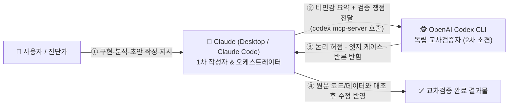

> [!summary] ⏱️ 5초 핵심 요약
> - **한 줄 비유**: 자기가 쓴 보고서의 오탈자와 논리적 허점을 자기 눈으로 찾으려 하면 뇌가 알아서 고쳐 읽으며 넘어가듯, **Claude가 작성한 코드나 보안 분석 결과도 다른 두뇌를 가진 감사관(OpenAI Codex CLI)에게 MCP로 바로 넘겨 '2차 소견(Second Opinion)'을 받아야 사각지대가 사라집니다.**
> - **핵심 원리**: OpenAI Codex CLI에 내장된 **`codex mcp-server`** 기능을 통해 별도 브리지 개발 없이 Claude(호스트)에 Codex를 표준 MCP 도구로 직결하고, `작성(Claude) → 쟁점 요약 및 검증 요청(MCP) → 반론·엣지 케이스 도출(Codex) → 실제 코드/데이터 대조 후 반영` 루프를 돌립니다.
> - **핵심 보안·품질 원칙**: Codex에 민감 원문(전체 소스·로그·자격증명)을 무분별하게 넘기지 않도록 **비민감 요약 위주로 전달**하고, 두 AI가 동시에 같은 환각(Shared Blind Spot)에 빠질 수 있으므로 최종 판단은 반드시 실제 코드·데이터로 검증해야 합니다.

[[취약점 진단 툴에 MCP 붙이기 Ghidra Burp jadx]]가 외부 분석 도구를 Claude에 붙이는 이야기였다면, 이번 글은 **AI의 작업 결과물을 다른 AI로 검증하는 워크플로**를 다룹니다. 취약점 분석이든, [[Hera — Frida 기반 동적 보안 분석 워크벤치를 직접 만들다]] 같은 도구 개발이든, 이 블로그의 글 문장을 다듬는 작업이든 — **Claude 혼자 끝낸 결과를 Claude 자신이 다시 검토하면 같은 사각지대(확증 편향)를 그대로 통과시키기 쉽습니다.**

그래서 요즘은 작업 종류를 가리지 않고 OpenAI의 [Codex CLI](https://github.com/openai/codex)를 MCP로 붙여서 상시 2차 소견을 받고 있습니다.



---

## 한눈에 보는 단일 AI 자가검토 vs Claude × Codex MCP 교차검증 비교표

**💡 한 줄 비유**: 한 명의 회계사가 장부 작성과 감사를 혼자 다 하는 것(**단일 AI 자가검토**)과, **소속 법인이 아예 다른 외부 감사관(Codex)을 옆자리에 앉혀 실시간으로 서류를 넘겨 검토받는 것(MCP 교차검증)**의 차이입니다.

| 비교 항목 | ❌ 단일 AI 자가검토 (Claude 단독) | ⚠️ 수동 복붙 교차검토 (창 2개 수동 왕복) | ✅ **Claude + Codex MCP 직결 (현재 방식)** |
|---|---|---|---|
| **사각지대 발견율** | 낮음 (자기가 생성한 논리와 전제를 그대로 긍정하는 경향) | 높음 (서로 다른 모델 아키텍처·추론 성향 교차) | **높음** (Claude의 빠른 구현·정리 + Codex의 집요한 추론·반론 결합) |
| **작업 오버헤드** | 없음 | 매번 컨텍스트 설명과 결과를 복사·붙여넣기 해야 함 | **극소** (`"이거 Codex한테도 검토받아줘"` 한 줄로 자동 위임) |
| **컨텍스트 통제** | 단일 세션 내 공유 | 사람이 직접 발췌해야 함 | Claude가 **작업 요약과 핵심 쟁점만 정제해 MCP 인자로 전달** 가능 |
| **주요 활용 영역** | 단순 초안 작성, 빠른 프로토타이핑 | 일회성 중요 의사결정 | 코드 리뷰, 아키텍처 설계, 보안 취약점 판정, 기술 문서 팩트체크 상시 적용 |

---

## 1. 설치 및 MCP 연동 설정 (3분 완성)

**💡 한 줄 비유**: Codex CLI 안에는 이미 **표준 통역기(`mcp-server`)가 기본 내장**되어 있어서, 복잡한 중간 다리 프로그램을 깔 필요 없이 전원 코드만 Claude에 바로 꽂으면 됩니다.

### Step 1: Codex CLI 설치 및 API 키 로그인
먼저 Node.js 환경에서 전역 패키지로 Codex CLI를 설치하고 로그인합니다.

```bash
npm i -g @openai/codex
codex login --api-key "<OPENAI_API_KEY>"
```

### Step 2: Claude에 MCP 서버로 등록하기
Codex CLI는 자체적으로 `mcp-server` 서브커맨드를 지원하므로 별도 브리지 스크립트 없이 그 자체로 MCP 서버가 됩니다. 사용하는 환경에 맞춰 아래 둘 중 하나로 등록합니다.

- **방법 A — Claude Code (CLI) 사용자**: 터미널에서 한 줄로 등록이 끝납니다.
```bash
claude mcp add codex -- codex mcp-server
```

- **방법 B — Claude Desktop 사용자**: `claude_desktop_config.json`(`파일 → 설정 → 개발자 → 구성 편집`)에 직접 추가합니다.
```json
{
  "mcpServers": {
    "codex": {
      "command": "codex",
      "args": ["mcp-server"]
    }
  }
}
```

### Step 3: 연동 확인 및 서드파티 래퍼 선택지
- 설정 후 Claude를 재시작하면 채팅창 도구(🔨) 목록에 `codex` 관련 툴이 표시됩니다.
- **고급 제어용 서드파티 래퍼**: 만약 기본 `codex mcp-server`보다 세션별 승인 범위나 리뷰 전용 프롬프트 템플릿을 더 세밀하게 제어하고 싶다면 [tuannvm/codex-mcp-server](https://github.com/tuannvm/codex-mcp-server) 또는 [MarcEspuna/MCP-Codex-reviewer](https://github.com/MarcEspuna/MCP-Codex-reviewer)를 대안으로 사용할 수 있습니다.

---

## 2. 실전 교차검증 워크플로와 작업별 프롬프트 템플릿

**💡 한 줄 비유**: 감사관에게 막연히 "이거 어때?"라고 물으면 "좋네요"라는 의례적 대답만 돌아오지만, **"이 설계에서 레이스 컨디션이 터질 만한 곳과 내 가정이 틀렸을 가능성 3가지를 짚어줘"라고 구체적인 감사 항목을 지정해 넘기면** 날카로운 피드백이 돌아옵니다.

### 4단계 표준 실행 루프
1. **1차 작업 완료**: Claude가 코드 작성, 취약점 분석, 또는 기술 문서 초안을 완성합니다.
2. **검토 위임 지시**: 사용자가 `"이거 Codex한테도 검토받아줘"`라고 요청합니다.
3. **쟁점 요약 및 MCP 호출**: Claude가 작업 요약과 확인이 필요한 쟁점을 정리해 Codex MCP 툴로 넘깁니다.
4. **대조 및 선별 반영**: 돌아온 Codex의 지적 사항을 Claude가 **실제 원문 코드·데이터와 대조해 타당한 것만** 반영합니다.

### 작업 유형별 실전 교차검증 프롬프트 예시

| 작업 유형 | Claude에게 던지는 실전 교차검증 지시문 (복사해서 바로 사용) | Codex가 주로 잡아내는 포인트 |
|---|---|---|
| **1. 코드 리뷰 & 리팩토링** | `"방금 수정한 모듈의 핵심 변경 요약과 엣지 케이스 쟁점을 정리해서 Codex MCP에 보내고, 예외 처리 누락이나 상태 동기화 버그가 있는지 반론을 받아와줘."` | 비동기 타이밍 이슈, 타입 경계 오류, 롤백 시 사이드 이펙트 |
| **2. 보안 취약점·아키텍처 진단** | `"우리가 세운 이 공격 체인 가설의 전제조건을 요약해서 Codex에게 넘기고, 실제로는 권한 경계나 기본 설정 때문에 성립하지 않을 가능성(False Positive)을 따져달라고 해줘."` | 과장된 위험도 판정 방지, 누락된 사전 조건(IAM Condition 등) 식별 |
| **3. 기술 블로그·보고서 팩트체크** | `"이 글에서 설명한 기술적 메커니즘과 표 내용을 Codex에게 검토받아서, 과장된 표현이나 버전/스펙상 부정확한 서술이 있는지 체크하고 원문과 대조해 고쳐줘."` | 개념 혼동(예: 모델 판단 vs 런타임 실행), 단정적 과장 문구 교정 |

---

## 3. 교차검증 시 반드시 지켜야 할 보안·품질 체크리스트

**💡 한 줄 비유**: 외부 자문위원에게 의견을 구할 때 **회사 일급비밀 서류 원본을 통째로 복사해 넘기지 않고(데이터 최소화), 자문위원의 말이라도 실제 장부와 맞는지 마지막에 내 눈으로 직접 확인하는(맹신 금지) 원칙**입니다.

- [ ] **민감 정보 전송 금지 (Data Minimization)**: Codex에 보내는 내용은 원문 전체가 아니라 **비민감 요약과 구조적 쟁점 위주**로 제한했는가? (고객사 실제 소스 코드 전체, 운영 로그, API 키·자격증명을 그대로 외부 모델에 전송하지 않기)
- [ ] **무조건 합산 금지 (원문 대조)**: Codex가 지적했다고 해서 무조건 코드를 고치지 않고, 실제 로컬 코드·공식 문서·실험 결과와 대조해 맞는 의견만 선별 반영했는가?
- [ ] **공통 사각지대(Shared Blind Spot) 인지**: 두 AI 모델이 학습 데이터 특성상 **똑같은 오해나 환각을 공유할 수 있다**는 점을 염두에 두고, 핵심 동작(빌드 통과, 실제 PoC 응답 등)은 반드시 결정론적 실행으로 최종 확인했는가?

## 참고

- [OpenAI Codex CLI](https://github.com/openai/codex)
- [tuannvm/codex-mcp-server](https://github.com/tuannvm/codex-mcp-server)
- [MarcEspuna/MCP-Codex-reviewer](https://github.com/MarcEspuna/MCP-Codex-reviewer)
- [Model Context Protocol 공식](https://modelcontextprotocol.io)
