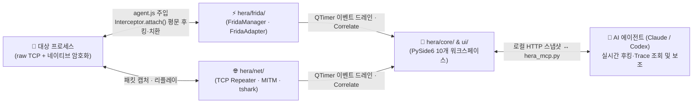

> [!summary] ⏱️ 5초 핵심 요약
> - **한 줄 비유**: 일반 웹 프록시(Burp Suite)가 우체국을 오가는 **밀봉된 암호 편지봉투(와이어 패킷)**만 쳐다보며 쩔쩔매는 동안, **Hera**는 발신자가 편지를 봉투에 넣고 암호를 걸기 직전의 **책상 위(메모리 내 암호화 함수 호출 지점)에서 원본 편지지를 바로 읽고 바꿔치기하는 특수 요원**입니다.
> - **핵심 원리**: `raw TCP + 네이티브 자체 암호화` 앱을 진단할 때 세션키·시퀀스·프레이밍을 역공학으로 전부 재현하는 대신, **Frida(`Interceptor.attach`)로 암호화 직전 평문 버퍼를 in-place 변조**하고 Length-prefix 자동 재계산 TCP Repeater와 AI(MCP) 연동을 단일 PySide6 GUI로 통합했습니다.
> - **아키텍처 강점**: 프레임워크 비의존 순수 로직(`core/`)과 Frida 버전 의존 계측부(`frida/adapter.py`)를 철저히 분리해, Anti-Frida 이슈로 `frida 16.5.1`로 핀을 롤백할 때도 단 한 파일 수정만으로 대응했습니다.

> [!warning] 개발 상태 및 사용 주의사항
> - 🚧 **활발히 개발 중(Work in Progress)**: 테스트 단계이고 편의성 개선·버그 검증이 더 필요합니다. 안정 릴리즈가 아닙니다.
> - ⚠️ **승인된 자산에만 사용**: 자사 앱 또는 명시적으로 허가받은 진단 대상에만 사용하세요. 보안 연구·진단 목적의 도구입니다.

진단을 하다 보면 Burp Suite류 프록시로는 손이 안 닿는 대상이 있습니다. **raw TCP 위에 커스텀 프로토콜을 얹고, 전송 전에 네이티브 레이어에서 자체 암호화를 하는 앱**입니다. 세션키·시퀀스·프레이밍을 모르면 와이어(네트워크 패킷)에서 잡은 데이터는 그냥 암호문 덩어리일 뿐입니다.

그래서 직접 만들기 시작한 게 **Hera**입니다. **Frida 기반 런타임 계측, 패킷 캡처, 프로토콜 리플레이, 그리고 AI 에이전트(MCP) 연동**을 하나의 GUI로 묶은 동적 보안 분석 워크벤치입니다.



---

## 한눈에 보는 Hera 10대 워크스페이스 기능 요약표

**💡 한 줄 비유**: 예전에는 Frida 터미널 창, Wireshark 패킷 창, Hex 에디터, 메모장, AI 채팅창을 모니터 가득 따로 띄워놓고 눈이 핑핑 돌아가며 대조했다면, Hera는 이 **모든 계기판을 하나의 조종석(Cockpit)에 통합한 워크벤치**입니다.

| 워크스페이스 | 핵심 담당 기능 | 실무 진단에서의 역할 (왜 필요한가?) |
|---|---|---|
| **1. TARGET** | 프로세스 선택, 함수명 glob 후킹, `module+offset` 주소 후킹(IDA/Ghidra RVA), Replace 규칙(평문 변조 + 길이 변경 허용) | 심볼이 살아있는 함수뿐 아니라 Strip된 네이티브 바이너리의 오프셋 주소에도 즉시 후킹 및 평문 치환 적용 |
| **2. FRIDA / Trace** | 실시간 이벤트 스트림, `Type/Module/Function/Preview` 정규식 통합 검색, **Backtrace**(콜스택 + 인자 출처 추적) | 암호화 함수를 누가 호출했는지 상위 콜스택을 역추적해 비즈니스 로직 위치 식별 |
| **3. FRIDA / Intercept** | Burp Intercept 개념을 Frida 후킹에 이식 — 요청·응답 양방향 실시간 일시정지·수정 | 암호화 직전 메모리를 멈춰 세우고 원하는 값으로 직접 수정한 뒤 전송 재개 |
| **4. HEX** | 16바이트/행 정렬 Hex 에디터 + Offset·ASCII 동기 스크롤 | 바이너리 구조체 및 패킷 바이트의 정밀 편집 |
| **5. REPLAY** | Web/TCP Repeater(**Length-prefix 자동 재계산**, Hex Diff), **Protocol Lab**(고정/가변 필드 자동 탐지), **Mutation Lab**(필드별 변조 응답 Diff) | 바이트 길이가 바뀔 때마다 깨지는 커스텀 TCP 프로토콜의 길이 헤더를 자동 보정하며 퍼징·리플레이 수행 |
| **6. NET** | HTTP/HTTPS MITM 프록시, 내장 브라우저 연동 | 일반 웹/API 트래픽과 네이티브 소켓 통신을 한 도구 안에서 함께 관찰 |
| **7. CAPTURE** | `tshark`/Npcap 실시간 패킷 캡처, 정규식 필터, `.pcapng` 동시 저장 | 실제 네트워크 인터페이스를 통과하는 로우 패킷 증적 확보 |
| **8. TIMELINE** | Frida Trace + 패킷 + 프록시 Flow 통합 시간순 뷰, **Correlate**(평문 바이트를 실제 패킷과 매칭) | 메모리에서 잡은 평문이 실제 어느 시점의 네트워크 패킷으로 나갔는지 인과관계 연결 |
| **9. ASSESSMENT** | CWE/CVSS 기반 구조화 Finding + 증거 연계(원본 바이트·SHA-256·타임스탬프 보존), Markdown+JSON 리포트 Export | 진단 중 발견한 취약점과 무결성 증적을 즉시 보고서 형태로 패키징 |
| **10. MCP** | Hera의 실시간 상태를 MCP 도구로 노출 (`hera_mcp.py`) | Claude 등 AI 에이전트가 현재 후킹 상태와 Trace를 직접 조회하며 분석 보조 |

---

## 1. 핵심 원리 — 왜 와이어(Wire)가 아니라 메모리(Memory)인가

**💡 한 줄 비유**: 금고차(네트워크 소켓)에 실린 뒤에는 방탄유리와 자물쇠(세션키·시퀀스·프레이밍)를 뚫어야 하지만, **은행 직원이 돈을 세서 가방에 넣는 창구 안쪽(암호화 함수 진입점)에 서 있으면 평문 지폐를 그대로 보고 바꿀 수 있습니다.**

### 메모리 레이어 후킹 파이프라인
Hera의 핵심 아이디어는 단순합니다. **암호화가 일어나기 직전의 평문 버퍼를 메모리에서 가로채는 것**입니다.

```text
TARGET Start
  → FridaManager → FridaAdapter → frida로 agent.js를 대상 프로세스에 주입
  → agent.js: Interceptor.attach()로 암호화 함수 후킹
    호출 직전 평문 버퍼를 in-place로 치환(Replace) → send()로 이벤트 전달
  → GUI는 QTimer로 드레인해 Trace 테이블에 반영
```

- **세션키·시퀀스 재현 불필요**: 소켓(와이어) 레벨이 아니라 암호화 함수 호출 지점을 잡기 때문에 복잡한 키 교환이나 시퀀스 번호, 프레이밍을 역공학으로 재구현할 필요가 없습니다.
- **In-place 평문 치환**: 메모리상의 평문만 바꿔치기하면, 이후 암호화와 패킷 전송은 앱 본래의 로직이 알아서 처리합니다.


### 커스텀 프로토콜 진단의 구원투수: TCP Repeater와 Length-prefix 자동 재계산
TCP Repeater는 raw 소켓으로 직접 송수신하면서 **length-prefix 필드를 자동으로 다시 계산**해줍니다. 바이트 하나만 늘어나도 전체 길이 필드가 깨져 서버가 연결을 끊어버리는 커스텀 바이너리 프로토콜에서, 매번 손으로 16진수 계산기를 두드리던 고통을 없애줍니다.


---

## 2. MCP 연동 — AI가 진단 세션을 직접 들여다본다

**💡 한 줄 비유**: 분석가가 화면을 캡처해서 AI에게 설명하는 대신, **조수석에 앉은 AI(Claude)에게 계기판 보조 모니터(`hera_mcp.py`)를 연결해 주어 "지금 잡힌 Trace 중에서 인자 길이가 이상한 호출만 골라봐"라고 바로 시키는 구조**입니다.

- Hera는 로컬 HTTP 상태 스냅샷을 통해 별도 프로세스인 **`hera_mcp.py`**와 통신하고, 이를 MCP(Model Context Protocol) 표준 도구로 노출합니다.
- Claude 같은 AI 클라이언트가 현재 어떤 함수가 후킹됐는지, Trace 테이블에 어떤 평문 버퍼가 찍혔는지를 직접 조회하고 분석을 보조합니다.
- [[취약점 진단 툴에 MCP 붙이기 Ghidra Burp jadx]]에서 다룬 **"AI가 진단 도구를 직접 부리는"** 패턴을 자체 제작 도구에 그대로 내장한 결과입니다.


---

## 3. 아키텍처 설계와 모듈 격리 (`core` · `frida` · `net` · `ui`)

**💡 한 줄 비유**: 자동차의 **엔진 제어 로직(`core`)과 계기판 화면(`ui`), 그리고 언제든 갈아 끼울 수 있는 타이어 어댑터(`frida/adapter.py`)를 분리해 두어**, 타이어 규격(Frida 버전)이 바뀌어도 차체를 뜯어고치지 않게 만든 구조입니다.

```text
hera/
├── core/     — 프레임워크 비의존 순수 로직
│               이벤트 모델·hexdump·length-field, Correlate, Protocol Lab, Mutation Lab,
│               구조화 Finding+Evidence — 전부 Qt 의존 없이 단위 테스트 가능
├── frida/    — 계측 엔진 (adapter=frida API 격리, agent.js=타깃 내부 JS, manager=오케스트레이션)
├── net/      — 네트워크 I/O (raw HTTP 클라이언트, tshark 캡처, MITM 프록시, CA)
└── ui/       — PySide6(Qt) 패널, 워크스페이스 1:1 대응

hera_mcp.py   — MCP stdio 서버 진입점 (별도 프로세스)
run.py        — GUI 진입점
```

### 아키텍처 분리가 빛을 발한 실제 사례: Frida 버전 롤백
- **`core/`의 독립성**: 이벤트 모델, Hexdump, Length-field 계산, Correlate, Protocol/Mutation Lab, 구조화 Finding+Evidence 등 모든 핵심 로직은 Qt(GUI) 의존성이 전혀 없어 빠른 단위 테스트가 가능합니다.
- **`frida/adapter.py` 단일 지점 격리**: `frida` 라이브러리를 직접 호출하는 코드는 오직 `frida/adapter.py` 한 파일뿐입니다. 실제로 **`frida 17.x`에서 특정 Anti-Frida 보호 대상에 attach가 멈추는 현상**을 겪었을 때, **`16.5.1`로 핀을 고정하고 롤백하는 작업이 단 한 파일 수정**으로 깔끔하게 끝났습니다.

---

## 4. 개발 방식과 향후 로드맵

**💡 한 줄 비유**: 아키텍처 설계도와 실제 타깃 검증은 **사람(진단가)이 직접 핸들을 잡고**, 방대한 구현과 코드 교차검증은 **Claude Code(운전 보조)와 Codex(적대적 감사관)를 양옆에 태워 함께 달린 프로젝트**입니다.

### 만든 방식 — 솔직한 회고
- **역할 분담**: 설계·기능 우선순위 결정·실제 타깃 검증은 직접 수행했고, 구현은 Claude Code와 페어 프로그래밍하면서 [[Claude 작업을 Codex로 교차검증하기 — MCP로 두 AI 붙이기]]에서 소개한 워크플로대로 Codex 교차검토와 커밋 전 적대적 관점의 멀티에이전트 코드 리뷰를 거쳤습니다.
- **왜 여전히 WIP인가**: "AI랑 같이 만들었으니 완벽하다"가 아닙니다. 설계가 맞았는지는 실제 까다로운 타깃에 부딪히며 계속 검증 중이고, UI 편의성 이슈나 엣지 케이스 버그를 실전 사용으로 하나씩 잡아나가는 단계입니다.

### 구동 요구 사항과 남은 과제
- **시스템 요구 사항**: `Windows` + `Python 3.12+` (`CAPTURE` 워크스페이스 사용 시 `Wireshark` [`tshark` + `Npcap`] 별도 설치 필요)
- **향후 로드맵**:
  1. **Protocol Lab 고도화**: TLV(Type-Length-Value) 재귀 파싱 및 CRC 알고리즘 자동 추론
  2. **Mutation Lab 확장**: 알려진 인젝션 페이로드 사전(Dictionary) 내장
  3. **Evidence & 리포팅**: 민감정보 자동 마스킹(Redaction) 규칙 및 HTML/PDF 리포트 Export 지원
