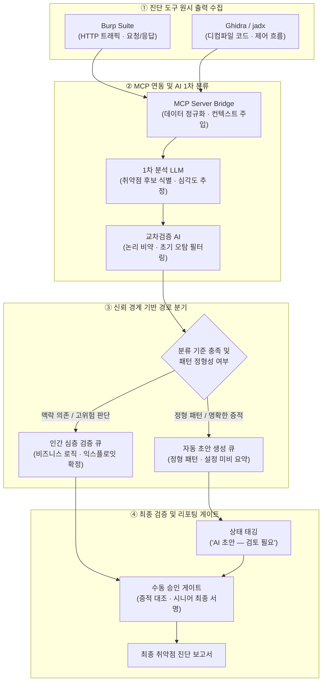
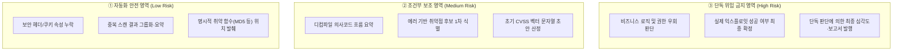
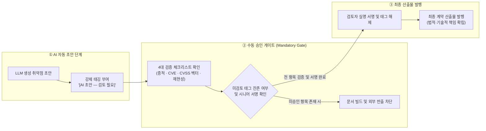

> [!summary] ⏱️ 5초 핵심 요약
> - **한 줄 비유**: LLM 기반 진단·리포팅 자동화 파이프라인은 **100명의 주니어 분석가에게 동시에 초안 작성과 1차 분류를 지시하는 것**과 같습니다. 처리 속도와 물량은 압도적이지만, 전체 맥락을 모르거나 틀린 내용을 확신에 차서 보고할 수 있으므로 시니어(사람)의 최종 검수 없이는 절대 외부로 나갈 수 없습니다.
> - **핵심 원리**: Burp Suite·Ghidra 등 진단 도구의 원시 출력(Raw Output)을 MCP로 LLM에 전달해 1차 분류(Triage)와 초안 작성을 수행하되, 결과물을 **자동 리포팅 가능 영역**과 **인간 심층 검증 필수 영역**으로 엄격히 분리해 처리합니다.
> - **핵심 원칙/기준**: 재현 가능한 요청·응답 증적 유무, 공식 출처(NVD 등)와 CVE·버전의 일치 여부, CVSS 벡터 문자열 근거 포함 여부를 검증 기준으로 삼으며, 법적·계약적 산출물인 최종 보고서는 반드시 사람의 승인 게이트(Approval Gate)와 최종 서명을 거쳐야 합니다.

이 글에서는 진단 도구와 AI를 결합해 실제 동작하는 **취약점 진단·리포팅 자동화 파이프라인의 전체 아키텍처**를 설계하고, 파이프라인을 어디까지 신뢰할 수 있는지 판단하는 **자동화 한계와 인간 검증 기준(Verification Criteria)**을 다룹니다.

이 블로그의 기존 글인 [[취약점 진단 툴에 MCP 붙이기 — Ghidra · Burp · jadx를 Claude에 연동하기]]에서는 개별 진단 도구를 MCP(Model Context Protocol)로 AI에 연결하는 구체적인 설정과 연동 방법을 다루었고, [[Claude 작업을 Codex로 교차검증하기 — MCP로 두 AI 붙이기]]에서는 두 개의 서로 다른 AI 모델을 맞붙여 결과물을 상호 검증하는 워크플로우를 설명했습니다. 이번 글은 개별 도구 연동 설정 방법을 반복하지 않고, **앞선 두 가지 기법(진단 도구 MCP 연동 + 이종 AI 간 교차검증)을 하나의 엔드투엔드(End-to-End) 진단·리포팅 자동화 파이프라인으로 결합**한 뒤, 실무 투입 시 반드시 설정해야 하는 **신뢰 경계선과 사람의 검증 기준**을 수립하는 데 집중합니다.

---

## 1. 파이프라인 아키텍처

진단 도구에 MCP를 연결했다고 해서 곧바로 최종 보고서가 완성되는 것은 아닙니다. 실무에서 작동하는 자동화 파이프라인은 **원시 데이터 수집 → MCP 기반 컨텍스트 전달 → LLM 1차 분류(Triage) 및 교차검증 → 위험도·확신도에 따른 경로 분기 → 인간 승인 게이트 → 최종 리포팅**의 다단계 필터 구조로 설계해야 합니다.

> [!tip] 💡 한 줄 비유
> 이 파이프라인은 **대학병원의 응급실 분류 체계(Triage)**와 같습니다. 혈액 검사기와 엑스레이(Burp·Ghidra)에서 나온 수백 장의 원시 데이터를 예진 스태프(LLM)가 빠르게 훑어 단순 찰과상(정형화된 설정 미비)은 처방전 초안을 바로 작성하고, 복합 골절이나 내과적 정밀 판단이 필요한 환자(비즈니스 로직 결함·실제 익스플로잇 확인)는 전문의(보안 진단원)에게 우선순위를 매겨 인계하는 구조입니다.

### 엔드투엔드 데이터 흐름

1. **원시 출력 수집 (Diagnostic Raw Output)**
   - **네트워크/웹 계층**: Burp Suite 등 프록시·스캐너가 수집한 HTTP 요청/응답 패킷, 헤더 정보, 파라미터 변조에 따른 상태 코드 및 응답 본문 차이.
   - **바이너리/코드 계층**: Ghidra·jadx 등이 추출한 디컴파일 의사코드(Pseudocode), 심볼 테이블, 문자열 참조(Cross-reference), 위험 함수(Sink) 호출 흐름.
2. **MCP 브리지 및 컨텍스트 정규화 (MCP Context Delivery)**
   - 진단 도구의 방대한 출력을 그대로 LLM에 넣으면 컨텍스트 창이 오염되거나 핵심 정보가 희석됩니다. MCP 서버가 도구별 원시 데이터를 정형화된 JSON 스키마(대상 엔드포인트, 함수 시그니처, 입출력 쌍)로 정규화하여 LLM에 전달합니다.
3. **LLM 1차 분류 및 AI 교차검증 (First-Pass Triage & Cross-Verification)**
   - 1차 LLM이 취약점 후보군 식별, 취약점 유형(CWE) 매핑, 초기 심각도(CVSS 초안) 산정을 수행합니다.
   - [[Claude 작업을 Codex로 교차검증하기 — MCP로 두 AI 붙이기]]에서 다룬 방식대로, 2차 검증용 AI가 1차 분류 결과의 논리적 비약이나 코드 해석 오류를 1차로 걸러냅니다.
4. **신뢰 경계에 따른 분기 (Routing by Confidence & Risk)**
   - **경로 A (보고서 초안 직행)**: 패턴이 명확하고 오탐 가능성이 극히 낮은 정형 항목은 LLM이 리포트 템플릿에 맞춰 초안을 즉시 생성합니다. 단, 이 경우에도 `'AI 초안 — 검토 필요'` 태그가 자동으로 부여됩니다.
   - **경로 B (인간 심층 검증 큐)**: 맥락 의존성이 높거나 실제 공격 성공 여부를 확정해야 하는 항목은 진단원의 수동 검토 큐(Human Review Queue)로 분리됩니다.

### 파이프라인 단계별 역할과 입출력 명세

| 파이프라인 단계 | 주요 수행 주체 | 입력 데이터 (Input) | 출력 산출물 (Output) | 핵심 통제 장치 |
| :--- | :--- | :--- | :--- | :--- |
| **① 원시 데이터 추출** | Burp, Ghidra, jadx | 대상 시스템 트래픽, 바이너리 | Raw HTTP 패킷, 디컴파일 함수 블록 | 조회 범위 제한(Scope Filtering) |
| **② MCP 전달 및 1차 분류** | MCP 서버 + 분석/검증 LLM | 정규화된 패킷·코드 스니펫 | 취약점 후보 목록, 추정 CWE/CVSS | 시스템 프롬프트 기반 출력 스키마 강제 |
| **③ 경로 분기 (Routing)** | 파이프라인 규칙 엔진 | 1차 분류 결과 및 항목 카테고리 | 자동 초안 큐 vs 인간 검증 큐 분리 | 고위험·비정형 항목의 자동 통과 차단 |
| **④ 최종 승인 및 발행** | **보안 진단원 (Human)** | AI 작성 초안 + 원본 증적 세트 | **최종 서명된 진단 보고서** | 검증 체크리스트 및 수동 승인 게이트 |

> [!note] ✅ 아키텍처 설계 체크 포인트
> - **원본 증적의 비변조 보존**: LLM이 요약한 텍스트와 별개로, Burp의 원본 Request/Response 전문과 Ghidra의 원본 주소(Address)·어셈블리 라인은 변형 없이 데이터베이스나 아티팩트 저장소에 그대로 보존되어 최종 보고서에 링크되어야 합니다.
> - **단방향 흐름 강제**: AI가 생성한 초안이 인간의 승인 게이트를 우회하여 최종 문서 파일(PDF/DOCX 등)로 직행하는 경로는 아키텍처 수준에서 원천 차단해야 합니다.

---

## 2. LLM이 안전하게 자동화할 수 있는 영역

LLM을 진단 파이프라인에 투입할 때 가장 높은 투자 대비 효과(ROI)를 내는 곳은 **정답의 기준이 명확하고, 입력 데이터 안에 판단 근거가 100% 포함되어 있는 반복 작업**입니다.

> [!tip] 💡 한 줄 비유
> 숙련된 감사관이 수천 페이지의 장부에서 **필수 기입란이 비어 있는 서류나 구형 양식을 사용한 서류를 골라내고 부서별로 철하는 일**을 100명의 주니어 분석가에게 맡기는 것과 같습니다. 판단 기준이 명확하므로 주니어들이 빠르게 처리해도 사고가 나지 않습니다.

### 안전하게 위임할 수 있는 3대 영역

1. **반복적인 정형 패턴 매칭 (Repetitive Pattern Matching)**
   - **보안 헤더 및 설정 누락 점검**: HTTP 응답 헤더에서 `Strict-Transport-Security`, `Content-Security-Policy`, `X-Content-Type-Options` 등의 누락 여부나 쿠키의 `HttpOnly`, `Secure`, `SameSite` 속성 미설정 여부를 전수 확인하는 작업입니다.
   - **노출된 버전 정보와 알려진 CVE 1차 대조**: 서버 배너(`Server: nginx/...`), 디컴파일된 바이너리의 오픈소스 라이브러리 문자열, 매니페스트 파일에서 식별된 명확한 버전 문자열을 추출하여 알려진 취약 버전 범위와 대조하는 1차 매칭 작업입니다.
2. **대량 스캔 결과의 요약 및 카테고리화 (Summarization & Categorization)**
   - 자동화 스캐너나 퍼저(Fuzzer)가 쏟아낸 수백~수천 건의 중복 경고(예: 동일 템플릿 파일에서 발생한 수십 개의 반사형 파라미터 알림)를 근본 원인(Root Cause) 단위로 클러스터링합니다.
   - 기술적 로그 나열을 고객사 개발자와 경영진이 이해할 수 있는 표준 보고서 양식(개요, 영향도 초안, 표준 권고안)으로 구조화하여 문장 작성 시간을 단축합니다.
3. **체크리스트 기반 1차 분류 (Checklist-Based First-Pass Triage)**
   - OWASP ASVS나 내부 진단 가이드라인의 정형 항목을 기준으로, 디컴파일된 코드 내에 하드코딩된 API 키 패턴, 취약한 암호화 알고리즘(`MD5`, `SHA1`, `DES`, `ECB 모드` 등) 호출 위치를 빠르게 전수 스캔하고 해당 코드 블록을 발췌합니다.

### 자동화 적합 영역의 특징과 기대 효과

| 작업 유형 | 입력 데이터의 특성 | LLM 수행 역할 | 사람의 개입 수준 |
| :--- | :--- | :--- | :--- |
| **보안 헤더·속성 점검** | 단일 HTTP 응답 내 근거 완결 | 누락 속성 식별 및 표준 권고문 생성 | 샘플링 검수 및 예외 사유 확인 |
| **다량 스캔 결과 클러스터링** | 동일 원인에서 파생된 반복 로그 | 엔드포인트 그룹화 및 표(Table) 요약 | 그룹화 기준의 적절성 확인 |
| **취약 암호화·위험 함수 식별** | 디컴파일 코드 내 명시적 API 호출 | 호출 지점(Sink) 발췌 및 CWE 매핑 | 해당 경로가 실제 실행 코드인지 확인 |

> [!tip] ✅ 안전 자동화 영역의 체크 포인트
> - **입력 내 근거 완결성(Self-Contained Evidence)**: LLM에게 넘겨준 단일 패킷이나 코드 블록만 보더라도 제3자가 즉시 참/거짓을 판별할 수 있는 항목만 자동 초안 큐로 보냅니다.
> - **정규표현식·정적 규칙과의 하이브리드 구성**: 단순 문자열 매칭은 정규표현식이나 정적 분석 도구가 먼저 수행하고, LLM은 그 결과를 문맥에 맞게 분류하고 보고서 문장으로 다듬는 역할을 맡길 때 정확도와 비용 효율이 가장 높습니다.

---

## 3. LLM이 단독으로 맡으면 위험한 영역과 그 이유

반면, LLM에게 단독 판단을 맡겼을 때 심각한 미탐(False Negative)이나 치명적인 오탐(False Positive)으로 이어지는 영역이 존재합니다. 이 영역을 자동화 큐에 그대로 태우면 **보고서의 신뢰도가 붕괴**될 뿐만 아니라 진단 대상 시스템이나 계약 관계에 직접적인 리스크를 초래합니다.

> [!warning] 💡 한 줄 비유
> 법조문과 장부 양식만 배운 주니어 분석가 100명에게 **"이 거래가 회사 정관과 상거래 관행상 배임에 해당하는지 최종 판결을 내리라"**고 지시하는 격입니다. 주니어들은 회사의 비문서화된 비즈니스 맥락을 알지 못하며, 심지어 애매한 정황만 보고도 마치 중대 범죄를 적발한 것처럼 확신에 찬 어조로 허위 보고서를 올릴 위험이 있습니다.

### LLM 단독 위임이 위험한 3가지 핵심 이유

1. **비즈니스 로직 결함 (Business Logic Flaws) — "정상처럼 보이지만 맥락상 틀린" 판단 불가**
   - HTTP 상태 코드가 `200 OK`이고 응답 본문에 에러 메시지가 전혀 없더라도, 일반 사용자가 관리자 전용 리소스를 조회했거나(IDOR/BOLA), 결제 금액 검증 단계를 건너뛰어 0원 결제가 승인된 상황은 치명적인 취약점입니다.
   - 반대로, 특정 API가 인증 없이 데이터를 반환하더라도 그것이 본래 공개용 카탈로그 API라면 취약점이 아닙니다.
   - LLM은 주어진 패킷과 코드 조각만 볼 뿐, **"이 시스템의 기획 의도와 권한 정책상 누가 무엇을 할 수 있어야 하는가"**라는 외부 비즈니스 규칙(Out-of-Context Rules)을 온전히 알지 못하므로 정상 기능과 로직 결함을 구분하지 못합니다.
2. **익스플로잇 성공 여부의 최종 확정 (Final Confirmation of Exploit Success)**
   - 코드상에 위험해 보이는 함수(예: SQL 쿼리 문자열 결합, 시스템 명령어 실행 함수)가 존재하더라도, 앞단 게이트웨이나 상위 래퍼 함수에서 강력한 입력값 검증이 이루어지고 있다면 실제 공격은 불가능(Unexploitable)합니다.
   - 또한 WAF(웹 방화벽)나 프레임워크의 기본 방어 기제가 작동해 실제로는 차단된 응답을 받았음에도, LLM은 응답 길이 변화나 특정 키워드만 보고 **"익스플로잇에 성공하여 취약점이 확인되었다"고 서술(Narrating Success without Proof)**하는 오류를 범하기 쉽습니다. 실제 재현 가능한 증적 없이 LLM의 추론만으로 공격 성공을 단정하면 심각한 오탐이 발생합니다.
3. **근거 없는 확신과 환각(Hallucination)의 보고서 유입 위험**
   - LLM의 가장 위험한 특성 중 하나는 **틀린 내용이나 오탐(False Positive)을 지극히 전문적이고 확신에 찬 어조로 서술**한다는 점입니다.
   - 존재하지 않는 CVE 번호를 그럴듯하게 조합해 내거나, 해당 버전에서는 이미 패치된 취약점을 여전히 유효한 것처럼 기술하거나, 디컴파일된 코드의 변수명만 보고 실제 존재하지 않는 공격 시나리오를 창작해 보고서 문장에 섞어 넣을 수 있습니다.

### 영역별 자동화 신뢰도 및 위험 비교

| 취약점 및 판단 영역 | LLM 단독 처리 시 주요 실패 모드 | 실무 리스크 | 필수 통제 방식 |
| :--- | :--- | :--- | :--- |
| **비즈니스 로직 결함 (IDOR, 절차 우회)** | 정상 응답(`200 OK`)을 정상 처리로 오인(미탐)하거나 공개 기능을 취약점으로 오인(오탐) | 핵심 취약점 누락 또는 고객사 개발팀의 불신 초래 | 진단원이 권한 매트릭스 및 기획 의도 직접 대조 |
| **익스플로잇 가능성 최종 확정** | 코드 스니펫의 정적 패턴만 보고 실제 재현 없이 "공격 성공"으로 단정 서술 | 방어 기제(WAF·필터)를 무시한 허위 고위험 보고 | 실제 페이로드 실행 및 재현 증적(PoC) 수동 확보 |
| **확신에 찬 오탐 서술 (환각)** | 가짜 CVE 인용, 버전 오매칭, 존재하지 않는 코드 흐름을 사실처럼 기술 | 보고서의 법적·전문적 신뢰도 치명적 손상 | 공식 DB(NVD 등) 교차 조회 및 증적 강제 매핑 |

> [!danger] ⚠️ 위험 영역 관리 체크 포인트
> - **"추정"과 "확정"의 어휘 분리**: 프롬프트와 파이프라인 규칙을 통해, 실제 공격 재현 증적이 매핑되지 않은 상태에서 LLM이 `"취약점이 존재함"`, `"탈취 가능함"` 같은 단정적 서술어를 사용하는 것을 금지하고, `"취약점 후보로 확인 필요"` 형태로만 출력하도록 제한해야 합니다.

---

## 4. 검증 기준(Verification Criteria) 체크리스트

100명의 주니어 분석가(LLM)가 올린 초안을 시니어 진단원(사람)이 검수할 때는 막연하게 문장을 읽어보는 것이 아니라, **객관적이고 기계적으로 확인할 수 있는 검증 기준(Verification Criteria)**을 통과해야만 보고서 반영을 승인해야 합니다.

왜냐하면 LLM은 문맥상 매끄러운 문장을 만드는 데 특화되어 있어, 글의 유창함만 보고 검수하면 환각이나 논리적 결함을 놓치기 쉽기 때문입니다. 따라서 사람의 검수는 **"문장이 자연스러운가?"가 아니라 "독립적인 증거와 공식 데이터로 역추적이 가능한가?"**에 맞춰져야 합니다.

### 인간 검증 필수 체크리스트 (Human Verification Checklist)

모든 LLM 생성 취약점 항목(Finding)은 최종 보고서에 통합되기 전 아래 체크리스트를 전수 통과해야 합니다.

- [ ] **재현 가능한 요청/응답(Request/Response) 원본 증적이 실제로 첨부되어 있는가?**
  - LLM이 요약한 설명만 있고 실제 패킷이나 화면 캡처, 디컴파일 주소가 없는 항목은 즉시 반려합니다.
  - 첨부된 HTTP 요청을 그대로 재전송(Replay)했을 때 보고서에 기술된 것과 동일한 취약 응답이 재현되는지, 그리고 민감 정보가 마스킹 처리 규칙을 준수했는지 확인합니다.
- [ ] **인용된 CVE 번호가 공식 출처(NVD, CVE.org)에 실존하며 대상 소프트웨어·버전과 정확히 일치하는가?**
  - LLM이 제시한 CVE ID를 NVD(National Vulnerability Database) 또는 CVE.org 공식 레코드와 직접 대조합니다.
  - 단순히 제품명만 같은 것이 아니라, 진단 대상에서 확인된 정확한 버전(CPE 기준)이 해당 CVE의 영향받는 버전 범위(Affected Configurations) 안에 포함되는지, 운영체제나 빌드 백포트(Backport) 패치 여부는 없는지 확인합니다.
- [ ] **자동 산정된 CVSS 심각도 점수에 그 근거가 되는 벡터 문자열(Vector String)이 함께 제시되었으며 각 메트릭 판단이 타당한가?**
  - 단순히 `"심각도: High (8.1)"`처럼 숫자만 적힌 초안은 승인하지 않습니다. 반드시 `CVSS:3.1/AV:N/AC:L/PR:L/UI:N/S:U/C:H/I:H/A:N`과 같은 전체 벡터 문자열이 포함되어야 합니다.
  - 각 세부 메트릭(특히 필요 권한 `PR`, 사용자 상호작용 `UI`, 범위 변경 `S`)이 대상 시스템의 실제 운영 환경 및 공격 조건과 부합하는지 사람이 항목별로 검증합니다.
- [ ] **디컴파일 코드 및 정적 분석 기반 항목의 경우, 외부 입력점(Source)부터 위험 함수(Sink)까지의 도달 가능성(Reachability)이 확인되었는가?**
  - Ghidra나 jadx에서 발췌한 함수가 실제로 실행되지 않는 데드 코드(Dead Code)이거나 내부 상수만 처리하는 함수가 아닌지, 사용자 입력이 필터링 없이 도달하는지 호출 그래프를 확인합니다.
- [ ] **제시된 조치 권고안(Remediation)이 대상 시스템의 기술 스택 및 아키텍처와 호환되는가?**
  - LLM이 일반적인 교과서적 권고안(예: Python 환경인데 Java 프레임워크 설정 변경을 권고)을 복붙하지 않았는지, 실제 개발팀이 적용 가능한 구체적 코드·설정 예시인지 확인합니다.

### 검증 항목별 합격/반려 기준 요약

| 검증 영역 | 반려 대상 (Reject) | 승인 기준 (Approve) |
| :--- | :--- | :--- |
| **증적(Evidence) 정합성** | "패킷 분석 결과 취약함이 확인됨" 같은 텍스트 요약만 존재 | 타임스탬프·엔드포인트·파라미터가 포함된 Raw HTTP 전문 또는 정확한 바이너리 오프셋 첨부 |
| **CVE 및 버전 매칭** | 버전 확인 없이 배너 이름만으로 추정 매핑하거나 비공식 출처 인용 | NVD/CVE.org 공식 문서 링크 및 CPE 버전 범위 일치 확인 완료 |
| **CVSS 심각도 산정** | 근거 없는 단일 점수(Score) 또는 정성적 등급(High/Medium)만 기재 | 공식 계산기 규격의 전체 Vector String 명시 및 각 메트릭 선정 사유 포함 |
| **교차검증 이력** | 단일 LLM의 1회성 생성 출력물 | [[Claude 작업을 Codex로 교차검증하기 — MCP로 두 AI 붙이기]] 워크플로우를 통한 2차 AI 검증 로그 또는 정적 도구 교차 확인 포함 |

---

## 5. 리포팅 자동화에서 사람이 반드시 최종 서명해야 하는 이유

파이프라인이 아무리 정교해지더라도 **최종 보고서의 발행 버튼과 서명(Sign-off)은 반드시 사람(보안 진단원·책임자)의 고유 권한**으로 남아 있어야 합니다. 이는 기술적 정확성 문제를 넘어 법적·계약적 책임과 직결되기 때문입니다.

> [!important] 💡 한 줄 비유
> 100명의 주니어 분석가가 밤새워 회계 감사 보고서 초안을 작성했더라도, **공인회계사 본인이 직접 검토하고 직인을 찍지 않은 문서는 법적 효력이 없으며, 만약 그 보고서에 허위 사실이 들어 있다면 "주니어가 잘못 적었다"는 변명으로 법적 책임을 피할 수 없는 것**과 정확히 같습니다.

### 왜 최종 서명은 대체될 수 없는가?

1. **진단 보고서는 법적·계약적 산출물(Legal & Contractual Deliverable)입니다**
   - 취약점 진단 보고서는 단순한 기술 메모가 아니라, 과업지시서(SOW)와 비밀유지계약(NDA), 컴플라이언스(전자금융감독규정, ISMS-P 등) 요구사항에 따라 제출되는 공식 계약 산출물입니다.
   - 보고서에 기재된 오탐으로 인해 고객사가 불필요한 긴급 패치를 수행하다 서비스 장애가 발생하거나, 반대로 잘못된 자동 분류로 인해 핵심 취약점이 누락되어 침해 사고가 발생했을 때의 계약적·법적 책임은 전적으로 진단 수행 조직과 담당 진단원에게 귀속됩니다.
2. **AI가 작성한 초안이라도 최종 책임(Accountability)은 인간 평가자에게 있습니다**
   - LLM은 법적 인격체가 아니므로 결과물에 대해 책임을 질 수 없습니다. AI가 환각으로 잘못된 CVE나 과장된 위험도를 기재했더라도, 그것이 최종 보고서에 실려 나간 순간 그것은 **"AI의 실수"가 아니라 "검수하지 않은 진단원의 과실"**이 됩니다.
3. **비즈니스 우선순위와 운영 환경에 맞춘 조율(Contextual Tuning)은 사람의 몫입니다**
   - 동일한 취약점이라도 고객사의 네트워크 망분리 수준, 대체 통제(Compensating Controls) 존재 여부, 레거시 시스템의 변경 제약 사항에 따라 실제 조치 우선순위와 권고 방식이 달라져야 합니다. 이러한 맥락적 조율은 고객사 담당자와 소통하는 인간 진단원만이 수행할 수 있습니다.

### 파이프라인 설계에 책임 원칙을 반영하는 방법 (Governance by Design)

사람의 최종 검토를 개인의 성실함에만 맡기지 않고, **파이프라인의 시스템적 제약(Guardrail)으로 강제**해야 합니다.

1. **모든 자동 생성 섹션에 명시적 워터마크·태그 강제 부여**
   - LLM이 초안을 생성할 때 모든 항목의 메타데이터와 제목 옆에 `[AI 초안 — 검토 필요 (AI Draft — Needs Human Review)]` 태그를 강제로 삽입합니다.
   - 이 태그는 사람이 체크리스트 항목을 모두 체크하고 승인 처리하기 전까지는 시스템상에서 제거되지 않도록 설계합니다.
2. **최종 전달 전 필수 수동 승인 게이트(Mandatory Manual Approval Gate) 구축**
   - CI/CD나 문서 빌드 파이프라인에서 미승인 태그(`AI 초안 — 검토 필요`)가 단 하나라도 남아 있는 상태에서는 최종 배포용 포맷(PDF/고객사 전달용 문서)으로의 렌더링이나 익스포트(Export)가 실패하도록 차단 로직(Linter/Gatekeeper)을 둡니다.
3. **검수 이력 및 승인자 추적성(Audit Trail) 확보**
   - 각 취약점 항목마다 `AI 초안 생성 시각 → 교차검증 AI 결과 → 인간 검토자 ID → 증적 확인 및 최종 서명 시각`이 로그로 남도록 구성하여, 보고서의 모든 문장에 대해 누가 검증하고 승인했는지 사후 추적이 가능해야 합니다.

> [!warning] ✅ 리포팅 거버넌스 최종 체크 포인트
> - **Silent Pass(무검증 통과) 금지**: "이번 항목은 단순하니까 안 보고 넘겨도 되겠지"라는 예외 경로를 허용하지 마십시오. 단순 보안 헤더 누락 항목이라도 최소한 원본 응답 헤더 증적과의 일치 여부를 확인하고 승인 버튼을 누르는 절차를 유지해야 합니다.
> - **자동화의 목적 재정의**: 파이프라인의 목표는 **"사람을 대체하여 무인 보고서를 찍어내는 것"이 아니라, "100명의 주니어 AI에게 반복 작업과 초안 작성을 맡겨 확보한 시간으로 시니어 진단원이 비즈니스 로직 분석과 최종 검증에 집중하게 만드는 것"**임을 명확히 해야 합니다.

---

## 참고

- [Model Context Protocol (MCP) Official Documentation](https://modelcontextprotocol.io/)
- [NVD (National Vulnerability Database) — NIST](https://nvd.nist.gov/)
- [CVE Program Official Website (CVE.org)](https://www.cve.org/)
- [FIRST — Common Vulnerability Scoring System (CVSS) v3.1 & v4.0 Specification](https://www.first.org/cvss/)
- [OWASP Web Security Testing Guide (WSTG)](https://owasp.org/www-project-web-security-testing-guide/)
- [OWASP Top 10 for Large Language Model Applications](https://owasp.org/www-project-top-10-for-large-language-model-applications/)
