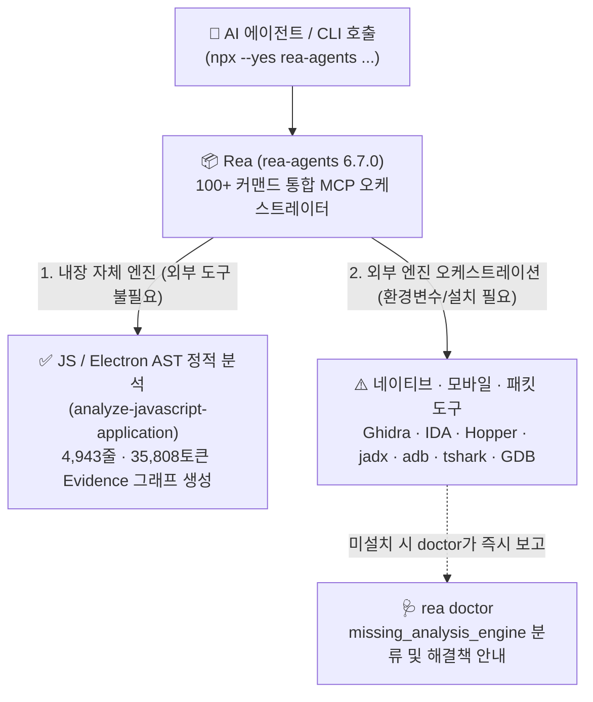

> [!summary] ⏱️ 5초 핵심 요약
> - **한 줄 비유**: Rea(`rea-agents`)는 직접 수술을 집도하는 외과의사가 아니라, **수술실에 이미 놓여 있는 메스와 내시경(Ghidra·IDA·Hopper·jadx·adb·tshark)을 AI 에이전트가 한 곳에서 부릴 수 있게 묶어주는 '만능 수술 도구 트레이'**입니다(단, JS/Electron 정적 분석 메스 하나는 기본 내장되어 있습니다).
> - **핵심 검증 결과**: 외부 도구 설치 없이 `npx rea-agents`만으로 **JS 애플리케이션 AST 기반 정적 분석(`analyze-javascript-application`)과 하드코딩 시크릿·참조 그래프 추출**이 실제 작동함을 확인했으며, 토이 앱 3개 파일에 **35,808토큰(4,943줄)**짜리 구조화 그래프를 쏟아내는 'AI 에이전트 소비 전용' 설계를 체감했습니다.
> - **핵심 주의사항**: 네이티브/모바일 역공학은 여전히 사용자의 기존 도구 설치본·라이선스(`GHIDRA_INSTALL_DIR`, IDA 등)에 의존하며, 프로세스 실행·파일 쓰기·네트워크 접근 권한을 품은 거대 MCP 서버이므로 **출처 검증과 클라이언트 승인 통제**가 필수입니다.

[Rea](https://github.com/morluto/rea)는 npm 패키지 `rea-agents`로 배포되는 **MCP 서버 + CLI**입니다. README 기준으로 네이티브 바이너리(Ghidra/IDA/Hopper 오케스트레이션), JS/Electron 앱(실행 없이 정적 분석), .NET/Go/Rust/WASM/EVM 바이트코드, 안드로이드(JADX/apktool/adb), 게임 엔진 파일, 웹사이트/네트워크 캡처(HAR/pcap), 펌웨어, SQLite, 실행 중 프로세스 관찰까지 — **역공학 대상 거의 전부를 하나의 MCP 인터페이스로 묶겠다는 도구**입니다(TypeScript 모노레포, MIT 라이선스, Node `>=22.19` / `24.11` / `26` 요구).

[[취약점 진단 툴에 MCP 붙이기 Ghidra Burp jadx]]에서 Ghidra·Burp·jadx를 각각 따로 MCP 브리지로 붙였는데, Rea는 그 역할을 한 패키지로 흡수하려는 시도처럼 보여서 직접 설치해보고 실제로 무엇이 되고 무엇이 안 되는지 검증했습니다.



---

## 한눈에 보는 Rea 실제 검증 결과 및 Hera와의 비교표

| 구분 항목 | **Rea (`rea-agents 6.7.0`)** | **Hera (직접 만든 Frida 워크벤치)** |
|---|---|---|
| **지향점 (철학)** | **넓고 얕게 (범용 오케스트레이션)**: 모든 역공학 타깃과 기존 도구를 하나의 MCP 표면(100+ 커맨드)으로 통합 | **좁고 깊게 (전용 동적 계측)**: raw TCP + 네이티브 암호화 후킹·리플레이 문제를 메모리 레이어에서 직접 해결 |
| **자체 분석 능력** | JS/Electron 정적 AST 분석(`analyze-javascript-application`)은 외부 도구 없이 즉시 작동 확인 | Frida `agent.js` 평문 버퍼 후킹, Length-prefix 자동 재계산, Protocol/Mutation Lab 자체 구현 |
| **외부 도구 의존성** | 네이티브·APK 분석은 사용자가 가진 Ghidra/IDA/jadx/Hopper 설치본 및 라이선스 필요 (`doctor`로 상태 점검) | 런타임 계측은 `frida`(16.5.1 고정), 패킷 캡처만 `tshark`/`Npcap` 연동 |
| **출력 형태와 소비자** | 토이 앱 3파일 기준 **4,943줄 / 35,808토큰**의 거대 Evidence 그래프 → 사람이 아닌 **AI 에이전트가 `--token-limit`/`--filter-output`으로 잘라 쓰도록 설계** | 분석가용 PySide6(Qt) GUI 테이블·Hex Diff + AI 보조용 경량 MCP 상태 스냅샷 |
| **이번 테스트 검증 범위** | ✅ `npx` 실행, `--help`, `doctor`, `capabilities`, `setup --dry-run`, `analyze-javascript-application`<br/>⏸️ 네이티브 엔진 연동(미설치), 실제 MCP 설정 덮어쓰기(의도적 생략) | 실제 타깃 프로세스 후킹, 패킷 리플레이, MCP 연동까지 자체 개발 및 검증 중 |

---

## 1. 환경 확인 및 `npx` 즉시 실행 테스트

**💡 한 줄 비유**: 무거운 종합 공구함을 방에 영구 설치하기 전에, **일회용 대여(`npx`)로 카탈로그(`--help`)부터 펼쳐 메뉴판에 적힌 100가지 요리가 진짜 목록에 있는지 확인하는 단계**입니다.

### Node.js 요구사항 및 레지스트리 확인
```bash
node --version
# v24.14.0

npm ping
# npm notice PING https://registry.npmjs.org/
# npm notice PONG 198ms
```
요구 버전(`>=24.11`)을 충족하며 레지스트리 접근도 정상입니다. Ghidra/IDA/JADX 같은 무거운 외부 도구는 이 환경에 설치하지 않은 전제하에, 외부 도구가 필요 없는 경로부터 테스트했습니다.

### `npx --yes rea-agents --help` 실행 결과
```bash
npx --yes rea-agents --help
```
- 로컬 전역 설치 없이 `npx`로 패키지를 받아 바로 실행했습니다(테스트 버전: **`rea-agents 6.7.0`**).
- `prebuild-install@7.1.3` deprecated 경고 한 줄 외에 에러 없이 실행되었으며, `--help` 출력에 **`inspect-macho`, `decompile-jeb-item`, `capture-adb-screen`, `inspect-sqlite-database`, `inspect-pcap-capture`, `analyze-javascript-application` 등 100개가 넘는 커맨드**가 나열됩니다.
- 단, 이는 "메뉴판에 커맨드가 존재한다"는 확인이며, 실제로 실행 끝까지 검증한 분석은 아래 4절의 `analyze-javascript-application`입니다.

---

## 2. `doctor`와 `setup --dry-run` — 무엇이 없고 어디에 붙는지 확인

**💡 한 줄 비유**: 자동차 시동을 걸기 전에 **계기판 자가진단(`doctor`)을 돌려 어느 부품(Ghidra·IDA·jadx)이 빠져 있는지 솔직한 리포트를 받고, 내비게이션 설정 변경(`setup --dry-run`)은 미리보기만 띄워보는 과정**입니다.

### `rea doctor` 실행: 빠진 분석 엔진을 명확히 짚어줌
```bash
npx --yes rea-agents doctor
```

```yaml
healthy: false
environment_healthy: false
scope_checks[14]:
  - name: node
    ok: true
    detail: 24.14.0
  - name: host
    ok: true
    detail: win32 x64
  - name: hopper
    ok: false
    classification: missing_analysis_engine
    remediation: "Run rea setup to install Hopper, or set HOPPER_LAUNCHER_PATH."
  - name: ghidra
    ok: false
    classification: missing_analysis_engine
    detail: GHIDRA_INSTALL_DIR is not set
  - name: ida-registration
    ok: false
    classification: missing_analysis_engine
    detail: IDA MCP registration is not configured.
  - name: jadx
    ok: false
    classification: missing_analysis_engine
    detail: Set REA_JADX_MCP_JAR to the absolute path of a caller-supplied jadx-headless-mcp 0.7.1 JAR. REA does not download or install it.
  ...
```

- **관찰 포인트**:
  - 이 환경에는 Hopper, Ghidra, IDA, jadx, Kuna 5개가 모두 없어 전부 `missing_analysis_engine`으로 분류되었습니다.
  - 흥미로운 차이는 **`remediation` 안내 방식**입니다. Ghidra와 jadx는 `GHIDRA_INSTALL_DIR`이나 `REA_JADX_MCP_JAR`처럼 사용자가 이미 가진 설치본 경로를 환경변수로 넘기라고 명시(`REA does not download or install it`)하는 반면, **Hopper는 `rea setup`을 통해 설치까지 진행할 수 있다**(`--install-hopper` 옵션 존재)고 안내합니다.

### `rea setup --dry-run`: 기존 에이전트 설정 보호하며 경로 탐지만 확인
`rea setup`은 Claude Code, Codex, Cursor, Gemini CLI 같은 에이전트 설정 파일에 MCP 서버를 자동 등록합니다. 현재 작업 세션에서 쓰는 AI 클라이언트 설정을 실험용으로 덮어쓰고 싶지 않아 `--client`나 `--all-detected` 없이 `--dry-run`만 돌렸습니다.

```bash
npx --yes rea-agents setup --dry-run
```

```yaml
status: planned
plannedActions: []
appliedActions: []
...
registrations[6]:
  - client: antigravity
    config_path: "C:\\Users\\yong\\.gemini\\config\\mcp_config.json"
    command: []
```
- `--dry-run`이고 `--client`도 지정하지 않았으므로 실제 설정 파일은 전혀 건드리지 않으면서(`plannedActions: []`), 현재 시스템에 설치된 agentic CLI(여기선 `antigravity`/`agy`)의 설정 파일 경로(`C:\Users\yong\.gemini\config\mcp_config.json`)를 정확히 탐지해 보여주었습니다.

---

## 3. `analyze-javascript-application` — 실제 작동한 정적 JS 분석 검증

**💡 한 줄 비유**: 프로그램을 직접 실행해 보지 않고도 **설계도(AST 구문 트리)만 샅샅이 분해해서, 코드 깊숙이 숨겨둔 비밀 열쇠 문자열과 부품 간 연결선을 X-레이 사진(Evidence 그래프)으로 찍어내는 작업**입니다.

외부 도구가 필요 없는 내장 경로를 검증하기 위해 3개 파일로 구성된 미니 JS "가짜 라이선스 체크" 앱을 만들어 테스트했습니다.

```javascript
// index.js
const crypto = require("crypto");
const { checkLicense } = require("./license");

function main() {
  const key = "hardcoded-super-secret-key-123";
  ...
  if (checkLicense(key)) { ... }
  const hash = crypto.createHash("sha256").update(key).digest("hex");
  return hash;
}
main();

// license.js
function checkLicense(key) {
  return key.length > 10 && key.startsWith("hardcoded");
}
module.exports = { checkLicense };
```

### 실행 및 파이프라인 진행 로그
```bash
npx --yes rea-agents analyze-javascript-application "/tmp/rea-test-app"
```
*(Git Bash 환경이라 `/tmp`는 실제로 `C:\Users\yong\AppData\Local\Temp`로 매핑됩니다.)*

실행하면 **`파싱(parse_javascript_source) → 애플리케이션 그래프 구성 → 시맨틱 그래프 구성(build_javascript_semantic_graph) → 봉인(sealing) → 해싱(hashing)`** 단계가 순서대로 찍히며 완료됩니다.

```yaml
{"rea_progress":{"phase":"parse_javascript_source","message":"Parsing and projecting index.js (1/3)",...}}
{"rea_progress":{"phase":"parse_javascript_source","message":"Parsing and projecting license.js (2/3)",...}}
{"rea_progress":{"phase":"build_javascript_semantic_graph",...}}
{"rea_progress":{"phase":"analyze_javascript_application","terminal":true,...}}
evidence_id: ev_c88e17739f84701a75b926890fbc818ac0cebfb8ae0d400ccebe6cbee99a4d66
subject:
  name: rea-test-app
  digest:
    sha256: 354a14f9700ae33147f27688234788d97002702afcac51018a9a2facb873362d
```

### 결과 분석: 35,808토큰짜리 Evidence 그래프의 정체와 정직한 한계 명시
- **압도적인 출력 크기**: 고작 3파일짜리 토이 앱인데도 결과물은 **4,943줄, `--token-count` 기준 35,808토큰**짜리 거대 evidence 그래프였습니다. `--filter-output`과 `--token-limit` 옵션이 별도로 마련된 이유를 체감할 수 있었는데, 사람이 눈으로 통독하는 리포트가 아니라 **AI 에이전트가 필요한 조각만 쿼리해 잘라 먹도록 설계된 구조**입니다.
- **정확한 정적 추적 확인**: 결과를 grep해보면 하드코딩된 시크릿과 모듈 관계가 정확히 그래프 노드로 복원되어 있습니다.
  ```yaml
  role_key: "literal:scope:function:82:409:binding:key:binding:\"hardcoded-super-secret-key-123\""
  value: hardcoded-super-secret-key-123
  ```
  `index.js`가 `require("./license")`로 `checkLicense`를 가져오는 CommonJS 관계, 참조 지점, `.startsWith` 속성 접근까지 모두 실행 없이 AST 정적 분석만으로 잡혔습니다.
- **정직한 한계(Caveat) 표시**: 결과 내부에 `"Call target checkLicense has ambiguous or unsupported assignments."`, `"Own property checkLicense is unknown-coverage."` 같은 주의사항이 함께 기록되어 있어, 동적 실행으로 확인된 사실과 정적 추론의 한계를 과장 없이 구분해 줍니다.

---

## 4. 종합 평가 및 MCP 공급망 보안 관점의 시사점

**💡 한 줄 비유**: 만능 스위스 아미 나이프(Rea)를 작업대에 들여놓을 때는 **칼날이 얼마나 잘 드는지(기능)뿐만 아니라, 그 칼을 쥔 로봇 팔(AI 에이전트)이 실수로 내 손을 베지 않도록 안전잠금장치(출처 검증·MCP 승인 정책)가 걸려 있는지**부터 봐야 합니다.

### 무엇이 확인되었고 언제 쓸 만한가?
- **즉시 활용 가능한 영역**: JS/Electron 앱을 실행하지 않고 정적으로 빠르게 훑어 해시·위치·바인딩 그래프를 뽑아낼 때는 외부 라이선스 없이 `npx` 한 줄로 바로 쓸 수 있습니다.
- **오케스트레이션 레이어로서의 성격**: 네이티브 바이너리·안드로이드·WASM 등 나머지 경로는 Rea가 분석을 "대신 해주는" 마법이 아니라 **"이미 보유한 도구(무료인 Ghidra나 유료인 IDA·Hopper·JEB)를 AI가 부리게 해주는 통합 어댑터"**입니다. [[Hera — Frida 기반 동적 보안 분석 워크벤치를 직접 만들다]]가 특정 문제(네이티브 암호화 후킹)를 깊게 파고든 전용 도구라면, Rea는 모든 타깃을 넓게 묶는 범용 플랫폼입니다.

### 보안 관점: MCP 서버를 설치한다는 것 자체의 무게
README는 반드시 공식 저장소(`github.com/morluto/rea`), `rea.tools`, npm 패키지 `rea-agents`를 통해서만 설치하라고 강조합니다. 실제로 `npx --yes rea-agents capabilities` 출력을 확인해 보면 이 경고가 결코 과장이 아님을 알 수 있습니다.
- **강력한 부작용(Effect) 노출**: Rea가 노출하는 작업들에는 `launches_process`, `may_write_filesystem`, `may_access_network`, `may_show_ui` 속성이 붙어 있으며, `adb push/install`이나 `GDB 콘솔 명령 실행` 같은 고위험 커맨드가 CLI와 MCP 표면에 그대로 존재합니다.
- **통제 지점**: 이번 테스트에서는 안전한 정적 분석만 실행해 실제 프로세스 기동이나 네트워크 전송이 일어나지 않았지만, 이를 MCP로 AI 클라이언트에 연결하면 **에이전트가 이런 고위험 동작을 요청할 수 있는 통로**가 열립니다([[LLM 입문 — 거대언어모델·에이전트·RAG 개념 정리]] 6절 및 [[LLM 서비스와 클라우드 공격 경로 — 실무 진단 체크리스트]] 경로 7 참고). 따라서 패키지 출처 확인과 함께 클라이언트의 **MCP 도구 실행 승인 정책**을 엄격히 걸어두어야 합니다.
