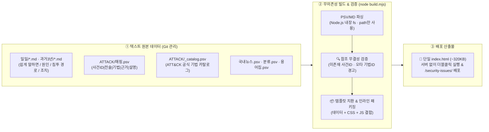

> [!summary] ⏱️ 5초 핵심 요약
> - **한 줄 비유**: 매일 쏟아지는 보안 뉴스를 정리하는 데 무거운 데이터베이스와 클라우드 서버를 띄우는 것은 **동네 마트에 장 보러 가면서 대형 컨테이너 트럭을 몰고 나가는 격**입니다. 대신 **파이프(`|`)로 구분한 메모장(`PSV`)과 조립 설명서 한 장(`build.mjs`)으로 언제 어디서든 더블클릭만 하면 열리는 '단 한 장짜리 인터랙티브 백과사전(`index.html`)'**을 만들었습니다.
> - **핵심 원리**: 사건 본문(`*.md`)과 ATT&CK 매핑(`*.psv`)을 Node.js 내장 모듈(`fs`, `path`)만으로 파싱·참조 무결성 검증까지 마친 뒤, CSS와 JS를 모두 인라인으로 합쳐 **서버 없이 동작하는 320KB 단일 정적 파일**로 컴파일합니다.
> - **핵심 설계 교훈**: 한글 문장에 흔한 쉼표(`,`) 대신 파이프(`|`)를 써서 이스케이프 지옥을 피했고, 데이터가 50건을 넘어가며 필수적이 된 **사건ID·기법ID 교차 검증**을 빌드 스크립트에 내장해 수동 오타를 원천 차단했습니다.

보안 사고 기사를 매일 꼼꼼히 읽을 여유는 없습니다. 제목과 대략적인 내용 정도만 훑고 지나가는 게 현실인데, 그렇게 보고 넘기면 **"이 사건이 어떤 MITRE ATT&CK 기법이었는지"**, **"비슷한 원인의 사건이 과거에 또 있었는지"**는 금방 기억에서 사라집니다. 제목만 보고도 흐름이 한눈에 보이게, 훑어보기 자체를 쉽게 만들고 싶어서 제작한 도구가 [보안이슈 · MITRE ATT&CK 정리](/security-issues/)입니다.



---

## 한눈에 보는 보안이슈 트래커 아키텍처 선택 이유 비교표

**💡 한 줄 비유**: 매일 몇 줄씩 기록하고 검색하는 도구를 만들 때 **'관리할 부품 수'를 0개로 줄이기 위해 내린 4가지 기술적 트레이드오프**입니다.

| 설계 결정 지점 | 흔히 택하는 무거운 대안 | ✅ **이 프로젝트의 선택** | 실무에서 얻은 이득과 감수한 대가(Trade-off) |
|---|---|---|---|
| **1. 런타임 & 호스팅** | DB + 백엔드 API 서버 또는 Notion/외부 SaaS | **서버리스 단일 `index.html` (~320KB)** | **이득**: 로그인·호스팅 비용 0원, USB에 담아 더블클릭해도 즉시 동작, 폴더 복사로 배포 끝<br/>**대가**: 데이터가 늘수록 HTML 파일 크기 증가 |
| **2. 데이터 저장 포맷** | CSV (쉼표 구분) 또는 복잡한 중첩 JSON | **PSV (`|` 파이프 구분 텍스트)** + Markdown | **이득**: 한국어 요약문에 일상적으로 들어가는 쉼표(`,`)·따옴표 이스케이프 지옥 완벽 회피, Git diff 가독성 극대화 |
| **3. 빌드 의존성** | Webpack/Vite + 수많은 `npm` 패키지 | **Node.js 빌트인(`fs`, `path`) 단일 `build.mjs`** | **이득**: `node_modules` 설치나 버전 깨짐 걱정 없이 어느 환경에서나 `node build.mjs` 한 줄로 즉시 빌드 |
| **4. 데이터 품질 관리** | 눈으로 직접 대조 (수동 검수) | **빌드 시점 참조 무결성 자동 검증** | **이득**: 사건 수가 50건을 넘어가도 `매핑.psv`의 오타 사건ID나 없는 ATT&CK 기법ID를 빌드 시 즉시 적발 |

---

## 1. 왜 서버 없이 파일만으로 만들었나 — 3대 설계 조건

**💡 한 줄 비유**: 매일 쓰는 수첩이 열릴 때마다 로그인 창을 띄우거나 인터넷 연결을 요구하면 결국 안 쓰게 되기 때문에, **'더블클릭 즉시 실행 · 메모장 직접 편집 · 파일 한 장으로 복사 끝'이라는 세 가지 철칙**을 세웠습니다.

### 처음에 못 박은 3가지 조건
1. **서버 없이 더블클릭으로 바로 열릴 것**: 별도 웹 서버나 DB 데몬 없이 로컬 파일시스템에서도 그대로 작동해야 합니다.
2. **데이터는 텍스트 파일로 직접 고칠 수 있을 것**: 전용 어드민 UI를 만드는 대신 에디터로 열어서 몇 줄 추가하고 Git으로 히스토리를 관리할 수 있어야 합니다.
3. **결과물은 단 한 파일로 끝날 것**: 배포와 공유가 `index.html` 파일 하나 복사하는 것으로 끝나야 합니다.

```text
일일/*.md, 과거3년/*.md        — 사건 본문 (쉽게 말하면 / 원인 / 침투 경로 / 조치)
ATTACK/매핑.psv                — 사건ID|전술|기법|근거|설명
ATTACK/_catalog.psv            — ATT&CK 공식 기법 목록
국내뉴스.psv, 분류.psv, 용어집.psv
        │  node build.mjs
        ▼
index.html (서버 없이 열리는 단일 파일, ~320KB)
```

---

## 2. 핵심 구현 디테일 — PSV 포맷과 빌드 시점 무결성 검증

**💡 한 줄 비유**: 사건 요약문에 쉼표(`,`)를 쓸 때마다 따옴표로 감싸는 건 **숨 쉴 때마다 허락받는 것만큼 피곤한 일**이라 칸막이를 파이프(`|`)로 바꿨고, 조립 기계(`build.mjs`)에 **'부품 번호 대조 센서'를 달아 불량 부품(오타 ID)이 섞이면 바로 경보가 울리게** 만들었습니다.

### 1) 왜 CSV 대신 PSV(Pipe-Separated Values)를 골랐는가?
- 보안 사건 설명이나 한 줄 요약에는 쉼표(`,`)가 일상적으로 들어갑니다.
- CSV를 쓰면 쉼표가 나올 때마다 큰따옴표(`"..."`)로 감싸고 내부 따옴표를 또 이스케이프해야 해서 텍스트 파일로 직접 편집할 때 실수가 잦습니다.
- 반면 파이프 문자(`|`)는 일반 기사 요약문에 거의 등장하지 않아 파싱과 이스케이프 규칙이 극단적으로 단순해집니다.

### 2) 데이터가 50건을 넘어가며 필수가 된 '참조 무결성 검증'
`build.mjs`는 단순히 파일을 하나로 합치기만 하지 않고 **데이터베이스의 외래키(Foreign Key) 제약조건 역할**을 겸합니다.
- `매핑.psv`에 적힌 `사건ID`가 실제 `일일/*.md` 또는 `과거3년/*.md` 사건 문서에 존재하는지 대조합니다.
- 매핑된 `기법ID`(예: `T1190`)가 `_catalog.psv`의 MITRE ATT&CK 공식 기법 목록에 실제로 존재하는지 대조합니다.
- 누락이나 오타가 있으면 빌드 콘솔에 즉시 경고를 띄웁니다.

```python
# 방어: 실제 빌드 스크립트의 검증 로직 — 참조 무결성 체크 (개념 예시)
존재하지_않는_사건ID = 매핑에서_참조한_ID - 실제_사건_문서_ID
if 존재하지_않는_사건ID:
    경고(f"매핑.psv가 존재하지 않는 사건을 참조: {존재하지_않는_사건ID}")
```

### 3) 단일 HTML 인라인 패키징의 명암과 운영 이슈
- **장점 (초간단 배포)**: 라우팅·데이터·렌더링 로직과 스타일을 전부 하나의 `index.html`에 인라인으로 넣다 보니 파일 크기는 약 **320KB**가 되었지만, 블로그 하위 경로(`/security-issues/`)에 파일 한 장만 복사해 넣으면 배포가 끝납니다.
- **교차 이슈 1 (Quartz SPA 라우터 충돌)**: Quartz가 모르는 독립 HTML을 하위 경로에 끼워 넣다 보니 블로그 내부 링크 클릭 시 SPA 라우터가 가로채며 화면이 깨지는 문제가 있었고, 이는 `data-router-ignore` 속성으로 해결했습니다([[블로그 인프라 자동화 — Quartz, GitHub Actions, 로컬 빌드 깜빡임 없애기]] 참고).
- **교차 이슈 2 (빌드 타임스탬프 Diff)**: `build.mjs`가 생성 시점의 날짜를 `index.html`에 박아 넣는 구조라, 원본 데이터가 똑같아도 다시 빌드하면 날짜 줄 때문에 Git diff가 한 줄 생깁니다. CI 자동화와 맞물려 불필요한 변경이 잡히는 부분이라 추후 소스 해시 기반으로 개선할 계획입니다.

---

## 3. 만든 방식과 회고 — AI 페어 프로그래밍과 교차검증

**💡 한 줄 비유**: 코딩 실무(PSV 파서, ATT&CK 전술 15개 매핑, 단일 HTML 템플릿 치환)는 **Claude Code가 빠르게 처리**하고, **사람은 "어떤 오타와 누락을 걸러내야 하는지" 도메인 규칙을 지시**하며, 마지막엔 **Codex가 빌드 스크립트의 예외 케이스를 한 번 더 훑는 3각 편대**로 완성했습니다.

- **역할 분담**:
  - **Claude Code**: `build.mjs`의 PSV 파싱·검증 로직 작성, ATT&CK 전술 15개 매핑 UI 구성, 단일 HTML 인라인 번들링 구현
  - **작성자(사람)**: 실제 데이터를 매일 입력하며 검증 로직이 반드시 걸러야 할 케이스(사건ID 오타, 폐기되거나 존재하지 않는 기법 참조 등)를 정의하고 사용성 피드백 제공
  - **Codex 교차검증**: [[Claude 작업을 Codex로 교차검증하기 — MCP로 두 AI 붙이기]] 방식대로 빌드 스크립트 수정 후 Codex에 2차 검토를 맡겨 파싱 엣지 케이스를 점검
- **결론**: 거창한 프레임워크나 DB 없이도 **"매일 몇 줄 적고 검색해서 다시 보는"** 목적에는 `PSV + 무의존성 빌드 스크립트 + 단일 HTML` 조합이 가장 유지보수하기 편하고 강력한 정답이었습니다.
