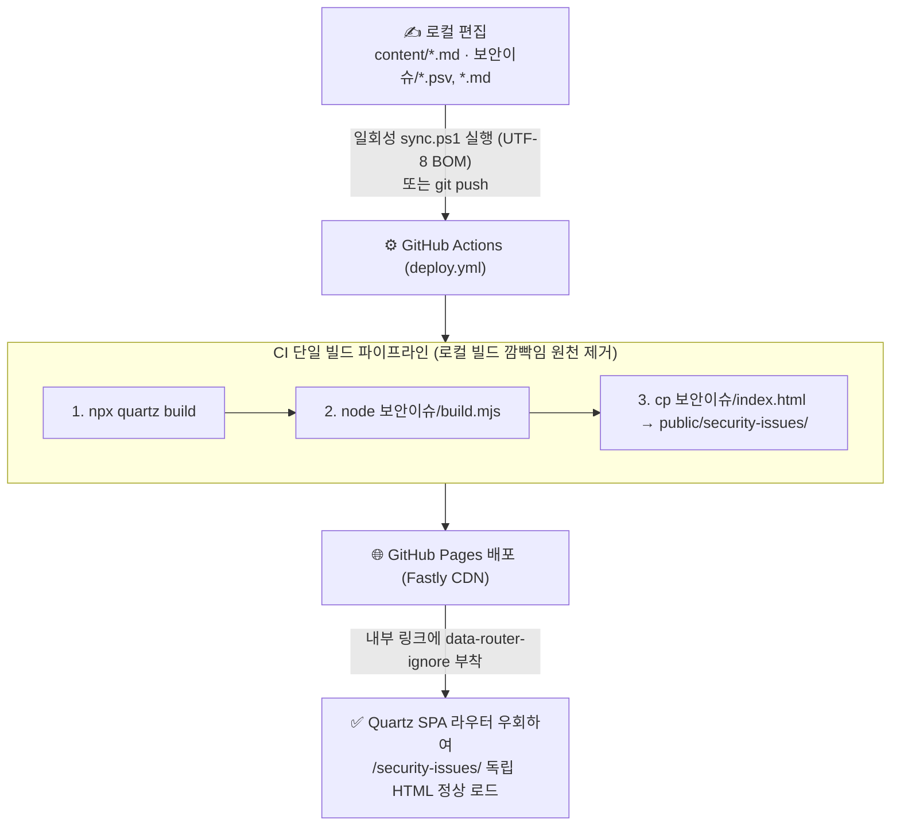

> [!summary] ⏱️ 5초 핵심 요약
> - **한 줄 비유**: 블로그 운영 자동화는 **"누군가 알아서 해주고 있겠지"라는 막연한 믿음을 버리고, 사람이 깜빡할 일(로컬 빌드)은 공장 컨베이어 벨트(GitHub Actions CI)에 묶어두며, 혼자 몰래 졸고 있는 야간 경비원(상시 감시 스크립트) 대신 퇴근할 때 확실히 잠그는 일회성 자물쇠(`sync.ps1`)로 바꾸는 과정**입니다.
> - **핵심 해결 과제 4가지**: ① `build.mjs` 로컬 빌드 누락 → **GitHub Actions CI 빌드 통합**, ② Quartz SPA 라우터의 외부 정적 페이지 깨짐 → **`data-router-ignore` 적용**, ③ CSS 수정 미반영 착시 → **Fastly CDN `max-age=600` 캐시 원인 규명**, ④ 죽어 있던 `auto-sync.ps1` 상시 프로세스 → **UTF-8 BOM 적용 일회성 `sync.ps1` 전환**.
> - **협업 방식**: 사용자는 `"안 보인다"`, `"클릭이 안 된다"`는 현상만 전달하고, 원인 추적(`spa.inline.ts` 분석, 캐시 우회 fetch 비교, 프로세스 점검)과 코드 수정은 전부 Claude가 수행한 실전 AI 디버깅 기록입니다.

이 블로그는 [Quartz](https://quartz.jzhao.xyz/)로 만들고 GitHub Pages에 올립니다. `content/`에 마크다운을 쓰고 push하면 GitHub Actions가 빌드해서 배포하는 구조입니다. 그런데 운영하다 보니 이 기본 구조 바깥에서 문제가 반복됐습니다. [보안이슈 ATT&CK 트래커](/security-issues/)처럼 **Quartz가 모르는 독립 정적 페이지를 하위 경로에 끼워 넣으면서 생긴 문제들**이었습니다.

이 글은 제가 직접 코드를 뒤져 디버깅한 기록이 아닙니다. 저는 `"안 보인다"`, `"클릭이 안 된다"` 같은 증상만 보고 Claude(AI)에게 전달했고, 원인 추적과 코드 수정은 Claude가 세션 안에서 직접 수행했습니다.



---

## 한눈에 보는 블로그 인프라 4대 트러블슈팅 요약표

**💡 한 줄 비유**: 사용자가 느낀 **4가지 답답한 증상**과, AI(Claude)가 뚜껑을 열어 찾아낸 **진짜 범인 및 처방전**을 한눈에 대조한 표입니다.

| 번호 | 사용자가 겪은 증상 | Claude가 찾아낸 근본 원인 | 최종 해결책 (적용 코드/설정) |
|---|---|---|---|
| **문제 1** | 보안이슈 소스를 고치고 push했는데 사이트가 옛 내용 그대로임 | `node build.mjs`가 로컬에서만 돌아가서, 로컬 빌드를 깜빡하고 소스만 push하면 옛 `index.html`이 배포됨 | GitHub Actions **`deploy.yml`에 `node "보안이슈/build.mjs"` 및 복사 단계 내장** |
| **문제 2** | 주소창에 `/security-issues/`를 치면 열리는데 블로그 내 링크를 클릭하면 깨짐 | Quartz의 `enableSPA: true` 라우터(`spa.inline.ts`)가 링크 클릭을 가로채 fetch로 DOM만 갈아끼우려다 독립 HTML과 충돌 | `<a>` 태그에 **`data-router-ignore`** 속성을 추가해 브라우저 전체 페이지 이동 강제 |
| **문제 3** | 사이드바 CSS를 여러 번 고쳐도 화면이 안 바뀜 | Quartz가 JS는 content-hash를 붙이지만 **`index.css`는 고정 파일명**이라 GitHub Pages(Fastly CDN) `max-age=600`(10분) 캐시에 걸림 | `?bust=Date.now()` (`cache: 'no-store'`)로 서버 반영 확인 후 하드 리프레시 안내 (추후 CSS 해시화 과제) |
| **문제 4** | 자동 동기화(`auto-sync.ps1`)가 안 돌고, 새로 짠 `.ps1`은 한글 파싱 에러 및 `git push` 에러 발생 | ① 30초 주기 상시 감시 창이 조용히 죽어 있음<br/>② Windows PowerShell 5.1은 **UTF-8 BOM 없는 한글 스크립트**를 깨뜨림<br/>③ `git push 2>&1` 리다이렉트 시 정상 stderr 진행 로그를 `NativeCommandError`로 오판 | 상시 데몬을 버리고 **일회성 `sync.ps1`(UTF-8 with BOM 저장 + `2>&1` 제거)**로 전환 |

---

## 1. 문제 1: 로컬에서 빌드하는 걸 깜빡하면 사이트가 옛 내용 그대로

**💡 한 줄 비유**: 집에서 반죽(`*.psv`, `*.md`)만 고쳐 놓고 **오븐에 굽기(`node build.mjs`)를 깜빡한 채 어제 구워 둔 식은 빵(`index.html`)을 가게 진열대에 그대로 내보내던 실수**를, 아예 **가게 진열 직전(GitHub Actions CI)에 무조건 새로 굽도록 자동화**해 해결했습니다.

### 증상과 원인
- 보안이슈 트래커는 `psv`와 마크다운 소스를 `node build.mjs`로 돌려 `index.html` 하나를 생성하는 구조입니다([[보안이슈 트래커 빌드 후기 — psv와 build.mjs로 서버 없는 정적 도구 만들기]] 참고).
- 소스 파일(`일일/*.md`, `*.psv`)만 고치고 로컬에서 `node build.mjs` 실행을 깜빡한 채 push하면, 저장소엔 새 소스가 들어갔는데 정작 배포되는 `index.html`은 갱신 전 상태로 남습니다.

### 해결책: 빌드 책임을 로컬(사람)에서 CI(GitHub Actions)로 이전
Claude가 `.github/workflows/deploy.yml`에 빌드와 복사 단계를 직접 추가했습니다.

```yaml
- name: Build Quartz
  run: npx quartz build
- name: Build security-issues page from source
  run: node "보안이슈/build.mjs"
- name: Copy security-issues static page
  run: |
    mkdir -p public/security-issues
    cp "보안이슈/index.html" public/security-issues/index.html
```
- **효과**: 이제 소스 파일만 push하면 CI가 매번 직접 `build.mjs`를 돌려서 최신 `index.html`을 만듭니다. **"빌드 결과물을 커밋에 의존하지 말고, 배포 시점에 원본 소스로부터 다시 생성하게 만든 것"**이 핵심입니다.

---

## 2. 문제 2: Quartz의 SPA 라우터가 외부 정적 페이지를 깨먹는다

**💡 한 줄 비유**: 아파트 단지 내 셔틀버스(Quartz SPA 라우터)가 모든 이동을 단지 내 방송실 규격으로만 처리하려다 보니, **단지 바깥의 독립 건물(`/security-issues/`)로 가는 승객까지 억지로 자기 버스에 태우려다 사고가 난 상황**입니다. 표지판에 **"이 길은 걸어서 직접 나가세요(`data-router-ignore`)"**라고 적어 주어 해결했습니다.

### 증상과 원인 (`spa.inline.ts` 분석)
- 주소창에 `/security-issues/`를 직접 입력하면 멀쩡히 열리는데, 블로그 안에서 링크를 클릭하면 화면이 깨지거나 안 들어가지던 현상이었습니다.
- Claude가 Quartz의 라우터 소스 코드(`spa.inline.ts`)를 직접 읽고 원인을 찾아냈습니다. Quartz는 `enableSPA: true`일 때 내부 링크 클릭을 가로채서 `fetch`로 받아온 뒤 페이지 전체 리로드 없이 DOM만 갈아치우는데, `/security-issues/`는 Quartz가 만든 페이지가 아니라 완전히 다른 구조의 독립 HTML이라 충돌한 것입니다.

```ts
const getOpts = ({ target }: Event) => {
  if (!isElement(target)) return
  if (target.attributes.getNamedItem("target")?.value === "_blank") return
  const a = target.closest("a")
  if (!a) return
  if ("routerIgnore" in a.dataset) return  // 핵심 탈출구!
  ...
}
```

### 해결책: `data-router-ignore` 속성 한 줄 추가
라우터 코드에 이미 `"routerIgnore" in a.dataset` 조건이 있는 것을 확인하고, 링크 태그에 **`data-router-ignore`** 속성을 추가했습니다.

```html
<a href="/security-issues/" data-router-ignore>보안 이슈 · ATT&CK 정리</a>
```
Quartz 바깥의 독립 정적 페이지로 연결하는 모든 링크에는 이 속성을 붙이면 SPA 라우터가 건너뛰고 브라우저 기본 전체 이동을 수행합니다.

---

## 3. 문제 3: CSS를 고쳤는데 안 보인다 — 알고 보니 10분 캐시

**💡 한 줄 비유**: 주방(서버)에서는 이미 새 메뉴로 요리를 바꿔 내보내고 있는데, **홀 매니저(CDN·브라우저 캐시)가 10분 전에 찍어둔 옛날 메뉴판(`index.css`)을 손님에게 계속 보여주고 있었던 상황**입니다.

### 증상과 원인 검증
- 사이드바 링크 디자인을 여러 번 고치는 동안 매번 `"안 바뀌었는데?"`라고 물었고, Claude는 `"서버는 이미 최신"`이라고 답해 처음엔 의심이 들었습니다.
- 이에 Claude가 캐시를 강제로 우회해 서버의 실제 CSS를 받아와 비교하는 스크립트로 증명해 보였습니다.

```js
// Claude가 확인한 방법 — 캐시 무시하고 서버의 최신 CSS만 다시 받아서 비교
const r = await fetch('https://.../index.css?bust=' + Date.now(), { cache: 'no-store' })
```

- **근본 원인**: Quartz는 JS 파일에는 content-hash를 붙여 자동 캐시 무효화를 해주지만, **`index.css`는 파일명이 고정**되어 있습니다. 여기에 GitHub Pages(Fastly CDN)의 기본 `max-age=600`(10분)과 브라우저 캐시가 겹쳐서 push 직후 10분 동안 옛 CSS가 표시된 것이었습니다.
- **대응**: 당장은 하드 리프레시(`Ctrl+Shift+R`)로 확인하고, 근본적으로는 CSS 파일명에도 content-hash를 붙이도록 Quartz 빌드 파이프라인을 개선하는 과제로 남겨두었습니다.

---

## 4. 문제 4: 상시 감시 스크립트의 배신과 PowerShell 5.1의 두 가지 함정

**💡 한 줄 비유**: 24시간 보초를 서라고 세워둔 경비 로봇(`auto-sync.ps1`)이 창문이 닫히자 소리 소문 없이 꺼져 있는 걸 보고, **아예 작업이 끝날 때 버튼 한 번으로 문단속까지 마치는 일회성 퇴근 스위치(`sync.ps1`)로 바꿨더니 이번엔 윈도우 구형 번역기(PowerShell 5.1 인코딩·stderr)가 발목을 잡은 에피소드**입니다.

### 1) 상시 감시(`auto-sync.ps1`)에서 일회성 실행(`sync.ps1`)으로의 전환
- 처음엔 30초마다 `git status`를 확인해 자동 커밋·push하는 `auto-sync.ps1`이 돌아가고 있다고 믿었지만, Claude가 실행 프로세스 목록을 확인해 보니 창이 닫히거나 세션이 바뀌면서 **조용히 죽어 있었습니다.**
- 다시 띄워도 세션 환경 특성상 금방 종료되는 것을 확인하고, 불안정한 상시 프로세스 대신 **작업 루틴이 끝나는 시점에 딱 한 번 실행하는 일회성 스크립트**로 구조를 바꿨습니다(`build.mjs → git add(보안이슈 폴더만) → commit → push`).

```powershell
D:\98. blog\보안이슈\sync.ps1
```

### 2) Windows PowerShell 5.1의 두 가지 함정과 해결책
새로 만든 `sync.ps1`을 처음 실행했을 때 발생한 파싱·실행 에러에서 Claude가 찾아낸 윈도우 환경 특유의 함정 두 가지입니다.

1. **함정 A — 한글 스크립트와 UTF-8 BOM 누락**:
   - 한글이 들어간 `.ps1` 파일을 **UTF-8(BOM 없음)**로 저장하면 Windows PowerShell 5.1이 이를 시스템 기본 코드페이지(CP949)로 잘못 읽어 문자열이 깨지고 구문 파싱 에러가 납니다. 반드시 **UTF-8 with BOM(`$true`)**으로 저장해야 합니다.
   ```powershell
   [System.IO.File]::WriteAllText($path, $content, [System.Text.UTF8Encoding]::new($true))
   ```
2. **함정 B — `git push 2>&1` 리다이렉트와 `NativeCommandError`**:
   - Git은 정상적인 진행 상황 메시지(`To github.com:...`)도 표준 에러(`stderr`) 스트림으로 출력합니다.
   - PowerShell에서 이를 `2>&1`로 캡처하면 정상 진행 출력까지 `ErrorRecord`(`NativeCommandError`)로 취급해 스크립트가 중단될 수 있으므로, 네이티브 Git 명령 출력은 불필요하게 리다이렉트하지 않는 것이 안전합니다.

---

## 5. 마무리 — 지금 남은 단단한 배포 구조

**💡 한 줄 비유**: **"자동으로 돌고 있겠지"라고 넘겨짚던 암묵적 믿음들을 전부 걷어내고, 눈으로 확인된 결정론적 파이프라인만 남겨 둔 현재의 블로그 인프라**입니다.

```text
content/*.md, 보안이슈/*  (사람이 직접 편집)
        │ push (또는 일회성 sync.ps1)
        ▼
GitHub Actions: npx quartz build + node 보안이슈/build.mjs
        │
        ▼
GitHub Pages 배포 (1~2분)
```

1. **로컬 빌드 결과물을 믿지 않고** 커밋마다 CI가 원본 소스에서 다시 빌드하게 만든 것
2. **SPA 라우터가 모르는 페이지엔** `data-router-ignore`로 라우팅을 맡기지 않은 것
3. **화면이 안 바뀔 때** 캐시를 의심하고 `cache: 'no-store'`로 직접 대조한 것
4. **죽어 있는 상시 프로세스 대신** BOM 인코딩을 갖춘 일회성 스크립트로 바꾼 것

네 가지 모두 결국 **"뭔가 자동으로 되고 있다고 믿지 말고 실제로 확인하자"**는 하나의 원칙으로 수렴합니다.
