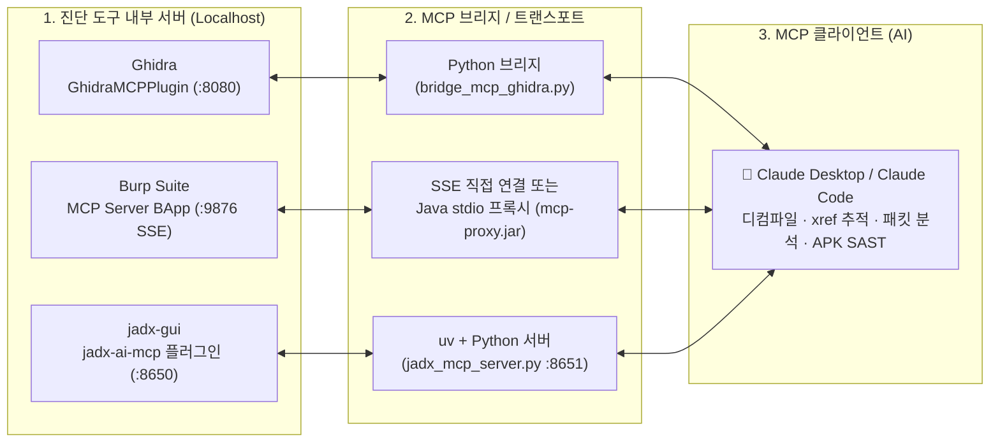

> [!summary] ⏱️ 5초 핵심 요약
> - **한 줄 비유**: 예전에는 분석가가 Ghidra·Burp·jadx 화면에서 코드를 일일이 복사해 AI 채팅창에 붙여넣는 **'인간 배달부'**였다면, **MCP(Model Context Protocol)**를 꽂으면 AI가 직접 진단 도구의 운전대를 잡고 함수를 디컴파일하거나 패킷을 조회하는 **'직통 USB-C 케이블'**이 생깁니다.
> - **핵심 원리**: 세 도구 모두 **`도구 내부 서버(플러그인/익스텐션) ↔ MCP 브리지(서버) ↔ Claude(MCP 클라이언트)`**의 3단 구조로 동작하며, AI의 자연어 도구 호출을 각 진단 툴의 로컬 API로 변환해 실행합니다.
> - **핵심 안전 수칙**: 본인 소유 또는 명시적으로 인가된 진단 대상에만 사용하고, AI가 임의로 스코프 밖 트래픽을 쏘지 않도록 **Burp Target Approval(대상 승인) 및 MCP 클라이언트 실행 승인 설정**을 반드시 켜야 합니다.

요즘 진단할 때 **MCP(Model Context Protocol)**를 적극적으로 쓰고 있습니다. Ghidra로 디컴파일한 함수를 Claude한테 바로 던져서 `"이 함수 뭐하는 거야?"`라고 묻고, Burp 프록시 히스토리를 AI가 직접 훑어보게 하고, jadx로 까낸 APK 클래스를 Claude가 읽고 SAST를 돌리는 식입니다. 도구와 AI 사이에 사람이 복붙하던 왕복 과정이 사라지니 분석 속도가 확 빨라집니다.

이 글에서는 **Ghidra · Burp Suite · jadx** 세 도구를 Claude(Desktop / Claude Code)에 MCP로 연동하는 방법을 정리합니다.



---

## 한눈에 보는 3대 진단 툴 MCP 연동 비교표

| 진단 도구 | 주력 분석 영역 | 사용 플러그인 / 저장소 | 로컬 통신 포트·방식 | 핵심 준비물 | 대표 실전 프롬프트 예시 |
|---|---|---|---|---|---|
| **1. Ghidra** | 네이티브 바이너리 리버싱 | [LaurieWired/GhidraMCP](https://github.com/LaurieWired/GhidraMCP) | HTTP `localhost:8080` ↔ `bridge_mcp_ghidra.py` | Ghidra, JDK 21+, Python 3.10+ (`mcp`, `requests`) | `"라이선스 키 검증이나 결제 금액 다루는 후보 함수를 문자열·xref로 찾아줘"` |
| **2. Burp Suite** | 웹·API 트래픽 진단 | 공식 BApp `MCP Server` (PortSwigger) | SSE `127.0.0.1:9876` (또는 `mcp-proxy.jar`) | Burp Suite, BApp Store 설치 (가장 간편) | `"프록시 히스토리에서 /api/ 요청만 추리고 Repeater로 파라미터 변조 응답 차이 비교해줘"` |
| **3. jadx** | 안드로이드 APK 정적 분석 | [zinja-coder/jadx-ai-mcp](https://github.com/zinja-coder/jadx-ai-mcp) | HTTP `127.0.0.1:8650` ↔ `jadx_mcp_server.py` (`:8651`) | `jadx-gui`, Python `uv` 패키지 매니저 | `"지금 선택한 클래스와 AndroidManifest 가져와서 빠르게 SAST 취약점 짚어줘"` |

> [!warning] 진단 윤리 및 데이터 보안 주의사항
> - 모든 연동은 **본인 소유 바이너리/APK, 또는 명시적으로 인가된 진단 대상**에만 사용하세요.
> - AI에게 보내는 데이터(디컴파일된 코드, HTTP 트래픽)는 모델 제공자의 데이터 정책을 따른다는 점도 반드시 사전 확인해야 합니다.

---

## 1. Ghidra MCP — 바이너리 디컴파일을 Claude에게

**💡 한 줄 비유**: 예전에는 수만 줄짜리 어셈블리·디컴파일 창에서 `strings`와 `xref`를 손으로 일일이 따라가며 미로를 찾았다면, Ghidra MCP는 **Ghidra 안에 숙련된 리버싱 조수를 상주시켜 "결제 검증 함수 찾아서 변수 이름까지 읽기 쉽게 정리해 놔"라고 시키는 것**입니다.

[LaurieWired/GhidraMCP](https://github.com/LaurieWired/GhidraMCP)는 Ghidra의 리버싱 기능을 MCP 툴로 노출합니다. 디컴파일, 메소드·데이터 자동 명명, 코드 구조 조회, 크로스레퍼런스(xref)까지 Claude가 직접 호출할 수 있습니다. 릴리스에 이미 빌드된 파일이 올라와 있어 복잡한 Maven 소스 빌드가 필요 없는 것이 큰 장점입니다.

### 준비물
- [Claude Desktop](https://claude.ai/download) (또는 Claude Code)
- [Ghidra](https://github.com/NationalSecurityAgency/ghidra/releases)
- **JDK 21 이상** ([Oracle](https://www.oracle.com/kr/java/technologies/downloads/) 등) — *GhidraMCP 빌드용이 아니라 Ghidra 자체를 구동하는 데 필요합니다.*
- **Python 3.10+** (브리지 스크립트 실행용)
- [GhidraMCP 릴리스](https://github.com/LaurieWired/GhidraMCP/releases) 파일 (빌드된 확장 `.zip` + `bridge_mcp_ghidra.py` 포함)

### 단계별 설치 절차
1. **기본 환경 및 프로젝트 준비**: Claude Desktop과 JDK 21+를 설치한 뒤 Ghidra 압축을 해제해 `ghidraRun.bat`(윈도우)를 실행합니다. 새 프로젝트(`File → New Project`)를 만들고 분석할 바이너리를 import합니다.
2. **GhidraMCP 릴리스 압축 해제**: 다운로드한 릴리스 압축을 풀고 안에 든 `bridge_mcp_ghidra.py`를 별도 경로에 보관합니다.
3. **Ghidra 확장 설치**: Ghidra에서 `File → Install Extensions` → 우측 상단 `+` 버튼을 눌러 압축 해제한 GhidraMCP 확장(`zip`)을 추가합니다.
4. **플러그인 활성화 확인**: 목록에서 `GhidraMCP`를 체크한 뒤 Ghidra를 재실행합니다. CodeBrowser 창에서 `File → Configure → Developer`의 Configure Developer Plugins에 **`GhidraMCPPlugin`**이 체크되어 있는지 확인합니다.
5. **로컬 서버 구동 확인**: 플러그인이 켜지면 Ghidra가 로컬에서 MCP용 HTTP 서버(기본 `localhost:8080`)를 띄웁니다.

### Claude 연동 설정 (Desktop & CLI)
먼저 파이썬 브리지에 필요한 패키지를 설치합니다.

```bash
pip install mcp requests
```

- **Claude Desktop 연동**: `파일 → 설정 → 개발자 → 구성 편집`으로 `claude_desktop_config.json`을 열어 브리지를 등록합니다. *(주의: 윈도우 경로는 역슬래시를 반드시 두 번(`\\`) 써야 JSON 파싱 에러가 나지 않습니다.)*

```json
{
  "mcpServers": {
    "ghidra": {
      "command": "python",
      "args": ["C:\\path\\to\\bridge_mcp_ghidra.py"]
    }
  }
}
```

저장한 뒤 Claude Desktop을 `파일 → 종료`로 완전히 종료했다가 재실행합니다. `파일 → 설정 → 개발자`에서 `ghidra` MCP 서버가 `running`으로 보이고 채팅창 도구(🔨) 버튼에 Ghidra 툴이 뜨면 성공입니다.

- **Claude Code(CLI) 연동**: 한 줄 명령어로 즉시 등록됩니다.
```bash
claude mcp add ghidra -- python C:/path/to/bridge_mcp_ghidra.py
```

### 실전 활용 패턴 2가지
1. **이미 아는 함수를 빠르게 해독할 때 (Top-Down)**:
   - `"현재 프로그램에서 main 함수 디컴파일하고 뭐하는지 설명해줘"`
   - `"이 함수 내부 변수와 함수명에 의미 있는 이름을 붙여줘"`
   - `"이 주소로 들어오는 xref 다 찾아서 호출 흐름 정리해줘"`
2. **모르는 진입점·변조 지점을 역추적할 때 (Bottom-Up)**:
   - `"라이선스 키 검증이나 파일 복호화 동작을 하는 후보 함수를 찾아줘"`
   - `"내가 변조하고 싶은 인자(예: 결제 금액, 권한 플래그)가 들어가는 함수를 찾아줘"`
   - 예전엔 `strings`를 떠서 의심스러운 문자열을 grep하고 xref를 손으로 거슬러 올라갔다면, 이제는 Claude가 문자열·xref·디컴파일 결과를 한꺼번에 훑어 후보 함수를 짚어줍니다.

---

## 2. Burp Suite MCP — 웹 진단 트래픽을 Claude에게

**💡 한 줄 비유**: Burp Suite에 찍힌 수천 개의 프록시 패킷 더미 속에서 **AI에게 "수상한 `/api/` 요청만 골라내서 Repeater로 파라미터 하나씩 흔들어보고 차이점만 보고해"라고 지시하는 자동화 관제탑**입니다.

Burp는 PortSwigger가 직접 만든 공식 BApp으로 **"MCP Server"** 익스텐션을 제공하므로 세 도구 중 설치가 가장 간단합니다.


### 단계별 설치 및 주요 기능
1. Burp Suite에서 `Extensions → BApp Store`로 이동합니다.
2. 검색창에 `mcp` 입력 → **`MCP Server` (by Daniel S, PortSwigger)** 선택 → `Install`을 클릭합니다.
3. 상단에 새로 생긴 **`MCP` 탭**으로 이동해 **`Enable MCP server`**를 체크합니다.
4. 보안 설정(자동 승인 대상, 설정 편집 허용 등)을 진단 환경에 맞게 조정합니다.

- **연동 시 가능한 주요 작업**:
  - HTTP/1.1 및 HTTP/2 요청 직접 전송
  - 프록시 히스토리(HTTP · WebSocket) 정규식 필터 조회
  - Repeater 탭 생성 및 Intruder 전송
  - Collaborator 페이로드 생성·폴링 *(Burp Professional 전용)*
  - 프로젝트·유저 설정 JSON 내보내기 및 수정

### Claude 연동 설정
- **자동 설정 (Claude Desktop 권장)**: Burp의 `MCP` 탭 안에 있는 **Install** 버튼을 누르면 패키징된 stdio 프록시를 사용해 Claude Desktop 설정을 자동으로 잡아줍니다.
- **수동 설정 (Claude Code / SSE 또는 프록시 jar)**: Burp MCP 서버는 기본적으로 SSE 모드(`http://127.0.0.1:9876`)로 동작합니다.

```bash
# 방법 A: Claude Code에서 SSE(원격) 트랜스포트로 직접 등록
claude mcp add --transport sse burp http://127.0.0.1:9876
```

```json
// 방법 B: claude_desktop_config.json에 동봉된 stdio 프록시 jar 직접 등록
{
  "mcpServers": {
    "burp": {
      "command": "java",
      "args": ["-jar", "/path/to/mcp-proxy.jar", "--sse-url", "http://127.0.0.1:9876"]
    }
  }
}
```

### 실전 활용 및 필수 안전장치
- `"프록시 히스토리에서 /api/ 들어간 요청만 보여줘"`, `"이 Repeater 요청 파라미터 하나씩 바꿔서 보내고 응답 차이 알려줘"` 같은 작업을 Claude가 직접 수행합니다.
- **필수 안전 설정**: AI가 임의로 엉뚱한 도메인에 요청을 쏘면 위험하므로, Burp MCP 탭의 **Configurable target approval(대상 승인)**을 반드시 설정해 인가된 진단 스코프 밖으로 트래픽이 새지 않게 통제하세요.

---

## 3. jadx MCP — 안드로이드 APK 분석을 Claude에게

**💡 한 줄 비유**: 안드로이드 APK를 jadx-gui로 열어 두고 **"지금 보고 있는 액티비티랑 매니페스트 파일 같이 읽고 인텐트나 하드코딩 키 취약점 있는지 훑어줘"라고 바로 시키는 모바일 코드 리뷰 파트너**입니다.

jadx 본체에는 아직 MCP가 내장돼 있지 않지만, [zinja-coder/jadx-ai-mcp](https://github.com/zinja-coder/jadx-ai-mcp) 플러그인을 쓰면 `jadx-gui`로 디컴파일한 자바 코드를 Claude가 실시간으로 읽고 분석할 수 있습니다. 구조는 **`jadx-gui 플러그인(HTTP :8650) ↔ 파이썬 MCP 서버(jadx_mcp_server.py) ↔ Claude`** 순서입니다.

### 준비물 및 설치 절차
- **준비물**: [jadx 최신 릴리스](https://github.com/skylot/jadx/releases) (`jadx-gui`) + Python 패키지 매니저 [`uv`](https://github.com/astral-sh/uv)
1. [jadx-ai-mcp 릴리스](https://github.com/zinja-coder/jadx-ai-mcp/releases)에서 **`jadx-ai-mcp-<버전>.jar`**와 **`jadx-mcp-server-<버전>.zip`** 두 파일을 모두 받습니다.
2. **플러그인 설치**: jadx 플러그인 매니저 명령어를 실행하거나 받은 `.jar`를 jadx 플러그인 폴더에 직접 넣습니다.
   ```bash
   jadx plugins --install "github:zinja-coder:jadx-ai-mcp"
   ```
3. **MCP 서버 의존성 설치**: `jadx-mcp-server.zip` 압축을 풀고 해당 폴더에서 `uv sync`를 실행합니다.
   ```bash
   cd jadx-mcp-server
   uv sync
   ```
4. 플러그인이 설치된 `jadx-gui`로 분석할 APK를 열어두면 플러그인이 `127.0.0.1:8650`에서 대기합니다.

### Claude 연동 설정
- **Claude Desktop (`claude_desktop_config.json`)**:
```json
{
  "mcpServers": {
    "jadx-mcp-server": {
      "command": "/path/to/uv",
      "args": ["--directory", "/path/to/jadx-mcp-server/", "run", "jadx_mcp_server.py"]
    }
  }
}
```
- **Claude Code (CLI)**:
```bash
claude mcp add jadx -- /path/to/uv --directory /path/to/jadx-mcp-server/ run jadx_mcp_server.py
```
*(플러그인이 다른 머신/포트에 있다면 `--jadx-host` [기본 `127.0.0.1`], `--jadx-port` [기본 `8650`], MCP 서버 자체 포트는 `--host`/`--port` [기본 `8651`] 인자로 조정할 수 있습니다.)*

### 실전 활용
연동 후 `jadx-gui`에서 클래스를 선택하고 Claude에게 `"지금 선택한 클래스 가져와서 빠르게 SAST 돌려줘"`라고 요청하면, `fetch_current_class()`, `get_android_manifest()`, `search_classes_by_keyword()`, `xrefs_to_method()` 등 **25개가 넘는 전용 툴**로 디컴파일 코드를 읽고 취약점을 짚어줍니다.

---

## 4. 마무리 — 왜 진단에 MCP를 쓰는가

**💡 한 줄 비유**: 사람의 눈과 손은 **'어디가 수상한지 가설을 세우는 데'** 쓰고, 함수 수백 개에 주석을 달거나 패킷 수천 개를 대조하는 **'단순 반복 노가다'는 MCP로 연결된 AI에게 맡기는 분업 구조**입니다.

```text
도구 내부 서버(플러그인/익스텐션)  ↔  MCP 브리지(서버)  ↔  Claude(MCP 클라이언트)
   Ghidra :8080                       파이썬/자바              "이 함수 뭐해?"
   Burp   :9876(SSE)                                          "이 트래픽 분석해"
   jadx   :8650                                               "이 클래스 취약점 봐줘"
```

- **복붙 루프 제거**: 디컴파일 결과나 패킷을 복사해 채팅창에 붙여넣고 다시 도구로 돌아가는 수동 왕복이 사라집니다.
- **대량·반복 작업 가속**: 함수 수백 개 명명·주석화, 트래픽 패턴 훑기, APK 전체 클래스 SAST에서 시간을 극적으로 줄여줍니다.
- **다음 걸음**: 이렇게 도구별로 각각 MCP 브리지를 붙이는 방식 외에, 역공학 도구를 하나로 묶으려는 시도는 [[Rea 써봤다 — MCP로 붙는 AI 역공학 에이전트 도구]]에서, 직접 만든 Frida 동적 분석 워크벤치에 MCP를 얹은 과정은 [[Hera — Frida 기반 동적 보안 분석 워크벤치를 직접 만들다]]에서 이어서 볼 수 있습니다.

## 참고

- [LaurieWired/GhidraMCP](https://github.com/LaurieWired/GhidraMCP)
- [Burp Suite MCP Server (BApp)](https://portswigger.net/bappstore) — Extensions → BApp Store에서 `mcp` 검색
- [zinja-coder/jadx-ai-mcp](https://github.com/zinja-coder/jadx-ai-mcp)
- [jadx 릴리스](https://github.com/skylot/jadx/releases)
- [Model Context Protocol 공식](https://modelcontextprotocol.io)
