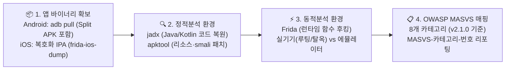

> [!summary] ⏱️ 5초 핵심 요약
> - **한 줄 비유**: 모바일 앱 모의해킹은 **내 손안에 배송된 금고(APK/IPA)를 작업대에 올려 설계도(정적분석)를 읽고, 금고가 작동하는 순간에 청진기(Frida 동적분석)를 대보는 작업**입니다.
> - **핵심 원리**: 진단 파이프라인은 **`원본 무결성이 검증된 바이너리 확보(Split APK·복호화 IPA)` → `정적·동적 분석 환경 구축(jadx·apktool·Frida)` → `OWASP MASVS v2.1.0(8개 카테고리) 기준 매핑`** 순서로 진행됩니다.
> - **핵심 체크 및 주의사항**: 제3자 APK 다운로드 사이트 대신 기기에서 직접 추출(`pm path` 전체 확인)하고, 보고서는 Mobile Top 10(`M1~M10`)이 아닌 **`MASVS-카테고리-번호` 컨트롤 ID**를 기준으로 작성합니다.

모바일 앱 모의해킹 시리즈의 첫 글입니다. 이 글은 특정 취약점을 깊게 파는 글이 아니라, 이후 글들을 읽기 전에 필요한 **분석 대상 확보 → 분석 환경 구축 → 진단 기준(OWASP MASVS) 이해**를 한 번에 정리하는 지도 역할입니다. 모바일 진단도 웹과 마찬가지로 반드시 **본인 소유 기기/앱이거나 서면 허가를 받은 대상**에서만 수행하세요.



---

## 한눈에 보는 안드로이드 vs iOS 진단 환경 비교

| 구분 | Android | iOS | 실무 핵심 주의사항 |
|---|---|---|---|
| **패키지 포맷** | APK (ZIP 기반, `classes*.dex`, `AndroidManifest.xml`) | IPA (ZIP 기반, `Payload/*.app/`, Mach-O, `Info.plist`) | Android는 **Split APK 누락 주의**, iOS는 **FairPlay DRM 암호화(`cryptid`) 확인 필수** |
| **바이너리 추출** | `adb shell pm path <pkg>` → `adb pull` | 탈옥 기기에서 `frida-ios-dump` 등 메모리 덤프 (또는 비암호화 배포본) | 제3자 사이트(APKPure 등) 파일은 리패키징 위험이 있으므로 `apksigner verify --print-certs` 대조 |
| **정적 분석 도구** | `jadx` (Java 디컴파일), `apktool` (리소스·smali 재조립) | `otool`, `nm`, `class-dump`, `Ghidra` / `Hopper` | 난독화(R8/ProGuard) 및 Swift 심볼 스트리핑 여부에 따라 동적 분석 병행 |
| **동적 계측 도구** | `Frida` (`frida-server` 또는 `frida-gadget` 삽입) | `Frida` (`frida-server` 또는 `frida-gadget` 재서명) | 기기 무결성 판정(**Play Integrity** / **App Attest**) 및 루팅·탈옥 탐지 우회 선행 필요 |

---

## 1. 안드로이드/iOS 앱 확보

**💡 한 줄 비유**: 정품 시계를 감정하려면 **공식 매장에서 바로 가져온 시계(기기에서 직접 뽑은 원본 패키지)**를 열어야지, 출처 모를 중고 장터(제3자 APK 사이트)에서 누가 부품을 바꿨을지 모르는 시계를 가져오면 안 됩니다.

### 핵심 원리
정적·동적 분석을 하려면 먼저 분석 대상 바이너리(APK/IPA)를 손에 넣어야 합니다. 안드로이드는 `adb`로 기기에 설치된 패키지를 그대로 꺼낼 수 있고, iOS는 샌드박스와 코드 서명·DRM 때문에 설치된 앱을 "그냥 복사"하는 방법이 없어 탈옥 기기나 별도 추출 도구가 필요합니다.

### 플랫폼별 바이너리 추출 방법과 주의점

1. **안드로이드 APK 추출 (Split APK 전체 확보 필수)**
   - 대상 앱을 **실제 기기(또는 에뮬레이터)에 설치한 뒤** 경로를 확인해 꺼내는 방식이 가장 신뢰할 수 있습니다.
   - Google Play로 배포되는 앱은 `base.apk` 외에 화면 밀도·ABI(네이티브 `.so` 포함)·언어별 **split APK**가 함께 설치되는 경우가 많으므로, `pm path`가 돌려주는 경로를 **전부** 확인하고 꺼내야 리소스나 네이티브 라이브러리 누락 없이 재현할 수 있습니다.
   ```bash
   # 1. 설치된 패키지의 모든 APK 경로 확인 (base.apk + split APK들)
   adb shell pm path com.example.app
   # package:/data/app/~~xxxx==/com.example.app-xxxx==/base.apk
   # package:/data/app/~~xxxx==/com.example.app-xxxx==/split_config.arm64_v8a.apk

   # 2. 디렉터리 전체 추출
   adb pull /data/app/~~xxxx==/com.example.app-xxxx==/

   # 3. 외부 입수 APK인 경우 서명 유효성 및 인증서 지문(Fingerprint) 대조
   apksigner verify --print-certs base.apk
   ```
2. **제3자 다운로드 사이트(APKPure류) 사용 시 위험성**
   - 원본 서명이 아닌 재서명(리패키징)된 파일을 올려두는 경우가 있고, 실제 배포 버전과 코드가 다를 수 있어 **진단 대상의 무결성을 보장하지 못합니다**.
   - `apksigner verify`는 서명이 유효한지(변조되지 않았는지)만 확인할 뿐 **그 서명이 원 개발사의 것인지는 증명하지 않으므로**, 의심스러운 출처라면 `--print-certs`로 인증서 지문을 뽑아 공식 배포본과 직접 대조해야 합니다.
3. **iOS IPA 확보와 FairPlay DRM 복호화**
   - App Store로 배포되는 앱의 실행 파일은 **FairPlay DRM**으로 암호화된 상태로 저장되기 때문에, 단순히 앱 번들을 복사하는 것만으로는 정적 분석에 쓸 복호화된 바이너리를 얻지 못합니다.
   - 실무에서는 탈옥 기기에 설치한 뒤 `frida-ios-dump` 같은 도구로 실행 중인 프로세스 메모리에서 복호화된 상태의 IPA를 재구성합니다. (단, 개발/엔터프라이즈 배포로 받은 비암호화 IPA나 자체 앱의 시뮬레이터 빌드는 탈옥 없이도 분석 가능합니다.)
   - **법적·계약적 확인**: App Store에서 정식 구매한 앱을 추출하는 행위가 Apple 개발자 프로그램 라이선스 계약이나 저작권법상 기술적 보호조치 우회 금지 조항과 어떻게 충돌하는지는 관할 법률과 계약 조건에 따라 달라지므로, 진단 목적이라도 앱 소유자(또는 발주사)의 서면 허가 범위와 적용 법률을 먼저 확인해야 합니다.

### 체크 포인트
- `pm path`로 나온 APK(스플릿 포함)를 빠짐없이 추출했는지 확인한다.
- 제3자 배포 파일이라면 `apksigner verify --print-certs`로 뽑은 인증서 지문을 신뢰할 수 있는 공식 배포본과 대조했는지 확인한다.
- iOS 분석 대상이 탈옥 기기 덤프인지 비암호화 배포본인지, 그리고 계약상 허용된 범위인지 확인한다.
- 참고: [OWASP MASTG — Android App Extraction](https://mas.owasp.org/MASTG/techniques/android/MASTG-TECH-0003/), [OWASP MASTG — iOS App Binary Extraction](https://mas.owasp.org/MASTG/techniques/ios/MASTG-TECH-0054/), [Android — apksigner](https://developer.android.com/tools/apksigner)

---

## 2. 분석 환경 구축

**💡 한 줄 비유**: **정적 분석(`jadx`·`apktool`)**이 건물 완공 도면을 펼쳐 놓고 비밀 통로와 잠금장치를 찾는 작업이라면, **동적 분석(`Frida`)**은 실제로 건물이 운영될 때 문지기 옆에 서서 오가는 열쇠와 대화를 실시간으로 가로채고 바꿔치기하는 작업입니다.

### 핵심 원리
모바일 진단은 "코드를 읽는" 정적 분석과 "실행 중인 앱을 건드리는" 동적 분석을 함께 수행합니다. 안드로이드 쪽은 APK를 사람이 읽을 수 있는 형태로 바꿔주는 디컴파일러가 핵심이고, 두 플랫폼 공통으로는 런타임에 함수 호출을 가로채는 동적 계측 도구가 필요합니다.

### 주요 도구 및 환경 선택 기준

| 구분 | 도구 / 환경 | 핵심 역할 | 한계 및 주의사항 |
|---|---|---|---|
| **정적 분석** | **jadx** | APK의 DEX 바이트코드를 Java에 가까운 소스 코드로 역컴파일하여 로직·하드코딩 값·취약 API 탐색 | ProGuard/R8 및 상용 난독화 적용 시 가독성이 떨어지며, 복원 코드가 원본과 100% 동일하지 않을 수 있음 |
| **정적 분석 / 패치** | **apktool** | APK를 리소스(매니페스트, XML)와 **smali**(DEX 중간 표현)로 분해 후 재조립(리패키징) | `android:debuggable="true"` 추가나 핀닝 smali 패치 후 **반드시 재서명(`apksigner`)**해야 설치 가능 |
| **동적 계측** | **Frida** | 실행 중인 프로세스에 JS 엔진을 주입해 Java/ObjC/Swift/Native 함수를 실시간 후킹 | 루팅/탈옥 기기에서는 `frida-server` 구동, 비루팅/비탈옥 기기에서는 APK/IPA에 `frida-gadget` 삽입 후 재패키징 |
| **구동 환경** | **에뮬레이터 vs 실기기** | 에뮬레이터는 스냅샷 복원과 비용 면에서 유리, 실기기는 실제 환경 재현에 유리 | 일부 앱은 `build.prop`이나 **Play Integrity**(과거 SafetyNet Attestation은 2025년 단계적 종료) 신호를 확인해 동작을 제한함 |

### `frida-server`와 루팅 탐지의 관계
- `frida-server`를 실기기에 올리려면 보통 root 권한이 필요하므로, **루팅 탐지**(`su` 바이너리, Magisk 흔적 확인 등)와 **Frida 탐지**(기본 포트 `27042`, 프로세스 목록, 메모리 내 문자열 확인 등)를 **같은 앱이 함께 구현해 두는 사례**가 많습니다.
- 다만 둘 다 구현돼 있다는 보장은 없고, 서로 다른 신호만 확인하는 앱도 있어 한쪽을 우회했다고 분석이 바로 가능해진다고 단정할 수는 없습니다. 구체적인 우회 기법(Zygisk 모듈, `frida-server` 리네이밍, `objection`)은 [[모바일 취약점 진단 — Frida 동적분석과 네트워크]]에서 다룹니다.

### 체크 포인트
- 분석 대상이 난독화돼 있어 `jadx` 결과만으로 로직 파악이 가능한지 확인한다.
- `apktool`로 재조립한 APK가 정상 서명 후 설치/실행되는지 확인한다.
- `frida-server` 버전이 호스트의 `frida-tools` 버전 및 대상 기기 아키텍처(`arm64` 등)와 정확히 일치하는지 확인한다.
- 에뮬레이터에서 앱의 핵심 기능이 정상 동작하는지 확인하고, 제한되면 실기기 전환을 검토한다.
- 참고: [jadx (GitHub)](https://github.com/skylot/jadx), [Apktool 공식 사이트](https://apktool.org/), [Frida — Modes of operation](https://frida.re/docs/modes/), [OWASP MASTG — Root Detection](https://mas.owasp.org/MASTG/knowledge/android/MASVS-RESILIENCE/MASTG-KNOW-0027/), [Android — Play Integrity 판정 유형](https://developer.android.com/google/play/integrity/verdicts)

---

## 3. OWASP MASVS 구조 소개

**💡 한 줄 비유**: **OWASP Mobile Top 10**이 뉴스에 나오는 '올해 가장 흔한 사고 유형 10가지' 포스터라면, **OWASP MASVS**는 건축 안전 감리관이 현장에서 하나씩 체크하며 합격 도장을 찍는 **공식 정밀 점검 기준표(8개 영역)**입니다.

### 핵심 원리
- **Mobile Top 10과의 차이**: OWASP에는 "10대 위험 목록" 형식의 **Mobile Top 10**(`M1`~`M10`, 2024년판 기준)이 따로 있는데, 이는 MASVS의 옛 버전이 아니라 **별도로 유지되는 다른 프로젝트**입니다.
- **MASVS(Mobile Application Security Verification Standard)**: 순위가 아니라 앱이 충족해야 할 **검증 가능한 보안 요구사항**을 정의하는 표준입니다. 현재는 요구사항을 **8개 카테고리**로 묶어 관리합니다(`MASVS-PRIVACY`는 v2.1.0에서 추가된 카테고리로, 8개 구조가 처음부터 고정돼 있던 것은 아닙니다).
- **MASTG와의 관계**: 각 카테고리 안에는 검증 가능한 개별 요구사항(`MASVS-STORAGE-1`처럼 번호가 붙은 컨트롤 ID)이 있고, **MASTG(Mobile Application Security Testing Guide)**가 그 요구사항을 실제로 어떻게 테스트하는지 구체적인 절차를 제공합니다.

### OWASP MASVS 8개 카테고리 및 시리즈 매핑 (공식 YAML 정의 기준)

| 카테고리 코드 | 영역 이름 | 핵심 검증 내용 | 이 시리즈의 대응 글 |
|---|---|---|---|
| **MASVS-STORAGE** | 저장소 (Storage) | 로컬 파일시스템·DB·Keystore·Keychain·백업 내 민감 데이터 보호 | [[모바일 취약점 진단 — 로컬 저장소 포렌식]] |
| **MASVS-CRYPTO** | 암호화 (Cryptography) | 하드코딩 키 배제, 안전한 알고리즘·모드 및 키 관리 API 사용 | [[모바일 취약점 진단 — 안드로이드 정적분석]], [[모바일 취약점 진단 — iOS 정적분석]] |
| **MASVS-AUTH** | 인증/인가 (Authentication & Authorization) | 네이티브 OAuth/PKCE, 토큰 갱신·폐기, 디바이스 바인딩, 상태 검증 | [[모바일 취약점 진단 — OAuth·PKCE 네이티브 플로우 공격]], [[모바일 취약점 진단 — 백엔드 API 토큰 갱신과 디바이스 바인딩]] |
| **MASVS-NETWORK** | 네트워크 통신 (Network Communication) | TLS 설정(ATS/Network Security Config), 인증서 피닝 및 평문 차단 | [[모바일 취약점 진단 — Frida 동적분석과 네트워크]] |
| **MASVS-PLATFORM** | 플랫폼 상호작용 (Platform Interaction) | IPC 컴포넌트 노출, 딥링크/앱링크, WebView 파일 접근 및 JS 브리지 | [[모바일 취약점 진단 — 안드로이드 IPC 공격면]], [[모바일 취약점 진단 — 딥링크·앱링크 공격표면]], [[모바일 취약점 진단 — WebView와 파일 접근 취약점]] |
| **MASVS-CODE** | 코드 품질 (Code Quality) | 디버그 플래그 제거, 바이너리 보호 기법, 클라이언트-서버 API 계약 검증 | [[모바일 취약점 진단 — 안드로이드 정적분석]], [[모바일 취약점 진단 — iOS 정적분석]], [[모바일 취약점 진단 — 앱 바이너리에서 API 계약 추출하기]] |
| **MASVS-RESILIENCE** | 리버싱·변조 저항성 (Resilience) | 루팅/탈옥·Frida 탐지 및 하드웨어 기반 기기 신뢰 증명(Attestation) | [[모바일 취약점 진단 — Frida 동적분석과 네트워크]], [[모바일 취약점 진단 — 기기 신뢰 공격(Device Attestation 우회)]] |
| **MASVS-PRIVACY** | 프라이버시 (Privacy) | 기기 내 개인정보 식별자 노출 및 클립보드·로그 유출 통제 | [[모바일 취약점 진단 — 로컬 저장소 포렌식]] (개인정보 저장 관점) |

### 체크 포인트
- 진단 보고서에 취약점을 적을 때 Mobile Top 10의 `M-번호`가 아니라 `MASVS-카테고리-번호`(예: `MASVS-STORAGE-1`) 형식으로 매핑되는지 확인한다.
- 참고하는 자료가 현재 MASVS(8개 카테고리)와 별개 프로젝트인 Mobile Top 10을 혼동해 쓰지 않았는지 확인한다.
- 참고: [OWASP MASVS 공식 사이트](https://mas.owasp.org/MASVS/), [OWASP MASVS-PRIVACY 추가 발표(v2.1.0)](https://mas.owasp.org/news/2024/01/18/masvs-v210-release--masvs-privacy/), [OWASP Mobile Top 10 (별도 프로젝트)](https://owasp.org/www-project-mobile-top-10/), [OWASP MASTG (테스트 가이드)](https://mas.owasp.org/MASTG/)

---

## 4. 진단 커버리지 체크리스트

**💡 한 줄 비유**: 탐험을 떠나기 전에 **지도에서 우리가 직접 걸어 들어갈 구역(이 시리즈의 범위)과 다른 전문 장비가 필요한 구역(범위 밖)**을 미리 색칠해 두는 단계입니다.

이 시리즈가 MASVS 8개 카테고리 중 무엇을 다루고 무엇을 다루지 않는지 표로 정리합니다. 이후 글을 읽을 때 "지금 이 글이 전체 그림에서 어디에 해당하는가"를 확인하는 기준으로 활용하세요.

| MASVS 카테고리 | 이 시리즈에서 다루는 핵심 범위 | 범위 밖 (별도 영역) |
|---|---|---|
| **MASVS-STORAGE** | 로컬 DB / SharedPreferences / plist / Keychain / Keystore 저장 데이터 포렌식 수집·분석 | — |
| **MASVS-CRYPTO** | 하드코딩된 키, 취약한 알고리즘(ECB 모드 등) 사용 여부를 코드에서 **발견**하는 수준 | 암호 알고리즘/프로토콜 구현 자체의 수학적 취약점 분석(패딩 오라클 설계 결함 등 암호학 심화) |
| **MASVS-AUTH** | 토큰 저장 위치, 클라이언트 측 인증 로직 우회, 네이티브 OAuth/PKCE 및 토큰 회전·바인딩 검증 | 웹 브라우저 전용 세션/SSO 구현 결함(이는 웹 취약점 시리즈 영역) |
| **MASVS-NETWORK** | 프록시 신뢰 설정 확인, 핀닝이 분석을 막는 경우 허가 범위 내 우회 후 트래픽 관찰, 평문 통신 여부 확인 | — |
| **MASVS-PLATFORM** | 안드로이드 IPC(Intent, Content Provider, Broadcast Receiver) 공격면, 딥링크/앱링크, WebView 설정 오류와 파일 접근 | — |
| **MASVS-CODE** | 디버그 빌드 설정, 로그에 민감정보 노출, 앱 바이너리 내 API 데이터 모델(Mass Assignment 후보) 추출 | 컴파일러/빌드 체인 취약점, 서드파티 SDK 코드 자체의 심층 감사 |
| **MASVS-RESILIENCE** | 루팅/탈옥 탐지와 Frida 탐지 우회, 기기 신뢰 증명(Play Integrity·App Attest) 검증 구조 분석 | 상용 난독화·패커 역공학, 안티 디버깅 심화 분석 등 바이너리 보호 리버싱 자체 |
| **MASVS-PRIVACY** | 로컬에 남는 개인정보 식별 및 클립보드·로그 노출(저장소 글에서 다루는 일부만 해당) | 수집 최소화·이용자 통제·투명성 등 카테고리 전반, 개인정보보호법·GDPR 등 법적 컴플라이언스 평가 |

---

## 앞으로 다룰 글

이 글을 기준으로 아래 글들이 이어집니다.

- [[모바일 취약점 진단 — 안드로이드 정적분석]]
- [[모바일 취약점 진단 — iOS 정적분석]]
- [[모바일 취약점 진단 — Frida 동적분석과 네트워크]]
- [[모바일 취약점 진단 — 로컬 저장소 포렌식]]
- [[모바일 취약점 진단 — 안드로이드 IPC 공격면]]
- [[모바일 취약점 진단 — WebView와 파일 접근 취약점]]
- [[모바일 취약점 진단 — 딥링크·앱링크 공격표면]]
- [[모바일 취약점 진단 — OAuth·PKCE 네이티브 플로우 공격]]
- [[모바일 취약점 진단 — 백엔드 API 토큰 갱신과 디바이스 바인딩]]
- [[모바일 취약점 진단 — 기기 신뢰 공격(Device Attestation 우회)]]
- [[모바일 취약점 진단 — 앱 바이너리에서 API 계약 추출하기]]
