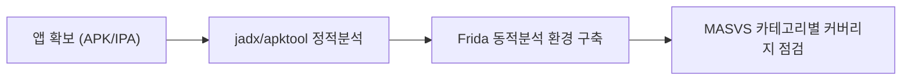

모바일 앱 모의해킹 시리즈의 첫 글입니다. 이 글은 특정 취약점을 깊게 파는 글이 아니라, 이후 글들을 읽기 전에 필요한 **분석 대상 확보 → 분석 환경 구축 → 진단 기준(OWASP MASVS) 이해**를 한 번에 정리하는 지도 역할입니다. 모바일 진단도 웹과 마찬가지로 반드시 **본인 소유 기기/앱이거나 서면 허가를 받은 대상**에서만 수행하세요.

---

## 1. 안드로이드/iOS 앱 확보

**원리**: 정적·동적 분석을 하려면 먼저 분석 대상 바이너리(APK/IPA)를 손에 넣어야 합니다. 안드로이드는 `adb`로 기기에 설치된 패키지를 그대로 꺼낼 수 있고, iOS는 샌드박스와 코드 서명 때문에 설치된 앱을 "그냥 복사"하는 방법이 없어 탈옥 기기나 별도 추출 도구가 필요합니다.

안드로이드 APK는 대상 앱을 **실제 기기(또는 에뮬레이터)에 설치한 뒤** 경로를 확인해 꺼내는 방식이 가장 신뢰할 수 있습니다. 단, Google Play로 배포되는 앱은 `base.apk` 외에 화면 밀도·ABI·언어별 split APK가 함께 설치되는 경우가 많으므로, `pm path`가 돌려주는 경로를 **전부** 확인하고 꺼내야 리소스 누락 없이 재현할 수 있습니다.

```bash
adb shell pm path com.example.app
# package:/data/app/~~xxxx==/com.example.app-xxxx==/base.apk
# package:/data/app/~~xxxx==/com.example.app-xxxx==/split_config.arm64_v8a.apk
adb pull /data/app/~~xxxx==/com.example.app-xxxx==/
```

APKPure류 제3자 다운로드 사이트는 원본 서명이 아닌 재서명(리패키징)된 파일을 올려두는 경우가 있고, 실제로 배포되는 버전과 코드가 다를 수 있어 **진단 대상의 무결성을 보장하지 못합니다**. 서명 검증 없이 받은 APK로 분석한 결과는 실제 운영 앱과 차이가 있을 수 있으므로, 가능하면 Google Play에서 직접 설치한 뒤 기기에서 꺼내는 쪽을 기본으로 삼으세요. `apksigner verify`는 서명이 유효한지(변조되지 않았는지)만 확인할 뿐 **그 서명이 원 개발사의 것인지는 증명하지 않으므로**, 의심스러운 출처라면 `--print-certs`로 인증서 지문을 뽑아 공식 배포본과 직접 대조해야 합니다.

iOS는 App Store로 배포되는 앱의 실행 파일이 FairPlay DRM으로 암호화된 상태로 저장되기 때문에, 단순히 앱 번들을 복사하는 것만으로는 정적 분석에 쓸 복호화된 바이너리를 얻지 못합니다. 실무에서는 탈옥 기기에 설치한 뒤 `frida-ios-dump` 같은 도구로 실행 중인 프로세스 메모리에서 복호화된 상태의 IPA를 재구성하는 방식을 씁니다(개발/엔터프라이즈 배포로 받은 비암호화 IPA나 자체 앱의 시뮬레이터 빌드는 탈옥 없이도 분석 가능합니다). App Store에서 정식 구매한 앱을 추출하는 행위가 Apple 개발자 프로그램 라이선스 계약이나 저작권법상 기술적 보호조치 우회 금지 조항과 어떻게 충돌하는지는 관할 법률과 계약 조건에 따라 달라지므로, 진단 목적이라도 앱 소유자(또는 발주사)의 서면 허가 범위와 적용 법률을 먼저 확인해야 합니다.

- 체크 포인트: `pm path`로 나온 APK(스플릿 포함)를 빠짐없이 추출했는지, 제3자 배포 파일이라면 `apksigner verify --print-certs`로 뽑은 인증서 지문을 신뢰할 수 있는 공식 배포본과 대조했는지, iOS 분석 대상이 탈옥 기기 덤프인지 비암호화 배포본인지, 계약상 허용된 범위인지
- 참고: [OWASP MASTG — Android App Extraction](https://mas.owasp.org/MASTG/techniques/android/MASTG-TECH-0003/), [OWASP MASTG — iOS App Binary Extraction](https://mas.owasp.org/MASTG/techniques/ios/MASTG-TECH-0054/), [Android — apksigner](https://developer.android.com/tools/apksigner)

---

## 2. 분석 환경 구축

**원리**: 모바일 진단은 "코드를 읽는" 정적 분석과 "실행 중인 앱을 건드리는" 동적 분석을 함께 합니다. 안드로이드 쪽은 APK를 사람이 읽을 수 있는 형태로 바꿔주는 디컴파일러가 핵심이고, 두 플랫폼 공통으로는 런타임에 함수 호출을 가로채는 계측 도구가 필요합니다.

**정적 분석 도구**
- **jadx**: APK의 DEX 바이트코드를 자바에 가까운 소스 코드로 역컴파일합니다. 로직을 읽고 하드코딩된 값, 취약한 API 호출을 찾는 데 주로 쓰지만, 코드가 난독화돼 있으면(ProGuard/R8, 상용 난독화 툴) 가독성이 크게 떨어지고, 복원된 코드가 원본과 100% 동일하지 않을 수 있습니다.
- **apktool**: APK를 리소스(매니페스트, XML, 이미지)와 smali(DEX의 어셈블리에 가까운 중간 표현)로 분해하고, 수정 후 다시 패키징(재조립)할 수 있습니다. `android:debuggable="true"` 추가, 인증서 핀닝 로직이 들어간 smali 패치처럼 **바이너리를 고쳐서 재서명·재설치**하는 작업에 주로 씁니다.

**동적 분석: Frida**
Frida는 실행 중인 프로세스에 스크립트를 주입해 자바/오브젝티브C/스위프트 함수를 후킹하는 계측 프레임워크입니다. 루팅/탈옥된 기기에서는 보통 기기 쪽에 `frida-server`를 올려 쓰지만, 루팅/탈옥 없이도 대상 APK에 `frida-gadget`을 삽입해 재패키징하는 방식으로 쓸 수도 있습니다.

**에뮬레이터 vs 실기기(루팅/탈옥) 트레이드오프**: 에뮬레이터는 스냅샷 복원이 쉽고 기기 구매 비용이 없지만, 일부 앱은 `build.prop` 값이나 Play Integrity 판정(과거 SafetyNet Attestation은 2025년에 단계적으로 종료됐습니다) 같은 기기 속성·무결성 신호를 확인하며, 그 결과를 바탕으로 한 제한 조치는 앱·서버 구현에 따라 다릅니다(바로 차단된다고 단정할 수 없습니다). 실기기는 실제 사용 환경과 동일하지만, Frida를 `frida-server` 방식으로 올리려면 보통 루팅(안드로이드)·탈옥(iOS)이 선행돼야 하므로, 대상 앱이 루팅/탈옥 탐지를 구현해 뒀다면 그 우회가 진단의 선행 작업이 되는 경우가 있습니다.

**frida-server와 루팅 탐지의 관계**: frida-server를 실기기에 올리려면 보통 root 권한이 필요하므로, 루팅 탐지(su 바이너리, Magisk 흔적 확인 등)와 Frida 탐지(기본 포트, 프로세스 목록, 메모리 내 문자열 확인 등)를 **같은 앱이 함께 구현해 두는 사례가 있습니다**. 다만 둘 다 구현돼 있다는 보장은 없고, 서로 다른 신호만 확인하는 앱도 있어 한쪽을 우회했다고 분석이 바로 가능해진다고 볼 수는 없습니다. 이 우회 기법 자체(Zygisk 모듈, frida-server 리네이밍, objection)는 이후 Frida 동적분석 글에서 다룹니다.

- 체크 포인트: 분석 대상이 난독화돼 있어 jadx 결과만으로 로직 파악이 가능한지, apktool로 재조립한 APK가 정상 서명 후 설치/실행되는지, frida-server 버전이 대상 아키텍처(arm64 등)와 일치하는지, 에뮬레이터에서 앱의 핵심 기능이 정상 동작하는지(제한되면 실기기 전환 검토)
- 참고: [jadx (GitHub)](https://github.com/skylot/jadx), [Apktool 공식 사이트](https://apktool.org/), [Frida — Modes of operation](https://frida.re/docs/modes/), [OWASP MASTG — Root Detection](https://mas.owasp.org/MASTG/knowledge/android/MASVS-RESILIENCE/MASTG-KNOW-0027/), [Android — Play Integrity 판정 유형](https://developer.android.com/google/play/integrity/verdicts)

이 시리즈의 분석 파이프라인을 한 장으로 요약하면 다음과 같습니다.



---

## 3. OWASP MASVS 구조 소개

**원리**: OWASP에는 "10대 위험 목록" 형식의 **Mobile Top 10**(`M1`~`M10`, 2024년판 기준)이 따로 있는데, 이는 MASVS의 옛 버전이 아니라 **별도로 유지되는 다른 프로젝트**입니다. 반면 이 글에서 기준으로 삼는 **MASVS(Mobile Application Security Verification Standard)는 순위가 아니라, 앱이 충족해야 할 검증 가능한 보안 요구사항을 정의하는 표준**이고, 현재는 요구사항을 8개 카테고리로 묶어 관리합니다(`MASVS-PRIVACY`는 v2.1.0에서 추가된 카테고리로, 8개 구조가 처음부터 고정돼 있던 것은 아닙니다). 이 시리즈의 진단 범위와 보고서 매핑은 Mobile Top 10이 아니라 **MASVS 카테고리와 `MASVS-카테고리-번호` 형식의 컨트롤 ID**를 기준으로 합니다. 카테고리와 코드는 다음과 같습니다(OWASP MASVS 공식 YAML 정의 기준).

| 카테고리 | 이름 | 이 시리즈의 대응 글 |
|---|---|---|
| MASVS-STORAGE | 저장소(Storage) | 로컬 저장소 포렌식 |
| MASVS-CRYPTO | 암호화(Cryptography) | 안드로이드/iOS 정적분석 (코드상 오용 탐지 수준) |
| MASVS-AUTH | 인증/인가(Authentication and Authorization) | 안드로이드/iOS 정적분석, Frida 동적분석과 네트워크 |
| MASVS-NETWORK | 네트워크 통신(Network Communication) | Frida 동적분석과 네트워크 |
| MASVS-PLATFORM | 플랫폼 상호작용(Platform Interaction) | 안드로이드 IPC 공격면, WebView와 파일 접근 취약점 |
| MASVS-CODE | 코드 품질(Code Quality) | 안드로이드/iOS 정적분석 |
| MASVS-RESILIENCE | 리버싱·변조 저항성(Resilience Against Reverse Engineering and Tampering) | Frida 동적분석과 네트워크 (탐지 우회 수준까지만) |
| MASVS-PRIVACY | 프라이버시(Privacy) | 로컬 저장소 포렌식 (개인정보 저장 관점) |

각 카테고리 안에는 검증 가능한 개별 요구사항(`MASVS-STORAGE-1`처럼 번호가 붙은 컨트롤)이 있고, MASTG(Mobile Application Security Testing Guide)가 그 요구사항을 실제로 어떻게 테스트하는지 절차를 제공합니다. 이 시리즈의 각 글은 하나의 카테고리에만 대응되는 것은 아니고, 주제별로 **관련된 여러 MASVS 컨트롤**을 함께 다루는 방식으로 구성됩니다.

- 체크 포인트: 진단 보고서에 취약점을 적을 때 Mobile Top 10의 `M-번호`가 아니라 `MASVS-카테고리-번호`(예: `MASVS-STORAGE-1`) 형식으로 매핑되는지, 참고하는 자료가 현재 MASVS(8개 카테고리)와 별개 프로젝트인 Mobile Top 10을 혼동해 쓰지 않았는지
- 참고: [OWASP MASVS 공식 사이트](https://mas.owasp.org/MASVS/), [OWASP MASVS-PRIVACY 추가 발표(v2.1.0)](https://mas.owasp.org/news/2024/01/18/masvs-v210-release--masvs-privacy/), [OWASP Mobile Top 10 (별도 프로젝트)](https://owasp.org/www-project-mobile-top-10/), [OWASP MASTG (테스트 가이드)](https://mas.owasp.org/MASTG/)

---

## 4. 진단 커버리지 체크리스트

이 시리즈가 MASVS 8개 카테고리 중 무엇을 다루고 무엇을 다루지 않는지 먼저 표로 정리합니다. 이후 글을 읽을 때 "지금 이 글이 전체 그림에서 어디에 해당하는가"를 확인하는 용도로 쓰세요.

| MASVS 카테고리 | 이 시리즈에서 다룸 | 범위 밖 |
|---|---|---|
| MASVS-STORAGE | 로컬 DB/SharedPreferences/plist/Keychain 저장 데이터 포렌식 수집·분석 | — |
| MASVS-CRYPTO | 하드코딩된 키, 취약한 알고리즘(ECB 모드 등) 사용 여부를 코드에서 **발견**하는 수준 | 암호 알고리즘/프로토콜 구현 자체의 수학적 취약점 분석(패딩 오라클 설계 결함 등 암호학 심화) |
| MASVS-AUTH | 토큰 저장 위치, 클라이언트 측 인증 로직 우회 가능성 | 백엔드 인증 서버의 세션/OAuth 구현 결함(이는 웹 취약점 시리즈 영역) |
| MASVS-NETWORK | 프록시 신뢰 설정 확인, 핀닝이 분석을 막는 경우 허가 범위 내 우회 후 트래픽 관찰, 평문 통신 여부 확인 | — |
| MASVS-PLATFORM | 안드로이드 IPC(Intent, Content Provider, Broadcast Receiver) 공격면, WebView 설정 오류와 파일 접근 | — |
| MASVS-CODE | 디버그 빌드 설정, 로그에 민감정보 노출 등 정적 분석 수준 | 컴파일러/빌드 체인 취약점, 서드파티 SDK 코드 자체의 심층 감사 |
| MASVS-RESILIENCE | 루팅/탈옥 탐지와 Frida 탐지를 **우회**하는 수준(진단을 진행하기 위한 실전 기법) | 상용 난독화·패커 역공학, 안티 디버깅 심화 분석 등 바이너리 보호 리버싱 자체 |
| MASVS-PRIVACY | 로컬에 남는 개인정보 식별(저장소 글에서 다루는 일부만 해당) | 수집 최소화·이용자 통제·투명성 등 카테고리 전반, 개인정보보호법·GDPR 등 법적 컴플라이언스 평가 |

---

## 앞으로 다룰 글

이 글을 기준으로 아래 글들이 이어집니다.

- [[모바일 취약점 진단 — 안드로이드 정적분석]]
- [[모바일 취약점 진단 — iOS 정적분석]]
- [[모바일 취약점 진단 — Frida 동적분석과 네트워크]]
- [[모바일 취약점 진단 — 로컬 저장소 포렌식]]
- [[모바일 취약점 진단 — 안드로이드 IPC 공격면]]
- [[모바일 취약점 진단 — WebView와 파일 접근 취약점]]
