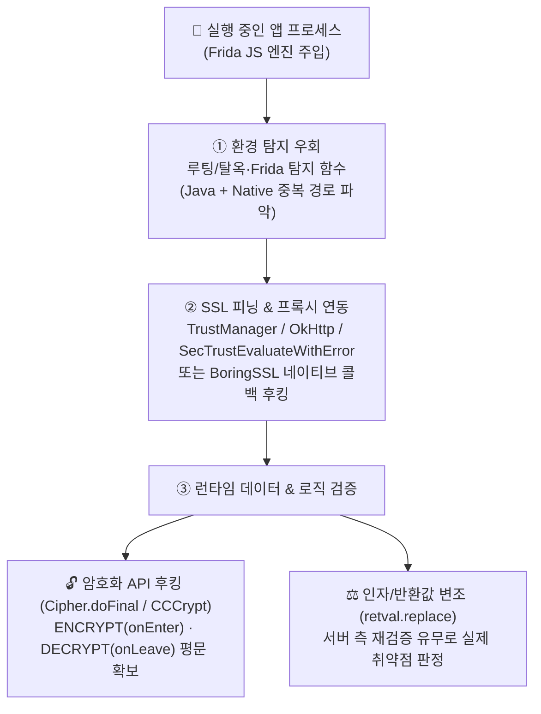
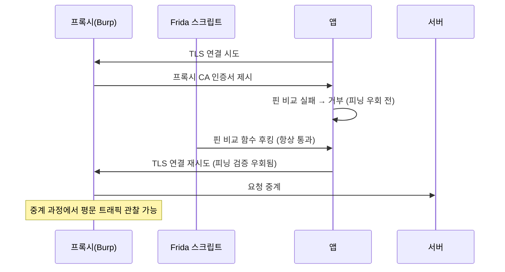

> [!summary] ⏱️ 5초 핵심 요약
> - **한 줄 비유**: 정적 분석이 꺼져 있는 기계의 설계도를 읽는 것이라면, **Frida 동적 분석은 돌아가는 기계의 혈관(함수 진입·종료 지점)에 초소형 내시경(JS 엔진)을 꽂아 흐르는 평문 데이터를 보고 밸브(반환값)를 돌리는 기술**입니다.
> - **핵심 원리**: Frida는 네이티브 `Interceptor.attach(onEnter/onLeave)`와 고수준 런타임 브리지(`Java.*`, `ObjC.*`, `Swift.*`)를 통해 **루팅/탈옥 탐지 우회 → SSL 피닝 우회 → 메모리 내 암호화 전 평문 덤프 → 비즈니스 로직 검증**을 수행합니다.
> - **핵심 판정 기준**: 클라이언트에서 불리언 반환값을 뒤집어 화면(UI)을 열었더라도 **서버가 독립적으로 권한·결제·무결성을 재검증한다면 실제 취약점이 아니며**, 반드시 서버 리소스 접근 성공 여부로 위험도를 판정해야 합니다.

모바일 앱 진단은 APK/IPA를 뜯어보는 정적 분석만으로는 반을 못 봅니다. 앱이 **실제로 실행되는 순간**에만 드러나는 값(복호화된 평문, 런타임에 계산되는 검증 로직, 조건 분기 결과)이 더 많기 때문입니다. Frida는 실행 중인 프로세스에 JS 엔진을 주입해 임의 함수의 인자·반환값·동작을 그 자리에서 관찰하고 바꿀 수 있게 해주는 동적 계측 도구로, 이 글은 Frida를 축으로 한 모바일 진단 체크리스트를 정리한 것입니다. 전제는 하나, **승인된 자산에만** 적용합니다.



---

## 한눈에 보는 플랫폼·언어별 Frida 계측 비교

| 대상 환경 | Frida 브리지 / API | `frida-trace` 옵션 | 후킹 특징 및 실무 주의점 |
|---|---|---|---|
| **Android (Java/Kotlin)** | `Java.perform`, `Java.use("패키지.클래스")` | `-j "패키지!메서드"` | ART 런타임 메타데이터를 이용해 클래스·메서드 이름으로 직접 구현 교체(`.implementation = ...`) 가능 |
| **iOS (Objective-C)** | `ObjC.classes.클래스명["- 메서드:"]` | `-m "-[클래스 메서드]"` | `objc_msgSend` 동적 디스패치 구조 덕분에 심볼이 스트립되어도 메서드 셀렉터 이름으로 후킹 용이 |
| **iOS (Swift)** | `Swift.*` API 또는 `Interceptor.attach` | `-y` (또는 주소 기반) | 정적 디스패치·인라이닝·심볼 제거(`strip`)가 겹치면 이름만으로 못 찾아 **Ghidra 오프셋 기반 후킹** 필요 |
| **Native (C/C++ `.so`/`.dylib`)** | `Interceptor.attach(addr, {onEnter, onLeave})` | `-i "심볼패턴"` | 모든 후킹의 기반. 심볼이 제거(strip)된 경우 베이스 주소 + 오프셋 계산 필요 |

---

## 1. Frida 기본 계측 모델

**💡 한 줄 비유**: 함수라는 방의 **입구(`onEnter`)와 출구(`onLeave`)에 검색대(트램폴린)**를 세워, 방에 들어갈 때 들고 가는 서류(인자)를 복사·수정하고 방에서 나올 때 들고 나오는 결재판(반환값)을 바꿔치기하는 원리입니다.

### 핵심 원리
- **네이티브 계측(`Interceptor.attach`)**: Frida의 핵심은 특정 함수의 진입 지점 주소에 트램폴린을 심어, 그 함수가 호출될 때마다 `onEnter`(인자 접근·변조 가능)와 `onLeave`(반환값 접근·변조 가능) 콜백이 끼어들게 만드는 구조입니다.
- **고수준 런타임 브리지**:
  - **Android (Java/Kotlin)**: `Java.perform(() => { Java.use("com.app.Foo").bar.implementation = function(...) {...} })` 형태로 ART의 Java 브리지를 통해 클래스/메서드 이름만으로 직접 후킹합니다.
  - **iOS (Objective-C)**: `ObjC.classes.Foo["- bar:"]`로 Objective-C 런타임의 동적 디스패치를 이용한 이름 기반 후킹이 가능합니다.
  - **iOS (Swift)**: 자체 브리지(`Swift.*` API)와 탐색 기능이 있지만, 정적 디스패치·인라이닝·심볼 제거(`strip`)가 겹치면 이름만으로 못 찾는 경우가 많아 심볼 주소나 오프셋 기반 후킹으로 내려가야 할 때가 많습니다.

### 기본 후킹 코드 패턴 비교
```javascript
// 1. Android Java 메서드 후킹 예시
Java.perform(() => {
  const AuthManager = Java.use("com.example.app.AuthManager");
  AuthManager.isPremiumUser.implementation = function () {
    console.log("[*] isPremiumUser called -> returning true");
    return true;
  };
});

// 2. Native (C/C++ 또는 Strip된 Swift) 주소/심볼 후킹 예시
const targetAddr = Module.findExportByName("libnative-lib.so", "Java_com_example_app_RootCheck_isRooted");
if (targetAddr) {
  Interceptor.attach(targetAddr, {
    onEnter(args) {
      console.log("[*] Native check entered");
    },
    onLeave(retval) {
      retval.replace(0); // false(0)로 반환값 교체
    }
  });
}
```

### 체크 포인트
- 대상이 Java/Kotlin(Android)인지 Objective-C인지 Swift인지 먼저 구분한다.
- Swift/네이티브라면 `nm`/Ghidra 등으로 심볼이 남아있는지(strip 여부) 확인 후 오프셋 기반 후킹을 준비한다.
- `frida-trace`로 네이티브 심볼은 `-i`, Java 메서드는 `-j`, Objective-C 메서드는 `-m`, Swift 함수는 `-y` 옵션으로 각각 탐색한다(난독화·strip된 이름은 바이너리 분석으로 보완).
- 참고: [Frida — Interceptor API](https://frida.re/docs/javascript-api/#interceptor), [Frida — Java API](https://frida.re/docs/javascript-api/#java), [Frida — ObjC API](https://frida.re/docs/javascript-api/#objc)

---

## 2. 루팅/탈옥 탐지 우회

**💡 한 줄 비유**: 건물 입구의 경비원(Java 레이어 탐지) 한 명만 매수하고 들어갔다간 복도에 숨어 있는 적외선 센서(네이티브 `.so` 레이어 탐지)에 걸려 경보가 울리므로, **건물 전체의 센서 위치를 먼저 다 찾아내야** 합니다.

### 핵심 원리
- **다양한 탐지 신호**: 앱이 "변조된 환경에서 실행 중"임을 점검하는 로직은 파일 경로 존재 확인, `su` 바이너리 탐색, Frida 기본 포트(`27042`)나 `frida-server` 프로세스명 탐지, `/proc/self/maps` 내 인젝션된 라이브러리 흔적 탐색 등 다양합니다. 그 결과도 단순 불리언 반환뿐 아니라 예외 발생, 강제 종료, 원격 무결성 판정 호출로 나타납니다.
- **로컬 탐지 vs 원격 무결성 판정**: 반환값이나 분기 조건으로만 쓰이는 로컬 탐지는 Frida로 반환값을 바꾸면 통하지만, **Play Integrity API**나 **App Attest**처럼 서버가 직접 검증하는 원격 무결성 판정은 로컬 함수 반환값만 바꿔서는 해결되지 않으며 별도로 평가해야 합니다(상세 내용은 [[모바일 취약점 진단 — 기기 신뢰 공격(Device Attestation 우회)]] 참고).
- **다중 레이어 중복 구현 주의**: 상용 앱은 같은 판단 로직을 **Java 레이어와 네이티브(`.so`) 레이어에 중복 구현**해 두는 경우가 많습니다. 하나만 우회하면 나머지 경로에서 다시 걸리므로, 네이티브 심볼(`frida-trace -i "*root*"`)과 Java 메서드(`-j`)를 넓게 스캔해 실제 분기에 쓰이는 지점을 모두 막아야 합니다.

### 체크 포인트
- 탐지 로직이 Java와 네이티브(`.so`) 중 몇 군데에 중복 구현되어 있는지 확인한다.
- 단순 로컬 반환값 조작인지 서버 측 원격 무결성 판정(Play Integrity 등)인지 구분했는지 확인한다.
- 우회 후 앱이 로그인·결제 등 다른 화면이나 API 호출 시점에서 재차 검사하지 않는지 확인한다.
- 참고: [OWASP MASTG — Android Anti-Reversing Defenses](https://mas.owasp.org/MASTG/0x05j-Testing-Resiliency-Against-Reverse-Engineering/), [OWASP MASTG — iOS Anti-Reversing Defenses](https://mas.owasp.org/MASTG/0x06j-Testing-Resiliency-Against-Reverse-Engineering/), [Android — Play Integrity API](https://developer.android.com/google/play/integrity/standard)

---

## 3. SSL 피닝 우회

**💡 한 줄 비유**: 일반 TLS 검증이 "정부(CA)가 발급한 진짜 신분증이 맞는가?"만 보는 것이라면, **SSL 피닝은 "내 수첩에 적힌 우리 본사 직원의 얼굴 사진(지정된 인증서/공개키 해시)과 똑같은가?"까지 대조**하는 것입니다. Frida는 직원이 사진 대조를 할 때 옆에서 무조건 "맞음!"이라고 대답하게 만듭니다.



### 핵심 원리
- **인증서 피닝의 동작**: 정상적인 인증서 체인·호스트명 검증에 더해, 서버 인증서 또는 공개키(SPKI 해시)가 **앱이 미리 지정한 핀 목록과 일치하는지** 추가로 확인합니다. (참고: Android 7(API 24) 이상을 타깃하는 앱은 피닝이 없어도 `network_security_config.xml` 기본값에 따라 사용자가 설치한 프록시 CA를 신뢰하지 않으므로, 이 설정 자체가 먼저 프록시를 막을 수 있습니다.)
- **플랫폼별 주요 후킹 지점**:
  - **Android**: 커스텀 `TrustManager.checkServerTrusted`(체인 검증 지점이며 핀 비교가 반드시 그 안에 있는 건 아님), OkHttp의 `CertificatePinner.check` 경로가 대표적입니다.
  - **iOS**: `URLSession`의 인증 도전(challenge) 처리와 `SecTrustEvaluateWithError`를 통한 신뢰 평가, 또는 ATS의 선언형 피닝(`NSPinnedDomains`) 중 실제 사용 경로를 구분합니다(`SecTrustEvaluate`는 폐기 예정 API라 구형 앱에서만 고려).
  - **네이티브 자체 TLS 스택(OpenSSL/BoringSSL, Flutter 등)**: 표준 OS API를 타지 않으므로 범용 스크립트가 작동하지 않을 수 있습니다. `SSL_CTX_set_verify`(검증 콜백 설정 지점)나 `X509_verify_cert`(주로 체인 검증 지점) 같은 심볼은 탐색 후보일 뿐 그 자체가 핀 비교 함수라고 단정할 수 없으며, 검증 콜백을 따라가 실제 핀 비교가 일어나는 지점(strip된 경우 시그니처·상수 패턴 활용)을 찾아 후킹해야 합니다.

### 체크 포인트
- 표준 스크립트(`objection`의 `android sslpinning disable`, CodeShare 범용 언피닝 스크립트) 적용 후 **실제 요청이 프록시에 잡히는지**로 검증한다(스크립트 로드 성공과 우회 성공은 다름).
- 실패 시 `frida-trace`로 OpenSSL/BoringSSL 심볼(`SSL_`, `X509_` 접두) 호출 여부를 확인해 네이티브 자체 구현 여부를 판단한다.
- 네이티브 구현이면 검증 콜백부터 역추적해 실제 핀 비교 지점을 특정하는 전용 후킹 스크립트를 작성한다.
- 참고: [OWASP MASTG — Testing Network Communication (SSL Pinning)](https://mas.owasp.org/MASTG/0x04f-Testing-Network-Communication/), [OWASP MASTG — Android SSL Pinning Bypass 기법](https://mas.owasp.org/MASTG/techniques/android/MASTG-TECH-0012/), [objection — SSL pinning bypass 구현](https://github.com/sensepost/objection/blob/master/objection/console/helpfiles/android.sslpinning.disable.txt)

---

## 4. 런타임 메모리에서 평문 데이터 확인

**💡 한 줄 비유**: 편지가 우체통(네트워크)에 들어갈 땐 이미 암호 봉투에 밀봉된 뒤지만, **편지를 봉투에 넣는 손(`Cipher.doFinal` 암호화 입력)이나 봉투를 뜯어 읽는 손(복호화 출력) 바로 옆에서 보면** 원본 글씨를 그대로 읽을 수 있습니다.

### 핵심 원리
디스크에 저장되거나 네트워크로 나가는 시점에는 이미 애플리케이션 레벨 암호화가 끝나 있어 프록시에서도 암호문만 보일 수 있습니다. 하지만 암호화 함수(`javax.crypto.Cipher.doFinal`, iOS `CCCrypt`, 또는 자체 암호화 유틸)는 **메모리에서 평문이 들어가고 나가는 순간**을 다루고 있습니다.

### 암호화 모드(`opmode`)에 따른 평문 위치 구분

| 동작 모드 | `onEnter` (입력 인자) | `onLeave` (반환값) | 실무 후킹 시 주의점 |
|---|---|---|---|
| **암호화 (`Cipher.ENCRYPT_MODE = 1`)** | **평문 (관찰 대상)** | 암호문 | `Cipher.update()`에 데이터를 먼저 넣고 인자 없는 `doFinal()`을 호출하는 오버로드도 흔하므로 `init()` 모드와 `update` 호출 패턴을 함께 확인 |
| **복호화 (`Cipher.DECRYPT_MODE = 2`)** | 암호문 | **평문 (관찰 대상)** | 반환된 바이트 배열(`byte[]`)을 문자열이나 Hex로 변환해 서버 응답의 복호화 원문 확인 |

 *(참고: 단발성 덤프를 넘어 패킷·타임라인과 연결해 전체 흐름을 재구성하거나 커스텀 프로토콜을 다뤄야 한다면 [[Hera — Frida 기반 동적 보안 분석 워크벤치를 직접 만들다]]에서 다룬 전용 워크벤치 도구의 영역입니다.)*

### 체크 포인트
- 암호화/인코딩 유틸 클래스·함수를 먼저 특정한다(Java라면 `Cipher`, `Base64`, 네이티브라면 `CCCrypt` 등 암호화 라이브러리 심볼).
- `onEnter`/`onLeave`에서 버퍼를 hexdump해 실제로 평문인지 확인한다(이미 암호화된 상위 레이어를 잘못 짚으면 암호문만 보임).
- 덤프한 값이 실제 API 요청·로컬 저장소의 민감 필드와 일치하는지 교차 확인한다.
- 참고: [Frida — Memory API](https://frida.re/docs/javascript-api/#memory), [OWASP MASTG — Testing Memory for Sensitive Data](https://mas.owasp.org/MASTG/0x05d-Testing-Data-Storage/)

---

## 5. 메서드 인자/반환값 변조를 통한 로직 우회

**💡 한 줄 비유**: 영화관 입구 전광판의 '매진' 글자를 해킹해 '입장 가능'으로 바꿨더라도(클라이언트 UI 우회), **상영관 문 앞의 직원이 바코드 리더기로 실제 예매 내역을 서버에서 다시 조회한다면** 안으로 들어갈 수 없습니다.

### 핵심 원리
- 라이선스 확인, 결제 완료 여부, 프리미엄 기능 잠금 해제 같은 판단을 **클라이언트 코드 안에서만** 수행하고 불리언 반환값 하나로 분기를 타는 앱은 네이티브 `retval.replace(1)`이나 Java `.implementation = function() { return true; }`로 즉시 우회됩니다.
- **취약점 판정의 핵심 경계**: 이 기법의 가치는 **"클라이언트 측 검증은 신뢰할 수 없다"**는 원칙을 증명하는 데 있습니다.
  - **서버 재검증이 있는 경우**: 화면(UI)만 열릴 뿐 실제 유료 콘텐츠나 API 호출은 서버가 차단하므로 **"로컬 UI 우회(낮은 영향도 또는 정보성)"**로 구분합니다.
  - **서버 재검증이 없는 경우**: 클라이언트 변조만으로 서버 리소스 접근이나 상태 변경이 성공하므로 **"클라이언트 신뢰 기반 접근 통제 우회(주요 취약점)"**로 보고합니다.

### 체크 포인트
- 우회 대상 함수가 로컬 판단만 하는지 서버 응답을 받아 검증하는지 네트워크 트래픽까지 함께 확인한다.
- 우회 후 실제로 서버 리소스(구매한 콘텐츠, 잠긴 API)에 접근되는지 또는 화면만 바뀌는지 구분한다.
- 보고서에 "클라이언트 우회 성공"과 "서버 리소스 접근 성공"을 명확히 분리해서 기재한다.
- 참고: [OWASP MASTG — Testing Code Quality (Business Logic)](https://mas.owasp.org/MASTG/0x04h-Testing-Code-Quality/), [OWASP MASVS — Resilience Requirements](https://mas.owasp.org/MASVS/11-MASVS-RESILIENCE/)

---

## 6. objection/frida-based 자동화 도구

**💡 한 줄 비유**: `objection`은 흔한 자물쇠들을 단번에 열어주는 **만능 마스터키 묶음(1차 스크리닝 도구)**이고, 특수 제작된 금고(네이티브 자체 구현·난독화)를 만났을 때 직접 핀을 깎아 만드는 작업이 **커스텀 Frida 스크립트 작성**입니다.

### 핵심 원리
- `objection`은 Frida 위에 올라간 런타임 모바일 탐색 도구로, SSL 피닝 우회(`android sslpinning disable` / `ios sslpinning disable`)나 루팅/탈옥 탐지 우회(`android root disable` / `ios jailbreak disable`) 같은 반복 패턴을 명령어 하나로 제공합니다.
- **표준 케이스 vs 커스텀 구현**: 표준 `TrustManager`/OkHttp나 공개된 탐지 라이브러리를 그대로 쓰는 앱은 `objection` 단계에서 바로 뚫리지만, 네이티브 자체 TLS 스택을 쓰거나 함수명이 난독화된 앱은 사전 정의된 후킹 대상을 찾지 못해 실패합니다. 이때는 2~3절처럼 `frida-trace`로 후킹 지점을 직접 탐색해 커스텀 스크립트를 작성해야 합니다.

### 체크 포인트
- `objection` 표준 명령으로 1차 시도 후 실패 시 어느 레이어(Java/네이티브)에서 막히는지 `frida-trace`로 원인을 분리한다.
- `objection`이 지원하는 명령 목록이 현재 대상 OS·버전 기준으로 유효한지 확인한다.
- 참고: [objection — documentation](https://github.com/sensepost/objection), [objection — command list](https://github.com/sensepost/objection/wiki/Using-objection)

---

## 7. 네트워크 트래픽 가로채기와 프록시

**💡 한 줄 비유**: 고속도로 톨게이트(Burp 프록시)에서 차 안을 검사하려면 **① 차가 톨게이트 차선으로 들어와야 하고(프록시 라우팅), ② 검문소 신분증을 인정해야 하며(CA 신뢰), ③ 지정 차량 대조(SSL 피닝)를 통과해야** 합니다. 셋 중 하나라도 빠지면 차가 아예 안 오거나 입구에서 유턴해 버립니다.

### 프록시에 트래픽이 안 잡힐 때 3단계 원인 분리

| 점검 순서 | 원인 분류 | 증상 | 해결 방법 |
|---|---|---|---|
| **1단계** | **시스템 프록시 무시** (Flutter, 게임 엔진, 직접 소켓 연결 등) | Burp에 연결 시도(TLS 에러 포함) 자체가 전혀 안 뜸 | OS 레벨에서 VPN/iptables(ProxyDroid 등)로 트래픽을 프록시 포트로 강제 리다이렉트하거나 프록시 조회 API 후킹 |
| **2단계** | **프록시 CA 미신뢰** (Android 7+ 사용자 CA 기본 불신 등) | Burp Alerts 탭에 `unknown_ca` / TLS handshake failure 발생 | 시스템 인증서 저장소 주입, `network_security_config.xml` 패치, 또는 Frida로 신뢰 검증 우회 |
| **3단계** | **SSL 피닝 거부 또는 TLS 스펙 불일치** | CA 신뢰 후에도 핸드셰이크 직후 연결 종료 | 3절의 SSL 피닝 우회 적용, 여전히 실패 시 프록시의 TLS 버전/cipher suite 지원 설정 확인 |

### 체크 포인트
- 프록시에 아무 트래픽도 안 잡히면 ① 시스템 프록시 사용 여부 → ② 프록시 CA 신뢰 여부 → ③ SSL 피닝 우회 여부 순서로 분리 진단한다.
- 피닝 우회 후에도 핸드셰이크 실패가 남으면 TLS 버전/cipher suite 제약이나 전송 방식(HTTP/2, WebSocket, 커스텀 포트) 문제인지 확인한다.
- 참고: [PortSwigger — Configuring an Android device to work with Burp](https://portswigger.net/burp/documentation/desktop/mobile/config-android-device), [OWASP MASTG — Intercepting HTTP(S) Traffic](https://mas.owasp.org/MASTG/0x04f-Testing-Network-Communication/)

---

표준 Frida 스크립트로 커버되는 범위는 생각보다 넓지만, 네이티브 자체 구현 앞에서는 결국 바이너리를 직접 읽어 후킹 지점을 찾는 수작업으로 돌아갑니다. raw TCP 위에 커스텀 프로토콜까지 얹은 대상이라 패킷 레벨 재현·리플레이까지 필요하다면 [[Hera — Frida 기반 동적 보안 분석 워크벤치를 직접 만들다]] 같은 전용 도구를 쓰는 게 낫고, 그 전 단계인 이 글의 체크리스트는 대부분의 모바일 진단에서 1차 범용 절차로 충분합니다.
