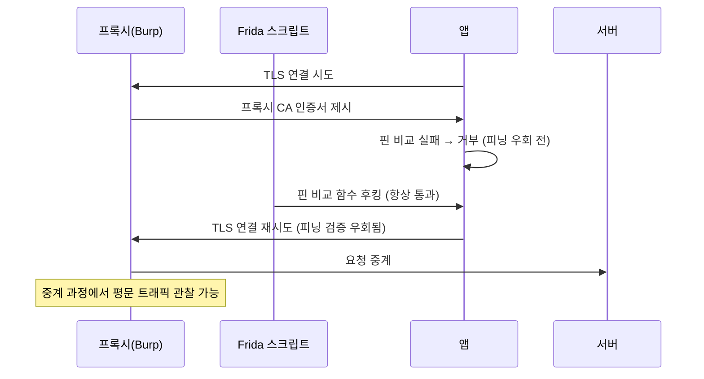

모바일 앱 진단은 APK/IPA를 뜯어보는 정적 분석만으로는 반을 못 봅니다. 앱이 **실제로 실행되는 순간**에만 드러나는 값(복호화된 평문, 런타임에 계산되는 검증 로직, 조건 분기 결과)이 더 많기 때문입니다. Frida는 실행 중인 프로세스에 JS 엔진을 주입해 임의 함수의 인자·반환값·동작을 그 자리에서 관찰하고 바꿀 수 있게 해주는 동적 계측 도구로, 이 글은 Frida를 축으로 한 모바일 진단 체크리스트를 정리한 것입니다. 전제는 하나, **승인된 자산에만** 적용합니다.

---

## 1. Frida 기본 계측 모델

**원리**: Frida의 핵심은 네이티브 함수를 대상으로 하는 `Interceptor.attach(address, {onEnter, onLeave})`입니다. 특정 함수의 진입 지점 주소에 트램폴린을 심어, 그 함수가 호출될 때마다 `onEnter`(인자 접근·변조 가능)와 `onLeave`(반환값 접근·변조 가능) 콜백이 끼어들게 만드는 구조입니다. 고수준 언어 레이어는 이 위에 각 런타임 전용 브리지가 따로 얹혀 있어 플랫폼마다 접근법이 갈립니다. Android는 `Java.perform(() => { Java.use("com.app.Foo").bar.implementation = function(...) {...} })` 형태로 ART의 Java 브리지를 통해 클래스/메서드 이름만으로 직접 후킹이 가능하고, iOS는 `ObjC.classes.Foo["- bar:"]`로 Objective-C 런타임의 동적 디스패치를 이용한 이름 기반 후킹이 됩니다. Swift도 Frida에 자체 브리지(`Swift.*` API)와 함수 탐색 기능이 있지만, 정적 디스패치·인라이닝·심볼 제거(strip)가 겹치면 이름만으로 못 찾는 경우가 적지 않아 결국 심볼 주소나 오프셋 기반 후킹으로 내려가야 할 때가 많습니다. 즉 "이름으로 바로 후킹되는지"는 런타임 브리지가 얼마나 완전하게 메서드 정보를 노출하느냐와 바이너리에 심볼이 얼마나 남아있느냐에 달려 있습니다.

- 체크 포인트: 대상이 Java/Kotlin(Android)인지 Objective-C인지 Swift인지 먼저 구분, Swift/네이티브라면 `nm`/Ghidra 등으로 심볼이 남아있는지(strip 여부) 확인 후 오프셋 기반 후킹 준비, `frida-trace`로 네이티브 심볼은 `-i`, Java 메서드는 `-j`, Objective-C 메서드는 `-m`, Swift 함수는 `-y` 옵션으로 각각 탐색(난독화·strip된 이름은 이 방식으로도 안 잡히므로 바이너리 분석으로 보완)
- 참고: [Frida — Interceptor API](https://frida.re/docs/javascript-api/#interceptor), [Frida — Java API](https://frida.re/docs/javascript-api/#java), [Frida — ObjC API](https://frida.re/docs/javascript-api/#objc)

## 2. 루팅/탈옥 탐지 우회

**원리**: 앱이 "변조된 환경에서 실행 중"임을 스스로 점검하는 로직은 파일 경로 존재 확인, `su` 바이너리 탐색, Frida 서버의 기본 포트 27042나 `frida-server` 프로세스명 탐지, `/proc/self/maps`에서 인젝션된 라이브러리 흔적 탐색 등 다양한 형태를 취하고, 그 결과도 단순 불리언 반환뿐 아니라 예외 발생, 강제 종료, 원격 무결성 판정 호출로 나타나기도 합니다. 반환값이나 분기 조건으로만 쓰이는 로컬 탐지라면 그 함수를 Frida로 후킹해 반환값을 바꾸는 방식이 통하지만, Play Integrity API처럼 **서버가 직접 검증하는 원격 무결성 판정**은 로컬 함수 반환값만 바꿔서는 해결되지 않고 별도로 평가해야 합니다. 또 실무에서 가장 많이 틀리는 지점은 "탐지 함수 하나를 우회하면 끝"이라는 가정입니다. 상용 앱은 같은 판단 로직을 Java 레이어와 네이티브(.so) 레이어에 중복 구현해두는 경우가 많고, 하나만 우회하면 나머지 경로에서 다시 걸립니다. 네이티브 심볼은 `frida-trace -i "*root*"`처럼, Java 메서드는 `-j`로 각각 패턴 스캔해 호출되는 함수 후보를 넓게 뽑은 뒤, 그중 실제로 반환값이 분기에 쓰이는 지점을 하나씩 찾아 막아야 합니다.

- 체크 포인트: 탐지 로직이 Java/네이티브 중 몇 군데에 중복되는지, 로컬 반환값 조작인지 서버 측 원격 무결성 판정(Play Integrity 등)인지 구분했는지, 우회 후 앱이 다른 화면·다른 API 호출 시점에서 재차 검사하지 않는지
- 참고: [OWASP MASTG — Android Anti-Reversing Defenses](https://mas.owasp.org/MASTG/0x05j-Testing-Resiliency-Against-Reverse-Engineering/), [OWASP MASTG — iOS Anti-Reversing Defenses](https://mas.owasp.org/MASTG/0x06j-Testing-Resiliency-Against-Reverse-Engineering/), [Android — Play Integrity API](https://developer.android.com/google/play/integrity/standard)

## 3. SSL 피닝 우회

**원리**: 인증서 피닝은 정상적인 인증서 체인·호스트명 검증에 더해 "그 인증서 또는 공개키(또는 그 해시)가 **앱이 미리 지정한 핀과 일치하는가**"까지 추가로 확인하는 검증입니다. 그래서 Burp 같은 프록시의 CA 인증서를 시스템/사용자 저장소에 설치해 체인 신뢰는 통과시켜도(참고로 Android 7 이상을 타깃하는 앱은 네트워크 보안 설정에서 사용자가 설치한 CA를 기본으로 신뢰하지 않으므로, 피닝이 없어도 이 설정 자체가 먼저 막을 수 있습니다), 앱이 자체 핀 목록과 비교하는 순간 거부당합니다. Frida의 접근은 **범용 스크립트가 실제로 후킹하는 검증 경로를 앱이 그대로 쓸 때** 그 비교 로직 함수를 항상 "통과"로 바꾸는 것입니다. Android에서는 커스텀 `TrustManager.checkServerTrusted`(체인 검증 지점이며, 핀 비교가 반드시 그 안에 있는 건 아닙니다)나 OkHttp의 `CertificatePinner` 경로가 대표적인 후킹 대상이고, iOS에서는 `URLSession`의 인증 도전 처리와 `SecTrustEvaluateWithError`를 통한 신뢰 평가, 또는 ATS의 선언형 피닝(`NSPinnedDomains`) 중 앱이 실제로 쓰는 경로를 구분해 확인해야 합니다(`SecTrustEvaluate`는 폐기 예정 API라 구형 앱에서만 고려 대상입니다). 네이티브 레이어에서 OpenSSL/BoringSSL을 직접 링크해 TLS 핸드셰이크를 자체 구현한 앱이라면, 이 표준 경로 자체를 안 타기 때문에 objection이나 CodeShare의 범용 우회 스크립트가 작동하지 않을 수 있습니다. `SSL_CTX_set_verify`(검증 콜백 설정 지점)나 `X509_verify_cert`(주로 체인 검증 지점) 같은 심볼은 탐색 후보일 뿐, 둘 중 하나가 곧 앱의 핀 비교 함수라고 단정할 수 없습니다 — 해당 빌드의 검증 콜백을 따라가 그 이후에 실제로 핀 비교가 일어나는 지점을 찾아야 하고, 심볼이 strip되어 있으면 함수 시그니처나 상수 패턴으로 역으로 찾아야 합니다.

- 체크 포인트: 표준 스크립트(objection `android sslpinning disable`, CodeShare 범용 언피닝 스크립트) 적용 후 **실제 요청이 성공하는지**로 검증(스크립트 실행 성공과 우회 성공은 다름), 안 되면 `frida-trace`로 OpenSSL/BoringSSL 심볼(`SSL_`, `X509_` 접두) 호출 여부를 확인해 네이티브 자체 구현 여부 판단, 네이티브 구현이면 검증 콜백부터 따라가 실제 핀 비교 지점을 특정하는 전용 후킹 작성 필요
- 참고: [OWASP MASTG — Testing Network Communication (SSL Pinning)](https://mas.owasp.org/MASTG/0x04f-Testing-Network-Communication/), [OWASP MASTG — Android SSL Pinning Bypass 기법](https://mas.owasp.org/MASTG/techniques/android/MASTG-TECH-0012/), [objection — SSL pinning bypass 구현](https://github.com/sensepost/objection/blob/master/objection/console/helpfiles/android.sslpinning.disable.txt)

## 4. 런타임 메모리에서 평문 데이터 확인

**원리**: 디스크에 저장되거나 네트워크로 나가는 시점에는 이미 암호화·인코딩이 끝나 있어 그 값만 봐서는 원본 데이터를 알 수 없습니다. 하지만 암호화 함수(예: `javax.crypto.Cipher.doFinal`, `CCCrypt`, 또는 자체 구현한 암호화 유틸)는 **평문이 들어가고 나가는 쪽**을 들고 있습니다. 다만 어느 쪽이 평문인지는 모드에 따라 반대입니다 — 암호화(`Cipher.ENCRYPT_MODE`)라면 `onEnter`에서 보는 인자가 평문이고, 복호화(`DECRYPT_MODE`)라면 입력 인자는 이미 암호문이고 `onLeave`에서 반환되는 쪽이 평문입니다. `update`에 데이터를 먼저 넣고 인자 없는 `doFinal()`을 호출하는 오버로드도 흔해서, 후킹 지점을 `doFinal` 하나로 단정하지 말고 초기화 모드와 실제 호출 패턴부터 확인해야 합니다. Java 메서드는 `Java.use`로 구현을 가로채고, 맞는 쪽(onEnter 인자 또는 onLeave 반환값)의 버퍼를 읽어 로그로 남기면, 디스크/네트워크 레벨에서는 볼 수 없는 실제 평문 내용(API 요청 본문, 저장되는 민감 필드)을 확인할 수 있습니다. 이건 와이어나 파일시스템이 아니라 **메모리에 잠깐 존재하는 값을 가로채는** 접근이라는 점에서, 소켓 레벨 캡처만으로 끝내는 진단보다 한 단계 더 들어가는 확인 방법입니다. 범위는 표준 Frida 스크립트 레벨의 단발성 덤프이고, 패킷·타임라인과 연결해 전체 흐름을 재구성하거나 커스텀 프로토콜까지 다뤄야 한다면 범용 스크립트만으로는 부족해지는데, 그 영역은 [[Hera — Frida 기반 동적 보안 분석 워크벤치를 직접 만들다]]에서 다룬 전용 도구의 몫입니다.

- 체크 포인트: 암호화/인코딩 유틸 클래스·함수를 먼저 특정(Java라면 `Cipher`, `Base64`, 네이티브라면 암호화 라이브러리 심볼), `onEnter`에서 인자 버퍼를 hexdump해 실제로 평문인지 확인(이미 암호화된 상위 레이어를 잘못 짚으면 암호문만 보임), 덤프한 값이 요청에 쓰이는 실제 민감 필드와 일치하는지 교차 확인
- 참고: [Frida — Memory API](https://frida.re/docs/javascript-api/#memory), [OWASP MASTG — Testing Memory for Sensitive Data](https://mas.owasp.org/MASTG/0x05d-Testing-Data-Storage/)

## 5. 메서드 인자/반환값 변조를 통한 로직 우회

**원리**: 라이선스 확인, 결제 완료 여부, 프리미엄 기능 잠금 해제 같은 판단을 **클라이언트 코드 안에서만** 수행하고 그 결과(불리언 하나)로 UI 분기를 타는 앱이 있습니다. 네이티브 함수라면 `onLeave`에서 `retval.replace(1)`처럼 정수형 반환값을 직접 바꾸고, Java 메서드라면 `Java.use(...).isLicensed.implementation = function() { return true; }`처럼 구현 자체를 원하는 값을 반환하도록 교체합니다. 이렇게 반환값/구현을 뒤집어 검증을 우회할 수 있습니다. 이 기법 자체의 가치는 "우회가 됐다"는 사실보다, **"클라이언트 측 검증은 신뢰할 수 없다"**는 원칙을 눈앞에서 증명하는 데 있습니다. 진짜 취약점으로 보고할 수 있는 조건은 서버가 같은 상태를 독립적으로 재검증하지 않는 경우로 한정됩니다. 서버가 결제 영수증이나 라이선스 토큰을 매 요청마다 재검증한다면, 클라이언트 쪽 우회는 화면만 속일 뿐 실제 리소스 접근은 막혀 있으므로 "로컬 UI 우회"로 영향도를 낮춰 보고해야 하고, 서버 재검증이 없다면 그대로 "클라이언트 신뢰 기반 접근 통제 우회"로 보고합니다.

- 체크 포인트: 우회 대상 함수가 로컬 판단만 하는지 서버 응답을 받아 검증하는지 트래픽까지 같이 확인, 우회 후 실제로 서버 리소스(구매한 콘텐츠, 잠긴 API)에 접근되는지 또는 화면만 바뀌는지 구분, 보고서에 "클라이언트 우회 성공"과 "서버 리소스 접근 성공"을 분리해서 기재
- 참고: [OWASP MASTG — Testing Code Quality (Business Logic)](https://mas.owasp.org/MASTG/0x04h-Testing-Code-Quality/), [OWASP MASVS — Resilience Requirements](https://mas.owasp.org/MASVS/11-MASVS-RESILIENCE/)

## 6. objection/frida-based 자동화 도구

**원리**: objection은 Frida 위에 올라간 런타임 모바일 탐색/계측 도구로, 위에서 설명한 SSL 피닝 우회·루팅/탈옥 탐지 우회 같은 반복적인 패턴을 미리 스크립트화해 명령 하나(`android sslpinning disable`, `android root disable` 등)로 제공합니다. 처음 진단을 시작할 때는 이 표준 스크립트부터 돌려보는 게 합리적인 순서입니다. 표준 TrustManager/OkHttp나 공개된 탐지 패턴을 그대로 쓰는 앱이라면 이 단계에서 바로 뚫리는 경우가 적지 않습니다. 문제는 커스텀 구현에 부딪혔을 때입니다. 네이티브에서 자체 TLS 스택을 쓰거나, 탐지 로직을 알려지지 않은 함수명으로 난독화해 둔 앱은 objection의 사전 정의된 스크립트가 후킹할 대상을 못 찾아 효과가 없거나 일부만 우회됩니다. 이 시점부터는 2~3번에서 다룬 것처럼 `frida-trace`로 직접 후킹 지점을 탐색하고 커스텀 스크립트를 작성하는 수작업으로 내려가야 하며, objection은 "표준 케이스를 빠르게 치워주는 1차 스크리닝 도구"로 이해하는 게 정확합니다.

- 체크 포인트: objection 표준 명령으로 1차 시도 후 실패 시 어느 레이어(Java/네이티브)에서 막히는지 `frida-trace`로 원인 분리, objection이 지원하는 명령 목록이 현재 버전 기준으로 유효한지(도구 자체가 자주 업데이트됨) 확인
- 참고: [objection — documentation](https://github.com/sensepost/objection), [objection — command list](https://github.com/sensepost/objection/wiki/Using-objection)

## 7. 네트워크 트래픽 가로채기와 프록시

**원리**: 앱이 시스템 프록시 설정을 무시하고 직접 연결하거나, 프록시 CA를 신뢰하지 않거나, 인증서 피닝으로 거부하는 경우 Burp 같은 프록시에는 아무 트래픽도 잡히지 않습니다. Frida로 네트워크 설정 관련 API(예: Android의 프록시 조회 로직, 또는 앱이 내부적으로 프록시 환경변수를 무시하도록 만든 코드 경로)를 후킹해 시스템 프록시를 강제로 타도록 만들거나, 애초에 OS 레벨에서 VPN/iptables로 트래픽을 프록시 포트로 리다이렉트하는 방법과 병행합니다. 이것만으로는 피닝이 걸린 앱에서 여전히 막히므로, **3번의 SSL 피닝 우회가 선행되어야** 합니다. 다만 피닝 우회에 성공했다고 자동으로 프록시에 평문이 보이는 것도 아닙니다 — 트래픽 경로(시스템 프록시 사용 여부), 프록시 CA 신뢰, 호스트명·체인 검증, 전송 방식(HTTP/2, WebSocket, 커스텀 포트)이 전부 맞아떨어져야 Repeater에서 실제 내용을 볼 수 있고, 이 중 하나라도 빠지면 아무것도 안 뜨거나 TLS 핸드셰이크 실패만 반복해서 보입니다.

- 체크 포인트: 프록시에 아무 트래픽도 안 잡히면 ① 앱이 시스템 프록시를 쓰는지(미사용이면 리다이렉트 필요) ② 프록시 CA가 신뢰 저장소에 들어갔는지 ③ 피닝이 아직 안 뚫렸는지 순서로 분리 진단, 피닝 우회 후에도 핸드셰이크 실패가 남으면 TLS 버전/cipher suite 제약(프록시가 지원 안 하는 구형 설정)인지 확인
- 참고: [PortSwigger — Configuring an Android device to work with Burp](https://portswigger.net/burp/documentation/desktop/mobile/config-android-device), [OWASP MASTG — Intercepting HTTP(S) Traffic](https://mas.owasp.org/MASTG/0x04f-Testing-Network-Communication/)

---

표준 Frida 스크립트로 커버되는 범위는 생각보다 넓지만, 네이티브 자체 구현 앞에서는 결국 바이너리를 직접 읽어 후킹 지점을 찾는 수작업으로 돌아갑니다. raw TCP 위에 커스텀 프로토콜까지 얹은 대상이라 패킷 레벨 재현·리플레이까지 필요하다면 [[Hera — Frida 기반 동적 보안 분석 워크벤치를 직접 만들다]] 같은 전용 도구를 쓰는 게 낫고, 그 전 단계인 이 글의 체크리스트는 대부분의 모바일 진단에서 1차 범용 절차로 충분합니다.
