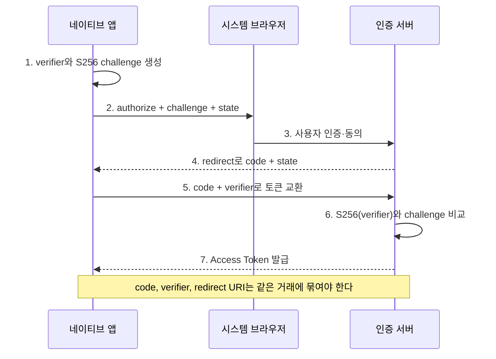

웹 브라우저에서 서버가 `client_secret`을 보관하는 일반적인 웹 SSO 진단과 달리, 이 글은 RFC 8252의 **네이티브 앱 Public Client 제약**만 다룬다. 앱 바이너리에 비밀을 안전하게 넣을 수 없다는 전제에서 PKCE 강제 여부, 시스템 브라우저와 인앱 WebView의 신뢰 차이, `state` 미검증으로 인한 Login CSRF를 검증한다.

---

## 1. Public Client와 PKCE의 역할

**개념**: 모바일 앱에 `client_secret`을 넣는 것은 집의 예비 열쇠 번호를 메모해 모든 방문자에게 한 장씩 나눠 주는 것과 같다. 앱 파일은 사용자 기기에 배포되므로 누구든 디컴파일해 그 "비밀"을 읽을 수 있다. PKCE는 로그인 시작 때 앱이 일회용 비밀 증명값을 만들고 그 변형만 인증 서버에 맡긴 뒤, 코드 교환 때 원래 값을 다시 확인하는 장치다. 중간에서 Authorization Code를 주운 사람도 그 증명이 없으면 토큰으로 바꿀 수 없다.

**원리**: 네이티브 앱은 배포된 모든 인스턴스가 같은 정적 비밀을 가져야 하므로 OAuth의 confidential client로 인증할 수 없다. PKCE는 무작위 `code_verifier`에서 `code_challenge`를 만들고 Authorization Code와 결합한다. 토큰 엔드포인트는 해당 코드에 저장된 challenge와 제출된 verifier를 비교하며, 이 검증은 클라이언트 비밀을 대체하는 공개 클라이언트용 코드 탈취 방어다.

- 체크 포인트:
  - 앱 바이너리의 `client_secret`이 인증 수단으로 실제 사용되는지 확인한다.
  - 매 로그인마다 충분히 무작위인 새 `code_verifier`가 생성되는지 확인한다.
  - Authorization Code와 challenge가 서버에서 일회성으로 결합되는지 검사한다.
- 참고: [RFC 8252 - OAuth 2.0 for Native Apps](https://www.rfc-editor.org/rfc/rfc8252.html), [RFC 7636 - PKCE](https://www.rfc-editor.org/rfc/rfc7636.html), [RFC 6749 - Client Types](https://www.rfc-editor.org/rfc/rfc6749.html#section-2.1)

## 2. 정상 Authorization Code 흐름

**원리**: 앱은 먼저 verifier와 challenge를 만들고 외부 user-agent에서 인가 요청을 시작한다. 인증 서버는 redirect URI로 짧은 수명의 코드를 돌려주고, 앱은 백채널 토큰 요청에 원래 verifier를 제출한다. 공격자가 리디렉션을 선점해 코드를 얻더라도 verifier를 모르고, 정상 앱이 코드를 받더라도 이미 사용됐다면 서버가 재사용을 거부해야 한다.

- 체크 포인트:
  - authorize 요청의 challenge와 token 요청의 verifier를 한 거래 단위로 대응시킨다.
  - 코드 재사용, 만료 코드, 다른 redirect URI에서 받은 코드가 모두 거부되는지 확인한다.
  - verifier가 로그·분석 SDK·크래시 리포트에 남지 않는지 검사한다.
- 참고: [RFC 7636 - Protocol](https://www.rfc-editor.org/rfc/rfc7636.html#section-4), [RFC 9700 - Authorization Code Grant](https://www.rfc-editor.org/rfc/rfc9700.html#name-authorization-code-grant)

## 3. PKCE 생략과 `plain` 다운그레이드

**원리**: 정상 앱이 S256을 사용해도 서버가 같은 Public Client에 PKCE 없는 새 거래나 `code_challenge_method=plain` 거래를 허용하면 S256 강제 정책이 아니다. `plain`은 verifier 자체가 전면 채널 요청에 노출되므로 인가 요청까지 관찰 가능한 공격자에게 증명값을 드러낸다. 다만 진행 중인 S256 요청의 method만 `plain`으로 바꾸면 저장된 challenge와 verifier가 일치하지 않으므로 자동으로 성공하지 않으며, 다운그레이드 검증은 처음부터 별도 `plain` 거래를 구성해 서버 정책이 이를 받아들이는지 확인해야 한다.

- 체크 포인트:
  - challenge와 method를 각각 누락한 authorize 요청이 거부되는지 확인한다.
  - `S256`을 `plain`으로 바꾸거나 알 수 없는 method를 넣었을 때 실패하는지 확인한다.
  - 다른 앱 인스턴스에서 만든 verifier로 코드 교환이 가능한지 검사한다.
  - 오류 응답이 verifier·코드의 유효성을 과도하게 구분해 노출하지 않는지 확인한다.
- 참고: [RFC 7636 - PKCE Downgrade Attack](https://www.rfc-editor.org/rfc/rfc7636.html#section-7.2), [RFC 9700 - PKCE](https://www.rfc-editor.org/rfc/rfc9700.html#name-pkce)

## 4. 리디렉션 URI와 코드 가로채기

**원리**: 커스텀 스킴은 여러 앱이 등록할 수 있어 악성 앱이 Authorization Code를 받을 가능성이 있지만, PKCE가 올바르면 코드만으로 토큰을 얻지 못한다. Claimed HTTPS URI(App Links·Universal Links)와 loopback URI는 플랫폼별 소유권 또는 로컬 포트 규칙을 제공한다. 인증 서버는 네이티브 앱 redirect URI를 사전 등록 값과 정확히 비교해야 하며 부분 문자열·와일드카드 비교는 공격자 경로를 만든다.

- 체크 포인트:
  - 동일 커스텀 스킴을 등록한 테스트 앱이 콜백을 받을 수 있는지 확인한다.
  - redirect URI의 scheme·host·port·path를 하나씩 바꿔 정확 일치 여부를 검사한다.
  - 코드가 다른 클라이언트 ID나 redirect URI의 토큰 요청에서 거부되는지 확인한다.
  - claimed HTTPS 링크의 도메인 연관 파일이 릴리스 앱과 일치하는지 확인한다.
- 참고: [RFC 8252 - Redirection URI Options](https://www.rfc-editor.org/rfc/rfc8252.html#section-7), [RFC 8252 - Authorization Servers](https://www.rfc-editor.org/rfc/rfc8252.html#section-8.4)

## 5. 인앱 WebView와 시스템 브라우저

**원리**: 인앱 WebView는 호스트 앱이 DOM·키 입력·쿠키 흐름을 관찰하거나 로그인 화면을 모방할 수 있고, 사용자가 실제 IdP의 주소 표시줄을 확인하기 어렵다. 또한 시스템 브라우저의 기존 로그인 세션과 쿠키 저장소를 공유하지 않아 SSO와 피싱 방지 신호가 약해진다. `ASWebAuthenticationSession`과 Android Custom Tabs 같은 외부 user-agent는 브라우저 보안 컨텍스트와 도메인 표시를 사용하므로 RFC 8252가 권고하는 기본 경로다.

- 체크 포인트:
  - 로그인 화면이 일반 WebView/WKWebView인지 시스템 인증 세션인지 런타임에서 확인한다.
  - IdP URL과 TLS 상태를 사용자가 볼 수 있는 UI가 있는지 확인한다.
  - 앱이 로그인 DOM에 스크립트를 삽입하거나 자격 증명 입력을 가로챌 수 있는지 설계 수준에서 확인한다.
  - 시스템 브라우저 SSO 세션을 재사용하는지, 로그아웃 범위가 어디까지인지 기록한다.
- 참고: [RFC 8252 - Embedded User-Agents](https://www.rfc-editor.org/rfc/rfc8252.html#section-8.12), [Apple ASWebAuthenticationSession](https://developer.apple.com/documentation/authenticationservices/aswebauthenticationsession), [Android Custom Tabs](https://developer.chrome.com/docs/android/custom-tabs/)

## 6. `state` 미검증과 Login CSRF

**원리**: 거래별 verifier를 인증 응답과 올바르게 결합한 PKCE는 일부 CSRF 방어도 제공할 수 있으므로 `state` 누락만으로 취약점을 단정할 수는 없다. 그러나 앱이 고엔트로피 state를 생성·저장하고 콜백에서 일치 여부를 확인하지 않으며 PKCE 거래 결속도 불완전하면, 공격자가 자신의 계정으로 시작한 인가 응답을 피해자의 앱에 전달해 공격자 계정으로 로그인시키는 Login CSRF가 성립할 수 있다. 이후 피해자가 입력한 개인정보가 공격자 계정에 저장되는지가 실제 영향이다.

- 체크 포인트:
  - state가 로그인마다 새로 생성되고 예측 불가능한지 확인한다.
  - 누락·변조·이전 거래의 state가 포함된 콜백을 앱과 서버가 거부하는지 검사한다.
  - 여러 로그인 창을 병렬로 열었을 때 state와 PKCE 거래가 서로 섞이지 않는지 확인한다.
  - OIDC를 쓰면 nonce와 state의 역할을 구분해 각각 검증하는지 확인한다.
- 참고: [RFC 6749 - CSRF](https://www.rfc-editor.org/rfc/rfc6749.html#section-10.12), [OpenID Connect Core - Nonce](https://openid.net/specs/openid-connect-core-1_0.html#NonceNotes), [RFC 9700](https://www.rfc-editor.org/rfc/rfc9700.html)

## 7. 네이티브 플로우 판정 순서

**원리**: 안전성은 앱 화면 한 번의 성공이 아니라 인증 서버가 모든 우회 변형을 거부하는지로 판정한다. 외부 user-agent, 정확한 redirect URI, S256 강제, 거래별 state, 코드 일회성이 한 흐름에 함께 있어야 한다. 하나의 통제가 다른 통제의 누락을 자동으로 보완하지는 않는다.

- 체크 포인트:
  - 정상 흐름을 기준선으로 캡처하고 PKCE·state·redirect URI를 한 요소씩 변형한다.
  - 오류가 클라이언트에서만 발생하는지 인증 서버에서도 강제되는지 구분한다.
  - 코드와 토큰 원문은 보고서에서 제거하고 거래 ID·시각·응답 코드로 증거를 남긴다.
  - 수정 후 다중 창, 앱 전환, 취소·재시도에서도 거래 결합이 유지되는지 회귀 검증한다.
- 참고: [OWASP MASVS-AUTH](https://mas.owasp.org/MASVS/controls/MASVS-AUTH/), [OAuth 2.0 Security BCP](https://www.rfc-editor.org/rfc/rfc9700.html)

---

네이티브 OAuth의 핵심은 앱 안의 비밀을 믿는 것이 아니라, 외부 user-agent와 서버가 일회용 거래를 정확히 묶는 데 있다. PKCE, state, redirect URI는 서로 다른 공격을 막으므로 각각 독립적으로 강제 여부를 확인해야 한다.
