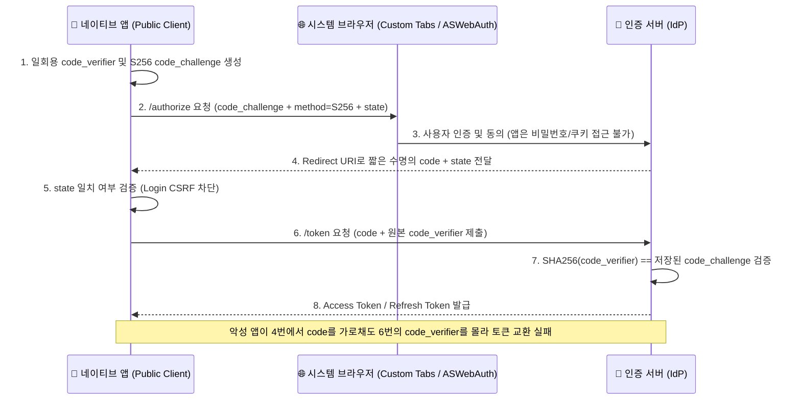

> [!summary] ⏱️ 5초 핵심 요약
> - **한 줄 비유**: 모바일 앱에 고정된 `client_secret`을 넣어 배포하는 것은 **전 국민에게 나눠주는 안내 책자에 금고 비밀번호를 인쇄해 두는 것**과 같습니다. 대신 매번 로그인할 때마다 **앱이 즉석에서 반쪽짜리 암호표(`code_verifier`)를 만들고 잠긴 상자(`code_challenge`)만 먼저 보낸 뒤, 나중에 물건(토큰)을 찾을 때 원래 암호표를 대조하는 것**이 **PKCE**입니다.
> - **핵심 원리**: RFC 8252 네이티브 OAuth 보안은 **`외부 시스템 브라우저(ASWebAuthenticationSession/Custom Tabs)` + `PKCE(S256 강제)` + `정확히 일치하는 Redirect URI` + `거래별 고엔트로피 state 검증`**이 한 흐름으로 묶일 때 성립합니다.
> - **핵심 점검 포인트**: 서버가 PKCE 생략이나 `code_challenge_method=plain` 다운그레이드 거래를 받아주는지, 인앱 WebView로 자격증명 입력을 유도하는지, `state` 미검증으로 공격자 계정이 강제 연결(Login CSRF)되는지 확인합니다.

웹 브라우저에서 백엔드 서버가 `client_secret`을 안전하게 보관하는 일반적인 웹 SSO 진단과 달리, 이 글은 RFC 8252의 **네이티브 앱 Public Client 제약**만 다룹니다. 앱 바이너리에 비밀을 안전하게 넣을 수 없다는 전제에서 **PKCE 강제 여부**, **시스템 브라우저와 인앱 WebView의 신뢰 차이**, **`state` 미검증으로 인한 Login CSRF**를 검증합니다.



---

## 한눈에 보는 네이티브 OAuth 4대 보안 통제와 공격 시나리오

| 보안 통제 요소 | 방어하는 핵심 위협 | 취약한 구현 / 오설정 | 진단 검증 방법 |
|---|---|---|---|
| **PKCE (`S256`)** | 커스텀 스킴 선점 등을 통한 **Authorization Code 가로채기** | PKCE 파라미터 누락 허용, `code_challenge_method=plain` 허용 | 처음부터 `code_challenge`를 빼거나 `method=plain`으로 시작한 별도 거래를 서버가 승인하는지 확인 |
| **Redirect URI 검증** | 인증 코드의 외부 도메인/타 앱 유출 | 부분 문자열·접두사 매칭, 와일드카드 허용, 미검증 커스텀 스킴 단독 의존 | `redirect_uri`의 scheme·host·port·path 변조 및 App Links / Universal Links 적용 여부 확인 |
| **외부 User-Agent** | 호스트 앱의 **자격증명(ID/PW)·쿠키 스니핑 및 피싱** | 인앱 `WebView` / `WKWebView`에서 직접 IdP 로그인 페이지 렌더링 | 런타임 UI 확인(주소 표시줄·시스템 인증 세션 여부) 및 `ASWebAuthenticationSession` / `Custom Tabs` 사용 확인 |
| **`state` 파라미터** | **Login CSRF** (피해자 앱에 공격자 계정 강제 로그인) | 고정값·예측 가능값 사용, 콜백 수신 시 `state` 일치 여부 미검증 | 공격자 계정으로 발급받은 `code` 콜백을 피해자 앱 세션에 주입해 로그인 성립 여부 확인 |

---

## 1. Public Client와 PKCE의 역할

**💡 한 줄 비유**: 모바일 앱에 `client_secret`을 넣는 것은 **집의 예비 열쇠 번호를 메모해 모든 방문자에게 한 장씩 나눠 주는 것**과 같습니다. 반면 **PKCE**는 방문할 때마다 앱이 즉석에서 일회용 암구호(`code_verifier`)를 만들고, 그 암구호로 잠근 자물쇠(`code_challenge`)만 먼저 보낸 뒤 나중에 원래 암구호로만 문을 여는 장치입니다.

### 핵심 원리
- **Public Client의 한계**: 네이티브 앱은 사용자 기기에 배포되므로 누구든 디컴파일해 바이너리 안의 정적 비밀(`client_secret`)을 읽을 수 있습니다. 따라서 OAuth의 Confidential Client로 인증할 수 없습니다.
- **PKCE(Proof Key for Code Exchange, RFC 7636) 메커니즘**:
  1. 로그인 시작 시 앱이 고엔트로피 무작위 문자열인 **`code_verifier`**를 생성합니다.
  2. 이를 해시 변환(`BASE64URL(SHA256(code_verifier))`)한 **`code_challenge`**만 인가 요청(`/authorize`)에 실어 보냅니다.
  3. 인증 서버는 발급한 Authorization Code에 해당 `code_challenge`와 변환 방식(`S256`)을 묶어 저장합니다.
  4. 토큰 교환(`/token`) 시 앱이 원본 `code_verifier`를 제출하면 서버가 해시값을 비교합니다. 중간에서 Authorization Code를 가로챈 공격자는 `code_verifier`를 알 수 없어 토큰을 발급받지 못합니다.

### 체크 포인트
- 앱 바이너리에 하드코딩된 `client_secret`이 실제 인증 수단으로 사용되는지 확인한다.
- 매 로그인마다 충분히 무작위인 새 `code_verifier`가 생성되는지 확인한다.
- Authorization Code와 `code_challenge`가 서버에서 일회성 거래로 결합되는지 검사한다.
- 참고: [RFC 8252 - OAuth 2.0 for Native Apps](https://www.rfc-editor.org/rfc/rfc8252.html), [RFC 7636 - PKCE](https://www.rfc-editor.org/rfc/rfc7636.html), [RFC 6749 - Client Types](https://www.rfc-editor.org/rfc/rfc6749.html#section-2.1)

---

## 2. 정상 Authorization Code 흐름

**💡 한 줄 비유**: 물품 보관소(인증 서버)에 가방을 맡길 때 **보관함 번호표(`code`)**와 **내가 직접 설정한 일회용 비밀번호(`code_verifier`)**가 한 세트로 묶여야, 남이 번호표를 주워 가도 가방(Access Token)을 꺼내 갈 수 없습니다.

### 핵심 원리
- 앱은 `code_verifier`와 `code_challenge`를 생성한 뒤 외부 user-agent(시스템 브라우저)에서 인가 요청을 시작합니다.
- 인증 서버는 `redirect_uri`로 짧은 수명의 `code`를 돌려주고, 앱은 백채널 `/token` 요청에 원래 `code_verifier`를 제출합니다.
- 공격자가 리디렉션을 선점해 `code`를 먼저 얻더라도 `code_verifier`를 몰라 실패하며, 설령 정상 앱이 받은 `code`가 노출되더라도 이미 한 번 사용됐다면 서버가 재사용을 즉시 거부해야 합니다.

### 체크 포인트
- `/authorize` 요청의 `code_challenge`와 `/token` 요청의 `code_verifier`를 한 거래 단위로 대응시켜 검증하는지 확인한다.
- 코드 재사용, 만료된 코드, 다른 `redirect_uri`에서 받은 코드가 모두 거부되는지 확인한다.
- `code_verifier`가 기기 로그·분석 SDK·크래시 리포트에 평문으로 남지 않는지 검사한다.
- 참고: [RFC 7636 - Protocol](https://www.rfc-editor.org/rfc/rfc7636.html#section-4), [RFC 9700 - Authorization Code Grant](https://www.rfc-editor.org/rfc/rfc9700.html#name-authorization-code-grant)

---

## 3. PKCE 생략과 `plain` 다운그레이드

**💡 한 줄 비유**: 금고에 최신 지문 인식기(`S256`)를 달아 놓았어도, 옆에 **"지문 안 찍고 그냥 열기(PKCE 생략)"** 버튼이나 **"비밀번호를 봉투 겉면에 적어 보내기(`plain`)"** 옵션을 그대로 켜 두면 도둑은 당연히 쉬운 길을 택합니다.

### 핵심 원리
- 정상 앱이 `S256`을 사용하더라도, **인증 서버가 같은 Public Client(`client_id`)에 대해 PKCE 없는 새 거래나 `code_challenge_method=plain` 거래를 허용한다면** `S256` 강제 정책이 아닙니다.
- `plain` 모드는 `code_challenge == code_verifier`이므로 전면 채널(인가 요청 URL)을 관찰할 수 있는 공격자에게 증명값 자체가 그대로 노출됩니다.
- **진단 시 주의점**: 이미 `S256`으로 시작한 거래의 `/token` 요청에서만 파라미터를 바꾼다고 다운그레이드가 되는 것은 아닙니다(저장된 해시값과 맞지 않아 당연히 실패함). **반드시 `/authorize` 단계부터 아예 `code_challenge`를 빼거나 `code_challenge_method=plain`으로 지정한 새로운 거래를 시작해 서버가 이를 수용하는지** 확인해야 합니다.

### PKCE 강제 여부 테스트 케이스 비교
```http
# Case 1: PKCE 파라미터 완전 누락 테스트 (/authorize)
GET /oauth/authorize?response_type=code&client_id=mobile_app&redirect_uri=myapp://callback&state=xyz HTTP/1.1
# -> 안전한 서버 응답: 400 Bad Request (error=invalid_request, code_challenge required)

# Case 2: plain 다운그레이드 거래 시작 테스트 (/authorize)
GET /oauth/authorize?response_type=code&client_id=mobile_app&redirect_uri=myapp://callback&code_challenge=PlainVerifier123&code_challenge_method=plain&state=xyz HTTP/1.1
# -> 안전한 서버 응답: 400 Bad Request (plain method not allowed for this client)
```

### 체크 포인트
- `code_challenge`와 `code_challenge_method`를 각각 누락한 `/authorize` 요청이 거부되는지 확인한다.
- 처음부터 `S256`을 `plain`으로 바꾸거나 알 수 없는 method를 넣었을 때 인가 단계에서 실패하는지 확인한다.
- 다른 앱 인스턴스에서 만든 `code_verifier`로 코드 교환이 가능한지 검사한다.
- 오류 응답이 `code_verifier`·`code`의 유효성을 과도하게 구분해 노출하지 않는지 확인한다.
- 참고: [RFC 7636 - PKCE Downgrade Attack](https://www.rfc-editor.org/rfc/rfc7636.html#section-7.2), [RFC 9700 - PKCE](https://www.rfc-editor.org/rfc/rfc9700.html#name-pkce)

---

## 4. 리디렉션 URI와 코드 가로채기

**💡 한 줄 비유**: 커스텀 스킴(`myapp://`)은 누구나 자기 집 문패에 '홍길동 집'이라고 적어 붙일 수 있는 것과 같아서 우편물(`code`)이 엉뚱한 집으로 배달될 수 있지만, **App Links / Universal Links는 등기부등본(도메인 연관 파일)으로 확인된 진짜 집주인에게만 배달하는 등기우편**입니다.

### 핵심 원리
- **Custom URI Scheme의 한계**: 여러 앱이 동일한 커스텀 스킴을 등록할 수 있어 악성 앱이 Authorization Code를 가로챌 가능성이 있습니다(PKCE가 올바르게 구현되어 있다면 코드만으로는 토큰 교환이 막히지만, 심층 방어를 위해 스킴 선점 자체도 줄여야 합니다).
- **권장 Redirect URI 방식 (RFC 8252)**:
  - **Claimed HTTPS URI (Android App Links / iOS Universal Links)**: 도메인 소유권과 앱 서명/번들 ID를 결합해 스킴 선점을 방지합니다(상세 검증법은 [[모바일 취약점 진단 — 딥링크·앱링크 공격표면]] 참고).
  - **Loopback URI (`http://127.0.0.1:{port}`)**: 주로 데스크톱/CLI 네이티브 앱에서 로컬 포트를 열어 수신합니다.
- **서버 측 URI 매칭**: 인증 서버는 네이티브 앱 `redirect_uri`를 사전 등록된 값과 **정확히 일치(Exact Match)**하는지 비교해야 하며, 부분 문자열·와일드카드 허용은 공격자 경로를 만듭니다.

### 체크 포인트
- 동일 커스텀 스킴을 등록한 테스트 앱이 인가 콜백을 가로챌 수 있는지 확인한다.
- `redirect_uri`의 scheme·host·port·path를 하나씩 바꿔 서버가 정확 일치(Exact Match)로 검증하는지 검사한다.
- 발급된 `code`가 다른 `client_id`나 다른 `redirect_uri`의 `/token` 요청에서 거부되는지 확인한다.
- Claimed HTTPS 링크의 도메인 연관 파일(`assetlinks.json` / `AASA`)이 실제 릴리스 앱과 일치하는지 확인한다.
- 참고: [RFC 8252 - Redirection URI Options](https://www.rfc-editor.org/rfc/rfc8252.html#section-7), [RFC 8252 - Authorization Servers](https://www.rfc-editor.org/rfc/rfc8252.html#section-8.4)

---

## 5. 인앱 WebView와 시스템 브라우저

**💡 한 줄 비유**: **인앱 WebView**에서 소셜 로그인을 하는 것은 **남의 가게 직원이 들고 있는 메모장에 내 은행 아이디와 비밀번호를 적어주는 것**과 같고, **시스템 브라우저 세션(`ASWebAuthenticationSession`·`Custom Tabs`)**을 쓰는 것은 **은행 전용 보안 단말기에 내가 직접 입력하고 가게에는 '결제 승인 완료' 영수증만 넘겨주는 것**입니다.

### 인앱 WebView vs 외부 User-Agent 비교 (RFC 8252 Section 8.12)

| 비교 항목 | 인앱 WebView (`WebView` / `WKWebView`) — ❌ 비권장 | 외부 User-Agent (`Custom Tabs` / `ASWebAuthenticationSession`) — ✅ 권장 |
|---|---|---|
| **호스트 앱의 개입 가능성** | 호스트 앱이 JS 주입(`evaluateJavaScript`)으로 **DOM·키 입력·쿠키를 직접 열람·변조 가능** | 호스트 앱 프로세스와 격리되어 앱이 사용자의 ID/PW 입력이나 IdP 쿠키를 볼 수 없음 |
| **피싱 방어 (주소창 확인)** | 주소 표시줄이 없거나 앱이 가짜 주소창 UI를 그릴 수 있어 피싱 판별 불가 | 시스템 브라우저의 실제 도메인 표시 및 TLS 보안 컨텍스트 제공 |
| **SSO 세션 공유** | 시스템 브라우저와 쿠키 저장소가 분리되어 매번 재로그인 유도 | 시스템 브라우저의 기존 로그인 세션을 안전하게 공유 가능 |

### 체크 포인트
- 로그인 화면이 일반 `WebView`/`WKWebView`인지 시스템 인증 세션(`ASWebAuthenticationSession`, `Custom Tabs`)인지 런타임에서 확인한다.
- IdP URL과 TLS 상태를 사용자가 직접 확인할 수 있는 브라우저 UI가 있는지 확인한다.
- 앱이 로그인 DOM에 스크립트를 삽입하거나 자격 증명 입력을 가로챌 수 있는 구조인지 설계 수준에서 확인한다.
- 시스템 브라우저 SSO 세션을 재사용하는지, 로그아웃 시 세션 정리 범위가 어디까지인지 기록한다.
- 참고: [RFC 8252 - Embedded User-Agents](https://www.rfc-editor.org/rfc/rfc8252.html#section-8.12), [Apple ASWebAuthenticationSession](https://developer.apple.com/documentation/authenticationservices/aswebauthenticationsession), [Android Custom Tabs](https://developer.chrome.com/docs/android/custom-tabs/)

---

## 6. `state` 미검증과 Login CSRF

**💡 한 줄 비유**: 피해자의 앱에 **공격자의 계정 명찰이 달린 로그인 완료 티켓(`code`)**을 몰래 밀어 넣어, 피해자가 자기 계정인 줄 알고 입력한 카드 정보나 사생활 기록이 고스란히 공격자 계정에 쌓이게 만드는 공격입니다.

### 핵심 원리
- 거래별 `code_verifier`를 인증 응답과 엄격히 결합한 PKCE는 일부 CSRF 방어 효과도 제공할 수 있으므로 `state` 누락만으로 즉시 취약점을 단정할 수는 없습니다.
- 그러나 **앱이 고엔트로피 `state`를 생성·저장해 콜백에서 대조하지 않고 PKCE 거래 결속도 불완전하다면**, 공격자가 자신의 계정으로 시작한 인가 응답(`myapp://callback?code= 공격자_코드`)을 피해자의 기기에서 실행시켜 피해자 앱을 공격자 계정으로 로그인시키는 **Login CSRF**가 성립합니다.
- 실제 비즈니스 영향은 피해자가 로그인 이후 입력한 결제 수단·개인정보·검색 기록이 공격자 계정에 귀속되어 유출되는지 여부로 판정합니다.

### 체크 포인트
- `state`가 매 로그인 시점마다 새로 생성되고 예측 불가능한 난수인지 확인한다.
- 누락·변조·이전 거래의 `state`가 포함된 콜백을 앱과 서버가 거부하는지 검사한다.
- 여러 로그인 창을 병렬로 열었을 때 `state`와 PKCE 거래가 서로 섞이지 않는지 확인한다.
- OpenID Connect(OIDC)를 함께 쓴다면 ID Token 재전송을 막는 `nonce`와 `state`의 역할을 구분해 각각 검증하는지 확인한다.
- 참고: [RFC 6749 - CSRF](https://www.rfc-editor.org/rfc/rfc6749.html#section-10.12), [OpenID Connect Core - Nonce](https://openid.net/specs/openid-connect-core-1_0.html#NonceNotes), [RFC 9700](https://www.rfc-editor.org/rfc/rfc9700.html)

---

## 7. 네이티브 플로우 판정 순서

**💡 한 줄 비유**: 안전한 인증 흐름은 다리 기둥 네 개(**외부 브라우저·정확한 Redirect URI·S256 PKCE·state 검증**)가 모두 제자리에 서 있어야 하며, 하나가 튼튼하다고 해서 다른 기둥을 빼도 무너지지 않는 것은 아닙니다.

### 핵심 원리
안전성은 앱 화면에서 정상 로그인이 한 번 성공하는지가 아니라, **인증 서버와 클라이언트가 모든 우회 변형을 거부하는지**로 판정합니다. 외부 user-agent, 정확한 `redirect_uri`, `S256` 강제, 거래별 `state`, 코드 일회성이 한 흐름에 함께 있어야 합니다.

### 체크 포인트
- 정상 흐름을 기준선(Baseline)으로 캡처하고 PKCE·`state`·`redirect_uri`를 한 요소씩 변형해 테스트한다.
- 차단 오류가 클라이언트 UI에서만 발생하는지 인증 서버에서도 실제로 강제되는지 구분한다.
- Authorization Code와 토큰 원문은 보고서에서 마스킹하고 거래 ID·시각·응답 코드로 증거를 남긴다.
- 수정 후 다중 창, 앱 전환, 로그인 취소·재시도 상황에서도 거래 결합이 유지되는지 회귀 검증한다.
- 참고: [OWASP MASVS-AUTH](https://mas.owasp.org/MASVS/controls/MASVS-AUTH/), [OAuth 2.0 Security BCP (RFC 9700)](https://www.rfc-editor.org/rfc/rfc9700.html)

---

네이티브 OAuth의 핵심은 앱 안의 비밀을 믿는 것이 아니라, 외부 user-agent와 서버가 일회용 거래를 정확히 묶는 데 있습니다. 로그인 이후 발급된 토큰이 어떻게 갱신·폐기되고 기기와 결합되는지는 [[모바일 취약점 진단 — 백엔드 API 토큰 갱신과 디바이스 바인딩]]에서 이어서 다룹니다.
