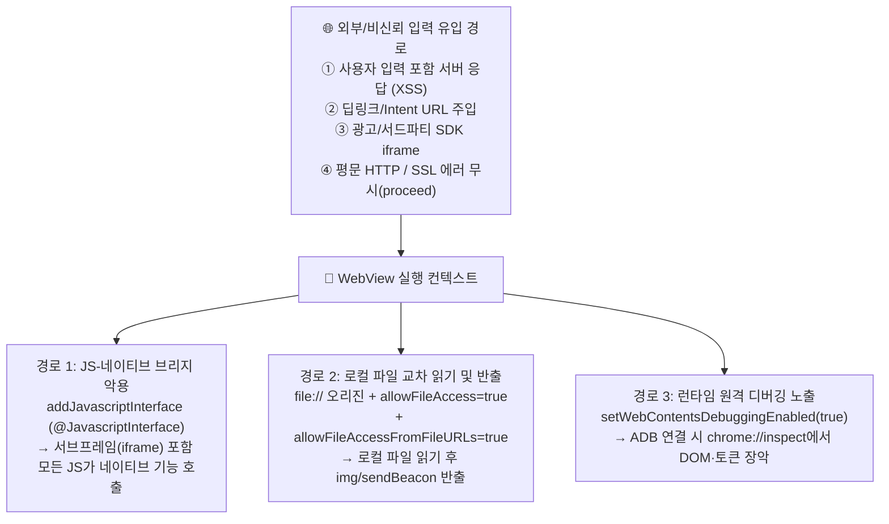
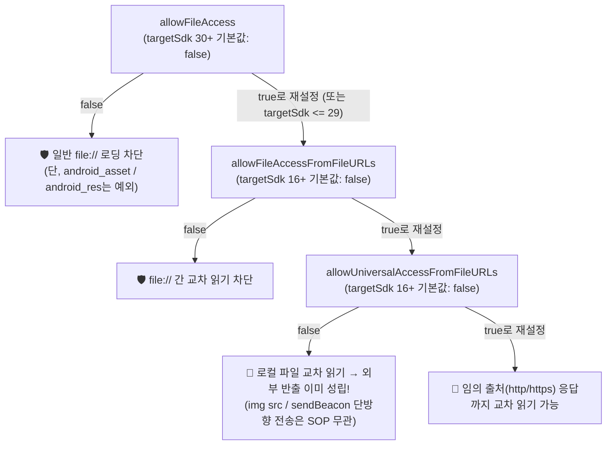
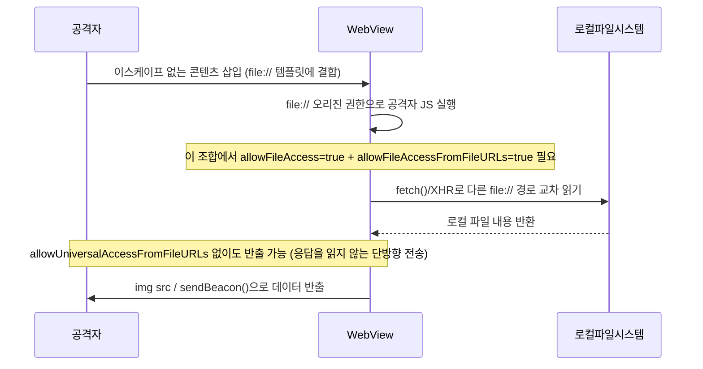

> [!summary] ⏱️ 5초 핵심 요약
> - **한 줄 비유**: 일반 브라우저의 취약점이 호텔 객실(탭) 하나가 털리는 사고라면, **WebView 취약점은 객실 안에 건물 마스터키(`JavascriptInterface` 브리지)와 지하 금고 직통 문(`file://` 로컬 파일 접근)을 함께 열어둔 격**입니다.
> - **핵심 원리**: WebView 위협은 단독 설정 하나가 아니라 **`신뢰할 수 없는 콘텐츠 유입(XSS·딥링크·광고 iframe·평문 HTTP)` + `위험 설정 활성화(JS 브리지 노출·파일 교차 접근 플래그·SSL 에러 무시)`**가 결합될 때 폭발합니다.
> - **핵심 방어**: `@JavascriptInterface`는 신뢰된 도메인에만 최소한으로 바인딩하고, Android `allowFileAccess*` 플래그 기본값(`false`) 유지 및 `WebViewAssetLoader` 사용, iOS `WKAppBoundDomains` 적용, `onReceivedSslError`에서 무조건 `cancel()`을 강제해야 합니다.

모바일 취약점 진단 시리즈의 핵심 파트인 WebView 진단입니다. WebView는 네이티브 앱 안에 끼워 넣는 "미니 브라우저"라서, 설정 하나(파일 접근 허용 범위, JS 브리지 노출, 디버깅 플래그)를 잘못 잡으면 일반 웹 취약점보다 피해 범위가 훨씬 커집니다 — 브라우저라면 탭 하나가 털리지만, WebView는 그 자체로 **네이티브 앱의 권한과 로컬 파일 시스템**까지 이어지는 통로이기 때문입니다. 아래는 그 설정값과 실제로 악용 가능해지는 조건을 짚은 체크리스트입니다.



---

## 한눈에 보는 WebView 7대 점검 항목 요약표

| 점검 항목 | 핵심 위험 API / 설정 | 실제 악용 성립 조건 | 핵심 방어 대책 |
|---|---|---|---|
| **1. JS 브리지 노출** | `addJavascriptInterface` (`@JavascriptInterface`) | 브리지가 바인딩된 WebView에 비신뢰 콘텐츠(원격 웹, XSS, 광고 iframe)가 로드됨 | 신뢰 도메인에만 바인딩, `WebMessageCompat` 등으로 출처(Origin) 검증 |
| **2. 파일 접근 플래그** | `setAllowFileAccess(true)` + `setAllowFileAccessFromFileURLs(true)` | 개발자가 기본값(`false`)을 명시적으로 `true`로 켜고 `file://`에서 공격자 JS가 실행됨 | 기본값(`false`) 유지, 로컬 리소스는 `WebViewAssetLoader`(`https://` 가상 도메인) 사용 |
| **3. `file://` + 원격 데이터** | `loadDataWithBaseURL("file://...", html)` 등 | 로컬 템플릿에 서버/사용자 데이터를 이스케이프 없이 삽입해 `file://` 오리진 XSS 발생 | 철저한 출력 인코딩, `file://` 컨텍스트에 파일 접근권이나 브리지 부여 금지 |
| **4. iOS WKWebView 설정** | `loadFileURL(_:allowingReadAccessTo:)`, KVC 비공개 키 | 허용 디렉터리 범위를 앱 샌드박스 루트 등으로 과도하게 넓게 지정 | 최소 하위 디렉터리만 지정, `Info.plist`에 `WKAppBoundDomains` 등록 |
| **5. 원격 디버깅 노출** | `WebView.setWebContentsDebuggingEnabled(true)` | 릴리스 빌드에 조건 없이 남아 있고 공격자가 ADB 접근 권한을 확보함 | 반드시 `BuildConfig.DEBUG` 조건문 안에서만 활성화 |
| **6. SSL 검증 우회** | `WebViewClient.onReceivedSslError` 내 `handler.proceed()` | 동일 Wi-Fi 등 MITM 가능 경로에서 공격자가 위조 인증서를 제시함 | 조건부 허용 없이 모든 오류에서 기본 `handler.cancel()` 유지 |
| **7. 딥링크 + WebView 결합** | `webView.loadUrl(intent.getStringExtra("url"))` | exported Activity/딥링크가 URL 스킴·호스트 검증 없이 `loadUrl`로 직결됨 | 허용 스킴(`https`)·호스트 화이트리스트 검증 및 `shouldOverrideUrlLoading` 재검증 |

---

## 1. WebView 기본 위협 모델

**💡 한 줄 비유**: 일반 브라우저는 손님에게 지금 어느 건물에 있는지 보여주는 **도로명 주소창**이 있지만, **WebView는 창문도 주소창도 없는 밀실**이어서 손님(사용자)은 지금 보는 화면이 진짜 은행 서버인지 내 휴대폰 내부 파일(`file://`)인지 구별할 수 없습니다.

### 핵심 원리
- WebView는 OS가 제공하는 브라우저 엔진(안드로이드는 Chromium 기반, iOS는 WebKit)을 네이티브 앱 프로세스 안에 임베드한 컴포넌트입니다.
- **신뢰 가정이 깨지는 4가지 대표 경로**: 개발자는 흔히 "내 서버 페이지만 띄우니까 안전하다"고 가정하지만, 실제로는 다음 네 가지 경로로 비신뢰 콘텐츠가 같은 WebView 컨텍스트에 섞여 들어옵니다.
  1. 서버 응답에 **사용자 입력이 섞여 들어가는 콘텐츠**(게시판, 프로필, 알림 상세 등 XSS 가능 지점)
  2. **광고 SDK·서드파티 분석 SDK**가 끼워 넣는 외부 콘텐츠 및 서브프레임(`iframe`)
  3. **평문 HTTP**로 받아와 네트워크 중간자(MITM)에게 노출되는 콘텐츠
  4. **딥링크/Intent**로 외부에서 주입된 임의의 URL
- 이 중 하나라도 해당하면 "내 서버 콘텐츠"라는 신뢰 경계가 무너지며, 아래 2~8절의 설정값들이 실제 공격 체인으로 작동합니다.

### 체크 포인트
- 앱이 로드하는 URL 목록(원격 도메인, `file://` 에셋, 서드파티 SDK WebView)을 전부 나열한다.
- 각 경로에 사용자 입력·광고 콘텐츠·외부 딥링크 입력이 섞여 들어가는지, 평문 HTTP로 받는 콘텐츠가 있는지 확인한다.
- 참고: [OWASP MASTG — WebViews](https://mas.owasp.org/MASTG/0x05h-Testing-Platform-Interaction/), [OWASP MASVS](https://mas.owasp.org/MASVS/)

---

## 2. addJavascriptInterface / JS-네이티브 브리지 노출

**💡 한 줄 비유**: 웹페이지라는 손님방 안에 **네이티브 앱의 금고와 설정실을 직접 조작할 수 있는 직통 인터폰(`Bridge`)**을 달아둔 것입니다. 방 안에 낯선 사람(XSS나 광고 `iframe`)이 들어오면 그 사람도 인터폰 수화기를 그대로 들 수 있습니다.

### 핵심 원리
- `webView.addJavascriptInterface(obj, "Bridge")`로 네이티브 객체를 바인딩하면, WebView 내 JS가 `Bridge.메서드명()`으로 네이티브 메서드를 직접 호출할 수 있습니다.
- **API 17(`Android 4.2`) 기준 동작 차이**:
  - **API 17 미만**: 바인딩된 객체의 모든 `public` 메서드(`getClass()` 포함)가 리플렉션으로 노출되어 임의 명령 실행(RCE)이 가능했습니다.
  - **API 17 이상**: `@JavascriptInterface` 어노테이션이 붙은 메서드만 노출됩니다(단, 앱의 `targetSdkVersion >= 17`이고 실행 기기가 Android 4.2 이상일 때만 적용).
- **현대 앱에서의 2가지 핵심 위험**:
  1. **노출된 기능 자체의 민감도**: `@JavascriptInterface`가 붙은 메서드가 파일 읽기/쓰기, 토큰 반환, 결제/설정 변경을 수행하고 그 WebView가 비신뢰 콘텐츠를 로드할 수 있다면 공격자 JS가 그대로 호출합니다.
  2. **서브프레임(`iframe`) 자동 주입 함정**: `addJavascriptInterface`로 바인딩한 객체는 **최상위 프레임뿐 아니라 페이지 안의 모든 서브프레임(광고 `iframe` 등)에도 동일하게 주입**됩니다. 네이티브 메서드 안에서는 호출한 프레임의 출처(Origin)를 구분할 기본 방법이 없으므로, 메인 페이지가 안전해도 끼워진 서드파티 `iframe`이 브리지를 호출할 수 있습니다.

### 체크 포인트
- `addJavascriptInterface` 호출부를 찾아 바인딩된 객체와 `@JavascriptInterface` 메서드 목록을 전수 확인한다.
- 그 WebView가 로드하는 콘텐츠 중 비신뢰 입력(원격 페이지, 사용자 입력 포함 페이지, 광고 `iframe`, HTTP 평문)이 섞여 있는지 확인한다.
- 노출된 메서드가 파일 접근·토큰 조회·설정 변경처럼 민감한 동작을 수행하는지 확인한다.
- `minSdkVersion`이 17 미만이라 구형 리플렉션 동작이 남는 기기가 있는지 확인한다.
- 참고: [Android Developers — JavascriptInterface](https://developer.android.com/reference/android/webkit/JavascriptInterface), [OWASP MASTG — Testing JavaScript Execution in WebViews](https://mas.owasp.org/MASTG/0x05h-Testing-Platform-Interaction/)

---

## 3. 파일 접근 설정값 심화 (핵심)

**💡 한 줄 비유**: `allowFileAccess`는 **애초에 지하 문서고(`file://`) 문을 열 수 있게 할 것인가**, `allowFileAccessFromFileURLs`는 **문서고 A열람실에 들어온 사람이 옆방인 B금고(`다른 file:// 경로`) 문서를 꺼내 볼 수 있게 할 것인가**, `allowUniversalAccessFromFileURLs`는 **문서고 안에서 외부 인터넷(`http/https`)의 응답까지 마음대로 읽게 할 것인가**를 결정하는 스위치입니다.



### `WebSettings` 파일 접근 3대 플래그 비교 및 기본값 변화

| 플래그 메서드 | 통제 범위 | Target SDK별 기본값 | 실무 진단 핵심 포인트 |
|---|---|---|---|
| **`setAllowFileAccess(boolean)`** | WebView가 `file://` URL을 로드할 수 있는지 여부 (꺼도 `file:///android_asset/`, `android_res/`는 항상 접근 가능) | API 29 이하: `true`<br/>**API 30 이상: `false`** | 2026년 현재 유통 앱(`targetSdk >= 30`)은 기본이 `false`이므로 개발자가 명시적으로 `true`로 켰는지 확인 |
| **`setAllowFileAccessFromFileURLs(boolean)`** | `file://` 콘텐츠의 JS가 **다른 `file://` 경로**를 교차 출처로 읽을 수(`fetch`/`XHR`) 있는지 여부 | **API 16 이상: `false`**<br/>(API 30에서 deprecated) | `allowFileAccess(true)`와 함께 켜지면 **로컬 파일 읽기 → 외부 반출 체인이 즉시 완성됨** |
| **`setAllowUniversalAccessFromFileURLs(boolean)`** | `file://` 콘텐츠의 JS가 **임의의 출처(`http`/`https` 포함)** 응답까지 교차 접근할 수 있는지 여부 | **API 16 이상: `false`**<br/>(API 30에서 deprecated) | 가장 위험한 플래그이나, **이 플래그가 꺼져 있어도 로컬 파일 외부 반출은 이미 가능함**에 주의 |

### 왜 `UniversalAccess` 없이도 로컬 파일 반출이 성립하는가?
- `allowFileAccess(true)` + `allowFileAccessFromFileURLs(true)` 상태에서 `file://` 컨텍스트의 JS는 기기 내 접근 가능한 다른 로컬 파일을 `fetch()`나 `XMLHttpRequest`로 읽어올 수 있습니다.
- 읽어온 데이터를 공격자 서버로 **내보내는(Exfiltration)** 데는 응답을 읽을 필요가 없으므로, ``나 `navigator.sendBeacon()`처럼 SOP가 막지 않는 단방향 요청만으로 반출이 끝납니다.

### 체크 포인트
- 앱 코드에서 `setAllowFileAccess`, `setAllowFileAccessFromFileURLs`, `setAllowUniversalAccessFromFileURLs`를 명시적으로 `true`로 호출하는 곳이 있는지 확인한다.
- `targetSdkVersion`이 30 미만이라 레거시 기본값(`allowFileAccess=true`)이 그대로 적용되는지 확인한다.
- `file://` 콘텐츠를 로드하면서 위 플래그가 켜진 조합이 있는지 확인한다.
- 참고: [Android Developers — WebView unsafe file inclusion](https://developer.android.com/privacy-and-security/risks/webview-unsafe-file-inclusion), [Android Developers — WebSettings](https://developer.android.com/reference/android/webkit/WebSettings), [OWASP MASTG — MASTG-BEST-0011 Securely Load File Content in a WebView](https://mas.owasp.org/MASTG/best-practices/MASTG-BEST-0011/)

---

## 4. file:// URL 로딩과 원격 콘텐츠 결합

**💡 한 줄 비유**: 외부에서 온 편지(서버 데이터)를 소독(이스케이프)도 하지 않은 채 **우리 집 안방(`file:///android_asset/template.html`)에 그대로 펼쳐 놓으면**, 편지 속에 숨어 있던 악성 코드가 '손님'이 아니라 **'안방 주인(`file://` 오리진)' 권한**으로 집안을 뒤지게 됩니다.



### 핵심 원리
- 많은 앱이 `file:///android_asset/template.html` 같은 로컬 템플릿을 띄운 뒤 서버 응답(공지사항, 상품 설명, 프로필)을 `loadDataWithBaseURL`이나 `loadUrl("javascript:renderContent('...')")`로 끼워 넣습니다.
- 이때 적절한 HTML/JS 출력 인코딩이 없으면 XSS 페이로드가 일반 웹 도메인이 아닌 **`file://` 오리진 권한**으로 실행됩니다.
- 여기에 3절의 파일 접근 플래그나 2절의 JS 브리지가 함께 걸려 있으면, 단순 XSS가 **기기 로컬 파일 탈취 및 네이티브 기능 호출**로 증폭됩니다.

### 체크 포인트
- 로컬 HTML 템플릿에 서버 응답·사용자 입력을 삽입하는 코드가 출력 인코딩 없이 문자열 결합을 쓰는지 확인한다.
- 해당 템플릿이 로드되는 WebView에 3절의 파일 접근 플래그나 2절의 JS 브리지가 함께 활성화되어 있는지 확인한다.
- 참고: [OWASP MASTG — Testing JavaScript Execution in WebViews](https://mas.owasp.org/MASTG/0x05h-Testing-Platform-Interaction/), [Android Developers — WebView unsafe file inclusion](https://developer.android.com/privacy-and-security/risks/webview-unsafe-file-inclusion)

---

## 5. iOS WKWebView의 동등 설정

**💡 한 줄 비유**: Android가 건물 전체에 '파일 출입 허용 스위치'를 두는 식이라면, **iOS `WKWebView`는 문을 열 때마다 "이번엔 딱 이 서랍(`allowingReadAccessTo`)만 열람 허가함"이라고 매번 범위를 지정**하고, **허가된 도메인(`WKAppBoundDomains`) 밖으로는 아예 발을 못 디디게** 묶는 구조입니다.

### 핵심 원리
1. **비공개(Private) 파일 접근 KVC 지양**: `WKWebView`는 Android의 세 플래그에 대응하는 공개 API를 제공하지 않습니다. `allowFileAccessFromFileURLs` 등은 `WKWebViewConfiguration.preferences`에 KVC(`setValue(forKey:)`)로만 접근 가능한 **문서화되지 않은 비공개 프로퍼티**이므로, 사용하는 순간 App Store 심사 거절 및 OS 업데이트 시 동작 변경 리스크와 보안 위험을 동시에 떠안게 됩니다.
2. **호출 단위 범위 지정 (`loadFileURL(_:allowingReadAccessTo:)`)**: 로컬 파일을 로드할 때 두 번째 인자로 읽기 허용 파일 또는 디렉터리 범위를 명시적으로 지정합니다. 여기에 앱 샌드박스 루트 전체를 넘기면 상위/형제 디렉터리 파일까지 노출될 수 있습니다.
3. **App-Bound Domains (`limitsNavigationsToAppBoundDomains`, iOS 14+)**:
   - 파일 접근 플래그가 아니라 **최상위 네비게이션을 특정 도메인 목록으로 제한**하는 기능입니다.
   - `Info.plist`에 `WKAppBoundDomains` 키로 허용 도메인을 등록하고 `limitsNavigationsToAppBoundDomains = true`를 켜면, 목록 밖 도메인으로의 최상위 이동이 차단되고 `evaluateJavaScript`·`messageHandlers`·쿠키 조작 등 강력한 API가 앱 바운드 도메인 안에서만 동작합니다.
   - **주의**: 최신 iOS라고 자동 적용되는 것이 아니라 **`Info.plist`에 명시적으로 opt-in해야 작동**합니다.

### 체크 포인트
- `loadFileURL(_:allowingReadAccessTo:)` 호출 시 두 번째 인자로 넘긴 디렉터리가 필요 이상으로 넓은 범위(앱 샌드박스 루트 전체 등)인지 확인한다.
- `WKWebViewConfiguration.preferences`에 KVC(`setValue(forKey:)`)로 비공개 파일 접근 키를 강제로 켜고 있는지 확인한다.
- `Info.plist`에 `WKAppBoundDomains`를 등록하고 `limitsNavigationsToAppBoundDomains = true`를 켰는지 확인한다.
- 참고: [Apple Developer — WKWebViewConfiguration](https://developer.apple.com/documentation/webkit/wkwebviewconfiguration), [WebKit Blog — App-Bound Domains](https://webkit.org/blog/10882/app-bound-domains/), [OWASP MASTG — iOS WebViews](https://mas.owasp.org/MASTG/tests/ios/MASVS-PLATFORM/MASTG-TEST-0077/)

---

## 6. 원격 디버깅 노출

**💡 한 줄 비유**: `setWebContentsDebuggingEnabled(true)`를 릴리스 앱에 켜 두는 것은 **출고된 자동차 대시보드 밑에 정비소 전용 진단 단자(OBD)를 활짝 열어둔 것**과 같아서, 충전 케이블(ADB)만 꽂으면 차 안의 모든 대화와 열쇠(DOM·쿠키·토큰)를 PC 화면(`chrome://inspect`)에서 그대로 볼 수 있습니다.

### 핵심 원리
- `WebView.setWebContentsDebuggingEnabled(true)`가 호출되면 앱 내 모든 WebView 인스턴스가 Chrome DevTools 원격 디버깅 대상이 됩니다.
- **매니페스트 `android:debuggable`과 독립적**: 릴리스 빌드(`debuggable="false"`)라도 코드 안에 이 호출이 조건 없이 남아 있으면 그대로 활성화된 채 배포됩니다.
- **성립 조건과 영향**: 기기에 USB(또는 승인된 ADB)로 연결 가능한 환경(분실/공유 기기, 악성 충전소 등)에서 공격자가 PC의 `chrome://inspect`를 열어 DOM, JS 콘솔, 네트워크 요청/응답(인증 토큰·쿠키)을 열람하고 임의 JS를 주입할 수 있습니다.

### 체크 포인트
- 릴리스 빌드 바이너리에서 `setWebContentsDebuggingEnabled(true)` 호출이 `BuildConfig.DEBUG` 등 빌드 타입 조건 없이 남아 있는지 확인한다.
- 실제 릴리스 APK를 기기에 설치한 뒤 PC의 `chrome://inspect`에 WebView가 노출되는지 직접 확인한다.
- 참고: [Android Developers — Debug using Chrome DevTools](https://developer.android.com/develop/ui/views/layout/webapps/debug-chrome-devtools), [Chrome Developers — Remote debugging WebViews](https://developer.chrome.com/docs/devtools/remote-debugging/webviews)

---

## 7. SSL/인증서 검증 우회 핸들러

**💡 한 줄 비유**: 개발할 때 출입증이 만료된 테스트 서버에 들어가려고 경비원에게 **"신분증 위조나 만료 경고가 떠도 그냥 무조건 통과시켜(`handler.proceed()`)"**라고 지시해 놓고, 실제 영업장(릴리스 앱) 문을 열 때도 그 지시를 지우지 않은 상태입니다.

### 핵심 원리
- `WebViewClient.onReceivedSslError(view, handler, error)`는 TLS 핸드셰이크 중 복구 가능한 인증서 오류(만료, 자체 서명, 호스트명 불일치, 비신뢰 CA 등)가 났을 때 호출되며, 기본 구현은 `handler.cancel()`입니다.
- 앱이 이를 오버라이드해 **`handler.proceed()`를 호출**하면 해당 WebView의 인증서 체인 검증이 무력화됩니다.
- Android 공식 문서는 `error.getPrimaryError()`로 특정 오류만 골라 허용하는 "조건부 proceed"도 금지하며, **예외 없이 `handler.cancel()`을 호출**하도록 명시합니다.

### 취약한 코드 vs 안전한 코드
```kotlin
// ❌ 취약한 구현: SSL 에러 발생 시 무조건(또는 조건부로) 연결 진행 -> MITM 공격에 완전 노출
override fun onReceivedSslError(view: WebView?, handler: SslErrorHandler?, error: SslError?) {
    handler?.proceed() // 절대 사용 금지
}

// ✅ 안전한 구현: 모든 SSL 에러에서 즉시 로드 중단 (기본 동작 유지)
override fun onReceivedSslError(view: WebView?, handler: SslErrorHandler?, error: SslError?) {
    handler?.cancel()
}
```

### 체크 포인트
- `onReceivedSslError`를 오버라이드하는 코드를 찾아 무조건이든 조건부든 `proceed()`를 호출하는 경로가 있는지 확인한다.
- 개발 플레이버 전용 우회 코드가 릴리스 빌드에 실수로 포함되지 않았는지 확인한다.
- 참고: [Android Developers — WebViewClient.onReceivedSslError](https://developer.android.com/reference/android/webkit/WebViewClient#onReceivedSslError(android.webkit.WebView,%20android.webkit.SslErrorHandler,%20android.net.http.SslError)), [OWASP MASTG — Testing Endpoint Identify Verification](https://mas.owasp.org/MASTG/tests/android/MASVS-NETWORK/MASTG-TEST-0284/)

---

## 8. 딥링크/URL 스킴과 WebView 결합

**💡 한 줄 비유**: 누구나 밖에서 편지를 넣을 수 있는 우체통(딥링크)이 안방 TV(WebView)와 직결되어 있어서, **공격자가 밖에서 넣은 가짜 방송 테이프(피싱 URL, `javascript:`, `file://`)가 검증 없이 곧바로 안방 TV에서 재생되는 구조**입니다.

### 핵심 원리
- 커스텀 URL 스킴(`myapp://`)이나 App Links / Universal Links로 전달받은 URL 파라미터를 검증 없이 `webView.loadUrl(url)`에 넘기면, 공격자가 메신저·QR코드로 유포한 링크 하나로 앱 내부 WebView에 피싱 페이지를 띄울 수 있습니다.
- **치명적 체인 결합**: 전달값으로 `file://` 경로나 `javascript:` 스킴까지 허용되면, **2절(JS 브리지 호출)**이나 **3절(로컬 파일 교차 읽기 및 반출)** 취약점과 결합되어 원격 링크 클릭 한 번으로 로컬 파일 탈취나 네이티브 명령 실행까지 이어집니다.

### 체크 포인트
- 딥링크/Intent로 전달받은 URL 문자열이 `loadUrl`에 들어가기 전에 허용 스킴(`https`만) 및 허용 호스트 화이트리스트 검증을 거치는지 확인한다.
- `shouldOverrideUrlLoading`에서 이후 발생하는 리다이렉트·네비게이션마다 동일한 검증을 반복하는지 확인한다.
- `file://`나 `javascript:` 스킴이 전달값으로 허용되는지 테스트한다.
- 참고: [Android Developers — Verify Android App Links](https://developer.android.com/training/app-links/verify-android-app-links), [OWASP MASTG — Testing Deep Links](https://mas.owasp.org/MASTG/tests/android/MASVS-PLATFORM/MASTG-TEST-0014/)

---

더 깊이 보려면 [OWASP MASTG — Android Platform APIs](https://mas.owasp.org/MASTG/0x05h-Testing-Platform-Interaction/)와 [OWASP MASVS](https://mas.owasp.org/MASVS/)를 참고하세요. 외부 URL 진입점 자체의 도메인 검증과 백엔드 상태 변경 공격은 [[모바일 취약점 진단 — 딥링크·앱링크 공격표면]]에서 이어서 다룹니다.
