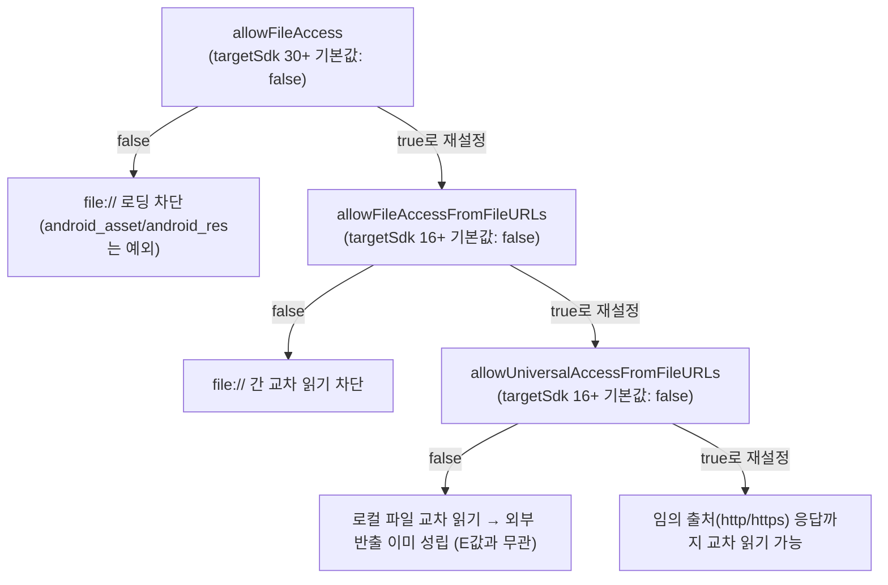
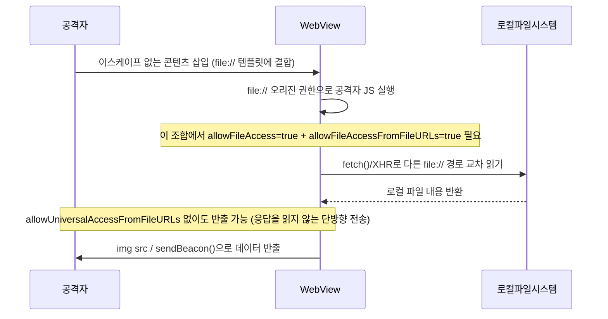

모바일 취약점 진단 시리즈의 첫 글입니다. WebView는 네이티브 앱 안에 끼워 넣는 "미니 브라우저"라서, 설정 하나(파일 접근 허용 범위, JS 브리지 노출, 디버깅 플래그)를 잘못 잡으면 일반 웹 취약점보다 피해 범위가 커집니다 — 브라우저라면 탭 하나가 털리지만, WebView는 그 자체로 **네이티브 앱의 권한과 로컬 파일 시스템**까지 이어지는 통로이기 때문입니다. 아래는 그 설정값과 실제로 악용 가능해지는 조건을 짚은 체크리스트입니다.

---

## 1. WebView 기본 위협 모델

**원리**: WebView는 OS가 제공하는 브라우저 엔진(안드로이드는 Chromium 기반, iOS는 WebKit)을 네이티브 앱 프로세스 안에 임베드한 컴포넌트입니다. 일반 브라우저와 다른 점은 주소창이 없다는 것 — 사용자는 지금 보이는 화면이 `https://실제도메인`인지 `file://`인지 구분할 방법이 없고, 그 판단은 전적으로 앱 코드가 떠안습니다.

그 결과 앱 개발자가 "내가 로드하는 콘텐츠는 내 서버 거니까 안전하다"고 가정하기 쉬운데, 실제로는 ① 서버 응답에 사용자 입력이 섞여 들어가는 콘텐츠(게시판, 프로필, 알림 상세), ② 광고 SDK·서드파티 분석 SDK가 끼워 넣는 콘텐츠, ③ 평문 HTTP로 받아와 MITM에 노출되는 콘텐츠, ④ 딥링크로 외부에서 주입된 URL까지 전부 같은 WebView 컨텍스트에서 로드되는 경우가 많습니다. 이 네 가지 중 하나라도 해당하면 "내 서버 콘텐츠"라는 신뢰 가정이 깨지고, 아래 2~8번 항목의 설정값이 실제 공격 표면으로 바뀝니다.

즉 WebView 자체는 취약점이 아니고, **신뢰 경계를 어디에 그었는지와 그 경계 안에 들어오는 콘텐츠가 실제로 통제 가능한지**가 핵심 질문입니다.

- 체크 포인트: 앱이 로드하는 URL 목록을 전부 나열하고(원격 도메인, `file://` 에셋, 서드파티 SDK WebView) 각각에 사용자 입력·광고 콘텐츠·외부 입력이 섞여 들어가는 경로가 있는지, 평문 HTTP로 받는 콘텐츠가 있는지 확인
- 참고: [OWASP MASTG — WebViews](https://mas.owasp.org/MASTG/0x05h-Testing-Platform-Interaction/), [OWASP MASVS](https://mas.owasp.org/MASVS/)

## 2. addJavascriptInterface / JS-네이티브 브리지 노출

**원리**: `webView.addJavascriptInterface(obj, "Bridge")`로 네이티브 객체를 바인딩하면, WebView가 로드한 JS가 `Bridge.메서드명()` 형태로 그 객체의 메서드를 직접 호출할 수 있습니다. API 17(Android 4.2, JELLY_BEAN_MR1) 이전에는 바인딩된 객체의 **모든 public 메서드**(상속받은 `getClass()` 포함)가 JS에서 리플렉션으로 호출 가능했고, 이 리플렉션 경로를 통해 바인딩 의도와 무관한 임의 Java 객체·메서드까지 건드릴 수 있어 원격 코드 실행급 공격이 다수 보고됐습니다.

이를 막기 위해 API 17부터 `@JavascriptInterface` 어노테이션이 붙은 메서드만 JS에 노출되도록 범위가 명시적으로 제한됐습니다. 단, 이 제한은 **앱의 targetSdkVersion이 17 이상이고 실행 기기가 Android 4.2 이상일 때만** 적용됩니다 — minSdkVersion을 낮게 잡아 구형 기기 호환을 유지하는 앱이라면 신/구 동작이 기기별로 갈릴 수 있습니다.

`@JavascriptInterface`로 범위를 제한했더라도, 노출된 메서드 자체가 파일 읽기/쓰기, 설정 변경, 토큰 발급처럼 민감한 기능이면 여전히 위험합니다 — **그 WebView가 신뢰 안 된 콘텐츠를 로드할 수 있는가**가 실제 악용 가능 여부를 가릅니다.

또한 `addJavascriptInterface`로 바인딩한 객체는 **최상위 프레임뿐 아니라 그 페이지 안의 모든 서브프레임(광고 iframe 등)에도 동일하게 주입**되고, 네이티브 코드는 호출한 프레임이 어느 출처인지 구분할 방법이 없습니다 — 메인 페이지만 신뢰 가능한지 보고 넘어가면 그 안에 끼워진 서드파티 iframe(광고 SDK 등)이 같은 브리지를 호출할 수 있다는 점을 놓치게 됩니다. JS를 전혀 신뢰할 수 없는 상태(원격 페이지, 광고 콘텐츠, MITM 가능한 HTTP)에서 바인딩된 브리지가 있다면, 공격자 JS가 그 메서드를 그대로 호출해 네이티브 기능을 대신 실행시킬 수 있습니다.

- 체크 포인트:
  - `addJavascriptInterface` 호출부를 찾아 바인딩된 객체와 `@JavascriptInterface` 메서드 목록을 확인
  - 그 WebView가 로드하는 콘텐츠 중 신뢰 안 된 입력(원격 페이지, 사용자 입력 포함 페이지, HTTP 평문)이 섞여 있는지
  - 노출된 메서드가 파일 접근·설정 변경·명령 실행처럼 민감한 동작을 수행하는지
  - `minSdkVersion`이 17 미만이라 구형 리플렉션 동작이 남은 기기가 있는지
- 참고: [Android Developers — JavascriptInterface](https://developer.android.com/reference/android/webkit/JavascriptInterface), [OWASP MASTG — Testing JavaScript Execution in WebViews](https://mas.owasp.org/MASTG/0x05h-Testing-Platform-Interaction/)

## 3. 파일 접근 설정값 심화 (핵심)

**원리**: `WebSettings`에는 파일 접근과 관련된 플래그 세 개가 있고, 각각 통제하는 범위가 다릅니다.

- `setAllowFileAccess(boolean)`: WebView가 애초에 `file://` URL을 로드할 수 있는지 여부입니다. 꺼도 `file:///android_asset/`, `file:///android_res/`는 항상 접근 가능합니다.
- `setAllowFileAccessFromFileURLs(boolean)`: `file://` 콘텐츠에서 실행 중인 JS가 **다른 `file://` URL**을 교차 출처로 읽어올 수 있는지 여부입니다.
- `setAllowUniversalAccessFromFileURLs(boolean)`: `file://` 콘텐츠에서 실행 중인 JS가 **임의의 출처(http/https 포함 전부)**를 교차 접근할 수 있는지 여부입니다. 세 개 중 가장 위험한 플래그입니다.

Android 공식 보안 가이드([developer.android.com/privacy-and-security/risks/webview-unsafe-file-inclusion](https://developer.android.com/privacy-and-security/risks/webview-unsafe-file-inclusion))에 명시된 현재 기본값은 다음과 같습니다: `setAllowFileAccess`는 **API 29 이하를 타겟하는 앱에서는 TRUE, API 30 이상을 타겟하는 앱에서는 FALSE**가 기본값이고, `setAllowFileAccessFromFileURLs`와 `setAllowUniversalAccessFromFileURLs`는 **API 16 이상을 타겟하는 앱에서는 FALSE**가 기본값이며 둘 다 API 30에서 사용 중단(deprecated) 표시가 붙었습니다. 즉 2026년 현재 유통되는 앱 대부분(targetSdkVersion이 Play 스토어 최소 요건에 맞춰 30 이상)은 이 세 플래그가 전부 꺼진 상태로 출발합니다 — "WebView는 기본적으로 로컬 파일을 전부 열어준다"는 과거 통념은 더 이상 사실이 아닙니다.

실제로 위험해지는 조건은 **개발자가 이 중 하나 이상을 명시적으로 `true`로 되돌린 경우**입니다. 핵심은 `allowFileAccess`(file:// 로딩 자체 허용)와 `allowFileAccessFromFileURLs`(다른 file:// 경로를 교차 출처로 읽기 허용)를 함께 켠 상태에서 WebView가 `file://` 콘텐츠를 로드하는 조합입니다 — 이렇게 되면 그 콘텐츠 안의 JS가 기기에 저장된 임의 파일(다른 앱이 공유 저장소에 둔 파일, 앱 자체 데이터 디렉터리 하위 파일 등 OS 수준 파일 권한이 허용하는 범위)을 `fetch()`나 `XMLHttpRequest`로 읽어올 수 있습니다.

읽어온 데이터를 공격자 서버로 **내보내는** 데는 `allowUniversalAccessFromFileURLs`가 추가로 필요하지 않습니다 — ``나 `navigator.sendBeacon()`처럼 응답을 읽지 않고 데이터만 실어 보내는 경로는 SOP가 원래 막지 않기 때문입니다. `allowUniversalAccessFromFileURLs`는 여기서 한 단계 더 나아가, file:// JS가 **임의의 http/https 응답 자체를 읽는 것**까지 허용하는 가장 넓은 플래그입니다.

즉 **로컬 파일 읽기 → 외부로 반출**까지는 `allowFileAccess` + `allowFileAccessFromFileURLs` 조합만으로 이미 성립하고, 이 체인이 실전에서 성립하려면 ① 해당 플래그들이 실제로 `true`로 재설정돼 있어야 하고, ② 그 `file://` 컨텍스트에 공격자가 자기 JS를 심을 방법(2·4·8번 항목과 결합)이 있어야 합니다.

- 체크 포인트:
  - 앱 코드에서 `setAllowFileAccess`, `setAllowFileAccessFromFileURLs`, `setAllowUniversalAccessFromFileURLs`를 명시적으로 `true`로 호출하는 곳이 있는지(기본값만으로는 대부분 꺼져 있음을 전제로 재설정 여부를 확인)
  - targetSdkVersion이 30 미만이라 레거시 기본값(`allowFileAccess=true`)이 그대로 적용되는지
  - `file://` 콘텐츠를 로드하면서 위 플래그가 켜진 조합이 있는지
- 참고: [Android Developers — WebView unsafe file inclusion](https://developer.android.com/privacy-and-security/risks/webview-unsafe-file-inclusion), [Android Developers — WebSettings](https://developer.android.com/reference/android/webkit/WebSettings), [OWASP MASTG — MASTG-BEST-0011 Securely Load File Content in a WebView](https://mas.owasp.org/MASTG/best-practices/MASTG-BEST-0011/)

## 4. file:// URL 로딩과 원격 콘텐츠 결합

**원리**: 많은 앱이 `file:///android_asset/template.html` 같은 로컬 HTML 템플릿을 띄운 뒤, 서버에서 받은 데이터(공지사항, 상품 설명, 사용자 프로필 등)를 `loadDataWithBaseURL`이나 JS 문자열 삽입(`javascript:renderContent('...')`)으로 그 템플릿 안에 끼워 넣는 방식을 씁니다. 이때 서버 데이터를 HTML/JS 컨텍스트에 맞게 이스케이프하지 않으면, 그 데이터에 섞인 XSS 페이로드가 **`file://` 오리진 권한을 가진 컨텍스트**에서 실행됩니다.

일반 웹 XSS는 피해자 사이트의 오리진 권한(그 사이트 쿠키, 그 사이트 API 호출)에 그치지만, `file://` 오리진에서 터지는 XSS는 3번 항목의 플래그 설정에 따라 **기기 로컬 파일 전체 접근권**까지 함께 쥐게 될 수 있고, 같은 WebView에 2번 항목의 JS 브리지가 바인딩돼 있다면 그 브리지까지 그대로 호출 가능한 컨텍스트에서 실행됩니다. 즉 이 자체는 새로운 취약점이 아니라 **"XSS가 어느 오리진에서 터지는가"에 따라 피해 범위가 증폭되는 체인**이며, 성립 조건은 ① 로컬 템플릿에 외부 데이터를 이스케이프 없이 삽입, ② 그 WebView가 file:// 콘텐츠를 로드 중, ③ 3번 플래그가 켜져 있거나 2번 브리지가 바인딩돼 있어야 증폭 효과가 발생합니다 (③이 없어도 기본 XSS 자체는 성립할 수 있습니다).

- 체크 포인트: 로컬 HTML 템플릿에 서버 응답·사용자 입력을 삽입하는 코드가 출력 인코딩 없이 문자열 결합(`loadUrl("javascript:...")`, 수동 HTML 조립)을 쓰는지, 그 템플릿이 로드되는 WebView에 3번 플래그나 2번 JS 브리지가 함께 걸려 있는지
- 참고: [OWASP MASTG — Testing JavaScript Execution in WebViews](https://mas.owasp.org/MASTG/0x05h-Testing-Platform-Interaction/), [Android Developers — WebView unsafe file inclusion](https://developer.android.com/privacy-and-security/risks/webview-unsafe-file-inclusion)

## 5. iOS WKWebView의 동등 설정

**원리**: WKWebView는 Android WebView의 세 플래그에 대응하는 **공개 API를 제공하지 않습니다**. `allowFileAccessFromFileURLs`(그리고 이와 비슷한 universal access 성격의 값)는 `WKWebViewConfiguration.preferences`에 KVC(`setValue(forKey:)`)로만 접근 가능한 **비공개(private, undocumented) 프로퍼티**이고, 공식 문서화된 API가 아니므로 쓰는 순간 비공개 API 사용이라는 리스크(심사 거절 가능성, 차기 OS에서 조용히 동작 변경 가능)를 같이 떠안습니다.

로컬 파일 로드는 보통 `loadFileURL(_:allowingReadAccessTo:)`로 처리하는데, 이 API는 Android의 전역 on/off 플래그와 달리 두 번째 인자로 **파일 또는 디렉터리 단위**로 읽기 허용 범위를 호출 시점마다 명시적으로 좁힙니다.

이것과는 별개로 `limitsNavigationsToAppBoundDomains`(iOS 14+)가 있는데, 이는 파일 접근 플래그가 아니라 **최상위 네비게이션을 특정 도메인 목록으로 제한하는 기능**입니다 — Info.plist에 `WKAppBoundDomains` 키로 허용 도메인을 등록한 뒤 이 값을 켜면, 목록 밖 도메인으로의 최상위 이동이 막히고 `evaluateJavaScript`·커스텀 스타일시트·`messageHandlers`·쿠키 조작 같은 강력한 API가 앱 바운드 도메인(로컬 파일·`data:`·앱이 직접 공급한 HTML 포함) 안에서만 동작합니다. 다만 서드파티 iframe까지 이 범위에서 배제되는 건 아니고, Info.plist에 `WKAppBoundDomains` 키 자체를 추가하지 않은 앱은 이 제약이 전혀 걸리지 않습니다 — "최신 iOS니까 자동으로 안전하다"가 아니라 **Info.plist에 명시적으로 opt-in해야 적용되는 기능**입니다.

WKWebView가 전반적으로 더 보수적인 이유는 ① 렌더링이 별도 프로세스(WebContent 프로세스)에서 돌아 네이티브 앱 메모리와 직접 격리되고, ② 파일 접근 API 자체가 전역 플래그가 아니라 호출마다 범위를 좁히는 구조이기 때문입니다.

- 체크 포인트:
  - `loadFileURL(_:allowingReadAccessTo:)` 호출 시 두 번째 인자로 넘긴 파일/디렉터리가 필요 이상으로 넓은 범위(앱 샌드박스 루트 전체 등)인지
  - `WKWebViewConfiguration.preferences`에 KVC로 비공개 파일 접근 키를 강제로 켜고 있는지
  - `WKAppBoundDomains`를 등록하고 `limitsNavigationsToAppBoundDomains = true`를 켰는지
- 참고: [Apple Developer — WKWebViewConfiguration](https://developer.apple.com/documentation/webkit/wkwebviewconfiguration), [WebKit Blog — App-Bound Domains](https://webkit.org/blog/10882/app-bound-domains/), [OWASP MASTG — iOS WebViews](https://mas.owasp.org/MASTG/tests/ios/MASVS-PLATFORM/MASTG-TEST-0077/)

## 6. 원격 디버깅 노출

**원리**: `WebView.setWebContentsDebuggingEnabled(true)`를 호출하면 그 앱의 모든 WebView 인스턴스가 Chrome DevTools 원격 디버깅 대상이 됩니다. 기본값은 꺼짐이고, 이 플래그는 앱의 `android:debuggable` 매니페스트 값과 **독립적**입니다 — 즉 릴리스 빌드(`debuggable=false`)라도 코드에서 이 호출을 조건 없이 남겨 두면 그대로 활성화된 채 배포됩니다.

공격 조건은 ① 이 플래그가 켜진 상태로 배포, ② 공격자가 USB(또는 이미 활성화된 네트워크 ADB)로 기기에 연결 가능하고 기기가 그 연결을 승인한 상태여야 합니다. 조건이 맞으면 공격자는 PC의 `chrome://inspect`에서 해당 WebView의 DOM, 실행 중인 JS 콘솔, 네트워크 요청/응답(쿠키, 인증 토큰 포함)을 실시간으로 들여다보고 임의 JS를 주입해 실행할 수 있습니다. USB 물리 접근이나 ADB 권한이 전제이므로 원격 인터넷 공격보다는 공유 기기·분실/탈취 기기·악성 충전 스테이션(USB 데이터 라인 경유) 같은 시나리오에서 위협이 커집니다.

- 체크 포인트: 릴리스 빌드 바이너리에서 `setWebContentsDebuggingEnabled(true)` 호출이 `BuildConfig.DEBUG` 등 빌드 타입 조건 없이 남아 있는지, 실제 릴리스 APK를 기기에 설치한 뒤 `chrome://inspect`에 노출되는지 직접 확인
- 참고: [Android Developers — Debug using Chrome DevTools](https://developer.android.com/develop/ui/views/layout/webapps/debug-chrome-devtools), [Chrome Developers — Remote debugging WebViews](https://developer.chrome.com/docs/devtools/remote-debugging/webviews)

## 7. SSL/인증서 검증 우회 핸들러

**원리**: `WebViewClient.onReceivedSslError(view, handler, error)`는 TLS 핸드셰이크 중 **복구 가능한(recoverable) 인증서 오류**(만료, 자체 서명, 호스트명 불일치, 신뢰 안 된 CA 등)가 났을 때만 호출되는 콜백이고, 기본 구현은 `handler.cancel()`로 로드를 중단합니다. 위험은 앱이 이 메서드를 **오버라이드하면서 조건 없이 `handler.proceed()`를 호출**하도록 구현했을 때 생깁니다 — 보통 개발 단계에서 사내망 자체 서명 인증서 때문에 생기는 오류를 빠르게 넘기려고 넣었다가 릴리스에 그대로 남는 패턴입니다.

이 경우 이 콜백이 발생하는 범위, 즉 **그 WebView가 겪는 인증서 체인 검증이 무력화**되어 어떤 인증서를 들이밀어도 통과합니다. Android 공식 문서는 `error.getPrimaryError()` 값을 보고 특정 오류만 골라 허용하는 식의 "조건부 proceed"도 권장하지 않고, **항상 `cancel()`을 호출**하라고 명시합니다.

공격 조건은 공격자가 네트워크 경로를 가로챌 수 있는 위치(동일 공용 Wi-Fi, 악성 AP, ARP 스푸핑, 침해된 라우터)에 있어야 하며, 그 경로에서 TLS 종단을 가로채 인증서를 들이밀면 해당 WebView 트래픽(로그인 요청, 세션 토큰, API 응답)을 평문으로 열람·조작할 수 있습니다.

- 체크 포인트: `onReceivedSslError`를 오버라이드하는 코드를 찾아 오류 종류를 가려서든 무조건으로든 `proceed()`를 호출하는 경로가 있는지(공식 권장은 예외 없이 `cancel()`), 특정 빌드 플레이버에서만 우회하도록 돼 있다면 릴리스 빌드에 실수로 포함되지 않았는지
- 참고: [Android Developers — WebViewClient.onReceivedSslError](https://developer.android.com/reference/android/webkit/WebViewClient#onReceivedSslError(android.webkit.WebView,%20android.webkit.SslErrorHandler,%20android.net.http.SslError)), [OWASP MASTG — Testing Endpoint Identify Verification](https://mas.owasp.org/MASTG/tests/android/MASVS-NETWORK/MASTG-TEST-0284/)

## 8. 딥링크/URL 스킴과 WebView 결합

**원리**: 하이브리드 앱은 흔히 커스텀 URL 스킴(`myapp://`)이나 Android App Links/iOS Universal Links로 외부(메신저 링크, 푸시 알림, QR코드, 다른 앱)에서 전달받은 값을 받아 특정 화면을 띄우는데, 그 값 안에 담긴 URL을 검증 없이 그대로 `webView.loadUrl(url)`에 넘기는 구현이 흔합니다. 이 활동(Activity)이 `intent-filter`로 외부에 노출(exported)돼 있고 전달받은 URL의 스킴·호스트를 허용 목록으로 제한하지 않으면, 공격자는 피싱 사이트로 이어지는 딥링크를 메신저·SNS로 배포해 그 앱의 WebView 컨텍스트에서 피싱 페이지를 열게 만들 수 있습니다.

더 심각한 체인은 전달값이 `file://` 경로나 `javascript:` 스킴까지 허용하는 경우입니다 — 이땐 2번(JS 브리지)이나 3번(파일 접근 플래그가 켜진 `file://` 콘텍스트)과 결합해, 공격자가 외부에서 보낸 링크 하나로 피싱을 넘어 네이티브 브리지 호출이나 로컬 파일 접근까지 열어줄 수 있습니다. 성립 조건은 ① 딥링크 핸들러가 전달 URL의 스킴/호스트를 검증하지 않고, ② 그 값이 WebView의 `loadUrl`/`loadData` 계열로 바로 전달되며, ③ (심화 단계는) 2·3번 취약점이 같은 WebView 인스턴스에 함께 존재해야 합니다.

- 체크 포인트:
  - 딥링크/Intent로 전달받은 URL 문자열이 `loadUrl`에 바로 들어가기 전에 허용 스킴(`https`만)·허용 호스트 화이트리스트 검증을 거치는지
  - `shouldOverrideUrlLoading`에서 네비게이션마다 같은 검증을 반복하는지
  - `file://`나 `javascript:` 스킴이 전달값으로 허용되는지
- 참고: [Android Developers — Verify Android App Links](https://developer.android.com/training/app-links/verify-android-app-links), [OWASP MASTG — Testing Deep Links](https://mas.owasp.org/MASTG/tests/android/MASVS-PLATFORM/MASTG-TEST-0014/)

---

## 정리

| 항목 | 핵심 질문 | 핵심 방어 |
|---|---|---|
| JS 브리지 | 신뢰 안 된 콘텐츠를 로드하는 WebView에 민감 기능이 바인딩됐는가? | 신뢰 콘텐츠에만 바인딩, `@JavascriptInterface` 범위 최소화 |
| 파일 접근 플래그 | `allowFileAccess`/`FromFileURLs`/`UniversalAccessFromFileURLs`를 명시적으로 켰는가? | 기본값(꺼짐) 유지, 필요하면 `WebViewAssetLoader` 사용 |
| file:// + 원격 데이터 | 로컬 템플릿에 외부 데이터를 이스케이프 없이 삽입하는가? | 출력 인코딩, `file://` 콘텍스트에 파일 전체 접근권 주지 않기 |
| iOS 동등 설정 | `loadFileURL` 허용 범위가 필요 이상으로 넓은가? | 최소 디렉터리만 허용, `WKAppBoundDomains` 등록 |
| 원격 디버깅 | 릴리스 빌드에 디버깅 플래그가 남았는가? | 빌드 타입 조건부로만 활성화 |
| SSL 우회 | `onReceivedSslError`가 무조건 `proceed()`인가? | 기본 `cancel()` 유지, 검증 로직 없이 우회 금지 |
| 딥링크 결합 | 외부 URL을 검증 없이 WebView에 로드하는가? | 스킴/호스트 화이트리스트, 네비게이션마다 재검증 |

더 깊이 보려면 [OWASP MASTG — Android Platform APIs](https://mas.owasp.org/MASTG/0x05h-Testing-Platform-Interaction/)와 [OWASP MASVS](https://mas.owasp.org/MASVS/)를 참고하세요. 이 시리즈는 계속 이어집니다.
