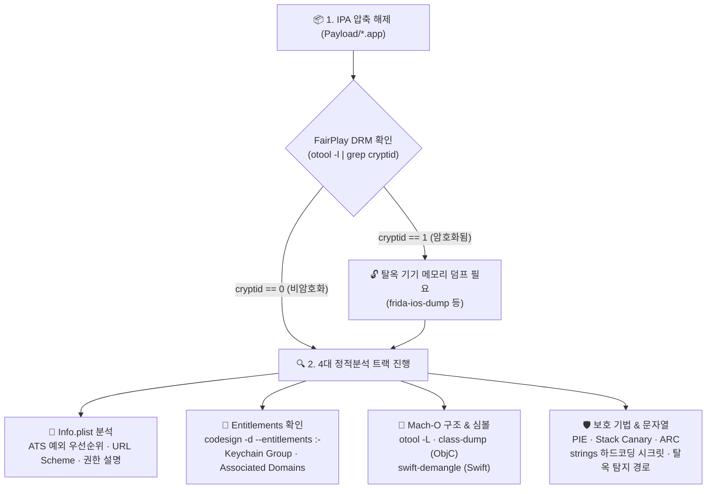
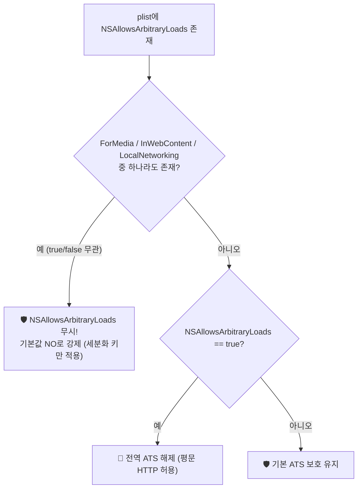

> [!summary] ⏱️ 5초 핵심 요약
> - **한 줄 비유**: iOS 정적분석은 금고(앱)를 실제로 작동시키기 전에 **외부 포장지(`IPA`)를 뜯어 사용 설명서(`Info.plist`)와 권한 증명서(`Entitlements`), 금속 외벽의 재질(`Mach-O` 헤더·심볼)을 투시해 약점을 먼저 표시해 두는 작업**입니다.
> - **핵심 원리**: 탈옥 기기나 앱 실행 없이도 **`IPA 압축 해제 및 FairPlay 암호화(cryptid) 확인` → `Info.plist(ATS 우선순위·URL Scheme)` → `Entitlements(Keychain/App Group/Associated Domains)` → `Mach-O 심볼·문자열·보호기법(PIE/Canary/ARC)`** 순서로 공격 표면을 도출합니다.
> - **핵심 주의사항**: `NSAllowsArbitraryLoads`는 세분화 키(`ForMedia`/`InWebContent`/`LocalNetworking`)가 하나라도 있으면 무시되어 `NO`로 동작하며, 정적분석에서 찾은 단서는 모두 동적 분석에서 검증할 가설 목록으로 다뤄야 합니다.

iOS 앱 진단의 첫 단계는 앱을 실행하기 전에 **IPA 파일 자체에서 뽑아낼 수 있는 정보**를 먼저 훑는 것입니다. 탈옥(jailbreak)된 기기가 없어도, 앱을 설치하지 않아도 할 수 있는 작업이 대부분이라 동적 분석 전에 공격 표면과 우선순위를 잡는 용도로 씁니다. 이 글은 정적분석까지만 다루고, 키체인에 실제로 뭐가 저장되는지·런타임에서 SSL 피닝이 어떻게 걸리는지 같은 동적 영역은 이후 글에서 다룹니다.

---

## 한눈에 보는 iOS 정적분석 핵심 명령어 요약표

| 점검 항목 | 대상 파일 / 영역 | 핵심 실행 명령어 | 주요 확인 포인트 |
|---|---|---|---|
| **DRM 암호화 여부** | Mach-O 실행 파일 | `otool -l <바이너리> \| grep -A4 LC_ENCRYPTION` | `cryptid 1`이면 암호화 상태(메모리 복호화 덤프 필요), `0`이면 즉시 분석 가능 |
| **서명 및 엔타이틀먼트** | 앱 번들 (`*.app`) | `codesign -d --entitlements :- <앱경로>` | `keychain-access-groups`, `application-groups`, `associated-domains` 선언 범위 |
| **동적 라이브러리 및 헤더** | Mach-O 실행 파일 | `otool -L <바이너리>` / `otool -hv <바이너리>` | 링크된 서드파티·디버그 프레임워크 목록 및 메인 바이너리 `PIE` 플래그 확인 |
| **클래스·심볼 추출** | Mach-O 실행 파일 | `class-dump -H <바이너리> -o out` / `nm <바이너리>` | ObjC 클래스·메서드 복원, `_stack_chk_guard`(Canary), `_objc_retain`(ARC) 확인 |
| **평문 문자열 탐색** | 바이너리 및 `Info.plist` | `strings <바이너리> \| grep -iE "key\|secret\|token"` | 하드코딩된 API 키·URL 및 고전/루트리스(`/var/jb`) 탈옥 탐지 문자열 |

---

## 1. IPA 구조와 추출

**💡 한 줄 비유**: `IPA` 파일은 겉에 사과 스티커만 붙어 있을 뿐 속은 평범한 **지퍼백(`ZIP`)**입니다. 다만 App Store에서 막 꺼낸 지퍼백 안의 핵심 부품(`Mach-O` 실행 파일)은 **특수 자물쇠(FairPlay DRM)**로 잠겨 있어, 열쇠로 한 번 풀어야(`cryptid 0`) 내부 설계도가 보입니다.

### 핵심 원리
- **ZIP 구조**: 웹 취약점 글에서 DOCX/XLSX가 사실 "ZIP 안에 XML"이라 XXE 공격면이 된다고 다룬 것처럼, IPA도 확장자만 바뀐 ZIP 압축 파일입니다.
- **`Payload/앱이름.app/` 내부 핵심 구성요소**:
  - **Mach-O 바이너리**: 실행 파일 본체입니다. `.app` 디렉터리 이름과 실제 실행 파일명이 다를 수 있으므로 `Info.plist`의 **`CFBundleExecutable`** 값으로 정확한 파일명을 확인합니다.
  - **`Info.plist`**: 앱 설정과 권한·네트워크·스킴 메타데이터가 담긴 파일입니다.
  - **`_CodeSignature/` 및 `embedded.mobileprovision`**: 서명 정보와 프로비저닝 프로파일입니다. 단, `embedded.mobileprovision`은 Ad Hoc·엔터프라이즈·개발용 배포에는 들어 있지만 **App Store 배포본에는 빠져 있는 경우가 많아** 모든 IPA에 항상 있는 파일은 아닙니다.
  - **`Frameworks/*.framework` 및 `PlugIns/*.appex`**: 앱에 포함된 프레임워크와 앱 익스텐션으로, 각각 별도의 Mach-O 바이너리로 분석해야 합니다.
- **FairPlay DRM 암호화(`cryptid`) 확인**:
  - App Store 배포본은 바이너리 자체가 FairPlay DRM으로 암호화돼 있는 경우가 많습니다. `otool -l`로 본 `LC_ENCRYPTION_INFO`(64비트는 `LC_ENCRYPTION_INFO_64`) 로드 커맨드의 **`cryptid`가 `1`**이면 암호화된 상태이므로 탈옥 기기에서 `frida-ios-dump` 등으로 메모리 복호화 덤프를 떠야 분석할 수 있습니다.
  - TestFlight·Ad Hoc·엔터프라이즈 배포나 개발자가 직접 빌드한 IPA는 `cryptid`가 `0`(또는 암호화 미적용)이어서 바로 분석할 수 있습니다.

### 체크 포인트
- `Payload/*.app` 안에 들어있는 바이너리가 `LC_ENCRYPTION_INFO`/`LC_ENCRYPTION_INFO_64`로 암호화돼 있는지(`otool -l <바이너리> | grep -A4 LC_ENCRYPTION`) 확인한다.
- 앱 번들 안에 다른 프레임워크(`Frameworks/*.framework`)나 앱 익스텐션(`PlugIns/*.appex`)이 같이 들어있어 각각 별도 바이너리로 분석해야 하는지 확인한다.
- 참고: [Apple — Bundle Structure](https://developer.apple.com/library/archive/documentation/CoreFoundation/Conceptual/CFBundles/BundleTypes/BundleTypes.html), [OWASP MASTG — Automated Static Analysis](https://mas.owasp.org/MASTG/techniques/ios/MASTG-TECH-0078/)

---

## 2. Info.plist 분석

**💡 한 줄 비유**: `Info.plist`는 건물의 **출입문 목록(`CFBundleURLTypes`)**, **방탄유리 시공 규정(`NSAppTransportSecurity`)**, **입주자가 관리실에 신청한 특수 장비 목록(`NS*UsageDescription`)**이 적힌 건물 관리 대장입니다.

### 핵심 원리
`Info.plist`는 선언적 설정 파일이라 바이너리를 디스어셈블하지 않고도 핵심 공격 표면을 파악할 수 있습니다.

1. **커스텀 URL Scheme (`CFBundleURLTypes`)**
   - 다른 앱이나 브라우저가 호출할 수 있는 진입점(예: `myapp://`)입니다. 어떤 scheme이 등록되어 있는지, 그 핸들러가 전달받은 파라미터를 검증 없이 쓰는지가 1차 체크 대상입니다.
2. **네트워크 보안 설정 (`NSAppTransportSecurity`, ATS)**
   - **기본 보호**: iOS 9 SDK 이상으로 빌드된 앱은 별도 설정이 없으면 **HTTPS 강제 + TLS 1.2 이상 + 순방향 비밀성(Forward Secrecy) 요구**가 기본 적용됩니다.
   - **ATS의 적용 경계 주의**: ATS는 `URLSession`/`NSURLConnection` 등 **URL Loading System을 거치는 요청에만 적용**됩니다. 앱이 `Network.framework`의 저수준 API나 BSD 소켓으로 직접 TCP 연결을 맺으면 이 보호를 그대로 우회하므로, ATS 설정만 보고 평문 통신이 없다고 단정하면 안 됩니다.
   - **ATS 완화 키별 동작과 우선순위 함정**:
     - `NSAllowsArbitraryLoads: true`: 앱 전역에서 ATS를 끕니다. **단, `NSAllowsArbitraryLoadsForMedia` / `NSAllowsArbitraryLoadsInWebContent` / `NSAllowsLocalNetworking` 중 하나라도 plist에 존재하면 그 값(`true`/`false` 무관)과 상관없이 `NSAllowsArbitraryLoads` 자체가 무시되고 기본값 `NO`로 처리됩니다.** 세 세분화 키가 하나도 없을 때만 전역 해제가 먹힙니다. Also, App Store 심사 시 사유 소명을 요구하므로 정당한 사유(서드파티 SDK 호환, 내부망 전용 등)가 있는지 함께 평가해야 합니다.
     - `NSAllowsArbitraryLoadsInWebContent: true`: `WKWebView`로 불러오는 웹 콘텐츠에만 평문 HTTP를 허용하고, 앱이 직접 만드는 `URLSession` 요청에는 영향이 없습니다.
     - `NSExceptionDomains`: 특정 도메인에만 독립적인 예외(`NSExceptionAllowsInsecureHTTPLoads: true`)를 겁니다. 서브도메인까지 포함하려면 `NSIncludesSubdomains: true`를 따로 지정해야 하며, `*.example.com` 같은 와일드카드 표기는 지원되지 않습니다.
     - `NSExceptionMinimumTLSVersion`: 도메인별 최소 TLS 버전을 낮추는 예외 키지만, Apple이 플랫폼 차원에서 구형 TLS 지원을 좁혀 왔으므로 키 존재만으로 단정하지 말고 실제 기기에서 낮은 버전 핸드셰이크가 성사되는지 직접 확인해야 합니다.
3. **권한 요청 설명 (`NSxxxUsageDescription`) 및 기타 키**
   - `NSCameraUsageDescription`, `NSLocationWhenInUseUsageDescription`, `NSContactsUsageDescription` 등으로 앱이 요청할 수 있는 민감 권한 후보를 추정합니다. 단, 미사용 서드파티 SDK가 끼워 넣었을 수도 있으므로 실제 호출 여부는 바이너리에서 확인해야 합니다(반대로 이 문자열 없이 보호 자원에 접근하면 iOS가 접근을 거부하고 앱을 종료시킵니다).
   - `ITSAppUsesNonExemptEncryption` 키는 암호화 수출 신고용 규제 준수 메타데이터이므로 보안 취약점이 아닌 참고 수준으로만 다룹니다.

### 체크 포인트
- `NSAllowsArbitraryLoads`가 켜져 있을 때 `ForMedia`/`InWebContent`/`LocalNetworking` 키가 함께 존재해 실제로는 무시되고 있는 건 아닌지 확인한다.
- `NSExceptionDomains`에 `NSIncludesSubdomains`로 서브도메인까지 넓힌 예외나 과도한 평문 허용이 걸려 있는지 확인한다.
- `CFBundleURLTypes`에 등록된 scheme이 입력값 검증 없이 딥링크 파라미터를 처리하는지 확인한다.
- `NSxxxUsageDescription` 목록이 앱의 실제 기능 범위를 벗어나는지, 그리고 URL Loading System을 우회하는 저수준 네트워킹 API를 쓰는지 확인한다.
- 참고: [Apple — NSAllowsArbitraryLoads](https://developer.apple.com/documentation/bundleresources/information-property-list/nsapptransportsecurity/nsallowsarbitraryloads), [Apple — Preventing Insecure Network Connections](https://developer.apple.com/documentation/security/preventing-insecure-network-connections), [Apple — Requesting Access to Protected Resources](https://developer.apple.com/documentation/uikit/requesting-access-to-protected-resources), [OWASP MASTG — ATS Configurations Allowing Cleartext Traffic](https://mas.owasp.org/MASTG/tests/ios/MASVS-NETWORK/MASTG-TEST-0322/)

---

## 3. 바이너리 정보 추출 (Objective-C vs Swift)

**💡 한 줄 비유**: **Objective-C**는 사무실 문마다 부서명과 담당자 이름표(`__objc_methname`)를 그대로 붙여 놓아 밖에서도 조직도를 쉽게 그릴 수 있지만(`class-dump`), **Swift**는 이름표를 암호 같은 약어(Name Mangling)로 바꾸고 직통 내선 번호(정적 디스패치/vtable)로만 연락해 조직도를 복원하기 훨씬 까다롭습니다.

### 핵심 원리
- **Objective-C 메타데이터**: 런타임 메시지 디스패치(`objc_msgSend`)를 위해 `__DATA.__objc_classlist`, `__TEXT.__objc_methname` 섹션에 클래스명·메서드 시그니처·프로퍼티명이 평문으로 남습니다. `class-dump`류 도구로 헤더 형태 복원이 가능합니다.
- **Swift 바이너리의 특성**: 동적 디스패치 대신 정적 호출이나 vtable을 주로 쓰고 이름이 네임 맹글링(name mangling)됩니다. `NSObject`를 상속하더라도 `@objc`로 노출된 멤버만 `class-dump`에 보이며, 순수 Swift 타입(구조체, enum, `@objc` 미노출 클래스)은 `swift-demangle`로 이름만 풀 수 있을 뿐 시그니처 복원을 위해선 Hopper/Ghidra/IDA 같은 디스어셈블러가 필요합니다.
- **라이브러리 및 심볼 확인**: `otool -L`은 링크된 동적 라이브러리/프레임워크 목록을, `nm`은 심볼 테이블을 보여줍니다.

### 체크 포인트
- `otool -L <바이너리>`로 링크된 프레임워크 목록에 디버그용 로깅 라이브러리가 남아있는지 확인한다(SDK 버전은 실제 바이너리 버전 분석으로 추가 확인).
- `class-dump -H <바이너리> -o 출력폴더`로 뽑은 헤더에 민감한 클래스명(`APIKeyManager`, `DebugLogin` 등)이 있는지 확인한다.
- 바이너리가 순수 Swift라 `@objc` 노출 심볼 외에는 `class-dump` 결과가 비어 있는지 확인하고 디스어셈블러 분석으로 전환한다.
- 참고: [OWASP MASTG — class-dump](https://mas.owasp.org/MASTG/tools/ios/MASTG-TOOL-0043), [OWASP MASTG — Reviewing Disassembled Objective-C and Swift Code](https://mas.owasp.org/MASTG/techniques/ios/MASTG-TECH-0076), [class-dump (GitHub)](https://github.com/nygard/class-dump)

---

## 4. 바이너리 보호 기법 확인 (PIE · Stack Canary · ARC)

**💡 한 줄 비유**: 바이너리 보호 기법은 금고 자체가 뚫렸을 때를 대비한 **보조 방호벽**입니다. **PIE**는 금고 위치를 매번 바꾸는 장치(ASLR 전제), **Stack Canary**는 복도에 세워둔 경보용 철사줄, **ARC**는 다 쓴 문서를 자동으로 파쇄하는 규칙입니다.

### 3대 바이너리 보호 기법 비교 및 판정 주의사항

| 보호 기법 | 확인 명령어 / 심볼 | 핵심 원리 | 실무 판정 시 흔히 하는 오해와 주의점 |
|---|---|---|---|
| **PIE (Position Independent Executable)** | `otool -hv <메인바이너리>` (`PIE` 플래그 확인) | 매 실행마다 다른 메모리 주소에 로드되어 ASLR이 동작하게 함 | 확인 대상은 **앱의 메인 실행 파일**만 해당. `.framework`/`.dylib`는 원래 위치 독립 공유 라이브러리(PIC)이므로 `MH_PIE` 플래그가 없는 것이 정상 |
| **Stack Canary** | `nm <바이너리> \| grep stack_chk` 또는 `otool -Iv` (`___stack_chk_guard`, `___stack_chk_fail`) | 함수 리턴 전 스택 변조를 검사해 스택 버퍼 오버플로우 난이도 상승 | clang이 지역 버퍼가 있는 취약 후보 함수에만 삽입함. **순수 Swift 코드**는 언어 차원에서 배열 경계·타입 안전성을 강제하므로 Canary 유무보다 `UnsafePointer` / C 브릿징 사용 여부를 보는 것이 더 중요 |
| **ARC (Automatic Reference Counting)** | `nm` / `otool -Iv` (`_objc_retain`, `_objc_release` 등) | 컴파일 타임에 retain/release를 삽입해 Objective-C 객체 수명 관리 | `_objc_retain`은 **Objective-C 코드**의 정황 증거일 뿐, C/C++ 직접 관리 메모리까지 보장하지 않으며 **Swift는 자체 `swift_retain`/`swift_release`를 사용**하므로 ObjC 심볼 부재로 ARC 미적용을 단정하면 안 됨 |

*(참고: 세 가지 모두 유무 자체가 독립 취약점이 아니라, 다른 메모리 손상 취약점 발견 시 익스플로잇 난이도를 가늠하는 보조 지표입니다.)*

### 체크 포인트
- 메인 실행 파일의 `otool -hv` 출력에 `PIE` 플래그가 있는지 확인한다(프레임워크/dylib는 제외).
- Objective-C/C/C++ 비중이 큰 바이너리라면 `nm`/`otool -Iv` 출력에 `_stack_chk_fail`/`_stack_chk_guard` 심볼이 있는지 확인한다.
- `_objc_retain`/`_objc_autorelease` 또는 `swift_retain` 계열 심볼과 C/C++ 서드파티 라이브러리의 보호 기법 누락 여부를 함께 확인한다.
- 참고: [OWASP MASTG — Binary Protection Mechanisms](https://mas.owasp.org/MASTG/knowledge/ios/MASVS-CODE/MASTG-KNOW-0061/), [OWASP MASTG — Obtaining Compiler-Provided Security Features](https://mas.owasp.org/MASTG/techniques/ios/MASTG-TECH-0118/), [Apple — Transitioning to ARC](https://developer.apple.com/library/archive/releasenotes/ObjectiveC/RN-TransitioningToARC/Introduction/Introduction.html)

---

## 5. 키체인/엔타이틀먼트 미리보기

**💡 한 줄 비유**: `Entitlements`는 Apple이라는 건물주가 앱에 서명해 발급한 **특수 권한 증명서(공유 창고 출입권, 공식 도메인 위임장)**입니다. 정적분석에서는 "어떤 권한을 신청했는가"를 보고, 실제 창고에 무엇이 들었는지는 동적 포렌식에서 확인합니다.

### 핵심 원리
`codesign -d --entitlements :- <앱 경로>`를 실행하면 앱에 서명된 entitlement plist가 출력됩니다.

- **`keychain-access-groups`**: 이 그룹에 속한 앱들이 키체인 항목을 공유할 수 있는 **자격을 선언**한 것입니다. 선언 자체만으로 공유 항목이 존재한다는 뜻은 아니며, 같은 그룹을 선언하고 서명·프로비저닝 조건이 맞는 다른 앱이 실제로 설치돼 있어야 공유가 성립합니다.
- **`com.apple.security.application-groups`**: 메인 앱과 앱 익스텐션(`PlugIns/*.appex`) 등이 파일·`UserDefaults`를 공유하는 컨테이너 그룹입니다.
- **`aps-environment`**: 푸시 알림 사용 여부와 환경(`development` / `production`)을 나타냅니다.
- **`com.apple.developer.associated-domains`**: Universal Links로 연결을 위임받을 도메인 목록(예: `applinks:example.com`)입니다. URL scheme과 달리 도메인의 `.well-known/apple-app-site-association`(AASA) 파일이 이 앱의 번들 ID를 실제로 허용하는지 상호 검증해야 합니다.
- *(주의: `UIBackgroundModes`는 entitlement가 아니라 `Info.plist`의 일반 키입니다.)*

### 체크 포인트
- `keychain-access-groups`에 선언된 그룹이 다른(특히 서드파티 벤더) 앱과 겹치는지, 실제 공유가 성립하는 조합인지 확인한다.
- `com.apple.security.application-groups`로 공유 컨테이너를 쓰는 익스텐션이 있는지 확인한다.
- `associated-domains`에 등록된 도메인을 앱이 실제로 통제하며 해당 도메인의 AASA 파일이 이 앱의 번들 ID를 포함하는지 확인한다.
- 참고: [Apple — Entitlements Reference](https://developer.apple.com/documentation/bundleresources/entitlements), [Apple — Supporting Associated Domains](https://developer.apple.com/documentation/xcode/supporting-associated-domains), [Apple — UIBackgroundModes](https://developer.apple.com/documentation/bundleresources/information-property-list/uibackgroundmodes)

---

## 6. 하드코딩 시크릿

**💡 한 줄 비유**: 소스 코드에 적은 비밀번호나 API 키는 컴파일이라는 압축 프레스를 거쳐도 사라지지 않고, 바이너리 단면(`__TEXT.__cstring` 등)에 **선명한 활자 그대로 찍혀 남습니다**.

### 핵심 원리
- `strings <바이너리>`는 Mach-O의 문자열 섹션(`__TEXT.__cstring` 등)뿐 아니라 Swift 메타데이터 섹션(`__TEXT.__swift5_*`)까지 바이너리 전체에서 연속된 문자 시퀀스를 뽑아냅니다.
- 별도의 암호화·난독화 처리를 하지 않은 문자열 리터럴(API 키, 내부 URL, OAuth `client_secret`, 디버그 계정)과 `Info.plist`의 커스텀 키 값은 평문 그대로 노출됩니다.
- 오탐을 줄이기 위해 문자열 주변 컨텍스트(변수명·클래스명 결합 여부)와 고엔트로피 패턴(Base64/hex)을 함께 확인합니다.

### 체크 포인트
- `strings <바이너리> | grep -iE "key|secret|token|api|password"`로 1차 스크리닝 후 실제 유효한 자격증명인지 확인한다.
- `Info.plist`의 커스텀 키 값과 바이너리 내 고엔트로피 문자열(Base64/hex 패턴)이 하드코딩돼 있는지 확인한다.
- 참고: [OWASP MASTG — Retrieving Strings](https://mas.owasp.org/MASTG/techniques/ios/MASTG-TECH-0071), [OWASP MASTG — Testing Local Data Storage](https://mas.owasp.org/MASTG/tests/ios/MASVS-STORAGE/MASTG-TEST-0052)

---

## 7. 탈옥(jailbreak) 탐지 로직 확인

**💡 한 줄 비유**: 동적 분석에서 센서를 끄려면, 먼저 정적 분석에서 **금고 안 어디에 어떤 종류의 센서(고전 `/Applications/Cydia.app`부터 최신 루트리스 `/var/jb`까지)가 몇 개나 설치되어 있는지 도면에서 찾아 표시**해야 합니다.

### 대표적인 5가지 탈옥 탐지 패턴과 최신 트렌드
1. **파일/디렉터리 경로 확인(`stat`/`fopen`)**:
   - **고전(루트 파일시스템 쓰기 가능) 탈옥**: `/Applications/Cydia.app`, `/Library/MobileSubstrate/MobileSubstrate.dylib`, `/bin/bash`, `/usr/sbin/sshd`, `/etc/apt` 등
   - **최신 루트리스(rootless) 탈옥**: `/var/jb/` 하위 격리 경로 및 `Sileo` 패키지 매니저 관련 경로까지 반영하고 있는지 함께 확인해야 합니다.
2. **샌드박스 외부 쓰기 시도**: `/private/` 아래에 테스트 파일을 써보고 성공 여부로 샌드박스 해제를 판별합니다.
3. **`fork()` 호출 성공 여부**: 정상 iOS 앱 샌드박스는 `fork()`를 거부하지만, 일부 탈옥 환경에서는 제약이 풀려 성공하는 점을 이용합니다.
4. **동적 라이브러리 목록 순회**: `dyld` 이미지 목록에 인젝션된 라이브러리가 있는지 검사합니다.
5. **URL Scheme 확인**: `cydia://` 등의 커스텀 스킴이 열리는지 확인합니다.

*(참고: 정적분석에서 탐지 로직의 존재와 위치를 찾았다고 자동으로 우회되는 것은 아니며, 단일 판정 함수에 모여 있는지 여러 곳에 분산·난독화되어 있는지에 따라 [[모바일 취약점 진단 — Frida 동적분석과 네트워크]]에서 후킹 전략을 세웁니다.)*

### 체크 포인트
- `strings` 결과에 `Cydia`, `MobileSubstrate`, `/var/jb` 같은 고전·루트리스 탈옥 관련 문자열이 모두 있는지 확인한다.
- `class-dump` 결과에 `isJailbroken`, `JailbreakDetector` 류의 클래스/메서드 이름이 있는지 확인한다.
- 탐지 로직이 한 곳에 모여 있는지 아니면 여러 지점에 분산돼 있는지(동적 후킹 난이도에 영향) 파악한다.
- 참고: [OWASP MASTG — Jailbreak Detection](https://mas.owasp.org/MASTG/knowledge/ios/MASVS-RESILIENCE/MASTG-KNOW-0084/), [OWASP MASTG — Bypassing Jailbreak Detection](https://mas.owasp.org/MASTG/techniques/ios/MASTG-TECH-0152/), [OWASP MASVS](https://mas.owasp.org/MASVS/)

---

정적분석은 "코드를 실행하지 않고 얼마나 알아낼 수 있는가"의 영역이라, 여기서 잡은 ATS 예외·과도한 entitlement·하드코딩 시크릿·탈옥 탐지 지점은 다음 단계인 동적 분석([[모바일 취약점 진단 — Frida 동적분석과 네트워크]], [[모바일 취약점 진단 — 로컬 저장소 포렌식]])에서 검증할 가설 목록이 됩니다.
