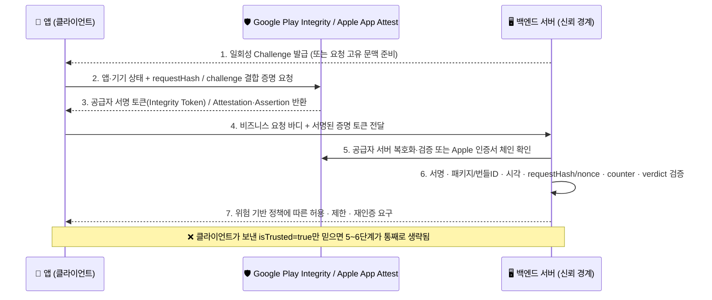

> [!summary] ⏱️ 5초 핵심 요약
> - **한 줄 비유**: 앱이 스스로 루팅 여부를 검사해 서버에 `isRooted: false`를 보내는 것은 **수험생이 자기 시험지에 직접 '부정행위 없음' 도장을 찍어 내는 것**이고, **Device Attestation(Play Integrity · App Attest)은 시험 감독관(Google·Apple 보안 하드웨어)이 봉인된 성적 증명서에 전자서명을 해서 서버로 보내는 것**입니다.
> - **핵심 원리**: 로컬 루팅·탈옥 탐지는 기기 통제권을 가진 공격자와의 끝없는 추격전(지연 장치)일 뿐이며, 진정한 기기 신뢰는 **`서버가 발급한 일회성 Challenge/RequestHash` + `하드웨어·OS 공급자가 서명한 Attestation 토큰` + `백엔드 서버의 암호학적 서명·식별자·신선도 검증`**으로 완성됩니다.
> - **핵심 점검 포인트**: 프록시에서 단순 불리언 조작으로 통과되는지, 다른 요청의 정상 Attestation 토큰을 잘라 붙여 재생(Replay)할 수 있는지, 미지원 기기·장애 시 폴백(Fallback) 정책이 무조건 허용(`Fail-Open`)인지 확인합니다.

이 글은 [[모바일 취약점 진단 — Frida 동적분석과 네트워크]]의 2절처럼 네트워크·피닝 우회 과정에서 만나는 로컬 루팅·탈옥 탐지 함수 하나를 패치하는 절차를 반복하지 않습니다. 여기서는 Magisk 계열 은닉, 재패키징, 토큰 재생처럼 Frida를 거치지 않는 경우까지 포함해 **기기와 앱의 신뢰성을 원격 서버에 어떻게 증명하고 서버가 그 암호학적 증명을 실제로 검증하는지**를 다룹니다.

---

## 한눈에 보는 기기 신뢰 검증 메커니즘 비교

| 구분 | 로컬 루팅·탈옥 탐지 (Client-Side) | Google Play Integrity API (Android) | Apple App Attest (iOS) |
|---|---|---|---|
| **검증 주체** | 앱 내부 코드 (Java/ObjC/Native `.so`) | Google Play 서비스 + 하드웨어 백킹 + 백엔드 서버 | Secure Enclave + Apple 서버 + 백엔드 서버 |
| **증명 대상** | `su` 파일, Magisk/Zygisk, `/var/jb`, 후킹 흔적 유무 | `appIntegrity`(패키지·서명), `deviceIntegrity`, `accountDetails` | 정품 앱 인스턴스 여부 및 하드웨어 바인딩 키(Attested Key)의 요청 서명 참여 |
| **요청 결속 방식** | 없음 (단순 로컬 분기 또는 평문 플래그 전송) | **Standard API**: `requestHash` **Classic API**: `nonce` | 1단계 **Attestation**(인증서 체인·nonce) + 2단계 **Assertion**(요청 digest 서명 + 증가하는 `counter`) |
| **보안 한계** | 기기를 장악한 공격자가 Frida/Zygisk/패치로 언제든 우회 가능 (지연 장치) | `requestHash`/`nonce` 미결속 시 정상 기기 토큰 릴레이·재생 공격에 노출 | 탈옥 여부를 단일 불리언으로 주는 기능이 아니며, 서명 오라클 악용 방어(속도 제한 등) 병행 필요 |

---

## 1. Attestation이 증명하는 것

**💡 한 줄 비유**: 앱이 스스로 "나는 정상 기기에서 실행 중"이라고 말하고 그 답을 믿는 것은 **수험생이 자기 답안에 직접 합격 도장을 찍는 것**과 같습니다. **Attestation**에서는 Google이나 Apple 같은 운영체제 공급자가 **공증인**처럼 기기·앱 상태를 확인하고 서명된 증명서를 만들어 서버에 전달합니다.

### 핵심 원리
- 루팅·탈옥 탐지는 기기를 통제한 공격자가 검사 코드를 숨기거나 고칠 수 있는 끝없는 추격전이므로 절대적 장벽이 아니라 **지연 장치**입니다. 원격 서버가 검증하는 하드웨어 기반 증명이 더 강한 출발점입니다.
- **단일 불리언이 아닌 Verdict의 집합**: Attestation은 단순한 "안전/위험" 불리언 하나가 아니라 **앱 식별, 배포 경로, 기기 무결성, 키 소유, 요청 결속** 등 제품별 판정(verdict)의 집합입니다.
  - **Play Integrity**: Google이 보호한 응답에서 앱·계정·기기 관련 판정을 제공합니다.
  - **App Attest**: Apple이 승인한 정품 앱 인스턴스와 attested key가 서버 요청에 참여했는지 증명합니다.
  - 두 제품의 의미는 같지 않으므로 백엔드 서버는 필요한 속성을 명시적으로 선택해 검사해야 합니다.

### 체크 포인트
- 앱이 서버로 보내는 값이 자체 불리언(`isRooted: false`)인지 공급자 서명 토큰·assertion인지 구분한다.
- 서버가 실제로 검사하는 verdict 이름과 거부·제한 정책을 문서화한다.
- 미지원 기기·오프라인·공급자 장애 시 폴백(Fallback) 정책이 무조건 허용(`Fail-Open`)인지 확인한다.
- 참고: [Play Integrity Overview](https://developer.android.com/google/play/integrity/overview), [Apple - Establishing Your App's Integrity](https://developer.apple.com/documentation/devicecheck/establishing-your-app-s-integrity), [OWASP MASVS-RESILIENCE](https://mas.owasp.org/MASVS/controls/MASVS-RESILIENCE/)

---

## 2. 로컬 루팅·탈옥 은닉의 진화

**💡 한 줄 비유**: 초기의 루팅 탐지가 방바닥에 떨어진 도구의 흔적(`su` 파일)을 찾는 것이었다면, 최신 은닉 도구들은 **검사관이 방에 들어오는 순간에만 가짜 벽지를 펼쳐 흔적을 가리는 방식(프로세스 네임스페이스 격리·언마운트)**으로 진화했습니다.

### 루팅 은닉 계층의 정확한 구분
- **전통적 사용자 공간 탐지**: `su` 경로, 쓰기 가능한 시스템 파티션, 알려진 루팅 패키지, 탈옥 파일(`/Applications/Cydia.app`, `/var/jb`)·URL scheme처럼 앱 프로세스가 볼 수 있는 흔적을 검사했습니다.
- **MagiskHide → Zygisk & DenyList (Magisk v24+)**:
  - 과거 `MagiskHide`는 관찰 결과를 대상 프로세스에서 숨겼고, Magisk v24 이후에는 **`Zygisk`**와 **`DenyList`**가 도입되었습니다.
  - **`Zygisk`**는 Zygote 기반 앱 프로세스에 코드를 주입하는 메커니즘이며, **`DenyList`**는 선택한 프로세스에서 Magisk 변경사항을 되돌리는(revert) 정책이지 그 자체로 완전한 은닉을 보장하는 기능이 아닙니다.
  - **`Shamiko`** 등은 Zygisk 위에서 동작하는 제3자 은닉 모듈입니다.
- **커널 계층 권한 관리 (`KernelSU`류)**: 사용자 공간의 `su` 데몬 대신 더 낮은 **커널 계층**에서 루트 권한을 부여·관리합니다. 따라서 `Zygisk`, `DenyList`, `Shamiko`, `KernelSU`를 모두 뭉뚱그려 "커널 수준 은닉"이라고 부르는 것은 기술적으로 부정확하며 계층과 역할을 구분해야 합니다.

### 체크 포인트
- 파일·패키지·프로퍼티·mount·프로세스·후킹 탐지를 각각 어떤 계층에서 수행하는지 목록화한다.
- `MagiskHide`, `DenyList`, `Zygisk`, 제3자 모듈(`Shamiko`), 커널 기반 도구(`KernelSU`)를 버전과 역할별로 정확히 구분한다.
- 로컬 탐지 실패가 민감 API의 서버 허용으로 곧바로 이어지는지 확인한다.
- 탐지 우회 시험은 승인된 기기에서만 수행하고 운영 환경에 우회 모듈 배포를 피한다.
- 참고: [Magisk Changelog](https://github.com/topjohnwu/Magisk/blob/master/docs/changes.md), [Magisk Documentation](https://topjohnwu.github.io/Magisk/), [OWASP MASTG - Android Reverse Engineering](https://mas.owasp.org/MASTG/knowledge/android/MASVS-RESILIENCE/)

---

## 3. Play Integrity 요청 결속 (Standard vs Classic)

**💡 한 줄 비유**: 공증서(Integrity Token)에 **"이 증명서는 오직 '홍길동에게 100만 원 송금'이라는 요청서(`requestHash`)에만 유효함"**이라고 못 박아 두지 않으면, 공격자는 정상 기기에서 받은 진짜 공증서를 떼어내 **'공격자에게 1,000만 원 송금' 요청서에 클립으로 다시 끼워 제출(토큰 재사용)**할 수 있습니다.

### Standard API vs Classic API 비교 및 검증 요소

| 구분 | Standard API (권장) | Classic API | 서버 측 필수 검증 항목 |
|---|---|---|---|
| **요청 결속 필드** | **`requestHash`** (보호할 요청의 안정적인 해시 표현 결합) | **`nonce`** (서버가 발급한 일회성 난수 결합) | 두 API는 요청 결속 필드와 응답 처리 방식이 다르므로 **절대 섞어 검증하면 안 됨** |
| **앱 무결성 (`appIntegrity`)** | `PLAY_RECOGNIZED` 등 배포 경로·패키지명·서명 인증서 digest 확인 | 동일 | `packageName`, 앱 버전, 인증서 SHA-256 digest가 실제 릴리스 앱과 일치하는지 대조 |
| **기기 무결성 (`deviceIntegrity`)** | `MEETS_DEVICE_INTEGRITY`, `MEETS_STRONG_INTEGRITY`, `MEETS_BASIC_INTEGRITY` 등 | 동일 | 비즈니스 위험도에 따라 요구할 최소 무결성 등급을 개별 판정 |
| **계정 및 신선도** | `accountDetails` (`LICENSED` 등) + 타임스탬프(`timestampMillis`) | 동일 | 오래된 토큰이나 다른 액션에서 발급된 토큰의 재사용 즉시 거부 |

### 체크 포인트
- Standard의 `requestHash` 또는 Classic의 `nonce`가 민감 요청마다 고유하게 계산·결합되는지 확인한다.
- `packageName`, 앱 버전, 인증서 digest와 요청 시각을 백엔드 서버가 직접 검사하는지 확인한다.
- `appIntegrity`, `deviceIntegrity`, `accountDetails` 등 필요한 verdict를 개별적으로 판정하는지 확인한다.
- 오래된 토큰과 다른 요청에서 받은 토큰의 재사용(Replay)이 거부되는지 검사한다.
- 참고: [Play Integrity Standard Requests](https://developer.android.com/google/play/integrity/standard), [Play Integrity Classic Requests](https://developer.android.com/google/play/integrity/classic), [Play Integrity Verdicts](https://developer.android.com/google/play/integrity/verdicts)

---

## 4. App Attest 키와 assertion

**💡 한 줄 비유**: **1단계 Attestation**이 Apple 공증소에서 "이 도장(Secure Enclave 키)은 정품 앱 안에서 새로 판 진짜 도장임"을 최초 등록하는 절차라면, **2단계 Assertion**은 이후 서버에 서류를 낼 때마다 그 도장을 찍고 **일련번호(`counter`)를 1씩 올려 찍어 복사본 재사용을 막는 절차**입니다.

### 핵심 원리
- **일회성 Attestation 단계**: 앱 인스턴스가 Secure Enclave에서 생성한 키에 대해 Apple이 증명을 수행합니다. 서버는 **Apple 인증서 체인, `nonce`, 앱 식별자(RP ID = Team ID + Bundle ID 해시), `keyId`, 환경(`development`/`production`)과 `AAGUID`**를 검증한 뒤 공개키를 저장합니다.
- **요청별 Assertion 단계**: 이후 민감 요청마다 앱은 저장된 키로 **서버 `challenge`와 요청 digest에 결합된 assertion**을 생성합니다. 서버는 서명 유효성과 함께 **직전 요청보다 항상 증가하는 `counter`**를 검증해 재생 공격을 차단합니다.
- **주의점**: App Attest는 일반적인 탈옥 여부를 단일 불리언 verdict로 주는 기능이 아니라, **정품 앱 인스턴스와 하드웨어 보호 키가 해당 요청에 참여했다는 암호학적 신호**입니다.

### 체크 포인트
- 서버가 `keyId`와 검증된 공개키를 특정 사용자·앱 인스턴스에 안전하게 연결해 저장하는지 확인한다.
- `challenge`가 일회용이고 세션 및 실제 요청 내용(바디)에 결합되는지 검사한다.
- assertion의 서명과 `counter` 증가를 서버가 검증하고 동일·이전 카운터 재생을 거부하는지 확인한다.
- 개발(`appattestdevelop`)·프로덕션(`appattest`) 환경과 AAGUID 정책이 혼동되지 않는지 확인한다.
- 참고: [Apple - Establishing Your App's Integrity](https://developer.apple.com/documentation/devicecheck/establishing-your-app-s-integrity), [Apple - Validating Apps That Connect to Your Server](https://developer.apple.com/documentation/devicecheck/validating-apps-that-connect-to-your-server), [Apple - App Attest Environment](https://developer.apple.com/documentation/bundleresources/entitlements/com.apple.developer.devicecheck.appattest-environment)

---

## 5. 서버측 암호학 검증의 경계

**💡 한 줄 비유**: 아무리 위조 불가능한 여권(Attestation 토큰)을 들고 와도, 출입국 심사관(백엔드 서버)이 여권은 열어보지도 않고 **입국 신고서의 '범죄 경력 없음: 예' 체크 표시(`isTrusted: true`)만 보고 통과시키면** 여권 제도는 무용지물이 됩니다.

### 핵심 원리
- 앱이 `isTrusted: true`나 로컬 SDK 성공 결과만 보내고 서버가 이를 그대로 믿으면 공격자는 프록시에서 요청 값을 바꾸는 것만으로 우회합니다.
- 강한 흐름에서는 서버가 `challenge`를 발급하고 공급자가 보호한 토큰·인증서 체인·서명·요청 결속·시각·재생 상태를 직접 검증한 뒤 권한 결정을 내립니다.
- 이 검증은 **민감 API와 동일한 신뢰 경계**에서 수행돼야 하며, API Gateway 뒤의 일부 레거시 경로나 내부 버전 엔드포인트만 검증에서 빠지는 예외가 없어야 합니다.

### 체크 포인트
- 프록시에서 로컬 신뢰 불리언만 반전했을 때 서버가 요청을 허용하는지 확인한다.
- 증명 토큰의 한 바이트를 바꿨을 때 서버가 암호학적으로 거부하는지 검사한다.
- `nonce`·`requestHash`·`counter`·`timestamp`의 서버 측 저장과 재사용 방지 위치를 확인한다.
- 모든 민감 엔드포인트가 빠짐없이 동일한 검증 미들웨어를 통과하는지 확인한다.
- 참고: [Play Integrity Standard Requests](https://developer.android.com/google/play/integrity/standard), [Apple - Validating Apps That Connect to Your Server](https://developer.apple.com/documentation/devicecheck/validating-apps-that-connect-to-your-server), [NIST SP 800-63B](https://pages.nist.gov/800-63-4/sp800-63b.html)

---

## 6. 우회 시도와 한계

**💡 한 줄 비유**: 공격자가 위조지폐를 직접 찍어낼 순 없어도(공급자 개인키 서명 위조 불가), **진짜 지폐를 복사해 여러 번 내거나(토큰 재생)**, **기기가 감염된 상태에서 진짜 은행 앱의 손을 빌려 대량 송금 서류에 대신 도장을 찍게 만드는(서명 오라클 악용)** 우회로를 노립니다.

### 핵심 원리
- **서명 위조 불가 vs 결속 허점 악용**: 로컬 함수 후킹이나 재패키징은 앱 내부 불리언이나 요청 조립을 바꿀 수는 있어도 Google·Apple의 개인키로 새 증명에 서명할 수는 없습니다. 대신 공격자는 **유효한 토큰이 요청 내용과 결합되지 않은 허점을 노려 다른 요청으로 릴레이·재생(Replay)**합니다.
- **서명 오라클(Signing Oracle) 위협**: 손상된(루팅/탈옥) 기기에서 합법적인 정품 앱 프로세스에 후킹해 원하는 요청마다 서명을 대신 생성하게 만드는 시나리오도 존재합니다.
- **Attestation의 역할 한계**: Attestation은 계정 탈취(크리덴셜 스터핑), 서버 측 인가 결함(IDOR/BOPLA), 정상 기기에서의 악성 자동화를 자동으로 막아주지 않으므로 **단독 인증 요소로 취급하면 안 됩니다**.

### 체크 포인트
- 재패키징한 빌드가 원본 패키지·번들 식별자와 서명 인증서 정책에서 거부되는지 확인한다.
- 정상 기기에서 발급받은 유효 증명을 다른 사용자·다른 요청 바디·다른 엔드포인트에 붙여 재생해 본다.
- 정상 앱 프로세스에서 대량 요청 서명을 유도할 때 서버 측 속도 제한(Rate Limit)과 이상 행위 탐지가 작동하는지 확인한다.
- 증명 실패 시 무조건 허용되는 `Fail-Open` 경로와 레거시 API 버전을 찾는다.
- 참고: [Play Integrity - Security Considerations](https://developer.android.com/google/play/integrity/overview#security-considerations), [OWASP MASVS-RESILIENCE](https://mas.owasp.org/MASVS/controls/MASVS-RESILIENCE/), [CWE-345](https://cwe.mitre.org/data/definitions/345.html)

---

## 7. 판정과 운영 정책

**💡 한 줄 비유**: 기기 신뢰 검증은 '무조건 출입 금지' 아니면 '무조건 프리패스' 중 하나만 고르는 스위치가 아니라, **신뢰 점수에 따라 소액 조회는 허용하되 고액 송금 시에는 추가 생체인증·한도 축소를 요구하는 단계별 보안 검색대**로 운영해야 합니다.

### 핵심 원리
- 공급자 할당량(Quota) 초과, 일시적 네트워크 실패, 구형 OS, 접근성 기능이나 기업 관리(MDM) 환경에서 오탐이 발생할 수 있으므로 이진 차단보다 **위험 기반 단계적 대응(재인증 요구, 거래 한도 축소, 이상 거래 모니터링)**이 필요합니다.
- 진단 보고서에서도 **"클라이언트 로컬 루팅 탐지 우회"**와 **"서버 측 원격 Attestation 검증 우회"**를 같은 심각도로 묶지 않고 명확히 분리해 평가해야 합니다.

### 체크 포인트
- 로컬 탐지, 공급자 증명, 서버 정책의 실패 지점을 각각 분리해 보고한다.
- verdict 조합별 허용·제한·재인증 정책과 감사 로그 기록 여부를 확인한다.
- 공급자 장애·할당량 초과·미지원 기기의 폴백 동작을 승인된 시나리오로 시험한다.
- 취약점 수정 후 토큰 변조·재생·교차 요청·재패키징 회귀 테스트를 수행한다.
- 참고: [Play Integrity Remediation Dialogs](https://developer.android.com/google/play/integrity/remediation), [Apple App Attest](https://developer.apple.com/documentation/devicecheck), [OWASP MASTG](https://mas.owasp.org/MASTG/)

---

로컬 루팅·탈옥 탐지는 공격 비용을 높이지만 기기 통제권을 가진 상대에게 절대적인 증명이 되지 않습니다. 핵심은 공급자가 보호한 증명을 요청에 묶고 백엔드가 서명·식별자·신선도를 끝까지 검증하는지이며, 이는 [[모바일 취약점 진단 — Frida 동적분석과 네트워크]]의 로컬 함수 패치와 전혀 다른 신뢰 경계입니다.
