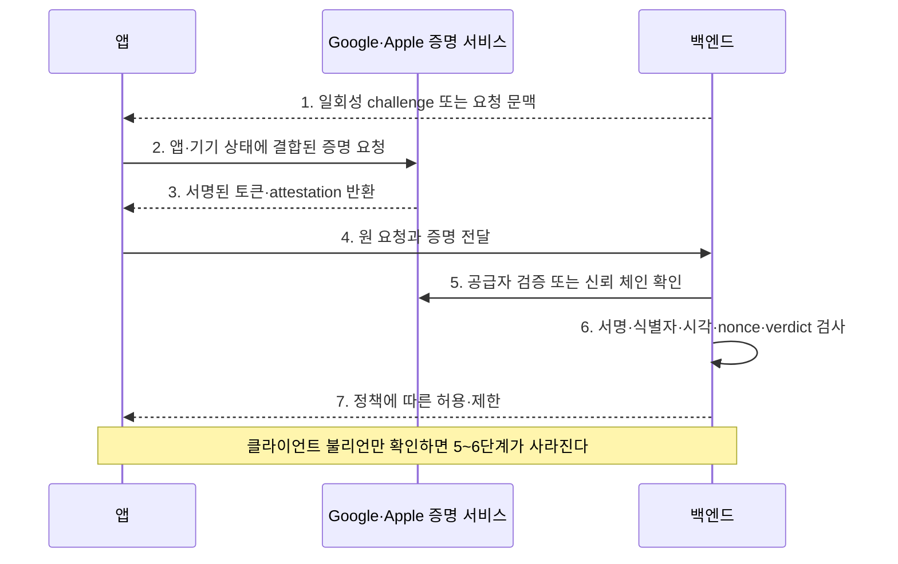

이 글은 [[모바일 취약점 진단 — Frida 동적분석과 네트워크]]의 2절처럼 네트워크·피닝 우회 과정에서 만나는 로컬 루팅·탈옥 탐지 함수 하나를 패치하는 절차를 반복하지 않는다. 여기서는 Magisk 계열 은닉, 재패키징, 토큰 재생처럼 Frida를 거치지 않는 경우까지 포함해 **기기와 앱의 신뢰성을 원격 서버에 어떻게 증명하고 서버가 그 암호학적 증명을 실제로 검증하는지**를 다룬다.

---

## 1. Attestation이 증명하는 것

**개념**: 앱이 스스로 "나는 정상 기기에서 실행 중"이라고 말하고 그 답을 믿는 것은 수험생이 자기 답안에 직접 합격 도장을 찍는 것과 같다. Attestation에서는 Google이나 Apple 같은 운영체제 공급자가 공증인처럼 기기·앱 상태를 확인하고 서명된 증명서를 만들어 서버에 전달한다. 서버는 앱이 보낸 `true`를 믿는 것이 아니라 공증인의 서명과 증명서의 내용을 확인해야 한다. 루팅·탈옥 탐지는 기기를 통제한 공격자가 검사 코드를 숨기거나 고칠 수 있는 끝없는 추격전이므로 장벽이 아니라 지연 장치이며, 원격 서버가 검증하는 하드웨어 기반 증명이 더 강한 출발점이다.

**원리**: Attestation은 하나의 "안전/위험" 불리언이 아니라 앱 식별, 배포 경로, 기기 무결성, 키 소유, 요청 결속 등 제품별 verdict의 집합이다. Play Integrity는 Google이 보호한 응답에서 앱·계정·기기 관련 판정을 제공하고, App Attest는 Apple이 승인한 정품 앱 인스턴스와 attested key가 서버 요청에 참여했는지 증명한다. 두 제품의 의미는 같지 않으며 서버는 필요한 속성을 명시적으로 선택해야 한다.

- 체크 포인트:
  - 앱이 보내는 값이 자체 불리언인지 공급자 서명 토큰·assertion인지 구분한다.
  - 서버가 사용하는 verdict 이름과 거부·제한 정책을 문서화한다.
  - 미지원 기기·오프라인·공급자 장애 시 폴백 정책이 무조건 허용인지 확인한다.
- 참고: [Play Integrity Overview](https://developer.android.com/google/play/integrity/overview), [Apple - Establishing Your App's Integrity](https://developer.apple.com/documentation/devicecheck/establishing-your-app-s-integrity), [OWASP MASVS-RESILIENCE](https://mas.owasp.org/MASVS/controls/MASVS-RESILIENCE/)

## 2. 로컬 루팅·탈옥 은닉의 진화

**원리**: 초기 탐지는 `su` 경로, 쓰기 가능한 시스템 파티션, 알려진 패키지, 탈옥 파일·URL scheme처럼 앱 프로세스가 보는 사용자 공간 흔적을 검사했다. MagiskHide는 이런 관찰 결과를 대상 프로세스에서 숨겼고, Magisk v24 이후 Zygisk와 DenyList가 도입됐다. Zygisk는 Zygote 기반 앱 프로세스에 코드를 주입하며, DenyList는 선택한 프로세스에서 Magisk 변경을 되돌리는 정책이지 완전한 은닉 보장이 아니다. Shamiko는 Zygisk 기반 제3자 은닉 모듈이고, KernelSU류는 더 낮은 커널 계층에서 권한을 관리하므로 이들을 모두 "커널 수준"으로 부르는 것은 부정확하다.

- 체크 포인트:
  - 파일·패키지·프로퍼티·mount·프로세스·후킹 탐지를 각각 어떤 계층에서 수행하는지 목록화한다.
  - MagiskHide, DenyList, Zygisk, 제3자 모듈을 버전과 역할별로 구분한다.
  - 탐지 실패가 민감 API의 서버 허용으로 곧바로 이어지는지 확인한다.
  - 탐지 우회 시험은 승인된 기기에서만 수행하고 운영 우회 모듈 배포를 피한다.
- 참고: [Magisk Changelog](https://github.com/topjohnwu/Magisk/blob/master/docs/changes.md), [Magisk Documentation](https://topjohnwu.github.io/Magisk/), [OWASP MASTG - Android Reverse Engineering](https://mas.owasp.org/MASTG/knowledge/android/MASVS-RESILIENCE/)

## 3. Play Integrity 요청 결속

**원리**: Standard API에서 앱은 보호할 요청의 안정적인 표현을 `requestHash`에 결합하고, 받은 integrity token을 백엔드로 보낸다. 백엔드는 Google Play 서버에 토큰 복호화·검증을 요청하고 package name, 요청 세부정보, 시각, 앱·기기 verdict를 정책과 비교한다. Classic API는 nonce를 사용하며 응답 처리 방식도 다르므로 두 흐름의 필드를 섞어 검증하면 안 된다.

- 체크 포인트:
  - Standard의 `requestHash` 또는 Classic의 nonce가 민감 요청마다 고유하게 결합되는지 확인한다.
  - package name, 앱 버전, 인증서 digest와 요청 시각을 서버가 검사하는지 확인한다.
  - `appIntegrity`, `deviceIntegrity`, `accountDetails` 등 필요한 verdict를 개별적으로 판정하는지 확인한다.
  - 오래된 토큰과 다른 요청에서 받은 토큰의 재사용이 거부되는지 검사한다.
- 참고: [Play Integrity Standard Requests](https://developer.android.com/google/play/integrity/standard), [Play Integrity Classic Requests](https://developer.android.com/google/play/integrity/classic), [Play Integrity Verdicts](https://developer.android.com/google/play/integrity/verdicts)

## 4. App Attest 키와 assertion

**원리**: App Attest는 앱 인스턴스가 만든 키에 대해 일회성 attestation을 수행하고, 이후 그 키로 서버 challenge와 요청 digest에 결합된 assertion을 생성한다. 서버는 attestation 단계에서 Apple 인증서 체인, nonce, 앱 식별자(RP ID), key ID, 환경과 AAGUID를 확인하고, assertion 단계에서 서명과 증가하는 counter를 검증한다. 이는 일반적인 탈옥 여부를 단일 verdict로 주는 기능이 아니라 정품 앱 인스턴스와 키가 요청에 참여했다는 신호다.

- 체크 포인트:
  - 서버가 key ID와 검증된 공개키를 사용자·앱 인스턴스에 안전하게 연결하는지 확인한다.
  - challenge가 일회용이고 세션·요청 내용에 결합되는지 검사한다.
  - assertion의 서명과 counter 증가를 서버가 검증하고 재생을 거부하는지 확인한다.
  - 개발·프로덕션 환경과 AAGUID 정책이 혼동되지 않는지 확인한다.
- 참고: [Apple - Establishing Your App's Integrity](https://developer.apple.com/documentation/devicecheck/establishing-your-app-s-integrity), [Apple - Validating Apps That Connect to Your Server](https://developer.apple.com/documentation/devicecheck/validating-apps-that-connect-to-your-server), [Apple - App Attest Environment](https://developer.apple.com/documentation/bundleresources/entitlements/com.apple.developer.devicecheck.appattest-environment)

## 5. 서버측 암호학 검증의 경계

**원리**: 앱이 `isTrusted: true`나 로컬 SDK 성공 결과만 보내고 서버가 이를 그대로 믿으면 공격자는 요청 값을 바꾸는 것만으로 우회한다. 강한 흐름에서는 서버가 challenge를 발급하고 공급자가 보호한 토큰·인증서 체인·서명·요청 결속·시각·재생 상태를 검증한 뒤 권한 결정을 내린다. 검증은 민감 API와 같은 신뢰 경계에서 수행돼야 하며 API Gateway 뒤 일부 경로만 빠지는 예외가 없어야 한다.

- 체크 포인트:
  - 프록시에서 로컬 신뢰 불리언만 반전했을 때 서버가 허용하는지 확인한다.
  - 증명 토큰의 한 바이트를 바꿨을 때 서버가 암호학적으로 거부하는지 검사한다.
  - nonce·requestHash·counter·timestamp의 저장과 재사용 방지 위치를 확인한다.
  - 모든 민감 엔드포인트가 같은 검증 미들웨어를 통과하는지 확인한다.
- 참고: [Play Integrity Standard Requests](https://developer.android.com/google/play/integrity/standard), [Apple - Validating Apps That Connect to Your Server](https://developer.apple.com/documentation/devicecheck/validating-apps-that-connect-to-your-server), [NIST SP 800-63B](https://pages.nist.gov/800-63-4/sp800-63b.html)

## 6. 우회 시도와 한계

**원리**: 로컬 함수 후킹·재패키징은 앱이 만드는 불리언이나 요청 조립을 바꿀 수 있지만 공급자의 개인키로 새 증명에 서명할 수는 없다. 반대로 유효 토큰이 요청 내용과 결합되지 않으면 다른 요청으로 릴레이·재생할 수 있고, 손상된 기기에서 합법적인 앱 프로세스가 서명 오라클처럼 악용될 여지도 있다. Attestation은 계정 탈취, 서버 권한 결함, 정상 기기의 악성 자동화를 해결하지 않으므로 단독 인증 요소로 취급하면 안 된다.

- 체크 포인트:
  - 재패키징 빌드가 원본 package·bundle 식별자와 인증서 정책에서 거부되는지 확인한다.
  - 유효 증명을 다른 사용자·요청 바디·엔드포인트에 붙여 재생해 본다.
  - 정상 앱 프로세스에서 대량 요청 서명을 유도할 때 속도 제한과 행위 탐지가 작동하는지 확인한다.
  - 증명 실패가 무조건 허용되는 fail-open 경로와 레거시 API를 찾는다.
- 참고: [Play Integrity - Security Considerations](https://developer.android.com/google/play/integrity/overview#security-considerations), [OWASP MASVS-RESILIENCE](https://mas.owasp.org/MASVS/controls/MASVS-RESILIENCE/), [CWE-345](https://cwe.mitre.org/data/definitions/345.html)

## 7. 판정과 운영 정책

**원리**: 기기 신뢰는 이진 차단보다 위험 기반 정책으로 운용해야 한다. 공급자 할당량, 네트워크 실패, 오래된 OS, 접근성·기업 관리 환경에서 오탐이 생길 수 있으므로 고위험 동작의 재인증·한도 축소·추가 모니터링 같은 단계적 대응이 필요하다. 진단 결과도 "루팅 탐지 우회"와 "서명된 원격 증명 우회"를 같은 심각도로 묶지 않는다.

- 체크 포인트:
  - 로컬 탐지, 공급자 증명, 서버 정책의 실패 지점을 각각 분리해 보고한다.
  - verdict 조합별 허용·제한·재인증 정책과 감사 로그를 확인한다.
  - 공급자 장애·할당량 초과·미지원 기기의 폴백을 승인된 시나리오로 시험한다.
  - 수정 후 토큰 변조·재생·교차 요청·재패키징 회귀 테스트를 수행한다.
- 참고: [Play Integrity Remediation Dialogs](https://developer.android.com/google/play/integrity/remediation), [Apple App Attest](https://developer.apple.com/documentation/devicecheck), [OWASP MASTG](https://mas.owasp.org/MASTG/)

---

로컬 루팅·탈옥 탐지는 공격 비용을 높이지만 기기 통제권을 가진 상대에게 절대적인 증명이 되지 않는다. 핵심은 공급자가 보호한 증명을 요청에 묶고 백엔드가 서명·식별자·신선도를 끝까지 검증하는지이며, 이는 [[모바일 취약점 진단 — Frida 동적분석과 네트워크]]의 로컬 함수 패치와 다른 신뢰 경계다.
