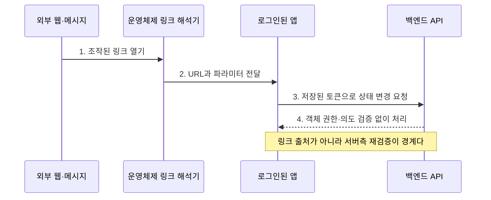

[[모바일 취약점 진단 — 안드로이드 IPC 공격면]]이 Intent·ContentProvider·BroadcastReceiver를 통한 **앱 내부 컴포넌트 통신**을 다뤘다면, 이 글은 웹페이지·SMS·QR 코드·메신저·다른 앱의 브라우저에서 시작해 등록 스킴이나 검증된 도메인을 거치는 **외부 URL 진입점**만 다룬다. exported 컴포넌트 일반론은 반복하지 않고, 링크 처리 주체의 신뢰와 파라미터가 백엔드 동작으로 이어지는 조건에 집중한다.

---

## 1. 링크가 앱의 진입점이 되는 방식

**개념**: 딥링크는 웹 주소처럼 생긴 표지판을 눌러 앱의 특정 화면으로 바로 들어가는 기능이다. `myapp://` 같은 커스텀 스킴은 누구나 "은행 앱으로 가는 길"이라는 표지판을 인쇄할 수 있는 것과 비슷해, 같은 표지를 단 가짜 앱이 끼어들 수 있다. App Links와 Universal Links는 건물 관리자인 운영체제가 실제 도메인 소유자의 확인 문서를 보고 진짜 입주자만 표지판을 달게 하는 방식이다. 따라서 링크 문자열이 비슷해도 두 방식의 신뢰 수준은 같지 않다.

**원리**: 운영체제는 URL의 scheme·host·path를 앱이 선언한 핸들러와 대조해 실행 대상을 정한다. 커스텀 스킴에는 중앙 소유권 검증이 없지만, Android App Links와 iOS Universal Links는 HTTPS 도메인에 둔 연관 파일과 앱 식별자를 결합한다. 다만 검증된 링크도 앱 내부 파라미터 검증이나 서버 권한 검사를 대신하지 않는다.

- 체크 포인트:
  - Android Manifest와 iOS URL Types·Associated Domains에서 모든 외부 URL 진입점을 목록화한다.
  - scheme·host·path별로 커스텀 스킴과 검증형 링크를 구분한다.
  - 링크로 열린 화면이 로그인·재인증·권한 검사를 어디서 수행하는지 추적한다.
- 참고: [Android - Create Deep Links](https://developer.android.com/training/app-links/create-deeplinks), [Android - About App Links](https://developer.android.com/training/app-links/about), [Apple - Supporting Associated Domains](https://developer.apple.com/documentation/xcode/supporting-associated-domains)

## 2. Custom URL Scheme 선점

**원리**: 커스텀 스킴에는 도메인처럼 고유 소유자를 증명하는 절차가 없어 여러 앱이 같은 `myapp://`를 등록할 수 있다. Android에서는 일치하는 intent filter, 사용자 기본값, 선택기 등 Intent 해석 규칙이 실행 앱을 좌우하고, iOS는 중복 등록 시 어느 앱이 처리할지 애플리케이션이 의존할 수 있는 보장을 제공하지 않는다. 따라서 "항상 먼저 설치한 앱이 이긴다" 같은 가정 대신 공격자 앱이 콜백을 수신하거나 사용자를 선택기로 유도할 수 있는지를 실제 버전에서 검증해야 한다.

- 체크 포인트:
  - 테스트 앱에 같은 스킴을 등록해 설치 순서·기본 앱·OS 버전별 동작을 기록한다.
  - OAuth 코드, 일회용 토큰, 비밀번호 재설정 값이 커스텀 스킴에 실리는지 확인한다.
  - 수신 앱이 콜백의 발신 앱을 신뢰하거나 민감 값을 로그에 남기는지 검사한다.
- 참고: [Android Intent Filters](https://developer.android.com/guide/components/intents-filters), [Apple - Defining a Custom URL Scheme](https://developer.apple.com/documentation/xcode/defining-a-custom-url-scheme-for-your-app), [RFC 8252 - Private-Use URI Scheme Redirection](https://www.rfc-editor.org/rfc/rfc8252.html#section-7.1)

## 3. Android App Links의 도메인 검증

**원리**: App Links는 HTTPS URL, Manifest의 `android:autoVerify="true"`, 그리고 `https://도메인/.well-known/assetlinks.json`의 패키지명·서명 인증서 지문을 연결한다. Android 12 이상에서는 일반 웹 링크 처리 정책이 더 엄격하지만, 검증 실패·리디렉션·잘못된 지문·동적 규칙의 지원 버전 차이 때문에 단순 선언만으로 검증 성공을 가정할 수 없다. 하위 도메인은 선언과 파일 배치 범위를 각각 확인해야 한다.

- 체크 포인트:
  - `assetlinks.json`이 HTTPS에서 리디렉션 없이 올바른 MIME과 JSON으로 제공되는지 확인한다.
  - 배포 인증서의 SHA-256 지문과 패키지명이 실제 릴리스와 일치하는지 확인한다.
  - `adb shell pm get-app-links` 등 OS 상태로 도메인별 검증 결과를 확인한다.
  - 검증 실패 시 브라우저·선택기·다른 앱으로 어떻게 폴백되는지 기록한다.
- 참고: [Android - Verify App Links](https://developer.android.com/training/app-links/verify-applinks), [Digital Asset Links](https://developers.google.com/digital-asset-links/v1/getting-started), [Android - About App Links](https://developer.android.com/training/app-links/about)

## 4. iOS Universal Links의 연관 모델

**원리**: Universal Links는 앱의 Associated Domains entitlement와 도메인의 `apple-app-site-association`(AASA) 파일을 앱 식별자·경로 규칙으로 연결한다. AASA가 유효해도 사용자의 선택과 현재 탐색 맥락에 따라 Safari가 열릴 수 있으며, 링크가 앱을 연다는 사실은 요청 파라미터가 신뢰된다는 뜻이 아니다. CDN 캐시와 앱 설치 시점의 연관 갱신 때문에 수정 직후 결과도 분리해 해석해야 한다.

- 체크 포인트:
  - AASA의 `appID` 또는 `appIDs`, `components` 경로가 대상 빌드와 일치하는지 확인한다.
  - 파일이 도메인 루트 또는 `.well-known` 경로에서 리디렉션 없이 접근되는지 확인한다.
  - 허용·제외 경로와 와일드카드가 민감 화면까지 넓게 포함하는지 검사한다.
  - 신규 설치와 기존 설치에서 캐시 영향을 나눠 재검증한다.
- 참고: [Apple - Supporting Associated Domains](https://developer.apple.com/documentation/xcode/supporting-associated-domains), [Apple - Allowing Apps and Websites to Link to Your Content](https://developer.apple.com/documentation/xcode/allowing-apps-and-websites-to-link-to-your-content), [Apple CDN for Associated Domains](https://developer.apple.com/documentation/xcode/supporting-associated-domains#Use-the-Apple-App-Site-Association-CDN)

## 5. 상태 변경으로 직결되는 파라미터

**원리**: 딥링크 핸들러가 `action`, `accountId`, `coupon`, `confirm` 같은 값을 읽어 사용자 확인 없이 백엔드 상태 변경 API를 호출하면 링크 클릭이 CSRF와 유사한 강제 동작이 된다. 모바일 앱에는 브라우저 쿠키 기반 CSRF와 다른 인증 전달 경로가 있지만, 공격자가 만든 입력이 이미 로그인된 앱의 토큰과 결합된다는 핵심은 같다. 서버가 객체 권한과 의도를 재검증하지 않으면 앱의 화면 확인만으로는 방어되지 않는다.

- 체크 포인트:
  - 금액·수신자·계정·권한 변경 파라미터를 링크에서 직접 지정할 수 있는지 확인한다.
  - 사용자 확인 화면에서 최종 값이 다시 표시되고 서버가 일회성 의도를 검증하는지 확인한다.
  - 다른 사용자·테넌트의 객체 식별자로 바꿨을 때 서버가 거부하는지 검사한다.
- 참고: [OWASP CSRF Prevention Cheat Sheet](https://cheatsheetseries.owasp.org/cheatsheets/Cross-Site_Request_Forgery_Prevention_Cheat_Sheet.html), [OWASP WSTG - Testing for CSRF](https://owasp.org/www-project-web-security-testing-guide/latest/4-Web_Application_Security_Testing/06-Session_Management_Testing/05-Testing_for_Cross_Site_Request_Forgery), [OWASP MASVS-AUTH](https://mas.owasp.org/MASVS/controls/MASVS-AUTH/)

## 6. Open Redirect와 신뢰 경계 이탈

**원리**: `next`, `redirect`, `returnUrl`을 절대 URL로 허용하거나 문자열 접두사만 검사하면 앱의 신뢰된 링크가 공격자 도메인으로 이동하는 발판이 된다. 사용자정보·인증 코드·일회용 토큰을 다음 URL의 query나 fragment에 붙이면 리디렉션 자체보다 정보 노출이 핵심 영향이다. 허용 목록은 정규화된 scheme·host·port·path를 구조적으로 비교해야 하며 사용자정보 구문과 유사 도메인을 배제해야 한다.

- 체크 포인트:
  - 외부 scheme, protocol-relative URL, 사용자정보(`@`), 인코딩·중첩 URL을 각각 시험한다.
  - 리디렉션 대상에 토큰이나 개인정보가 자동으로 이어 붙는지 확인한다.
  - 허용 목록 비교가 파싱 전 문자열 비교인지 정규화 후 구성요소 비교인지 확인한다.
- 참고: [OWASP Unvalidated Redirects and Forwards Cheat Sheet](https://cheatsheetseries.owasp.org/cheatsheets/Unvalidated_Redirects_and_Forwards_Cheat_Sheet.html), [RFC 3986 - URI Generic Syntax](https://www.rfc-editor.org/rfc/rfc3986.html)

## 7. 링크가 유도하는 서버측 URL 요청

**원리**: 딥링크의 `imageUrl`, `callback`, `importUrl`을 앱이 백엔드에 전달하고 서버가 해당 URL을 가져오면 외부 입력은 서버측 요청(SSRF)으로 바뀐다. 앱에서 사설 IP 문자열을 막아도 서버의 DNS 재해석, 리디렉션 추적, IPv6·정수형 주소 처리와 다를 수 있어 신뢰 경계는 백엔드다. 진단은 승인된 관찰 도메인으로 서버 요청 발생만 증명하고 내부 메타데이터를 실제로 수집하지 않는다.

- 체크 포인트:
  - 링크 파라미터 중 서버가 가져오는 URL과 앱이 직접 가져오는 URL을 구분한다.
  - 서버가 리디렉션마다 목적지 IP와 scheme을 다시 검증하는지 확인한다.
  - 사설·루프백·링크 로컬 대역과 비HTTP scheme이 거부되는지 검사한다.
  - DNS 확인 결과와 실제 연결 대상의 불일치를 방지하는지 확인한다.
- 참고: [OWASP SSRF Prevention Cheat Sheet](https://cheatsheetseries.owasp.org/cheatsheets/Server_Side_Request_Forgery_Prevention_Cheat_Sheet.html), [CWE-918](https://cwe.mitre.org/data/definitions/918.html)

---

외부 URL은 단순한 화면 이동 값이 아니라 앱 권한을 깨우는 입력이다. 스킴 소유권, 도메인 연관, 앱 내부 파라미터 처리, 백엔드 권한·URL 검증을 서로 다른 계층으로 나눠 확인하고, 앱 내부 IPC의 호출자 검증은 [[모바일 취약점 진단 — 안드로이드 IPC 공격면]]과 분리해 판단해야 한다.
