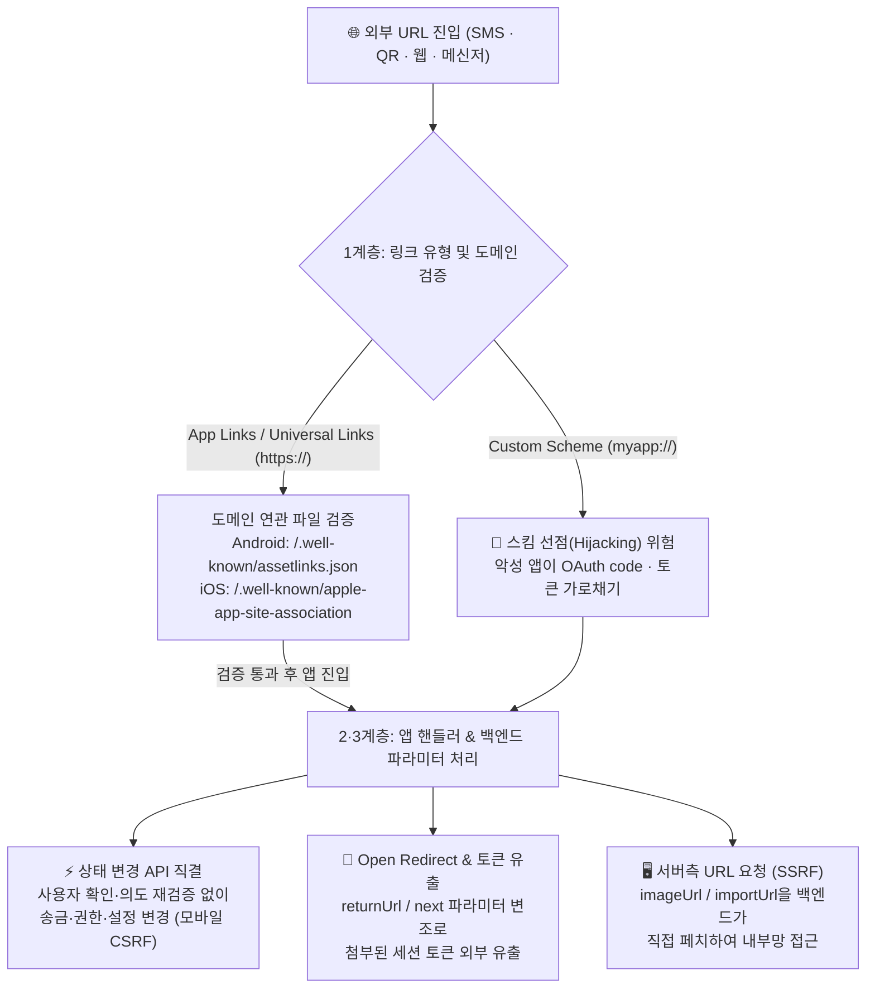
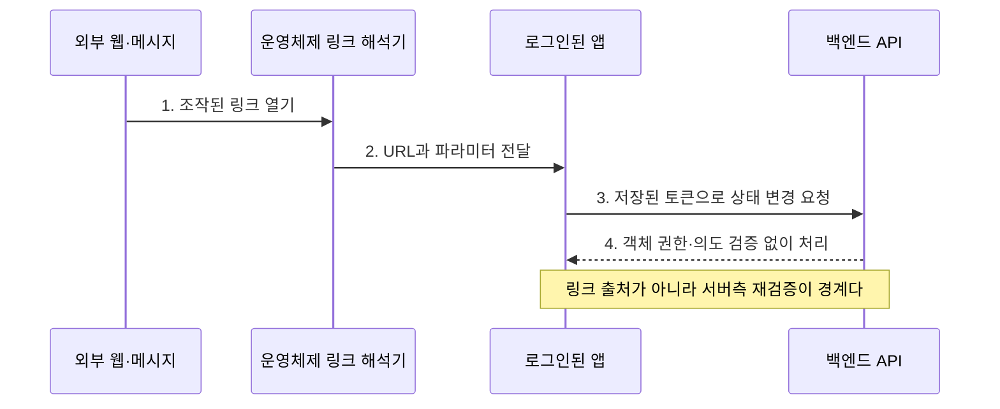

> [!summary] ⏱️ 5초 핵심 요약
> - **한 줄 비유**: 딥링크는 문자나 웹페이지의 표지판을 눌러 앱 안의 특정 방으로 순간이동하는 문입니다. **`myapp://` 같은 커스텀 스킴이 누구나 똑같은 상호 간판을 달아 손님(인증 코드)을 가로챌 수 있는 가건물**이라면, **App Links와 Universal Links는 구청(OS)이 건물 등기부등본(`assetlinks.json`·`AASA`)을 대조해 진짜 주인에게만 연결해 주는 공식 도로명 주소**입니다.
> - **핵심 원리**: 딥링크 보안은 **`1계층: 링크 소유권 검증(App Links / Universal Links)` → `2계층: 앱 내부 파라미터 정규화 및 화이트리스트 검증` → `3계층: 백엔드 API의 상태 변경 의도(CSRF 방어)·객체 권한·SSRF 검증`**이 모두 갖춰져야 성립합니다.
> - **핵심 주의사항**: 도메인 소유권이 검증된 App Links / Universal Links라 하더라도 **"그 링크를 통해 들어온 파라미터 값이 안전하다"는 뜻은 아니므로**, 상태 변경 API 직결·Open Redirect·SSRF를 별도로 검증해야 합니다.

[[모바일 취약점 진단 — 안드로이드 IPC 공격면]]이 Intent·ContentProvider·BroadcastReceiver를 통한 **앱 내부 컴포넌트 통신**을 다뤘다면, 이 글은 웹페이지·SMS·QR 코드·메신저·다른 앱의 브라우저에서 시작해 등록 스킴이나 검증된 도메인을 거치는 **외부 URL 진입점**만 다룹니다. exported 컴포넌트 일반론은 반복하지 않고, **링크 처리 주체의 신뢰**와 **파라미터가 백엔드 동작으로 이어지는 조건**에 집중합니다.



---

## 한눈에 보는 3대 모바일 링크 메커니즘 비교

| 구분 | Custom URL Scheme (`myapp://`) | Android App Links (`https://`) | iOS Universal Links (`https://`) |
|---|---|---|---|
| **소유권 검증 유무** | ❌ 없음 (어떤 앱이든 동일 스킴 선언 가능) | ✅ 있음 (`AndroidManifest.xml`의 `autoVerify="true"` + 서버 `assetlinks.json`) | ✅ 있음 (`Associated Domains` entitlement + 서버 `apple-app-site-association`) |
| **선점(Hijacking) 위험** | 높음 (설치된 다른 앱이 콜백 수신 또는 선택기 노출 가능) | 낮음 (단, 검증 실패·리디렉션·지문 불일치 시 일반 웹/선택기로 폴백됨) | 낮음 (앱 설치 시점 Apple CDN/도메인에서 AASA 검증) |
| **서버 측 설정 파일** | 불필요 | `https://도메인/.well-known/assetlinks.json` (패키지명 + 서명 SHA-256 지문) | `https://도메인/.well-known/apple-app-site-association` (`appIDs` + `components` 경로) |
| **진단 시 핵심 명령어/도구** | `AndroidManifest.xml` / `Info.plist`(`CFBundleURLTypes`) 확인 | `adb shell pm get-app-links <패키지명>` | `codesign -d --entitlements :-` 및 AASA 경로 규칙 확인 |

---

## 1. 링크가 앱의 진입점이 되는 방식

**💡 한 줄 비유**: `myapp://` 같은 커스텀 스킴은 **누구나 "은행 앱으로 가는 길"이라는 표지판을 인쇄해 자기 가게 앞에 세울 수 있는 것**과 비슷해 가짜 앱이 끼어들 수 있지만, **App Links와 Universal Links는 건물 관리자인 운영체제가 실제 도메인 소유자의 확인 문서를 보고 진짜 입주자만 표지판을 달게 하는 방식**입니다.

### 핵심 원리
- 운영체제는 URL의 `scheme`·`host`·`path`를 앱이 선언한 핸들러와 대조해 실행 대상을 정합니다.
- 커스텀 스킴에는 중앙 소유권 검증이 없지만, Android App Links와 iOS Universal Links는 HTTPS 도메인에 둔 연관 파일과 앱 식별자(서명 지문·Team ID/Bundle ID)를 암호학적으로 결합합니다.
- **중요한 경계**: 검증된 링크(App Links/Universal Links)는 **"이 도메인의 링크를 어느 앱이 열 것인가"**만 보장할 뿐, **"그 링크 안에 적힌 파라미터 값을 믿어도 되는가"**(앱 내부 입력 검증이나 서버 권한 검사)를 대신해 주지 않습니다.

### 체크 포인트
- `AndroidManifest.xml`과 iOS `Info.plist`(`CFBundleURLTypes`)·`Associated Domains`에서 모든 외부 URL 진입점을 목록화한다.
- `scheme`·`host`·`path`별로 커스텀 스킴과 검증형 링크를 구분한다.
- 링크로 열린 화면이 로그인·재인증·권한 검사를 어디서 수행하는지 추적한다.
- 참고: [Android - Create Deep Links](https://developer.android.com/training/app-links/create-deeplinks), [Android - About App Links](https://developer.android.com/training/app-links/about), [Apple - Supporting Associated Domains](https://developer.apple.com/documentation/xcode/supporting-associated-domains)

---

## 2. Custom URL Scheme 선점 (Scheme Hijacking)

**💡 한 줄 비유**: 동네에 '행복세탁소(`myapp://`)'라는 이름을 아무나 쓸 수 있으면, 손님이 맡긴 명품 옷(OAuth 인가 코드·일회용 로그인 토큰)이 짝퉁 세탁소로 배달되는 사고가 터집니다.

### 핵심 원리
- 커스텀 스킴은 도메인처럼 고유 소유자를 증명하는 절차가 없어 여러 앱이 같은 `myapp://`를 등록할 수 있습니다.
- **OS별 충돌 처리 주의점**:
  - **Android**: 일치하는 `intent-filter`, 사용자 기본값 설정, 앱 선택기(Disambiguation dialog) 등 Intent 해석 규칙이 실행 앱을 좌우합니다.
  - **iOS**: 중복 등록 시 어느 앱이 처리할지 애플리케이션이 의존할 수 있는 보장을 제공하지 않습니다.
  - 따라서 "항상 먼저 설치한 앱이 이긴다" 같은 단순 가정 대신, **공격자 앱이 민감 콜백을 수신하거나 사용자를 선택기로 유도할 수 있는지**를 대상 OS 버전에서 직접 검증해야 합니다.

### 체크 포인트
- 테스트 앱에 대상 앱과 동일한 커스텀 스킴을 등록해 설치 순서·기본 앱·OS 버전별 동작을 기록한다.
- OAuth 인가 코드(`code`), 일회용 토큰, 비밀번호 재설정 값이 커스텀 스킴에 실려 전달되는지 확인한다.
- 수신 앱이 콜백의 발신 앱을 무조건 신뢰하거나 민감 값을 시스템 로그에 남기는지 검사한다.
- 참고: [Android Intent Filters](https://developer.android.com/guide/components/intents-filters), [Apple - Defining a Custom URL Scheme](https://developer.apple.com/documentation/xcode/defining-a-custom-url-scheme-for-your-app), [RFC 8252 - Private-Use URI Scheme Redirection](https://www.rfc-editor.org/rfc/rfc8252.html#section-7.1)

---

## 3. Android App Links의 도메인 검증

**💡 한 줄 비유**: 앱이 매니페스트에 "나는 `example.com`의 공식 앱입니다(`autoVerify=true`)"라고 적어 내면, 안드로이드 OS가 직접 `https://example.com/.well-known/assetlinks.json`에 찾아가 **"이 패키지 이름과 인감도장(SHA-256 서명 지문)이 당신네 공식 앱이 맞습니까?"**라고 대조하는 절차입니다.

### 핵심 원리
- App Links는 ① HTTPS URL, ② 매니페스트 `<intent-filter android:autoVerify="true">`, ③ `https://도메인/.well-known/assetlinks.json`의 패키지명 및 서명 인증서 SHA-256 지문을 연결합니다.
- **단순 선언만으로 안전을 단정할 수 없는 이유**: HTTP 리디렉션(301/302 허용 안 됨), 잘못된 MIME 타입, 개발용 인증서 지문과 릴리스(또는 Google Play App Signing) 지문 혼동, 서브도메인 누락 등으로 인해 실제 기기에서는 검증이 실패한 채 일반 링크로 폴백되는 사례가 흔합니다.

### Android App Links 검증 상태 확인 명령어 및 설정 예시
```bash
# 1. 기기에서 대상 패키지의 도메인별 App Links 검증 상태 확인 (verified 여부 확인)
adb shell pm get-app-links com.example.app

# 2. 서버의 Digital Asset Links 파일 직접 조회 (리디렉션 없이 200 OK JSON 반환 필수)
curl -i https://example.com/.well-known/assetlinks.json
```

### 체크 포인트
- `assetlinks.json`이 HTTPS에서 리디렉션 없이 올바른 MIME(`application/json`)과 JSON 구조로 제공되는지 확인한다.
- 파일 내 SHA-256 지문과 패키지명이 실제 배포된 릴리스 APK의 서명 인증서와 정확히 일치하는지 확인한다.
- `adb shell pm get-app-links` 등 OS 상태로 도메인별 검증 결과(`verified`)를 확인한다.
- 검증 실패 시 브라우저·선택기·다른 앱으로 어떻게 폴백되는지 기록한다.
- 참고: [Android - Verify App Links](https://developer.android.com/training/app-links/verify-applinks), [Digital Asset Links](https://developers.google.com/digital-asset-links/v1/getting-started), [Android - About App Links](https://developer.android.com/training/app-links/about)

---

## 4. iOS Universal Links의 연관 모델

**💡 한 줄 비유**: 앱 안의 증명서(`Associated Domains` entitlement)와 웹사이트 금고 속 명부(`apple-app-site-association`)가 서로의 이름(`TeamID.BundleID`)과 출입 가능 복도(`components` 경로)를 정확히 가리켜야만 Safari를 거치지 않고 앱 문이 바로 열립니다.

### 핵심 원리
- Universal Links는 앱의 `com.apple.developer.associated-domains` entitlement(`applinks:example.com`)와 도메인의 `apple-app-site-association`(AASA) 파일을 앱 식별자(`TeamID.BundleID`) 및 경로 규칙으로 연결합니다.
- **진단 시 고려할 특성**:
  - AASA가 유효해도 사용자의 선택이나 현재 탐색 맥락(동일 도메인 내 이동 등)에 따라 Safari가 열릴 수 있습니다.
  - Apple CDN 캐시와 앱 설치 시점의 연관 정보 갱신 주기 때문에 서버 파일 수정 직후의 결과와 신규 설치 결과를 분리해 해석해야 합니다.
  - 무엇보다 **"Universal Link로 앱이 열린다"는 사실이 "URL 파라미터가 신뢰된다"는 뜻은 아닙니다.**

### 체크 포인트
- AASA 파일의 `appID`/`appIDs` 및 `components` 경로 규칙이 대상 빌드와 일치하는지 확인한다.
- AASA 파일이 `/.well-known/apple-app-site-association` 경로에서 HTTPS 리디렉션 없이 접근되는지 확인한다.
- 허용·제외(`exclude: true`) 경로와 와일드카드(`*`, `?`)가 민감 화면까지 과도하게 포함하는지 검사한다.
- 신규 설치와 기존 설치에서 Apple CDN 캐시 영향을 나눠 재검증한다.
- 참고: [Apple - Supporting Associated Domains](https://developer.apple.com/documentation/xcode/supporting-associated-domains), [Apple - Allowing Apps and Websites to Link to Your Content](https://developer.apple.com/documentation/xcode/allowing-apps-and-websites-to-link-to-your-content), [Apple CDN for Associated Domains](https://developer.apple.com/documentation/xcode/supporting-associated-domains#Use-the-Apple-App-Site-Association-CDN)

---

## 5. 상태 변경으로 직결되는 파라미터 (모바일 CSRF 유사 공격)

**💡 한 줄 비유**: 사용자가 메신저에 올라온 '이벤트 당첨 확인' 링크를 눌렀을 뿐인데, 앱이 열리자마자 **"아, 주인님이 '계좌 해지 즉시 실행(`action=delete&confirm=true`)' 버튼을 누르셨군요!"라고 오해해 저장된 로그인 토큰으로 서버에 바로 해지 요청을 날리는 상황**입니다.



### 핵심 원리
- 딥링크 핸들러가 `action`, `accountId`, `coupon`, `confirm` 같은 파라미터를 읽어 **사용자의 명시적 확인 없이 백엔드 상태 변경 API를 자동 호출**하면, 링크 클릭 한 번이 웹의 CSRF와 유사한 강제 동작이 됩니다.
- 모바일 앱은 브라우저 쿠키 대신 로컬에 저장된 Authorization 헤더(Bearer 토큰)를 쓰지만, **"외부 공격자가 조립한 입력값이 이미 로그인된 앱의 인증 토큰과 결합되어 전송된다"**는 본질은 같습니다.
- 또한 파라미터 안의 객체 식별자(`accountId` 등)를 서버가 현재 로그인 사용자 권한과 대조하지 않으면 IDOR(BOLA)까지 동시에 발생합니다.

### 체크 포인트
- 금액·수신자·계정·권한 변경 파라미터를 딥링크 URL에서 직접 지정해 즉시 실행시킬 수 있는지 확인한다.
- 상태 변경 전 사용자 확인 화면에서 최종 값이 명확히 표시되고, 서버가 일회성 의도(재인증·확인 토큰 등)를 검증하는지 확인한다.
- 파라미터를 다른 사용자·테넌트의 객체 식별자로 바꿨을 때 백엔드 서버가 거부하는지 검사한다.
- 참고: [OWASP CSRF Prevention Cheat Sheet](https://cheatsheetseries.owasp.org/cheatsheets/Cross-Site_Request_Forgery_Prevention_Cheat_Sheet.html), [OWASP WSTG - Testing for CSRF](https://owasp.org/www-project-web-security-testing-guide/latest/4-Web_Application_Security_Testing/06-Session_Management_Testing/05-Testing_for_Cross_Site_Request_Forgery), [OWASP MASVS-AUTH](https://mas.owasp.org/MASVS/controls/MASVS-AUTH/)

---

## 6. Open Redirect와 신뢰 경계 이탈

**💡 한 줄 비유**: 공식 앱이라는 믿을 만한 안내원이 손님에게 **출입증(인증 토큰)을 손에 쥐여준 채, 안내 표지판(`returnUrl`)이 조작된 줄도 모르고 손님을 강도 소굴(`https://evil.example`)로 데려다주는 격**입니다.

### 핵심 원리
- 딥링크의 `next`, `redirect`, `returnUrl` 파라미터를 절대 URL로 허용하거나 허술한 문자열 접두사(`startsWith("https://example.com")` → `https://example.com.evil.com` 또는 `https://example.com@evil.com` 우회)만 검사하면 공식 링크가 공격자 도메인으로 이동하는 발판이 됩니다.
- **가장 치명적인 영향**: 단순 화면 이동보다 **앱이 리디렉션 대상 URL의 query나 fragment에 현재 사용자의 세션 토큰·일회용 인증 코드·개인정보를 자동으로 이어 붙여서 보내는지**가 핵심 위험도를 결정합니다.
- 방어를 위해선 URL을 먼저 파싱·정규화한 뒤 `scheme`·`host`·`port`·`path` 구성요소를 허용 목록(Allowlist)과 구조적으로 비교하고 사용자정보 구문(`@`)을 배제해야 합니다.

### 체크 포인트
- 외부 scheme, protocol-relative URL(`//evil.com`), 사용자정보(`https://trusted.com@evil.com`), 인코딩·중첩 URL을 각각 시험한다.
- 리디렉션될 때 대상 URL에 인증 토큰이나 개인정보가 자동으로 첨부되는지 프록시로 확인한다.
- 허용 목록 비교가 파싱 전 단순 문자열 비교인지, 정규화 후 호스트 구성요소 비교인지 코드 수준에서 확인한다.
- 참고: [OWASP Unvalidated Redirects and Forwards Cheat Sheet](https://cheatsheetseries.owasp.org/cheatsheets/Unvalidated_Redirects_and_Forwards_Cheat_Sheet.html), [RFC 3986 - URI Generic Syntax](https://www.rfc-editor.org/rfc/rfc3986.html)

---

## 7. 링크가 유도하는 서버측 URL 요청 (SSRF)

**💡 한 줄 비유**: 손님이 딥링크에 적어 보낸 주소(`importUrl`)를 앱이 그대로 본사 서버에 넘기면서 **"서버야, 이 주소에 가서 사진 좀 대신 가져와 줘"**라고 시키면, 공격자는 그 주소 자리에 **본사 내부 통제실 주소(`169.254.169.254` 등)**를 적어 넣어 서버가 스스로 내부 기밀을 읽어오게 만듭니다.

### 핵심 원리
- 딥링크의 `imageUrl`, `callback`, `importUrl` 파라미터를 앱이 백엔드 API에 전달하고 **백엔드 서버가 그 URL을 직접 페치(Fetch)**하면, 외부 링크 입력은 곧바로 **SSRF(Server-Side Request Forgery)** 공격 표면이 됩니다.
- 앱(클라이언트) 코드에서 사설 IP 문자열을 필터링하더라도, 공격자는 프록시에서 API를 직접 호출하거나 서버 측의 DNS 리바인딩·HTTP 리디렉션 추적·IPv6/정수형 IP 표현 차이를 이용해 우회할 수 있으므로 **진정한 방어 경계는 백엔드 서버**입니다.
- *(윤리적 진단 원칙: 진단 시에는 승인된 외부 관찰 도메인(OAST)으로 서버 요청 발생 여부만 증명하고, 클라우드 메타데이터나 내부 자산을 실제로 수집·악용하지 않습니다.)*

### 체크 포인트
- 딥링크 파라미터 중 **백엔드 서버가 직접 가져오는 URL**과 **모바일 앱이 직접 가져오는 URL**을 구분한다.
- 백엔드 서버가 리디렉션(30x) 단계마다 최종 목적지 IP와 scheme을 다시 검증하는지 확인한다.
- 사설·루프백·링크 로컬 대역(`169.254.169.254` 등)과 비HTTP scheme(`file://`, `gopher://` 등)이 서버에서 거부되는지 검사한다.
- DNS 확인 결과와 실제 소켓 연결 대상 IP의 불일치(DNS Rebinding)를 방지하는지 확인한다.
- 참고: [OWASP SSRF Prevention Cheat Sheet](https://cheatsheetseries.owasp.org/cheatsheets/Server_Side_Request_Forgery_Prevention_Cheat_Sheet.html), [CWE-918](https://cwe.mitre.org/data/definitions/918.html)

---

외부 URL은 단순한 화면 이동 값이 아니라 앱과 백엔드의 권한을 깨우는 입력입니다. 스킴 소유권, 도메인 연관, 앱 내부 파라미터 처리, 백엔드 권한·URL 검증을 서로 다른 계층으로 나눠 확인하고, 앱 내부 IPC의 호출자 검증은 [[모바일 취약점 진단 — 안드로이드 IPC 공격면]]과 분리해 판단해야 합니다.
