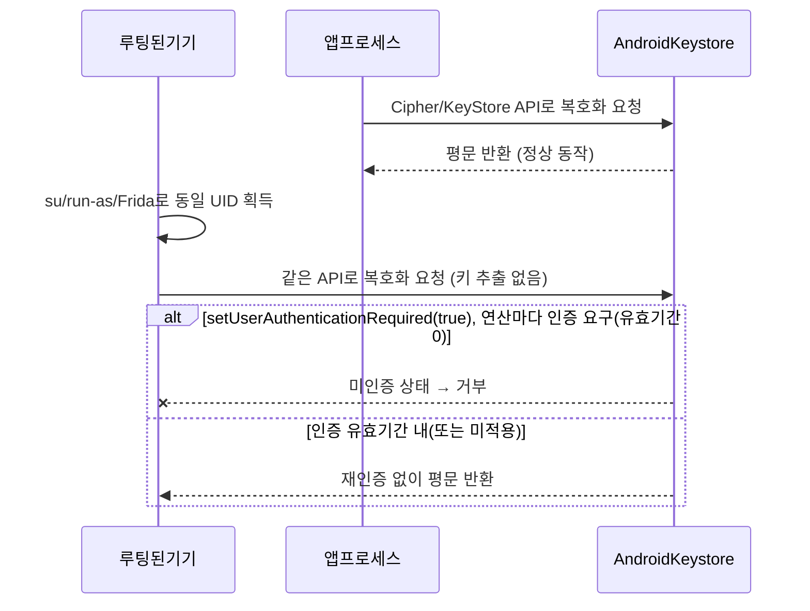

모바일 앱은 네트워크를 거치지 않고도 토큰·개인정보·대화 내용을 기기 안에 남깁니다. 이 글은 "그 데이터가 기기 어디에, 어떤 보호 수준으로 남는가"를 다룹니다. 핵심은 **접근 조건**입니다 — 루팅/탈옥, 디버그 빌드, 백업 추출 중 어떤 전제가 성립해야 실제로 읽어낼 수 있는지, 그리고 Keystore·Keychain에 올려뒀다는 사실 자체가 그 전제를 얼마나 막아주는지(혹은 안 막아주는지)를 구분해서 봅니다.

---

## 1. 안드로이드 앱 전용 저장공간 구조

**원리**: 안드로이드는 앱마다 고유 UID를 부여하고 `/data/data/<package>/` 아래(`shared_prefs/`, `databases/`, `files/`, `cache/`)를 그 UID 소유로 묶어 Linux DAC로 격리합니다. 일반 상태에서는 다른 앱 프로세스가 이 경로를 읽을 수 없습니다. 실제로 접근 가능해지는 조건은 세 가지로 나뉩니다. ① **루팅(su) 또는 탈옥** — 상위 권한으로 UID 격리 자체를 우회하므로 어떤 앱이든 전체 경로를 그대로 읽습니다. ② **디버그 가능 빌드(`android:debuggable="true"`)** — 루팅 없이도 `adb shell run-as <package>`로 해당 앱 UID 셸을 얻어 같은 경로에 접근할 수 있습니다. 릴리스 빌드는 기본적으로 `debuggable=false`지만, 테스트용으로 남겨두거나 CI가 디버그 APK를 잘못 배포하면 이 경로가 열립니다. ③ **백업 추출** — `adb backup`이나 기기 간 전송·클라우드 백업으로 앱 데이터를 통째로 꺼내는 경로이며, 실제로 추출되는지는 `allowBackup`/`dataExtractionRules` 설정에 달려 있습니다(해당 플래그 자체는 [[모바일 취약점 진단 — 안드로이드 정적분석]] 참고, 이 글 6장에서는 백업 "이후"에 뭘 읽을 수 있는지만 다룹니다). 세 조건 중 하나만 성립해도 이 장 이후에 나오는 SQLite·SharedPreferences 평문 데이터는 바로 노출됩니다.

- 체크 포인트: 대상 기기/에뮬레이터가 루팅돼 있는지(`su` 존재 여부, `ro.debuggable`/`ro.secure` 값은 참고 지표일 뿐 단독으로 확정 근거는 아님), 테스트 대상 APK의 매니페스트에 `android:debuggable="true"`가 있는지(`run-as <package>` 성공 여부로 교차 확인), 저장공간 안에 암호화 없이 떨어지는 파일이 있는지
- 참고: [Android Developers — Access app-specific files](https://developer.android.com/training/data-storage/app-specific), [OWASP MASTG — Tests](https://mas.owasp.org/MASTG/tests/)

## 2. SQLite 평문 저장

**원리**: `databases/` 아래 `.db` 파일은 기본적으로 일반 SQLite 포맷 그대로 디스크에 남습니다. 1장의 세 조건(루팅/디버그 빌드/백업) 중 하나로 파일에 접근하면, 별도의 암호화가 없는 한 `sqlite3`로 바로 열어 토큰·개인정보·대화 내용을 평문으로 읽을 수 있습니다. 방어 여부를 가르는 것은 "DB를 쓰는가"가 아니라 **DB 레벨 암호화(SQLCipher 등)의 적용 여부와, 그 암호화 키를 어떻게 보관하는가**입니다 — SQLCipher를 붙였어도 패스프레이즈를 소스 코드 상수나 평문 설정 파일에 하드코딩하면 DB 파일과 키가 같은 접근 조건 안에 있으므로 보호 효과가 사실상 없고, 키를 Keystore로 감싼 값에서 유도해야 의미가 있습니다(4장 참고).

- 체크 포인트: `.db` 파일을 루팅/디버그/백업 경로로 확보해 `sqlite3`로 직접 열었을 때 토큰·개인정보가 평문으로 보이는지, SQLCipher 등 DB 레벨 암호화가 걸려 있다면 그 키/패스프레이즈가 하드코딩이 아니라 Keystore 보호 키에서 유도되는지
- 참고: [OWASP MASVS](https://mas.owasp.org/MASVS/), [OWASP MASTG — Tests](https://mas.owasp.org/MASTG/tests/)

## 3. SharedPreferences / UserDefaults 평문 저장

**원리**: 안드로이드 `SharedPreferences`는 `shared_prefs/*.xml`로, iOS `UserDefaults`는 앱 컨테이너 안 `.plist`로 저장됩니다. 둘 다 "로그인 상태 유지" 토큰이나 간단한 자격 증명을 별 생각 없이 넣어두는 자리인데, 기본 API는 암호화를 하지 않습니다. 1장 조건이 성립하면 해당 파일을 열어 키-값 쌍을 그대로 읽을 수 있습니다. `EncryptedSharedPreferences`(androidx.security-crypto)를 쓰더라도, 결국 Keystore로 보호된 키로 값만 감싸 **같은 경로에 있는 XML 파일**로 저장하는 구조라 "암호화됐다"는 사실 자체가 4장에서 다루는 한계를 그대로 물려받습니다 — 파일을 암호화했다는 것과 그 파일을 복호화할 수 없다는 것은 별개입니다. 참고로 `EncryptedSharedPreferences`는 현재 공식 문서에서 사용 중단(deprecated)으로 표시돼 있어, 신규 구현이라면 Jetpack DataStore 등 다른 대안을 먼저 검토해야 합니다.

- 체크 포인트: 세션 토큰·자격 증명이 `shared_prefs`/`UserDefaults`에 평문 키-값으로 존재하는지, 암호화 래퍼를 쓴다면 그 복호화 경로가 4장의 Keystore 호출 조건과 동일한 약점을 갖는지
- 참고: [OWASP MASTG — Tests](https://mas.owasp.org/MASTG/tests/)

## 4. Android Keystore의 실제 보호 범위

**원리**: Android Keystore로 생성한 키는 앱 프로세스 밖에서 관리되고, 하드웨어 백킹이 적용된 경우(TEE 또는 StrongBox) 키 원문이 보안 하드웨어를 벗어나지 않습니다. 다만 모든 Keystore 키가 자동으로 하드웨어에 있는 것은 아니며(구형 기기·에뮬레이터는 소프트웨어 폴백으로 떨어질 수 있음), 실제 백킹 수준은 `KeyInfo.getSecurityLevel()`로 확인해야 합니다. 하드웨어 백킹이 됐다면 "키를 파일로 추출"하는 공격은 루팅으로도 사실상 불가능합니다. 하지만 이게 "암호문도 안전하다"는 뜻은 아닙니다. 그 키로 암호화한 **결과물(암호문)은 여전히 앱 저장공간(SQLite, SharedPreferences 파일 등)에 그대로 남아 있고**, 복호화는 앱이 `Cipher`/`KeyStore` API를 호출해 시스템 프로세스에 요청하는 방식으로 이뤄집니다. 루팅된 기기에서는 공격자가 그 앱의 UID로(`run-as`, Frida 프로세스 주입, 또는 su로 UID 전환) 똑같은 API를 호출해 "나는 이 앱이다"라고 시스템에 요청하는 것을 막을 방법이 기본적으로 없습니다 — 키를 추출하지 않고도, 앱 자신이 쓰는 것과 동일한 경로로 복호화 결과(평문)를 받아낼 수 있다는 뜻입니다. 이 경로를 좁히는 것이 `setUserAuthenticationRequired(true)`로 키를 **생체인증/기기 잠금해제에 바인딩**하는 설정이지만, 이것도 완전한 차단은 아닙니다 — 인증 유효기간(`setUserAuthenticationParameters`)을 몇 분 단위로 길게 잡아두면 그 유효기간 안에는 같은 UID의 공격 코드도 재인증 없이 키를 쓸 수 있고, 연산마다 인증을 요구(유효기간 0)하도록 설정한 경우에만 매번 생체인증을 거치지 않고는 복호화가 거부됩니다. 즉 "Keystore를 쓴다"는 사실이 아니라 **실제 하드웨어 백킹 수준 + 사용자 인증 바인딩을 연산 단위로 걸었는지**가 실제 방어선입니다.

- 체크 포인트: `KeyInfo.getSecurityLevel()`로 확인한 실제 하드웨어 백킹 수준, `setUserAuthenticationRequired(true)` 적용 여부와 인증 유효기간을 연산 단위(0초)로 좁혔는지, 루팅 기기에서 앱과 동일 UID로 복호화 API를 직접 호출했을 때 유효기간 안이라 재인증 없이 평문이 나오는지
- 참고: [Android Developers — Android Keystore system](https://developer.android.com/privacy-and-security/keystore), [Android Developers — KeyGenParameterSpec.Builder](https://developer.android.com/reference/android/security/keystore/KeyGenParameterSpec.Builder)

## 5. iOS Keychain의 접근 제어 클래스

**원리**: iOS Keychain도 같은 구조적 함정이 있습니다 — "Keychain에 넣었다"가 아니라 **`kSecAttrAccessible` 계열 값이 무엇인지**가 실제 보호 수준을 정합니다. `WhenUnlocked`는 기기가 **현재** 잠금 해제된 상태에서만 복호화 가능하고, `AfterFirstUnlock`은 재부팅 후 최초 잠금 해제 시점부터 다음 재부팅 전까지 클래스 키가 메모리에 남아 있어 그 사이에는 기기가 다시 잠겨도 복호화가 가능합니다 — "한 번이라도 잠금 해제된 적 있으면 영구히 덤프 가능"이 아니라 이 재부팅 단위 윈도우 안에서만 그렇습니다. `ThisDeviceOnly` 접미사가 붙은 변형은 **다른 기기로 이전되지 않습니다** — 즉 아이클라우드 키체인 동기화(이는 별도로 `kSecAttrSynchronizable`이 결정) 대상에서 제외되고, 암호화된 백업을 새 기기에 복원해도 해당 항목은 복원되지 않습니다. 접미사가 없는 항목은 암호화된 백업을 복원할 때 새 기기로 옮겨가지만, 그 전달 자체가 "원본 기기에 종속되지 않은 평문 추출"을 뜻하지는 않습니다 — Keychain 항목은 접근 제어 클래스와 무관하게 **기기 UID에서 유래한 별도 키로 한 번 더 래핑**되므로, 비암호화 로컬 백업 파일을 그냥 확보하는 것만으로는(원본 기기 없이는) 복원도 복호화도 되지 않습니다. 탈옥된 기기는 이 래핑을 우회하는 게 아니라 **원본 기기 자체에서 securityd/보안 하드웨어에 직접 접근**하므로, 그 기기가 현재 처한 잠금 상태에 따라(`WhenUnlocked`면 지금 잠금 해제 상태인지, `AfterFirstUnlock`이면 마지막 재부팅 이후 한 번이라도 해제된 적 있는지) 해당 클래스 항목을 읽어낼 수 있습니다.

- 체크 포인트: 세션 토큰·자격 증명 Keychain 항목에 `kSecAttrAccessible*ThisDeviceOnly` 변형이 적용됐는지, 아이클라우드 동기화가 필요 없다면 `kSecAttrSynchronizable`도 꺼져 있는지, 탈옥된 "원본 기기"에서 현재 잠금 상태/마지막 재부팅 이후 해제 이력이 해당 접근 클래스 조건을 만족하는지
- 참고: [Apple Developer — Restricting Keychain Item Accessibility](https://developer.apple.com/documentation/security/restricting-keychain-item-accessibility), [Apple Developer — Keychain Services](https://developer.apple.com/documentation/security/keychain-services)

## 6. 백업을 통한 데이터 추출

**원리**: 백업은 루팅/탈옥 없이도 앱 데이터를 꺼낼 수 있는 경로이지만, 실제로 뭐가 포함되는지는 OS 버전과 설정에 따라 크게 갈립니다. 안드로이드는 `adb backup`이 포함하는 범위가 `allowBackup` 값과 타깃 API 레벨에 따라 달라지고(타깃 API 31 이상인 앱은 기본적으로 제외되는 등 버전별 차이가 있으며, 정확한 조건은 [[모바일 취약점 진단 — 안드로이드 정적분석]] 참고), 조건이 맞아 백업을 받아낸 경우에만 평문 tar로 변환해 2~3장에서 다룬 SQLite·SharedPreferences 파일을 그대로 꺼낼 수 있습니다. iOS는 iTunes/Finder의 **암호화하지 않은** 로컬 백업에서도 앱 컨테이너 파일(SQLite, plist)은 그대로 꺼내지지만, **Keychain 항목은 다릅니다** — Keychain 데이터는 접근 제어 클래스와 별개로 기기 UID에서 유래한 키로 한 번 더 래핑되어 있어, 비암호화 백업 파일만 확보해서는(원본 기기 없이는) 바로 복호화되지 않습니다. 공격자가 Keychain까지 노린다면 경로는 둘 중 하나입니다 — ① 원본 기기 자체를 탈옥해 5장의 라이브 접근 조건으로 읽거나, ② 암호화 백업을 (알아낸 백업 비밀번호로) 자신이 통제하는 기기에 복원해 `ThisDeviceOnly`가 아닌 항목만 옮겨온 뒤 그 기기에서 접근 제어 클래스 조건에 맞춰 읽는 것입니다. 방어는 백업 자체를 막는 게 아니라 **민감 파일을 백업 대상에서 제외**하는 쪽입니다 — 안드로이드는 `dataExtractionRules` XML의 `<exclude>`로 특정 파일/DB를 백업·기기 간 전송에서 뺄 수 있고, iOS는 파일에 `NSURLIsExcludedFromBackupKey` 속성을 지정하거나(캐시류) Keychain 항목을 `ThisDeviceOnly` 클래스로 저장해 새 기기로의 이전 자체를 막습니다.

- 체크 포인트: 대상 앱의 타깃 API 레벨/`allowBackup` 설정상 `adb backup`에 실제로 데이터가 포함되는지, iTunes/Finder 비암호화 로컬 백업에 추출한 SQLite·plist 파일에 토큰·개인정보가 평문으로 들어 있는지, 민감 파일/DB가 `dataExtractionRules`의 `<exclude>` 또는 `NSURLIsExcludedFromBackupKey`로 백업 대상에서 제외돼 있는지
- 참고: [Android Developers — Back up user data with Auto Backup](https://developer.android.com/identity/data/autobackup), [Android Developers — Backup best practices](https://developer.android.com/privacy-and-security/risks/backup-best-practices), [Apple Developer — isExcludedFromBackupKey](https://developer.apple.com/documentation/foundation/urlresourcekey/isexcludedfrombackupkey)

## 7. 클립보드/로그 노출

**원리**: 클립보드는 OS 버전에 따라 노출 범위가 다릅니다. 안드로이드는 **10(API 29) 이상부터 백그라운드 앱의 클립보드 읽기를 기본 차단**하고, 현재 포커스를 가진 앱이나 기본 입력기(IME)만 읽을 수 있도록 바꿨습니다 — 즉 "클립보드에 복사하면 아무 앱이나 가져간다"는 전제는 Android 10 미만 또는 포커스를 가진 악성 입력기/앱이 설치된 경우로 조건이 좁혀집니다. iOS는 iOS 14까지는 어떤 앱이든 `UIPasteboard.general`을 조용히 읽을 수 있었고 배너 알림만 추가됐지만, **iOS 16부터는 달라졌습니다** — 앱이 시스템 붙여넣기 UI(붙여넣기 메뉴, 키보드 단축키, `UIPasteControl`)를 거치지 않고 **코드로 직접** 다른 앱이 복사한 클립보드 내용을 읽으려 하면, 사용자에게 허용 여부를 묻는 확인창이 뜨고 승인해야 내용을 받습니다. 즉 사용자가 명시적으로 붙여넣기 동작을 한 경우는 여전히 프롬프트 없이 통과하지만, 앱이 사용자 모르게 클립보드를 스캔하는 경로는 iOS 16 이상에서 실제로 막힙니다. 로그 쪽은 안드로이드 `Log.d/e` 호출이 릴리스 빌드에서도 제거되지 않고 남아 있으면, USB 디버깅이 켜져 있고 그 PC가 기기에서 RSA 키로 승인된 상태에서 `adb logcat`을 실행하는 것만으로(일반 설치 앱이 다른 앱 로그를 읽는 경로가 아니라 ADB 디버깅 접근 경로로) 다른 앱의 로그까지 읽힙니다. iOS의 통합 로깅은 기본적으로 동적 문자열·객체 인자를 `<private>`로 가려 Console/sysdiagnose에 노출하지 않습니다(정수·불리언 같은 단순 값은 기본적으로 가려지지 않습니다). 레거시 C 스타일 `os_log()` 호출에서는 개발자가 명시적으로 `%{public}@` 서식을 쓰면 가림이 풀리고, Swift `Logger` API에서는 같은 역할을 `privacy: .public` 파라미터가 하며, 어느 쪽이든 `NSLog`/`print()`로 바로 찍으면 애초에 가림 대상이 아니라 그대로 노출됩니다.

- 체크 포인트: 민감 정보를 클립보드에 복사하는 기능이 있는지와 대상 OS/타깃 버전이 안드로이드 10 미만 또는 iOS 16 미만을 포함하는지, 릴리스 빌드 로그에 토큰·개인정보가 `Log.d/e`·`NSLog`·`print()`로 그대로 찍히는지, `os_log()`의 `%{public}@`나 `Logger`의 `privacy: .public`을 민감 값에 실수로 쓰지 않았는지
- 참고: [Android Developers — Secure clipboard handling](https://developer.android.com/privacy-and-security/risks/secure-clipboard-handling), [Android Developers — Android 10 privacy changes](https://developer.android.com/about/versions/10/privacy/changes), [Apple Developer — UIPasteboard](https://developer.apple.com/documentation/uikit/uipasteboard), [Apple Developer — UIPasteControl](https://developer.apple.com/documentation/uikit/uipastecontrol), [Apple Developer — OSLogPrivacy](https://developer.apple.com/documentation/os/oslogprivacy)

---

이 글에서 반복되는 패턴은 하나입니다. **"보호 메커니즘이 존재한다"와 "그 메커니즘이 지금 이 설정으로 실제 공격 조건을 막는다"는 다른 문장**이라는 것. Keystore·Keychain·백업 제외·클립보드 알림 모두 기본값이 아니라 설정값을 봐야 진단이 끝납니다.
