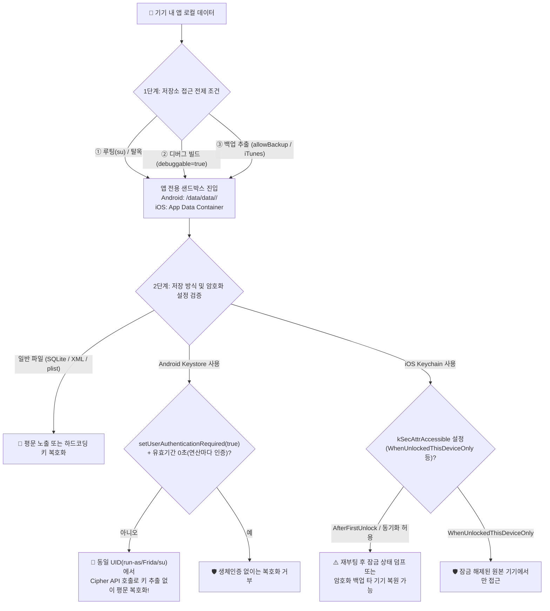
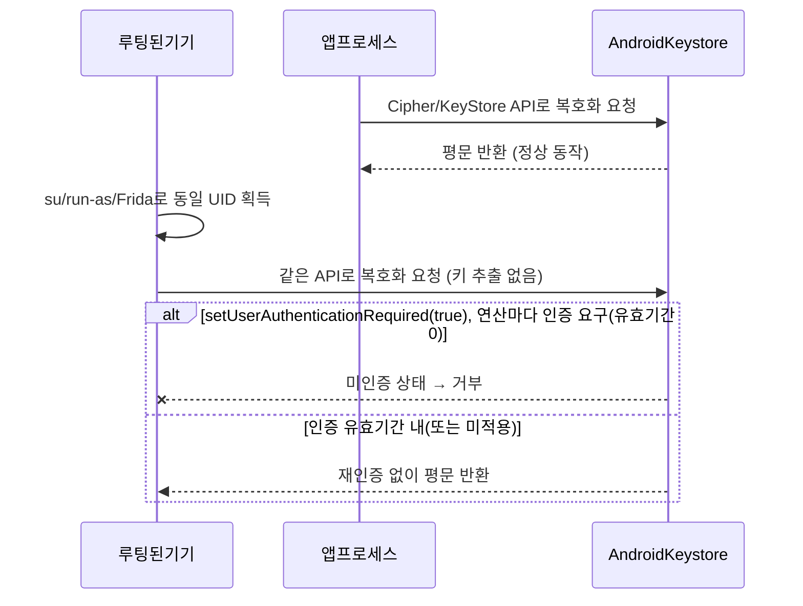

> [!summary] ⏱️ 5초 핵심 요약
> - **한 줄 비유**: 앱이 기기에 데이터를 저장할 때 일반 파일(`SQLite`·`SharedPreferences`·`plist`)에 그냥 적는 것은 **서랍장에 현금을 그대로 넣어두는 것**이고, **`Keystore`·`Keychain`을 쓰는 것은 현금을 금고에 넣되 "누가, 언제(잠금 상태·생체인증 유효기간), 다른 집으로 이사 갈 때(백업 복원)도 열 수 있게 할 것인가"라는 세부 잠금 규칙을 설정하는 것**입니다.
> - **핵심 원리**: 로컬 저장소 진단은 **"어떤 전제 조건(루팅/탈옥·`debuggable`·백업 추출)에서 파일이 읽히는가"**와 **"Keystore(생체인증 연산 단위 바인딩 여부)·Keychain(`kSecAttrAccessible*ThisDeviceOnly` 여부)의 세부 설정이 그 전제를 실제로 막아주는가"**를 교차 검증합니다.
> - **핵심 주의사항**: Android Keystore로 키 추출을 막아도 루팅 기기에서 동일 UID로 복호화 API를 직접 호출하면(연산마다 생체인증을 요구하지 않는 한) 평문이 반환되며, iOS Keychain은 기기 UID 키로 래핑되어 비암호화 백업만으로는 바로 복호화되지 않습니다.

모바일 앱은 네트워크를 거치지 않고도 토큰·개인정보·대화 내용을 기기 안에 남깁니다. 이 글은 "그 데이터가 기기 어디에, 어떤 보호 수준으로 남는가"를 다룹니다. 핵심은 **접근 조건**입니다 — 루팅/탈옥, 디버그 빌드, 백업 추출 중 어떤 전제가 성립해야 실제로 읽어낼 수 있는지, 그리고 Keystore·Keychain에 올려뒀다는 사실 자체가 그 전제를 얼마나 막아주는지(혹은 안 막아주는지)를 구분해서 봅니다.

---

## 한눈에 보는 로컬 저장소 영역별 보호 수준과 공격 조건

| 저장소 / 메커니즘 | 플랫폼 | 파일 경로 / API | 기본 보호 수준 | 공격 성공 조건 및 핵심 방어 포인트 |
|---|---|---|---|---|
| **SQLite DB** | 공통 | `databases/*.db` | 평문 (OS UID 샌드박스 격리만 존재) | 루팅/디버그/백업 시 `sqlite3`로 즉시 열람. **SQLCipher 적용 + 패스프레이즈를 Keystore/Keychain으로 보호**해야 안전 |
| **SharedPreferences / UserDefaults** | 공통 | `shared_prefs/*.xml` / `Library/Preferences/*.plist` | 평문 Key-Value XML/plist | `EncryptedSharedPreferences`(현재 deprecated, DataStore 등 전환 검토) 사용 시에도 **Keystore 호출 한계(4절)**를 그대로 물려받음 |
| **Android Keystore** | Android | `KeyStore` / `KeyGenParameterSpec` | TEE / StrongBox 하드웨어 키 추출 방지 | 키 추출은 막지만 **동일 UID 프로세스의 복호화 API 호출은 기본 허용**. `setUserAuthenticationRequired(true)` + 연산 단위(0초) 설정 필수 |
| **iOS Keychain** | iOS | `SecItemAdd` / `kSecAttrAccessible` | 기기 UID 키 + 사용자 패스코드 기반 계층 암호화 | 비암호화 백업만으로는 복호화 불가. **`WhenUnlockedThisDeviceOnly`** 및 `kSecAttrSynchronizable: false` 설정 확인 |
| **클립보드 & 시스템 로그** | 공통 | `ClipboardManager` / `UIPasteboard` / `logcat` / `os_log` | Android 10+(포커스 제한), iOS 16+(확인창), iOS 로그 `<private>` 마스킹 | 릴리스 빌드 내 `Log.d/e`, `NSLog`, `print()`, `os_log`의 `%{public}@` / `privacy: .public` 오용 여부 확인 |

---

## 1. 안드로이드 앱 전용 저장공간 구조

**💡 한 줄 비유**: 안드로이드의 `/data/data/<패키지명>/` 폴더는 호텔에서 투숙객마다 나눠준 **개별 객실(고유 Linux UID)**입니다. 평상시엔 옆방 손님이 못 들어오지만, **마스터키를 쥔 지배인(루팅 `su`), 투숙객 본인으로 변장하는 복제 카드(`debuggable` + `run-as`), 이삿짐 박스 통째 반출(`adb backup`)** 중 하나가 열리면 방 안의 모든 서랍이 그대로 공개됩니다.

### 핵심 원리
안드로이드는 앱마다 고유 UID를 부여하고 `/data/data/<package>/` 하위(`shared_prefs/`, `databases/`, `files/`, `cache/`)를 Linux DAC로 격리합니다. 일반 상태에서는 다른 앱이 읽을 수 없지만, 다음 **3가지 조건 중 하나만 성립**해도 내부 파일에 직접 접근할 수 있습니다.

1. **루팅(`su`) 또는 탈옥**: 상위 권한으로 UID 격리 자체를 우회하므로 모든 경로를 그대로 읽습니다.
2. **디버그 가능 빌드(`android:debuggable="true"`)**: 루팅 없이도 `adb shell run-as <package>`로 해당 앱 UID 셸을 얻어 전용 저장공간에 접근합니다.
3. **백업 추출**: `adb backup`이나 기기 간 전송·클라우드 백업으로 앱 데이터를 꺼내는 경로이며, 추출 가능 여부는 `allowBackup`/`dataExtractionRules`와 타깃 SDK 버전에 달려 있습니다(상세 조건은 [[모바일 취약점 진단 — 안드로이드 정적분석]] 및 아래 6절 참고).

### 체크 포인트
- 대상 기기/에뮬레이터가 루팅돼 있는지 확인한다(`su` 존재 여부 확인, `ro.debuggable`/`ro.secure` 값은 참고 지표일 뿐 단독 확정 근거는 아님).
- 테스트 대상 APK 매니페스트에 `android:debuggable="true"`가 있는지 `adb shell run-as <package>` 성공 여부로 교차 확인한다.
- 전용 저장공간 안에 암호화 없이 생성되는 민감 파일이 있는지 전수 조사한다.
- 참고: [Android Developers — Access app-specific files](https://developer.android.com/training/data-storage/app-specific), [OWASP MASTG — Tests](https://mas.owasp.org/MASTG/tests/)

---

## 2. SQLite 평문 저장

**💡 한 줄 비유**: 금고(DB 파일)에 자물쇠(`SQLCipher`)를 채웠더라도 **열쇠(패스프레이즈)를 금고 바로 옆 포스트잇(소스 코드 상수·평문 설정 파일)에 붙여 두면**, 방에 들어온 사람은 자물쇠가 없는 것과 똑같이 금고를 엽니다.

### 핵심 원리
- `databases/` 아래 `.db` 파일은 기본적으로 일반 SQLite 포맷 그대로 디스크에 남습니다. 1절의 세 조건 중 하나로 파일을 꺼내면 `sqlite3` 명령어로 토큰·개인정보·대화 내용을 평문으로 읽을 수 있습니다.
- **방어 성립 기준**: 단순히 DB 암호화 라이브러리(`SQLCipher` 등)를 썼는지가 아니라, **그 암호화 키(패스프레이즈)를 어디에 보관하는가**가 핵심입니다. 패스프레이즈를 코드에 하드코딩하면 보호 효과가 없으며, 반드시 Android Keystore나 iOS Keychain으로 보호된 키에서 유도해야 합니다.

### 체크 포인트
- `.db` 파일을 확보해 `sqlite3`로 직접 열었을 때 토큰·개인정보가 평문으로 보이는지 확인한다.
- `SQLCipher` 등 DB 레벨 암호화가 걸려 있다면 패스프레이즈가 하드코딩이 아니라 Keystore/Keychain 보호 키에서 유도되는지 확인한다.
- 참고: [OWASP MASVS](https://mas.owasp.org/MASVS/), [OWASP MASTG — Tests](https://mas.owasp.org/MASTG/tests/)

---

## 3. SharedPreferences / UserDefaults 평문 저장

**💡 한 줄 비유**: `SharedPreferences`와 `UserDefaults`는 원래 앱의 '다크모드 켜짐', '알림 소리 크기' 같은 **가벼운 환경설정을 적어두는 메모장**이지, 출입증(세션 토큰)이나 비밀번호를 보관하는 금고가 아닙니다.

### 핵심 원리
- 안드로이드 `SharedPreferences`(`shared_prefs/*.xml`)와 iOS `UserDefaults`(앱 컨테이너 내 `.plist`)는 기본적으로 아무런 암호화를 하지 않습니다.
- 안드로이드에서 `EncryptedSharedPreferences`(`androidx.security:security-crypto`)를 쓰더라도, 결국 Keystore 키로 값만 감싸 같은 경로의 XML 파일에 저장하는 구조이므로 **4절에서 다루는 Keystore의 구조적 한계(동일 UID에서의 복호화 API 호출 가능)**를 그대로 물려받습니다.
- *(참고: `EncryptedSharedPreferences`는 현재 공식 문서에서 사용 중단(`deprecated`)으로 표시되어 있으므로, 신규 구현에서는 Jetpack DataStore와 직접 관리하는 Keystore 조합 등을 검토해야 합니다.)*

### 체크 포인트
- 세션 토큰·자격 증명이 `shared_prefs/*.xml`이나 `UserDefaults` `.plist`에 평문 키-값으로 존재하는지 확인한다.
- 암호화 래퍼를 쓴다면 그 복호화 경로가 4절의 Keystore 호출 조건과 동일한 약점을 갖는지 확인한다.
- 참고: [OWASP MASTG — Tests](https://mas.owasp.org/MASTG/tests/)

---

## 4. Android Keystore의 실제 보호 범위

**💡 한 줄 비유**: Android Keystore는 **열쇠 원형(키 바이트)을 특수 기계(TEE/StrongBox) 안에 영구 밀봉해 밖으로 꺼내 갈 수 없게** 만듭니다. 하지만 루팅된 기기에서 공격자가 앱으로 변장(동일 UID 획득)해 기계 앞에 서서 **"열쇠는 안 꺼내 갈 테니 이 암호 문서 좀 대신 풀어주세요(`Cipher.doFinal`)"**라고 버튼만 누르면, **매번 지문 인식(`유효기간 0초`)을 요구하지 않는 한 기계는 군말 없이 평문을 뱉어냅니다.**

### 핵심 원리
1. **하드웨어 백킹 확인 (`KeyInfo.getSecurityLevel()`)**: Keystore로 생성한 키는 앱 프로세스 밖에서 관리되며, TEE 또는 StrongBox 하드웨어 백킹이 적용되면 루팅으로도 **키 원문 추출은 사실상 불가능**합니다(단, 구형 기기·에뮬레이터는 소프트웨어 폴백될 수 있으므로 `getSecurityLevel()`로 확인).
2. **"키 추출 불가 ≠ 암호문 복호화 불가"**:
   - 그 키로 암호화한 결과물(암호문)은 여전히 앱 저장공간(SQLite, XML 등)에 남아 있습니다.
   - 루팅 기기나 `debuggable` 앱에서 공격자가 `su`, `run-as`, 또는 Frida 주입으로 **해당 앱과 동일한 UID를 획득**하면, 키를 추출할 필요 없이 앱 자신이 쓰는 것과 똑같은 `Cipher`/`KeyStore` API를 호출해 복호화된 평문을 그대로 받아낼 수 있습니다.
3. **진정한 방어선 (`setUserAuthenticationRequired(true)`)**:
   - 키 사용을 생체인증/기기 잠금해제에 바인딩해야 합니다.
   - 이때도 인증 유효기간(`setUserAuthenticationParameters`)을 몇 분 단위로 길게 잡으면 그 시간 창 안에서는 공격 코드도 재인증 없이 키를 쓸 수 있습니다. **연산마다 인증을 요구(유효기간 `0`)**하도록 설정한 경우에만 매번 사용자 생체인증 없이는 복호화가 거부됩니다.

### 체크 포인트
- `KeyInfo.getSecurityLevel()`로 확인한 실제 하드웨어 백킹 수준(TEE / StrongBox 여부)을 확인한다.
- `setUserAuthenticationRequired(true)` 적용 여부와 인증 유효기간을 연산 단위(`0`초)로 좁혔는지 확인한다.
- 루팅 기기에서 앱과 동일 UID로 복호화 API를 직접 호출(Frida 등)했을 때 재인증 없이 평문이 나오는지 검증한다.
- 참고: [Android Developers — Android Keystore system](https://developer.android.com/privacy-and-security/keystore), [Android Developers — KeyGenParameterSpec.Builder](https://developer.android.com/reference/android/security/keystore/KeyGenParameterSpec.Builder)

---

## 5. iOS Keychain의 접근 제어 클래스

**💡 한 줄 비유**: iOS Keychain에 데이터를 넣을 때 **`WhenUnlocked`는 집주인이 문을 열고 깨어 있을 때만 열리는 금고**이고, **`AfterFirstUnlock`은 아침에 한 번만 문을 열면 다시 잠들어도 밤새(다음 재부팅 전까지) 열려 있는 금고**이며, **`ThisDeviceOnly`는 이사 갈 때(백업 복원) 새집으로 절대 옮겨가지 않는 붙박이 금고**입니다.

### `kSecAttrAccessible` 주요 접근 제어 클래스 비교

| 접근 제어 상수 (`kSecAttrAccessible*`) | 복호화 가능 시점 (기기 잠금 상태) | 백업 복원 및 기기 간 이전 여부 | 보안 권장도 및 특징 |
|---|---|---|---|
| **`WhenUnlockedThisDeviceOnly`** | 기기가 **현재 잠금 해제된 상태**에서만 가능 | ❌ 이전 불가 (원본 기기 전용) | ✅ **민감 세션 토큰·자격증명 최우선 권장** |
| **`WhenUnlocked`** | 기기가 현재 잠금 해제된 상태에서만 가능 | 암호화 백업 복원 시 새 기기로 이전 가능 | 기기 교체 편의성이 꼭 필요한 경우에만 제한적 사용 |
| **`AfterFirstUnlockThisDeviceOnly`** | 재부팅 후 **최초 1회 잠금 해제 이후~다음 재부팅 전**까지 기기가 다시 잠겨도 복호화 가능 | ❌ 이전 불가 (원본 기기 전용) | 백그라운드 데몬·푸시 처리 등 잠금 상태 작업이 필수인 경우에만 사용 |
| **`AfterFirstUnlock`** | 재부팅 후 최초 1회 잠금 해제 이후~다음 재부팅 전까지 가능 | 암호화 백업 복원 시 새 기기로 이전 가능 | ⚠️ 탈옥 기기 확보 시 재부팅 전 윈도우 내에서 잠금 상태로도 덤프 가능 |

*(참고: 아이클라우드 키체인 동기화 여부는 `ThisDeviceOnly` 접미사와 별개로 `kSecAttrSynchronizable` 속성이 결정하며, 모든 Keychain 항목은 기기 고유 UID에서 유래한 키로 한 번 더 래핑되어 있어 비암호화 백업 파일만으로는 원본 기기 없이 복호화할 수 없습니다.)*

### 체크 포인트
- 세션 토큰·자격 증명 Keychain 항목에 `kSecAttrAccessible*ThisDeviceOnly` 변형이 적용됐는지 확인한다.
- 아이클라우드 동기화가 불필요하다면 `kSecAttrSynchronizable`이 꺼져 있는지 확인한다.
- 탈옥된 원본 기기에서 현재 잠금 상태/재부팅 이후 해제 이력이 해당 접근 클래스 조건을 만족하는지 확인한다.
- 참고: [Apple Developer — Restricting Keychain Item Accessibility](https://developer.apple.com/documentation/security/restricting-keychain-item-accessibility), [Apple Developer — Keychain Services](https://developer.apple.com/documentation/security/keychain-services)

---

## 6. 백업을 통한 데이터 추출

**💡 한 줄 비유**: 금고 문을 정면으로 못 뚫어도 **이삿짐센터(`adb backup` · `iTunes 로컬 백업`)를 불러 집안 살림을 박스째 복사해 내 창고로 가져오면**, 이사 제외 스티커(`<exclude>` · `isExcludedFromBackupKey` · `ThisDeviceOnly`)를 안 붙인 물건들은 전부 내 손에 들어옵니다.

### 핵심 원리
- **Android 백업 추출 조건**: `allowBackup` 값과 타깃 API 레벨에 따라 갈립니다. 타깃 API 31(Android 12) 이상인 앱은 `allowBackup="true"`여도 기본적으로 `adb backup`에서 제외되며(`debuggable="true"`일 때만 포함), 구형 타깃 앱이나 클라우드/D2D 백업 경로에서는 데이터가 포함될 수 있습니다(상세 조건은 [[모바일 취약점 진단 — 안드로이드 정적분석]] 참고).
- **iOS 로컬 백업과 Keychain의 차이**:
  - iTunes/Finder의 **비암호화 로컬 백업**에서도 앱 컨테이너의 일반 파일(`SQLite`, `plist`)은 그대로 추출됩니다.
  - 그러나 **Keychain 항목은 기기 UID 키로 래핑**되어 있어 비암호화 백업 파일만으로는(원본 기기 없이는) 복호화되지 않습니다. 공격자가 백업으로 Keychain을 노리려면 **암호화 백업**(백업 비밀번호 필요)을 떠서 자신이 통제하는 탈옥 기기에 복원해 `ThisDeviceOnly`가 아닌 항목만 옮겨온 뒤 읽어야 합니다.
- **올바른 방어**: 민감 파일은 Android `dataExtractionRules`(`<exclude>`), iOS `NSURLIsExcludedFromBackupKey` 속성으로 백업 대상에서 명시적으로 제외하고, Keychain은 `ThisDeviceOnly` 클래스를 사용합니다.

### 체크 포인트
- 대상 앱의 타깃 API 레벨/`allowBackup`/`debuggable` 설정상 `adb backup`에 실제로 데이터가 포함되는지 확인한다.
- iTunes/Finder 비암호화 로컬 백업에서 추출한 SQLite·plist 파일에 토큰·개인정보가 평문으로 들어 있는지 확인한다.
- 민감 파일/DB가 `dataExtractionRules`의 `<exclude>` 또는 `NSURLIsExcludedFromBackupKey`로 백업 대상에서 제외돼 있는지 확인한다.
- 참고: [Android Developers — Back up user data with Auto Backup](https://developer.android.com/identity/data/autobackup), [Android Developers — Backup best practices](https://developer.android.com/privacy-and-security/risks/backup-best-practices), [Apple Developer — isExcludedFromBackupKey](https://developer.apple.com/documentation/foundation/urlresourcekey/isexcludedfrombackupkey)

---

## 7. 클립보드/로그 노출

**💡 한 줄 비유**: **클립보드**는 여러 사람이 함께 쓰는 로비 화이트보드이고, **시스템 로그(`logcat`·`Console`)**는 건물 관리실의 공용 방송 기록지입니다. 최신 OS가 화이트보드 훔쳐보기를 많이 막았더라도, 중요한 비밀번호는 애초에 적지 말아야 하며 공용 방송에 전체 공개(`%{public}@`)로 내보내선 안 됩니다.

### OS 버전별 클립보드 및 로그 보호 변화

| 구분 | Android | iOS | 진단 시 핵심 체크사항 |
|---|---|---|---|
| **클립보드 접근 제어** | **Android 10 (API 29)+**: 백그라운드 앱의 클립보드 읽기 기본 차단 (현재 포커스 앱 또는 기본 IME만 가능) | **iOS 14~15**: 배너 알림 표시 **iOS 16+**: 시스템 붙여넣기 UI(`UIPasteControl` 등) 없이 코드로 타 앱 클립보드 접근 시 **사용자 허용 확인창** 강제 표시 | 민감 정보 복사 기능 유무 및 Android 10 미만 / iOS 16 미만 지원 여부, Android 13+ `ClipDescription.EXTRA_IS_SENSITIVE` 적용 여부 |
| **시스템 로그 노출** | 릴리스 빌드에 `Log.d/e` 등이 남으면 USB 디버깅 승인된 PC에서 `adb logcat`으로 열람 가능 | 통합 로깅(`os_log` / Swift `Logger`)은 동적 문자열을 기본 **`<private>`** 마스킹 처리 | iOS에서 **`%{public}@`**(`os_log`)나 **`privacy: .public`**(`Logger`), 또는 마스킹이 안 되는 **`NSLog`/`print()`**로 토큰을 찍는지 확인 |

### 체크 포인트
- 민감 정보를 클립보드에 복사하는 기능이 있는지, 그리고 대상 OS 범위가 Android 10 미만 또는 iOS 16 미만을 포함하는지 확인한다.
- 릴리스 빌드 로그에 토큰·개인정보가 `Log.d/e`·`NSLog`·`print()`로 그대로 찍히는지 확인한다.
- iOS `os_log()`의 `%{public}@`나 Swift `Logger`의 `privacy: .public`을 민감 값에 실수로 쓰지 않았는지 확인한다.
- 참고: [Android Developers — Secure clipboard handling](https://developer.android.com/privacy-and-security/risks/secure-clipboard-handling), [Android Developers — Android 10 privacy changes](https://developer.android.com/about/versions/10/privacy/changes), [Apple Developer — UIPasteboard](https://developer.apple.com/documentation/uikit/uipasteboard), [Apple Developer — UIPasteControl](https://developer.apple.com/documentation/uikit/uipastecontrol), [Apple Developer — OSLogPrivacy](https://developer.apple.com/documentation/os/oslogprivacy)

---

이 글에서 반복되는 패턴은 하나입니다. **"보호 메커니즘이 존재한다"와 "그 메커니즘이 지금 이 설정으로 실제 공격 조건을 막는다"는 전혀 다른 문장**이라는 것. Keystore·Keychain·백업 제외·클립보드 및 로그 모두 기본값이 아니라 실제 설정값을 확인해야 진단이 끝납니다.
