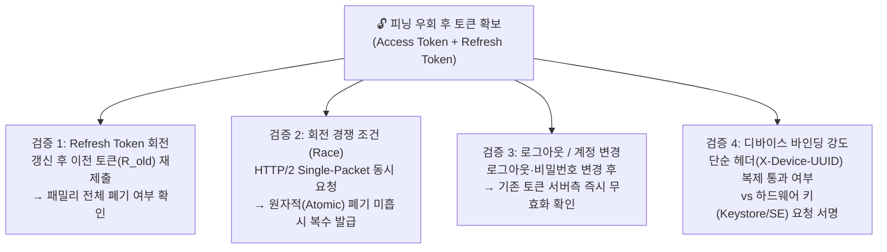
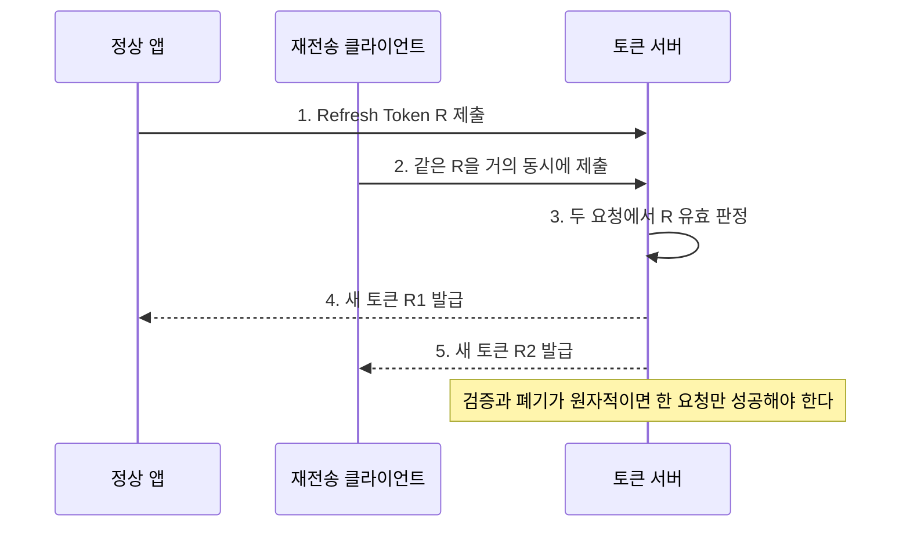

> [!summary] ⏱️ 5초 핵심 요약
> - **한 줄 비유**: **Access Token**이 1시간짜리 일일 출입증이라면 **Refresh Token**은 새 출입증을 계속 뽑을 수 있는 장기 회원권입니다. 그리고 **디바이스 바인딩**에서 서버가 `X-Device-UUID` 헤더만 비교하는 것은 **아무나 복사해 붙일 수 있는 종이 스티커를 믿는 것**이고, **하드웨어 키(Keystore/Secure Enclave)로 요청에 서명하게 하는 것은 위조 불가능한 지문 날인을 받는 것**입니다.
> - **핵심 원리**: 피닝 우회로 트래픽을 확보한 뒤에는 **`Refresh Token 회전(Rotation) 및 패밀리 전체 폐기` + `동시 리플레이(HTTP/2 Single-Packet)에 대한 원자적 처리` + `로그아웃 시 서버측 즉시 무효화` + `하드웨어 개인키 기반 요청 서명(Sender-Constrained)`**이 작동하는지 검증합니다.
> - **핵심 판정 기준**: 단순히 프록시에서 "토큰 문자열을 보았다"가 아니라, **탈취·복제한 토큰으로 다른 기기·클라이언트에서 얼마나 오랫동안 어떤 권한을 행사할 수 있는가**로 위험도를 산정합니다.

[[모바일 취약점 진단 — Frida 동적분석과 네트워크]]가 **트래픽을 어떻게 가로채는가**를 다뤘다면, 이 글은 인증서 피닝 우회가 끝나 요청과 응답을 이미 관찰할 수 있다고 가정하고 **가로챈 뒤 API 인증 흐름의 무엇을 공격하는가**에 집중합니다. 범위는 Refresh Token 재사용·로그아웃 무효화·디바이스 바인딩 같은 백엔드 인증 로직이며, 프록시 구성과 피닝 우회 절차는 반복하지 않습니다.



---

## 한눈에 보는 모바일 토큰 관리 및 바인딩 수준 비교

| 검증 영역 | 취약한 설계 (공격 성립) | 안전한 방어 설계 (RFC 9700 / DPoP 준수) | 핵심 진단 테스트 방법 |
|---|---|---|---|
| **Refresh Token 회전** | 갱신 후에도 이전 Refresh Token이 만료 전까지 계속 유효함 | **1회용 회전(Rotation) + 이전 토큰 재사용 감지 시 해당 토큰 패밀리 전체 즉시 폐기** | 토큰 갱신(`R1` → `R2`) 직후 `R1`을 다시 제출해 성공 여부 및 `R2`의 동반 폐기 여부 확인 |
| **동시성 처리 (Race)** | `검증 → 발급 → 폐기`가 비원자적이어서 동시 요청 시 유효 토큰 2개 발급 | DB 트랜잭션/공유 락을 통한 **원자적(Atomic) 비교-후-소비(Compare-and-Swap)** | HTTP/2 Single-Packet 기법으로 동일 Refresh Token을 병렬 전송해 발급된 두 토큰 모두 작동하는지 확인 |
| **로그아웃 무효화** | 앱 로컬 저장소에서만 토큰을 지우고 서버 세션/토큰은 살려둠 | 로그아웃·비밀번호 변경 시 서버 측 Refresh Token 패밀리 및 연결 세션 즉시 폐기 | 로그아웃 전 캡처해 둔 Access/Refresh Token을 로그아웃 완료 후 재전송 |
| **디바이스 바인딩** | 자기신고 헤더(`X-Device-UUID`, 모델명) 문자열 일치 여부만 비교 | **TEE/StrongBox · Secure Enclave 비추출 개인키**로 메서드·경로·바디·nonce 서명 검증 | 다른 기기/프록시에서 토큰과 `X-Device-UUID` 헤더를 함께 복사해 요청 전송 |

---

## 1. 토큰 수명과 디바이스 바인딩의 의미

**💡 한 줄 비유**: **Access Token**은 짧게 쓰는 하루 출입증이고, **Refresh Token**은 출입증을 다시 발급받는 장기 회원증에 가깝습니다. 서버가 `X-Device-UUID`처럼 앱이 스스로 적은 값을 믿는 것은 **누구나 베껴 붙일 수 있는 스티커**를 확인하는 것과 같지만, 하드웨어 키로 요청에 서명하게 하면 **위조하기 어려운 홀로그램**까지 확인하는 셈입니다.

### 핵심 원리
- OAuth 계열에서 Access Token과 Refresh Token은 서로 다른 권한과 수명을 가진 자격 증명입니다.
- Refresh Token이 탈취되면 짧은 Access Token 만료 시간은 아무런 방어선이 되지 않습니다. 따라서 서버는 만료 시간뿐 아니라 **회전(Rotation), 재사용 탐지(Reuse Detection), 클라이언트·사용자·기기와의 결합**을 함께 검증해야 합니다.
- 단순 기기 식별값(UUID, 광고 ID)은 인증 요소가 아니며, **비추출 가능(Non-exportable) 개인키가 만든 암호학적 서명**처럼 공격자가 복제할 수 없는 증명이 있어야 진정한 디바이스 바인딩이라고 부를 수 있습니다.

### 체크 포인트
- Access Token과 Refresh Token의 실제 만료 시간을 각각 기록한다.
- 토큰 갱신 요청에 필요한 토큰·클라이언트 식별자·기기 값의 조합을 하나씩 제거하며 서버 반응을 확인한다.
- 동일 계정의 다른 기기(또는 프록시 Repeater)에서 기존 Refresh Token이 그대로 통하는지 확인한다.
- 참고: [RFC 6749 - OAuth 2.0](https://www.rfc-editor.org/rfc/rfc6749.html), [RFC 9700 - OAuth 2.0 Security Best Current Practice](https://www.rfc-editor.org/rfc/rfc9700.html), [OWASP MASVS-AUTH](https://mas.owasp.org/MASVS/controls/MASVS-AUTH/)

---

## 2. 장기 Refresh Token과 회전 실패

**💡 한 줄 비유**: 일회용 승차권(`R1`)을 개찰구에 넣고 새 환승권(`R2`)을 받았는데도 **옛날 승차권(`R1`)이 구멍도 안 뚫린 채 그대로 다시 찍힌다면**, 표를 주운 도둑과 원래 주인이 둘 다 끝없이 지하철을 탈 수 있습니다.

### 핵심 원리
- **RFC 9700의 요구사항**: 클라이언트 인증을 할 수 없는 Public Client(모바일 앱)의 장기 Refresh Token에는 **Sender-Constrained(발신자 결속) 방식** 또는 **토큰 회전(Rotation)과 재사용 탐지**를 적용해야 합니다.
- **패밀리 전체 폐기(Token Family Revocation)**: 이미 사용되어 폐기된 이전 Refresh Token(`R1`)이 다시 제출되었다는 것은 **정상 사용자와 탈취자 중 한쪽이 이미 토큰을 썼고 토큰이 유출되었다는 확실한 신호**입니다. 따라서 서버는 `R1`만 거부하는 데 그치지 않고, **`R1`에서 파생된 최신 토큰(`R2`, `R3`...) 패밀리 전체를 즉시 폐기**하고 재로그인을 요구해야 합니다.
- JWT 형식의 Refresh Token이라도 서명 자체는 서버 측 폐기 상태를 보장하지 않으므로, 서버가 토큰 식별자(`jti`) 상태를 조회하지 않으면 유출 후 통제 수단이 사라집니다.

### 체크 포인트
- 한 번 갱신한 뒤 바로 이전 Refresh Token을 다시 제출해 거부되는지 확인한다.
- 이전 토큰 재사용 시 해당 토큰만이 아니라 **같은 패밀리에서 새로 발급된 토큰까지 함께 폐기되는지** 확인한다.
- 비밀번호 변경·계정 잠금 뒤 기존 Refresh Token의 효력이 남는지 확인한다.
- 만료 시간이 문서상 수치가 아니라 실제 서버 검증 결과와 일치하는지 측정한다.
- 참고: [RFC 9700 - Refresh Token Protection](https://www.rfc-editor.org/rfc/rfc9700.html#name-refresh-token-protection), [RFC 6819 - OAuth 2.0 Threat Model](https://www.rfc-editor.org/rfc/rfc6819.html)

---

## 3. 동시 리플레이와 회전 경쟁 조건 (Race Condition)

**💡 한 줄 비유**: 은행 창구 두 곳에 동시에 같은 수표(`R`)를 내밀었을 때, 두 창구 직원이 **"아직 안 쓰인 수표네!"라고 동시에 확인한 뒤 각자 현금(`R1`, `R2`)을 내어주고 뒤늦게 파쇄 도장을 찍는 타이밍의 빈틈**을 노리는 것입니다.



### 핵심 원리
- 토큰 회전 구현이 `유효성 검증 → 새 토큰 발급 → 이전 토큰 폐기`를 **원자적(Atomic)으로 처리하지 않으면**, 동일한 Refresh Token을 거의 동시에 보낸 두 요청이 모두 검증을 통과해 독립된 두 개의 유효 토큰(`R1`, `R2`)을 발급받을 수 있습니다.
- **HTTP/2 Single-Packet 기법의 역할**: 여러 스트림의 마지막 프레임을 보류했다가 한 TCP 패킷으로 동시에 요청을 완성해 네트워크 지터(Jitter)를 줄이는 **동시성 시험 방법**이지, HTTP/2 프로토콜 자체가 토큰을 복제하는 취약점은 아닙니다. 실제 원인은 서버 저장소의 비교-후-갱신이 원자적이지 않거나 다중 서버 인스턴스 간 메모리 락만 사용한 데 있습니다.

### 체크 포인트
- 승인된 테스트 계정으로 동일 Refresh Token의 병렬 요청 수를 최소화해 재현한다.
- 단순 `200 OK` 응답 코드뿐 아니라 **발급된 두 토큰(`R1`, `R2`)이 실제로 각각 API 호출 및 후속 갱신에 사용 가능한지** 확인한다.
- HTTP/1.1과 HTTP/2 결과를 비교해 네트워크 전송 정렬이 아닌 서버 측 경쟁 조건임을 분리한다.
- 다중 서버 환경에서 인스턴스별 로컬 락이 아닌 공유 저장소(DB/Redis)의 원자적 소비가 적용되는지 확인한다.
- 참고: [RFC 9113 - HTTP/2](https://www.rfc-editor.org/rfc/rfc9113.html), [PortSwigger Research - The Single-Packet Attack](https://portswigger.net/research/the-single-packet-attack-making-remote-race-conditions-local), [CWE-362](https://cwe.mitre.org/data/definitions/362.html)

---

## 4. 로그아웃과 서버측 무효화

**💡 한 줄 비유**: 호텔에서 체크아웃할 때 손님이 **자기 지갑 속 객실 카드키를 가위로 잘라 버렸다고 해서(로컬 저장소 삭제)** 호텔 프런트 컴퓨터(백엔드 서버)에서 그 카드 번호를 정지시키지 않으면, 체크아웃 전에 복사해 둔 카드로 다른 사람이 방에 그대로 들어갈 수 있습니다.

### 핵심 원리
- 앱이 기기 로컬 저장소(Keystore/Keychain/SharedPreferences)에서 토큰을 삭제하는 것과 **백엔드 서버가 토큰을 폐기(Revocation)하는 것**은 완전히 별개입니다.
- 로그아웃 API가 아예 없거나 Refresh Token·서버 세션·푸시 알림 토큰의 연결을 끊지 않으면, 로그아웃 이전에 탈취된 토큰은 만료 시점까지 계속 작동합니다.
- 만약 Stateless JWT 설계상 짧은 수명의 Access Token을 즉시 폐기하지 않는 구조라면, **남은 수명을 최소화하고 민감 작업(결제·비밀번호 변경·개인정보 조회)에 별도의 재인증 요구나 블랙리스트(Denylist) 조회를 보상 통제로 명시**해야 합니다.

### 체크 포인트
- 로그아웃 실행 전에 Access Token과 Refresh Token을 캡처해 두고, 로그아웃 완료 후 각각 재전송해 거부되는지 검증한다.
- '현재 기기 로그아웃'과 '모든 기기 로그아웃'의 서버 측 폐기 범위를 구분해 확인한다.
- 회원 탈퇴(계정 삭제) 직후 기존 세션 토큰으로 개인정보 API가 여전히 호출되는지 확인한다.
- 네트워크 단절(비행기 모드) 상태에서의 로컬 로그아웃이 서버 로그아웃 완료로 오인되지 않는지 확인한다.
- 참고: [RFC 7009 - OAuth 2.0 Token Revocation](https://www.rfc-editor.org/rfc/rfc7009.html), [OWASP Session Management Cheat Sheet](https://cheatsheetseries.owasp.org/cheatsheets/Session_Management_Cheat_Sheet.html)

---

## 5. 자기신고 헤더 바인딩의 한계

**💡 한 줄 비유**: 출입문 경비원이 신분증(토큰)과 함께 **"본인 휴대폰 일련번호(`X-Device-UUID`)를 말해보세요"**라고 묻는다면, 신분증을 훔친 도둑은 피해자가 방금 말한 일련번호까지 그대로 외워서 대답하면 그만입니다.

### 핵심 원리
- `X-Device-UUID`, 기기 모델명, OS 버전, 광고 ID(ADID/IDFA)처럼 요청자가 HTTP 헤더나 바디에 임의로 적어 보낼 수 있는 값은 **식별 힌트(Identifier)일 뿐 소유 증명(Proof of Possession)이 아닙니다**.
- 서버가 토큰 발급 시점에 받은 `X-Device-UUID` 문자열과 이후 API 요청의 헤더 문자열이 같은지만 비교한다면, 공격자는 프록시나 악성코드로 **토큰과 헤더 문자열 두 개를 함께 복사**해 검사를 손쉽게 통과합니다.
- TLS는 전송 구간에서의 도청을 막아줄 뿐, 기기나 프록시에서 이미 탈취된 두 값을 암호학적으로 묶어 주지는 않습니다.

### 체크 포인트
- API 요청에서 기기 식별 헤더를 누락·변경·복제했을 때 서버 응답 차이를 비교한다.
- 해당 헤더 값이 앱 재설치, 백업 복원, 공장 초기화 시 어떻게 바뀌는지 확인한다.
- 탈취한 토큰과 기기 헤더를 다른 환경(PC `curl` 또는 다른 기기)에서 그대로 재생했을 때 단순 문자열 비교로 승인되는지 검사한다.
- 참고: [OWASP API Security Top 10](https://owasp.org/API-Security/), [RFC 9449 - DPoP](https://www.rfc-editor.org/rfc/rfc9449.html)

---

## 6. 하드웨어 키 기반 요청 서명 (Sender-Constrained Tokens)

**💡 한 줄 비유**: 토큰이라는 통장만 가져와선 돈을 안 내주고, **기기 내부의 특수 금고(TEE/StrongBox·Secure Enclave) 안에서만 찍을 수 있는 인감도장(비추출 개인키)으로 '오늘 날짜 + 송금 계좌 + 금액 + 일회성 번호(nonce)'가 적힌 출금 전표에 직접 서명**해 와야만 거래를 승인하는 방식입니다.

### 핵심 원리
- **비추출 하드웨어 키**: Android Keystore(TEE·StrongBox)나 iOS Secure Enclave에서 생성된 개인키는 키 원문을 앱 프로세스 밖으로 내보내지 않고 내부에서 서명 연산만 수행합니다(단, Android Keystore는 기기에 따라 소프트웨어 폴백이 가능하므로 `KeyInfo.getSecurityLevel()`과 Key Attestation 인증서 체인으로 실제 하드웨어 보호 여부를 서버가 확인해야 합니다).
- **요청 결속 서명 구조 (DPoP 유사 구조)**:
  - 서버가 **HTTP 메서드 + 요청 경로 + 본문(Body) 해시 + 발급 시각 + 서버 `nonce`**를 포함한 정규화 메시지에 대한 전자서명을 등록된 공개키로 검증합니다.
  - 이렇게 하면 토큰과 헤더 문자열만 복사한 공격자는 개인키가 없어 새로운 API 요청이나 다른 파라미터에 대한 유효한 서명을 생성할 수 없습니다.
- **보완 통제**: 하드웨어 키 존재만으로 앱 변조 여부나 실제 사용자 존재가 자동 증명되지는 않으므로([[모바일 취약점 진단 — 기기 신뢰 공격(Device Attestation 우회)]] 및 [[모바일 취약점 진단 — 로컬 저장소 포렌식]] 참고), 서명 재생 방지(`nonce`)와 키 재등록 시 강력한 재인증 정책이 함께 필요합니다.

### 자기신고 헤더 vs 하드웨어 키 서명 요청 비교
```http
# ❌ 취약한 자기신고 헤더 방식 (토큰과 UUID만 복사하면 어디서든 재사용 가능)
POST /api/v1/transfer HTTP/1.1
Authorization: Bearer eyJhbGciOi...
X-Device-UUID: 550e8400-e29b-41d4-a716-446655440000

{"to":"attacker","amount":1000000}

# ✅ 안전한 하드웨어 키 서명 결속 방식 (메서드·경로·바디 해시·nonce를 개인키로 서명)
POST /api/v1/transfer HTTP/1.1
Authorization: DPoP eyJhbGciOi...
DPoP: eyJ0eXAiOiJkcG9wK2p3dCIsImFsZyI6IkVTMjU2IiwiandrIjp7...}}.<서명: htm=POST, htu=/api/v1/transfer, ath=..., nonce=srv_nonce_991, iat=...>
```

### 체크 포인트
- 서명 대상(Payload)에 HTTP 메서드·요청 경로·본문 해시·발급 시각·서버 `nonce`가 모두 포함되는지 확인한다.
- 동일한 서명과 `nonce`를 재사용하거나 바디 값만 한 글자 바꿨을 때 서버에서 즉시 거부되는지 검사한다.
- 기기 공개키 등록·교체가 기존 토큰 인증만으로 가능한지, 아니면 강한 재인증(MFA 등)이 필요한지 확인한다.
- 기기의 하드웨어 보안 수준과 Key Attestation 결과를 서버가 실제로 저장·검증하는지 확인한다.
- 참고: [Android Keystore](https://developer.android.com/privacy-and-security/keystore), [Android Key Attestation](https://developer.android.com/privacy-and-security/security-key-attestation), [Apple Secure Enclave](https://support.apple.com/guide/security/secure-enclave-sec59b0b31ff/web), [RFC 9449 - DPoP](https://www.rfc-editor.org/rfc/rfc9449.html)

---

## 7. 판정 기준과 증거 보존

**💡 한 줄 비유**: 보안 보고서는 "열쇠 사진을 찍었습니다"에서 끝나면 안 되고, **"그 열쇠로 주인이 퇴실한 뒤에도 금고 문을 열 수 있었는지, 복사본 두 개가 동시에 통했는지"를 실제 시간표(타임라인)로 입증**하되 진짜 열쇠 원형은 가려서 제출해야 합니다.

### 핵심 원리
- 인증 취약점의 실제 영향도는 단순히 프록시에서 "토큰을 관찰했다"가 아니라, **탈취한 자격 증명으로 어떤 기간 동안 어떤 서버 권한을 행사할 수 있었는지**로 판정합니다.
- 재현 기록에는 **발급·갱신·폐기 시각, 토큰 식별자의 비가역 해시(또는 앞뒤 일부 마스킹), 요청 상관관계 ID**를 남기되, 실제 유효한 토큰 원문은 보고서와 로그에서 반드시 제거해야 합니다.

### 체크 포인트
- 단일 재사용(회전 미비), 동시 재사용(Race Condition), 로그아웃 후 재사용을 서로 다른 테스트 케이스로 분리해 기록한다.
- 보고서 증거에는 토큰 원문 대신 식별 가능한 비가역 해시(또는 마스킹)와 정확한 타임라인을 남긴다.
- 단순 헤더 복제 가능 여부와 하드웨어 개인키 서명 위조 불가를 구분해 위험도를 산정한다.
- 수정 후에는 패밀리 폐기와 원자적 회전이 모바일 네트워크 불안정으로 인한 정상 앱의 재시도 상황에서도 안전하게 동작하는지 회귀 검증한다.
- 참고: [OWASP Web Security Testing Guide](https://owasp.org/www-project-web-security-testing-guide/), [NIST SP 800-63B](https://pages.nist.gov/800-63-4/sp800-63b.html)

---

피닝 우회는 관찰 수단일 뿐 인증 취약점의 결론이 아닙니다. [[모바일 취약점 진단 — Frida 동적분석과 네트워크]]로 트래픽을 확보한 뒤에는 토큰 수명, 회전의 원자성, 폐기 범위, 그리고 복제 가능한 식별값과 하드웨어 키 증명을 분리해 끝까지 검증해야 합니다.
