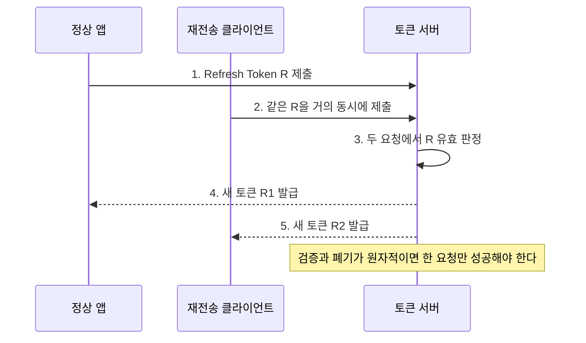

[[모바일 취약점 진단 — Frida 동적분석과 네트워크]]가 **트래픽을 어떻게 가로채는가**를 다뤘다면, 이 글은 인증서 피닝 우회가 끝나 요청과 응답을 이미 관찰할 수 있다고 가정하고 **가로챈 뒤 API 인증 흐름의 무엇을 공격하는가**에 집중한다. 범위는 Refresh Token 재사용·로그아웃 무효화·디바이스 바인딩 같은 백엔드 인증 로직이며, 프록시 구성과 피닝 우회 절차는 반복하지 않는다.

---

## 1. 토큰 수명과 디바이스 바인딩의 의미

**개념**: Access Token은 짧게 쓰는 하루 출입증이고, Refresh Token은 출입증을 다시 발급받는 장기 회원증에 가깝다. 하루 출입증이 만료되면 앱은 회원증을 서버에 보여 새 출입증을 받는다. 디바이스 바인딩은 그 회원증을 특정 기기에서만 쓰게 묶는 장치다. 서버가 `X-Device-UUID`처럼 앱이 스스로 적은 값을 믿는 것은 누구나 베껴 붙일 수 있는 스티커를 확인하는 것과 같지만, 하드웨어 키로 요청에 서명하게 하면 위조하기 어려운 홀로그램까지 확인하는 셈이다.

**원리**: OAuth 계열에서 Access Token과 Refresh Token은 서로 다른 권한과 수명을 가진 자격 증명이다. Refresh Token이 탈취되면 짧은 Access Token 만료는 방어선이 되지 않으므로, 서버는 만료 시간뿐 아니라 회전(rotation), 재사용 탐지, 클라이언트·사용자·기기와의 결합을 함께 검증해야 한다. 여기서 기기 식별값은 인증 요소가 아니며, 비추출 가능 개인키가 만든 서명처럼 공격자가 복제할 수 없는 증명이 있어야 바인딩이라고 부를 수 있다.

- 체크 포인트:
  - Access Token과 Refresh Token의 실제 만료 시간을 각각 기록한다.
  - 갱신 요청에 필요한 토큰·클라이언트 식별자·기기 값의 조합을 하나씩 제거해 본다.
  - 동일 계정의 다른 기기에서 기존 Refresh Token이 그대로 통하는지 확인한다.
- 참고: [RFC 6749 - OAuth 2.0](https://www.rfc-editor.org/rfc/rfc6749.html), [RFC 9700 - OAuth 2.0 Security Best Current Practice](https://www.rfc-editor.org/rfc/rfc9700.html), [OWASP MASVS-AUTH](https://mas.owasp.org/MASVS/controls/MASVS-AUTH/)

## 2. 장기 Refresh Token과 회전 실패

**원리**: 회전형 Refresh Token은 한 번 사용하면 이전 값을 폐기하고 새 값을 발급한다. RFC 9700은 클라이언트 인증을 할 수 없는 공개 클라이언트의 장기 Refresh Token에 sender-constrained 방식 또는 회전과 재사용 탐지를 요구한다. 서버가 이전 값과 새 값을 동시에 허용하거나, 토큰 패밀리의 재사용을 탐지하지 않으면 탈취자와 정상 사용자가 각자 Access Token을 계속 발급받을 수 있다. JWT 형식이어도 자체 서명은 폐기를 보장하지 않으며, `exp`가 길고 서버 상태를 조회하지 않으면 유출 이후 통제 수단이 줄어든다.

- 체크 포인트:
  - 한 번 갱신한 뒤 바로 이전 Refresh Token을 다시 제출한다.
  - 이전 토큰 재사용 시 해당 토큰만이 아니라 같은 패밀리 전체가 폐기되는지 확인한다.
  - 비밀번호 변경·계정 잠금 뒤 기존 Refresh Token의 효력이 남는지 확인한다.
  - 만료 시간이 문서값이 아니라 서버 검증 결과와 일치하는지 측정한다.
- 참고: [RFC 9700 - Refresh Token Protection](https://www.rfc-editor.org/rfc/rfc9700.html#name-refresh-token-protection), [RFC 6819 - OAuth 2.0 Threat Model](https://www.rfc-editor.org/rfc/rfc6819.html)

## 3. 동시 리플레이와 회전 경쟁 조건

**원리**: 회전 구현이 `검증 → 새 토큰 발급 → 이전 토큰 폐기`를 원자적으로 처리하지 않으면 동일 Refresh Token을 거의 동시에 보낸 두 요청이 모두 검증을 통과할 수 있다. HTTP/2 single-packet 기법은 여러 스트림의 마지막 프레임을 보류했다가 한 TCP 패킷으로 요청들을 완성해 네트워크 지터를 줄이는 동시성 시험 방법이지, HTTP/2 자체가 토큰을 복제하는 취약점은 아니다. 성공 조건은 서버 저장소의 비교-후-갱신이 원자적이지 않거나 재사용 탐지가 발급보다 늦다는 점이다.

- 체크 포인트:
  - 승인된 테스트 계정으로 동일 토큰의 병렬 요청 수를 최소화해 재현한다.
  - 응답 코드뿐 아니라 발급된 두 토큰이 실제로 각각 사용 가능한지 확인한다.
  - HTTP/1.1과 HTTP/2 결과를 비교해 전송 정렬이 아니라 서버 경쟁 조건임을 분리한다.
  - 다중 서버 환경에서 인스턴스별 메모리 락이 아닌 공유 저장소의 원자적 소비가 적용되는지 확인한다.
- 참고: [RFC 9113 - HTTP/2](https://www.rfc-editor.org/rfc/rfc9113.html), [PortSwigger Research - The Single-Packet Attack](https://portswigger.net/research/the-single-packet-attack-making-remote-race-conditions-local), [CWE-362](https://cwe.mitre.org/data/definitions/362.html)

## 4. 로그아웃과 서버측 무효화

**원리**: 앱이 로컬 저장소에서 토큰을 삭제하는 것과 서버가 토큰을 폐기하는 것은 별개다. 로그아웃 API가 없거나 Refresh Token·서버 세션·푸시 토큰의 연결을 끊지 않으면, 로그아웃 전에 복사한 토큰은 다른 클라이언트에서 계속 작동한다. Access Token을 즉시 폐기하지 않는 설계라면 남은 수명과 민감 작업의 재인증 요구가 보상 통제로 명시돼야 한다.

- 체크 포인트:
  - 로그아웃 전 Access Token과 Refresh Token을 보관하고 로그아웃 후 각각 재검증한다.
  - 한 기기 로그아웃과 전체 기기 로그아웃의 폐기 범위를 구분한다.
  - 계정 삭제 뒤 기존 세션으로 개인정보 API가 호출되는지 확인한다.
  - 네트워크 단절 상태의 로컬 로그아웃이 서버 로그아웃으로 오인되지 않는지 확인한다.
- 참고: [RFC 7009 - OAuth 2.0 Token Revocation](https://www.rfc-editor.org/rfc/rfc7009.html), [OWASP Session Management Cheat Sheet](https://cheatsheetseries.owasp.org/cheatsheets/Session_Management_Cheat_Sheet.html)

## 5. 자기신고 헤더 바인딩의 한계

**원리**: `X-Device-UUID`, 모델명, 광고 ID처럼 요청자가 임의로 설정할 수 있는 헤더는 식별 힌트일 뿐 소유 증명이 아니다. 서버가 토큰 발급 때 받은 문자열과 이후 요청 문자열의 동등성만 비교하면, 공격자는 가로챈 값과 토큰을 함께 복제해 검사를 통과한다. TLS는 전송 중 변조를 막지만 정상 클라이언트에서 이미 탈취된 두 값을 서로 묶어 주지는 않는다.

- 체크 포인트:
  - 기기 헤더를 누락·변경·복제했을 때 서버 응답 차이를 비교한다.
  - 헤더 값이 앱 재설치, 백업 복원, 공장 초기화에서 어떻게 바뀌는지 확인한다.
  - 토큰과 헤더가 다른 계정·기기 조합에서도 단순 문자열 비교로 승인되는지 검사한다.
- 참고: [OWASP API Security Top 10](https://owasp.org/API-Security/), [RFC 9449 - DPoP](https://www.rfc-editor.org/rfc/rfc9449.html)

## 6. 하드웨어 키 기반 요청 서명

**원리**: Android Keystore에서 TEE·StrongBox에 생성된 키나 iOS Secure Enclave의 개인키는 키 재료를 앱 밖으로 내보내지 않고 서명 연산만 제공한다. 다만 Android Keystore의 모든 키가 하드웨어 보호를 받는 것은 아니므로 `KeyInfo.getSecurityLevel()`과 키 증명 체인으로 실제 보안 수준을 구분해야 한다. 서버가 nonce, HTTP 메서드, 경로, 본문 해시, 발급 시각을 포함한 정규화 메시지의 서명을 공개키로 검증하면 토큰과 헤더만 복사한 공격자는 새 요청을 만들 수 없다. 키 존재만으로 앱 무결성이나 사용자 존재가 자동 증명되지는 않으며, 재생 방지와 키 폐기 정책도 별도로 필요하다.

- 체크 포인트:
  - 서명 대상에 메서드·경로·본문 해시·서버 nonce가 모두 포함되는지 확인한다.
  - 동일 서명과 nonce의 재사용이 서버에서 거부되는지 검사한다.
  - 공개키 등록 교체가 기존 인증만으로 가능한지, 재등록 시 강한 재인증이 필요한지 확인한다.
  - 하드웨어 보안 수준과 키 증명 결과를 서버가 저장·검증하는지 확인한다.
- 참고: [Android Keystore](https://developer.android.com/privacy-and-security/keystore), [Android Key Attestation](https://developer.android.com/privacy-and-security/security-key-attestation), [Apple Secure Enclave](https://support.apple.com/guide/security/secure-enclave-sec59b0b31ff/web), [RFC 9449 - DPoP](https://www.rfc-editor.org/rfc/rfc9449.html)

## 7. 판정 기준과 증거 보존

**원리**: 인증 취약점의 영향은 "토큰을 보았다"가 아니라 탈취한 자격 증명으로 어떤 기간 동안 어떤 서버 권한을 행사했는지로 판정한다. 재현에는 발급·갱신·폐기 시각, 토큰 식별자의 해시, 요청 상관관계 ID를 남기되 원문 토큰은 보고서와 로그에서 제거해야 한다. 동시성 검증은 서비스 부하를 최소화한 승인 범위에서 수행한다.

- 체크 포인트:
  - 단일 재사용, 동시 재사용, 로그아웃 후 재사용을 서로 다른 케이스로 기록한다.
  - 증거에는 토큰 원문 대신 식별 가능한 비가역 해시와 타임라인을 남긴다.
  - 단순 헤더 복제와 개인키 서명 위조 불가를 구분해 위험도를 산정한다.
  - 수정 후에는 패밀리 폐기와 원자적 회전이 정상 앱의 재시도에도 안전한지 회귀 검증한다.
- 참고: [OWASP Web Security Testing Guide](https://owasp.org/www-project-web-security-testing-guide/), [NIST SP 800-63B](https://pages.nist.gov/800-63-4/sp800-63b.html)

---

피닝 우회는 관찰 수단일 뿐 인증 취약점의 결론이 아니다. [[모바일 취약점 진단 — Frida 동적분석과 네트워크]]로 트래픽을 확보한 뒤에는 토큰 수명, 회전의 원자성, 폐기 범위, 그리고 복제 가능한 식별값과 하드웨어 키 증명을 분리해 검증해야 한다.
