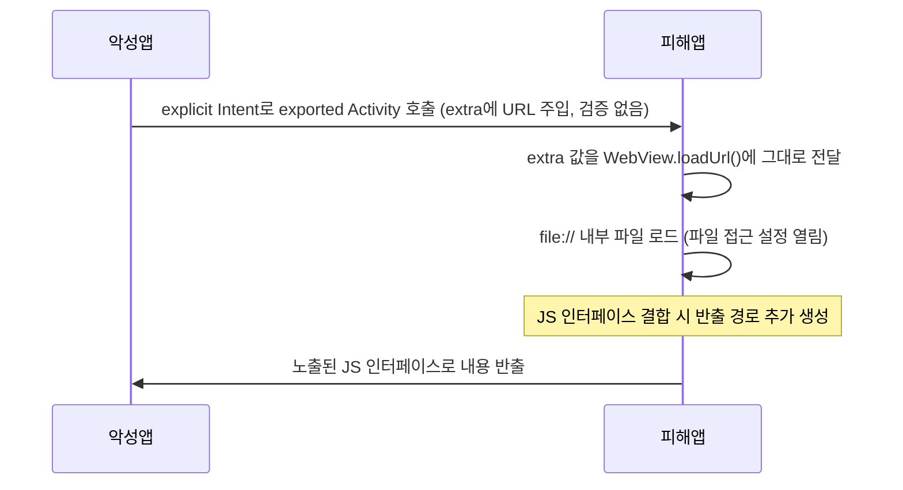

[[모바일 취약점 진단 — 안드로이드 정적분석]]에서 `android:exported`를 어떻게 찾는지는 이미 다뤘으니, 이 글은 그 다음 단계인 **"그 Intent로 실제로 뭘 할 수 있는가"**에 집중합니다. exported 컴포넌트는 공격면이 "있다"는 사실일 뿐이고, 실제 취약점이 되려면 그 컴포넌트가 외부에서 들어온 값을 검증 없이 민감한 동작에 그대로 쓰는 조건이 하나 더 필요합니다. 아래 각 항목은 그 조건을 구체적으로 짚습니다.

---

## 1. 인텐트 기반 공격면 개요

**원리**: 다른 앱이 Activity/Service/BroadcastReceiver에 접근할 수 있는지는 **exported 여부와, 그 컴포넌트를 호출하는 데 필요한 권한(permission)** 두 가지로 정해집니다 — `exported="false"`라도 권한이 없다는 사실만으로 열리지는 않고, 반대로 `exported="true"`여도 signature 보호 수준의 권한이 걸려 있으면 아무 앱이나 호출하지 못합니다. API 31(Android 12) 이상을 타깃하는 앱은 intent-filter가 있는 Activity/Service/Receiver에 한해 `exported` 값을 매니페스트에 명시하지 않으면 Android 12+ 기기에 설치 자체가 거부되므로, "암묵적 기본값"에 기대는 구멍은 최신 앱에서는 줄었습니다 — 다만 intent-filter가 없는 컴포넌트에는 이 의무가 적용되지 않고, 명시적으로 `exported="true"`를 선언했거나 구형 `targetSdkVersion`을 유지한 앱에는 기존 암묵적 기본값이 그대로 적용됩니다(ContentProvider는 이 규칙과 별개로 API 17부터 기본값이 이미 `false`입니다). 이 판정 자체(정적분석으로 어떤 컴포넌트가 열려 있는지 찾는 방법)는 [[모바일 취약점 진단 — 안드로이드 정적분석]]에서 다뤘으므로, 이 글은 "열려 있는 컴포넌트를 찾은 뒤" 그 Intent/Uri/브로드캐스트를 통해 실제로 어떤 동작을 유발할 수 있는지, 그리고 그게 성립하는 정확한 조건이 무엇인지를 다룹니다.

- 체크 포인트: 대상 컴포넌트가 exported인지는 이미 확인됐다고 가정하고, ① 외부에서 전달된 값(Intent extra, Uri, 브로드캐스트 데이터)을 검증 없이 쓰는지 ② 그 값으로 하는 동작이 민감한지(파일 접근, 인증 우회, 상태 변경, 코드 실행) 두 가지가 동시에 성립하는지를 본다
- 참고: [Android Developers — Intents and Intent Filters](https://developer.android.com/guide/components/intents-filters), [Android Developers — activity-element exported](https://developer.android.com/guide/topics/manifest/activity-element#exported)

## 2. Activity 하이재킹

여기서 말하는 "하이재킹"은 다른 앱이 암묵적 Intent를 가로채 대신 받는 전통적인 의미가 아니라, **exported 상태를 이용해 그 Activity를 직접 호출하면서 입력값을 주입**하는 쪽입니다.

**원리**: exported Activity가 Intent의 extra로 URL, 파일 경로, WebView에 로드할 대상 등을 받아 검증 없이 그대로 사용하면, 악성 앱은 암묵적 인텐트 필터 매칭을 거치지 않고 **explicit Intent**(`setComponent(ComponentName(패키지명, 클래스명))`)로 그 Activity를 직접 호출해 원하는 extra를 주입할 수 있습니다. exported 여부는 "누가 이 컴포넌트를 실행할 수 있는가"만 결정할 뿐, explicit Intent는 action/category 필터 조건과 무관하게 컴포넌트를 바로 타겟팅하므로 필터 설정은 이 공격의 방어책이 되지 않습니다. 실제로 자주 보이는 패턴은 extra로 받은 URL을 `WebView.loadUrl()`에 그대로 넘기는 경우(스킴 제한이 없고 WebView의 파일 접근 설정(`setAllowFileAccess` 등)이 열려 있으면 `file://`로 읽을 수 있는 내부 파일을 로드할 수 있고, 여기에 노출된 JS 인터페이스가 결합되면 그 내용을 앱 밖으로 빼낼 추가 경로가 생김), extra의 파일 경로를 검증 없이 읽어 들이는 경우, extra 값으로 로그인/결제 완료 같은 내부 상태 플래그를 덮어쓰는 경우입니다. 반대로 Activity가 extra를 전혀 쓰지 않거나 받은 값의 화이트리스트 검증을 하면 exported여도 이 시나리오는 성립하지 않습니다.

- 체크 포인트: exported Activity가 `getIntent().getExtras()`/`getData()` 값을 WebView 로드, 파일 I/O, 다른 Intent 재전달에 검증 없이 쓰는지, 그 값에 스킴/경로/도메인 화이트리스트가 있는지, PoC 작성 시 암묵적 인텐트가 아니라 explicit Intent로 직접 호출해도 진입되는지(`adb shell am start -n 패키지/컴포넌트 --es key value`)
- 참고: [OWASP MASTG-TEST-0364 — Exported Activities Without Protection](https://mas.owasp.org/MASTG/tests/android/MASVS-PLATFORM/MASTG-TEST-0364/), [OWASP MASTG-TEST-0373 — Accidentally Exported Activities](https://mas.owasp.org/MASTG/tests/android/MASVS-PLATFORM/MASTG-TEST-0373/), [Android Developers — WebView unsafe file inclusion](https://developer.android.com/privacy-and-security/risks/webview-unsafe-file-inclusion)

## 3. 민감 Service 직접 호출

**원리**: Service는 UI가 없어서 "눈에 보이는" 공격면이 아니지만, exported Service가 호출자를 검증하지 않은 채 결제 처리, 파일 접근, 설정 변경 같은 민감 기능을 수행하면 악성 앱이 `startService()`/`bindService()`로 그 기능을 사용자 화면 전환 없이 바로 트리거할 수 있습니다. 정상적인 방어는 매니페스트의 `android:permission`(특히 `signature` 보호 수준)으로 아예 호출 가능한 앱 자체를 제한하는 것이고, 이게 없으면 전달된 Intent의 action/extra만으로 분기해 기능을 실행할 때 호출자가 누구든 같은 결과를 얻습니다. `bindService()`로 바인딩해 `AIDL`/`Messenger` 인터페이스를 직접 호출하는 구조라면 `Binder` 메서드 구현부 안에서 `Binder.getCallingUid()`로 호출자 UID를 확인해 신뢰하는 패키지 목록과 대조하는 방식이 유효합니다 — 다만 이 값은 **현재 처리 중인 Binder 트랜잭션의 호출자**를 가리키므로 단순 `startService()`/`onStartCommand()` 경로(Binder 호출 문맥이 아님)에는 쓸 수 없고, UID 확인 자체도 결과를 신뢰할 수 있는 패키지 allowlist와 비교할 때만 의미가 있습니다. `bindService()` + AIDL 구조는 메서드 단위로 임의 호출이 가능해지므로 영향 범위가 더 큽니다.

- 체크 포인트: exported Service가 매니페스트 `android:permission`으로 호출 가능한 앱 자체를 제한하는지, 민감 동작(결제, 파일 쓰기, 권한 상승)이 Intent action만으로 분기되는지, `bindService` + AIDL 구조라면 Binder 메서드 안에서 `getCallingUid()`를 신뢰 패키지 allowlist와 비교하는지
- 참고: [Android Developers — service-element exported](https://developer.android.com/guide/topics/manifest/service-element#exported), [Android Developers — Security tips: IPC](https://developer.android.com/privacy-and-security/security-tips#IPC)

## 4. 브로드캐스트 스니핑과 스푸핑

**원리**: 양방향 문제입니다. 먼저 송신 측: `sendBroadcast()`로 보낸 **암묵적 브로드캐스트**(대상 패키지를 지정하지 않은 브로드캐스트)는 기기에 설치된 다른 앱이 같은 action을 구독하고 있으면 그 데이터(토큰, 민감 정보)를 가로챌 수 있습니다. 단, API 26(Android 8) **이상을 타깃하는 앱**이 매니페스트에 정적으로 등록한 리시버는 대부분의 암묵적 브로드캐스트를 받을 수 없게 제한됐으므로(구형 타깃 앱과 예외 목록에 해당하는 일부 시스템 브로드캐스트는 적용 대상이 아님), 이 제한이 적용되는 환경에서 실제로 가로챌 수 있는 쪽은 주로 **런타임에 `registerReceiver()`로 동적 등록된 리시버**(앱이 실행 중일 때만 유효)입니다. 반대로 수신 측: exported BroadcastReceiver가 `onReceive()`에서 발신자를 검증하지 않으면, 악성 앱이 같은 action으로 위조된 브로드캐스트를 보내 상태를 조작할 수 있습니다(예: "결제 완료" 브로드캐스트를 흉내 내 앱 상태를 바꾸는 경우). 두 방향은 서로 다른 지점을 보호해야 합니다 — 송신 측은 대상 패키지를 명시한 explicit 브로드캐스트나 `sendBroadcast(intent, receiverPermission)`으로 커스텀 signature 권한을 걸어 수신자를 제한해야 스니핑이 막히고, 수신 측은 `exported="false"` 또는 발신자에게 동일한 권한을 요구해야 스푸핑이 막힙니다 — 한쪽만 고쳐서는 다른 방향의 문제가 그대로 남습니다. 참고로 androidx `LocalBroadcastManager`는 이 문제를 프로세스 내부로 한정해 구조적으로 해결하는 방식이었지만 현재 Google이 공식적으로 deprecated 처리했으므로, 신규 코드에서는 `LiveData`/`Flow` 같은 인앱 이벤트 전달 수단으로 대체하는 것이 권장됩니다.

- 체크 포인트: 민감 데이터를 담은 브로드캐스트가 explicit 대상 지정이나 `receiverPermission` 없이 `sendBroadcast()`로 나가는지, exported Receiver의 `onReceive()`가 발신자 권한/서명을 검증하는지, 코드가 여전히 deprecated된 `LocalBroadcastManager`에 의존 중인지
- 참고: [Android Developers — Broadcasts overview](https://developer.android.com/guide/components/broadcasts), [Android Developers — LocalBroadcastManager (deprecated)](https://developer.android.com/reference/androidx/localbroadcastmanager/content/LocalBroadcastManager)

## 5. ContentProvider SQL 인젝션/경로 순회

**원리**: exported ContentProvider의 `query()`/`update()`/`delete()`가 호출자로부터 받은 `selection` 문자열을 `SQLiteQueryBuilder.appendWhere()` 등으로 **그대로 이어 붙이면**(파라미터 바인딩용인 `selectionArgs`를 쓰지 않으면) SQL Injection이 성립합니다. `selectionArgs`를 쓰더라도 `projection`(조회할 컬럼 목록) 배열을 검증 없이 그대로 쿼리에 꽂아 넣으면, 공격자가 컬럼명 자리에 서브쿼리 표현식을 넣어 다른 테이블 값을 끌어오는 projection injection으로 이어질 수 있습니다. 한편 파일을 다루는 Provider(`openFile()`/`openAssetFile()`)가 Uri의 경로 세그먼트를 검증 없이 `new File(baseDir, path)` 식으로 조합하면 `../`를 포함한 경로로 지정 디렉터리 밖의 파일에 접근하는 경로 순회가 가능합니다 — 다만 그 범위는 **Provider를 호스팅하는 앱 프로세스가 OS 권한상 실제로 읽고 쓸 수 있는 파일**로 한정됩니다. 보통은 그 앱 자신의 샌드박스 디렉터리 안에서 노출시키지 않으려던 다른 파일(설정, 캐시, 다른 사용자의 로컬 데이터)이 대상이고, UID 샌드박싱을 넘어 다른 앱의 전용 저장소까지 읽을 수 있다는 뜻은 아닙니다. 두 경우 모두 전제는 동일합니다 — exported Provider가 호출자 구분 없이 쿼리를 받고, 입력값을 검증·이스케이프·경로 정규화 없이 그대로 하위 계층(SQL 문자열, 파일시스템 API)에 전달하는 것.

- 체크 포인트: `selection`을 문자열 결합으로 조립하는지(`selectionArgs` 플레이스홀더 사용 여부), `projection` 배열을 화이트리스트 컬럼으로 제한하는지, 파일 기반 Provider가 경로 세그먼트를 정규화(canonical path) 후 허용 디렉터리 안인지 검사하는지, exported Provider에 `readPermission`/`writePermission`이 걸려 있는지
- 참고: [OWASP MASTG-TEST-0339 — SQL Injection in Content Providers](https://mas.owasp.org/MASTG/tests/android/MASVS-CODE/MASTG-TEST-0339/), [Android Developers — Content provider permissions](https://developer.android.com/guide/topics/providers/content-provider-creating#Permissions)

## 6. 딥링크 변조

**원리**: 커스텀 URL 스킴(`myapp://...`)과 Android App Links(`https://` 기반)는 검증 메커니즘이 다릅니다. App Links는 intent-filter에 `android:autoVerify="true"`를 걸면 시스템이 설치 시 해당 도메인의 `https://도메인/.well-known/assetlinks.json`(Digital Asset Links)을 확인해, 검증에 성공한 앱만 디스앰비규에이션 없이 그 도메인의 링크를 받도록 만듭니다 — 즉 도메인 소유권 검증은 이 스킴 선점 문제를 구조적으로 줄여주지만, `autoVerify`를 걸고 `assetlinks.json`을 배포했다는 사실만으로 검증이 끝났다고 단정할 수는 없고 실제 기기에서 도메인 검증 상태(`adb shell pm get-app-links`)를 확인해야 하며, 같은 도메인에 정당하게 여러 앱이 연결되는 경우도 있습니다. 반면 커스텀 스킴은 애초에 이 검증 대상이 아니라서(`http`/`https` 필터만 autoVerify 대상), 여러 앱이 동일한 스킴을 intent-filter로 등록하면 어느 앱이 응답할지는 디스앰비규에이션 다이얼로그나 사용자가 과거에 고른 기본 앱 설정에 따라 달라지고 — 설치 순서만으로 결과를 예단할 수는 없지만 — 사용자가 매번 선택하지 않는 환경에서는 악성 앱이 응답할 가능성이 구조적으로 남습니다. 그리고 App Links로 검증됐다고 해도 그 자체가 "URL 파라미터의 내용"까지 검증해 주는 건 아니라는 점이 중요합니다 — 딥링크는 어떤 웹페이지(피싱 사이트 포함)나 다른 앱에서도 호출 가능한 공개된 진입점이므로, 2번 Activity 하이재킹과 동일한 조건(전달된 파라미터를 검증 없이 민감 동작에 사용)이 여기서는 악성 앱 설치 없이 피싱 링크 클릭만으로도 성립할 수 있습니다.

- 체크 포인트: intent-filter가 커스텀 스킴인지 `http`/`https`(App Links)인지, App Links라면 `autoVerify="true"`가 걸려 있고 `assetlinks.json`이 실제로 배포돼 있는지, 딥링크로 진입하는 Activity가 쿼리 파라미터를 검증 없이 민감 동작(인증 상태 변경, 화면 전환, WebView 로드)에 쓰는지
- 참고: [OWASP MASTG-TEST-0393 — Use of Unverified App Links](https://mas.owasp.org/MASTG/tests/android/MASVS-PLATFORM/MASTG-TEST-0393/), [Android Developers — Verify Android App Links](https://developer.android.com/training/app-links/verify-android-applinks)

## 7. PendingIntent 가변성(mutability) 문제

**원리**: `PendingIntent`는 자신이 감싼 Intent를 실행할 권한을 다른 컴포넌트(시스템 알림, 다른 앱의 위젯 호스트 등)에 위임하는 토큰입니다. `FLAG_MUTABLE`로 생성하면 그 토큰을 전달받은 쪽이 `Intent.fillIn()`으로 **원본 Intent에서 비어 있던 필드**(action/데이터/카테고리/extra 등, 생성 시 지정하지 않은 부분)를 채우거나 덮어쓸 수 있는데 — 이미 명시적으로 채워진 필드까지 마음대로 바뀌는 건 아닙니다 — 그 PendingIntent 토큰을 공격자가 실제로 손에 넣을 수 있는 경로(알림 클릭 인텐트 유출, 다른 앱에 그대로 전달 등)가 있어야 악용이 성립합니다. API 31(Android 12)부터 이 API 레벨을 타깃하는 앱은 `PendingIntent` 생성 시 `FLAG_MUTABLE`/`FLAG_IMMUTABLE` 중 하나를 **반드시 명시**해야 하며, 생략하면 생성 시점에 `IllegalArgumentException`이 발생합니다(API 30 이하 타깃 앱에는 이 강제가 적용되지 않고, 과거처럼 플래그 없이 생성하면 암묵적으로 가변 상태가 됩니다). API 34(Android 14)부터는 한 단계 더 나아가, **컴포넌트나 패키지를 지정하지 않은 암묵적 Intent를 `FLAG_MUTABLE`로 감싸 PendingIntent를 만들면 그 자체가 예외**를 던지므로(베이스 Intent를 explicit으로 만들면 회피 가능), "암묵적 Intent + MUTABLE" 조합은 최신 타깃 앱에서는 사실상 막힙니다. 알림의 `RemoteInput`(인라인 답장)처럼 시스템이 나중에 Intent의 필드를 채워 넣어야 하는 경우를 제외하면 `FLAG_IMMUTABLE`이 기본 선택지입니다.

- 체크 포인트: `PendingIntent.getActivity/getService/getBroadcast` 호출부에 `FLAG_MUTABLE`/`FLAG_IMMUTABLE`이 명시돼 있는지, `FLAG_MUTABLE`을 쓴다면 베이스 Intent가 explicit인지, 그 PendingIntent 토큰이 알림·브로드캐스트·다른 앱 전달 등으로 실제로 외부에 노출되는 경로가 있는지, `targetSdkVersion`이 낮아 API 34+의 암묵적 Intent 제한을 받지 않는 상태인지
- 참고: [OWASP MASTG-TEST-0381 — Insecure PendingIntent Creation](https://mas.owasp.org/MASTG/tests/android/MASVS-PLATFORM/MASTG-TEST-0381/), [Android Developers — Pending intents](https://developer.android.com/privacy-and-security/risks/pending-intent), [Android Developers — Android 14 behavior changes: PendingIntent](https://developer.android.com/about/versions/14/behavior-changes-14#pending-intents)

---

## 정리

| 공격면 | 핵심 질문 | 성립 조건 |
|---|---|---|
| Activity 하이재킹 | extra를 검증 없이 쓰는가? | exported + explicit Intent로 직접 타겟팅 가능 + extra가 민감 동작에 직결 |
| 민감 Service | 호출자를 검증하는가? | exported + UID/서명 검증 없음 + 민감 기능 수행 |
| 브로드캐스트 | 도달 범위가 제한돼 있는가? | 암묵적 송신(동적 등록 리시버가 수신) 또는 exported Receiver의 발신자 미검증 |
| ContentProvider | selection/projection/경로가 검증되는가? | raw SQL 결합 또는 경로 미정규화 |
| 딥링크 | App Links 검증이 돼 있는가? | 커스텀 스킴 선점 가능 또는 파라미터 미검증 |
| PendingIntent | mutability가 명시돼 있는가? | 토큰이 외부에 노출 가능 + FLAG_MUTABLE + fillIn()으로 채울 수 있는 미지정 필드가 공격에 쓰임 |

더 깊이 보려면 [[모바일 취약점 진단 — 안드로이드 정적분석]]에서 이 컴포넌트들을 먼저 찾아낸 뒤, 이 글의 체크 포인트로 "찾은 다음에 뭘 할 수 있는지"를 검증하는 순서를 권합니다.
