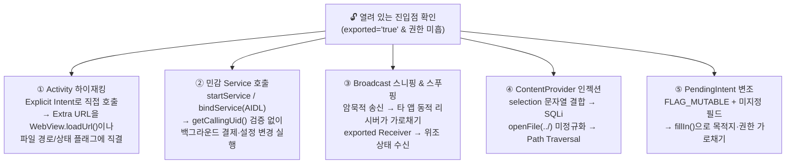
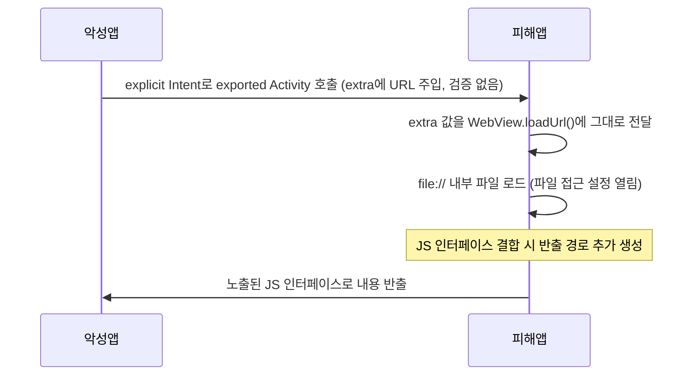

> [!summary] ⏱️ 5초 핵심 요약
> - **한 줄 비유**: 안드로이드 앱의 4대 컴포넌트(Activity·Service·Receiver·Provider)는 건물 안의 각 부서 창구입니다. **`exported="true"`가 외부 방문객에게 창구 문을 열어둔 것**이라면, **실제 IPC 취약점은 창구 직원이 방문객의 신분증(`permission`·`getCallingUid`)도 안 보고, 방문객이 내민 쪽지(`Intent extra`·`URI`·`SQL 조건문`)를 검증 없이 내부 금고나 결제 시스템에 그대로 입력할 때** 터집니다.
> - **핵심 원리**: IPC 취약점이 성립하려면 **`① 외부 접근 가능(exported="true" + 강한 권한 제한 부재)` + `② 외부 입력값(Extra/URI/Selection) 미검증` + `③ 민감한 내부 동작(WebView 로드·파일 I/O·SQL 실행·상태 변경) 직결`**이라는 3단계 조건이 동시에 충족되어야 합니다.
> - **핵심 방어**: 내부 전용 컴포넌트는 `exported="false"`로 닫고, 앱 간 통신이 필수라면 `signature` 수준 커스텀 권한 및 `Binder.getCallingUid()` 검증, ContentProvider 파라미터 바인딩(`selectionArgs`) 및 경로 정규화(`canonicalPath`), `PendingIntent`에 `FLAG_IMMUTABLE`을 강제해야 합니다.

[[모바일 취약점 진단 — 안드로이드 정적분석]]에서 `android:exported`를 어떻게 찾는지는 이미 다뤘으니, 이 글은 그 다음 단계인 **"그 Intent로 실제로 뭘 할 수 있는가"**에 집중합니다. exported 컴포넌트는 공격면이 "있다"는 사실일 뿐이고, 실제 취약점이 되려면 그 컴포넌트가 외부에서 들어온 값을 검증 없이 민감한 동작에 그대로 쓰는 조건이 하나 더 필요합니다. 아래 각 항목은 그 조건을 구체적으로 짚습니다.



---

## 한눈에 보는 안드로이드 IPC 6대 공격면 요약표

| 공격면 분류 | 핵심 진입 API / 메커니즘 | 취약점 성립 필수 조건 | ADB 테스트 명령어 / 방어 포인트 |
|---|---|---|---|
| **1. Activity 하이재킹** | `getIntent().getExtras()` / `getData()` → `WebView.loadUrl` 등 | exported + explicit Intent 호출 가능 + extra 값을 스킴/도메인 검증 없이 민감 동작에 사용 | `adb shell am start -n pkg/.Act --es url "file://..."`<br/>방어: `exported="false"` 또는 엄격한 화이트리스트 |
| **2. 민감 Service 호출** | `startService()` / `bindService()` (`AIDL`·`Messenger`) | exported + `android:permission`(`signature`) 부재 + `Binder.getCallingUid()` 미검증 | `adb shell am startservice -n pkg/.Svc`<br/>방어: `signature` 권한 + `getCallingUid()` 패키지 대조 |
| **3. Broadcast 양방향 위협** | 송신: `sendBroadcast()`<br/>수신: `onReceive()` | 송신 시 대상 패키지/`receiverPermission` 미지정(동적 리시버 스니핑) 또는 수신 시 발신자 미검증(스푸핑) | `adb shell am broadcast -a com.app.ACTION`<br/>방어: Explicit 지정, `signature` 권한, 인앱은 `Flow`/`LiveData` |
| **4. ContentProvider 공격** | `query()` (`selection`, `projection`) / `openFile()` | raw SQL 문자열 결합(SQLi), 컬럼 미검증(Projection Injection), 경로 미정규화(Path Traversal) | `adb shell content query --uri content://...`<br/>방어: `selectionArgs` 바인딩, `canonicalPath` 검증 |
| **5. 딥링크 변조** | `<intent-filter>` (`myapp://` vs `autoVerify="true"`) | 커스텀 스킴 선점 가능 또는 딥링크 쿼리 파라미터를 검증 없이 민감 기능에 직결 | `adb shell am start -W -a android.intent.action.VIEW -d "..."`<br/>방어: App Links 검증 + 파라미터 검증 |
| **6. PendingIntent 변조** | `PendingIntent.get*()` + `Intent.fillIn()` | 외부에 토큰 노출 + **`FLAG_MUTABLE`** + 베이스 Intent의 비어 있는 필드가 악용 가능 | 방어: 기본적으로 **`FLAG_IMMUTABLE`** 사용 (API 31+ 명시 의무, API 34+ 암묵적+MUTABLE 예외 발생) |

---

## 1. 인텐트 기반 공격면 개요

**💡 한 줄 비유**: 건물 문이 열려 있다(`exported="true"`)는 것만으로는 범죄가 되지 않습니다. **문 앞에 청원경찰(`android:permission`)이 없고, 안에 있는 직원이 외부인이 건넨 서류(`Intent extra`)를 확인도 안 하고 금고 시스템에 그대로 입력할 때** 비로소 사고가 터집니다.

### 핵심 원리
- 다른 앱이 Activity/Service/BroadcastReceiver에 접근할 수 있는지는 **① `exported` 여부**와 **② 호출에 필요한 권한(`android:permission`, 특히 `signature` 보호 수준)** 두 가지로 결정됩니다.
- **API 31(Android 12) 이상 타깃 앱의 변화**: `intent-filter`가 있는 Activity/Service/Receiver는 `exported`를 매니페스트에 명시하지 않으면 설치 자체가 거부됩니다. 단, `intent-filter`가 없는 컴포넌트나 구형 `targetSdkVersion` 앱, 또는 개발자가 습관적으로 `exported="true"`를 적어둔 컴포넌트는 여전히 주요 점검 대상입니다(ContentProvider는 API 17부터 기본값이 이미 `false`입니다).
- 이 글에서는 정적분석으로 열린 컴포넌트를 찾은 뒤, **외부 입력값 미검증 + 민감 동작 수행**이 어떻게 결합되는지 확인합니다.

### 체크 포인트
- 대상 컴포넌트가 exported이고 호출 측 권한 제한(`signature` 권한 등)이 없는지 먼저 확인한다.
- ① 외부에서 전달된 값(Intent extra, Uri, 브로드캐스트 데이터)을 검증 없이 쓰는지, ② 그 값으로 수행하는 동작이 민감한지(파일 접근, 인증 우회, 상태 변경, 코드 실행) 두 가지가 동시에 성립하는지 본다.
- 참고: [Android Developers — Intents and Intent Filters](https://developer.android.com/guide/components/intents-filters), [Android Developers — activity-element exported](https://developer.android.com/guide/topics/manifest/activity-element#exported)

---

## 2. Activity 하이재킹 (Explicit Intent 입력 주입)

**💡 한 줄 비유**: 정문 안내 데스크(`intent-filter` 조건)를 거치지 않고도, **부서 호실 번호(`패키지명/클래스명`)를 직접 찍어(Explicit Intent) 뒷문으로 불쑥 들어간 뒤 위조된 작업 지시서(`extra`)를 건네는 방식**입니다.



### 핵심 원리
- 여기서 다루는 하이재킹은 다른 앱이 암묵적 Intent를 가로채는 것이 아니라, **`exported="true"`인 Activity를 악성 앱이 Explicit Intent(`setComponent`)로 직접 호출하면서 조작된 extra/data를 주입**하는 공격입니다.
- **중요**: Explicit Intent는 `intent-filter`의 action/category 조건을 아예 검사하지 않고 컴포넌트를 바로 타겟팅하므로, 매니페스트의 필터 설정은 방어책이 되지 않습니다.
- **대표적인 악용 패턴 3가지**:
  1. extra로 받은 URL을 **`WebView.loadUrl()`**에 그대로 전달 (`file://` 파일 접근 설정이나 노출된 JS 브리지와 결합 시 내부 파일 유출 — 상세 조건은 [[모바일 취약점 진단 — WebView와 파일 접근 취약점]] 참고)
  2. extra로 받은 파일 경로를 검증 없이 읽어 들여 처리
  3. extra 값으로 로그인 완료·결제 인증 같은 내부 상태 플래그를 덮어쓰기

### 체크 포인트
- exported Activity가 `getIntent().getExtras()`/`getData()` 값을 WebView 로드, 파일 I/O, 다른 Intent 재전달에 검증 없이 쓰는지 확인한다.
- 입력값에 스킴/경로/도메인 화이트리스트 검증이 있는지 확인한다.
- PoC 작성 시 암묵적 인텐트가 아니라 explicit Intent로 직접 호출해 진입되는지 테스트한다(`adb shell am start -n 패키지/컴포넌트 --es key value`).
- 참고: [OWASP MASTG-TEST-0364 — Exported Activities Without Protection](https://mas.owasp.org/MASTG/tests/android/MASVS-PLATFORM/MASTG-TEST-0364/), [OWASP MASTG-TEST-0373 — Accidentally Exported Activities](https://mas.owasp.org/MASTG/tests/android/MASVS-PLATFORM/MASTG-TEST-0373/), [Android Developers — WebView unsafe file inclusion](https://developer.android.com/privacy-and-security/risks/webview-unsafe-file-inclusion)

---

## 3. 민감 Service 직접 호출

**💡 한 줄 비유**: Service는 창문(화면 UI)이 없는 지하 기계실입니다. 기계실 문이 열려 있으면(`exported="true"`), 악성 앱이 **투숙객(사용자) 눈에는 아무 화면도 띄우지 않은 채 조용히 지하로 내려가 결제 레버나 파일 백업 스위치(`startService` / `bindService`)를 당길 수 있습니다.**

### 핵심 원리
- exported Service가 호출자를 검증하지 않고 결제 처리, 파일 접근, 설정 변경 같은 민감 기능을 수행하면 악성 앱이 화면 전환 없이 즉시 트리거할 수 있습니다.
- **`startService()` vs `bindService()` 검증 방식의 차이**:
  - **매니페스트 레벨 방어**: `android:permission`(특히 `signature` 보호 수준)으로 호출 가능한 앱 자체를 제한하는 것이 가장 확실합니다.
  - **`Binder.getCallingUid()` 검증 (`bindService` + `AIDL`/`Messenger`)**: 바인딩된 Binder 메서드 구현부 안에서는 `Binder.getCallingUid()`로 현재 Binder 트랜잭션 호출자의 UID를 얻어 신뢰 패키지 allowlist와 대조할 수 있습니다. **단, 이 메서드는 Binder 호출 문맥에서만 유효하므로 단순 `startService()` → `onStartCommand()` 경로에서는 사용할 수 없습니다.**

### 체크 포인트
- exported Service가 매니페스트 `android:permission`(`signature` 레벨)으로 호출 가능한 앱을 제한하는지 확인한다.
- 민감 동작(결제, 파일 쓰기, 권한 상승)이 검증 없이 Intent action/extra만으로 분기되는지 확인한다.
- `bindService` + AIDL/Messenger 구조라면 Binder 메서드 안에서 `Binder.getCallingUid()`를 신뢰 패키지 allowlist와 비교하는지 확인한다.
- 참고: [Android Developers — service-element exported](https://developer.android.com/guide/topics/manifest/service-element#exported), [Android Developers — Security tips: IPC](https://developer.android.com/privacy-and-security/security-tips#IPC)

---

## 4. 브로드캐스트 스니핑과 스푸핑

**💡 한 줄 비유**: **스니핑(송신 문제)**이 사내 비밀 공지를 수신자 지정 없이 **건물 전체 확성기(`sendBroadcast`)**로 방송해 옆집 스파이(타 앱의 동적 등록 리시버)가 받아 적는 것이라면, **스푸핑(수신 문제)**은 우리 부서 무전기(`exported Receiver`) 주파수가 공개되어 있어 외부인이 **"사장님 지시입니다, 금고 여세요!"라고 가짜 무전**을 날리는 것입니다.

### 양방향 위협 구조와 OS 버전별 제약
1. **송신 측 (브로드캐스트 스니핑)**:
   - 대상 패키지를 지정하지 않은 암묵적 `sendBroadcast()`에 토큰이나 개인정보를 실어 보내면 같은 action을 구독 중인 다른 앱이 가로챌 수 있습니다.
   - *(참고: API 26(Android 8) 이상 타깃 앱은 매니페스트에 정적으로 등록한 리시버로 대부분의 암묵적 브로드캐스트를 받을 수 없게 제한되었으므로, 실제로 가로채는 쪽은 주로 실행 중에 **`registerReceiver()`로 동적 등록된 리시버**입니다.)*
   - **방어**: 수신 앱 패키지를 명시(Explicit)하거나 `sendBroadcast(intent, receiverPermission)`으로 `signature` 권한을 요구해야 합니다.
2. **수신 측 (브로드캐스트 스푸핑)**:
   - exported BroadcastReceiver가 발신자를 검증하지 않으면 악성 앱이 위조된 상태 변경 브로드캐스트를 보낼 수 있습니다.
   - **방어**: `exported="false"`로 닫거나 `<receiver android:permission="...">`으로 발신자 권한을 제한합니다.
3. **`LocalBroadcastManager` 사용 중단(Deprecated) 주의**:
   - 과거 프로세스 내부 전용 브로드캐스트에 쓰이던 `androidx.localbroadcastmanager.content.LocalBroadcastManager`는 현재 공식 **deprecated** 처리되었으므로, 신규 코드에서는 `LiveData`나 Kotlin `Flow` 같은 인앱 이벤트 전달 수단으로 대체해야 합니다.

### 체크 포인트
- 민감 데이터를 담은 브로드캐스트가 explicit 대상 지정이나 `receiverPermission` 없이 `sendBroadcast()`로 나가는지 확인한다.
- exported Receiver의 `onReceive()`가 발신자 권한/서명을 검증하는지 확인한다.
- 코드가 여전히 deprecated된 `LocalBroadcastManager`에 의존 중인지 확인한다.
- 참고: [Android Developers — Broadcasts overview](https://developer.android.com/guide/components/broadcasts), [Android Developers — LocalBroadcastManager (deprecated)](https://developer.android.com/reference/androidx/localbroadcastmanager/content/LocalBroadcastManager)

---

## 5. ContentProvider SQL 인젝션/경로 순회

**💡 한 줄 비유**: 도서관 자료 대출 창구(`ContentProvider`)에서 직원이 대출 신청서의 **도서 검색 조건(`selection`·`projection`)을 데이터베이스 명령어에 그대로 풀칠해 붙이거나(SQL Injection)**, 신청서에 적힌 **`../../원장실/기밀문서.txt` 경로를 확인 없이 그대로 가져다주는(Path Traversal)** 실수입니다.

### 핵심 원리
1. **SQL Injection (`selection` & `projection`)**:
   - exported ContentProvider의 `query()`/`update()`/`delete()`가 호출자가 넘긴 `selection` 문자열을 파라미터 바인딩(`selectionArgs`의 `?` 플레이스홀더) 없이 문자열 결합이나 `SQLiteQueryBuilder.appendWhere()`로 그대로 이어 붙이면 SQL Injection이 성립합니다.
   - `selectionArgs`를 쓰더라도 조회할 컬럼 목록인 **`projection` 배열**을 화이트리스트 검증 없이 그대로 쿼리에 넣으면, 컬럼명 자리에 서브쿼리를 넣어 다른 테이블 데이터를 빼내는 **Projection Injection**이 가능합니다.
2. **경로 순회 (`openFile` / `openAssetFile` Path Traversal)**:
   - 파일을 반환하는 Provider가 URI의 경로 세그먼트를 검증 없이 `new File(baseDir, path)`로 조합하면 `../`를 이용해 지정 디렉터리 밖의 파일에 접근할 수 있습니다.
   - **피해 범위의 경계**: 이때 읽을 수 있는 범위는 **Provider를 호스팅하는 앱 프로세스가 OS UID 권한상 읽을 수 있는 파일(즉, 해당 앱 자신의 샌드박스 내 다른 설정·DB·캐시 파일)**로 한정되며, 다른 앱의 전용 저장소까지 넘어가는 것은 아닙니다.

### 취약한 구현 vs 안전한 방어 구현
```kotlin
// ❌ 취약한 구현: selection 문자열 직접 결합(SQLi) 및 파일 경로 미정규화(Path Traversal)
override fun query(uri: Uri, projection: Array<String>?, selection: String?, selectionArgs: Array<String>?, sortOrder: String?): Cursor? {
    val sql = "SELECT * FROM notes WHERE title = '$selection'" // SQL Injection!
    return db.rawQuery(sql, null)
}
override fun openFile(uri: Uri, mode: String): ParcelFileDescriptor? {
    val file = File(context!!.filesDir, uri.lastPathSegment!!) // "../shared_prefs/auth.xml" 우회 위험!
    return ParcelFileDescriptor.open(file, ParcelFileDescriptor.MODE_READ_ONLY)
}

// ✅ 안전한 구현: selectionArgs 바인딩 및 canonicalPath(정규화 경로) 접두사 검증
override fun openFile(uri: Uri, mode: String): ParcelFileDescriptor? {
    val baseDir = File(context!!.filesDir, "public_docs").canonicalFile
    val targetFile = File(baseDir, uri.lastPathSegment ?: "").canonicalFile
    if (!targetFile.path.startsWith(baseDir.path + File.separator)) {
        throw SecurityException("Path traversal attempt blocked")
    }
    return ParcelFileDescriptor.open(targetFile, ParcelFileDescriptor.MODE_READ_ONLY)
}
```

### 체크 포인트
- `selection`을 문자열 결합으로 조립하는지(`selectionArgs` 플레이스홀더 사용 여부) 확인한다.
- `projection` 배열을 허용된 컬럼 화이트리스트로 제한하는지 확인한다.
- 파일 기반 Provider가 경로 세그먼트를 정규화(`getCanonicalPath` / `canonicalFile`)한 후 허용 디렉터리 하위인지 검사하는지 확인한다.
- exported Provider에 적절한 `readPermission`/`writePermission`이 걸려 있는지 확인한다.
- 참고: [OWASP MASTG-TEST-0339 — SQL Injection in Content Providers](https://mas.owasp.org/MASTG/tests/android/MASVS-CODE/MASTG-TEST-0339/), [Android Developers — Content provider permissions](https://developer.android.com/guide/topics/providers/content-provider-creating#Permissions)

---

## 6. 딥링크 변조

**💡 한 줄 비유**: 딥링크는 앱 바깥(웹·메신저)에서 누구나 누를 수 있는 **공개 초인종**입니다. 악성 앱이 기기에 설치되어 있지 않아도, 사용자가 피싱 링크만 누르면 2절의 Activity 하이재킹과 똑같은 입력값이 앱 안으로 들어옵니다.

### 핵심 원리
- **Custom Scheme vs Android App Links**:
  - `http`/`https` 기반 **App Links**는 `android:autoVerify="true"`와 서버의 `/.well-known/assetlinks.json` 검증을 통해 도메인 소유권을 확인하므로 스킴 선점 문제를 구조적으로 줄여줍니다(단, 실제 기기에서 `adb shell pm get-app-links`로 검증 성공 여부를 확인해야 합니다).
  - 반면 **커스텀 스킴(`myapp://`)**은 이 검증 대상이 아니어서 동일 스킴을 등록한 악성 앱이 응답할 가능성이 남습니다.
- **파라미터 검증은 별개**: App Links로 도메인 검증이 완료되었더라도 URL 쿼리 파라미터의 안전성까지 보장해 주지는 않으므로, 전달된 파라미터를 검증 없이 민감 동작(인증 상태 변경, WebView 로드)에 쓰면 피싱 링크 클릭만으로 공격이 성립합니다(심화 내용은 [[모바일 취약점 진단 — 딥링크·앱링크 공격표면]] 참고).

### 체크 포인트
- `intent-filter`가 커스텀 스킴인지 `http`/`https`(App Links)인지 구분한다.
- App Links라면 `autoVerify="true"`가 걸려 있고 `assetlinks.json`이 실제로 검증 통과 상태인지 확인한다.
- 딥링크로 진입하는 Activity가 쿼리 파라미터를 검증 없이 민감 동작에 쓰는지 확인한다.
- 참고: [OWASP MASTG-TEST-0393 — Use of Unverified App Links](https://mas.owasp.org/MASTG/tests/android/MASVS-PLATFORM/MASTG-TEST-0393/), [Android Developers — Verify Android App Links](https://developer.android.com/training/app-links/verify-android-applinks)

---

## 7. PendingIntent 가변성(mutability) 문제

**💡 한 줄 비유**: `PendingIntent`는 남에게 대신 심부름을 시키면서 건네주는 **우리 회사 법인카드와 위임장**입니다. **`FLAG_IMMUTABLE`이 결제처와 금액을 볼펜으로 다 적어 코팅해 주는 것**이라면, **`FLAG_MUTABLE`에 빈칸(미지정 컴포넌트·action·extra)을 남겨 두는 것은 백지 위임장을 주는 격**이어서 심부름꾼이 자기 계좌를 적어 넣을 수(`Intent.fillIn()`) 있습니다.

### 핵심 원리 및 API 레벨별 강제 규칙 변화
- `PendingIntent`는 자신이 감싼 베이스 Intent를 실행할 권한을 다른 컴포넌트(알림 매니저, 다른 앱 위젯 등)에 위임하는 토큰입니다.
- **`FLAG_MUTABLE`과 `Intent.fillIn()`**: `FLAG_MUTABLE`로 생성하면 토큰을 받은 쪽이 `Intent.fillIn()`으로 **원본 Intent에서 비어 있던 필드(생성 시 지정하지 않은 컴포넌트, action, data, extra 등)**를 채워 넣을 수 있습니다(이미 명시적으로 채워진 필드는 기본 플래그로 덮어쓰지 못함).
- **Android 버전별 보안 강화 흐름**:
  - **API 30(Android 11) 이하 타깃**: 플래그를 생략하면 암묵적으로 **가변(Mutable)** 상태로 생성됩니다.
  - **API 31(Android 12) 이상 타깃**: `FLAG_MUTABLE` 또는 `FLAG_IMMUTABLE` 중 하나를 **반드시 명시**해야 하며, 생략 시 `IllegalArgumentException`이 발생합니다.
  - **API 34(Android 14) 이상 타깃**: 컴포넌트나 패키지를 지정하지 않은 **암묵적(Implicit) Intent를 `FLAG_MUTABLE`로 감싸면 그 자체로 예외가 발생**합니다.
- 알림의 인라인 답장(`RemoteInput`) 등 시스템이 필드를 채워야 하는 예외적인 경우를 빼면 항상 **`FLAG_IMMUTABLE`**을 기본으로 사용해야 합니다.

### 체크 포인트
- `PendingIntent.getActivity/getService/getBroadcast` 호출부에 `FLAG_MUTABLE`/`FLAG_IMMUTABLE`이 명시돼 있는지 확인한다.
- 불가피하게 `FLAG_MUTABLE`을 쓴다면 베이스 Intent의 컴포넌트/패키지가 explicit으로 고정되어 있는지 확인한다.
- 해당 `PendingIntent` 토큰이 알림·브로드캐스트·타 앱 전달 등으로 실제로 외부에 노출되는 경로가 있는지 확인한다.
- `targetSdkVersion`이 낮아 API 31+/34+의 보호 제약을 받지 않는 상태인지 확인한다.
- 참고: [OWASP MASTG-TEST-0381 — Insecure PendingIntent Creation](https://mas.owasp.org/MASTG/tests/android/MASVS-PLATFORM/MASTG-TEST-0381/), [Android Developers — Pending intents](https://developer.android.com/privacy-and-security/risks/pending-intent), [Android Developers — Android 14 behavior changes: PendingIntent](https://developer.android.com/about/versions/14/behavior-changes-14#pending-intents)

---

더 깊이 보려면 [[모바일 취약점 진단 — 안드로이드 정적분석]]에서 이 컴포넌트들을 먼저 찾아낸 뒤, 이 글의 체크 포인트로 "찾은 다음에 실제로 무엇을 할 수 있는지"를 검증하는 순서를 권합니다.
