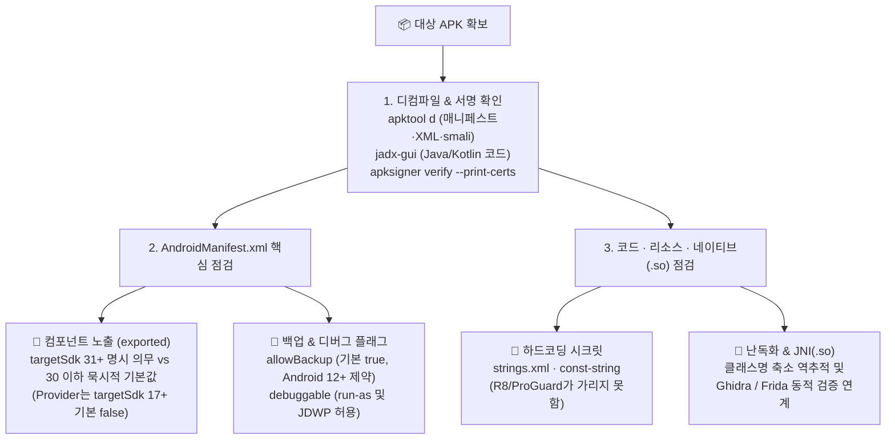

> [!summary] ⏱️ 5초 핵심 요약
> - **한 줄 비유**: 웹 서버가 밖에서 안이 안 보이는 요새라면, **안드로이드 APK는 사용자(그리고 공격자)의 손안에 통째로 배달된 조립식 금고**입니다. 정적분석은 금고를 켜보지 않고도 **안내도(`AndroidManifest.xml`)와 부품 설계도(`jadx` 디컴파일 코드)를 펼쳐 열려 있는 뒷문(`exported`), 이삿짐 반출 허용(`allowBackup`), 정비 모드 스위치(`debuggable`), 벽에 적힌 비밀번호(하드코딩 시크릿)를 찾아내는 작업**입니다.
> - **핵심 원리**: 루팅이나 앱 실행 없이 **`apktool`(매니페스트·리소스·smali 복원) + `jadx`(Java/Kotlin 로직 복원) + `apksigner`(서명 검증)**를 조합해 **`targetSdkVersion`에 따른 보안 기본값 차이**와 **실제 공격 성립을 위한 후속 조건**을 가려냅니다.
> - **핵심 주의사항**: ProGuard/R8 난독화는 클래스·메서드 이름만 바꿀 뿐 **문자열 리터럴(하드코딩 키·URL)은 가리지 못하며**, `exported="true"`나 `allowBackup="true"`는 단독으로 결론 내리지 않고 권한 제한·OS 버전·실제 민감 데이터 존재 여부와 결합해 판정해야 합니다.

안드로이드 앱은 기기에 설치되는 순간 APK 파일 전체가 공격자 손에 들어간다는 점에서 웹 서버와 다릅니다. 서버 코드는 숨길 수 있지만, 클라이언트 바이너리는 디컴파일하면 거의 다 읽힙니다. 이번 글은 **루팅이나 동적 실행 없이, APK 파일만 들고 확인할 수 있는 정적분석 항목**을 정리했습니다. 동적분석(Frida 후킹, 네트워크 트래픽 변조 등)은 별도 글에서 다룹니다. 진단은 반드시 **허가받은 대상**에만 하세요.



---

## 한눈에 보는 `AndroidManifest.xml` 핵심 보안 속성 및 SDK 버전별 동작

| 매니페스트 속성 / 대상 | 미선언 시 기본값 | `targetSdkVersion` 및 OS 버전별 핵심 변화 | 실제 취약점 성립을 위한 추가 검증 조건 |
|---|---|---|---|
| **`android:exported`**<br/>(`activity`, `service`, `receiver`) | `intent-filter` **있으면 `true`**, 없으면 `false` | **API 31(Android 12)+ 타깃**: `intent-filter`가 있으면 반드시 명시해야 설치 가능 (미선언 시 설치 실패) | `android:permission`(`signature` 레벨) 부재 + 발신자 미검증 + 민감 기능 수행([[모바일 취약점 진단 — 안드로이드 IPC 공격면]] 연계) |
| **`android:exported`**<br/>(`provider`) | API 16 이하: `true`<br/>**API 17 이상: `false`** | `intent-filter` 유무와 무관하게 **API 17부터 기본값이 이미 `false`** | `exported="true"`일 때 `readPermission`/`writePermission` 부재 및 SQLi·경로 순회 존재 여부 |
| **`android:allowBackup`**<br/>(`<application>`) | **`true`** | **Android 12(API 31)+ 기기 & 타깃 31+ 앱**: `true`여도 기본 `adb backup`에서 제외 (`debuggable="true"`일 때만 포함) | `dataExtractionRules` / `fullBackupContent`로 민감 파일 제외 여부 및 실제 DB/XML 내 평문 토큰 존재 여부 |
| **`android:debuggable`**<br/>(`<application>`) | **`false`** | 릴리스 빌드에서 실수로 `true` 배포 시 루팅 없이 `adb shell run-as` 및 JDWP 디버거 연결 허용 | ADB 접근 전제 + 내부 저장소 민감 데이터 유무 또는 클라이언트 완결형 인증 로직 존재 여부 |

---

## 1. AndroidManifest.xml 분석 기초

**💡 한 줄 비유**: **`apktool`**이 포장된 제품을 뜯어 **원래 설명서(`AndroidManifest.xml`)를 복원하고 부품을 살짝 고쳐 다시 조립할 수 있는 공구함**이라면, **`jadx`**는 복잡한 기계어 부품을 **사람이 읽기 편한 한글 설계도(Java 소스 형태)로 번역해 주는 돋보기**입니다.

### 핵심 원리
- APK는 서명된 ZIP 파일이지만 내부의 `AndroidManifest.xml`과 `classes.dex`는 컴파일된 바이너리 포맷이라 압축만 풀어서는 그대로 읽히지 않습니다.
- **`apktool` vs `jadx` 역할 분담**:
  - **`apktool`**: 바이너리 XML 매니페스트와 리소스를 사람이 읽을 수 있는 원본 형태로 복원하고, 코드를 재조립 가능한 `smali`로 뽑아내어 패치 후 재빌드할 때 씁니다.
  - **`jadx`**: `classes*.dex`를 읽기 쉬운 Java 유사 코드로 디컴파일해 전체 로직을 파악할 때 씁니다.
- **매니페스트 최우선 확인 항목**: `package`(패키지명), `minSdkVersion`/`targetSdkVersion`(버전별 보안 기본값 결정 기준), `uses-permission`(민감 권한 목록), `<application>`의 `allowBackup`·`debuggable`, 그리고 4대 컴포넌트의 `exported` 및 `permission` 선언입니다.

### 체크 포인트
- `apktool d app.apk`로 매니페스트·리소스를 복원하고 `jadx-gui app.apk`로 로직을 연다.
- 패키지명·권한 목록·컴포넌트 선언·`minSdkVersion`/`targetSdkVersion`을 표로 먼저 정리한다.
- 참고: [apktool](https://apktool.org/), [jadx](https://github.com/skylot/jadx), [OWASP MASTG — Android Basic Security Testing](https://mas.owasp.org/MASTG/techniques/android/MASTG-TECH-0017/)

---

## 2. exported 컴포넌트 노출

**💡 한 줄 비유**: 구형 건물(`targetSdk <= 30`)에서는 문 앞에 우체통(`intent-filter`)만 걸어두면 자동으로 **'외부인 출입 허용(`exported=true`)'**으로 간주되었지만, 신축 건물(`targetSdk >= 31`)에서는 문마다 **'외부인 출입 가능/불가' 표지판을 직접 못 박아 적어야만** 준공 허가(앱 설치)가 납니다.

```mermaid
flowchart TD
    A{"매니페스트에 android:exported 명시됨?"} -->|예| B{"명시값 = true?"}
    A -->|아니오 (미선언)| C{"intent-filter 있음?"}
    C -->|있음| E["다른 앱이 직접 호출 가능 (묵시적 true)"]
    C -->|없음| D["앱 내부에서만 접근 가능"]
    B -->|false| D
    B -->|true| E
    E --> F{"인증/권한 제한 없이 민감 기능 수행?"}
    F -->|예| G["취약"]
    F -->|아니오| H["취약 아님"]
```

### 핵심 원리
1. **Activity / Service / BroadcastReceiver의 기본값 규칙**:
   - **`targetSdkVersion >= 31` (Android 12 이상)**: `intent-filter`가 있는 컴포넌트에 `android:exported`를 명시하지 않으면 설치 자체가 실패(`INSTALL_FAILED_VERIFICATION_FAILURE`)합니다. 따라서 매니페스트에 적힌 값을 그대로 읽으면 됩니다.
   - **`targetSdkVersion <= 30` (레거시 앱)**: `exported`를 생략할 수 있으며, 이때는 **`intent-filter`가 하나라도 있으면 묵시적으로 `exported="true"`**, 없으면 `false`가 됩니다.
2. **ContentProvider의 별도 기본값 규칙**:
   - `intent-filter`와 무관하게 **`targetSdkVersion >= 17`이면 기본값이 이미 `false`**입니다(16 이하에서만 `true`).
   - Provider는 Intent가 아니라 `content://` URI와 `ContentResolver`(`query`/`insert`/`update`/`delete`/`openFile`)로 접근합니다.
3. **"노출됨(Exported) ≠ 취약점"**:
   - 실제로 익스플로잇 가능하려면 ① `android:permission`(특히 `signature` 레벨) 제한이 없어야 하고, ② 컴포넌트 내부 코드가 발신자나 입력값을 검증하지 않아야 하며, ③ 도달 가능한 기능이 실제로 민감한 작업(인증 우회, 파일 접근, 결제 등)이어야 합니다.

### 체크 포인트
- `targetSdkVersion` 확인 후 Activity/Service/Receiver는 31+ 앱이면 명시된 `exported` 값, 30 이하 앱이면 `intent-filter` 존재 여부로 노출을 판단한다.
- ContentProvider는 `targetSdkVersion` 17 기준으로 별도 판단한다.
- `exported="true"` 컴포넌트·Provider에 `android:permission`이나 URI별 읽기/쓰기 권한 제한이 있는지 확인한다.
- 도달 가능한 코드가 발신자 인증 및 입력 검증을 수행하는지 확인한다.
- 참고: [Android 12 동작 변경 — Safer component exports](https://developer.android.com/about/versions/12/behavior-changes-12#intent-filters), [android:exported 매니페스트 레퍼런스(activity)](https://developer.android.com/guide/topics/manifest/activity-element#exported), [android:exported 매니페스트 레퍼런스(provider)](https://developer.android.com/guide/topics/manifest/provider-element#exported), [OWASP MASTG — Testing Exported Components](https://mas.owasp.org/MASTG/tests/android/MASVS-PLATFORM/MASTG-TEST-0024/)

---

## 3. 하드코딩된 시크릿

**💡 한 줄 비유**: **ProGuard/R8 난독화**는 서류철 겉면의 제목을 `'인사기록카드'`에서 `'A.b.c'`로 바꿀 뿐, **서류철 안에 적힌 `'금고 비밀번호 = 123456'`이라는 글자(문자열 리터럴) 자체는 한 글자도 지우거나 암호화하지 않습니다.**

### 핵심 원리
- `res/values/strings.xml` 리소스나 코드 안의 문자열 리터럴(`smali`의 `const-string`)에 박아둔 API 키, AES 대칭키/고정 IV, 내부 서버 URL은 디컴파일 즉시 평문으로 노출됩니다.
- **ProGuard/R8 난독화에 대한 흔한 오해**: 기본 R8/ProGuard는 클래스·메서드·필드 **식별자 이름**을 축소하고 미사용 코드를 정리할 뿐, **문자열 리터럴 값을 암호화하지 않습니다**. 따라서 매핑 파일(`mapping.txt`)이 없어도 하드코딩된 키는 그대로 읽힙니다.
- **실질적 위험도 판정**:
  - 서버 측에서 도메인/앱 제한 및 권한 검증을 별도로 수행하는 공개용 식별 키라면 노출 피해가 제한적입니다.
  - 반면 로컬 DB나 SharedPreferences를 암호화하려고 쓴 **AES 대칭키/IV**를 코드에 박아두면 암호화 설계가 무력화됩니다(단, 실제 데이터 복호화까지 이어지려면 공격자가 그 암호문 파일에 접근할 수 있는 조건([[모바일 취약점 진단 — 로컬 저장소 포렌식]])이 함께 성립해야 합니다. 고정 IV 하드코딩 자체는 키 노출과 별개로 암호학적 설계 결함입니다).

### 체크 포인트
- `strings.xml`과 디컴파일 코드에서 `key`/`secret`/`token`/`password`/`iv` 류 변수명·문자열을 검색한다.
- 발견한 키가 실제로 어떤 자산(과금 API, 로컬 암호화 데이터, 내부 엔드포인트)을 보호하는지, 서버 측에 별도 인증·요청 제한이 있는지 확인한다.
- 참고: [OWASP MASVS — MASVS-CRYPTO (키 관리)](https://mas.owasp.org/MASVS/controls/MASVS-CRYPTO-1/), [OWASP MASTG — Testing for Hardcoded Secrets](https://mas.owasp.org/MASTG/tests/android/MASVS-CRYPTO/MASTG-TEST-0014/)

---

## 4. 난독화 우회 기초

**💡 한 줄 비유**: 도로 표지판의 지명이 전부 `a`, `b`, `c`로 지워졌더라도, **고속도로 톨게이트(표준 Android API 호출)와 건물 간판 글씨(문자열 리터럴·XML 리소스)는 절대 이름을 바꿀 수 없기 때문에** 이를 이정표 삼아 길을 역추적할 수 있습니다.

### 핵심 원리
- **난독화 적용 여부 확인**: `jadx`에서 패키지·클래스명이 `a.b.c`처럼 한두 글자로 뭉개져 있으면 R8/ProGuard가 적용된 것이고, `com.example.feature.LoginActivity`처럼 원형이 보이면 미적용 상태입니다.
- **매핑 파일 없이 역추적하는 기준점**: 문자열 리터럴, `strings.xml`, `AndroidManifest.xml`(컴포넌트 진입점 클래스명), 레이아웃 XML, 그리고 이름이 바뀌지 않는 **표준 Android SDK API 호출(`javax.crypto.Cipher`, ` SharedPreferences` 등)**을 검색해 역으로 호출 그래프를 따라갑니다.
- **네이티브 라이브러리(`.so`, JNI/NDK) 이동**: 민감 로직을 C/C++ `.so` 파일로 옮기더라도 근본적인 차단은 아니며, Ghidra/IDA 정적 리버싱이나 Frida 네이티브 후킹으로 분석합니다(비루팅 기기에서 Frida를 쓰려면 APK에 `frida-gadget`을 삽입해 **재패키징·재서명 후 재설치**해야 합니다).

### 체크 포인트
- `jadx` 디컴파일 결과의 클래스/메서드명이 난독화돼 있는지 확인한다.
- 이름이 뭉개져 있어도 문자열·리소스·매니페스트·표준 API 호출로 핵심 기능을 역추적할 수 있는지 확인한다.
- 민감 로직이 `.so`로 옮겨져 있다면 해당 네이티브 함수 심볼(`Java_패키지_클래스_메서드` 등)이 남아 있는지(strip 여부) 확인한다.
- 참고: [Android 공식 — 코드 축소·난독화(R8)](https://developer.android.com/build/shrink-code), [Frida — Android 가이드](https://frida.re/docs/android/), [OWASP MASTG — Resiliency Against Reverse Engineering](https://mas.owasp.org/MASVS/controls/MASVS-RESILIENCE-3/)

---

## 5. 백업 설정 노출 (`android:allowBackup`)

**💡 한 줄 비유**: `allowBackup`은 개발자가 명시적으로 **"이사 금지(`false`)"** 팻말을 걸지 않으면 기본적으로 **"누구든 이삿짐 트럭(`adb backup`)을 대면 방 안의 짐을 실어 가도 좋음(`true`)"** 상태로 열려 있는 옵션입니다. 다만 최신 안드로이드(12+)는 정비 모드(`debuggable=true`)가 아닌 일반 집에는 트럭 진입을 막아줍니다.

### OS 및 타깃 SDK 버전에 따른 실제 추출 가능 조건
- **미기재 시 기본값은 `true`**: 매니페스트에 `android:allowBackup`을 적지 않으면 자동으로 `true`가 적용됩니다.
- **Android 11 이하 환경**: `allowBackup="true"`이고 USB 디버깅이 승인되면 루팅 없이도 `adb backup -f backup.ab <패키지명>` 한 줄로 로컬 DB와 SharedPreferences가 추출됩니다.
- **Android 12(API 31)+ 기기 & `targetSdkVersion >= 31` 앱**:
  - 보안 강화로 인해 `allowBackup="true"`여도 **`adb backup` 명령에서 해당 앱 데이터가 기본적으로 제외**됩니다.
  - 단, 개발·테스트용 예외로 **`android:debuggable="true"`가 함께 켜져 있으면 다시 `adb backup`에 포함**됩니다.
  - 또한 `allowBackup="false"`로 클라우드·adb 백업을 막더라도 일부 제조사 기기의 기기 간 직접 전송(D2D)까지는 막지 못할 수 있으므로, `android:dataExtractionRules`(Android 12+)나 `android:fullBackupContent`(이전)로 민감 파일을 명시적으로 제외했는지 함께 봐야 합니다.

### 체크 포인트
- 매니페스트의 `allowBackup` 값을 확인한다(미기재 시 `true`로 간주).
- 대상 기기의 Android 버전과 앱의 `targetSdkVersion`·`debuggable` 값 조합으로 실제 `adb backup` 추출 가능 여부를 판단한다.
- `android:dataExtractionRules`(Android 12+)/`android:fullBackupContent`(이전)로 특정 민감 파일이 백업에서 제외되고 있는지 확인한다.
- 백업 가능 시 `.ab` 파일을 변환해 SharedPreferences·SQLite DB에 민감정보(토큰, PIN, 평문 비밀번호)가 있는지 확인한다.
- 참고: [Android 12 동작 변경 — ADB backup restriction](https://developer.android.com/about/versions/12/behavior-changes-12#adb-backup-restrictions), [Android 공식 — allowBackup 매니페스트 레퍼런스](https://developer.android.com/guide/topics/manifest/application-element#allowbackup), [Android 공식 — Backup 관련 위험(OWASP MASVS-STORAGE)](https://developer.android.com/privacy-and-security/risks/backup-leaks), [OWASP MASTG — Backups](https://mas.owasp.org/MASTG/knowledge/android/MASVS-STORAGE/MASTG-KNOW-0050/)

---

## 6. 디버그 가능 설정 (`android:debuggable`)

**💡 한 줄 비유**: `android:debuggable="true"`가 켜진 채 출고된 앱은 **공장 테스트용 마스터 스위치와 계기판 덮개를 열어둔 채 판매된 자동차**와 같아서, 정비 케이블(ADB)만 연결하면 루팅 없이도 엔진 내부 데이터(`/data/data/` 전용 폴더)를 꺼내고 주행 중 속도계 값(런타임 변수)을 마음대로 바꿀 수 있습니다.

### 핵심 원리
- 기본값은 `false`이며, 릴리스 빌드에서는 반드시 꺼져 있어야 합니다.
- **활성화 시 열리는 2가지 공격 경로 (루팅 불필요, 단 ADB 접근 전제)**:
  1. **전용 저장공간 직접 접근**: `adb shell run-as <패키지명>`으로 해당 앱의 UID 권한을 얻어 `/data/data/<패키지명>/` 내부의 DB와 설정 파일을 그대로 읽고 씁니다.
  2. **런타임 디버거 부착(JDWP)**: 실행 중인 프로세스에 `jdb` 등 디버거를 붙여 브레이크포인트를 걸고 메모리 내 변수·반환값을 실시간으로 관찰·변조합니다(단, 로그인·결제 우회가 실제로 성립하는지는 서버 측 재검증 유무에 따라 동적 확인 필요).

### 체크 포인트
- 배포된 릴리스 APK의 매니페스트에서 `android:debuggable` 값을 정적으로 확인한다.
- `true`라면 실제 기기에서 `adb shell run-as <패키지명>` 데이터 접근과 JDWP/Frida 동적 조작 가능 여부를 별도로 검증한다.
- 참고: [Android 공식 — debuggable이 미치는 위험](https://developer.android.com/privacy-and-security/risks/android-debuggable), [Android 공식 — debuggable 매니페스트 레퍼런스](https://developer.android.com/guide/topics/manifest/application-element#debug), [OWASP MASTG — Testing Whether the App is Debuggable](https://mas.owasp.org/MASTG/tests/android/MASVS-RESILIENCE/MASTG-TEST-0002/)

---

## 7. 서명 검증 (선택)

**💡 한 줄 비유**: 제품 보증서에 찍힌 인감도장(`apksigner` 인증서)을 감정해 **본사 공식 인감인지, 개발자 책상 서랍에서 임시로 쓰는 연습용 고무도장(`CN=Android Debug`)인지, 아니면 중간 유통업자가 몰래 다시 찍은 위조 도장(리패키징 서명)인지** 가려내는 단계입니다.

### 핵심 원리
- `apksigner verify --print-certs`나 `keytool -printcert`로 서명자 인증서의 발급자 DN, 유효기간, 해시 지문(Fingerprint)을 확인합니다.
- **디버그 인증서 판별 주의점**: 개발 환경마다 로컬에서 자동 생성되는 디버그 키스토어는 **지문(Fingerprint) 값 자체는 PC마다 다르지만**, 발급자 DN은 빌드 도구가 항상 **`CN=Android Debug, O=Android, C=US`**로 고정해 생성합니다. 사내 앱이나 APK 직접 배포(사이드로딩) 환경에서 이 패턴이 보이면 디버그 서명 배포를 강하게 의심할 수 있습니다.
- 서드파티 채널에서 입수한 APK라면 서명 지문이 공식 배포사(또는 Google Play App Signing 배포 키)의 지문과 일치하는지 반드시 대조합니다.

### 체크 포인트
- `apksigner verify --print-certs app.apk`로 서명자 인증서 지문과 발급자 DN을 확인한다.
- 발급자 DN이 `CN=Android Debug, O=Android, C=US`로 고정된 디버그 서명 패턴인지 확인한다.
- 사이드로딩 APK라면 공식 배포 채널이 공개한 서명 지문과 일치하는지 대조한다.
- 참고: [Android 공식 — 앱 서명](https://developer.android.com/studio/publish/app-signing), [Android 공식 — apksigner 도구](https://developer.android.com/tools/apksigner)

---

더 깊이 공부하려면 [OWASP MASTG](https://mas.owasp.org/MASTG/)와 [OWASP MASVS](https://mas.owasp.org/)를 추천합니다. 정적분석에서 찾은 컴포넌트와 디컴파일 코드는 [[모바일 취약점 진단 — 안드로이드 IPC 공격면]], [[모바일 취약점 진단 — Frida 동적분석과 네트워크]], 그리고 백엔드 API 모델을 역추적하는 [[모바일 취약점 진단 — 앱 바이너리에서 API 계약 추출하기]]로 바로 이어집니다.
