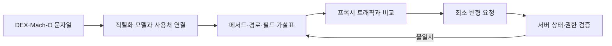

이 글은 [[모바일 취약점 진단 — 안드로이드 정적분석]]과 [[모바일 취약점 진단 — iOS 정적분석]]이 다루는 권한·서명·난독화·하드코딩 시크릿 등 **앱 자체의 취약점**을 반복하지 않는다. 같은 도구를 쓰되 앱 바이너리를 서버 데이터 모델의 단서로만 보고, 숨은 필드와 엔드포인트를 추정한 뒤 백엔드의 Mass Assignment·BOPLA 검증으로 전환하는 교차 단계를 다룬다.

---

## 1. 클라이언트에 남는 서버 계약

**개념**: 모바일 앱의 데이터 모델 클래스는 창고가 이해하는 모든 칸이 인쇄된 주문서와 비슷하다. 매장 화면에는 일부 칸만 보여도, 같은 클래스나 구조체가 JSON을 읽고 쓰기 때문에 보이지 않는 필드명이 앱 파일에 남을 수 있다. Mass Assignment는 서버가 주문서에 적힌 모든 칸을 그대로 데이터베이스 속성에 옮기는 실수다. 바이너리에서 `role`이나 `isAdmin` 같은 칸을 찾아 직접 보냈을 때 서버가 받아들인다면 사용자가 통제하면 안 되는 값을 바꿀 수 있다.

**원리**: Gson·Moshi·Kotlin serialization·Swift `Codable` 같은 직렬화 계층은 JSON 키와 모델 프로퍼티의 대응 정보를 코드, 어노테이션, 문자열 또는 메타데이터로 남길 수 있다. UI에서 참조하지 않는 필드도 응답 역직렬화나 공용 모델 재사용 때문에 포함될 수 있다. 다만 문자열 존재는 서버 지원의 증거가 아니므로 정적 결과는 반드시 승인된 API의 동적 검증 가설로 취급한다.

- 체크 포인트:
  - 화면에 없는 필드와 실제 직렬화 어노테이션이 연결돼 있는지 구분한다.
  - 요청 모델, 응답 모델, 로컬 DB 모델을 클래스 사용처로 분리한다.
  - 필드명만으로 취약점을 단정하지 않고 서버 응답과 상태 변화를 확인한다.
- 참고: [Gson User Guide](https://google.github.io/gson/UserGuide.html), [Swift Codable](https://developer.apple.com/documentation/swift/codable), [CWE-915](https://cwe.mitre.org/data/definitions/915.html)

## 2. DEX에서 모델과 경로 찾기

**원리**: jadx는 DEX 바이트코드를 Java와 유사한 코드로 복원해 클래스·어노테이션·상수의 관계를 보여 주고, apktool은 리소스와 smali 수준 구조를 보존해 디컴파일 누락을 보완한다. `SerializedName`, Retrofit HTTP 어노테이션, serializer adapter, URL path 문자열을 함께 보면 단순 문자열 검색보다 요청 모델과 엔드포인트의 연결을 더 정확히 추정할 수 있다. R8 난독화가 클래스명을 바꿔도 명시적 JSON 키와 서버 경로는 호환성 때문에 남는 경우가 많다.

- 체크 포인트:
  - URL·경로 문자열의 참조 위치에서 Retrofit 인터페이스와 요청 타입을 역추적한다.
  - `SerializedName`·Moshi `Json`·Kotlin `SerialName` 어노테이션을 검색한다.
  - Gson·Moshi·kotlinx.serialization의 커스텀 adapter가 필드를 제거·변환하는지 확인한다.
  - jadx 결과가 불완전하면 smali와 리소스에서 같은 가설을 교차 확인한다.
- 참고: [jadx](https://github.com/skylot/jadx), [Apktool](https://apktool.org/), [Android DEX Format](https://source.android.com/docs/core/runtime/dex-format)

## 3. Mach-O와 Swift·Objective-C 모델

**원리**: iOS 바이너리에서는 `strings`, Mach-O 섹션·심볼, Objective-C 런타임 메타데이터, Swift 타입·프로토콜 적합성 단서에서 경로와 모델명을 찾는다. Objective-C 클래스 정보는 class-dump 계열 도구로 보이는 경우가 있지만 Swift 최적화·심볼 제거·난독화는 복원도를 크게 낮춘다. `CodingKeys`의 원시 문자열이나 `Decodable` 오류 문자열은 프로퍼티명이 제거돼도 JSON 키를 남길 수 있으나, 동적 키나 암호화된 설정은 별도 런타임 관찰이 필요하다.

- 체크 포인트:
  - Mach-O의 문자열을 URL 경로, JSON 키, 분석 SDK 이벤트명으로 분류한다.
  - `CodingKeys`, `encode(to:)`, `init(from:)` 주변의 키 매핑을 확인한다.
  - Objective-C 런타임 노출과 Swift 심볼 결과를 같은 수준의 완전성으로 가정하지 않는다.
  - 앱 확장과 포함 프레임워크에도 별도 API 모델이 있는지 확인한다.
- 참고: [Apple - Mach-O Programming Topics](https://developer.apple.com/library/archive/documentation/DeveloperTools/Conceptual/MachOTopics/), [Swift Codable](https://developer.apple.com/documentation/swift/codable), [class-dump](http://stevenygard.com/projects/class-dump/)

## 4. OpenAPI 형태로 가설 정리하기

**원리**: 추출한 HTTP 메서드·경로·모델 필드·타입·필수 여부를 Swagger/OpenAPI의 path와 schema 형태로 정리하면 누락과 충돌을 체계적으로 볼 수 있다. 이는 서버의 실제 명세를 "복구"하는 것이 아니라 클라이언트 버전이 암시하는 부분 계약을 작성하는 작업이다. 앱에 남은 구버전 경로, feature flag 뒤 모델, 응답 전용 필드가 섞일 수 있으므로 각 항목에 출처와 관찰 상태를 표시해야 한다.



- 체크 포인트:
  - 각 필드에 요청/응답 방향, 타입, nullable 여부, 발견 위치를 기록한다.
  - 캡처 트래픽에서 확인된 항목과 바이너리에서만 추정한 항목을 구분한다.
  - 버전별 base URL과 API 경로가 섞이지 않도록 빌드 정보를 함께 기록한다.
  - OpenAPI 문법보다 서버 동작 증거를 우선하고 추정에는 명확히 표시한다.
- 참고: [OpenAPI Specification](https://spec.openapis.org/oas/latest.html), [OWASP Web Security Testing Guide](https://owasp.org/www-project-web-security-testing-guide/)

## 5. 숨은 필드의 우선순위

**원리**: 위험한 후보는 권한(`role`, `permissions`), 소유권(`ownerId`, `tenantId`), 상태(`approved`, `verified`), 금액·한도처럼 서버 결정이어야 하는 속성이다. 그러나 이름만 위험해 보여도 응답 표시용, 무시되는 필드, 서버 계산값일 수 있다. 요청 모델에 실제 포함되고 서버 상태 변화나 후속 조회에 반영되는지까지 확인해야 Mass Assignment 또는 속성 수준 권한 누락으로 판정할 수 있다.

- 체크 포인트:
  - UI 노출 여부가 아니라 보안 결정에 미치는 영향으로 후보를 정렬한다.
  - 생성과 수정 엔드포인트에서 같은 필드의 허용 정책이 다른지 확인한다.
  - 자기 객체와 다른 사용자·테넌트 객체에서 결과가 달라지는지 검사한다.
  - 서버가 필드를 무시한 것과 저장 후 응답에서 숨긴 것을 후속 조회로 구분한다.
- 참고: [OWASP API3:2023 BOPLA](https://api-security.owasp.org/editions/2023/en/0xa3-broken-object-property-level-authorization/), [OWASP Mass Assignment Cheat Sheet](https://cheatsheetseries.owasp.org/cheatsheets/Mass_Assignment_Cheat_Sheet.html)

## 6. 최소 변형으로 Mass Assignment 검증

**원리**: 검증 요청은 정상 바디를 기준으로 후보 필드 하나만 추가해야 원인을 분리할 수 있다. 예를 들어 승인된 테스트 객체의 수정 요청에 영향이 낮은 후보 값을 넣고, 응답 반사뿐 아니라 별도 조회와 권한 효과를 확인한다. 완성형 공격 페이로드를 만들거나 운영 데이터의 권한을 실제 상승시키지 말고, 무해한 테스트 계정·복구 가능한 객체에서 서버의 allowlist 부재만 입증한다.

```json
{
  "displayName": "test",
  "candidateField": "controlled-test-value"
}
```

- 체크 포인트:
  - 정상 요청과 후보 필드 하나를 추가한 요청만 비교한다.
  - 2xx 응답만 보지 않고 재조회·감사 로그·다른 세션의 권한 효과를 확인한다.
  - 읽기 권한과 쓰기 권한을 분리해 과다 노출과 과다 수정 문제를 구분한다.
  - 테스트 후 변경값을 원복하고 운영 영향이 없었음을 확인한다.
- 참고: [OWASP Mass Assignment Cheat Sheet](https://cheatsheetseries.owasp.org/cheatsheets/Mass_Assignment_Cheat_Sheet.html), [CWE-915](https://cwe.mitre.org/data/definitions/915.html), [OWASP API Security Top 10](https://owasp.org/API-Security/)

## 7. 오탐 제거와 보고

**원리**: 바이너리는 특정 시점의 클라이언트 계약이므로 서버의 현재 동작, 다른 플랫폼, 관리자 전용 API를 완전히 대표하지 않는다. 취약점 보고는 "필드 문자열 발견"과 "서버가 비인가 값을 저장·사용" 사이의 증거 사슬을 보여야 한다. 수정은 클라이언트에서 필드를 숨기는 것이 아니라 서버 DTO allowlist와 객체·속성별 권한 검사에 적용돼야 한다.

- 체크 포인트:
  - 앱 버전·플랫폼·환경·엔드포인트와 필드 출처를 재현 정보에 포함한다.
  - 요청 전후 상태와 권한 효과를 민감값을 가린 증거로 남긴다.
  - 서버 수정 후 알 수 없는 필드 거부 또는 명시적 무시 정책을 회귀 검증한다.
  - 모바일 UI 변경만으로 해결됐다고 판정하지 않는다.
- 참고: [OWASP API Security Project](https://owasp.org/www-project-api-security/), [CWE-915](https://cwe.mitre.org/data/definitions/915.html)

---

정적분석의 산출물은 곧바로 취약점이 아니라 서버 검증을 정밀하게 만드는 가설 목록이다. 앱 모델과 실제 API 상태 변화를 연결할 때 비로소 [[모바일 취약점 진단 — 안드로이드 정적분석]]과 [[모바일 취약점 진단 — iOS 정적분석]]에서 백엔드 권한 검증으로 안전하게 넘어갈 수 있다.
