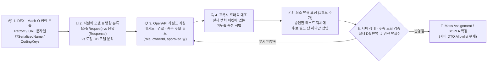

> [!summary] ⏱️ 5초 핵심 요약
> - **한 줄 비유**: 매장 키오스크 화면(모바일 앱 UI)에는 '일반 커피 주문' 버튼만 보여도, **키오스크 내부 프로그램(앱 바이너리의 직렬화 모델 클래스)을 뜯어보면 본사 포스기가 인식하는 `'직원할인율(discountRate)'`, `'관리자승인(isAdmin)'` 같은 숨은 주문 칸이 그대로 인쇄되어 있는 경우**가 많습니다.
> - **핵심 원리**: APK(`DEX`)와 IPA(`Mach-O`)의 직렬화 계층(`Gson`·`Moshi`·`Kotlin Serialization`·`Swift Codable`)에서 **UI에 노출되지 않는 숨은 필드와 엔드포인트를 추출해 OpenAPI 형태의 가설표를 만들고, 최소 변형 요청으로 백엔드의 Mass Assignment / BOPLA(OWASP API3:2023)를 검증**합니다.
> - **핵심 판정 기준**: 바이너리에서 `"isAdmin"` 문자열을 발견한 것 자체는 취약점이 아니며, **실제 수정 API 요청에 해당 필드를 추가했을 때 백엔드 서버가 allowlist 없이 이를 수용해 DB 상태나 권한이 바뀌는지**로 판정합니다.

이 글은 [[모바일 취약점 진단 — 안드로이드 정적분석]]과 [[모바일 취약점 진단 — iOS 정적분석]]이 다루는 권한·서명·난독화·하드코딩 시크릿 등 **앱 자체의 취약점**을 반복하지 않습니다. 같은 도구를 쓰되 **앱 바이너리를 서버 데이터 모델의 단서로만 보고**, 숨은 필드와 엔드포인트를 추정한 뒤 백엔드의 **Mass Assignment·BOPLA(Broken Object Property Level Authorization)** 검증으로 전환하는 교차 단계를 다룹니다.



---

## 한눈에 보는 플랫폼별 API 계약 및 데이터 모델 추출 단서

| 플랫폼 / 프레임워크 | 핵심 탐색 대상 (어노테이션 / 심볼 / 메타데이터) | 난독화(R8 / Strip) 적용 시 생존 이유 | 실무 추출 도구 및 주의점 |
|---|---|---|---|
| **Android (Retrofit / OkHttp)** | `@GET`, `@POST`, `@PUT`, `@PATCH`, `@Path`, `@Body`, `@Query` | 런타임 리플렉션으로 HTTP 요청을 조립하기 위해 어노테이션과 경로 문자열이 DEX에 그대로 유지됨 | `jadx`에서 URL 문자열 검색 후 인터페이스 선언부 및 `@Body` 파라미터 타입 클래스로 이동 |
| **Android (Gson / Moshi / Kotlinx)** | `@SerializedName("...")`, `@Json(name="...")`, `@SerialName("...")` | 클래스·필드 변수명이 `a`, `b`로 난독화되어도 **서버와 주고받을 실제 JSON 키 문자열**은 바뀌면 통신이 깨지므로 평문 유지 | 요청 DTO인지 응답 전용 DTO인지, 또는 Room/SQLite 로컬 DB 엔티티인지 사용처를 반드시 구분 |
| **iOS (Objective-C / URLSession)** | `__objc_methname`, `__objc_classlist`, URL 리터럴 | Objective-C 동적 디스패치 특성상 클래스명과 프로퍼티 시그니처가 평문 노출 | `class-dump`, `strings`로 모델 헤더 및 엔드포인트 경로 복원 |
| **iOS (Swift `Codable`)** | `CodingKeys` 열거형 원시 문자열, `encode(to:)`, `init(from:)` 디코딩 에러 문자열 | 순수 Swift 심볼이 스트립되어도 **JSON 키 매핑용 문자열 리터럴**은 바이너리 문자열 섹션에 남음 | `strings`, Ghidra/Hopper로 `CodingKeys` 테이블 주변의 키 문자열 묶음 추출 |

---

## 1. 클라이언트에 남는 서버 계약

**💡 한 줄 비유**: 모바일 앱의 데이터 모델 클래스는 **본사 창고(백엔드 DB)가 이해하는 모든 칸이 인쇄된 마스터 주문서**와 비슷합니다. 매장 화면에는 손님용 칸 몇 개만 보여도, 앱이 서버 응답을 읽거나 공용 모델을 재사용하느라 **관리자 전용 칸(`role`, `isAdmin`, `verified`)의 이름까지 주문서 양식에 그대로 남아 있는 것**입니다.

### 핵심 원리
- `Gson`·`Moshi`·`Kotlin serialization`·`Swift Codable` 같은 직렬화 계층은 JSON 키와 모델 프로퍼티의 대응 정보를 코드, 어노테이션, 문자열 또는 메타데이터로 남깁니다.
- **왜 화면에 없는 필드가 앱 바이너리에 남는가?**:
  1. 백엔드 엔티티/스키마에서 클라이언트 모델 코드를 자동 생성(Codegen)하면서 읽기 전용·관리자 전용 필드까지 한 클래스에 포함된 경우
  2. 조회(`GET`) 응답 역직렬화용 모델과 수정(`PUT`/`PATCH`/`POST`) 요청 직렬화용 모델을 분리하지 않고 **하나의 공용 DTO 클래스**로 재사용한 경우
  3. 아직 출시되지 않은 기능(Feature Flag 뒤의 화면)이나 구버전 관리자 API용 모델이 빌드에 함께 포함된 경우
- **중요 원칙**: 바이너리에 문자열이 존재한다는 사실은 서버 지원의 확정 증거가 아니므로, 정적 추출 결과는 반드시 **승인된 API에 대한 동적 검증 가설**로만 취급합니다.

### 체크 포인트
- 화면(UI)에 없는 필드와 실제 JSON 직렬화 어노테이션이 연결돼 있는지 구분한다.
- 요청 모델, 응답 전용 모델, 로컬 DB 모델을 클래스 참조 위치(사용처)로 분리한다.
- 필드명 발견만으로 취약점을 단정하지 않고 실제 서버 응답과 상태 변화를 확인한다.
- 참고: [Gson User Guide](https://google.github.io/gson/UserGuide.html), [Swift Codable](https://developer.apple.com/documentation/swift/codable), [CWE-915](https://cwe.mitre.org/data/definitions/915.html)

---

## 2. DEX에서 모델과 경로 찾기 (Android)

**💡 한 줄 비유**: R8 난독화가 택배 상자 안의 물건 이름표(Java 변수명 `private String a;`)를 다 지워버렸어도, **우체국 집배원(서버 JSON 파서)이 읽어야 하는 배송 라벨(`@SerializedName("is_vip_member")`)만큼은 절대 지울 수 없다**는 점을 이용합니다.

### 핵심 원리
- `jadx`는 DEX 바이트코드를 Java 유사 코드로 복원해 클래스·어노테이션·상수의 관계를 보여 주고, `apktool`은 리소스와 `smali` 수준 구조를 보존해 디컴파일 누락을 보완합니다.
- 단순 문자열 검색보다 **Retrofit HTTP 어노테이션(`@POST`, `@PATCH`) → 그 메서드의 `@Body` 클래스 타입 → 해당 클래스 내부의 `@SerializedName` / `@Json` / `@SerialName` 필드 목록**을 한 줄로 연결하면 어떤 엔드포인트에 어떤 숨은 필드를 보낼 수 있는지 정확히 도출됩니다.

### 난독화된 DEX에서 복원된 모델 예시
```java
// 클래스명과 필드명은 a, b, c로 난독화되었으나 서버 계약(경로·JSON 키)은 그대로 노출됨
public interface a {
    @PATCH("/api/v2/users/me/profile")
    Call<c> a(@Body b requestBody);
}

public final class b {
    @SerializedName("displayName")
    public String a;

    @SerializedName("bio")
    public String b;

    // ⚠️ UI 화면에는 입력창이 없지만 직렬화 모델에 포함된 후보 필드들!
    @SerializedName("role")
    public String c;

    @SerializedName("membershipTier")
    public Integer d;
}
```

### 체크 포인트
- URL·경로 문자열의 참조 위치에서 Retrofit 인터페이스와 요청/응답 타입을 역추적한다.
- `@SerializedName`·Moshi `@Json`·Kotlin `@SerialName` 어노테이션을 전수 검색한다.
- Gson·Moshi·`kotlinx.serialization`의 커스텀 adapter가 특정 필드를 직렬화 시 제거·변환하는지 확인한다.
- `jadx` 결과가 불완전하면 `smali`와 리소스에서 같은 가설을 교차 확인한다.
- 참고: [jadx](https://github.com/skylot/jadx), [Apktool](https://apktool.org/), [Android DEX Format](https://source.android.com/docs/core/runtime/dex-format)

---

## 3. Mach-O와 Swift·Objective-C 모델 (iOS)

**💡 한 줄 비유**: Swift 바이너리는 설계도가 잘게 압축되어 있지만, **서버에서 온 JSON 상자를 풀 때 쓰는 열쇠 꾸러미(`CodingKeys` 문자열 묶음)와 상자 규격이 안 맞을 때 뱉어내는 불평 문구(`Decodable` 에러 메시지)**가 한곳에 모여 있어 모델 구조를 역추적하는 단서가 됩니다.

### 핵심 원리
- iOS 바이너리에서는 `strings`, Mach-O 섹션·심볼, Objective-C 런타임 메타데이터, Swift 타입·프로토콜 적합성(Conformance) 단서에서 경로와 모델명을 찾습니다.
- Objective-C 클래스는 `class-dump` 계열 도구로 프로퍼티까지 잘 보이지만, 순수 Swift 모델은 최적화·심볼 제거 시 복원도가 낮아집니다.
- 이때도 **`CodingKeys`의 원시 문자열 리터럴**이나 `encode(to:)` / `init(from:)` 주변에 연속으로 배치된 JSON 키 문자열들을 묶어 보면 해당 구조체가 다루는 전체 속성 목록을 추정할 수 있습니다.

### 체크 포인트
- Mach-O의 문자열을 API URL 경로, JSON 키 후보, 서드파티 분석 SDK 이벤트명으로 분류한다.
- `CodingKeys`, `encode(to:)`, `init(from:)` 주변의 키 매핑 문자열 묶음을 확인한다.
- Objective-C 런타임 노출 결과와 Swift 심볼 결과를 같은 수준의 완전성으로 가정하지 않는다.
- 앱 익스텐션(`PlugIns/*.appex`)과 포함 프레임워크(`Frameworks/*.framework`)에도 별도 API 모델이 있는지 확인한다.
- 참고: [Apple - Mach-O Programming Topics](https://developer.apple.com/library/archive/documentation/DeveloperTools/Conceptual/MachOTopics/), [Swift Codable](https://developer.apple.com/documentation/swift/codable), [class-dump](http://stevenygard.com/projects/class-dump/)

---

## 4. OpenAPI 형태로 가설 정리하기

**💡 한 줄 비유**: 바이너리 곳곳에서 줍는 조각 단서들을 바로 서버에 던지지 않고, 먼저 **표준 건축 도면 양식(OpenAPI / Swagger 가설표) 위에 '실제로 눈으로 본 방(캡처된 트래픽)'과 '도면에만 그려진 비밀 방(바이너리 추정 필드)'으로 색깔을 구분해 그려 넣는 단계**입니다.

### 핵심 원리
- 추출한 HTTP 메서드·경로·모델 필드·타입·nullable 여부를 OpenAPI의 `paths`와 `components.schemas` 형태로 정리하면 누락과 충돌을 체계적으로 볼 수 있습니다.
- 이는 서버의 실제 명세를 그대로 복구한 것이 아니라 **현재 클라이언트 버전이 암시하는 부분 계약 가설**이므로, 구버전 레거시 경로나 응답 전용 필드가 섞여 있을 수 있습니다. 따라서 각 항목에 **출처(DEX/Mach-O 위치)와 관찰 상태(프록시 캡처 확인 vs 정적 추정)**를 반드시 함께 기록합니다.

### 체크 포인트
- 각 필드에 요청/응답 방향, 데이터 타입, nullable 여부, 바이너리 내 발견 위치를 기록한다.
- 프록시 캡처 트래픽에서 실제 관찰된 항목과 바이너리에서만 추정한 항목을 명확히 구분한다.
- 버전별 Base URL과 API 경로(`/v1/`, `/v2/`)가 섞이지 않도록 빌드 정보를 함께 기록한다.
- OpenAPI 문법 자체보다 실제 서버 동작 증거를 우선하고 추정 항목에는 표시를 남긴다.
- 참고: [OpenAPI Specification](https://spec.openapis.org/oas/latest.html), [OWASP Web Security Testing Guide](https://owasp.org/www-project-web-security-testing-guide/)

---

## 5. 숨은 필드의 우선순위 (BOPLA / Mass Assignment 후보)

**💡 한 줄 비유**: 발견한 수십 개의 숨은 칸 중에서도 가장 먼저 시험해 볼 대상은 단순 색상·정렬 옵션이 아니라, **계급장(`role`), 집문서 명의(`ownerId`), 결재 도장(`approved`), 금고 한도(`creditLimit`)처럼 원래 서버만 결정해야 하는 핵심 권한 속성**입니다.

### 위험도 순 숨은 필드 4대 카테고리

| 우선순위 분류 | 대표적인 후보 필드명 예시 | 백엔드에서 수용될 경우 발생하는 보안 영향 |
|---|---|---|
| **1. 권한 및 역할 (Privilege)** | `role`, `isAdmin`, `permissions`, `userType`, `scopes` | 일반 사용자 계정이 관리자·상위 역할로 **수직 권한 상승** |
| **2. 소유권 및 테넌트 (Ownership)** | `ownerId`, `userId`, `accountId`, `tenantId`, `orgId` | 객체 소유자나 소속 조직을 변경해 타인 데이터 장악 (**수평 권한 상승 / IDOR 결합**) |
| **3. 승인 및 검증 상태 (State/Status)** | `approved`, `isVerified`, `emailVerified`, `kycStatus`, `active` | 본인인증·관리자 승인·심사 절차를 건너뛰는 **비즈니스 로직 우회** |
| **4. 금액·등급·한도 (Financial/Quota)** | `price`, `discountRate`, `balance`, `creditLimit`, `membershipTier` | 결제 금액 변조, 무료 VIP 승격, 사용량 한도 무력화 |

*(주의: 이름만 위험해 보여도 실제로는 `GET` 응답 표시 전용이거나 서버가 계산 후 덮어쓰는 값일 수 있으므로 6절의 동적 검증이 필수입니다.)*

### 체크 포인트
- 단순 UI 노출 여부가 아니라 보안·비즈니스 결정에 미치는 영향도로 후보 필드를 정렬한다.
- 객체 생성(`POST`)과 수정(`PUT`/`PATCH`) 엔드포인트에서 같은 필드의 허용 정책이 다른지 각각 확인한다.
- 자기 소유 객체와 다른 사용자·테넌트 객체에서 결과가 달라지는지 검사한다.
- 서버가 필드를 무시한 것과 실제 저장 후 응답에서만 숨긴 것을 **후속 조회(`GET`)**로 구분한다.
- 참고: [OWASP API3:2023 BOPLA](https://api-security.owasp.org/editions/2023/en/0xa3-broken-object-property-level-authorization/), [OWASP Mass Assignment Cheat Sheet](https://cheatsheetseries.owasp.org/cheatsheets/Mass_Assignment_Cheat_Sheet.html)

---

## 6. 최소 변형으로 Mass Assignment 검증

**💡 한 줄 비유**: 과학 실험에서 변인을 통제하듯, **정상적으로 작동하는 주문서에 단 한 줄(`"candidateField": "test"`)만 살짝 덧붙여 보낸 뒤**, 영수증(응답 바디)만 보지 말고 **실제 창고 장부(후속 `GET` 재조회 및 실제 권한 변화)가 바뀌었는지 확인**해야 합니다.

### 핵심 원리
- 검증 요청은 정상 요청 바디를 기준선(Baseline)으로 삼고 **후보 필드 단 하나만 추가**해야 원인을 정확히 분리할 수 있습니다.
- 운영 데이터를 오염시키거나 실제 관리자 권한을 탈취해 서비스를 교란하지 말고, **승인된 테스트 계정과 복구 가능한 테스트 객체**에서 서버 측 DTO Allowlist 부재만 안전하게 입증합니다.

```json
{
  "displayName": "test",
  "candidateField": "controlled-test-value"
}
```

### 체크 포인트
- 정상 요청과 후보 필드 하나를 추가한 요청의 응답 및 부수 효과를 비교한다.
- 단순 `200 OK` 응답이나 응답 바디 반사(Reflection)만 보지 않고, **별도 `GET` 재조회·감사 로그·다른 세션에서의 실제 권한 효과**를 확인한다.
- 읽기 권한(과다 데이터 노출, Excessive Data Exposure)과 쓰기 권한(Mass Assignment)을 합친 **BOPLA(OWASP API3:2023)** 관점에서 두 문제를 구분해 기록한다.
- 테스트 완료 후 변경된 값을 즉시 원복하고 운영 환경에 영향이 없었음을 확인한다.
- 참고: [OWASP Mass Assignment Cheat Sheet](https://cheatsheetseries.owasp.org/cheatsheets/Mass_Assignment_Cheat_Sheet.html), [CWE-915](https://cwe.mitre.org/data/definitions/915.html), [OWASP API Security Top 10](https://owasp.org/API-Security/)

---

## 7. 오탐 제거와 보고

**💡 한 줄 비유**: 처방전은 모바일 앱의 주문서 종이에서 글씨를 지우는 것이 아니라, **본사 서버 입구에서 손님이 작성할 수 있는 칸만 적힌 전용 주문서(`Input DTO Allowlist`)만 받도록 서버 규정을 고치는 것**입니다.

### 핵심 원리
- 모바일 바이너리는 특정 버전 시점의 클라이언트 계약일 뿐 서버의 현재 전체 동작을 대변하지 않습니다.
- 따라서 취약점 보고서는 **"바이너리에서 필드 문자열 발견"**에서 멈추지 않고, **"요청 전송 → 서버가 비인가 속성을 DB에 바인딩·저장 → 후속 조회 및 권한 상승 확인"**이라는 완전한 증거 사슬을 제시해야 합니다.
- 근본적인 해결책은 모바일 앱 코드에서 필드를 지우거나 난독화하는 것이 아니라, **백엔드 서버에서 데이터베이스 엔티티와 입력용 DTO(Data Transfer Object)를 엄격히 분리해 허용된 필드(Allowlist)만 바인딩하고 객체·속성 수준 권한 검사를 수행**하는 것입니다.

### 체크 포인트
- 앱 버전·플랫폼·테스트 환경·엔드포인트와 바이너리 내 필드 출처를 재현 정보에 모두 포함한다.
- 요청 전후의 객체 상태(`GET` 응답 비교)와 권한 효과를 민감값을 마스킹한 증거로 남긴다.
- 서버 수정 후 알 수 없는 필드 거부(`400 Bad Request`) 또는 명시적 무시(DTO 분리) 정책이 작동하는지 회귀 검증한다.
- 모바일 앱 UI나 클라이언트 모델 변경만으로 취약점이 해결됐다고 판정하지 않는다.
- 참고: [OWASP API Security Project](https://owasp.org/www-project-api-security/), [CWE-915](https://cwe.mitre.org/data/definitions/915.html)

---

정적분석의 산출물은 곧바로 취약점이 아니라 서버 검증을 정밀하게 만드는 가설 목록입니다. 앱 데이터 모델과 실제 백엔드 API의 상태 변화를 연결할 때 비로소 [[모바일 취약점 진단 — 안드로이드 정적분석]]과 [[모바일 취약점 진단 — iOS 정적분석]]에서 백엔드 권한 검증으로 안전하게 넘어갈 수 있습니다.
