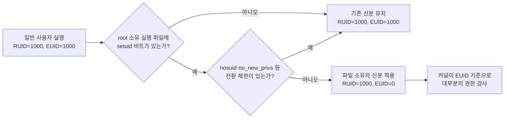

Linux 로컬 권한상승은 도구가 표시한 항목을 무작정 실행하는 문제가 아니라, 커널과 서비스 관리자가 **누구의 권한으로 무엇을 찾고 실행하는지** 추적하는 문제입니다. 기존 `OSCP` 폴더의 글은 Windows Active Directory(AD)와 도메인 계정 공격을 중심으로 다루며, 이 블로그에는 Linux 로컬 권한상승의 OS 내부구조를 한 흐름으로 설명한 글이 없었습니다. 이 글은 SUID, Capabilities, 실행 경로, `/proc`, cron, systemd를 연결해 자동화 결과를 읽는 기준을 정리합니다. 모든 확인과 검증은 소유하거나 명시적으로 **승인받은 대상에만** 적용합니다.

---

## 1. RUID와 EUID, setuid가 바꾸는 실행 신분

**원리**: 프로세스에는 “누가 이 프로그램을 시작했는가”를 나타내는 RUID(Real User ID)와 “지금 파일·프로세스 권한을 어떤 신분으로 검사할 것인가”를 나타내는 EUID(Effective User ID)가 있습니다. setuid를 출입증에 비유하면, 평소에는 일반 사용자 신분증인 RUID를 유지하지만 특정 문을 통과하는 동안에만 파일 소유자의 관리자 카드로 EUID가 바뀌는 구조입니다.

일반 사용자가 root 소유의 set-user-ID 실행 파일을 실행하면 `execve()` 과정에서 그 프로세스의 EUID가 파일 소유자 UID인 `0`으로 설정됩니다. RUID는 실행한 일반 사용자의 UID로 남으므로, “일반 사용자가 실행했는데 왜 root 권한으로 동작하는가”의 답은 **권한 검사에 주로 쓰이는 EUID가 root로 바뀌었기 때문**입니다. 프로그램은 필요에 따라 실효 권한을 낮추거나 되돌릴 수 있도록 saved set-user-ID도 사용합니다.

다만 SUID 표시가 곧 권한상승 성공을 뜻하지는 않습니다. Linux는 스크립트의 setuid 비트를 무시하고, `nosuid`로 마운트된 파일시스템이나 `no_new_privs`가 설정된 프로세스, 추적 중인 프로세스에서는 setuid 전환을 무시할 수 있습니다. 바이너리가 입력을 안전하게 검증하고 절대경로만 사용하며 권한을 일찍 내려놓는다면 SUID여도 악용 경로가 없을 수 있습니다.

- 체크 포인트:
  - `id`와 `/proc/$$/status`의 `Uid:` 네 값으로 현재 프로세스의 real/effective/saved/filesystem UID 구분
  - `find / -perm -4000 -type f 2>/dev/null` 결과에서 소유자, 정상 패키지 여부, 실행 경로 확인
  - `findmnt -no TARGET,OPTIONS`로 대상 파일시스템의 `nosuid` 여부 확인
  - SUID 파일 자체뿐 아니라 그 파일이 호출하는 명령·설정·라이브러리의 쓰기 권한까지 추적
- 참고: [Linux man-pages — execve(2)](https://man7.org/linux/man-pages/man2/execve.2.html), [Linux man-pages — credentials(7)](https://man7.org/linux/man-pages/man7/credentials.7.html), [GTFOBins — SUID 컨텍스트](https://gtfobins.github.io/#+suid)

## 2. Capabilities: root 권한을 필요한 조각으로 나누기

**원리**: 전통적인 Unix 모델의 root는 모든 문을 여는 거대한 열쇠 뭉치지만, Linux Capabilities는 그 뭉치를 기능별 조각으로 쪼개 필요한 조각만 나눠준 것입니다. 그래서 EUID가 `0`이 아닌 프로세스도 파일에 부여된 capability와 실행 시 계산되는 permitted/effective 집합에 따라 특정 특권 작업을 수행할 수 있습니다.

예를 들어 `CAP_SETUID`는 프로세스 UID를 바꾸는 작업을 허용하고, `CAP_NET_RAW`는 RAW·PACKET 소켓 사용을 허용합니다. 이것은 root 전체 권한을 준 것과 같지는 않지만, 인터프리터나 범용 도구처럼 기능 범위가 넓은 바이너리에 강한 capability가 붙으면 의도보다 훨씬 큰 영향으로 이어질 수 있습니다.

파일 capabilities는 확장 속성에 저장되며 `getcap`으로 확인합니다. 전체 파일시스템을 볼 때는 `getcap -r / 2>/dev/null`, 특정 파일은 `getcap /path/to/binary`처럼 확인할 수 있습니다. 결과의 `ep`는 허용 집합(permitted)에 넣고 실효 집합(effective)으로 활성화한다는 뜻이지만, capability 이름만 보고 결론 내리지 말고 바이너리 기능과 입력 통제, 마운트 옵션, 실행 시 capability 변환 규칙을 함께 봐야 합니다.

- 체크 포인트:
  - `getcap -r / 2>/dev/null`로 파일 capabilities 목록 수집
  - `getpcaps <PID>` 또는 `/proc/<PID>/status`의 `CapInh`, `CapPrm`, `CapEff`, `CapBnd`, `CapAmb`로 실제 프로세스 집합 확인
  - `CAP_SETUID`, `CAP_DAC_OVERRIDE`, `CAP_DAC_READ_SEARCH`, `CAP_SYS_ADMIN`처럼 영향이 큰 권한이 범용 실행기에 부여됐는지 확인
  - 배포 패키지의 정상 기본값인지, 관리자가 별도로 `setcap`한 이례적 설정인지 구분
- 참고: [Linux man-pages — capabilities(7)](https://man7.org/linux/man-pages/man7/capabilities.7.html), [Linux man-pages — getcap(8)](https://man7.org/linux/man-pages/man8/getcap.8.html), [GTFOBins — Capabilities 컨텍스트](https://gtfobins.github.io/#+capabilities)

## 3. PATH, LD_PRELOAD, RPATH와 RUNPATH: 이름을 실제 파일로 바꾸는 순서

**원리**: 권한 있는 프로그램이 다른 프로그램이나 라이브러리를 “택배 기사”에게 이름만 적어 건네면, 시스템은 검색 목록을 앞에서부터 훑어 실제 파일을 고릅니다. 공격자가 그 목록의 앞쪽 디렉터리에 같은 이름의 파일을 놓을 수 있다면, 관리자가 의도한 파일 대신 공격자가 통제하는 파일이 높은 권한으로 선택될 수 있습니다.

`$PATH`는 `backup`처럼 슬래시가 없는 명령 이름을 어느 디렉터리에서 찾을지 정합니다. root로 실행되는 스크립트나 SUID 프로그램이 `/usr/bin/backup`이라는 절대경로 대신 `backup`을 호출하고, 그때의 `PATH` 앞부분에 일반 사용자가 쓸 수 있는 디렉터리가 있다면 상대경로 실행 바이너리 하이재킹 조건이 만들어집니다. 현재 디렉터리를 뜻하는 빈 항목이나 `.`이 앞에 있는 경우도 같은 관점에서 봅니다.

동적 링크 바이너리에서는 로더가 공유 라이브러리를 고릅니다. `LD_PRELOAD`는 지정한 공유 객체를 다른 의존성보다 먼저 적재하게 해 함수 해석을 가로챌 수 있고, `LD_LIBRARY_PATH`는 검색 디렉터리를 추가합니다. 그러나 setuid나 파일 capabilities로 권한이 바뀌는 secure-execution mode에서는 위험한 `LD_*` 변수가 제거되거나 무시되므로, “SUID 파일에 `LD_PRELOAD`를 지정하면 언제나 된다”는 해석은 틀립니다.

의존성 이름에 슬래시가 없을 때 glibc 동적 로더의 핵심 검색 순서는 대체로 `DT_RPATH`(단, `DT_RUNPATH`가 없을 때) → `LD_LIBRARY_PATH`(secure-execution에서는 무시) → `DT_RUNPATH` → `/etc/ld.so.cache` → 기본 디렉터리입니다. `DT_RPATH`는 하위 의존성에도 적용될 수 있지만 `DT_RUNPATH`는 해당 객체의 직접 의존성에만 적용됩니다. 따라서 `readelf -d`로 RPATH/RUNPATH를 보고, 그 경로 또는 필요한 라이브러리 파일이 쓰기 가능한지 확인해야 합니다.

- 체크 포인트:
  - 권한 있는 스크립트·바이너리에서 슬래시 없는 외부 명령 호출과 실행 시점의 `PATH` 확인
  - `type -a <명령>`과 `command -v <명령>`으로 실제 선택 파일을 확인하고 각 상위 디렉터리의 쓰기 권한 추적
  - `readelf -d <바이너리>`의 `NEEDED`, `RPATH`, `RUNPATH`와 `ldd` 결과를 함께 검토
  - `LD_PRELOAD`·`LD_LIBRARY_PATH` 가능성을 보기 전에 setuid, capabilities, secure-execution 적용 여부 확인
- 참고: [Linux man-pages — exec(3)](https://man7.org/linux/man-pages/man3/exec.3.html), [Linux man-pages — ld.so(8)](https://man7.org/linux/man-pages/man8/ld.so.8.html), [GNU C Library — Dynamic Linker](https://sourceware.org/glibc/manual/latest/html_node/Dynamic-Linker.html)

## 4. /proc: 실행 중인 프로세스를 비추는 관찰창

**원리**: `/proc`는 디스크에 저장된 일반 파일 모음이라기보다 커널이 실행 중인 프로세스 상태를 파일처럼 보여주는 관찰창입니다. 창을 볼 권한이 있다면 명령행, 최초 환경변수, 열린 파일 같은 단서로 “어떤 높은 권한 프로세스가 무엇을 사용 중인가”를 역으로 추적할 수 있습니다.

`/proc/<PID>/cmdline`은 프로세스 시작 인자를, `/proc/<PID>/environ`은 `execve()` 시 전달된 초기 환경을 NUL 문자로 구분해 보여줍니다. `/proc/<PID>/fd/`는 열린 파일·파이프·소켓을 심볼릭 링크로 노출하고, `exe`, `cwd`, `maps`, `status`도 실행 파일·작업 디렉터리·메모리 매핑·UID와 capabilities를 이해하는 데 유용합니다. 이런 정보에서 설정 파일 경로, 임시 파일, 서비스가 읽는 스크립트, 검색 경로 같은 권한상승 힌트를 찾을 수 있습니다.

하지만 `/proc`가 모든 사용자에게 모든 정보를 공개하는 것은 아닙니다. 파일별 소유권과 ptrace 접근 검사, `/proc`의 `hidepid` 마운트 옵션, Yama·LSM 정책, PID namespace 등에 따라 다른 사용자의 프로세스가 보이지 않거나 읽히지 않을 수 있습니다. 또한 `environ`은 프로세스가 시작된 뒤 메모리에서 바꾼 모든 환경변수를 항상 반영하지 않습니다.

- 체크 포인트:
  - `ps -eo user,pid,ppid,cmd`로 높은 권한 프로세스를 찾고 접근 가능한 `/proc/<PID>` 항목만 확인
  - `tr '\0' ' ' < /proc/<PID>/cmdline`과 `tr '\0' '\n' < /proc/<PID>/environ`으로 NUL 구분 데이터 해석
  - `ls -l /proc/<PID>/fd`, `readlink /proc/<PID>/{exe,cwd}`로 열린 대상과 실행 위치 확인
  - `findmnt -no OPTIONS /proc`와 접근 실패 원인으로 `hidepid`, ptrace·LSM 제한 여부 구분
- 참고: [Linux man-pages — proc_pid(5)](https://man7.org/linux/man-pages/man5/proc_pid.5.html), [Linux man-pages — proc_pid_environ(5)](https://man7.org/linux/man-pages/man5/proc_pid_environ.5.html), [Linux man-pages — proc_pid_fd(5)](https://man7.org/linux/man-pages/man5/proc_pid_fd.5.html)

## 5. cron: 예약 시각에 어느 사용자의 명령을 실행하는가

**원리**: cron은 정해진 시각마다 봉인된 작업 지시서를 꺼내 실행하는 예약 담당자입니다. 위험 여부는 지시서를 누가 작성할 수 있는지가 아니라, **실행될 때 어느 사용자 도장을 찍고 어떤 스크립트를 읽는지**까지 연결해 판단해야 합니다.

사용자별 crontab은 그 crontab 소유자 권한으로 실행됩니다. 반면 `/etc/crontab`과 `/etc/cron.d/*` 형식에는 시간 필드 다음에 실행 사용자를 지정하는 필드가 있으며, `/etc/cron.hourly` 같은 주기 디렉터리는 배포판의 시스템 cron 설정이 어떤 사용자로 호출하는지 확인해야 합니다. root로 실행되는 항목이 일반 사용자가 쓸 수 있는 스크립트나 설정을 호출하면, 다음 예약 실행에서 그 변경 내용도 root 컨텍스트로 처리될 수 있습니다.

cron은 대화형 셸과 환경이 다르고 제한된 `PATH`, `SHELL`, 작업 디렉터리를 사용할 수 있습니다. 따라서 스크립트 파일만 보지 말고 crontab의 환경 선언, 상대경로 명령, 와일드카드, 리다이렉션 대상, 스크립트가 다시 읽는 파일까지 이어지는 쓰기 가능 체인을 확인해야 합니다. 쓰기 가능하더라도 작업이 비활성화됐거나 실제로 호출되지 않으면 즉시 악용 가능한 항목은 아닙니다.

- 체크 포인트:
  - 사용자 crontab, `/etc/crontab`, `/etc/cron.d/`, `/etc/cron.{hourly,daily,weekly,monthly}/`의 실행 사용자 구분
  - root 항목이 호출하는 스크립트와 그 상위 디렉터리, 설정·로그·임시 파일의 소유권과 쓰기 권한 확인
  - cron이 사용하는 `PATH`에서 상대경로 명령이 공격자 쓰기 가능 디렉터리보다 뒤에 있지 않은지 확인
  - 로그와 타임스탬프로 작업이 실제 실행되는지 확인하되 운영 부하나 파일 변경 없이 관찰
- 참고: [cronie — crontab(5)](https://man7.org/linux/man-pages/man5/crontab.5.html), [Debian manpages — cron(8)](https://manpages.debian.org/stable/cron/cron.8.en.html)

## 6. systemd: 유닛 설정과 실행 파일의 신뢰 경계

**원리**: systemd 유닛은 서비스의 “누가, 무엇을, 어떤 환경에서 시작할지” 적은 운전 지시서입니다. 시스템 서비스는 `User=`가 없으면 기본적으로 root로 실행되고, `User=`가 있으면 그 사용자로 내려가지만, 사용자별 systemd 관리자에서 실행하는 유닛은 해당 사용자 컨텍스트를 벗어나지 않습니다.

`systemctl cat <unit>`은 실제 유닛과 drop-in을 합쳐 보여주므로 `ExecStart=`, `ExecStartPre=`, `ExecReload=`, `EnvironmentFile=`, `WorkingDirectory=`, `User=`, `Group=`을 함께 볼 수 있습니다. root 시스템 유닛 자체나 drop-in, `Exec*`가 가리키는 스크립트·바이너리, `EnvironmentFile`이 일반 사용자에게 쓰기 가능하면 다음 시작·재시작·재로드 시 높은 권한 실행 흐름이 바뀔 수 있습니다.

다만 디스크의 유닛 파일을 바꿨다고 실행 중인 서비스가 즉시 변하지는 않습니다. 보통 관리자가 `daemon-reload`를 수행하고 서비스를 시작·재시작하거나, 부팅·타이머·자동 재시작 같은 후속 사건이 있어야 새 설정이 반영됩니다. 따라서 “쓰기 가능”과 “공격자가 권한 없이 반영 시점을 만들 수 있음”을 구분하고, 유닛 검색 경로에서 이름이 같은 파일의 우선순위와 심볼릭 링크 대상도 확인합니다.

- 체크 포인트:
  - `systemctl show <unit> -p User -p Group -p FragmentPath -p DropInPaths`로 실행 사용자와 실제 설정 출처 확인
  - `systemctl cat <unit>`으로 기본 유닛과 drop-in을 합친 최종 구성 확인
  - `ExecStart*`, `ExecReload`, `EnvironmentFile`, `WorkingDirectory`가 가리키는 전체 경로의 소유권·쓰기 권한 추적
  - 변경 반영에 `daemon-reload`, 재시작, 부팅, timer 활성화 중 무엇이 필요한지와 일반 사용자가 그 사건을 유발할 수 있는지 확인
- 참고: [systemd — systemd.service](https://www.freedesktop.org/software/systemd/man/latest/systemd.service.html), [systemd — systemd.exec](https://www.freedesktop.org/software/systemd/man/latest/systemd.exec.html), [systemd — systemd.unit](https://www.freedesktop.org/software/systemd/man/latest/systemd.unit.html)

## 7. linPEAS 출력을 취약점이 아니라 가설 목록으로 읽기

**원리**: linPEAS 같은 자동화 스크립트는 화재경보기이지 화재 원인 감정서가 아닙니다. 눈에 띄는 SUID 바이너리, capabilities, 쓰기 가능한 경로, cron 작업, systemd 유닛을 빠르게 모아주지만, 색이 강조됐다는 사실만으로 권한상승이 증명되지는 않습니다.

의심스러운 SUID 항목은 “실행 시 EUID가 누구로 바뀌는가 → 통제 가능한 입력이나 하위 호출이 있는가 → `nosuid`·`no_new_privs` 제한은 없는가” 순서로 확인합니다. capabilities는 “어떤 조각이 부여됐는가 → 그 바이너리가 그 조각으로 어떤 동작을 할 수 있는가”를 보고, PATH·RPATH·cron·systemd 항목은 “높은 권한 실행자 → 공격자 쓰기 가능 파일 → 실제 실행·반영 사건”이 끊기지 않는지 검증합니다.

GTFOBins는 정상 Unix 바이너리의 기능이 SUID, sudo, capabilities 같은 잘못된 권한 구성과 결합될 때 어떤 보안 경계를 넘을 수 있는지 찾는 참고 목록입니다. 목록에 있다는 사실은 그 바이너리가 취약하다는 뜻이 아니며, 설치 버전과 빌드 옵션, 부여된 권한, 허용된 기능을 현재 대상에서 다시 확인해야 합니다. 이 원리를 알고 보면 linPEAS 출력은 복사해 실행할 명령 목록이 아니라, 수동 검증의 우선순위를 정하는 근거가 됩니다.

- 체크 포인트:
  - 자동화 결과를 원본 명령(`find`, `getcap`, `systemctl`, `readelf`)으로 재확인
  - 파일 하나가 아니라 소유자·상위 디렉터리·심볼릭 링크·호출 대상까지 쓰기 가능 체인으로 기록
  - 현재 EUID, capability 집합, 실행 사용자, 마운트·LSM 제한을 함께 남겨 오탐 제거
  - 검증은 읽기 전용 관찰부터 시작하고, 운영 영향이 있는 실행·변경은 별도 승인 후 수행
- 참고: [linPEAS — PEASS-ng](https://github.com/peass-ng/PEASS-ng/tree/master/linPEAS), [GTFOBins](https://gtfobins.github.io/), [Linux man-pages — capabilities(7)](https://man7.org/linux/man-pages/man7/capabilities.7.html)

---

Linux 권한상승을 이해하는 핵심은 특별한 명령을 외우는 것이 아니라, 프로세스의 실효 신분과 권한 조각, 파일 검색 순서, 실행 사용자, 쓰기 가능한 신뢰 경계를 한 줄로 연결하는 것입니다. 이 연결이 보이면 자동화 도구가 강조한 항목 중 실제 위험한 경로와 단순한 정보성 결과를 구분할 수 있습니다.
