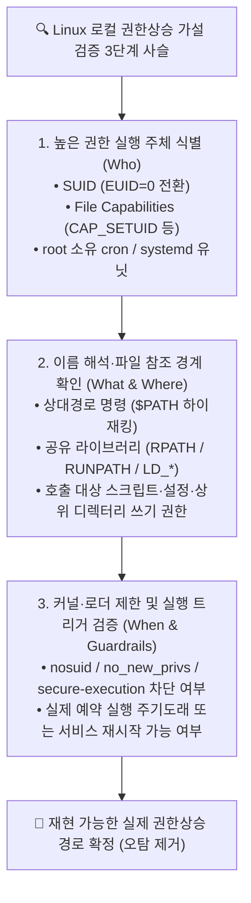
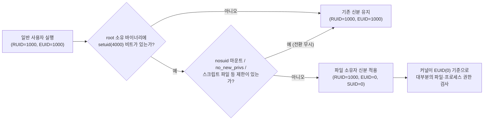
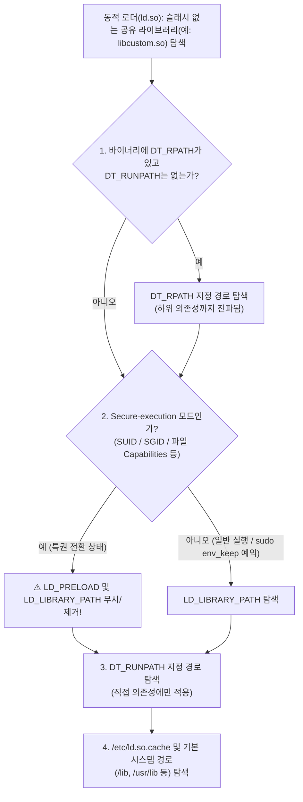

> [!summary] ⏱️ 5초 핵심 요약
> - **한 줄 비유**: Linux 로컬 권한상승은 요술 지팡이 명령어를 외우는 것이 아니라, **높은 권한(EUID=0 또는 특권 Capability)을 가진 프로세스가 어떤 심부름꾼(PATH·로더·cron·systemd)을 통해 내가 고칠 수 있는 파일(쓰기 가능 지점)을 읽어 실행하는지** 그 연결 고리를 찾는 추적 게임입니다.
> - **핵심 원리**: 권한상승이 실제로 성립하려면 반드시 **① 높은 권한의 실행 주체(SUID/Capabilities/root 서비스) + ② 공격자가 통제(쓰기·하이재킹)할 수 있는 경로/파일 + ③ 그 변경을 실제로 실행·반영시키는 트리거(호출·예약 시각·재시작)** 3박자가 끊기지 않고 이어져야 합니다.
> - **핵심 체크 포인트**: `linPEAS`의 빨간색·노란색 강조 표시는 확정된 취약점이 아니라 **검증할 가설 목록**이며, `nosuid`, `no_new_privs`, `secure-execution mode(LD_PRELOAD 무시)`, `hidepid` 같은 커널·로더 보호 조건을 함께 대조해야 오탐을 걸러낼 수 있습니다.

Linux 로컬 권한상승은 도구가 표시한 항목을 무작정 실행하는 문제가 아니라, 커널과 서비스 관리자가 **누구의 권한으로 무엇을 찾고 실행하는지** 추적하는 문제입니다. 기존 `OSCP` 폴더의 글은 Windows Active Directory(AD)와 도메인 계정 공격을 중심으로 다루며, 이 블로그에는 Linux 로컬 권한상승의 OS 내부구조를 한 흐름으로 설명한 글이 없었습니다. 이 글은 SUID, Capabilities, 실행 경로, `/proc`, cron, systemd를 연결해 자동화 결과를 읽는 기준을 정리합니다. 모든 확인과 검증은 소유하거나 명시적으로 **승인받은 대상에만** 적용합니다.



---

## 한눈에 보는 Linux 권한상승 6대 내부구조 비교표

| 내부구조 요소 | 한 줄 비유 | 핵심 작동 원리 | 자주 하는 오판 (오탐 원인) | 핵심 확인 명령어 |
|---|---|---|---|---|
| **1. RUID / EUID & SUID** | 특정 문을 통과할 때만 파일 주인의 마스터 출입증으로 바꿔 달기 | `execve()` 시 프로세스의 **EUID(실효 UID)**를 파일 소유자(예: `root=0`)로 전환해 권한 검사 수행 | 셸 스크립트의 SUID(Linux 커널이 무시), `nosuid` 마운트, `no_new_privs` 설정 환경 간과 | `id`, `grep Uid /proc/$$/status`, `find / -perm -4000 -type f` |
| **2. Capabilities** | 마스터키 뭉치를 기능별 열쇠 조각으로 쪼개어 나눠 주기 | `EUID!=0`이어도 파일/프로세스의 Permitted·Effective 집합에 부여된 특권 조각 허용 | 단순 `cap_net_raw` 등을 무조건 root 탈취로 과장, `nosuid`나 입력 통제 미확인 | `getcap -r / 2>/dev/null`, `getpcaps <PID>`, `grep Cap /proc/$$/status` |
| **3. `PATH` / `LD_*` / `RPATH`** | 이름만 적힌 심부름 메모를 보고 앞쪽 사물함부터 순서대로 뒤지기 | 슬래시(`/`) 없는 명령은 `$PATH` 순서로, 라이브러리는 `RPATH` → `LD_LIBRARY_PATH` → `RUNPATH` 순 탐색 | **SUID/Capabilities 실행 시 secure-execution 모드가 켜져 `LD_PRELOAD`·`LD_LIBRARY_PATH`가 무시됨**을 간과 | `echo $PATH`, `type -a`, `readelf -d <bin>`, `ldd <bin>` |
| **4. `/proc` 파일시스템** | 실행 중인 프로세스 내부를 들여다보는 실시간 유리창 | 커널이 각 PID의 `cmdline`(인자), `environ`(초기 환경), `fd`(열린 파일), `status`를 가상 파일로 노출 | `hidepid=1/2` 마운트 옵션이나 ptrace/LSM 제한을 모르고 권한 부족 에러에 매달림, 런타임 변경 환경변수 미반영 간과 | `tr '\0' ' ' < /proc/<PID>/cmdline`, `ls -l /proc/<PID>/fd` |
| **5. `cron` 스케줄러** | 정해진 시각마다 지정된 사람의 도장을 찍어 작업 지시서 실행하기 | `/etc/crontab`, `/etc/cron.d/*` 등에 적힌 사용자 컨텍스트로 주기적 명령/스크립트 실행 | 쓰기 가능한 스크립트를 찾았으나 주석 처리·비활성 상태이거나 cron 전용 제한된 `$PATH`를 고려하지 않음 | `cat /etc/crontab`, `ls -la /etc/cron*`, `crontab -l` |
| **6. `systemd` 서비스** | 서비스의 실행 계정·명령·환경을 정의한 공식 운전 지시서 | 유닛 파일과 drop-in을 합쳐 `User=`(기본 `root`) 권한으로 `ExecStart` 등 실행 | 디스크의 유닛 파일을 고쳤으나 일반 사용자 권한으로 `daemon-reload`나 서비스 재시작을 유발할 방법이 없음 | `systemctl cat <unit>`, `systemctl show <unit> -p User,FragmentPath,DropInPaths` |

---

## 1. RUID와 EUID, setuid가 바꾸는 실행 신분

**💡 한 줄 비유**: 평소에는 내 일반 사원증(**RUID**)을 목에 걸고 다니지만, 특별한 금고 프로그램(**SUID 바이너리**)을 실행하는 동안에만 금고 주인의 관리자 출입증(**EUID=0**)으로 임시 전환되는 구조입니다.



### 핵심 원리
- **4가지 UID의 역할 (`/proc/$$/status`의 `Uid:` 행)**:
  - **RUID (Real UID)**: 이 프로세스를 실제로 시작한 원래 사용자가 누구인지 나타냅니다.
  - **EUID (Effective UID)**: 커널이 지금 파일·프로세스 접근 권한을 어떤 신분으로 검사할지 결정하는 핵심 기준입니다. (파일시스템 접근 시 엄밀히는 FSUID가 쓰이지만 보통 EUID를 따라갑니다.)
  - **SUID (Saved set-user-ID)**: 프로그램이 일시적으로 실효 권한(EUID)을 낮췄다가 다시 원래의 특권으로 되돌릴 수 있도록 보관해 두는 값입니다.
- **`execve()`와 EUID 전환**: 일반 사용자(`UID=1000`)가 `root(UID=0)` 소유의 set-user-ID 실행 파일을 실행하면, `execve()` 시스템 콜 과정에서 프로세스의 **EUID가 파일 소유자인 `0`으로 설정**됩니다. RUID는 `1000`으로 남지만 권한 검사의 주 기준인 EUID가 `0`이 되었기 때문에 root 권한 작업을 수행할 수 있습니다.
- **SUID 비트가 있어도 권한상승이 안 되는 4가지 대표 조건**:
  1. **셸 스크립트(`#!`)**: Linux 커널은 경쟁 조건(Race Condition) 등 보안상의 이유로 스크립트 파일에 붙은 setuid 비트를 무시합니다.
  2. **`nosuid` 마운트 옵션**: 대상 파일이 위치한 파일시스템(예: `/tmp`, `/home`, NFS 마운트)이 `nosuid` 옵션으로 마운트되어 있으면 특권 전환이 일어나지 않습니다.
  3. **`PR_SET_NO_NEW_PRIVS` (`no_new_privs`)**: 컨테이너나 샌드박스, systemd 보안 설정 등으로 부모 프로세스에 `no_new_privs`가 켜져 있으면 SUID 전환이 차단됩니다.
  4. **안전하게 작성된 바이너리**: 입력값을 엄격히 통제하고 외부 명령을 절대경로로만 호출하며, 특권 작업 직후 `setresuid()` 등으로 권한을 완전히 내려놓는 정상 바이너리는 SUID가 붙어 있어도 악용 경로가 없습니다.

```bash
# 1. 현재 프로세스의 Real / Effective / Saved / Filesystem UID 확인
id
grep -E '^Uid:|^Gid:|^NoNewPrivs:' /proc/$$/status

# 2. 시스템 내 SUID(4000) 일반 파일 탐색 및 마운트 옵션(nosuid 여부) 대조
find / -perm -4000 -type f -exec ls -ld {} + 2>/dev/null
findmnt -no TARGET,OPTIONS
```

### 체크 포인트
- `id`와 `/proc/$$/status`의 `Uid:` 네 값으로 현재 프로세스의 **Real / Effective / Saved / Filesystem UID**를 정확히 구분했는가?
- `find / -perm -4000 -type f 2>/dev/null` 결과에서 파일 소유자, 배포판 기본 패키지 여부, 비표준 경로(`/opt`, `/usr/local` 등) 여부를 확인했는가?
- `findmnt -no TARGET,OPTIONS`로 대상 바이너리가 위치한 파일시스템의 **`nosuid` 마운트 여부**를 확인했는가?
- SUID 바이너리 자체뿐 아니라 **그 바이너리가 내부적으로 호출하는 명령·설정 파일·공유 라이브러리의 쓰기 권한**까지 추적했는가?
- 참고: [Linux man-pages — execve(2)](https://man7.org/linux/man-pages/man2/execve.2.html), [Linux man-pages — credentials(7)](https://man7.org/linux/man-pages/man7/credentials.7.html), [GTFOBins — SUID 컨텍스트](https://gtfobins.github.io/#+suid)

---

## 2. Capabilities: root 권한을 필요한 조각으로 나누기

**💡 한 줄 비유**: 전통적인 Unix의 `root`가 건물 모든 문을 다 여는 **만능 마스터키 뭉치**라면, Linux Capabilities는 그 뭉치를 **'네트워크 소켓 열쇠(`cap_net_raw`)', '신분증 변경 열쇠(`cap_setuid`)'처럼 기능별 낱개 열쇠로 쪼개어 필요한 조각만 나눠준 것**입니다.

### 핵심 원리
- **EUID=0 없이 동작하는 특권 조각**: Capabilities 덕분에 프로세스의 EUID가 `0(root)`이 아니더라도, 실행 파일의 확장 속성(`security.capability`)에 부여된 capability와 `execve()` 시 계산되는 프로세스 집합(**Permitted, Effective, Inheritable, Bounding, Ambient**)에 따라 특정 특권 작업을 수행할 수 있습니다.
- **범용 바이너리와 위험한 Capability의 결합**:
  - `ping`에 부여된 `cap_net_raw=ep`처럼 단일 목적 도구에 최소 권한이 붙은 경우는 정상입니다.
  - 반면 **`python3`, `perl`, `node`, `tar`, `vim`, `openssl` 같은 인터프리터나 범용 파일 처리 도구**에 아래와 같은 강력한 capability가 부여되면 사실상 root 전체 권한 탈취로 이어집니다.

| 주의할 핵심 Capability | 허용하는 특권 동작 | 범용 바이너리(예: `python3`, `tar`)에 부여 시 파급력 |
|---|---|---|
| **`CAP_SETUID`** | 프로세스 UID를 임의로 변경 (`setuid(0)` 호출 가능) | `python3 -c 'import os; os.setuid(0); os.system("/bin/sh")'` 등으로 즉시 `root` 셸 획득 |
| **`CAP_DAC_OVERRIDE`** | 파일의 읽기·쓰기·실행 DAC 권한 검사(rwx) 전면 우회 | `/etc/shadow`, `/etc/sudoers`, `root`의 SSH 키나 cron 파일을 임의로 읽고 덮어쓰기 가능 |
| **`CAP_DAC_READ_SEARCH`** | 파일 읽기 및 디렉터리 검색 권한 검사 우회 | `/etc/shadow`나 백업 아카이브, 개인키 등 시스템 내 모든 민감 파일 열람 가능 |
| **`CAP_SYS_ADMIN`** | 마운트, 네임스페이스 조작 등 광범위한 시스템 관리 작업 | 사실상 root에 준하는 다양한 권한상승 경로 생성 가능 |

```bash
# 1. 파일시스템 전체에서 파일 Capabilities가 설정된 바이너리 검색
getcap -r / 2>/dev/null

# 2. 특정 프로세스(PID)의 현재 Capability 집합 비트마스크 및 디코딩 확인
grep -E '^Cap(Inh|Prm|Eff|Bnd|Amb):' /proc/$$/status
capsh --decode=00000000a80425fb
```

### 체크 포인트
- `getcap -r / 2>/dev/null`로 파일 capabilities가 설정된 모든 바이너리 목록을 수집했는가?
- `getpcaps <PID>` 또는 `/proc/<PID>/status`의 **`CapInh`, `CapPrm`, `CapEff`, `CapBnd`, `CapAmb`**로 실제 프로세스에 활성화된 집합을 확인했는가?
- `CAP_SETUID`, `CAP_DAC_OVERRIDE`, `CAP_DAC_READ_SEARCH`, `CAP_SYS_ADMIN`처럼 파급력이 큰 권한이 **인터프리터나 범용 바이너리**에 부여되었는지 확인했는가?
- 배포판 패키지의 정상 기본값(예: `/usr/bin/ping`의 `cap_net_raw=ep`)인지, 관리자가 편의상 `setcap`으로 잘못 부여한 설정인지 구분했는가?
- 참고: [Linux man-pages — capabilities(7)](https://man7.org/linux/man-pages/man7/capabilities.7.html), [Linux man-pages — getcap(8)](https://man7.org/linux/man-pages/man8/getcap.8.html), [GTFOBins — Capabilities 컨텍스트](https://gtfobins.github.io/#+capabilities)

---

## 3. PATH, LD_PRELOAD, RPATH와 RUNPATH: 이름을 실제 파일로 바꾸는 순서

**💡 한 줄 비유**: 높은 권한을 가진 관리자가 심부름꾼에게 **"가서 `backup` 프로그램(또는 `libhelper.so` 부품) 좀 가져와!"라고 전체 주소 없이 이름만 적힌 쪽지**를 건네면, 심부름꾼은 정해진 사물함 목록을 **맨 앞칸부터 순서대로** 뒤집니다. 공격자가 앞쪽 사물함에 같은 이름의 가짜 파일을 넣어두면 관리자 권한으로 그 가짜 파일이 실행됩니다.

### 1) `$PATH`와 상대경로 명령 하이재킹
- **작동 조건**: `root`로 실행되는 스크립트나 SUID 프로그램이 `/usr/local/bin/backup`이라는 절대경로 대신 슬래시(`/`)가 없는 `backup`을 호출할 때(`system("backup")`, `execvp("backup", ...)` 등), 그 시점의 `$PATH` 앞쪽에 일반 사용자가 쓰기 가능한 디렉터리(예: `/tmp`, `/home/user/bin`, 또는 현재 디렉터리를 뜻하는 `.`이나 빈 항목 `::`)가 있으면 하이재킹 조건이 성립합니다.

### 2) 공유 라이브러리 탐색 순서와 `secure-execution mode`의 결정적 차이
동적 링크 바이너리에서 필요한 공유 라이브러리 이름에 슬래시(`/`)가 없을 때, **glibc 동적 로더(`ld.so`)가 파일을 찾는 정확한 순서**는 다음과 같습니다.



- **왜 SUID 바이너리에 그냥 `LD_PRELOAD`를 걸면 안 통하는가?**:
  - `execve()` 시 RUID와 EUID가 달라지거나(SUID) 파일 Capabilities로 특권이 생기는 경우, glibc 로더는 자동으로 **`secure-execution mode`**로 진입합니다. 이 모드에서는 공격자가 환경변수로 전달한 `LD_PRELOAD`, `LD_LIBRARY_PATH` 같은 위험한 `LD_*` 변수를 로더가 무시하고 제거합니다. (단, `sudo -l`에서 `env_keep+=LD_PRELOAD`가 명시적으로 허용된 경우는 `sudo`가 root로 전환한 뒤 환경을 넘겨주므로 예외적으로 작동합니다.)
- **반면 `DT_RPATH` / `DT_RUNPATH`가 위험한 이유**:
  - 바이너리 컴파일 시점에 ELF 헤더 안에 박혀 있는 `DT_RPATH`나 `DT_RUNPATH`(예: `/opt/app/lib`, `./lib`, `$ORIGIN/lib`)는 환경변수가 아니라 바이너리 자체의 속성이므로 SUID 상태에서도 그대로 탐색됩니다. 만약 그 디렉터리나 라이브러리 파일에 일반 사용자의 쓰기 권한이 열려 있다면 공유 라이브러리 하이재킹이 성립합니다.

```bash
# 1. 상대경로 명령이 실제 어느 경로에서 선택되는지 확인
echo "$PATH"
type -a backup

# 2. ELF 바이너리의 동적 섹션에서 NEEDED(의존 라이브러리)와 RPATH / RUNPATH 확인
readelf -d /usr/local/bin/custom_suid | grep -E 'NEEDED|RPATH|RUNPATH'
ldd /usr/local/bin/custom_suid
```

### 체크 포인트
- 권한 있는 스크립트·바이너리에서 **슬래시(`/`) 없는 외부 명령 호출**과 실행 시점의 `$PATH` 구성을 확인했는가?
- `type -a <명령>`과 `command -v <명령>`으로 실제 선택되는 파일을 확인하고 **앞선 검색 디렉터리들의 쓰기 권한**을 추적했는가?
- `readelf -d <바이너리>`의 **`NEEDED`, `RPATH`, `RUNPATH`**와 `ldd` 결과에서 쓰기 가능한 디렉터리나 누락된(`not found`) 라이브러리가 있는지 확인했는가?
- `LD_PRELOAD`·`LD_LIBRARY_PATH` 악용 가능성을 판단하기 전에 **setuid/capabilities에 의한 `secure-execution mode` 적용 여부**(또는 `sudo env_keep` 설정)를 먼저 확인했는가?
- 참고: [Linux man-pages — exec(3)](https://man7.org/linux/man-pages/man3/exec.3.html), [Linux man-pages — ld.so(8)](https://man7.org/linux/man-pages/man8/ld.so.8.html), [GNU C Library — Dynamic Linker](https://sourceware.org/glibc/manual/latest/html_node/Dynamic-Linker.html)

---

## 4. /proc: 실행 중인 프로세스를 비추는 관찰창

**💡 한 줄 비유**: `/proc`는 하드디스크에 저장된 일반 문서 창고가 아니라, **지금 건물 안에서 일하고 있는 모든 프로세스의 손에 들린 작업 지시서(`cmdline`), 주머니 속 초기 메모(`environ`), 현재 열어둔 서랍(`fd`)을 실시간으로 비춰주는 커널의 유리창**입니다.

### 핵심 원리와 관찰 포인트
- **주요 `/proc/<PID>/` 항목의 의미**:
  - `cmdline`: 프로세스가 시작될 때 전달된 명령행 인자 전체 (NUL 문자 `\0`으로 구분됨)
  - `environ`: `execve()` 호출 시점에 전달된 **초기 환경변수 목록** (NUL 문자로 구분됨. *주의: 프로세스가 실행 도중 `setenv()` 등으로 메모리에서 바꾼 값이 항상 실시간 반영되지는 않음*)
  - `fd/`: 프로세스가 현재 열어둔 파일·파이프·소켓 디스크립터를 가리키는 심볼릭 링크 디렉터리
  - `exe`, `cwd`, `maps`, `status`: 실제 실행 바이너리 경로, 현재 작업 디렉터리, 로드된 공유 라이브러리 메모리 매핑, UID 및 Capabilities 상태
- **왜 `/proc`가 안 보일 때가 있는가? (보호 통제 구분)**:
  1. **`hidepid` 마운트 옵션**: `/proc`가 `hidepid=1`(또는 `invisible`)이나 `hidepid=2`(또는 `noaccess`)로 마운트되어 있으면 다른 사용자의 PID 디렉터리에 접근할 수 없거나 아예 목록에서 숨겨집니다.
  2. **`ptrace` 접근 검사 및 LSM**: `environ`, `fd`, `exe`, `cwd` 등 민감한 항목은 커널의 `ptrace_may_access()` 검사와 Yama(`kernel.yama.ptrace_scope`), AppArmor/SELinux 정책에 의해 다른 소유자(특히 `root`) 프로세스에 대한 읽기가 차단됩니다.

```bash
# 1. /proc 마운트 옵션(hidepid 적용 여부) 먼저 확인
findmnt -no TARGET,OPTIONS /proc

# 2. 접근 가능한 프로세스의 NUL 구분 cmdline 및 초기 environ 읽기
tr '\0' ' ' < /proc/<PID>/cmdline; echo
tr '\0' '\n' < /proc/<PID>/environ

# 3. 실행 바이너리, 작업 디렉터리, 열린 파일 디스크립터(fd) 심볼릭 링크 확인
readlink -f /proc/<PID>/exe /proc/<PID>/cwd
ls -l /proc/<PID>/fd 2>/dev/null
```

### 체크 포인트
- `ps -eo user,pid,ppid,cmd`로 높은 권한 프로세스를 찾고 **현재 계정으로 접근 가능한 `/proc/<PID>` 항목**만 비파괴적으로 확인했는가?
- `tr '\0' ' ' < /proc/<PID>/cmdline`과 `tr '\0' '\n' < /proc/<PID>/environ`으로 **NUL(`\0`) 구분 데이터를 깨짐 없이 해석**했는가?
- `ls -l /proc/<PID>/fd`, `readlink /proc/<PID>/{exe,cwd}`로 프로세스가 참조하는 설정 파일·로그·스크립트 경로를 확인했는가?
- 접근 거부(`Permission denied`) 발생 시 `findmnt -no OPTIONS /proc`를 통해 **`hidepid` 옵션, 소유권/ptrace 검사, LSM 제한** 여부를 구분했는가?
- 참고: [Linux man-pages — proc_pid(5)](https://man7.org/linux/man-pages/man5/proc_pid.5.html), [Linux man-pages — proc_pid_environ(5)](https://man7.org/linux/man-pages/man5/proc_pid_environ.5.html), [Linux man-pages — proc_pid_fd(5)](https://man7.org/linux/man-pages/man5/proc_pid_fd.5.html)

---

## 5. cron: 예약 시각에 어느 사용자의 명령을 실행하는가

**💡 한 줄 비유**: `cron`은 정해진 시각마다 봉인된 작업 지시서를 꺼내 실행하는 **야간 당직자**입니다. 지시서에 **'사장님(`root`) 도장으로 실행할 것'**이라고 적혀 있는데 정작 **지시서 안에 적힌 심부름 스크립트나 보관 서랍을 일반 직원이 고칠 수 있다면**, 다음 정각에 일반 직원의 명령이 사장님 권한으로 실행됩니다.

### 핵심 원리: 사용자 crontab vs 시스템 cron 형식 비교
1. **실행 사용자 결정 방식**:
   - **사용자별 crontab (`crontab -l`)**: 별도의 사용자 필드가 없으며, 해당 crontab 소유자의 권한으로 실행됩니다.
   - **시스템 cron (`/etc/crontab`, `/etc/cron.d/*`)**: 5개의 시간 필드 바로 뒤에 **실행할 사용자(`root` 등)를 지정하는 6번째 필드**가 존재합니다. `/etc/cron.{hourly,daily,weekly,monthly}/` 디렉터리 안의 스크립트는 `/etc/crontab`(또는 `anacron`)이 지정한 사용자(대개 `root`)가 `run-parts`로 호출합니다.
2. **cron 환경의 특수성과 쓰기 가능 체인(Writable Chain)**:
   - cron은 일반 대화형 셸과 환경이 다릅니다. 상단에 별도 선언이 없으면 제한된 기본 `PATH`(예: `/usr/bin:/bin`)와 기본 `SHELL`(`sh`)을 사용합니다.
   - 따라서 호출되는 스크립트 파일 자체의 쓰기 권한뿐 아니라 **① 스크립트가 놓인 상위 디렉터리의 쓰기 권한(파일 삭제 후 재생성 가능 여부)**, **② crontab 상단에 선언된 `PATH` 내 앞선 디렉터리의 쓰기 권한**, **③ 스크립트 내부에서 상대경로로 호출하는 명령이나 `source`로 불러오는 설정 파일**, **④ 위험한 와일드카드(`*` — 예: `tar czf backup.tgz *`에서의 옵션 인젝션)**까지 한 줄로 이어서 봐야 합니다.

```text
# [취약한 /etc/cron.d/backup 설정 예시]
SHELL=/bin/bash
PATH=/opt/custom/bin:/usr/local/sbin:/usr/local/bin:/sbin:/bin:/usr/sbin:/usr/bin

# 매 10분마다 root 권한으로 실행:
# 1) /opt/custom/bin 이 일반 사용자 쓰기 가능하면 상대경로 명령 하이재킹 가능
# 2) /usr/local/bin/cleanup.sh 파일 또는 상위 폴더가 쓰기 가능하면 root 코드 실행 가능
*/10 * * * * root /usr/local/bin/cleanup.sh
```

### 체크 포인트
- 사용자 crontab, `/etc/crontab`, `/etc/cron.d/`, `/etc/cron.{hourly,daily,weekly,monthly}/` 각각에서 **누구의 권한(User)으로 실행되는지** 구분했는가?
- `root` 항목이 호출하는 **스크립트 파일 자체, 상위 디렉터리, 내부에서 `source`하거나 읽는 설정·임시 파일의 소유권과 쓰기 권한**을 모두 확인했는가?
- crontab에 정의된 `PATH`에서 **상대경로 명령이 공격자 쓰기 가능 디렉터리보다 뒤에서 탐색되지 않는지** 확인했는가?
- 시스템 로그나 파일 수정 타임스탬프로 해당 예약 작업이 **실제로 활성화되어 주기적으로 돌고 있는지** 비파괴적으로 확인했는가?
- 참고: [cronie — crontab(5)](https://man7.org/linux/man-pages/man5/crontab.5.html), [Debian manpages — cron(8)](https://manpages.debian.org/stable/cron/cron.8.en.html)

---

## 6. systemd: 유닛 설정과 실행 파일의 신뢰 경계

**💡 한 줄 비유**: `systemd` 유닛 파일은 백그라운드 서비스의 **운전 지시서**입니다. 운전 지시서(`*.service`나 `drop-in`) 또는 지시서가 시동을 거는 엔진 파일(`ExecStart`)을 일반 사용자가 고칠 수 있고, **차를 다시 시동 걸 기회(서비스 재시작·부팅·타이머)가 있다면** 그 차는 설정된 사용자(기본 `root`) 권한으로 공격자의 명령을 달립니다.

### 핵심 원리
- **시스템 유닛 vs 사용자 유닛 구분**:
  - **시스템 서비스 (`systemctl ...`)**: 유닛의 `[Service]` 섹션에 `User=` 지정이 없으면 **기본적으로 `root` 권한**으로 실행됩니다.
  - **사용자별 서비스 (`systemctl --user ...`)**: 해당 일반 사용자 컨텍스트 안에서만 돌아가므로 그 자체로 root 권한을 주지 않습니다.
- **최종 병합 구성 확인 (`systemctl cat`)**:
  - systemd는 기본 유닛 파일(`/lib/systemd/system/*.service` 또는 `/etc/systemd/system/*.service`) 위에 `*.service.d/*.conf` 형태의 **drop-in 오버라이드 파일**을 덧씌워 최종 설정을 만듭니다. 따라서 파일 하나만 읽지 말고 반드시 `systemctl cat <unit>`으로 병합된 전체 설정을 봐야 합니다.
- **반영 시점(Trigger) 분리의 중요성**:
  - 디스크에 있는 `.service` 유닛 파일을 수정했다고 해서 **현재 메모리에서 돌고 있는 서비스가 즉시 바뀌지는 않습니다.**
  - 유닛 파일 자체의 변경은 보통 `systemctl daemon-reload` 후 서비스 재시작(또는 시스템 재부팅)이 필요하고, `ExecStart=`가 가리키는 스크립트·바이너리 파일 변경은 서비스 재시작이나 `.timer`·소켓 활성화·`Restart=always` 등에 의한 재실행 사건이 일어날 때 반영됩니다. 따라서 **"파일 쓰기 가능"과 "권한 없는 사용자가 재실행/반영 시점을 만들 수 있는가(예: `sudo systemctl restart ...` 허용 여부 등)"를 분리해 평가**해야 합니다.

```bash
# 1. 서비스의 실행 계정(User/Group)과 실제 로드된 유닛·Drop-in 파일 경로 확인
systemctl show <unit>.service -p User,Group,FragmentPath,DropInPaths

# 2. 기본 유닛과 모든 Drop-in이 병합된 최종 설정 확인
systemctl cat <unit>.service

# 3. 유닛 파일, Drop-in, ExecStart 대상 바이너리/스크립트 및 상위 디렉터리 권한 확인
namei -l /etc/systemd/system/<unit>.service
```

### 체크 포인트
- `systemctl show <unit> -p User -p Group -p FragmentPath -p DropInPaths`로 **실행 사용자와 설정 파일의 정확한 출처**를 확인했는가?
- `systemctl cat <unit>`으로 기본 유닛과 **drop-in 오버라이드를 합친 최종 구성**을 확인했는가?
- `ExecStart*`, `ExecReload`, `EnvironmentFile`, `WorkingDirectory`가 가리키는 **전체 경로 체인(`namei -l`)의 소유권과 쓰기 권한**을 추적했는가?
- 변경 사항이 실제 반영되려면 **`daemon-reload`, 서비스 재시작, 부팅, `.timer` 주기 도래** 중 무엇이 필요한지, 그리고 일반 사용자가 그 트리거를 유발할 수 있는지 구분했는가?
- 참고: [systemd — systemd.service](https://www.freedesktop.org/software/systemd/man/latest/systemd.service.html), [systemd — systemd.exec](https://www.freedesktop.org/software/systemd/man/latest/systemd.exec.html), [systemd — systemd.unit](https://www.freedesktop.org/software/systemd/man/latest/systemd.unit.html)

---

## 7. linPEAS 출력을 취약점이 아니라 가설 목록으로 읽기

**💡 한 줄 비유**: `linPEAS` 같은 자동화 스크립트는 건물 곳곳에서 연기가 날 만한 곳을 전부 찍어주는 **초기 화재경보기**이지, 실제 불이 났다고 확정해 주는 **국과수 화재 감정서가 아닙니다**.

### 자동화 도구 결과를 수동 검증으로 바꾸는 3단계 필터

| `linPEAS` 강조 항목 | 1단계: 특권 주체 확인 (Who) | 2단계: 쓰기·통제 가능성 확인 (How) | 3단계: 보호 제한·트리거 확인 (When/Guard) |
|---|---|---|---|
| **SUID 바이너리** | 소유자가 `root` 등 상위 권한인가? | 입력 인자·환경·하위 호출 명령·`RPATH` 중 통제 가능한 지점이 있는가? (`GTFOBins` 대조) | 파일시스템 `nosuid`, 프로세스 `no_new_privs`, 스크립트 무시 조건에 걸리지 않는가? |
| **Capabilities** | `CapEff`/`CapPrm`에 특권 조각이 실제로 올라오는가? | 해당 바이너리가 그 Capability(`cap_setuid`, `cap_dac_override` 등)를 악용할 기능(인터프리터·파일 쓰기 등)을 가졌는가? | 마운트 옵션이나 AppArmor/SELinux 정책이 해당 동작을 차단하고 있지 않은가? |
| **cron / systemd** | 실행 사용자(`User=`)가 `root` 또는 다른 특권 계정인가? | 유닛·crontab·호출 스크립트·상위 디렉터리·`$PATH` 앞단에 현재 계정의 쓰기 권한이 있는가? | 작업이 실제 활성화되어 주기적으로 도는가, 또는 서비스 재시작·리로드 조건이 성립하는가? |

- **GTFOBins의 올바른 활용**: [GTFOBins](https://gtfobins.github.io/)는 정상 Unix 바이너리의 합법적 기능(파일 읽기, 셸 실행, 라이브러리 로드 등)이 **잘못된 권한 부여(SUID, `sudo`, Capabilities)**와 만났을 때 보안 경계를 어떻게 넘을 수 있는지 정리한 사전입니다. "GTFOBins에 등재된 프로그램이 설치되어 있다"는 사실 자체는 취약점이 아니며, 반드시 **부여된 특권 컨텍스트와 버전·빌드 옵션**을 현재 대상에서 대조해야 합니다.

### 체크 포인트
- `linPEAS`가 강조한 항목을 그대로 보고서에 복사하지 않고 **원본 OS 명령(`find`, `getcap`, `systemctl`, `readelf`, `namei -l`)으로 재확인**했는가?
- 파일 하나만 보지 않고 **소유자·상위 디렉터리·심볼릭 링크·호출 대상까지 이어지는 쓰기 가능 체인(Writable Chain)**으로 기록했는가?
- 현재 EUID, Capability 집합, 실행 사용자, **`nosuid`·`no_new_privs`·`hidepid`·LSM(AppArmor/SELinux) 제한**을 함께 확인해 오탐을 제거했는가?
- 모든 검증을 **읽기 전용 관찰부터 시작**하고, 운영 파일 변경이나 서비스 재시작이 수반되는 검증은 별도 승인과 복구 계획을 갖춘 뒤 수행했는가?
- 참고: [linPEAS — PEASS-ng](https://github.com/peass-ng/PEASS-ng/tree/master/linPEAS), [GTFOBins](https://gtfobins.github.io/), [Linux man-pages — capabilities(7)](https://man7.org/linux/man-pages/man7/capabilities.7.html)

---

## 마무리

Linux 로컬 권한상승을 꿰뚫어 보는 핵심은 희귀한 익스플로잇 명령을 외우는 것이 아니라, **① 프로세스의 실효 신분(EUID)과 권한 조각(Capabilities), ② 이름 해석과 파일 탐색 순서(`PATH`·`RPATH`·`ld.so`), ③ 예약·서비스 실행 주체(`cron`·`systemd`), ④ 공격자가 쓸 수 있는 신뢰 경계(Writable Chain)**를 한 줄로 연결하는 것입니다. 이 4가지 연결 고리가 눈에 보이면 자동화 도구의 수천 줄 출력 속에서도 진짜 위험한 경로와 단순 오탐을 단숨에 가려낼 수 있습니다.
