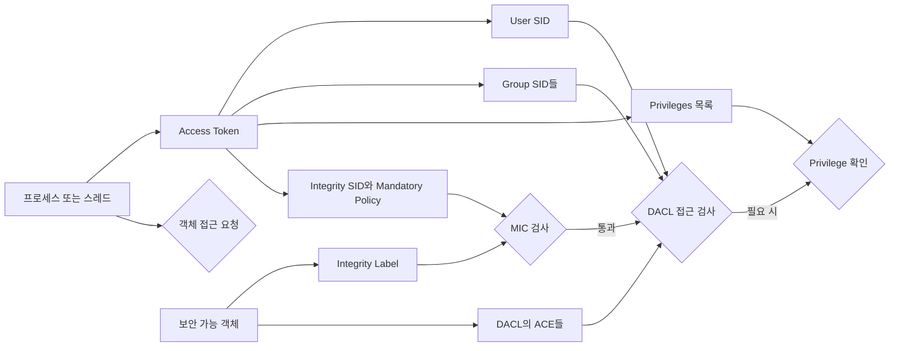

Windows 로컬 권한상승을 이해하려면 도구가 보여주는 결과보다 먼저 Windows가 "누구에게 무엇을 허용할지" 결정하는 구조를 알아야 합니다. 이 글은 Linux 권한상승 OS 내부구조 글과 OS별로 대칭을 이루며, Access Token·UAC·서비스 제어 관리자(SCM)를 한 흐름으로 연결합니다. 기존 OSCP 글들이 도메인 계정을 대상으로 한 공격을 다룬다면, 여기서는 로컬 머신의 단일 계정에서 권한이 달라지는 과정을 다룹니다. 도메인 인증과 권한 구조는 [[공격 체인 이전의 AD 아키텍처 기초 — Kerberos, NTLM, DACL·ACE, GPO·SYSVOL, 도메인 트러스트]]를 참고하고, 아래 점검은 **명시적으로 승인된 대상에만** 적용합니다.

---

## 1. Access Token: 프로세스가 들고 다니는 출입 카드

**원리**: Access Token은 건물의 **출입 카드**와 같습니다. 카드에는 내 신원(User SID), 내가 속한 조직(Group SID들), 특별히 허용된 작업(Privileges 목록)이 기록되어 있고, Windows는 프로세스나 스레드가 보호된 객체에 접근할 때 이 정보를 읽어 허용 여부를 판단합니다.

로그온이 성공하면 Windows는 사용자의 보안 컨텍스트를 나타내는 토큰을 만들고, 그 사용자를 대신해 실행되는 프로세스는 기본적으로 주 토큰(Primary Token)을 가집니다. 스레드는 보통 프로세스의 주 토큰을 사용하지만, 클라이언트를 가장하는 동안에는 별도의 가장 토큰(Impersonation Token)을 사용할 수 있습니다. 따라서 "사용자가 관리자 그룹에 속한다"는 계정 정보만으로 현재 프로세스의 실제 권한을 단정하면 안 되고, 그 프로세스나 스레드에 연결된 토큰을 확인해야 합니다.

파일·레지스트리 키·프로세스 같은 보안 가능 객체에 접근할 때 Windows는 토큰의 User SID와 Group SID들을 객체의 DACL에 있는 ACE와 대조합니다. 시스템 종료나 디버깅처럼 특정 시스템 작업은 SID 기반 접근 검사와 별도로 토큰의 Privilege가 필요한 경우가 있습니다. Privilege는 목록에 존재하는지뿐 아니라 현재 활성화되어 있는지도 중요합니다.

- 체크 포인트:
  - `whoami /user`, `whoami /groups`, `whoami /priv`로 현재 보안 컨텍스트를 나누어 확인
  - 계정의 그룹 소속과 현재 프로세스 토큰에서 활성화된 SID·Privilege를 구분
  - 서비스나 서버 프로세스를 점검할 때 스레드가 가장 토큰을 사용 중일 가능성도 고려
- 참고: [Microsoft Learn — Access Tokens](https://learn.microsoft.com/windows/win32/secauthz/access-tokens), [Microsoft Learn — Access Control Model](https://learn.microsoft.com/windows/win32/secauthz/access-control-model)

## 2. UAC: 관리자 토큰을 평소에는 잠가 두는 장치

**원리**: UAC(User Account Control)는 **관리자 카드를 평소에는 지갑 속 잠금 상태로 넣어두고 필요할 때만 꺼내 쓰게 하는 시스템**과 같습니다. 관리자 그룹 소속 사용자가 로그인해도 일반 작업은 관리 권한이 제거되거나 제한된 Filtered Token으로 실행하고, 상승 동의나 자격 증명 확인을 거친 프로세스만 Elevated Token을 사용하게 합니다.

관리자 승인 모드에서 관리자 계정으로 로그인하면 Windows는 서로 연결된 두 토큰을 만듭니다. 평소 데스크톱과 그 자식 프로세스는 표준 사용자와 비슷하게 제한된 토큰을 상속하고, 관리 작업이 필요할 때 UAC 프롬프트를 통과한 새 프로세스가 전체 관리자 토큰을 사용합니다. 그래서 같은 사용자 이름으로 실행한 두 명령 프롬프트라도 하나는 제한된 컨텍스트, 다른 하나는 상승된 컨텍스트일 수 있습니다.

표준 사용자에게 나타나는 자격 증명 프롬프트와 관리자에게 나타나는 동의 프롬프트도 구분해야 합니다. 전자는 관리 자격 증명을 제공해 다른 관리자 보안 컨텍스트로 작업하는 흐름이고, 후자는 이미 관리자 그룹에 속한 사용자가 자신의 전체 관리자 토큰 사용을 승인하는 흐름입니다. UAC 프롬프트가 보였다는 사실만으로 상승 성공을 단정하지 말고, 실제로 새 프로세스가 어떤 토큰을 받았는지 확인해야 합니다.

- 체크 포인트:
  - 관리자 그룹 소속 여부와 현재 프로세스가 Elevated Token을 사용하는지를 별도로 기록
  - 부모 프로세스에서 자식 프로세스로 토큰이 상속되므로 어느 셸에서 도구를 실행했는지 확인
  - UAC 정책과 관리자 승인 모드 설정에 따라 프롬프트와 토큰 생성 방식이 달라질 수 있음을 고려
- 참고: [Microsoft Learn — How User Account Control works](https://learn.microsoft.com/windows/security/application-security/application-control/user-account-control/how-it-works), [Microsoft Learn — User Account Control](https://learn.microsoft.com/windows/security/application-security/application-control/user-account-control/)

## 3. Integrity Level과 MIC: 권한 목록과 다른 보호 속성

**원리**: Access Token이 신원과 사용 가능한 권한이 적힌 출입 카드라면, Integrity Level은 카드와 객체에 붙은 **취급 등급 표지**에 가깝습니다. Low·Medium·High·System은 그 자체가 "권한 등급"이 아니라 Mandatory Integrity Control(MIC)이 사용하는 별도의 보안 속성이며, 낮은 무결성 주체가 더 높은 무결성 객체를 변경하지 못하게 하는 쓰기 접근 제어에 주로 쓰입니다.

주체의 Integrity SID는 Access Token에 연결되고, 객체의 무결성 레이블은 SACL의 Mandatory Label ACE에 저장됩니다. Windows는 일반적인 DACL 검사보다 먼저 MIC 정책을 평가하며, 기본 정책은 낮은 Integrity Level의 주체가 높은 레이블의 객체에 쓰지 못하게 하는 `NoWriteUp`입니다. 따라서 DACL이 쓰기를 허용해도 MIC가 먼저 거부할 수 있습니다.

UAC 상승 프로세스가 흔히 High Integrity로 실행되고 표준 데스크톱 프로세스가 보통 Medium Integrity로 실행되기 때문에 둘을 같은 개념처럼 오해하기 쉽습니다. 그러나 **Access Token은 User SID·Group SID·Privileges 같은 신원과 권한 정보를 담는 보안 컨텍스트**이고, **Integrity Level은 그 토큰과 객체에 연계되어 MIC 판정에 쓰이는 속성**입니다. 둘은 서로 연관되지만 동일하지 않습니다.

- 체크 포인트:
  - `Integrity Level = 권한 레벨`로 기록하지 않고 MIC 속성이라고 명시
  - DACL 권한이 충분해 보여도 객체의 무결성 레이블과 Mandatory Policy를 함께 확인
  - High Integrity와 관리자 권한의 상관관계는 인정하되, 토큰의 SID·Privilege와 MIC 판정을 분리해 해석
- 참고: [Microsoft Learn — Mandatory Integrity Control](https://learn.microsoft.com/windows/win32/secauthz/mandatory-integrity-control), [Microsoft Learn — Integrity Levels](https://learn.microsoft.com/windows/win32/secauthz/integrity-levels)

## 4. SCM과 서비스 데이터베이스: 백그라운드 프로그램의 책임자

**원리**: 서비스 제어 관리자(SCM, Service Control Manager)는 **Windows 백그라운드 프로그램들을 전담 관리하는 책임자**입니다. 서비스 등록 정보를 보관하고 부팅 또는 요청 시 서비스를 시작하며, 제어 프로그램의 요청에 따라 상태 조회·중지·재시작 같은 작업을 중재합니다.

SCM이 사용하는 설치 서비스 데이터베이스는 `HKLM\SYSTEM\CurrentControlSet\Services` 아래에 있으며, 각 서비스와 드라이버는 이름이 같은 하위 키를 가집니다. 대표적으로 `ImagePath`는 실행 파일 경로, `Start`는 시작 유형, `ObjectName`은 서비스 실행 계정을 나타냅니다. SCM API가 관리의 기준이며 레지스트리를 직접 바꾸는 방식은 정상적인 서비스 구성 절차가 아닙니다.

권한상승 관점에서는 서비스가 높은 권한의 계정으로 실행된다는 사실만 볼 것이 아니라, 누가 서비스 구성을 변경할 수 있는지, 실행 파일과 상위 디렉터리에 누가 쓸 수 있는지, 누가 서비스를 시작·중지할 수 있는지를 각각 확인해야 합니다. 서비스 DACL, 파일시스템 ACL, 레지스트리 ACL은 서로 다른 통제 지점이므로 하나의 결과로 합쳐 판단하면 오탐이 생깁니다.

- 체크 포인트:
  - 서비스의 `ImagePath`, 시작 유형, 실행 계정을 함께 확인
  - 서비스 구성 변경 권한과 실행 파일·디렉터리 쓰기 권한을 별도로 검사
  - 서비스 시작·중지 권한과 현재 실행 상태를 확인해 변경이 실제로 반영될 조건을 평가
- 참고: [Microsoft Learn — Database of Installed Services](https://learn.microsoft.com/windows/win32/services/database-of-installed-services), [Microsoft Learn — Service Control Manager](https://learn.microsoft.com/windows/win32/services/service-control-manager)

## 5. Unquoted Service Path: 문자열 모양이 아니라 악용 조건으로 판단

**원리**: SCM이 공백이 들어간 실행 경로를 따옴표 없이 전달하면 Windows의 실행 파일 탐색 과정에서 경로의 앞부분을 별도 실행 파일 후보로 해석할 수 있습니다. 이는 주소를 띄어쓰기 단위로 잘못 끊어 읽는 것과 비슷하지만, **경로에 공백이 있고 따옴표가 없다는 사실만으로 취약점이 되는 것은 아닙니다**.

예를 들어 `C:\Program Files\Vendor App\service.exe`가 미인용 상태라면 실행 과정에서 앞부분에 해당하는 후보 경로들이 검토될 수 있습니다. 그러나 실제 악용 가능성을 인정하려면 두 조건이 함께 충족되어야 합니다. 첫째, 공백 포함 미인용 경로의 중간 디렉터리 중 적어도 한 곳에서 공격자가 후보 실행 파일을 만들 수 있는 쓰기 권한이 있어야 합니다. 둘째, 해당 서비스를 재시작할 권한이 있거나 시스템 재부팅이 일어날 현실적인 기회가 있어야 합니다.

중간 디렉터리가 관리자만 쓸 수 있도록 보호되어 있거나 서비스를 다시 실행시킬 방법과 기회가 없다면, 공백과 따옴표 누락은 구성상 개선 항목일 수 있어도 현재 컨텍스트에서 실질적인 권한상승 경로라고 단정할 수 없습니다. 보고서에는 문자열 패턴뿐 아니라 쓰기 가능한 정확한 위치, 서비스 실행 계정, 재시작 가능성까지 증거로 남겨야 합니다.

- 체크 포인트:
  - `ImagePath`에 공백이 있고 실행 파일 경로가 따옴표로 감싸지지 않았는지 확인
  - 각 중간 디렉터리와 후보 파일 위치의 ACL에서 현재 사용자의 실제 쓰기 권한을 검증
  - 서비스 재시작 권한 또는 시스템 재부팅 기회가 있는지 확인
  - 위 두 악용 조건 중 하나라도 없으면 단순 미인용 경로를 실질적 권한상승 취약점으로 보고하지 않음
- 참고: [Microsoft Learn — CreateProcessW](https://learn.microsoft.com/windows/win32/api/processthreadsapi/nf-processthreadsapi-createprocessw), [Microsoft Learn — Service Security and Access Rights](https://learn.microsoft.com/windows/win32/services/service-security-and-access-rights)

## 6. WinPEAS 결과를 증거가 아닌 단서로 읽기

**원리**: WinPEAS 같은 자동화 도구는 건물 전체를 빠르게 훑어 의심스러운 출입 카드와 문을 표시하는 **점검표 작성자**입니다. 토큰 Privilege 목록, 서비스 경로, 약한 ACL 같은 후보를 빠르게 모아 주지만, 출력의 강조 표시가 곧바로 악용 가능성을 증명하지는 않습니다.

토큰 관련 출력은 어떤 Privilege가 현재 토큰에 존재하고 활성화되어 있는지, UAC로 제한된 토큰인지, 프로세스가 어떤 Integrity Level에서 실행되는지를 앞의 세 개념으로 분리해 읽어야 합니다. 서비스 관련 출력도 실행 계정, 서비스 DACL, 레지스트리 ACL, 파일·디렉터리 ACL, 재시작 가능성을 SCM 구조에 맞춰 교차 확인해야 합니다.

특히 자동화 도구가 Unquoted Service Path를 표시했다면 5번의 두 필수 조건을 수동으로 검증합니다. 이 과정을 거치면 "도구가 취약하다고 했다"가 아니라 "현재 토큰으로 특정 위치에 쓸 수 있고, 높은 권한의 서비스가 그 파일을 실행하도록 재시작할 수 있다"처럼 재현 가능한 근거로 바꿀 수 있습니다.

- 체크 포인트:
  - 토큰의 SID·Privilege, UAC 상승 상태, Integrity Level을 서로 다른 열로 기록
  - 서비스 후보마다 실행 계정·쓰기 가능한 위치·구성 변경 권한·재시작 가능성을 교차 검증
  - 자동화 도구의 색상과 경고 문구를 결론이 아닌 수동 확인 우선순위로 사용
- 참고: [PEASS-ng — Windows Local Privilege Escalation checks](https://github.com/peass-ng/PEASS-ng/tree/master/winPEAS), [Microsoft Learn — GetTokenInformation](https://learn.microsoft.com/windows/win32/api/securitybaseapi/nf-securitybaseapi-gettokeninformation)

---

Windows 로컬 권한상승은 하나의 "관리자 여부"로 설명되지 않습니다. 현재 프로세스가 들고 있는 Access Token, UAC가 선택한 제한 또는 상승 토큰, MIC의 Integrity Level, SCM과 서비스 ACL을 순서대로 분리해 보면 WinPEAS의 긴 출력도 검증 가능한 가설 목록으로 바뀌고, 실제 위험과 단순 구성 흔적을 구분할 수 있습니다.
