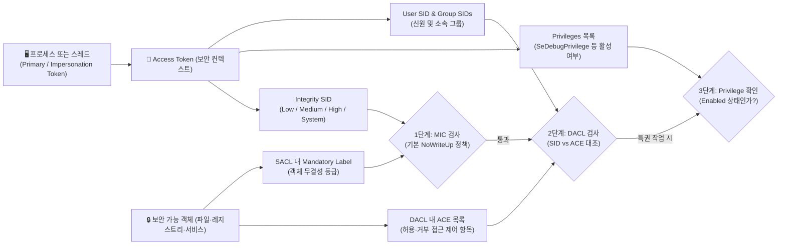
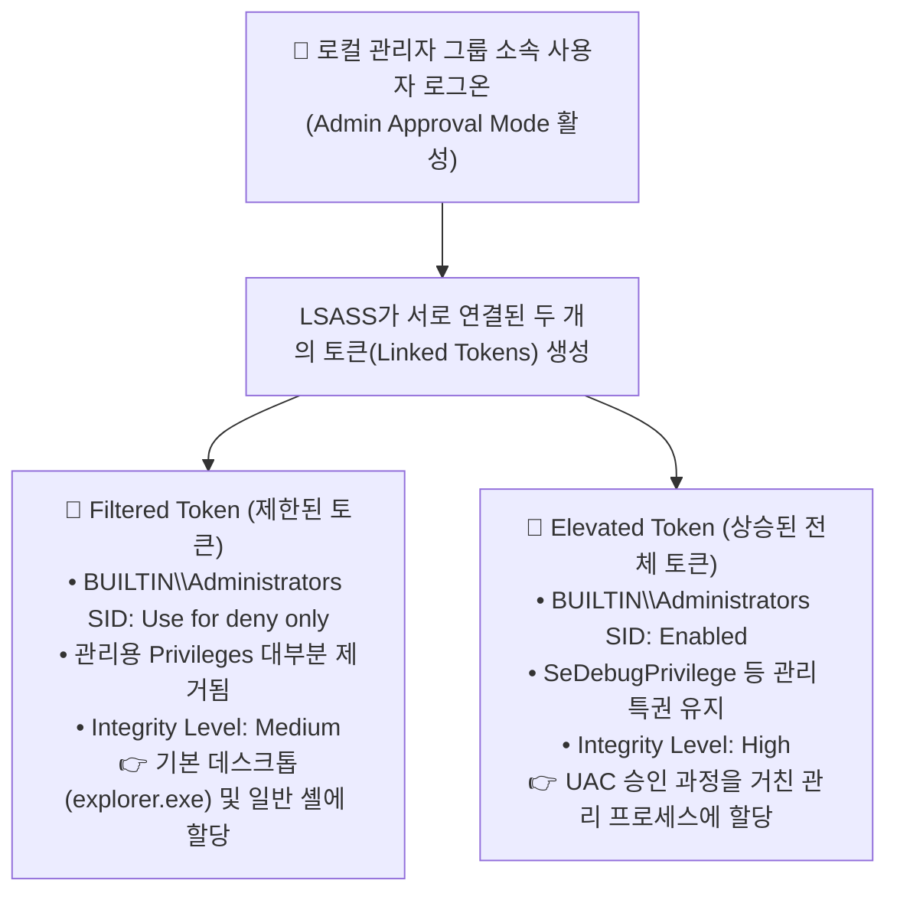
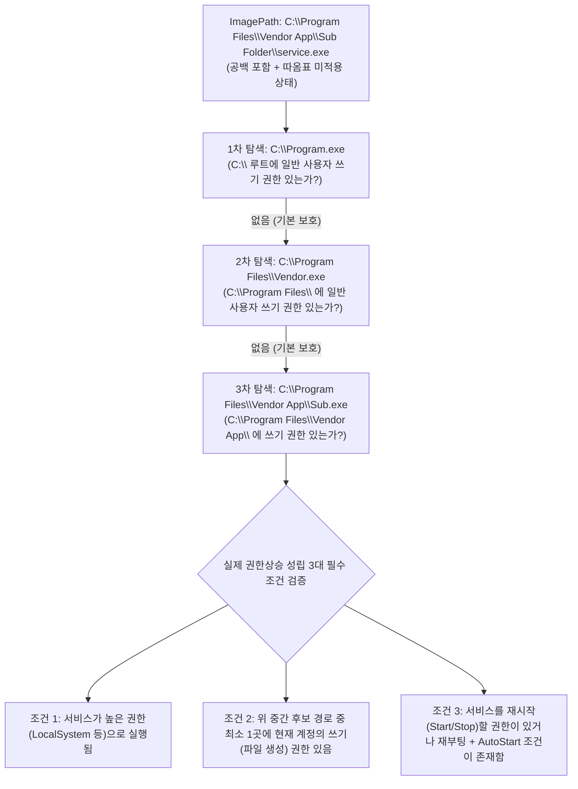

> [!summary] ⏱️ 5초 핵심 요약
> - **한 줄 비유**: Windows 로컬 권한상승은 **"계정이 관리자 그룹 소속인가?"**만 보는 것이 아니라, 지금 내 프로세스가 들고 있는 **출입 카드(Access Token)**가 **지갑 속 잠금 상태(UAC Filtered Token)인지 꺼내 쓴 상태(Elevated Token)인지**, 카드와 문에 붙은 **취급 등급 표지(Integrity Level / MIC)**가 무엇인지, 그리고 **건물 관리소장(SCM)**이 높은 권한으로 실행하는 백그라운드 서비스를 내가 고치고 재시작할 수 있는지를 확인하는 과정입니다.
> - **핵심 원리**: Windows는 객체 접근 시 **① MIC(무결성 수준 `NoWriteUp` 등)를 먼저 평가**한 뒤 **② DACL(토큰의 User/Group SID와 객체의 ACE 대조)**을 검사하며, 시스템 특권 작업은 별도로 **③ 토큰의 Privileges 활성화 여부**를 확인합니다.
> - **핵심 체크 포인트**: `Unquoted Service Path`(따옴표 없는 공백 경로)나 `WinPEAS`의 빨간색 경고는 문자열 모양만으로 취약점이 되지 않으며, 반드시 **① 중간 경로/대상에 대한 실제 쓰기 권한 + ② 고권한 서비스 실행 계정 + ③ 서비스 재시작(또는 재부팅) 트리거**가 모두 충족되는지 교차 검증해야 합니다.

Windows 로컬 권한상승을 이해하려면 도구가 보여주는 결과보다 먼저 Windows가 "누구에게 무엇을 허용할지" 결정하는 구조를 알아야 합니다. 이 글은 [[Linux 권한상승을 위한 OS 내부구조 — SUID, Capabilities, PATH, cron와 systemd]] 글과 OS별로 대칭을 이루며, Access Token·UAC·서비스 제어 관리자(SCM)를 한 흐름으로 연결합니다. 기존 OSCP 글들이 도메인 계정을 대상으로 한 공격을 다룬다면, 여기서는 로컬 머신의 단일 계정에서 권한이 달라지는 과정을 다룹니다. 도메인 인증과 권한 구조는 [[공격 체인 이전의 AD 아키텍처 기초 — Kerberos, NTLM, DACL·ACE, GPO·SYSVOL, 도메인 트러스트]]를 참고하고, 아래 점검은 **명시적으로 승인된 대상에만** 적용합니다.



---

## 한눈에 보는 Windows 권한상승 핵심 내부구조 비교표

| 내부구조 요소 | 한 줄 비유 | 담고 있는 핵심 정보·역할 | 자주 하는 오판 (오탐 원인) | 핵심 확인 명령어 |
|---|---|---|---|---|
| **1. Access Token** | 프로세스가 목에 걸고 다니는 실시간 출입 카드 | `User SID`, `Group SIDs`, `Privileges`, `Integrity SID` 등 보안 컨텍스트 (Primary vs Impersonation) | `net user`로 본 계정 소속 그룹만 보고 현재 프로세스 토큰의 실제 활성 권한을 단정함 | `whoami /all`, `whoami /user`, `whoami /groups`, `whoami /priv` |
| **2. UAC (사용자 계정 제어)** | 관리자 카드를 평소엔 잠금 지갑(Filtered)에 넣어두고 승인 시에만 꺼내 쓰기(Elevated) | 관리자 승인 모드에서 로그온 시 **Filtered Token(Medium)**과 **Elevated Token(High)** 두 개를 생성해 분리 운영 | 관리자 계정으로 접속했다는 이유만으로 현재 셸이 Elevated Token 상태라고 착각함 | `whoami /groups` (`BUILTIN\Administrators`의 `Enabled` vs `Use for deny only` 확인) |
| **3. Integrity Level & MIC** | 출입 카드와 문에 별도로 붙은 '취급 무결성 등급 표지' | DACL 검사보다 먼저 작동하여 낮은 등급 주체가 높은 등급 객체를 수정하지 못하게 차단 (`NoWriteUp`) | `Integrity Level = 권한(Privilege) 목록`으로 동일시하거나 DACL만 보고 쓰기 가능 여부를 단정함 | `whoami /groups` (Mandatory Label 확인), `icacls <경로>` |
| **4. SCM과 서비스 DB** | 백그라운드 프로그램들의 등록·시작·중지를 총괄하는 건물 관리소장 | `HKLM\SYSTEM\CurrentControlSet\Services` 기반으로 서비스 실행 계정(`ObjectName`), 경로(`ImagePath`) 관리 | 서비스 DACL, 레지스트리 ACL, 실행 파일 디스크 ACL 세 가지를 구분하지 않고 하나로 뭉뚱그려 판단함 | `sc.exe qc <서비스명>`, `sc.exe sdshow <서비스명>`, `Get-CimInstance Win32_Service` |
| **5. Unquoted Service Path** | 띄어쓰기가 있는 주소를 따옴표 없이 적어 앞 단어부터 차례로 찾아가게 만든 표기 | `CreateProcess`가 공백 기준으로 앞부분 후보(`C:\Program.exe` 등)를 순서대로 탐색하는 동작 | **중간 폴더 쓰기 권한과 서비스 재시작 권한이 없는데도** 단순히 따옴표가 빠졌다는 이유만으로 고위험 취약점으로 보고함 | `wmic service get name,pathname,startmode` / `icacls`로 중간 경로 쓰기 권한 검증 |

---

## 1. Access Token: 프로세스가 들고 다니는 출입 카드

**💡 한 줄 비유**: Access Token은 프로세스가 건물 안에서 목에 걸고 다니는 **실시간 출입 카드**입니다. 카드에는 **내 사번(`User SID`), 소속 부서(`Group SIDs`), 특별 작업 면허(`Privileges`)**가 적혀 있고, 문을 열 때마다 경비 시스템이 이 카드를 찍어 통과 여부를 결정합니다.

### 핵심 원리
- **Primary Token vs Impersonation Token**:
  - 사용자가 로그온에 성공하면 Windows(LSASS)는 사용자의 보안 컨텍스트를 담은 토큰을 생성합니다. 그 사용자가 실행하는 프로세스는 기본적으로 **주 토큰(Primary Token)**을 가집니다.
  - 스레드는 평소 프로세스의 주 토큰으로 동작하지만, 파이프·RPC·웹 요청을 보낸 클라이언트의 권한으로 잠시 대리 작업을 수행하는 동안에는 **가장 토큰(Impersonation Token)**을 스레드에 연결해 사용할 수 있습니다.
  - 따라서 `net user`에 나오는 정적 계정 정보만 보고 판단하면 안 되며, **현재 내 프로세스·스레드에 실제로 연결된 토큰의 내용**을 확인해야 합니다.
- **DACL 접근 검사와 Privileges의 차이**:
  - 파일·레지스트리 키·서비스 같은 **보안 가능 객체(Securable Object)**에 접근할 때는 토큰의 `User SID` 및 `Group SIDs`를 객체의 **DACL(Discretionary Access Control List)** 안의 **ACE(Access Control Entry)**와 대조합니다.
  - 반면 시스템 종료, 드라이버 로드, 타 프로세스 디버깅(`SeDebugPrivilege`), 토큰 가장(`SeImpersonatePrivilege`) 같은 시스템 수준 특권 작업은 SID 기반 DACL 검사와 별도로 **토큰의 `Privileges` 목록**에 해당 특권이 들어 있는지를 확인합니다.
  - *참고*: 토큰에 이미 존재하는 Privilege가 `Disabled` 상태인 경우, 프로세스는 `AdjustTokenPrivileges()` API를 호출해 이를 `Enabled`로 활성화할 수 있습니다. 반면 토큰에서 아예 **제거(Removed)**된 Privilege는 스스로 켤 수 없습니다.

```powershell
# 현재 프로세스 토큰의 User SID, Group SIDs(및 Integrity Label), Privileges 한 번에 확인
whoami /all
```

### 체크 포인트
- `whoami /user`, `whoami /groups`, `whoami /priv`로 현재 프로세스의 보안 컨텍스트를 나누어 확인했는가?
- 계정의 정적 그룹 소속(`net user`)과 **현재 프로세스 토큰에 실제로 포함·활성화된 SID 및 Privilege**를 구분했는가?
- 서비스나 네트워크 데몬 프로세스를 점검할 때 스레드가 **가장 토큰(Impersonation Token)**을 다루는 컨텍스트(`SeImpersonatePrivilege` 등)를 함께 고려했는가?
- 참고: [Microsoft Learn — Access Tokens](https://learn.microsoft.com/windows/win32/secauthz/access-tokens), [Microsoft Learn — Access Control Model](https://learn.microsoft.com/windows/win32/secauthz/access-control-model)

---

## 2. UAC: 관리자 토큰을 평소에는 잠가 두는 장치

**💡 한 줄 비유**: UAC(User Account Control)는 **관리자 마스터 카드를 평소에는 잠금장치가 달린 지갑(Filtered Token)에 넣어두고 일반 사원증처럼 쓰게 하다가, 꼭 필요한 순간에만 본인 확인(동의/자격 증명 프롬프트)을 거쳐 마스터 카드(Elevated Token)를 꺼내 쓰게 하는 이중 안전장치**입니다.



### 핵심 원리: Filtered Token vs Elevated Token 비교
관리자 승인 모드(Admin Approval Mode)에서 관리자 그룹 소속 계정으로 로그인하면 Windows는 **서로 연결된 두 개의 토큰(Linked Tokens)**을 만듭니다.

| 구분 | **Filtered Token (평소 일반 실행 시)** | **Elevated Token (관리자 권한 실행 시)** |
|---|---|---|
| **`BUILTIN\Administrators` SID 상태** | `Use for deny only` (허용 조건에는 쓰이지 않고 거부 ACE 대조에만 사용됨) | `Enabled, Enabled by default, Group owner` (전체 관리자 그룹 권한 활성) |
| **Privileges 목록** | `SeChangeNotifyPrivilege`, `SeShutdownPrivilege` 등 최소 기본 권한만 남고 관리 특권은 제거됨 | `SeDebugPrivilege`, `SeTakeOwnershipPrivilege`, `SeBackupPrivilege` 등 관리 특권 포함 |
| **Integrity Level** | **Medium** Integrity (`S-1-16-8192`) | **High** Integrity (`S-1-16-12288`) |

- **자격 증명 프롬프트 vs 동의 프롬프트**:
  - **표준 사용자(Standard User)**에게 뜨는 **자격 증명 프롬프트(Credential Prompt, `Over the Shoulder`)**는 별도의 관리자 ID/PW를 입력받아 그 관리자의 보안 컨텍스트로 새 프로세스를 띄우는 흐름입니다.
  - **관리자(Administrator)**에게 뜨는 **동의 프롬프트(Consent Prompt)**는 이미 생성되어 있는 자신의 연결된 **Elevated Token** 사용을 승인하는 흐름입니다.

### 체크 포인트
- 대상 계정이 관리자 그룹 소속이라는 사실과 **현재 실행 중인 셸 프로세스가 실제로 Elevated Token을 사용하고 있는지**를 별도로 구분해 기록했는가?
- 부모 프로세스에서 자식 프로세스로 토큰이 상속되므로, 진단 도구를 **어느 토큰 상태의 셸에서 실행했는지** 확인했는가?
- UAC 정책 레지스트리(`EnableLUA`, `ConsentPromptBehaviorAdmin`, `FilterAdministratorToken`) 설정에 따라 프롬프트 동작과 토큰 분리 여부가 달라짐을 고려했는가?
- 참고: [Microsoft Learn — How User Account Control works](https://learn.microsoft.com/windows/security/application-security/application-control/user-account-control/how-it-works), [Microsoft Learn — User Account Control](https://learn.microsoft.com/windows/security/application-security/application-control/user-account-control/)

---

## 3. Integrity Level과 MIC: 권한 목록과 다른 보호 속성

**💡 한 줄 비유**: Access Token이 내 신원과 면허 목록이 적힌 **출입 카드**라면, Integrity Level(무결성 수준)은 카드와 보안 문에 별도로 붙여 놓은 **'취급 등급 스티커(Low·Medium·High·System)'**입니다. 내 등급보다 높은 스티커가 붙은 문은 명단(DACL)에 내 이름이 있어도 함부로 고칠 수 없습니다(`NoWriteUp`).

### 핵심 원리
- **MIC(Mandatory Integrity Control)의 우선 평가**:
  - 주체의 Integrity SID는 Access Token에 들어 있고, 객체(파일·프로세스·레지스트리)의 무결성 레이블은 **SACL(System Access Control List)의 Mandatory Label ACE**에 저장됩니다(명시적 레이블이 없으면 기본적으로 Medium으로 간주).
  - Windows 커널(Security Reference Monitor)은 **일반적인 DACL 허용/거부 검사를 수행하기 전에 MIC 정책을 먼저 평가**합니다.
  - 기본 정책인 **`NoWriteUp`** 때문에, 낮은 Integrity Level(예: `Low` 또는 `Medium`)의 프로세스는 더 높은 Integrity Level(예: `High` 또는 `System`)이 붙은 프로세스나 파일에 **쓰기/수정/종료(`WRITE_DAC`, `PROCESS_VM_WRITE` 등)를 할 수 없습니다.** 설령 DACL이 해당 사용자에게 쓰기를 허용하더라도 MIC가 먼저 가로막습니다.
- **Access Token과 Integrity Level을 혼동하지 말 것**:
  - UAC 상승 프로세스가 `High Integrity`로 돌고 표준 사용자 프로세스가 `Medium Integrity`로 돌기 때문에 흔히 둘을 똑같은 개념으로 착각합니다.
  - 그러나 **Access Token은 신원(SID)과 특권(Privileges)을 담는 전체 보안 컨텍스트**이고, **Integrity Level은 그 토큰과 객체에 붙어 MIC(주로 쓰기 차단) 판정에 쓰이는 하나의 보안 속성**입니다.

```powershell
# 현재 토큰의 Mandatory Label(Integrity Level) 확인 (whoami /groups 출력 하단)
whoami /groups | findstr /i "Mandatory Label"

# 특정 파일/폴더의 DACL 및 설정된 Integrity Label 확인
icacls "C:\Program Files\Vendor App"
```

### 체크 포인트
- 보고서나 노트에 `Integrity Level = 권한(Privilege) 레벨`로 뭉뚱그려 적지 않고 **MIC(강제 무결성 제어) 속성**이라고 정확히 명시했는가?
- 객체의 DACL 권한이 충분해 보여도 **객체의 무결성 레이블(Mandatory Label)과 현재 토큰의 Integrity Level(`NoWriteUp` 제약)**을 함께 확인했는가?
- `High Integrity`와 관리자 권한의 상관관계는 이해하되, **토큰의 SID·Privilege 검사와 MIC 판정을 분리해 해석**했는가?
- 참고: [Microsoft Learn — Mandatory Integrity Control](https://learn.microsoft.com/windows/win32/secauthz/mandatory-integrity-control), [Microsoft Learn — Integrity Levels](https://learn.microsoft.com/windows/win32/secauthz/integrity-levels)

---

## 4. SCM과 서비스 데이터베이스: 백그라운드 프로그램의 책임자

**💡 한 줄 비유**: 서비스 제어 관리자(**SCM**, `services.exe`)는 건물 안의 모든 백그라운드 설비(서비스) 명부를 관리하고 시동을 걸어주는 **건물 관리소장**입니다. 설비가 높은 권한(`LocalSystem`)으로 돌아간다면, **① 관리소장에게 설정 변경을 요청할 권한(서비스 DACL), ② 관리 명부 서랍 권한(레지스트리 ACL), ③ 설비 기계실 문단속(실행 파일·폴더 ACL)** 세 곳을 각각 따로 점검해야 합니다.

### 핵심 원리: 서비스 관련 3대 접근 통제 지점 분리
SCM이 관리하는 서비스 데이터베이스는 레지스트리 `HKLM\SYSTEM\CurrentControlSet\Services\<서비스명>` 아래에 저장됩니다. 권한상승 가능성을 볼 때는 아래 **3가지 통제 지점(ACL)**을 절대 하나로 섞지 말고 각각 분리해서 확인해야 합니다.

| 점검 지점 | 저장·관리 위치 | 핵심 레지스트리 값 / 권한 의미 | 취약 시 발생하는 권한상승 시나리오 | 확인 명령어 예시 |
|---|---|---|---|---|
| **① 서비스 자체의 DACL** | SCM 보안 서술자 | `SERVICE_CHANGE_CONFIG`, `WRITE_DAC`, `SERVICE_START`/`STOP` | 일반 사용자가 `sc.exe config <이름> binpath= ...`로 실행 파일 경로를 바꿔치기하고 재시작 가능 | `sc.exe sdshow <서비스명>` / PowerShell `Get-Acl` |
| **② 서비스 레지스트리 키 ACL** | `HKLM\SYSTEM\CurrentControlSet\Services\<서비스명>` | `ImagePath`(실행 경로), `ObjectName`(실행 계정: `LocalSystem` 등), `Start`(시작 유형) | 일반 사용자가 레지스트리의 `ImagePath` 값을 직접 수정한 뒤 재부팅/재시작 시 고권한 코드 실행 | `Get-Acl "HKLM:\SYSTEM\CurrentControlSet\Services\<서비스명>" \| Format-List` |
| **③ 실행 바이너리 및 상위 폴더 ACL** | 파일시스템 (`ImagePath`가 가리키는 경로) | 파일 덮어쓰기(`W`/`M`/`F`) 또는 상위/중간 폴더에 파일 생성 권한 | `ImagePath`가 가리키는 `.exe`나 로드되는 `.dll`을 교체, 또는 Unquoted Path 중간 경로에 파일 생성 | `icacls "C:\Program Files\Vendor App\service.exe"` |

### 체크 포인트
- 대상 서비스의 **`ImagePath`(실행 경로), `Start`(시작 유형), `ObjectName`(실행 계정: `LocalSystem` 등)**을 함께 확인했는가?
- **서비스 DACL(구성 변경 권한), 레지스트리 키 ACL, 실행 파일·디렉터리 파일시스템 ACL** 세 가지를 별도로 분리해 검사했는가?
- 현재 사용자가 **서비스를 시작·중지(`SERVICE_START`/`SERVICE_STOP`)할 권한이 있는지** 또는 자동 시작(`AUTO_START`) 설정과 재부팅 조건이 어떻게 되는지 평가했는가?
- 참고: [Microsoft Learn — Database of Installed Services](https://learn.microsoft.com/windows/win32/services/database-of-installed-services), [Microsoft Learn — Service Control Manager](https://learn.microsoft.com/windows/win32/services/service-control-manager)

---

## 5. Unquoted Service Path: 문자열 모양이 아니라 악용 조건으로 판단

**💡 한 줄 비유**: 택배 기사가 따옴표 없이 적힌 주소 `C:\Program Files\Vendor App\Sub Folder\service.exe`를 보고 띄어쓰기마다 멈춰 서서 **`C:\Program.exe`가 있나? → `C:\Program Files\Vendor.exe`가 있나? 순서로 먼저 확인하는 습관**과 같습니다. 하지만 **내가 그 길목에 가짜 택배함(파일 쓰기)을 놓을 수 없고 택배차를 다시 출발시킬 방법(서비스 재시작)도 없다면** 실제 사고는 일어나지 않습니다.



### 핵심 원리: 단순 문자열 패턴과 실제 권한상승 취약점의 구분
SCM이 공백이 포함된 `ImagePath`를 따옴표(`"..."`) 없이 `CreateProcessW`에 전달하면, Windows는 공백을 실행 파일 경로와 인자의 구분자로 해석할 수 있어 위 다이어그램처럼 앞부분 후보들을 차례대로 탐색합니다.

그러나 **경로에 공백이 있고 따옴표가 빠졌다는 사실 하나만으로 실질적인 권한상승 취약점이 되는 것은 절대 아닙니다.** 실제 악용 가능성을 인정하려면 아래 조건이 모두 충족되어야 합니다.
1. **고권한 실행 컨텍스트**: 해당 서비스가 현재 사용자보다 높은 권한(예: `LocalSystem`)으로 실행되어야 합니다.
2. **중간 경로 쓰기 권한**: `C:\` 또는 `C:\Program Files\` 또는 `C:\Program Files\Vendor App\` 등 공백이 잘리는 중간 디렉터리 중 **적어도 한 곳에 현재 일반 사용자가 실행 파일(`Program.exe`, `Vendor.exe`, `Sub.exe`)을 생성할 수 있는 쓰기 권한(`W`, `M`, `F`, `AD`/`WD`)**이 있어야 합니다. *(Windows 기본 설정에서 `C:\`의 루트 파일 생성과 `C:\Program Files\` 쓰기는 일반 사용자에게 허용되지 않는 경우가 많습니다.)*
3. **실행 트리거 (재시작 또는 재부팅)**: 파일을 심은 뒤 그 서비스가 다시 시작되도록 **서비스 시작/중지 권한**이 있거나, 시작 유형이 `Auto`이고 현실적인 시스템 재부팅 기회가 있어야 합니다.

```powershell
# 1. 따옴표가 없고 공백이 포함된 비기본(C:\Windows\ 제외) 서비스 경로 조회
Get-CimInstance Win32_Service | Where-Object {
    $_.PathName -and $_.PathName -notmatch '^"' -and $_.PathName -notmatch '^C:\\Windows\\' -and $_.PathName -match ' '
} | Select-Object Name, StartName, StartMode, State, PathName

# 2. 식별된 경로의 각 상위/중간 디렉터리에 대해 실제 쓰기 권한(icacls) 수동 검증
icacls "C:\"
icacls "C:\Program Files"
icacls "C:\Program Files\Vendor App"
```

### 체크 포인트
- `ImagePath`에 공백이 있고 실행 파일 경로가 따옴표로 감싸지지 않았는지 확인했는가?
- 각 중간 디렉터리 후보 위치의 ACL(`icacls`)에서 **현재 사용자의 실제 파일 생성·쓰기 권한**을 검증했는가?
- **서비스 재시작 권한(`SERVICE_STOP`/`SERVICE_START`) 또는 시스템 재부팅 + `AUTO_START` 기회**가 있는지 확인했는가?
- 위 필수 악용 조건(특히 중간 디렉터리 쓰기 권한)이 없는데도 **단순 따옴표 누락만 보고 고위험 권한상승 취약점으로 과장 보고하지 않았는가?** (쓰기 권한이 없다면 '방어적 코딩·구성 개선 권고(Informational/Low)' 수준으로 구분)
- 참고: [Microsoft Learn — CreateProcessW](https://learn.microsoft.com/windows/win32/api/processthreadsapi/nf-processthreadsapi-createprocessw), [Microsoft Learn — Service Security and Access Rights](https://learn.microsoft.com/windows/win32/services/service-security-and-access-rights)

---

## 6. WinPEAS 결과를 증거가 아닌 단서로 읽기

**💡 한 줄 비유**: `WinPEAS` 같은 자동화 도구는 건물 전체를 빠르게 돌아다니며 의심스러운 문고리와 출입 카드를 전부 적어오는 **초기 점검 보조원**입니다. 보조원이 빨간 형광펜을 칠해 왔다고 해서 그 문이 실제로 열린다는 뜻은 아니므로, 반드시 **토큰·MIC·SCM 3단계 기준**으로 직접 손잡이를 확인해야 합니다.

### WinPEAS 주요 출력 영역별 수동 검증 매트릭스

| WinPEAS 출력 섹션 | 수동으로 분리해 기록할 핵심 열(Column) | 오탐을 걸러내는 결정적 질문 |
|---|---|---|
| **Token / Privileges 정보** | ① User/Group SID 활성 상태<br/>② UAC Filtered vs Elevated 여부<br/>③ Integrity Level (`Medium`/`High`/`System`)<br/>④ 활성 가능한 특권(`SeImpersonate`, `SeDebug` 등) | 관리자 그룹 소속이지만 현재 **Filtered Token(`Medium`)**에 묶여 있는 상태는 아닌가? |
| **Services Information** | ① 서비스 실행 계정(`ObjectName`)<br/>② 서비스 DACL / 레지스트리 ACL / 파일·폴더 ACL 구분<br/>③ 시작 유형(`StartMode`) 및 현재 사용자의 시작·중지 권한 | 경고 표시된 경로에 **실제로 현재 토큰(및 Medium Integrity)이 파일을 쓰거나 설정을 바꿀 수 있는가?** 그리고 **서비스를 재시작할 수 있는가?** |

### 체크 포인트
- 토큰 관련 발견사항을 정리할 때 **토큰의 SID·Privilege, UAC 상승 상태, Integrity Level**을 서로 다른 열로 분리해 기록했는가?
- 서비스 관련 후보마다 **실행 계정·쓰기 가능한 정확한 위치·구성 변경 권한·재시작 가능성**을 교차 검증했는가?
- 자동화 도구의 빨간색/노란색 강조 문구를 최종 결론이 아니라 **수동 확인의 우선순위표**로 활용했는가?
- 참고: [PEASS-ng — Windows Local Privilege Escalation checks](https://github.com/peass-ng/PEASS-ng/tree/master/winPEAS), [Microsoft Learn — GetTokenInformation](https://learn.microsoft.com/windows/win32/api/securitybaseapi/nf-securitybaseapi-gettokeninformation)

---

## 마무리

Windows 로컬 권한상승은 단순한 "관리자 계정 여부" 하나로 설명되지 않습니다.
1. 현재 프로세스가 들고 있는 **Access Token (User/Group SID와 Privileges)**
2. **UAC**가 분리해 놓은 **Filtered Token vs Elevated Token**
3. DACL보다 먼저 쓰기를 통제하는 **MIC의 Integrity Level (`NoWriteUp`)**
4. 백그라운드 서비스를 관리하는 **SCM의 3대 ACL(서비스·레지스트리·파일시스템)과 재시작 트리거**

이 네 가지 내부구조를 순서대로 분리해 읽으면 `WinPEAS`의 방대한 출력도 명확한 가설 검증 표로 바뀌며, 실제 침투 가능한 고위험 경로와 단순 구성상 흔적을 정확히 구분할 수 있습니다.
