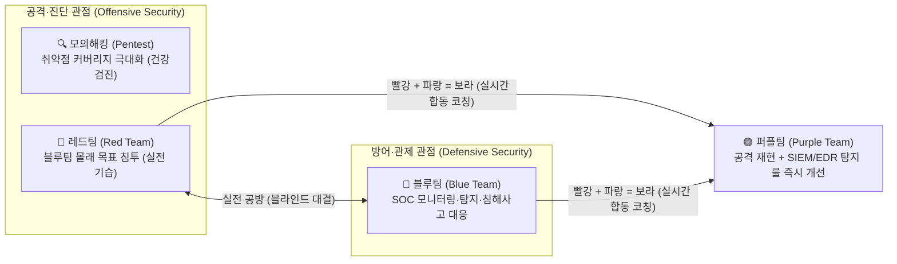
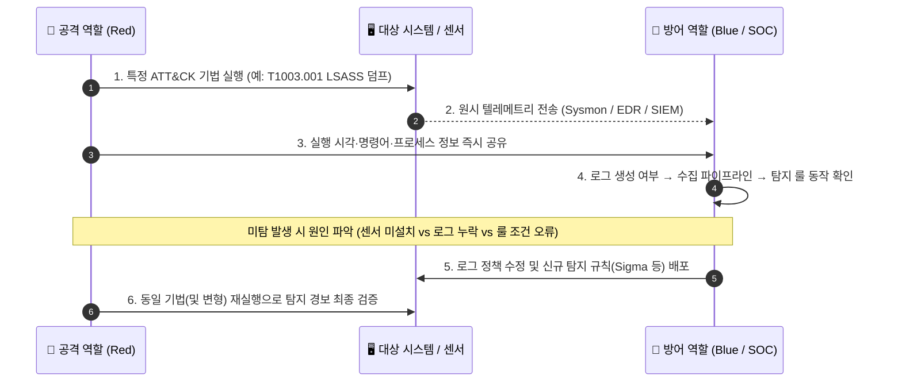

> [!summary] ⏱️ 5초 핵심 요약
> - **색상 팀(Color Team)의 큰 그림**: 🔴 **레드팀(공격)** + 🔵 **블루팀(방어·관제)** = 🟣 **퍼플팀(공격·방어 실시간 합동 훈련)**입니다. 그리고 🔍 **모의해킹**은 공격(Offensive) 영역 안에서 '은밀한 침투' 대신 **'시스템 취약점을 빠짐없이 찾는 종합 건강검진'**을 맡습니다.
> - **모의해킹 (건강검진)**: 정해진 범위 안의 취약점을 **빠짐없이 많이 찾는 검사** (산출물: 취약점 목록·조치 권고)
> - **레드팀 vs 블루팀 (실전 공방 훈련)**: 레드팀은 블루팀(SOC) 몰래 침투해 **목표 달성 여부**를 시험하고, 블루팀은 이를 **얼마나 빨리 탐지·차단(MTTD/MTTR)**하는지 검증받습니다.
> - **퍼플팀 (코칭 합동 훈련)**: 레드(공격)와 블루(방어)가 한자리에서 **방금 공격이 왜 안 잡혔는지 함께 보며 탐지 룰(SIEM/EDR)을 즉시 교정**합니다.

[[웹 취약점 진단 기법 입문 — XXE, SSRF부터 SQLi, XSS까지]] 같은 기존 보안 글은 모두 취약점을 찾고 검증하는 **모의해킹 실행 관점**의 결과물입니다. 하지만 입문자는 흔히 **"보안은 레드팀·블루팀·퍼플팀으로 나뉜다는데, 그럼 모의해킹은 어디에 속하고 레드팀과는 뭐가 다른 거지?"** 하고 헷갈려 합니다. 이 글은 색상 팀(레드·블루·퍼플)의 구조 속에서 모의해킹의 정확한 위치를 짚고, 각 활동의 목적·접근방식·산출물을 명확히 구분합니다.



---

## 한눈에 보는 보안 팀·진단 구분표

| 구분 | 🔍 모의해킹 (Pentest) | 🔴 레드팀 (Red Team) | 🔵 블루팀 (Blue Team) | 🟣 퍼플팀 (Purple Team) |
|---|---|---|---|---|
| **역할 포지션** | 공격·진단 (취약점 발굴) | 공격·모사 (실전 침투조) | 상시 방어·관제 (수비조) | 공격(Red) + 방어(Blue) 합동 |
| **한 줄 비유** | 항목별 종합 건강검진 | 예고 없는 적군 침투 훈련 | 24시간 성벽 경비대·관제탑 | 공격수·골키퍼가 리플레이 보며 합동 코칭 |
| **핵심 질문** | "이 범위에 구멍(취약점)이 몇 개나 어디에 있나?" | "실제 해커처럼 몰래 침투해 목표(금고)까지 갈 수 있나?" | "침투 징후를 얼마나 빨리 탐지·차단·복구할 수 있나?" | "방금 공격이 왜 로그에 안 잡혔고 어떤 룰을 고쳐야 하나?" |
| **은밀성 (OPSEC)** | **낮음** (방어팀에 일정·IP 사전 공유, WAF 예외 흔함) | **매우 높음** (블루팀에 비공개, 보안 장비 우회 시도) | — (탐지·차단 주체) | **없음 (완전 투명)** (공격 시각·명령어·화면을 실시간 공유) |
| **일반적 기간·범위** | 1~4주 / 특정 웹·앱·API·네트워크 대역 | 수주~수개월 / 전사 인프라·임직원·물리·사회공학 | 연중무휴 상시 운영 (SOC / DFIR) | 수일 워크숍~상시 프로그램 / 우선순위 ATT&CK 기법 단위 |
| **최종 산출물** | 취약점 진단 보고서 (위험도, 재현 증적, 패치 권고) | Kill Chain 침투 서사, 방어팀 대응 평가 | 탐지 경보, 침해사고 조사 보고서, 차단·복구 이력 | 신규·수정된 SIEM/EDR 탐지 룰(Sigma 등), 로그 공백 개선표 |

---

## 1. 왜 '레드·블루·퍼플'과 '모의해킹'을 함께 비교할까?

**💡 한 줄 비유**: 축구의 **공격수(레드)**와 **수비수(블루)**가 한자리에서 수비 대형을 맞추는 게 **합동 코칭(퍼플)**이라면, **모의해킹**은 경기 전에 경기장 펜스에 구멍이 몇 개 뚫려 있는지 샅샅이 점검하는 **시설 안전 정밀검사**입니다.

### 핵심 원리
보안 조직의 역할은 크게 **공격(Red)**과 **방어(Blue)**로 나뉘고, 두 팀이 실시간으로 협업하면 **퍼플(Purple)**이 됩니다. 여기서 많은 실무자가 헷갈리는 지점은 **"같은 공격(Offensive) 쪽 일인 모의해킹과 레드팀은 무엇이 다른가?"**, 그리고 **"모의해킹·레드팀·퍼플팀 중 우리 회사에 지금 필요한 프로젝트는 무엇인가?"**입니다.
- 명칭만 화려하게 '레드팀'이라고 부르면서 실제로는 2주 동안 웹 취약점 개수만 세고 끝내거나, 공격팀과 방어팀(블루팀)이 단순히 결과 보고 회의만 같이 했다고 '퍼플팀'이라고 부르면 계약 목표와 실제 산출물이 어긋납니다.
- 프로젝트를 발주하거나 수행할 때는 이름보다 **측정할 지표와 종료 조건**을 먼저 합의해야 합니다.

### 체크 포인트
- 프로젝트 명칭보다 **핵심 질문, 성공 조건, 측정 지표**를 계약서와 RoE(교전규칙)에 한 문장으로 정의했는가?
- 취약점 발견 건수(모의해킹), 목표 달성 및 관제 대응 평가(레드팀), 탐지 룰 개선(퍼플팀) 중 무엇이 최우선인지 합의했는가?
- 세 활동 모두 반드시 **사전 서면 승인과 RoE(Rules of Engagement)**가 전제된 합법적 보안 업무임을 확인했는가?
- 참고: [MITRE ATT&CK — Adversary Emulation and Red Teaming](https://attack.mitre.org/resources/), [PTES Technical Guidelines](http://www.pentest-standard.org/index.php/Main_Page)

---

## 2. 모의해킹 — 취약점 커버리지를 넓히는 진단

**💡 한 줄 비유**: 건강검진 센터가 환자에게 몰래 숨어서 검사할 필요가 없듯, 모의해킹은 **정해진 기간 안에 검사 항목을 빠짐없이 확인해 구멍을 최대한 많이 찾아내는 것**이 목표입니다.

### 핵심 원리
일반적인 취약점 중심 모의해킹의 목적은 **정해진 자산과 범위 안에서 취약점 발견 커버리지를 극대화**하고, 실제 악용 가능성과 영향을 안전하게 검증하는 것입니다. *(특정 시나리오 도달을 목표로 하는 목표 달성형 모의해킹도 있으나, 실무의 대다수는 커버리지 중심 모델을 따릅니다.)*

### 왜 은밀성(OPSEC)보다 커버리지가 우선인가?
- **시간 대비 효율**: WAF(웹 방화벽)나 IPS가 진단자 IP를 차단하는 데 시간을 다 쓰면, 정작 애플리케이션 내부의 비즈니스 로직 결함이나 인가 우회를 점검할 시간이 사라집니다. 따라서 실무 모의해킹에서는 진단용 IP를 차단 예외(Allowlist)에 등록하고 테스트하는 경우도 흔합니다.
- **즉각적인 위험 공유**: 크리티컬한 RCE(원격 코드 실행)나 DB 전체 노출을 발견하면 작전 종료까지 숨기는 것이 아니라, 즉시 고객사 담당자에게 알려 긴급 패치를 유도하거나 파괴적 후속 검증을 멈춥니다.

### 주요 산출물 예시
```text
[VULN-01] 주문 조회 API 수평적 권한 상승 (BOLA/IDOR) — 위험도: 상(High)
- 대상: GET /api/v2/orders/{orderId}
- 원인: 세션 사용자(user_id)와 주문 소유자(owner_id) 일치 여부 미검증
- 재현 증적: 계정 A의 토큰으로 계정 B의 orderId(10042) 조회 시 개인정보·결제내역 반환 확인
- 조치 권고: 서비스 계층에서 SELECT ... WHERE order_id = ? AND user_id = ? 조건 강제
```

### 체크 포인트
- 자산(도메인, IP, 앱 버전)과 취약점 카테고리별 **테스트 범위 및 제외 대상(Out-of-Scope)**을 명시했는가?
- 은밀성(우회)보다 **취약점 커버리지와 안전한 검증**이 우선이라는 점을 발주처와 합의했는가?
- 발견된 모든 취약점에 **재현 가능한 요청/응답 증적과 코드·설계 수준의 수정 권고**가 연결되어 있는가?
- 참고: [PTES Technical Guidelines](http://www.pentest-standard.org/index.php/Main_Page), [OWASP Web Security Testing Guide (WSTG)](https://owasp.org/www-project-web-security-testing-guide/)

---

## 3. 레드팀 — 목표 달성과 탐지·대응 역량 검증

**💡 한 줄 비유**: 장비 하나하나의 불량을 전수 검사하는 대신, **소수의 침투조가 관제탑(Blue Team)의 눈을 피해 실제 금고(핵심 목표)까지 도달할 수 있는지**, 그리고 **관제탑이 언제 비상벨을 울리는지**를 시험합니다.

### 핵심 원리
레드팀은 현실적인 공격자(또는 특정 APT 그룹의 TTPs — 전술·기술·절차)를 모사(Adversary Emulation)하여 사전에 정의한 **플래그(목표)**를 달성하고, 조직의 **사람(People)·프로세스(Process)·기술(Technology)** 전반의 탐지 및 대응 역량을 평가합니다.

### 모의해킹과 결정적으로 다른 3가지
1. **블라인드 수행과 화이트 셀(White Cell) 통제**: 실제 관제 요원과 일반 임직원에게는 훈련 시점과 공격 시나리오를 알리지 않습니다. 단, 무허가 해킹이 아니므로 소수의 통제 그룹(**화이트 셀**)이 모든 공격 IP·시각·행위를 실시간으로 파악하며, 실제 침해사고와 훈련을 구분(Deconfliction)하고 위험 시 즉시 중단시킬 비상 채널을 유지합니다.
2. **전방위 경로 활용**: 웹 취약점 하나에 매달리지 않고 오픈소스 정보 수집(OSINT), 피싱 메일(사회공학), 외주망·VPN 침투, AD(Active Directory) 횡적이동 등 목표 도달에 필요한 가장 현실적인 경로 하나를 뚫고 들어갑니다.
3. **완전성 비보장**: 목표에 도달하기 위해 선택한 한두 개의 공격 연쇄(Kill Chain)만 깊게 파므로, **"레드팀이 지나간 시스템에 다른 취약점이 없다"는 보장은 절대 하지 않습니다.**

### 체크 포인트
- 모사할 위협 행위자 수준, 최종 달성 목표(예: 도메인 관리자 권한, 핵심 DB 샘플 파일 획득), 종료 조건을 사전에 정의했는가?
- 블라인드 수준, **화이트 셀(통제관) 구성**, 실제 사고 오인 방지(Deconfliction) 및 긴급 중단 절차를 RoE에 포함했는가?
- 침투 성공 여부뿐 아니라 **최초 탐지 시각, 관제 분석·차단·보고 과정, 놓친 보안 신호**를 타임라인으로 기록했는가?
- 참고: [MITRE ATT&CK — Get Started](https://attack.mitre.org/resources/), [MITRE CTID — Adversary Emulation Library](https://ctid.mitre.org/resources/adversary-emulation-library/)

---

## 4. 퍼플팀 — 공격과 방어의 즉시 피드백 루프

**💡 한 줄 비유**: 공격수가 슛을 쏜 뒤 결과를 숨기는 것이 아니라, **그 자리에서 골키퍼와 함께 리플레이 화면을 보며 "방금 슛은 왜 사각지대에 가렸는지, 수비수를 어디에 세우면 막히는지" 즉시 교정하고 다시 쏴 보는 훈련**입니다.



### 핵심 원리
퍼플팀은 고정된 부서 이름이라기보다 **공격 관점(Red)과 방어 관점(Blue)이 실시간으로 협업하는 탐지 엔지니어링(Detection Engineering) 운영 방식**입니다.

### 왜 레드팀만으로는 부족할 때 퍼플팀을 하는가?
블라인드 레드팀 훈련을 몇 달 동안 진행한 뒤 결과 보고서에서 "1단계부터 8단계까지 관제팀이 하나도 탐지하지 못함"이라는 결론만 받으면, 방어팀 입장에서는 **로그가 아예 안 남았는지, SIEM으로 전송이 안 됐는지, 룰 조건이 틀렸는지** 역추적하기가 막막합니다. 퍼플팀은 은밀성을 포기하는 대신 투명성을 100%로 높여 짧은 시간 안에 탐지 공백을 메웁니다.

### 퍼플팀이 현장에서 분해하는 4단계 탐지 실패 원인
1. **센서 부재**: 해당 호스트나 서브넷에 EDR/Sysmon/Auditd 자체가 설치되어 있지 않음
2. **로그 생성 비활성화**: 센서는 있으나 OS 감사 정책(예: PowerShell Script Block Logging, 이벤트 ID 4688 명령줄 포함)이 꺼져 있음
3. **수집·파싱 누락**: 단말에는 로그가 남았으나 SIEM 수집 필터에서 버려졌거나 필드 파싱(정규화)이 깨짐
4. **탐지 규칙 논리 한계**: 로그는 SIEM에 들어왔으나 룰이 특정 파일명(`procdump.exe`)만 하드코딩해 인자 변형이나 다른 도구를 놓침

### 체크 포인트
- 대상 ATT&CK 기법별로 **로그 생성 → 수집 → 파싱 → 탐지 경보 → 대응 플레이북** 단계를 분리해 점검했는가?
- 탐지 실패 시 위 4단계(센서·생성·수집·룰 논리) 중 정확히 어디서 끊겼는지 기록했는가?
- 탐지 규칙을 수정한 뒤 **반드시 같은 공격(및 우회 변형)을 재실행**해 경보가 실제로 발생하는지 확인했는가?
- 참고: [MITRE ATT&CK — Detections and Analytics](https://attack.mitre.org/resources/), [MITRE ATT&CK — Assessment and Engineering](https://attack.mitre.org/resources/)

---

## 5. 산출물과 지표 — 무엇을 남기느냐가 목적을 드러낸다

**💡 한 줄 비유**: 건강검진은 **이상 수치와 처방전**을 남기고, 실전 방어 훈련은 **적 침투 경로와 경보 울린 시간**을 남기며, 코칭 훈련은 **교정된 수비 전술표**를 남깁니다.

### 핵심 원리
세 활동은 해결하려는 질문이 다르므로 결과 보고서의 주인공도 완전히 달라야 합니다.

| 활동 | 핵심 측정 지표 | 보고서의 주인공 | 주의할 점 |
|---|---|---|---|
| **모의해킹** | 범위 내 점검 완료율, 위험도별 취약점 수, 조치 완료율 | **개별 취약점 카드** (원인, PoC 증적, 패치 코드/설정) | 심각도(CVSS)만 적고 실제 비즈니스 맥락 영향을 빼먹지 말 것 |
| **레드팀** | **MTTD**(평균 탐지 시간), **MTTR**(평균 대응/봉쇄 시간), 단계별 탐지율 | **시간순 공격·방어 타임라인** (공격 행위 vs 관제 로그 대조표) | MTTR의 R이 Respond(초동대응), Remediate(조치), Recover(복구) 중 무엇인지 측정 시작·종료 시점을 명시할 것 |
| **퍼플팀** | ATT&CK 기법별 탐지 커버리지 변화(Before/After), 오탐률 | **탐지 규칙 명세서** (데이터 소스, 룰 로직, 재검증 결과) | 경보가 한 번 떴다고 끝내지 말고, 정상 업무 쿼리에 의한 오탐(False Positive) 수준과 담당 플레이북까지 연결할 것 |

### 체크 포인트
- MTTD·MTTR 등 시간 지표의 **측정 시작점과 종료점**을 보고서에 명확히 정의해 부서 간 해석 차이를 없앴는가?
- 레드팀 보고서에 "뚫렸다"는 결과만 적지 않고 **어느 지점에서 왜 탐지가 지연됐는지** 방어 개선 근거를 남겼는가?
- 퍼플팀 산출물에 신규 탐지 룰의 **소유자(담당팀), 배포 상태, 재검증 패킷/로그 증적, 남은 로그 수집 공백**을 포함했는가?
- 참고: [MITRE ATT&CK — Adversary Emulation and Red Teaming](https://attack.mitre.org/resources/)

---

## 마무리: 우리 조직엔 지금 무엇이 필요한가?

1. **새 서비스 출시 전이거나 시스템 곳곳의 보안 구멍을 폭넓게 찾아 막고 싶다** 👉 **모의해킹**
2. **기본적인 취약점 점검과 관제 체계는 갖췄고, 실제 해커가 침투했을 때 보안팀이 제때 알아채고 막아내는지 시험하고 싶다** 👉 **레드팀**
3. **EDR·SIEM을 비싸게 도입했는데 정작 최신 공격 기법에 경보가 울리는지 확신이 없고, 공격팀·방어팀이 함께 탐지 룰을 빠르게 다듬고 싶다** 👉 **퍼플팀**

이 블로그의 개별 기술 글들은 주로 첫 번째인 **모의해킹(취약점 발굴 및 검증)** 관점을 깊이 있게 다룹니다. 모의해킹을 시작할 때 반드시 먼저 정해야 하는 법적·운영상 안전장치는 [[스코프와 교전규칙(RoE) — 모의해킹을 시작하기 전에 정해야 할 것들]]에서, 전체 기술 진단 절차는 [[모의해킹 방법론 총정리 — PTES 7단계와 OWASP WSTG로 보는 진단 전체 지도]]에서 이어서 볼 수 있습니다.
