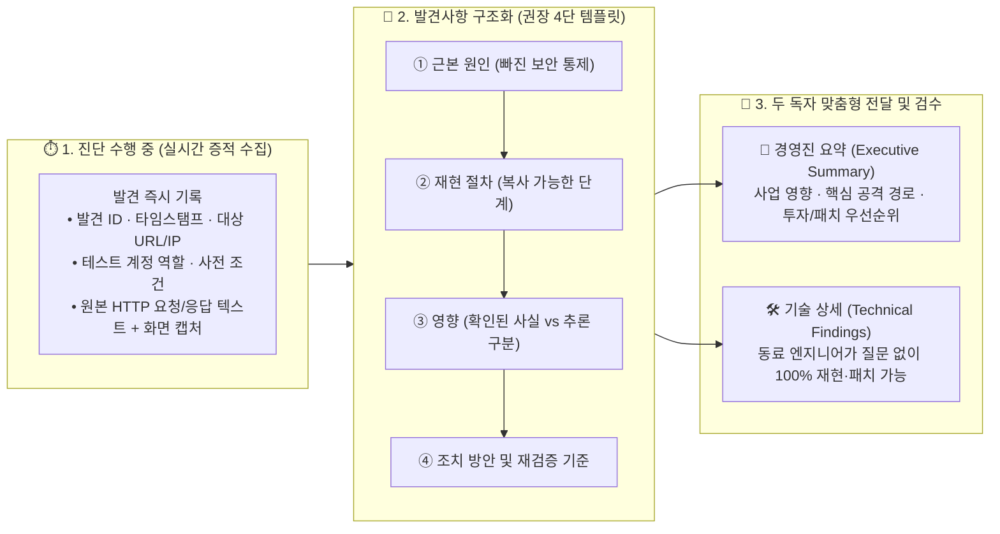

> [!summary] ⏱️ 5초 핵심 요약
> - **한 줄 비유**: 모의해킹 리포트는 **환자·보호자에게 수술 필요성과 우선순위를 설명하는 진단 요약서(Executive Summary)**와, **집도의에게 정확한 절개 위치와 처치 순서를 전달하는 수술 기록지(Technical Findings)**를 한 권에 담는 작업입니다.
> - **핵심 원리**: 리포트는 진단이 끝난 마지막 날 기억에 의존해 쓰는 것이 아니라 **발견 즉시 수집한 타임스탬프·원본 요청/응답·마스킹된 스크린샷 증적**을 바탕으로, **근본 원인 → 재현 절차 → 비즈니스/기술 영향 → 근본 조치 및 재검증 기준**이 한 줄로 이어지게 작성해야 합니다.
> - **핵심 체크 포인트**: 경영진 요약에는 기술 약어 대신 **사업 리스크와 의사결정 우선순위**를, 기술 상세에는 질문 없이 그대로 따라 할 수 있는 **텍스트 기반 단계별 재현 절차**를 적고, 배포 전 고객 민감정보 마스킹과 암호화 전달 채널을 반드시 검수하세요.

[[SysReptor로 OSCP 리포트 작성하기]]가 SysReptor 설치와 템플릿 설정이라는 **도구 사용법**을 다룬다면, 이 글은 도구와 무관하게 무엇을 어떤 순서로 누구에게 써야 하는지 설명하는 **글쓰기 방법론**입니다. 두 글은 서로 참고할 수 있지만 역할이 다르므로, 여기서는 SysReptor 설치·운영이나 특정 자격시험 양식을 반복하지 않고 경영진 요약과 기술 발견사항의 구성, 증적 수집 습관에만 집중합니다.



---

## 한눈에 보는 모의해킹 리포트 두 독자(Audience) 비교표

| 구분 | 👔 경영진 요약 (Executive Summary) | 🛠️ 기술 상세 발견사항 (Technical Findings) |
|---|---|---|
| **한 줄 비유** | 병원 원장·보호자에게 설명하는 **위험도와 치료 우선순위 요약서** | 담당 집도의·수리 기사에게 건네는 **정밀 수술·정비 매뉴얼** |
| **주 독자층** | CISO, CTO, 사업부 임원, 프로젝트 의사결정권자 | 백엔드/프론트엔드 개발자, 인프라 엔지니어, 보안 운영(SOC) 담당자 |
| **핵심 질문** | "우리 사업에 어떤 피해가 가능하며, 무엇부터 예산을 들여 고쳐야 하는가?" | "어느 코드/설정의 어떤 통제가 빠졌고, 어떻게 똑같이 재현해 수정을 검증하는가?" |
| **사용할 언어** | 업무 중단, 개인정보/기밀 유출, 금전·규제·신뢰도 영향, 공통 근본 원인 | 엔드포인트 URL/IP, 계정 권한, HTTP 요청/응답 원문, 코드/설정 패치 예시 |
| **피해야 할 실수** | CVE 번호·페이로드·프로토콜 약어를 나열하거나 단순 취약점 개수만 강조 | "로그인 후 값을 바꾸면 뚫림" 같은 모호한 요약, 텍스트 없이 잘린 스크린샷만 첨부 |

---

## 1. 한 사건을 두 독자에게 설명하는 리포트

**💡 한 줄 비유**: 같은 골절 사고라도 **환자와 가족에게는 "일상생활에 어떤 지장이 있고 어떤 수술을 먼저 해야 하는지(경영진 요약)"**를 설명해야 하고, **수술실 의료진에게는 "어느 뼈가 몇 밀리미터 어긋났고 어떤 순서로 고정해야 하는지(기술 상세)"**를 정확히 남겨야 합니다.

### 핵심 원리
- **독자 혼합의 문제**: 모의해킹 리포트는 예산과 우선순위를 결정하는 **경영진**, 그리고 결함을 재현하고 수정하는 **엔지니어**를 동시에 만족시켜야 합니다. 한 문단에 두 독자를 섞어 쓰면 경영진에게는 외계어 같은 기술 약어가 과하고, 엔지니어에게는 정작 패치에 필요한 재현 근거가 부족한 문서가 됩니다.
- **Executive Summary의 초점**: 취약점 이름을 나열하는 곳이 아니라 중요한 사업 기능, 고객 데이터, 운영 연속성, 규제·신뢰에 어떤 위험이 있는지를 설명하는 곳입니다. 기술 약어를 배제하고 **"무슨 일이 가능하며, 왜 지금 조치해야 하고, 어떤 의사결정이 필요한가"**를 짧게 전달합니다.
- **Technical Findings의 초점**: 다른 엔지니어가 동일한 권한과 환경에서 절차를 따라 같은 결과를 확인할 수 있을 만큼 구체적이어야 합니다. 대상, 사전 조건, 계정 역할, 요청 시각, 입력과 관찰 결과, 증적, 영향과 조치가 서로 연결돼야 하며, **미검증 추정과 실제 확인된 사실을 엄격히 구분**해야 합니다.

### 같은 취약점을 두 독자에게 다르게 번역하는 예시

| 독자 구분 | ❌ 나쁜 작성 예시 | ✅ 좋은 작성 예시 |
|---|---|---|
| **경영진 요약 (Executive)** | "`/api/v2/settlement` 엔드포인트에 BOLA(IDOR) 취약점이 존재하여 JWT 클레임의 `partner_id`와 Path Parameter 간 소유권 검증이 누락되었습니다." | "**정산 시스템 권한 검증 누락으로 인한 타 가맹점 정산금·계좌정보 열람 위험(Critical)**: 일반 가맹점 계정만으로 다른 모든 가맹점의 월별 정산 내역과 대표자 계좌 정보를 조회할 수 있음이 확인되었습니다. 정산 API의 소유권 검증 로직을 최우선으로 패치해야 합니다." |
| **기술 상세 (Technical)** | "정산 조회 화면에서 파라미터를 바꾸면 다른 가맹점 정보가 보입니다. 권한 체크를 추가하세요." | "가맹점 A(`partner_id=1001`, 역할: `MERCHANT_USER`)로 로그인 후 `GET /api/v2/settlement/1002` 호출 시, 서버가 세션의 `partner_id(1001)`와 요청 경로의 `1002` 일치 여부를 검사하지 않아 `200 OK`와 함께 가맹점 B의 정산 JSON을 반환함." |

### 체크 포인트
- Executive Summary에서 CVE·페이로드·프로토콜 약어보다 **사업 영향과 조치 우선순위**를 먼저 제시했는가?
- Technical Findings에 **대상·사전 조건·재현 단계·기대 결과·실제 결과·증적**을 빠짐없이 포함했는가?
- 두 섹션의 **위험 순위와 핵심 통계 수치(심각도별 건수 등)가 서로 모순되지 않는지** 대조했는가?
- 참고: [SANS — Writing a Penetration Testing Report](https://www.sans.org/white-papers/33343/)

---

## 2. 진단 중 실시간 기록 — 기억이 아니라 증적에서 쓰기

**💡 한 줄 비유**: 한 달간의 출장이 끝난 뒤 **기억만으로 영수증 내역과 이동 시간을 복원하면 날짜와 금액이 전부 틀리기 쉽습니다.** 결제하는 그 순간마다 사진과 메모를 남겨야 나중에 완벽한 정산표를 만들 수 있습니다.

### 핵심 원리
- **발견 즉시 기록하는 습관**: 리포트 작성은 테스트 종료 후 시작되는 일이 아닙니다. 취약점을 확인하는 그 순간부터 메모와 스크린샷, 원본 요청·응답, 대상과 시각을 남겨야 보고 단계에서 증적 공백(재현 불가 상태)을 피할 수 있습니다.
- **증적의 구조화와 무결성 보존**:
  - 각 증적에는 **발견사항 ID, 대상 자산, 사용한 계정 역할, 타임스탬프(시간대 포함), 재현 단계 번호**를 연결합니다.
  - 스크린샷은 모니터 전체를 무작정 찍기보다, **결과를 판단하는 데 필요한 핵심 영역과 대상 식별 정보(URL 주소창, 호스트명, 요청 헤더 일부 등)가 한 화면에 함께 보이도록** 캡처합니다.
  - 원본 HTTP 요청·응답과 터미널 로그는 텍스트 원문 그대로 보관하고, 최종 보고서 배포본에서 세션 토큰·개인정보·고객 비밀값을 마스킹합니다.
- **증적 관리 보안(Data Hygiene)**: 실제 고객 개인정보는 필요한 최소 범위(예: 1~2건의 마스킹된 샘플)만 확인하고, 민감정보를 테스터 개인 폴더나 일반 클라우드 메신저에 복사하지 않습니다. 저장 위치, 암호화, 접근 권한, 전달 방법과 폐기 시점은 반드시 RoE의 데이터 처리 규칙을 따릅니다.

```text
# 권장 증적 폴더 및 파일 명명 규칙 예시
evidence/
└── FIND-01_BOLA_Settlement_API/
    ├── 00_notes.md                          # 타임스탬프(2026-11-06 14:22 KST), 대상, 테스트 계정(merchant_a) 기록
    ├── 01_normal_request_response.txt       # 정상 본인 조회(1001) 원본 HTTP 패킷
    ├── 02_idor_request_response_masked.txt  # 타 가맹점(1002) 조회 재현 패킷 (계좌·실명 마스킹)
    └── 02_step2_burp_repeater.png           # 단계 2와 매칭되는 강조 표시된 캡처 이미지
```

### 체크 포인트
- 취약점 발견 즉시 **발견사항 ID, 시각(타임존 포함), 대상, 계정 역할, 사전 조건과 관찰 결과**를 기록했는가?
- 스크린샷 파일명과 본문 재현 단계 번호를 일치시키고, **텍스트 형태의 원본 요청·응답 무결성**을 유지했는가?
- 세션 토큰·쿠키·비밀번호·실제 개인정보는 보고서 배포본에서 **안전하게 마스킹하되 재현에 필요한 맥락(앞뒤 일부 식별자 등)은 남겼는가?**
- 매일 일과 종료 전에 **증적 누락, 이미지 깨짐, 시간대 불일치와 암호화 백업 상태**를 점검했는가?
- 참고: [SANS — Writing a Penetration Testing Report](https://www.sans.org/white-papers/33343/), [PTES — Reporting](http://www.pentest-standard.org/index.php/Reporting)

---

## 3. 발견사항 구성 — 이 블로그의 권장 템플릿

**💡 한 줄 비유**: 자동차 정비 기록서에 "차에서 소리가 남"이라고만 적는 대신 **① 고장 부품과 원인(근본 원인), ② 같은 소리가 나는 주행 조건과 확인 순서(재현 절차), ③ 방치 시 주행 안전에 미치는 위험(영향), ④ 부품 교체 방법과 수리 후 확인 기준(조치 방안)**을 나누어 적으면 어떤 정비사가 봐도 즉시 고칠 수 있습니다.

### 핵심 원리: 4단 권장 템플릿 구조
이 글에서는 각 기술 발견사항을 **① 근본 원인 → ② 재현 절차 → ③ 영향 → ④ 조치 방안** 순서로 쓰는 방식을 권합니다. *(이것은 업계에서 강제하는 단일 표준 공식이 아니라 **이 블로그의 권장 템플릿**이므로, 고객사나 수행사의 기존 계약 양식이 있다면 그것을 우선하되 아래 네 요소를 빠뜨리지 않는 점검 틀로 활용하면 됩니다.)*

1. **근본 원인 (Root Cause)**: "입력 검증 미흡" 같은 추상적인 상투어 대신, **어느 신뢰 경계(Trust Boundary)에서 어떤 서버 측 보안 통제가 빠졌는지** 구체적으로 설명합니다.
2. **재현 절차 (Reproduction Steps)**: 허가된 테스트 환경의 사전 조건과 관찰 과정을 번호 매긴 단계로 나눕니다.
3. **영향 (Impact)**: 스캐너의 기본 CVSS 점수를 그대로 복사하지 말고, **실제로 확인된 공격자의 능력(Confirmed Fact), 합리적 추론(Reasonable Inference), 미검증 최악 시나리오(Unverified Assumption)**를 명확히 구분해 적습니다.
4. **조치 방안 (Remediation)**: 단순 WAF 패턴 차단이 아니라 **근본 원인을 해결하는 코드·아키텍처 변경안과 패치 후 재검증 방법**을 제시합니다.

### 실무 기술 발견사항 카드 작성 예시
```markdown
### [FIND-01] 정산 내역 조회 API의 객체 수준 인가 검증 누락 (BOLA/IDOR)
- **위험도**: 상 (High) | **대상**: `GET /api/v2/settlement/{partnerId}` | **상태**: 미조치

1. **근본 원인 (Root Cause)**
   - 컨트롤러가 JWT 액세스 토큰의 서명 유효성(인증)만 확인하고, 토큰 내부의 로그인 주체(`sub.partner_id`)와 URL 경로 변수로 전달된 `{partnerId}`의 일치 여부(객체 수준 인가)를 서비스/DB 조회 계층에서 검증하지 않음.

2. **재현 절차 (Reproduction Steps)**
   - **사전 조건**: 스테이징 환경(`https://stg-api.example.com`), 일반 가맹점 테스트 계정 A(`partner_id=1001`) 및 비교용 테스트 계정 B(`partner_id=1002`)
   - **Step 1**: 계정 A로 로그인하여 유효한 Bearer 토큰을 발급받고 본인 정산 내역(`GET /api/v2/settlement/1001`)이 정상 반환(`200 OK`)됨을 확인한다. (증적 `FIG-01-1`)
   - **Step 2**: 동일한 계정 A의 Authorization 헤더를 유지한 채, 경로 변수만 계정 B의 식별자인 `1002`로 변경하여 요청한다. (증적 `FIG-01-2`)
   - **기대 결과**: `403 Forbidden` 또는 `404 Not Found` 응답과 함께 데이터 미반환
   - **실제 결과**: `200 OK` 응답과 함께 타 가맹점(1002)의 월별 정산 금액 및 마스킹되지 않은 계좌번호가 반환됨.

3. **영향 (Impact)**
   - **[확인된 사실]** 일반 가맹점 권한을 가진 사용자가 연번 형태의 `partnerId`를 변경해 타 가맹점의 정산 금액·계좌 정보를 열람할 수 있음.
   - **[합리적 추론]** `partnerId`가 순차 증가 정수이므로 자동화 스크립트를 통한 전체 가맹점 정보 대량 수집(Scraping)에 악용될 수 있음.

4. **조치 방안 및 재검증 기준 (Remediation & Verification)**
   - **근본 조치**: DB 조회 쿼리에 세션 주체의 식별자를 강제 바인딩 (`SELECT ... WHERE partner_id = : requestedId AND owner_user_id = :authenticatedUserId`)하거나, 본인 정보 조회 시 경로 파라미터를 제거하고 토큰 내부의 `partner_id`만 참조하도록 변경.
   - **재검증 기준**: Step 2와 동일하게 계정 A 토큰으로 `partnerId=1002` 호출 시 `403 Forbidden`이 반환되는지 확인.
```

### 체크 포인트
- **근본 원인**이 단순 증상이나 취약점 이름을 반복하지 않고 **빠진 서버 측 통제**를 정확히 짚었는가?
- **재현 절차**의 각 단계가 **증적 번호(`FIG-01-x`)와 1:1로 연결**되고 명확한 결과 판단 기준이 있는가?
- **영향** 서술에서 **확인된 사실, 합리적 추론, 미검증 가정**이 섞이지 않고 구분되어 있는가?
- **조치 방안**이 임시방편(특정 문자열 필터링 등)에 그치지 않고 **근본 원인 해결책과 패치 재검증 기준**까지 포함하는가?
- 참고: [SANS — Writing a Penetration Testing Report](https://www.sans.org/white-papers/33343/)

---

## 4. 복사해 따라갈 수 있는 재현 절차 만들기

**💡 한 줄 비유**: 요리 레시피에 "소금을 적당히 넣고 익을 때까지 볶는다"라고 쓰면 사람마다 전혀 다른 요리가 나옵니다. **재료의 초기 상태, 투입 순서, 불 세기와 완성 판정 기준**을 숫자로 적어야 다른 요리사도 똑같은 맛을 재현할 수 있습니다.

### 핵심 원리
- **질문 없는 재현성(Zero-Question Reproducibility)**: 좋은 재현 절차는 보고서 작성자에게 따로 전화나 메신저로 물어보지 않아도, 담당 개발자가 같은 테스트 환경에서 똑같은 결과를 5분 안에 확인할 수 있어야 합니다.
- **필수 포함 6요소**:
  1. **대상 식별자**: 정확한 URL, IP/포트, API 메서드, 앱 버전
  2. **사전 조건 및 테스트 계정**: 테스트 환경(Prod/Staging), 사용한 계정의 권한 역할(일반 사용자/가맹점/비로그인), 필요한 사전 데이터 상태
  3. **기준 정상 요청과 변경 지점**: 어떤 정상 요청에서 **정확히 어느 파라미터/헤더를 무엇으로 바꿨는지** 명시
  4. **복사 가능한 텍스트 블록**: 안전한 자리표시자(Placeholder)와 마스킹이 적용된 HTTP 요청/명령어 원문
  5. **기대 결과 vs 실제 관찰 결과**: 정상 보안 통제가 작동했을 때 나와야 할 응답과 실제 반환된 응답 비교
  6. **패치 후 재검증 기준**: 수정 완료 후 어느 단계를 다시 실행했을 때 어떤 응답이 나와야 '조치 완료'로 판정하는지 명시
- **스크린샷 만능주의 경계**: 스크린샷 이미지는 시각적 보조 수단일 뿐, **검색·복사·비교(Diff)가 불가능하고 중간 요청 헤더나 파라미터를 가릴 수 있습니다.** 반드시 복사 가능한 텍스트 코드 블록(요청·응답 요약)이 주 증거가 되고, 스크린샷은 해당 단계 번호와 빨간색 박스 강조 표시를 덧붙이는 보조 자료로 씁니다.

### 체크 포인트
- 각 재현 단계가 **'하나의 행동 → 하나의 관찰 결과'**를 갖도록 명확히 번호화되어 있는가?
- 환경·계정 권한·사전 데이터가 달라 재현에 실패할 수 있는 **전제 조건을 Step 1 이전에 명시**했는가?
- **복사 가능한 텍스트(HTTP 패킷·명령어)와 강조 표시된 스크린샷을 함께 제공**하되 실제 비밀값과 개인정보는 마스킹했는가?
- 패치 후 동일한 절차로 방어 성공을 확인할 수 있도록 **재검증 판정 기준**을 마지막에 추가했는가?
- 참고: [PTES — Reporting](http://www.pentest-standard.org/index.php/Reporting)

---

## 5. 경영진 요약 — 기술 발견을 사업 결정으로 번역하기

**💡 한 줄 비유**: 병원 경영진에게 수술용 메스의 합금 비율을 보고하면 예산 결재를 내릴 수 없습니다. **"환자 안전에 어떤 치명적 위험이 있고, 어느 노후 장비부터 교체해야 의료 사고를 막을 수 있는지"** 의사결정 언어로 번역해 주어야 합니다.

### 핵심 원리
- **요약이 아닌 재구성**: Executive Summary는 기술 보고서의 앞부분 몇 줄을 잘라 붙이는 작업이 아니라, 전체 진단 결과를 **사업 위험(Business Risk)과 의사결정 우선순위**로 다시 쓰는 작업입니다.
- **개수 함정(Counting Trap) 피하기**: 단순히 "상 1건, 중 3건, 하 12건 발견"처럼 개수만 나열하면, 사소한 정보 노출 수십 개와 회사 핵심 DB 전체가 털리는 치명적인 단일 공격 경로(Kill Chain)의 무게 차이가 가려집니다. 심각도별 통계표는 보조 지표로만 두고, **핵심 공격 시나리오, 영향받는 중요 비즈니스 자산, 여러 취약점을 관통하는 공통 근본 원인(예: 신규 마이크로서비스의 공통 인가 필터 누락), 단기·중장기 개선 로드맵**을 서술합니다.
- **진단 범위와 한계의 투명한 명시**: "이 시스템은 이제 완벽히 안전하다"는 식의 과장된 보증을 하지 않고, **합의된 테스트 기간·스코프·제공 정보 안에서 관찰된 결과라는 점과 제외된 대상(Out-of-Scope)**을 명확히 밝혀야 경영진이 남은 리스크를 올바르게 판단할 수 있습니다.

### 체크 포인트
- 보고서 첫 페이지에서 **점검 범위, 기간, 핵심 비즈니스 위험, 최우선 조치 사항과 필요한 의사결정**을 한눈에 파악할 수 있는가?
- 난해한 기술 용어를 **업무 중단, 고객 데이터 유출, 금전적 손실, 법적 규제 위반, 브랜드 신뢰도 영향**으로 번역했는가?
- 단순 취약점 개수 나열보다 **핵심 공격 연쇄 경로와 조직의 구조적·공통 근본 원인**을 우선 설명했는가?
- **제외 대상(Out-of-Scope)과 테스트 시간·환경의 한계**를 숨기지 않고 결론의 적용 범위를 정확히 명시했는가?
- 참고: [SANS — Writing a Penetration Testing Report](https://www.sans.org/white-papers/33343/)

---

## 6. 전달 전 품질 점검과 재검증

**💡 한 줄 비유**: 완벽하게 작성한 진료 기록이라도 **환자 이름이나 수치가 오기되어 있거나, 봉투를 봉하지 않은 채 아무 인편에나 보내면** 치료를 망치고 개인정보 유출 사고를 일으킵니다. 보안 리포트는 **내용의 정합성과 전달 채널의 보안**을 끝까지 검수해야 완성됩니다.

### 최종 출고 전 4대 검수(QA) 및 재검증 원칙
1. **동료 교차 검토(Peer Review)와 수치 일치**:
   - 작성자가 아닌 다른 엔지니어가 문서만 읽고 발견사항을 이해·재현할 수 있는지 검토합니다.
   - 요약 표, 본문 상세, 부록의 **발견사항 ID, 심각도 등급, 대상 자산명, 건수 합계**가 100% 일치하는지 확인합니다.
2. **민감정보 및 문서 메타데이터 클리닝**:
   - 본문 코드 블록, 스크린샷 구석(브라우저 탭·북마크·메신저 알림), 문서 속성(Word/PDF 작성자 메타데이터, 숨은 주석, 변경 내용 추적 기록)에 마스킹되지 않은 실제 비밀번호, 세션 토큰, 고객 개인정보가 남아 있지 않은지 전수 검사합니다.
3. **패치 후 재검증(Retest) 상태 표기**:
   - 조치가 끝난 항목은 원래의 재현 절차대로 다시 시험하고, 결과를 **`수정 완료(Remediated / Closed)`, `부분 수정(Partially Remediated)`, `미수정(Open)`, `위험 수용(Risk Accepted)`, `재검증 불가(Not Retested — 사유 명시)`**처럼 명확한 상태와 패치 후 증적으로 남깁니다.
   - 특정 파라미터 하나만 막은 임시 조치는 근본 해결 여부와 남은 우회 가능성을 구분해 적습니다.
4. **안전한 전달과 폐기**:
   - 최종 보고서와 증적 압축 파일은 사전 합의된 **암호화 방식(문서 암호 설정, PGP, 전용 보안 파일 전송 시스템 등)과 별도 채널을 통한 비밀번호 전달**로 지정된 수신자에게만 인도하며, 약속된 보관 기간 만료 후 안전하게 폐기합니다.

### 체크 포인트
- 다른 동료 엔지니어가 **문서만 보고도 발견사항을 이해하고 재현할 수 있는지** 교차 검토(Peer Review)를 거쳤는가?
- 경영진 요약 표·본문·부록의 **발견사항 ID, 위험도 등급, 자산명, 조치 상태 및 통계 숫자**가 정확히 일치하는가?
- 문서 메타데이터·변경 이력·스크린샷 여백에 **실제 비밀번호, 활성 토큰, 고객 개인정보**가 남지 않았는지 확인했는가?
- 사전 승인된 **수신자·암호화 채널·보관 기간·폐기 절차**에 따라 최종본을 안전하게 전달했는가?
- 참고: [SANS — Writing a Penetration Testing Report](https://www.sans.org/white-papers/33343/)

---

## 마무리

좋은 모의해킹 리포트는 화려한 해킹 기법을 자랑하거나 취약점 개수를 부풀린 문서가 아니라, **경영진이 망설임 없이 보수 우선순위를 결정하고 엔지니어가 질문 없이 한 번에 결함을 재현·수정·재검증할 수 있게 만드는 실용 문서**입니다. 전체 모의해킹 과정에서 보고 단계의 위치는 [[모의해킹 방법론 총정리 — PTES 7단계와 OWASP WSTG로 보는 진단 전체 지도]]를, 실제 문서 자동화 도구 설정은 [[SysReptor로 OSCP 리포트 작성하기]]를 참고하세요.
