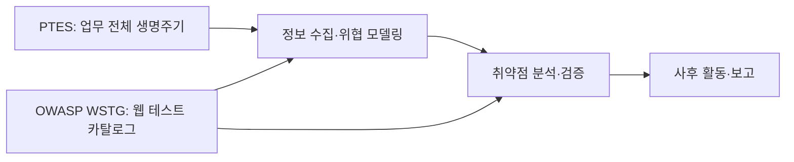

[[웹 취약점 진단 기법 입문 — XXE, SSRF부터 SQLi, XSS까지]]를 비롯한 웹취약점·모바일취약점·클라우드인프라 시리즈가 특정 취약점을 찾고 검증하는 **개별 공정의 결과물**이라면, 이 글은 그 결과물이 모의해킹 전체 과정의 어디에 놓이는지 보여주는 상위 지도입니다. 처음부터 읽을 수 있는 허브를 목표로 하며, 개별 공격 기법이나 실행 절차는 다시 다루지 않습니다. 특히 PTES 1단계의 상세 합의 항목은 [[스코프와 교전규칙(RoE) — 모의해킹을 시작하기 전에 정해야 할 것들]]의 범위이므로 여기서는 전체 순서에서의 위치만 짚습니다.

---

## 1. PTES와 WSTG — 전체 공정과 전문 공종 체크리스트

쉽게 말하면 건물을 지을 때 착공부터 설계, 시공, 검사, 인도까지 이어지는 전체 공정표와 전기 배선만 세밀하게 검사하는 체크리스트는 서로 경쟁하지 않습니다. 요리로 치면 PTES는 장보기부터 조리와 상차림까지의 전체 레시피이고, OWASP WSTG는 그중 웹 애플리케이션이라는 한 요리를 검사하는 상세 항목표에 가깝습니다.

**원리**: PTES(Penetration Testing Execution Standard)는 한 번의 모의해킹 업무가 계약 전 합의에서 최종 보고까지 어떻게 흘러가는지를 7단계로 나눕니다. OWASP WSTG(Web Security Testing Guide)는 그 흐름 안에서 웹 애플리케이션의 어떤 영역을 어떤 관점으로 시험할지 정리한 테스트 카탈로그입니다. 둘은 적용 고도가 다르므로 하나를 골라 다른 하나를 버리는 관계가 아닙니다.

PTES는 웹뿐 아니라 네트워크, 호스트, 조직의 업무 목표까지 포함할 수 있는 업무 흐름입니다. 반면 WSTG는 웹 보안 통제의 검증에 집중합니다. 따라서 실제 프로젝트에서는 PTES로 전체 일정을 관리하고, Intelligence Gathering과 Vulnerability Analysis 구간에서 WSTG 항목을 세부 작업 목록으로 사용하는 식이 자연스럽습니다.

- 체크 포인트:
  - 프로젝트 일정과 승인 지점은 PTES 단계로, 웹 테스트의 누락 점검은 WSTG 항목으로 각각 관리
  - WSTG를 전체 계약·보고 절차의 대체물로 보거나 PTES를 웹 취약점 체크리스트로 오해하지 않기
  - 진단 대상이 웹 외에 모바일·클라우드·내부망을 포함하면 각 영역의 별도 테스트 기준을 추가
- 참고: [PTES Technical Guidelines](http://www.pentest-standard.org/index.php/Main_Page), [OWASP WSTG](https://owasp.org/www-project-web-security-testing-guide/)

## 2. 1~3단계 — 무엇을, 왜, 어떤 관점으로 볼 것인가

쉽게 말하면 현장에 들어가기 전에 공사 구역과 도면을 확인하고, 건물에서 가장 중요한 공간과 사고 시 피해가 큰 지점을 먼저 표시하는 과정입니다. 망치를 들기 전에 경계와 우선순위를 정해야 엉뚱한 벽을 두드리지 않습니다.

**원리**: PTES의 앞 세 단계는 테스트의 방향을 만드는 구간입니다. 1단계 Pre-Engagement Interactions에서는 허용 범위와 일정, 금지 행위, 연락 체계를 합의합니다. 이 글에서는 그 존재와 역할만 다루며, 실제 합의 체크리스트는 별도 RoE 글에서 설명합니다.

2단계 Intelligence Gathering에서는 공개 정보, 자산 목록, 기술 스택, 노출된 기능과 신뢰 관계를 모아 공격 표면을 그립니다. 웹 프로젝트에서는 WSTG의 Information Gathering이 이 단계에 직접 도움이 되지만, WSTG 항목만으로 조직 전체의 자산과 업무 맥락이 자동으로 완성되는 것은 아닙니다.

3단계 Threat Modeling에서는 수집한 정보를 자산 가치, 공격자 관점, 신뢰 경계, 예상 영향과 연결해 우선순위를 정합니다. 같은 로그인 페이지라도 일반 게시판과 결제 승인 시스템은 실패했을 때의 피해가 다르므로, 단순히 발견된 URL 수가 아니라 보호할 자산과 가능한 공격 경로를 기준으로 다음 단계를 설계해야 합니다.

- 체크 포인트:
  - Pre-Engagement 결과가 승인된 범위·금지 행위·연락망으로 문서화됐는지
  - 자산 목록에 도메인뿐 아니라 API, 관리자 기능, 외부 연동과 인증 경계가 포함됐는지
  - 위협 모델이 테스트 우선순위와 시간 배분으로 실제 연결됐는지
- 참고: [PTES — Pre-engagement](http://www.pentest-standard.org/index.php/Pre-engagement), [PTES — Intelligence Gathering](http://www.pentest-standard.org/index.php/Intelligence_Gathering), [PTES — Threat Modeling](http://www.pentest-standard.org/index.php/Threat_Modeling)

## 3. 4~6단계 — 취약점을 찾고, 제한적으로 입증하고, 영향을 확인하기

쉽게 말하면 건물 검사에서 균열 후보를 찾는 일, 그 균열이 실제 구조 문제인지 안전하게 확인하는 일, 그리고 문제가 어느 공간까지 영향을 주는지 경계를 확인하는 일은 서로 이어지지만 같은 작업은 아닙니다. 후보를 찾았다고 바로 벽을 허물어서는 안 됩니다.

**원리**: 4단계 Vulnerability Analysis는 수집한 정보와 테스트 기준을 이용해 약점을 식별하고 오탐을 걸러내는 구간입니다. 5단계 Exploitation은 승인된 범위 안에서 약점이 실제 보안 영향으로 이어지는지 필요한 최소 수준으로 입증합니다. 6단계 Post-Exploitation은 확보된 접근이 어떤 데이터와 시스템에 영향을 줄 수 있는지, 그리고 탐지·복구 관점에서 무엇을 확인해야 하는지를 평가합니다.

WSTG의 상세 테스트는 주로 Vulnerability Analysis에 놓이고, 제한적인 검증은 Exploitation과 맞닿습니다. 다만 WSTG 범주와 PTES 단계를 1대1로 강제 대응시키면 안 됩니다. 예를 들어 Authorization Testing은 분석 단계에서 통제를 점검하지만, 실제 영향 확인은 승인된 검증 단계까지 이어질 수 있습니다.

버전 구분도 반드시 붙여야 합니다. **STABLE이 가리키는 v4.2 릴리스는 11개 테스트 카테고리**이며 Information Gathering, Configuration and Deployment Management Testing, Identity Management Testing, Authentication Testing, Authorization Testing, Session Management Testing, Input Validation Testing, Testing for Error Handling, Testing for Weak Cryptography, Business Logic Testing, Client-side Testing으로 구성됩니다. 반면 **latest 브랜치는 API Testing이 추가된 12개 카테고리**입니다. 따라서 “WSTG는 11개” 또는 “WSTG는 12개”라고 버전 없이 단정하면 둘 다 부정확합니다.

- 체크 포인트:
  - 테스트 계획서에 WSTG 버전 또는 브랜치를 명시하고 항목 수를 그 기준에 맞춰 기록
  - 취약점 후보 식별과 실제 영향 입증을 분리하고, 검증 강도는 RoE 한도를 넘지 않게 제한
  - Post-Exploitation에서 무분별한 확장 대신 접근 범위·민감 데이터·탐지 흔적을 필요한 만큼만 확인
- 참고: [OWASP WSTG stable v4.2 — 11개 카테고리](https://wstg.owasp.org/stable/4-Web_Application_Security_Testing/), [OWASP WSTG latest — API Testing 포함 12개 카테고리](https://wstg.owasp.org/latest/4-Web_Application_Security_Testing/00-Introduction_and_Objectives/), [PTES — Vulnerability Analysis](http://www.pentest-standard.org/index.php/Vulnerability_Analysis)

## 4. 7단계 Reporting — 발견을 의사결정으로 바꾸기

쉽게 말하면 정밀검사 결과가 검사자의 수첩에만 남아 있으면 건물주는 무엇을 고쳐야 할지 알 수 없습니다. 어디가 왜 위험한지, 지금 무엇부터 수리해야 하는지 전달돼야 검사가 실제 개선으로 이어집니다.

**원리**: Reporting은 마지막에 문장을 다듬는 부속 작업이 아니라, 앞 단계의 증거를 위험과 조치 우선순위로 변환하는 독립 단계입니다. 경영진에게는 사업 영향과 의사결정이, 기술팀에는 재현 근거와 수정 방향이 필요합니다.

좋은 보고를 위해서는 테스트 중부터 대상, 시각, 요청·응답, 계정 역할, 기대 결과와 실제 결과를 기록해야 합니다. 마지막 날 기억에 의존해 증거를 재구성하면 재현 조건이나 영향 범위를 놓치기 쉽습니다. 보고서 작성의 상세 방법은 [[모의해킹 리포트 작성법 — 재현 가능한 증적과 경영진 요약 쓰기]]에서 별도로 다룹니다.

- 체크 포인트:
  - 모든 발견에 자산·조건·증적·영향·조치와 검증 상태가 연결되는지
  - 경영진 요약과 기술 상세가 같은 사실을 서로 다른 독자 수준으로 설명하는지
  - 범위 밖 관찰이나 미검증 추정은 확정된 취약점과 명확히 구분하는지
- 참고: [PTES — Reporting](http://www.pentest-standard.org/index.php/Reporting), [SANS — Writing a Penetration Testing Report](https://www.sans.org/white-papers/33343/)

## 5. 이 블로그의 글을 전체 지도에 배치하는 법

쉽게 말하면 지도에서 목적지를 찾을 때는 먼저 어느 도시와 구역인지 보고, 그다음 골목 지도를 펼칩니다. 개별 취약점 글부터 무작정 읽기보다 현재 PTES 단계와 대상 기술을 정하면 필요한 글을 훨씬 빨리 고를 수 있습니다.

**원리**: 이 블로그의 기존 보안 글은 대부분 Vulnerability Analysis에서 점검할 항목과 Exploitation에서 안전하게 입증할 관점을 설명합니다. 예를 들어 [[웹 취약점 진단 기법 입문 — XXE, SSRF부터 SQLi, XSS까지]]는 웹 취약점 후보를 이해하고 점검하는 데 쓰이며, 프로젝트 승인이나 최종 보고 절차를 대신하지 않습니다.

따라서 첫 방문자는 이 글에서 전체 단계를 확인한 뒤, Pre-Engagement가 필요하면 RoE 글로, 웹 테스트가 필요하면 웹취약점 시리즈로, 증적 정리가 필요하면 리포트 작성 글로 이동하면 됩니다. 한 글이 모든 단계를 덮도록 늘리기보다 단계별 산출물을 연결하는 편이 누락과 중복을 줄입니다.

- 체크 포인트:
  - 현재 읽는 글이 PTES의 어느 단계에 쓰이는지 한 문장으로 설명 가능한지
  - 개별 취약점 체크리스트를 승인 범위나 위험 평가 없이 바로 실행하지 않는지
  - 단계가 바뀔 때 필요한 산출물과 다음 글을 함께 확인하는지
- 참고: [PTES Technical Guidelines](http://www.pentest-standard.org/index.php/Main_Page)

## 정리

| PTES 단계 | 핵심 질문 | WSTG와의 관계 |
|---|---|---|
| Pre-Engagement | 무엇을 어떤 규칙으로 시험할 것인가 | 직접 대체하지 않음 |
| Intelligence Gathering | 어떤 자산과 기능이 노출돼 있는가 | Information Gathering 활용 |
| Threat Modeling | 무엇이 가장 중요하고 위험한가 | 테스트 항목의 우선순위 결정 |
| Vulnerability Analysis | 어떤 보안 통제가 약한가 | WSTG 상세 카테고리의 중심 구간 |
| Exploitation | 실제 영향이 성립하는가 | 승인 범위에서 최소한으로 검증 |
| Post-Exploitation | 영향 범위와 탐지 흔적은 어디까지인가 | 웹을 넘어 시스템 맥락까지 확장 가능 |
| Reporting | 무엇을 왜 먼저 고쳐야 하는가 | 결과를 증적·위험·조치로 변환 |

PTES는 모의해킹 전체 여정을, WSTG는 웹 테스트의 세부 항목을 정리합니다. 시작 전 합의가 필요하면 [[스코프와 교전규칙(RoE) — 모의해킹을 시작하기 전에 정해야 할 것들]]을, 실제 웹 진단 항목이 필요하면 [[웹 취약점 진단 기법 입문 — XXE, SSRF부터 SQLi, XSS까지]]부터 이어서 보세요.
