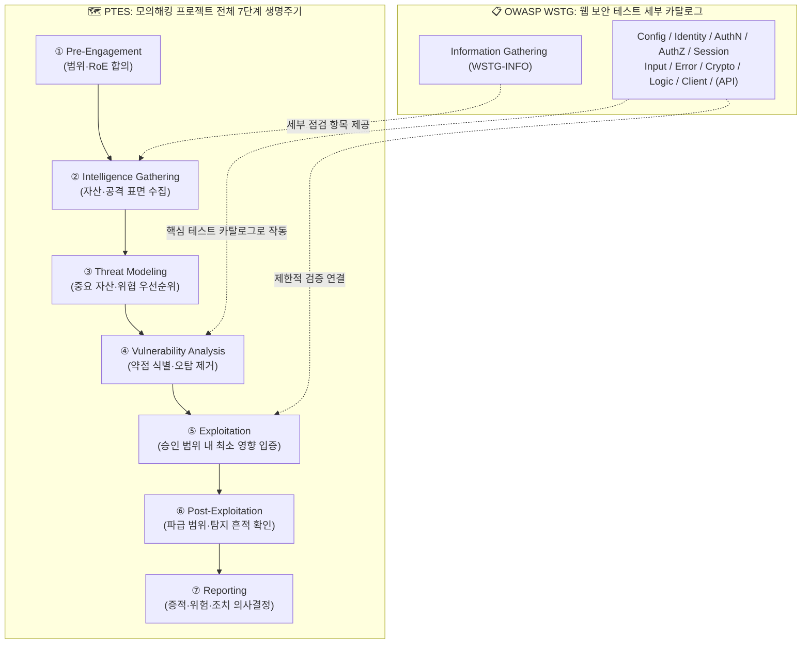
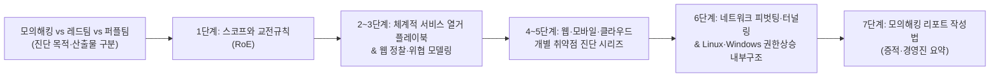

> [!summary] ⏱️ 5초 핵심 요약
> - **한 줄 비유**: 건물을 지을 때 **착공부터 준공 인도까지의 전체 공정표가 PTES(7단계)**라면, 그 안에서 **전기·배관 설비를 항목별로 꼼꼼히 점검하는 세부 체크리스트가 OWASP WSTG**입니다.
> - **핵심 원리**: PTES는 사전 합의(Pre-Engagement)부터 최종 보고(Reporting)까지 **프로젝트 전체 생명주기**를 관리하고, OWASP WSTG는 그중 **정보 수집·취약점 분석 구간에서 웹 애플리케이션 통제를 빠짐없이 검증**하는 카탈로그입니다.
> - **핵심 체크 포인트**: 두 프레임워크는 경쟁 관계가 아니라 상호 보완 관계이며, WSTG를 인용할 때는 반드시 버전(**v4.2 stable 11개 카테고리 vs latest 12개 카테고리 — API Testing 추가**)을 명시해야 합니다.

[[웹 취약점 진단 기법 입문 — XXE, SSRF부터 SQLi, XSS까지]]를 비롯한 웹취약점·모바일취약점·클라우드인프라 시리즈가 특정 취약점을 찾고 검증하는 **개별 공정의 결과물**이라면, 이 글은 그 결과물이 모의해킹 전체 과정의 어디에 놓이는지 보여주는 상위 지도입니다. 처음부터 읽을 수 있는 허브를 목표로 하며, 개별 공격 기법이나 실행 절차는 다시 다루지 않습니다. 특히 PTES 1단계의 상세 합의 항목은 [[스코프와 교전규칙(RoE) — 모의해킹을 시작하기 전에 정해야 할 것들]]의 범위이므로 여기서는 전체 순서에서의 위치만 짚습니다.

---

## 한눈에 보는 PTES 7단계와 OWASP WSTG 매핑표

| PTES 단계 | 핵심 질문 | 주요 산출물 | OWASP WSTG와의 관계 |
|---|---|---|---|
| **1. Pre-Engagement** | 무엇을 어떤 규칙(RoE)으로 시험할 것인가? | 서명된 스코프·RoE·비상연락망 | 직접 대체하지 않음 (계약·운영 단계) |
| **2. Intelligence Gathering** | 어떤 자산과 기능이 외부/내부에 노출돼 있는가? | 자산 목록, 기술 스택, 진입점 지도 | `Information Gathering` 카테고리 직접 활용 |
| **3. Threat Modeling** | 무엇이 가장 중요하고 침해 시 피해가 큰가? | 고가치 자산·신뢰 경계·우선순위표 | 어떤 WSTG 항목을 깊게 볼지 시간 배분 결정 |
| **4. Vulnerability Analysis** | 어떤 보안 통제가 약하거나 빠져 있는가? | 취약점 후보 목록 및 통제 실패 근거 | **WSTG 상세 카테고리(11/12개)의 중심 구간** |
| **5. Exploitation** | 발견한 약점이 실제 보안 영향으로 성립하는가? | 재현 가능한 최소 수준 PoC 증적 | 승인 범위 안에서 안전하게 영향 입증 |
| **6. Post-Exploitation** | 확보한 접근의 파급 범위와 탐지 흔적은 어디까지인가? | 내부 파급도, 데이터 접근 범위, 로그 흔적 | 웹을 넘어 호스트·내부망·클라우드 맥락까지 확장 |
| **7. Reporting** | 무엇을 왜 먼저 고쳐야 하는가? | 경영진 요약 + 기술 상세·재현·조치 보고서 | 테스트 결과를 증적·비즈니스 위험·패치로 변환 |

---

## 1. PTES와 WSTG — 전체 공정과 전문 공종 체크리스트

**💡 한 줄 비유**: 건물을 지을 때 **착공부터 설계·시공·준공 검사·인도까지 이어지는 전체 공정표(PTES)**와 **전기 배선만 세밀하게 검사하는 전문 체크리스트(OWASP WSTG)**는 서로 경쟁하지 않습니다. 요리로 치면 PTES는 장보기부터 상차림까지의 전체 코스 운영표이고, WSTG는 그중 '웹 애플리케이션'이라는 메인 요리의 세부 위생 점검표입니다.

### 핵심 원리
- **적용 고도(Altitude)의 차이**:
  - **PTES(Penetration Testing Execution Standard)**: 한 번의 모의해킹 프로젝트가 계약 전 합의에서 최종 보고까지 어떻게 흘러가는지를 **7단계 업무 흐름**으로 정의합니다. 웹뿐 아니라 네트워크, 호스트, 모바일, 클라우드, 조직의 비즈니스 목표까지 포괄합니다.
  - **OWASP WSTG(Web Security Testing Guide)**: 그 전체 흐름 안에서 **웹 애플리케이션의 어떤 보안 통제를 어떤 관점으로 시험할지** 정리한 세부 테스트 카탈로그입니다.
- **실무 결합 방식**: 둘 중 하나만 골라 다른 하나를 버리는 관계가 아닙니다. 실무에서는 **PTES로 프로젝트 일정·승인 게이트·보고 체계를 관리**하고, 2단계(정보 수집)와 4~5단계(취약점 분석·검증) 구간에서 **WSTG 항목을 세부 체크리스트로 끼워 넣어 누락을 방지**합니다.

### 체크 포인트
- 프로젝트 전체 일정과 승인 지점은 **PTES 단계**로, 웹 애플리케이션 테스트의 누락 점검은 **WSTG 항목**으로 각각 역할을 나누어 관리하고 있는가?
- WSTG 체크리스트만 돌렸다고 사전 합의(RoE)나 위협 모델링을 생략하거나, 반대로 PTES 단계 이름만 적고 세부 웹 점검 기준을 빠뜨리지 않았는가?
- 진단 대상이 웹 외에 모바일·클라우드·내부망을 포함할 때 각 영역의 전문 체크리스트(예: OWASP MASVS/MASTG 등)를 추가로 결합했는가?
- 참고: [PTES Technical Guidelines](http://www.pentest-standard.org/index.php/Main_Page), [OWASP WSTG](https://owasp.org/www-project-web-security-testing-guide/)

---

## 2. 1~3단계 — 무엇을, 왜, 어떤 관점으로 볼 것인가

**💡 한 줄 비유**: 건물 점검 현장에 들어가기 전에 **공사 허가 구역과 도면을 확인(1~2단계)**하고, 건물 안에서 **금고실이나 서버실처럼 사고 시 피해가 가장 큰 핵심 구역을 먼저 표시(3단계)**하는 과정입니다. 망치를 들기 전에 경계와 우선순위를 정해야 엉뚱한 창고 벽만 두드리다 시간을 다 쓰지 않습니다.

### 단계별 핵심 역할과 연결 흐름
1. **1단계 Pre-Engagement Interactions (사전 합의)**:
   - 허용 범위(In/Out-of-Scope), 일정, 금지 행위, 비상 연락 체계를 서면으로 확정합니다.
   - *상세 가이드*: [[스코프와 교전규칙(RoE) — 모의해킹을 시작하기 전에 정해야 할 것들]]에서 구체적인 체크리스트를 다룹니다.
2. **2단계 Intelligence Gathering (정보 수집)**:
   - 공개 정보(OSINT), 도메인·서브도메인, 포트·서비스, 기술 스택, 노출된 기능과 외부 연동 관계를 모아 **공격 표면(Attack Surface)**을 그립니다.
   - 웹 프로젝트에서는 WSTG의 `Information Gathering` 항목이 직접적인 도움을 주지만, WSTG 항목만으로 조직 전체의 인프라 자산과 비즈니스 맥락이 자동으로 완성되는 것은 아닙니다.
3. **3단계 Threat Modeling (위협 모델링)**:
   - 수집한 자산 정보를 **자산 가치, 공격자 관점, 신뢰 경계(Trust Boundary), 예상 비즈니스 피해**와 연결해 테스트 우선순위를 정합니다.
   - 예: 똑같은 로그인·게시판 기능이라도 '사내 동호회 공지 게시판'과 '결제 정산·관리자 승인 시스템'은 침해 시 피해 규모가 완전히 다릅니다. 단순히 발견된 URL 개수가 아니라 **보호할 핵심 자산과 현실적인 공격 경로**를 기준으로 4단계 시간 배분을 설계해야 합니다.

### 체크 포인트
- Pre-Engagement 결과가 서명된 **승인 범위·금지 행위·비상 연락망** 문서로 확정되었는가?
- 자산 목록에 단순 웹 도메인뿐 아니라 **숨겨진 API 엔드포인트, 관리자 기능, 제3자 외부 연동, 인증 경계**가 포함되었는가?
- 위협 모델링 결과가 장식용 문서에 그치지 않고 **실제 테스트 우선순위와 기능별 투입 시간 배분**으로 연결되었는가?
- 참고: [PTES — Pre-engagement](http://www.pentest-standard.org/index.php/Pre-engagement), [PTES — Intelligence Gathering](http://www.pentest-standard.org/index.php/Intelligence_Gathering), [PTES — Threat Modeling](http://www.pentest-standard.org/index.php/Threat_Modeling)

---

## 3. 4~6단계 — 취약점을 찾고, 제한적으로 입증하고, 영향을 확인하기

**💡 한 줄 비유**: 건물 안전 진단에서 **벽의 균열 후보를 찾는 일(4단계)**, 그 균열이 단순 도색 벗겨짐인지 **실제 구조적 결함인지 최소한의 장비로 안전하게 확인하는 일(5단계)**, 그리고 그 결함이 **건물 몇 층까지 영향을 주는지 경계를 파악하는 일(6단계)**은 서로 이어지지만 구분되어야 합니다. 균열을 찾았다고 건물을 무너뜨려 증명해서는 안 됩니다.

### 단계별 핵심 원리
- **4단계 Vulnerability Analysis (취약점 분석)**: 수집한 정보와 테스트 기준(WSTG 등)을 이용해 보안 통제의 약점을 식별하고 단순 정보 노출이나 오탐(False Positive)을 걸러내는 구간입니다.
- **5단계 Exploitation (검증·공격)**: RoE가 허용한 범위 안에서 식별된 약점이 **실제 보안 영향으로 이어지는지 필요한 최소 수준(Proof of Concept)으로 안전하게 입증**합니다.
- **6단계 Post-Exploitation (사후 분석)**: 확보된 접근 권한이 어떤 내부 데이터와 연결 시스템까지 영향을 줄 수 있는지(파급 범위), 그리고 방어팀의 탐지·복구 관점에서 어떤 흔적이 남는지를 평가합니다.
- *주의점*: WSTG의 테스트 카테고리는 주로 4단계(분석)에 놓이고 제한적 검증이 5단계(Exploitation)와 맞닿지만, WSTG 카테고리와 PTES 단계를 기계적인 1:1로 강제 대응시키면 안 됩니다(예: 인가 테스트는 통제 분석에서 시작해 승인된 권한 우회 입증까지 자연스럽게 이어짐).

### 📌 중요: OWASP WSTG 버전에 따른 카테고리 개수 차이 (11개 vs 12개)
실무 문서나 보고서에서 WSTG를 인용할 때는 반드시 **기준 버전(또는 브랜치)**을 함께 적어야 합니다. 버전 없이 "WSTG는 11개다" 혹은 "12개다"라고 단정하면 둘 다 부정확합니다.

| 구분 | **OWASP WSTG v4.2 (`stable` 릴리스)** | **OWASP WSTG `latest` 브랜치** |
|---|---|---|
| **총 카테고리 수** | **11개 카테고리** | **12개 카테고리 (`API Testing` 추가)** |
| **카테고리 목록** | 1. Information Gathering (`WSTG-INFO`) 2. Configuration and Deployment Management Testing (`WSTG-CONF`) 3. Identity Management Testing (`WSTG-IDNT`) 4. Authentication Testing (`WSTG-ATHN`) 5. Authorization Testing (`WSTG-ATHZ`) 6. Session Management Testing (`WSTG-SESS`) 7. Input Validation Testing (`WSTG-INPV`) 8. Testing for Error Handling (`WSTG-ERRH`) 9. Testing for Weak Cryptography (`WSTG-CRYP`) 10. Business Logic Testing (`WSTG-BUSL`) 11. Client-side Testing (`WSTG-CLNT`) | 좌측 11개 카테고리에 더해: **12. API Testing (`WSTG-APIT`)** 별도 카테고리로 분리·신설 |

### 체크 포인트
- 테스트 계획서와 결과 보고서에 **사용한 WSTG 버전(`v4.2 stable` vs `latest`)을 명시**하고 항목 수를 그 기준에 맞춰 기록했는가?
- 취약점 후보 식별(4단계)과 실제 영향 입증(5단계)을 분리하고, 검증 강도가 **RoE의 안전 한도(비파괴 원칙)를 넘지 않게 제한**했는가?
- Post-Exploitation(6단계)에서 무분별한 내부 장악 대신 **접근 가능 범위·민감 데이터 노출 여부·로그 탐지 흔적을 필요한 최소한으로만 확인**했는가?
- 참고: [OWASP WSTG stable v4.2 — 11개 카테고리](https://wstg.owasp.org/stable/4-Web_Application_Security_Testing/), [OWASP WSTG latest — API Testing 포함 12개 카테고리](https://wstg.owasp.org/latest/4-Web_Application_Security_Testing/00-Introduction_and_Objectives/), [PTES — Vulnerability Analysis](http://www.pentest-standard.org/index.php/Vulnerability_Analysis)

---

## 4. 7단계 Reporting — 발견을 의사결정으로 바꾸기

**💡 한 줄 비유**: 정밀 안전진단 결과가 점검자의 개인 수첩에만 암호처럼 적혀 있으면 건물주는 어느 기둥부터 보수해야 할지 알 수 없습니다. **어디가 왜 위험한지(경영진 요약)**, **기술자가 어떻게 똑같이 확인하고 수리해야 하는지(기술 상세)** 전달되어야 실제 개선으로 이어집니다.

### 핵심 원리
- **독립된 핵심 공정으로서의 리포팅**: Reporting은 프로젝트 마지막 날 문장을 다듬는 부속 작업이 아니라, 앞선 1~6단계의 기술적 증거를 **비즈니스 위험과 조치 우선순위로 변환하는 핵심 단계**입니다.
- **두 독자를 위한 이원화 구조**:
  - **경영진(Executive Summary)**: 비즈니스 영향, 규제·신뢰 리스크, 예산 및 패치 우선순위 의사결정 지원
  - **엔지니어(Technical Findings)**: 근본 원인, 단계별 재현 절차(PoC), 요청/응답 증적, 코드·설정 수준의 패치 및 재검증 기준 제시
- **진단 중 실시간 증적 수집**: 마지막 날 기억에 의존해 증거를 재구성하면 재현 조건이나 영향 범위를 놓치기 쉽습니다. 테스트 수행 중부터 대상, 시각, 요청·응답, 계정 역할, 기대 결과와 실제 결과를 즉시 기록해야 합니다.
  - *상세 가이드*: 보고서 작성의 구체적인 템플릿과 기법은 [[모의해킹 리포트 작성법 — 재현 가능한 증적과 경영진 요약 쓰기]]에서 다룹니다.

### 체크 포인트
- 보고서의 모든 발견사항에 **대상 자산·사전 조건·재현 증적·비즈니스 영향·조치 권고와 재검증 상태**가 빠짐없이 연결되어 있는가?
- 경영진 요약과 기술 상세 섹션이 **동일한 사실과 위험 순위를 서로 다른 독자의 언어로 일관되게 설명**하고 있는가?
- 스코프 밖 관찰 사항이나 검증되지 않은 추정 시나리오를 **확정된 취약점과 명확히 구분해 표기**했는가?
- 참고: [PTES — Reporting](http://www.pentest-standard.org/index.php/Reporting), [SANS — Writing a Penetration Testing Report](https://www.sans.org/white-papers/33343/)

---

## 5. 이 블로그의 글을 전체 지도에 배치하는 법

**💡 한 줄 비유**: 낯선 도시에서 목적지를 찾을 때는 먼저 **전체 광역 노선도(PTES)**에서 현재 내 위치와 갈 구역을 확인한 뒤, 그 구역의 **상세 골목 지도(개별 프로토콜·취약점 플레이북)**를 펼쳐야 길을 잃지 않습니다.

### 단계별 블로그 활용 가이드
- **착수 전 기획·합의 (1단계)**: [[스코프와 교전규칙(RoE) — 모의해킹을 시작하기 전에 정해야 할 것들]]
- **초기 열거·공격 표면 파악 (2~3단계)**: [[체계적 서비스 열거 플레이북 — SMB, LDAP, SNMP, MSSQL, NFS 프로토콜별 체크리스트]] 및 웹 정찰 가이드
- **취약점 분석·검증 (4~5단계)**: [[웹 취약점 진단 기법 입문 — XXE, SSRF부터 SQLi, XSS까지]] 등 웹·모바일·클라우드 취약점 상세 글
- **내부 확장·권한상승 평가 (6단계)**: [[펜테스터를 위한 네트워크 피벗팅과 터널링 — SSH, Chisel, Ligolo-ng, Proxychains]], [[Linux 권한상승을 위한 OS 내부구조 — SUID, Capabilities, PATH, cron와 systemd]], [[Windows 권한상승을 위한 OS 내부구조 — Access Token, UAC, 서비스 제어 관리자(SCM)]]
- **결과 정리·보고 (7단계)**: [[모의해킹 리포트 작성법 — 재현 가능한 증적과 경영진 요약 쓰기]]

### 체크 포인트
- 지금 읽거나 적용하려는 기술 글이 **PTES 7단계 중 어느 단계의 어떤 질문을 해결하는지** 한 문장으로 설명할 수 있는가?
- 개별 취약점 체크리스트를 **사전 승인 범위(RoE)나 위협 우선순위 평가 없이** 무작정 실행하고 있지 않은가?
- 한 단계가 끝날 때 다음 단계로 넘겨야 할 **핵심 산출물(자산 목록 → 가설 → 증적 → 조치안)**을 연결하고 있는가?
- 참고: [PTES Technical Guidelines](http://www.pentest-standard.org/index.php/Main_Page)

---

## 마무리

PTES는 모의해킹 프로젝트가 길을 잃지 않게 잡아주는 **전체 여정의 나침반**이고, OWASP WSTG는 웹 애플리케이션의 보안 통제를 빈틈없이 확인하는 **정밀 돋보기**입니다. 시작 전 합의가 필요하면 [[스코프와 교전규칙(RoE) — 모의해킹을 시작하기 전에 정해야 할 것들]]을, 실제 웹 진단 항목이 필요하면 [[웹 취약점 진단 기법 입문 — XXE, SSRF부터 SQLi, XSS까지]]부터 이어서 보세요.
